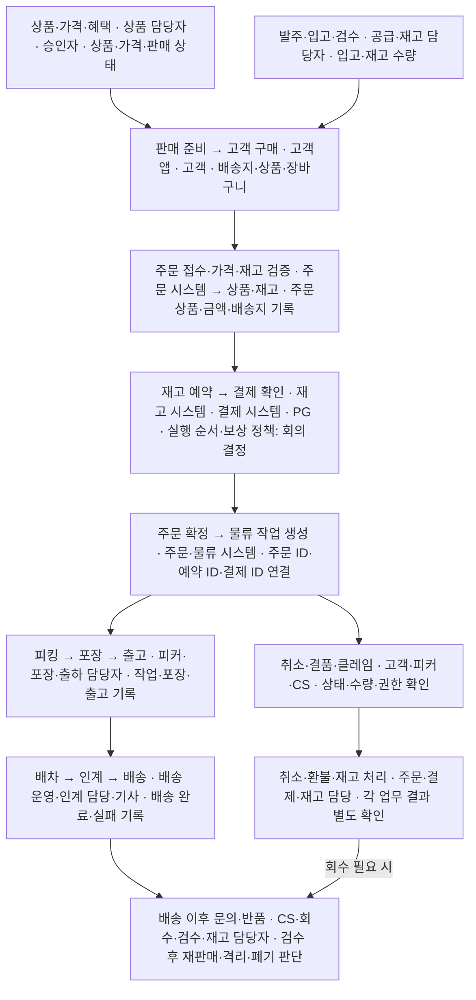
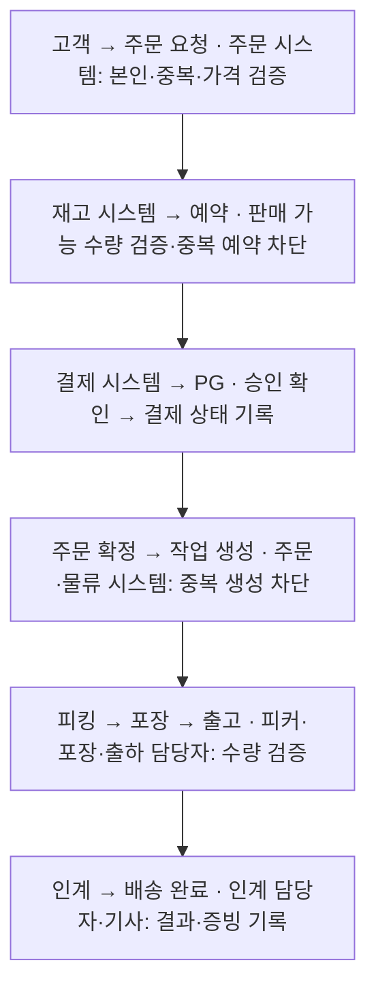
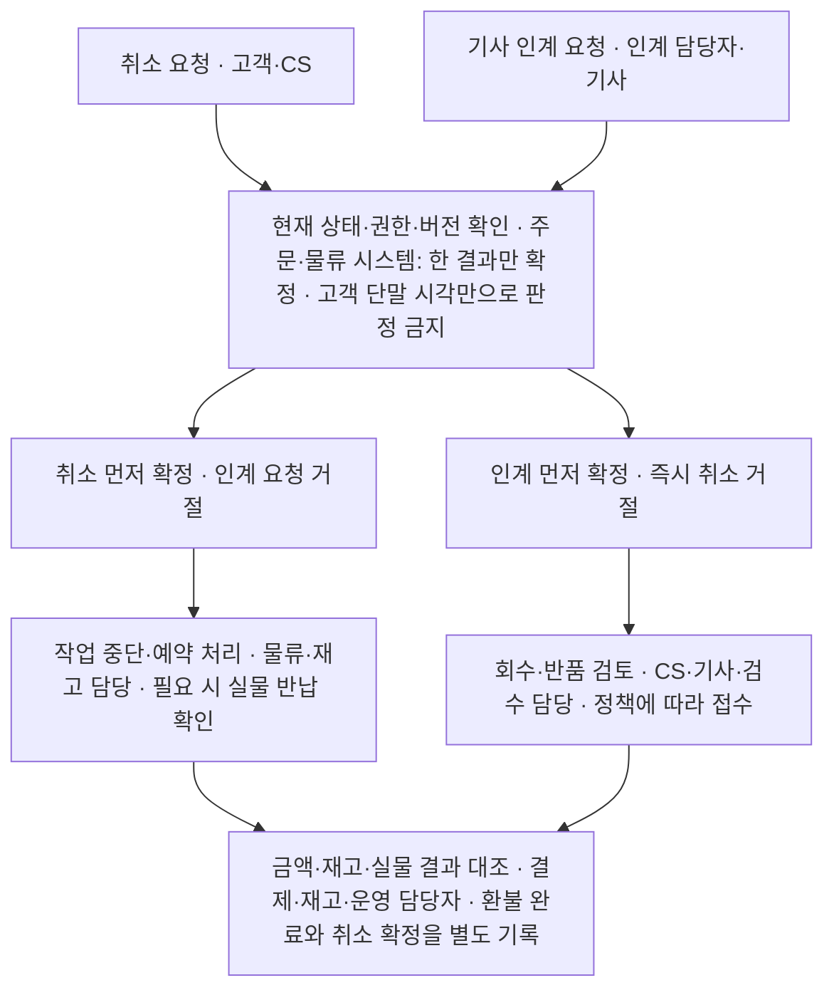
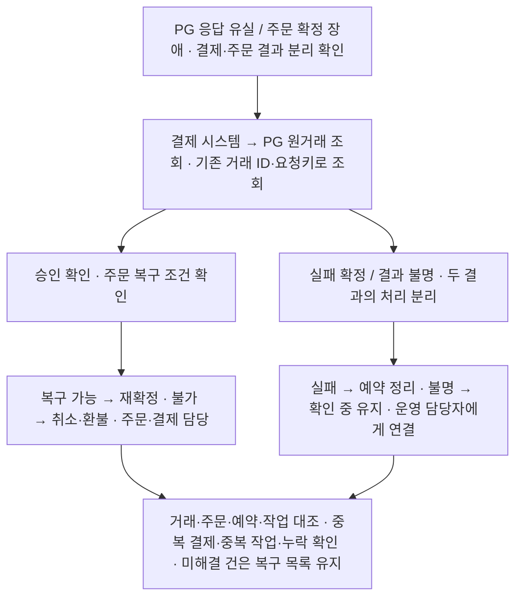
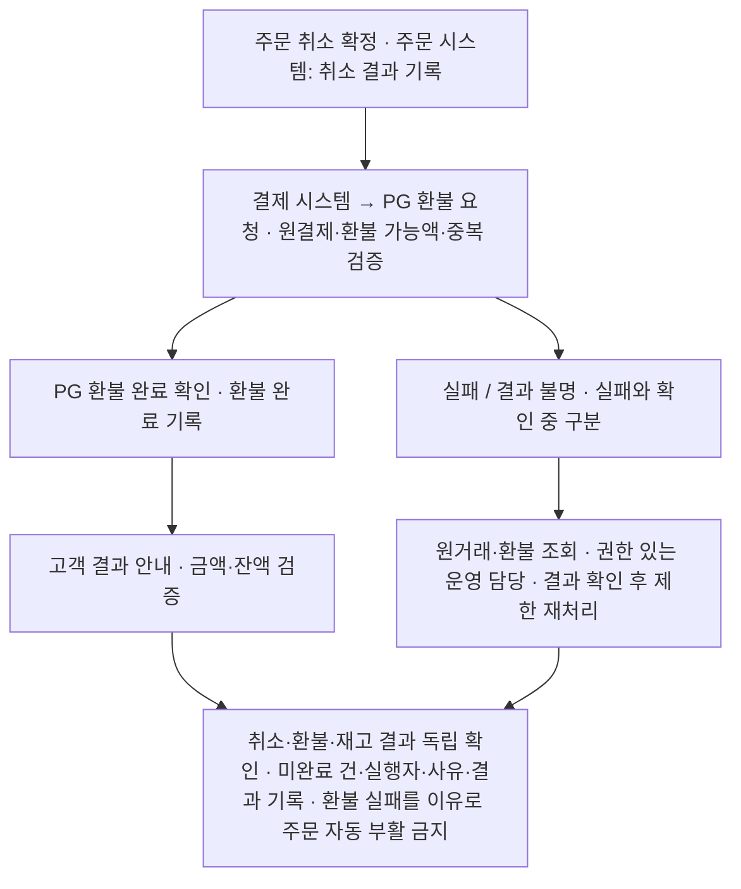

# B마트 회의용 설계 지도

## 1. 전체 업무 흐름

상자: 업무·처리 주체 / 화살표: 데이터·작업 연결 / 회의 결정: 미확정 정책

**전 단계 공통:** 권한·센터 범위 / 상태 검증 / 중복 방지 / 감사·복구

**회의 결정:** 예약·결제 순서 / 취소 마감 / 부분 환불 / 승인 범위

### PART 1~12 연결 위치

| 설계 대상 | 관련 PART |
| --- | --- |
| 권한·승인 / 데이터·이력 / 개인정보 | 1 / 2 / 7 |
| API·이벤트 / 상태 / 동시성·보상 | 3 / 4 / 5 |
| 복구 / 성능·센터 수용량 / 장애 대응 | 6 / 8 / 9 |
| 배포·롤백 / 통합 검증 / 범위·정책 | 10 / 11 / 12 |

## 2. 구현 범위·담당

**회의 제안 · 전체 미확정.** 업무 영역 기준이며 인원 배정과 별도.

| 영역 | 최소 구현 제안 | 별도 결정·후순위 후보 | 개발 담당 |
| --- | --- | --- | --- |
| 고객앱 | 로그인·주소 / 상품·장바구니 / 주문 요청·결과 조회 | 소셜 로그인 / 추천·고급 검색 | 미정 |
| 상품·가격·혜택 | 상품 등록·판매 상태 / 기본 가격 / 주문 시 가격 검증 | 복합 할인·쿠폰 / 가격 승인 적용 범위 | 미정 |
| 공급·재고·물류 | 입고·수량 관리 / 예약·해제 / 피킹·포장·출고 | 발주 자동화 / 로트·소비기한 깊이 | 미정 |
| 주문·결제·환불 | 주문·금액 기록 / 결제 결과 확인 / 전체 취소·환불 | PG 테스트 연동 / 모의 처리 / 부분 취소·환불 | 미정 |
| 배송·CS | 수동 배정·인계 / 완료·실패 기록 / 문의·환불 요청 | 자동 배차·실시간 위치 / 회수·반품 구현 범위 | 미정 |
| 공통 기반 | 역할·센터 권한 / 상태·중복 검증 / 감사·실패 조회 | 긴급 접근·승인 화면 / 복구 자동화 수준 | 미정 |

기본 보안·금액·재고 검증은 최소 범위에도 포함. 선택 기능을 포함하면 연결된 예외 처리도 함께 포함.

## 3. 상태·예외 흐름

### 3-1. 정상 주문·배송

제안 흐름 · 예약 선행 가정 · 재고 차감 시점 미정

회의 결정: 예약 시점·만료 / 주문 확정 조건 / 출고 시 수량 반영

### 3-2. 취소와 기사 인계 충돌

정책 예시 · 인계 확정 후 즉시 취소 불가를 가정

회의 결정: 취소 마감 / 확정 상태의 동시 변경 통제 / 회수·반품 기준

### 3-3. 결제 응답 유실·주문 실패

결과 불명 ≠ 결제 실패 · 원거래 확인 전 신규 결제 금지

회의 결정: 재조회 한도·시간 / 주문 복구 가능 조건 / 환불·예약 해제 순서

### 3-4. 취소 확정 후 환불 실패

취소 확정 ≠ 환불 완료 · 아래 상태명은 설계 초안

회의 결정: 재처리 권한·별도 승인 / 재시도 기준 / 고객 안내·예약 해제 시점

### 서로 구분해야 할 상태

| 관리 영역 | 상태 초안 |
| --- | --- |
| 주문 | 접수 → 확정 / 취소 |
| 결제 | 요청 → 확인 중 → 승인 / 실패 확정 |
| 물류 | 작업 대기 → 피킹 → 포장 → 출고·인계 |
| 배송 | 배정 → 인수 → 배송 중 → 완료 / 실패 |
| 환불 | 요청 → 처리 중 → 결과 확인 → 완료 / 실패 |
