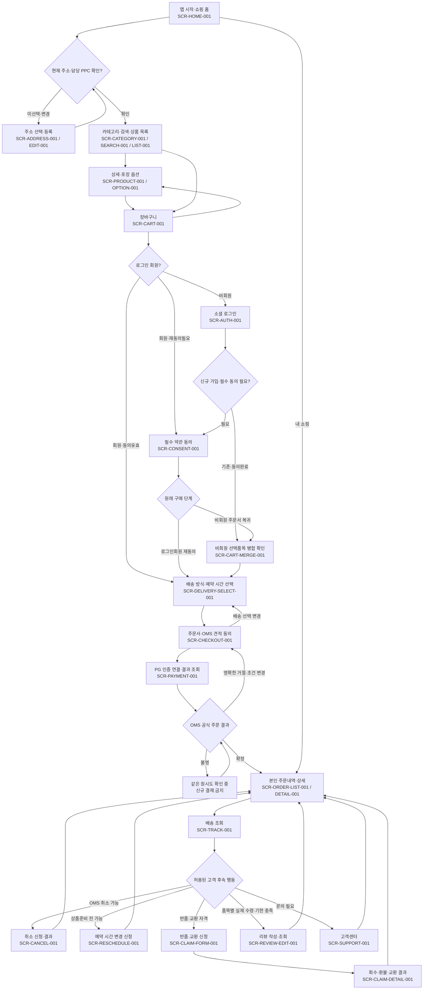
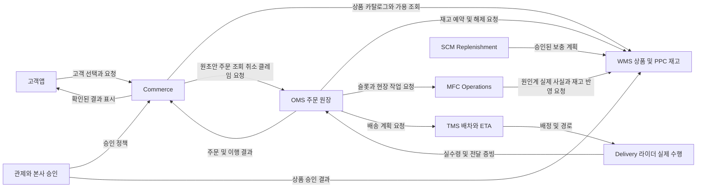
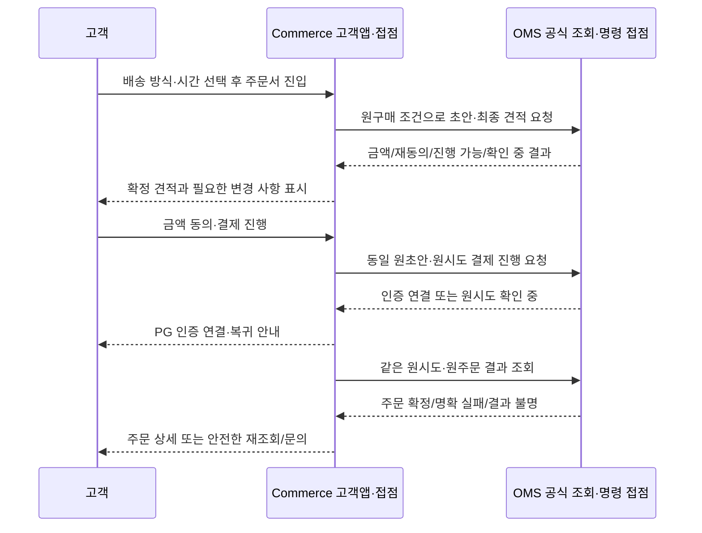
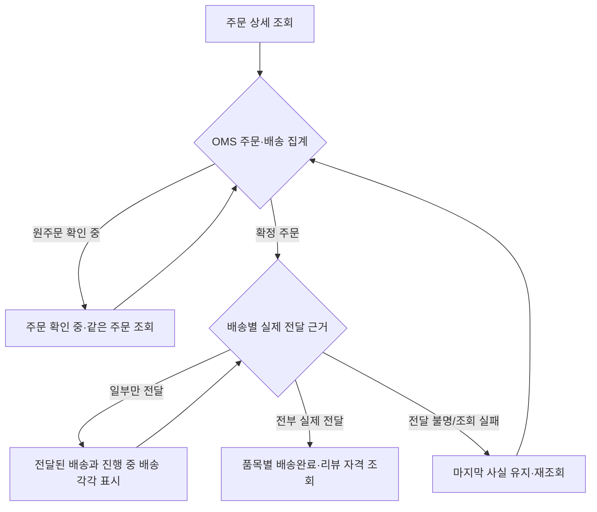
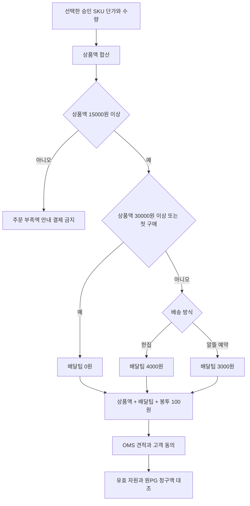
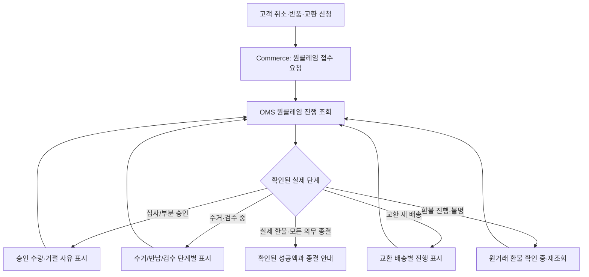

# Commerce 비즈니스 로직 — 상세 업무 기준 및 운영 기준

> Commerce는 고객의 회원가입부터 상품 탐색, 구매, 결제, 구매 후 서비스까지 담당하며, 고객앱은 이 업무를 제공하는 채널이다.
> 프로모션·할인·쿠폰은 1차 구현에서 제외하며(1.0), 기존 상세는 부록 C에 후속 참고로 보존한다.

## 표기 규칙

- **상태 태그:** 본문은 `[확정 정책]`, `[사용자 확정]`·`[사용자 최종 확정]`·`[사용자 재확인]`, `[채택 설계]`, `[설계안]`, `[보완 설계]`, `[명세 설계]`, `[팀 확인 필요]`, `[미확정]`·`[예시·미확정]`, `[이미지 확인]`, `[외부 확인]` 등의 태그로 각 문장의 지위를 표시한다. 태그 간 적용 우선순위는 2.5를 따른다.
- **PPC:** `PPC`는 용어집의 **MFC**(센터)와 같다. 이 문서에서 `MFC`는 주로 현장 시스템(용어집의 **MFC Operations**)을 가리킨다.
- **DC:** 본문의 `DC`는 용어집의 **CDC**(중앙 물류센터)와 같다.
- **PMart:** 원문의 서비스명 `바로픽`은 용어집 표준 `PMart`로 표기한다.

## 목차

- 1. Commerce 정의·업무 범위·협업 경계
- 2. 공통 용어·상품 식별·구매 정책
- 3. 고객 구매 전체 생명주기
- 4. 회원·인증·동의·계정 관리
- 5. 배송지·서비스 권역·PPC 판정
- 6. 상품·카테고리·검색·전시
- 7. 장바구니·수량·병합
- 8. 고객에게 표시하는 기본가격·배달팁·최종 견적 (OMS 확정액 참조)
- 9. 배송 방식·예약 시간·슬롯
- 10. 고객 주문서·견적 동의·OMS 초안 요청/결과
- 11. 고객 결제 진행·PG 복귀·OMS 결과 불명 안내
- 12. 주문내역·배송 조회·분할배송
- 13. 고객의 취소·반품·교환 신청과 환불 결과 조회
- 14. 고객센터·상담·클레임 접수
- 15. 리뷰·고객 참여·알림
- 16. 고객앱 공통 장애·중복 요청·안전한 조회 복구
- 17. 업무 검증·수용 시나리오
- 18. 미결정 정책·승인 대기 사항
- 부록 A. 화면 명칭·진입·이동 결과
- 부록 B. 업무 책임·연계의 요청과 완료 조건
- 부록 C. 후속 구현 참고 — 1차 제외
- 부록 D. 고객앱 중심 API·조회·오류·멱등성 계약
- 부록 E. 고객앱이 소비하는 상태·업무 사건·이벤트 대응 계약
- 부록 F. 최소 데이터 식별자·주문 당시 스냅샷·원사건 참조
- 부록 G. 인증·보안·개인정보·비기능·운영 관측 기준
- 부록 H. Commerce 고객앱 여정·시스템 시퀀스·상태·가격·클레임 Mermaid
- 부록 I. 화면·기능·상태·API·테스트 추적 및 상세 수용 검증
- 부록 K. OMS 소관 주문·금전 로직 이관 목록 및 고객앱 구현 경계

## 1. Commerce 정의·업무 범위·협업 경계

**Commerce는 고객의 회원가입부터 상품 탐색, 구매, 결제, 구매 후 서비스까지 담당하며, 다른 업무 시스템과 협업해 고객 거래를 완성하는 상위 업무 영역이다.** 고객앱은 이 업무를 제공하는 채널이다. Commerce의 책임은 화면을 표시하는 데 그치지 않고 고객의 선택·구매 의사·동의, 구매 조건의 검증, 결제 처리, 거래 결과의 조회와 미완료 업무의 복구를 연결하는 것이다.

MSA 구조에서는 Commerce를 여러 하위 시스템과 서비스로 구성한다. 다만 아래 업무 분류의 각 행을 마이크로서비스 하나로 고정하지 않는다. 어떤 상태를 누가 최종 변경하는지, 어디까지 함께 확정해야 하는지, 실패를 어느 책임 주체가 복구하는지에 따라 실제 서비스·트랜잭션·배포 경계를 정한다. 이 문서는 업무 책임과 협업 조건을 정의하며 개별 서버 수나 저장 구조를 확정하지 않는다.

[확정 정책] 상품 관리는 WMS가 담당한다. WMS는 DC와 PPC를 구분해 재고·위치·LOT·예약을 관리한다. MFC Operations는 PPC 현장 작업·품질 판정·슬롯과 처리 여력을 관리하고 현장 사실에 따른 재고 처리를 WMS에 요청한다. OMS는 주문 원장과 이행 생명주기를 주관한다. 본사 정책 승인, 실제 PG 거래, 운송 증빙은 각각의 책임과 구분한다.

### 1.0 1차 구현 범위 — 프로모션·할인·쿠폰 제외

[사용자 확정·2026-10-19] **프로모션·할인·쿠폰 관련은 1차 구현에서 제외한다.** 수량 할인 오퍼·기간/마감 할인·쿠폰 발급/다운로드/적용/점유/사용/복원·할인 안분·행사 전시와 알림을 현재 구매/취소/환불의 필수 절차로 두지 않는다. 기본가격·독립 E/B SKU 판매·수량 상한·최소금액·주문/결제·구매 후 서비스는 유지한다.

[사용자 재확인] **기존 배달팁 정책은 유지한다.** 한집4,000원·알뜰/예약3,000원·상품액30,000원 이상 또는 첫 구매 무료·봉투100원1회다. 첫 구매 판정·동시 주문 자격 확보·기존 이력 대조는 이 요금 조건을 위해 유지하며 쿠폰/프로모션 엔진 구현으로 확대하지 않는다.

기존 제외 기능의 상세는 같은 파일 마지막의 **부록 C. 후속 구현 참고 — 1차 제외**에 보존한다. 부록 안의 과거 `[확정 정책]`·`[설계안]`은 당시 업무 규칙의 지위이며 현재 구현 승인이나 1차 요구사항을 뜻하지 않는다. 후속 도입은 별도 범위 승인·미결정 검토가 필요하다.

### 1.1 Commerce 하위 시스템과 관리 상태

**이 문서에서 Key는 고객앱/Commerce다.** 고객앱을 통한 고객의 행동을 출발점으로 삼아 Commerce가 맡는 일과 다른 시스템에 요청하는 일을 정리한다. 고객앱은 Commerce의 채널이며, 아래의 처리 주관은 각 업무의 실제 판단·변경을 맡는 시스템을 뜻한다. 예를 들어 고객앱의 주문 조회를 설명할 때도 Key는 고객앱/Commerce이고, 주문 데이터·조회 권한의 처리 주관은 OMS다.

하위 시스템은 Commerce 안의 논리적인 업무 구분이다. 각 행이 독립 마이크로서비스·서버·배포 단위를 뜻하지 않는다. 먼저 고객앱/Commerce가 제공하는 기능을 보고, 이어서 각 기능이 관리하는 상태와 협업 경계를 확인할 수 있도록 표를 나눈다.

**고객앱/Commerce는 어떤 일을 맡는가**

| 하위 시스템 | 고객앱/Commerce가 맡는 일 |
|---|---|
| 회원·인증 | 소셜 가입·로그인·로그아웃, 계정 연결, 인증 실패/복귀, 이용 상태, 탈퇴 |
| 고객정보·동의 | 프로필, 배송지·연락처·수령 기본정보, 약관 동의/철회, 개인정보·알림 설정 |
| 상품 전시·탐색·검색 | 홈·카테고리, 검색·필터·정렬, 상세·판매 옵션, 배송지 기준 구매 가능 표시 |
| 장바구니 | 추가·삭제, SKU/수량 선택, 구매 상한, 선택 구매, 비회원 보존/병합 |
| 기본가격·배달팁 | 승인 SKU 기본가격×수량, 배달팁·봉투값·최종 견적 |
| 주문서·구매 진행 | 이번 구매 품목·주소·배송 선택, 조건 검증, 가격 초안 요청, 재고·슬롯/여력·첫 구매 무료배달 자격 확보 연계, OMS 주문 요청 |
| 결제 | 고객의 결제 요청을 OMS에 전달, PG 인증 연결, 원시도 결과 조회, 실패·불명 안내 |
| 주문·배송 고객 조회 | 본인 주문내역·상세, 결제/환불, 준비·배송·부분완료, 현재조건 재담기 |
| 구매 후 고객 서비스 | 취소·반품·교환 신청, 상담·사유/증빙 접수, 심사·회수·재배송·환불 결과 안내 |
| 고객 참여·알림 | 리뷰, 승인 범위의 찜·재입고 구독, 주문·결제·배송·배달팁 안내 |

**각 기능의 상태와 실제 처리 책임은 어떻게 나뉘는가**

| 하위 시스템 | 관리 상태·다른 시스템과의 경계 |
|---|---|
| 회원·인증 | 제공자 인증과 PMart 계정 이용 상태를 구분한다. 계정 복구는 현재 허용된 재인증/제공자 경로와 추가 도입 미결정을 구분한다. |
| 고객정보·동의 | 저장 주소와 주문 당시 주소를 구분한다. 동의·앱 설정·OS 권한을 분리하고 결제 후 주문 연락처 변경 금지를 유지한다. |
| 상품 전시·탐색·검색 | WMS 상품/재고 정본을 소비한다. 고객용 설명·검색 사본·노출이 SKU 발급·상품 승인·재고 예약을 대신하지 않는다. |
| 장바구니 | 구매 후보의 상태를 관리한다. 담기는 재고 확보가 아니며 회원 이관·주문 후 정리는 한 번만 반영한다. |
| 기본가격·배달팁 | 1차 프로모션·할인·쿠폰 제외. 정책 승인·계산·OMS 주문 금액 확정·PG 실거래를 구분한다. |
| 주문서·구매 진행 | 고객 구매 의사를 OMS의 원초안/원시도에 연결한다. OMS가 WMS 재고와 현장 슬롯 등 실행 결과를 조율한다. |
| 결제 | OMS가 결제 진행을 주관하고 서버 결제 처리 기능을 통해 PG 승인/취소·원거래 대사를 수행한다. Commerce는 별도 승인/환불 거래를 생성하지 않는다. |
| 주문·배송 고객 조회 | 주문 조회의 업무 주관은 OMS다. Commerce는 OMS 주문 결과·TMS 계획/ETA·Delivery 실제 수행·현장 진행을 고객에게 표시한다. 조회 사본이 주문/배송 원장이 되지 않는다. |
| 구매 후 고객 서비스 | Commerce 접수와 OMS 판단, MFC 현장 판정, WMS 재고 처리, TMS 운송 계획·Delivery 실제 수행을 연결한다. 상담 종료는 거래 의무 종결이 아니다. |
| 고객 참여·알림 | 리뷰는 확정 기한을 적용한다. 찜/재입고 알림 도입·채널·정책은 여전히 승인 대상이며 알림 성공은 재고/거래 성공이 아니다. |

회원가입은 소셜 인증을 통해 PMart 계정과 동의를 구성하는 흐름이다. 현재 허용된 재인증·제공자 경로와 자체 비밀번호 가입·휴대폰 본인확인·계정 복구 기능의 추가 도입 여부를 구분한다.

업무 분류에 이름이 포함되어 있어도 도입 여부와 처리 조건이 승인되지 않은 기능은 구매 조건으로 사용하지 않는다. 자체 본인확인·증정·포인트·멤버십 등 미도입 기능을 계정 생성 요건에 추가하거나 결제금액에서 차감하지 않는다. 고객에게 제공할 수 있는 기능과 승인 대기 기능을 구분해 표시한다.

### 1.2 다른 업무 영역과의 협업 범위

**고객앱/Commerce를 Key로 두고, 고객 행동 → Commerce의 처리/요청 → 상대 시스템의 실행 → 고객에게 보여 줄 결과 순서로 읽는다.** Commerce가 직접 맡는 상품 조회·장바구니와, OMS에 요청하는 주문 조회·결제 진행을 구분한다. 상품 조회에 필요한 공통 상품·재고 기준은 WMS가 제공한다.

**주요 요청과 결과는 어떤 경로로 연결되는가**

| 고객의 업무 | 고객앱/Commerce를 기준으로 본 요청·결과 흐름 | 실제 처리 주관 |
|---|---|---|
| 상품 조회 | 고객앱 → Commerce 상품 조회·검색<br>WMS 상품·지정 PPC 가용 정보와 승인 기본가격을 사용해 고객에게 표시 | 고객용 조회·전시는 **Commerce**.<br>공통 상품·재고 기준은 **WMS** |
| 장바구니 | 고객앱 → Commerce 추가·수량 변경·선택·병합<br>처리 결과를 고객앱에 반환하며, 담기만으로 주문/재고 예약을 생성하지 않음 | **Commerce** |
| 주문 조회 | 고객앱 → Commerce 조회 접점 → OMS<br>OMS의 본인 주문 결과 → Commerce → 고객앱 | 주문 데이터·조회 권한은 **OMS**.<br>고객 접점·표시는 **Commerce** |
| 결제 요청 | 고객앱 → Commerce → OMS → 서버 결제 처리 → 토스페이먼츠<br>실제 PG 결과 확인 → OMS 주문 확정 판단 → Commerce → 고객앱 | 결제 진행·주문 판단은 **OMS**.<br>실거래는 **PG**, 고객 인증 연결·결과 안내는 **Commerce** |
| 주문 확정 후 배송 | OMS → MFC Operations 준비 작업 / TMS 배차 계획 → Delivery 실제 수행<br>현장·배송 결과 → OMS 주문별 집계 → Commerce → 고객앱 | 준비·인계는 **MFC Operations**, 배차·ETA는 **TMS**, 실제 수령·전달은 **Delivery**, 주문 집계는 **OMS** |
| 취소·반품·교환 | 고객앱 → Commerce 접수 → OMS 심사·조율<br>현장/재고·회수/재배송·PG 취소 결과 → OMS → Commerce → 고객앱 | 사업 판단·환불 대상/한도는 **OMS**.<br>현장·재고·운송·PG는 각각의 실행 주체 |

주문 완료는 OMS가 주문을 확정한 시점이며 배송 완료와 구분한다. 이후 배송은 OMS의 이행 조율·MFC 현장 준비·TMS 배차를 거쳐 Delivery의 실제 수행으로 연결한다. Commerce가 주문 완료 직후 Delivery에 같은 배송 임무를 별도로 생성하지 않는다. 위 화살표는 업무 요청·결과의 관계이며 모든 구간의 직접 API 호출·동기 통신을 확정하지 않는다. 조회 결과 수신과 거래 실행 요청도 구분한다.

**상대 영역별로 어떤 정보를 주고받고 누가 처리하는가**

Commerce 명세에는 고객 거래에 필요한 요청·결과·업무 사건·실패 복구 계약을 포함한다. 아래 표는 고객앱/Commerce를 중심으로 상대 영역의 정보와 책임을 정리한다. 현재 최종 산출물은 Commerce를 포함한8개 시스템 파일이며, BI / Analytics는 상세 구현·별도 최종 문서에서 제외하고 원천 사건과 향후 분석의 경계만 설명한다.

| 협업 영역 | Commerce가 주고받는 업무 정보 | 상대 영역의 처리 책임·연계 방식 |
|---|---|---|
| OMS | 원구매 의도의 주문 요청, 초안/확보 진행, 결제 결과, 주문 확정, 취소/클레임·시간 변경 | **처리:** 주문 원장·생명주기·금액·이행 조정, 취소 가능 여부/수량과 환불 대상/한도 판단<br>**연계:** 구매·클레임 명령과 결과 조회, 확정 사건 수신. 응답 불명은 같은 원주문 조회 |
| WMS | 상품/SKU·카테고리·규격/포장·승인 기본 판매정보, 지정 PPC 판매 가능량, 예약·해제/반영 결과 | **처리:** 공통 상품 정본, DC/PPC별 현물·위치·LOT·상태·안전량·재고 예약과 실적 처리<br>**연계:** 카탈로그/가용 조회는 조회 계약. 구매 재고 확보·해제는 OMS 조율을 통해 요청 |
| MFC Operations | 운영 제한·슬롯/작업 여력, 준비·현장 품절·피킹/패킹·인계·회수품 판정의 고객 안내 | **처리:** PPC 현장 작업·품질 사실·운영 설정·슬롯 관리. 해당 사실에 따른 재고 반영은 WMS 요청<br>**연계:** OMS의 슬롯/작업 요청과 현장 결과 연계. Commerce는 조회/안내를 위해 결과를 사용 |
| TMS | 배송 방식/가능성·ETA, 배차·운송 계획·지연 영향 | **처리:** DC→PPC 간선과 고객 배송의 편성·배차·경로·ETA·재배차<br>**연계:** OMS를 통한 실행 요청, 고객 조회용 계획/예상 정보 수신 |
| Delivery | 실제 픽업·전달·실패·회수/반납의 진행과 증빙 | **처리:** 라이더 앱·실물 수령·고객 전달·안전/회수 실행·수행료<br>**연계:** OMS/TMS/MFC와 연결한 수행 결과 수신, 고객에게 허용된 진행·증빙만 공개 |
| BackOffice / 관제 시스템 | 승인된 기본가격·판매 정책 수신, 예외/운영 제한 안내, 상품 변경 승인 결과의 적용 확인 | **처리:** 본사 정책 등록/심사/승인, 권한·통합 사건 조율. 상품 정본 실행은 WMS에 요청<br>**연계:** 정책/승인 결과 조회·수신. 고객 거래의 실행 변경은 OMS/WMS 등 주관 시스템 경유 |
| SCM / Replenishment | 판매·품절·구매 실패 등 수요 신호, 실제 보충 결과에 따른 판매 재개·고객 안내 | **처리:** 공급·보충 계산·추천·수동 요청/승인·이관 계획. 외부 공급업체 발주/실입고 초기 제외 유지<br>**연계:** 원천 사실/계획 정보 연계. 고객 주문이 직접 보충 승인·출고를 실행하지 않음 |
| BI / Analytics | 탐색·담기·결제 시도·구매/환불 등 원천 사건의 의미와 중복/정정 관계 | **처리:** 향후 집계·분석·성과 측정. 현재 상세 분석 구현 범위 아님<br>**연계:** 업무 사실을 분석 입력으로 제공하는 경계만 정의. 분석 결과로 거래 원장을 확정하지 않음 |

BackOffice는 현재 관제 시스템의 본사 관리·승인 역할을 가리킨다. Delivery는 라이더 실제 수행을 관리하는 별도 시스템이며 TMS의 배차·경로 계획과 구분한다. 공통 상품 등록/변경은 본사 승인 뒤 WMS 상품 정본에 반영하고, Commerce의 전시/검색이 그 결과를 사용한다.

### 1.3 직접 요청·사건 수신·간접 조율의 구분

조회/검증 요청은 현재 조건으로 상품·가용·거래 결과를 확인하는 업무다. 조회 응답이 있다고 재고 예약·정책 승인·결제 승인이 발생하지 않는다. 캐시나 고객용 조회 사본은 빠른 표시를 위해 사용할 수 있지만 구매 실행 시에는 유효한 기준과 실제 확보 결과를 확인한다.

업무 사건 수신은 이미 주관 시스템에서 확정한 상품 변경·예약 성공·PG 거래 확인·현장 인계·배송 완료 등을 받아 고객 상태/안내를 갱신하는 업무다. 같은 사건의 중복 수신은 한 번만 반영하고 오래된 사건으로 최신 상태를 되돌리지 않는다. 사건 전달 성공과 수신 측 반영 성공, 알림 발송 성공을 각각 확인한다.

간접 조율은 Commerce가 고객 의도를 OMS에 전달하고 OMS가 WMS 재고·MFC 슬롯/작업·배송 수행을 조정하는 방식이다. Commerce는 모든 실행 시스템에 같은 주문을 따로 지시하지 않는다. 직접 API 호출과 이벤트 구독 중 실제 기술 방식은 구현 계약에서 정하되, 어느 방식이든 요청자·최종 판단자·반영 상태·중복/불명 복구 책임은 유지한다.

정보 조회가 일부 실패하면 실패한 영역과 이미 성공한 사실을 구분한다. 상품 사진만 실패하면 상품정보를 유지하고, WMS 재고 확보가 실패하면 PG 진입을 보류하며, 결제 승인 이후 알림만 실패하면 거래를 재실행하지 않는다. 조회 불명은0재고·배송완료·결제실패로 임의 치환하지 않는다.

### 1.4 Commerce와 OMS·결제의 핵심 경계

**Commerce는 고객의 구매 의사와 구매 경험을 관리하고, OMS는 접수된 주문의 원장과 이행 생명주기를 관리한다.** Commerce의 장바구니·주문서 선택/동의는 고객이 원하는 조건이다. OMS의 주문 수량·금액·배송 약속·상태는 실제 검증과 확보·결제 결과를 확인해 확정한 공식 거래다. 고객앱이 성공 화면을 먼저 만들고 OMS 주문을 나중에 추정 생성하지 않는다.

결제는 고객 접점과 서버 거래 처리로 나눈다. 고객 접점은 PG 인증에 연결하고 원시도 결과를 조회한다. 서버 결제 처리는 승인/취소 요청·원거래 검증·PG 결과/누적 취소·불명 대사를 담당한다. OMS는 청구액·주문 조건을 확인하고 실제 승인 사실로 주문 확정 또는 보상을 판단하며, 환불 대상·수량·한도를 결정한다. 결제 처리 기능의 독립 배포와 조직 소속은 별도 결정이다.

**결제 인증, PG 승인, OMS 주문 확정은 서로 다른 사건이다.** PG 승인만 성공하고 OMS 확정이 지연되면 원거래/원주문을 대사해 적격 복구 또는 승인된 취소를 진행한다. 결과 불명 중 새 결제를 자동 시작하지 않는다. OMS 초안/확보만 있고 승인 실패가 확인되면 해당 실패/해제 절차를 진행한다. 화면 이탈이나 제한시간 경과만으로 성공 거래를 실패로 간주하거나 확보를 해제하지 않는다.

취소 신청은 OMS의 취소 가능 판단과 현장 중지 결과를 거친다. MFC Operations의 실제 인계 선확정/불명이 있으면 출고 전 취소 성공과 WMS 재고 해제를 보류한다. 이미 인계된 실물은 승인된 회수/반품 경로로 심사한다. PG 취소 성공, OMS 환불 반영, 회수/재고 판정은 각각의 결과와 남은 의무를 관리한다.

### 1.5 WMS 상품 관리·DC/PPC 재고와 MFC 현장의 핵심 경계

[확정 정책] 공통 상품/SKU·규격·포장·분류의 관리 주체는 WMS다. 본사 상품·품질 담당자의 승인 권한은 유지하고 WMS가 승인된 상품 기준을 등록·변경·배포한다. 기본가격 정책 승인은 본사 관리 기능과 구분하며, 상품·가격을 고객에게 어떻게 설명하고 검색/전시할지는 Commerce가 관리한다. 같은 실물의 SKU는 전역 공통이고 Commerce가 고객용 SKU를 별도 발급하지 않는다.

WMS 내부에서는 **DC 재고와 PPC 재고를 별도로 관리**한다. 같은 SKU라도 DC100개·PPC A20개·PPC B0개는 각각의 보유량이다. 위치·LOT별 현물·정상/격리·예약·안전량·판매 준비와 이동 중을 센터별로 구분한다. WMS를 함께 쓴다고 DC 재고나 다른 PPC 재고를 담당 PPC의 즉시 판매 가능량으로 합치지 않는다. 고객 구매는 지정 PPC의 현재 적격 현물만 확보한다.

DC 출고는 WMS가 실제 출발에 따라 DC 현물과 이동 중을 반영한다. PPC 도착 뒤에는 MFC Operations가 현장 수량·품질·적치/판매 준비 사실을 확인하고 WMS에 전달한다. WMS는 같은 원수령을 기준으로 이동 중을 해소하고 PPC 정상/격리 현물에 한 번 반영한다. 합격분만 정상이며 미판정·부적합은 격리다. 실제 수령, 재고 반영 성공, 판매 준비 완료는 서로 구분한다.

PPC 고객 주문에서 OMS는 WMS에 재고 확보/해제를 요청하고 MFC Operations에는 슬롯/작업 여력과 이행을 요청한다. 피킹·패킹 진행은 현장 작업 결과이며 그 자체로 현물을 차감하지 않는다. 실제 유효 포장 인계 사실을 확인한 뒤 WMS가 해당 PPC 현물·예약을 한 번 소진한다. TMS는 운송 계획·배차를, Delivery는 실제 인계/수행 증빙을 관리하며 같은 실물의 재고를 다시 차감하지 않는다.

MFC Operations의 현장 사실이 확정됐지만 WMS 반영 응답이 없으면 현장 사실과 반영 대기를 보존하고 원수령/원인계로 조회·재전달한다. 독립 PPC 재고 원장을 새로 가산하지 않는다. 반영 사실과 적격/판매 준비가 확인되지 않은 수량은 고객에게 새 가용량으로 약속하지 않는다. 실제 현물을 연계 장애만으로 미수령·미인계로 되돌리지 않고 담당자가 원사건을 대사한다.

예약 슬롯·현장 운영 제한·준비 시작·최종 포장/인계 판정은 MFC Operations의 책임을 유지한다. 재고/LOT 예약과 시간대 정원 점유는 다른 자원이다. PPC 재고 정본이 WMS로 정해졌다고 슬롯도 자동으로 WMS로 이동하지 않는다. 실제 회수품은 MFC의 현장 판정과 WMS의 승인 재고 처리, OMS의 환불 판단을 각각 연결하며 회수/환불만으로 재판매 가능량을 늘리지 않는다.

### 1.6 고객앱·하위 시스템·다른 시스템의 요청 관계

고객앱은 상품·장바구니·주문·배송을 한 화면 흐름으로 제공하지만 실제 업무는 담당 시스템에 나누어 요청한다. **Commerce는 고객의 상품 조회·장바구니·입력/선택과 안내를 담당하고, 주문 조회·주문 확정·결제 진행은 OMS가 주관한다.** 상품 조회에 쓰이는 상품/SKU·재고의 기준은 WMS에 있고, 실제 배송 수행은 Delivery에 있다. 따라서 고객앱에 메뉴가 있다는 이유로 Commerce가 모든 원장을 직접 변경하지 않는다.

아래 화살표는 **업무 요청과 결과의 이동**을 뜻한다. 모든 구간이 동기 호출이거나 인접 시스템 간 직접 통신이어야 한다는 기술 결정을 뜻하지 않는다. 특히 상품 조회용 정보 수신, 주문 명령, 확정 사건 수신을 구분하고, 이미 성공한 원장 처리를 단순 화면/통지 오류 때문에 다시 실행하지 않는다.

| 고객의 행동 | 기본 요청·협업 경로 | 실제 판단·변경 주체 | Commerce가 고객에게 제공하는 결과 |
|---|---|---|---|
| 상품 목록·상세·검색 조회 | 고객앱 → Commerce 상품 조회 → WMS 상품/지정 PPC 가용 정보·승인 기본가격 | WMS 상품/재고, 승인 정책에 따른 Commerce 조회·전시 | 상품 설명·옵션·가격·구매 가능 표시 |
| 담기·수량 변경·선택 구매 | 고객앱 → Commerce 장바구니 → 상품/가격·현재 가용 재검증 | Commerce 장바구니. 이 단계의 WMS 예약은 없음 | 담은 품목·선택·수량·오류/변경 사유 |
| 주문서·최종금액 확인 | 고객앱 → Commerce 주문서 → OMS → WMS·MFC | OMS 초안/금액·확보 조율, WMS 재고·MFC 슬롯 | 재검증된 품목·금액·배송 조건·고객 동의 |
| 결제 요청 | 고객앱 → Commerce 결제 접점 → OMS → 서버 결제 처리 → 토스페이먼츠 | OMS 결제 진행·주문 확정 판단, PG 실거래 | 인증 진입·원시도 확인·주문 확정 또는 확인 중/실패 |
| 주문내역·주문상세 조회 | 고객앱 → Commerce 주문 조회 접점 → OMS | OMS 본인 주문·품목·금액·이행/취소/환불 상태 | OMS 결과를 고객용 화면으로 구성 |
| 주문 확정 후 준비·배송 | OMS → MFC 작업/WMS 예약 유지 → TMS 배차 → Delivery 임무/실수령·전달 | MFC 현장·WMS 재고·TMS 계획·Delivery 수행·OMS 집계 | 준비/배송별 진행·ETA·일부/전체 완료 안내 |
| 취소·예약시간 변경 | 고객앱 → Commerce → OMS → MFC·WMS·TMS/Delivery·결제 처리 | OMS 가능 범위 판단, 현장/PG 등 각 주관자의 실제 결과 | 접수·심사/확인 중·성공/거절과 사유 |
| 반품·교환·회수 요청 | 고객앱 → Commerce → OMS 심사 → TMS 회수 계획 → Delivery 수거/반납 → MFC 검수·WMS 반영 | OMS 고객 판단/환불, 각 시스템 실제 실행 | 승인량·미수거/미반납·검수·환불을 구분한 진행 |

### 1.7 회원·인증·고객정보 하위 시스템의 협업

- **고객앱의 요청:** 소셜 로그인·동의·프로필/주소 저장·탈퇴 요청을 Commerce에 보낸다. 소셜 제공자의 인증 성공과 PMart의 계정 이용 가능 상태를 구분한다.
- **Commerce의 처리:** 제공자 인증 결과와 계정 연결·동의·이용 상태를 확인하고 회원/비회원 장바구니 전환과 원래 구매 화면으로의 복귀를 처리한다. 고객 식별이 확정되지 않았으면 다른 고객의 장바구니나 주문 결과를 결합하지 않는다.
- **OMS와의 협업:** 주문 조회·새 구매·클레임 요청에는 현재 고객의 권한을 함께 검증한다. 탈퇴 요청은 Commerce가 신규 구매를 제한하고 OMS에 미완료 주문·결제 불명·취소/회수/환불 의무가 있는지 확인한다. OMS 의무 종결을 확인한 뒤 계정 탈퇴를 완료한다.
- **결과·예외:** 로그인 성공은 주문 생성/결제 승인을 뜻하지 않는다. 탈퇴 가능 여부 조회가 실패하면 `탈퇴 확인 중`으로 두고 거래가 없다고 추정하지 않는다. 탈퇴·재가입으로 과거 주문이나 혜택을 자동 복원하지 않는다.

### 1.8 배송지·상품 조회 하위 시스템의 협업

- **배송지 선택:** 고객앱 → Commerce 배송지 관리로 현재 쇼핑 주소를 선택한다. Commerce는 승인된 주소/PPC 연결과 MFC의 운영 제한·작업/슬롯 여력, TMS의 권역·운행 가능성을 조합해 서비스 가능성을 표시한다. [채택 설계] 주소록은 Commerce, 서비스 권역·담당 PPC 매핑은 본사 운영 승인 후 TMS 정본을 사용하고 OMS가 주문에 적용한 결과를 고정한다.
- **상품 조회:** 고객앱 → Commerce 상품 조회/검색 → WMS의 공통 상품/SKU·분류·취급/지정 PPC 가용 정보와 승인 기본가격을 사용한다. Commerce는 고객용 상품명·사진·목록·상세·옵션·검색 결과를 구성한다. WMS가 공통 상품을 관리한다는 사실과 고객의 조회 요청을 Commerce가 처리한다는 사실은 함께 성립한다.
- **수량·옵션의 해석:** `낱병6개`는 E- SKU수량6, `밀봉6입 팩1개`는 B- SKU수량1로 해석한다. 각각 승인 SKU 기본단가×수량으로 계산하며 수량 할인 오퍼는 1차 제외다. Commerce가 WMS 규격을 변경하거나 E/B 재고를 전환하지 않는다.
- **다른 시스템에 미치는 영향:** 단순 조회는 OMS 주문이나 WMS 예약, Delivery 임무를 만들지 않는다. 담당 PPC 변경 시 목록·가격 조건·장바구니 구매 가능성을 새 PPC 기준으로 재검증하고 DC/다른 PPC 수량을 즉시 배송 재고로 더하지 않는다.
- **결과·예외:** 상품 사진 오류와 상품 판매 불가, 재고 조회 실패와 실제 품절을 구분한다. 조회 결과가 오래됐거나 불명인 상품은 확정 가용량으로 약속하지 않고 주문 실행 시 OMS/WMS의 최신 검증을 거친다.

### 1.9 장바구니 하위 시스템의 협업

- **Commerce가 직접 관리하는 것:** 담은 SKU·수량·선택 여부, 삭제·병합·보존과 현재 고객/쇼핑 PPC의 연결이다. 고객앱의 담기/변경 요청은 Commerce 장바구니에서 처리하며 담을 때마다 OMS 주문을 생성하지 않는다.
- **상품·가격 기능에 요청하는 것:** SKU 판매 여부·승인 기본단가·구성 수량·기초상품 상한·해당 PPC 취급/가용·예상액을 검증한다. 기본 구매 상한은 같은 기초상품 구성 낱개 수 합산10개이고 승인 예외만 허용한다.
- **OMS로 넘기는 시점:** 고객이 구매 대상과 배송 조건을 선택해 주문서를 진행하면 Commerce가 이번 선택만 OMS 초안/검증 요청으로 넘긴다. 장바구니 전체나 나중에 추가한 품목을 기존 주문에 자동 포함하지 않는다.
- **주문 확정 후 처리:** OMS가 원주문 확정을 회신하면 그 주문에 실제 포함된 장바구니 대상만 정리한다. 응답 유실은 원주문 조회로 확인하고 정리 실패는 장바구니 정리만 재처리한다. 확정 주문을 새로 만들거나 장바구니에 남았다는 이유로 자동 재결제하지 않는다.
- **결과·예외:** 담기 성공은 재고 확보·가격 보장·주문 확정이 아니다. 로그인 병합에서 상한·현재 가용·가격/PPC 조건을 다시 확인하고 성공한 이관분만 비회원 장바구니에서 비운다.

### 1.10 주문서·기본가격·배달팁 하위 시스템의 협업

- **고객 입력:** Commerce 주문서는 이번 품목·주소·연락처·배송 방식/시간·품절 처리 선택과 최종 동의를 모은다. 화면 예상액과 OMS가 보존한 주문 초안 금액을 구분한다.
- **OMS 요청:** Commerce → OMS로 같은 구매 의도와 현재 선택을 보내고 초안·금액·구매 가능 결과를 받는다. OMS는 구매 상한·기본가격·첫 구매 무료배달 자격·배송비와 최종 청구액을 검증하고 주문 기준으로 보존한다.
- **자원 확보:** OMS는 WMS에 지정 PPC 적격 현물 예약을, MFC Operations에 필요한 슬롯/여력 확보를 요청한다. 유지되는 첫 구매 무료배달 자격은 주문별로 확인하며 쿠폰/행사 권리를 요청하지 않는다. Commerce는 재고/슬롯을 별도로 확보하지 않는다.
- **성공 조건:** 가격·품목·재고·슬롯/여력·첫 구매 무료배달 자격 결과가 이번 원초안과 모두 맞고 고객이 확정 금액에 동의해야 결제 진행을 허용한다. 입력 변경은 OMS에 재검증을 요청하며 이전 주소·수량·배송 조건의 확보 결과를 새 조건에 재사용하지 않는다.
- **실패·부분 성공:** 재고만 확보되고 슬롯이 실패하면 OMS가 결제 진행을 막고 성공한 점유의 해제를 조율한다. Commerce는 부족/마감·변경 필요 조건을 안내한다. 해제 불명은 확인 대기이고 가용량에 즉시 되돌려 쓰지 않는다.

### 1.11 결제 하위 시스템과 OMS·토스페이먼츠의 협업

**결제 요청을 받은 Commerce는 OMS에 진행을 요청하고, OMS가 주문과 연결된 결제 처리를 주관한다.** 여기서 서버 결제 처리 기능은 PG 승인·취소·결과 조회를 수행하는 책임이며 새로운9번째 최종 시스템이나 독립 결제 서비스 배포를 확정하는 명칭이 아니다.

1. **고객앱 → Commerce:** 고객이 확인한 이번 주문의 결제 의사를 전달한다. Commerce는 원초안/원시도와 연결해 OMS에 요청하며 연속 클릭·화면 복귀로 별도 결제 시도를 중복 생성하지 않는다.
2. **Commerce → OMS:** OMS가 초안·최종금액·재고/슬롯·첫 구매 무료배달 자격 점유·현재 주문/거래 상태를 확인한다. 이미 진행 중이거나 성공한 시도가 있으면 그 결과를 반환하고 새 청구를 시작하지 않는다.
3. **OMS → 서버 결제 처리 → PG:** 준비된 원주문·원시도·금액으로 토스페이먼츠 인증/승인 진행을 연결한다. 고객앱이 PG 인증 화면과 직접 상호작용할 수 있어도 고객앱의 인증 결과만으로 주문이나 결제 성공을 확정하지 않는다.
4. **PG → 서버 결제 처리 → OMS:** 실제 승인 사실·원거래·금액의 일치를 확인한다. OMS는 승인과 유효 확보 결과로 같은 주문을 확정하거나, 복구 불가능한 경우 승인된 원거래 취소를 조율한다.
5. **OMS → Commerce → 고객앱:** 주문 확정 결과와 결제 진행 결과를 회신한다. Commerce는 주문 완료·실패·확인 중을 구분하고 주문 확정 뒤에만 구매 장바구니 정리를 연결한다.

인증 성공·실제 결제 승인·OMS 주문 확정은 각각 다르다. PG 승인 성공/OMS 저장 실패는 원주문 복구 또는 승인 취소 대상이며, 고객에게 성공 여부가 불명이라고 새 청구를 시키지 않는다. 10분 만료 뒤 불명 거래는 확인 대기 점유로 전환하고1분 간격5회 조회 뒤 담당자 상신·15분 간격 후속 조회를 유지한다. 이 대사는 OMS가 결제 처리 기능과 조율하며 Commerce는 같은 원시도를 조회해 안내한다. 거래 실패/취소 사실을 확인하기 전 WMS 재고·슬롯/첫 구매 무료배달 자격 점유를 자동 해제하지 않는다.

취소·환불도 Commerce가 직접 PG에 새 금액을 보내는 흐름이 아니다. 고객 요청 → Commerce → OMS의 대상/한도 판단 → 서버 결제 처리의 원PG 취소 → 실제 결과 확인 → OMS 반영 → Commerce 안내로 처리한다. PG 취소 요청 접수와 실제 성공, OMS 환불 반영은 개별 결과다.

### 1.12 주문 조회 하위 시스템과 OMS의 협업

- **주문 조회 주관:** 주문내역·주문상세의 공식 데이터와 조회 가능 권한은 OMS가 확인한다. Commerce는 고객앱의 조회 접점과 표시를 맡고 별도 주문 원장을 관리하지 않는다.
- **기본 경로:** 고객앱 → Commerce의 주문 조회 접점 → OMS의 본인 주문 목록/상세 → Commerce → 고객앱이다. 주문번호만 알고 있다는 이유로 타인 주문·연락처·전달 사진을 조회할 수 없으며 현재 고객과 주문의 연결을 검증한다.
- **OMS가 제공할 내용:** 주문 상품/수량·당시 금액·결제/취소/환불 결과·배송별 이행 상태·진행 중 클레임·허용된 후속 요청을 제공한다. 과거 주문은 현재 WMS 상품명/가격으로 덮어쓰지 않고 주문 당시 기록을 유지한다.
- **배송 정보의 결합:** 준비/인계는 MFC 현장 사실, 배차/예상시각은 TMS, 실수령·이동·전달/실패는 Delivery 결과다. OMS는 이를 주문/배송 단위에 연결해 집계하고 Commerce는 출처별 최신성·예상/실제 구분을 유지해 표시한다. 화면 갱신을 위한 조회용 사본은 공식 주문·전달 상태를 새로 확정하지 않는다.
- **조회 실패:** 주문 목록 불명은 빈 주문내역으로, 위치 조회 실패는 배송 실패로 바꾸지 않는다. 이미 확인된 주문 정보는 확인 시각/갱신 상태와 함께 유지하고 실패한 영역만 다시 조회한다. 주문 상세 재조회가 결제 재승인·작업 재생성·배차 재요청을 일으키지 않게 한다.
- **재주문:** 과거 주문을 그대로 다시 확정하는 기능이 아니라 현재 상품·가격/PPC·상한·가용 조건으로 장바구니 후보를 다시 담는 기능이다. OMS 과거 기록을 읽은 뒤 Commerce 장바구니의 현재 검증을 거친다.

### 1.13 주문 확정 이후 MFC·TMS·Delivery 협업

고객앱의 주문 완료는 OMS가 주문을 확정했다는 뜻이며 배송이 끝났다는 뜻이 아니다. 배송 실행은 **OMS → MFC Operations의 준비 작업, TMS의 배차 계획 → Delivery의 실제 수행**으로 연결한다. Commerce가 주문 완료 직후 Delivery에 별도 임무를 직접 생성해 OMS/TMS의 이행 요청과 중복시키지 않는다.

1. **OMS → MFC Operations:** 유효 주문의 지정 PPC·품목/SKU·수량·배송 약속과 이행 조건을 전달한다. MFC는 작업 수락·실제 준비 시작·피킹/패킹·부족·유효 포장을 확정하고 OMS에 회신한다. WMS는 OMS가 확보한 예약을 유지하며 현장 적격/품질·LOT 결과에 따라 필요한 재고 처리를 한다.
2. **MFC/OMS → TMS:** 포장 준비예상·배송 단위·목적지·중량/부피·봉투/온도·시간창을 전달해 배차를 요청한다. MFC가 준비 중 예상시간으로 배차를 요청할 수 있어도 원OMS 이행/배송에 연결하며 같은 배송을 새 요청으로 중복 만들지 않는다. 포장 준비 완료와 배차 요청의 순서는 조율할 수 있고 실제 픽업은 검품 완료 뒤에만 허용한다.
3. **TMS → Delivery:** TMS가 후보·현재 가용/수단·권역·용량·기존 수행·시간창을 검사해 제안한다. Delivery는 라이더의 수락/거절을 전달하고 TMS가 한 배송의 유효 배정을 확정한다. 알림 수신·수락 의사 전달만으로 실물 인수 상태를 만들지 않는다.
4. **Delivery ↔ MFC, MFC → WMS:** 현재 배정 기사·원주문/배송·유효 포장·실수량을 대조한다. MFC의 포장별 최종 현장 판정과 Delivery의 실제 수령 증빙을 연결하고 WMS가 해당 PPC 현물/예약을 한 번 소진한다. 피킹/패킹·배차 성공만으로 재고를 미리 차감하지 않는다.
5. **Delivery → TMS/OMS:** Delivery가 실제 인수·이동·도착·전달/실패 결과를 반환한다. TMS는 운행 계획·ETA·후속 배차를 갱신하고 OMS는 배송별 이행·미전달/회수 의무를 집계한다. 직접 사건 수신 또는 TMS 등을 통한 전달 중 실제 기술 경로는 별도 계약이지만 수행 사실의 소유는 Delivery로 유지한다.
6. **OMS/배송 조회 결과 → Commerce:** Commerce가 고객에게 준비·배송별 진행·예상시각·실제 전달 결과와 부분 완료를 보여준다. 여러 배송 중 한 건만 전달됐으면 전체 배송완료로 표시하지 않는다. 실제 결과 확인 후 알림을 발송하고 알림 실패 때문에 배송을 다시 수행하지 않는다.

Delivery가 수행 중 사고·부재·파손을 보고하면 TMS는 승인된 중단/회수·재배차를 계획하고 OMS는 고객 주문·재배송/환불을 판단한다. 인계 불명은 MFC 최종 판정과 Delivery 실수령을 대사하기 전 재배차·출고 전 취소·재고 해제를 보류한다. 실제 전달 증빙 없이5시간이 지났다는 이유로 배송을 완료하지 않는다. 수행료의5시간은 실제 전달 이후의 별도 확정 대기시간이다.

### 1.14 취소·예약시간 변경·반품/교환 하위 시스템의 협업

- **신청 접점:** 고객앱 → Commerce로 원주문·대상 품목/수량·사유·증빙·변경 희망을 보낸다. Commerce는 본인 주문과 필수 입력을 확인해 OMS에 요청하고 `신청 접수`와 `처리 성공`을 구분해 표시한다.
- **취소:** OMS → MFC로 출고 중지/유효 포장별 인계 상태를 확인하고 WMS에는 확정된 미인계 범위의 예약 해제를 조율한다. TMS에는 필요 시 신규 배차/기존 배정 중단을, Delivery에는 현재 실수령·보관/회수 상태 확인을 연결한다. 인계 진행/불명 또는 실제 인계량을 출고 전 취소 수량으로 복구하지 않는다.
- **예약시간 변경:** OMS가 상품준비 전 실제 준비 시작과의 경합, 새 슬롯/현물·기한·현장/배송 여력을 확인한다. 새 시간 확정 결과로 TMS 계획과 Delivery 임무를 갱신하고 실패한 신규 점유만 정리한다. 결제 후 주소·연락처·요청 사항을 함께 변경하는 기능으로 확대하지 않는다.
- **반품/교환:** OMS가 접수 자격·승인 수량·회수/교환/환불·고객 비용을 판단한다. 승인 후 TMS가 회수/새 배송을 계획하고 Delivery가 실수거·PPC 직접 반납·새 상품 전달을 수행한다. MFC는 PPC 실수령/검수·품질을 확인하고 WMS는 승인된 반입/격리·재고 복구/실제 폐기를 반영한다.
- **환불과 고객 안내:** OMS가 원결제·원상품액·진행/성공 취소를 고려해 환불 범위를 결정하고 결제 처리 기능이 PG 실제 취소 결과를 확인한다. Commerce는 일부 승인·미수거·미반납·검수·환불 진행/완료를 따로 안내한다. 회수 요청 성공·고객 수거·상담 종료만으로 환불/클레임 전체 완료를 표시하지 않는다.
- **실패 복구:** 환불은 성공했지만 OMS/회수 반영이 실패했으면 성공한 환불을 다시 실행하지 않고 미완료 의무만 복구한다. 일반 반품비·환불 개시 시점·철회/거절품 재전달 등 미결정 항목은 OMS/운영 승인 대상으로 유지한다.

### 1.15 리뷰·고객 알림·운영 정책 하위 시스템의 협업

- **리뷰 자격:** 고객앱 → Commerce 리뷰로 요청하고 Commerce는 OMS의 주문 상품별 실제 배송완료 근거를 확인한다. 배송완료 후14일 이내 작성·최초 작성 후3일 경과 시 수정 불가·삭제 후 같은 주문 상품 재작성 금지를 적용한다. TMS의 예상도착이나 배차 종료를 배송완료 자격으로 사용하지 않는다.
- **고객 알림:** OMS의 주문/환불 사건, MFC 준비/인계 사실, TMS 배차/ETA, Delivery 실제 배송 결과를 해당 고객·원주문/배송에 연결한다. Commerce 알림은 승인된 수신/채널 정책과 최신 결과를 확인해 발송하고 같은 원사건의 재전송으로 중복 완료 안내를 만들지 않는다.
- **정책 수신:** 본사 관제의 승인 기본가격·판매/운영 정책을 받아 적용하고 상품 기준 변경은 WMS 반영 결과와 연결한다. 승인·WMS 반영·Commerce 전시/검색 반영은 각각 다르며 검색 갱신 실패로 새 SKU를 발급하거나 과거 주문 금액을 변경하지 않는다.
- **보충 영향:** 품절·판매·구매 실패 등의 원천 사실을 SCM의 보충 판단에 제공할 수 있다. SCM 예정 공급·TMS 도착예상만으로 Commerce가 판매를 재개하지 않고 MFC 실제 수령/정상 판정·적치/판매 준비와 WMS 반영을 확인한다. 고객 요청이 DC→PPC 자동 보충 승인이나 예정재고 예약판매를 발생시키지 않는다.
- **고객 문의·사건:** Commerce에서 접수한 문의는 주문·배송·포장·결제/회수 근거에 연결하고 사업 판단은 OMS, 현장 확인은 MFC, 배정/실행은 TMS/Delivery, 예외 승인·담당 조율은 관제로 전달한다. 상담 담당자가 화면 사본을 수정해 실제 주문·재고·환불을 성공으로 만들지 않는다.

### 1.16 협업 결과의 성공·확인 대기·종결 기준

| 협업 상황 | Commerce가 표시할 상태 | 담당자의 후속 처리 | 금지되는 중복/추정 |
|---|---|---|---|
| 장바구니 저장 성공·WMS 가용 조회 실패 | 담은 선택 유지·구매 가능 확인 중 | 상품/지정 PPC 가용 재조회, 주문 시 OMS 재검증 | 담기 성공을 재고 예약으로 표시하지 않음 |
| OMS 초안/확보 일부 성공 | 결제 준비 불가 또는 조건 변경 필요 | OMS가 원점유 조회·보상 해제/재확보 | Commerce가 별도로 같은 재고/슬롯 재점유 금지 |
| PG 인증 완료·승인/주문 결과 불명 | 결제/주문 확인 중 | OMS가 원거래·원주문 대사·조회/상신 | 신규 청구·시간만으로 점유 해제 금지 |
| OMS 주문 확정·고객 응답/장바구니 정리 실패 | 원주문 조회 뒤 확정 결과 복구 | Commerce 표시/정리/알림만 재처리 | 주문 재생성·PG 재승인 금지 |
| TMS 배정 성공·MFC 포장 미준비 | 상품 준비/픽업 대기 | MFC 준비·TMS ETA/대기 조율 | 배정 성공을 실수령/현물 차감으로 합성 금지 |
| Delivery 실제 인수·MFC/WMS 응답 불명 | 인계 확인 중·고객 전달 단계는 확인된 사실대로 안내 | 현장/라이더 실수량·원인계와 WMS 반영 대사 | 재픽업·전량 취소/예약 해제·이중 차감 금지 |
| 배송 일부 완료·다른 배송 사고 | 일부 전달·나머지 처리 중 | OMS 잔여 이행 판단, TMS 후속 계획·Delivery 보관/회수 | 전체 주문 완료·실수령 없는 회수 완료 금지 |
| PG 환불 성공·OMS/회수 미완료 | 환불 결과와 잔여 의무를 분리 | 해당 주관 기능이 미완료 단계 복구 | 같은 PG 취소 재실행·상담 종료로 사건 삭제 금지 |

협업 설명에서 `요청했다`, `접수됐다`, `실제로 변경됐다`, `고객에게 안내됐다`는 서로 다른 결과다. Commerce는 요청 경로를 관리하면서 각 주관 시스템의 실제 결과를 확인해 고객에게 안내한다. 원시도/원주문·유효 배송/포장·결과의 최신성을 유지하고, 다른 시스템의 내부 기능을 복제하거나 주관 시스템 두 곳이 같은 주문·실물을 각각 확정하도록 설계하지 않는다.

### 1.17 개발·실무 명세 적용 원칙과 1차 기능 계약 [보완 설계]

이 절은 1.0~1.16의 Commerce 중심 업무 범위와 시스템별 주관을 **변경하지 않은 상태에서**, 고객앱 구현에 필요한 계약 연결 방식을 명시한다. 기술 스택, DB 테이블 개수, 서비스 배포 경계, 실제 API URL을 이 문서만으로 최종 확정하지 않는다.

| 구분 | 지금 적용할 업무 기준 | 계약의 세부 확정이 필요한 부분 | 고객앱의 안전한 기본 처리 |
|---|---|---|---|
| 회원·인증 | 소셜 로그인, 약관/동의, 비회원 탐색, 로그인 복귀, 탈퇴 대기 | 제공자별 OAuth 결과 검증, 세션·토큰 규격 | 소셜 복귀를 회원 생성/구매 허용으로 추정하지 않음 |
| 배송지·서비스 권역 | Commerce 주소록, 본사 승인/TMS 매핑, WMS/MFC/TMS 구매조건 | 주소 정확도, 권역 버전, 중첩 PPC 기준 | 실제 매핑 불명이면 그 주소의 신규 주문 보류 |
| 상품·장바구니 | WMS 상품 정본, PPC별 적격 가용, E/B 실물 구분, 구성 상한 10개 | SKU 접두어 팀 간 교차 검증, 장바구니 API와 충돌 코드 | 장바구니 저장 성공을 재고 예약으로 알리지 않음 |
| 기본가격·배송비 | SKU 기본단가, 상품액 15,000원, 무료배달 30,000원/첫 구매, 봉투 100원 | 견적·정책 버전·무료배달 권리의 원요청 계약 | PG 전 OMS에서 재검증하고 고객의 변경금액 재동의 |
| 주문·결제 | OMS 원초안·자원 조율, 서버 PG 실승인, OMS 확정 | 실제 API·PG 승인 응답·원거래 조회/대사 | 원시도 불명 중 새 결제를 발생시키지 않음 |
| 배송 조회 | OMS 주문 원장, TMS ETA, Delivery 실제 수행, MFC 준비 | 사건 스키마·배송별 집계·지연 이벤트의 버전 | 조회 실패를 배송 실패/완료로 추정하지 않음 |
| 취소·반품·교환 | OMS 승인/수량 판단, 현장·회수·재고·PG 결과 독립 | 비용, 심사, 증빙, PG 부분취소 응답 등 | 미승인 자동 환불·가용 복구 금지 |
| 리뷰·고객센터·알림 | OMS 배송완료 근거, 접수와 결과 분리, 허용된 채널 | 첨부 제한, 노출 권한, 채널/알림 정책 | 알림/상담 성공으로 거래 의무를 종료하지 않음 |
| 1차 제외 | 프로모션·할인·쿠폰·증정, 예정재고 예약판매 등 | 후속 도입 승인과 정책 재검토 | 현재 가격/PG/환불 경로에서 제외된 권리 호출 금지 |

**[보완 설계] 요구사항의 추적 식별자:** 사용자 기능 분류 `F-001`(회원·주소), `F-002`(상품·검색), `F-003`(장바구니), `F-004`(주문·결제), `F-005`(주문·배송·알림), `F-006`(고객센터·취소·교환·환불)를 *추적용 상위 그룹*으로 사용할 수 있다. 이 분류는 실제 Jira 티켓·서비스 코드가 확정됐다는 뜻이 아니며 기존 상세 기능을 여섯 줄로 축약하거나 통합하지 않는다. 실제 연결 표는 부록 I에 둔다.

**[보완 설계] 문서 해석 규칙:** `[확정 정책]` 및 `[사용자 확정]`의 업무 값과 `[채택 설계]`, `[설계안]`, `[명세 설계]`, `[팀 확인 필요]`, `[1차 제외]`, `[예시·미확정]`은 서로 다르다. 특히 화면 ID/상태 영문 코드의 존재를 HTTP API·실서비스 기능의 승인 근거로 사용하지 않는다. 이 문서에 없는 정책을 AI가 임의 결정하면 적용이 아니라 제안으로 분리한다.

### 1.18 고객앱 요청·결과·실제 변경의 계약 경계 [보완 설계]

1. 고객앱은 고객이 원하는 행동과 현재 선택(고객, 배송지, SKU, 수량, 배송 방식, 주문/품목)을 Commerce에 전달한다.
2. Commerce는 **자신이 소유한** 세션/고객 설정/장바구니/화면용 조회를 처리하고, 주문·결제·클레임 명령은 OMS의 원구매/원주문/원요청에 연결한다.
3. 최종 변경의 사실은 WMS(재고/상품), MFC(현장/슬롯), OMS(주문/금액/클레임), PG(승인/취소), TMS(배차/ETA), Delivery(실수령/전달)의 실제 주관 결과에서 확인한다.
4. 고객 안내에서 `요청 접수`, `검증·처리 중`, `실행 확정`, `결과 불명`, `명확히 거절`을 구분하고, 성공한 단계와 실패한 단계를 각각 보존한다.
5. 화면 진입·새로고침·푸시 수신·알림 읽음은 공식 거래를 새로 확정하는 명령이 아니다. 같은 원요청의 재전송은 원결과를 반환하고, 서로 다른 고객 클릭은 별개의 변경 의도로 식별한다.
6. 작업자·운영자 수동 조치도 원사건·실제 근거·권한을 확인해야 하며, 고객앱의 임시 사본을 주문·재고·PG 정본으로 강제 반영하지 않는다.

**[참조]** 실제 HTTP 명세 양식은 부록 D, 이벤트와 상태 대응은 부록 E, 식별자·스냅샷은 부록 F, 보안/장애 운영은 부록 G, 업무 다이어그램은 부록 H, 테스트 연결은 부록 I에 있다. 아래 기존 2~18장의 원래 흐름과 상세 설명은 그대로 이어진다.

## 2. 공통 용어·상품 식별·구매 정책

### 2.0 고객앱 1차 구현 범위·기능별 완료 기준 [실행 범위표·보완 설계]

이 절은 **고객앱/Commerce에서 고객이 직접 이용할 기능을 개발 대상으로 식별**한다. 원본 1.0의 프로모션·할인·쿠폰 1차 제외와 기존 배달팁 유지 결정을 변경하지 않는다. `포함`은 Commerce의 화면/접수/검증/조회 구현을 뜻하며, OMS·WMS·MFC·TMS·Delivery·PG가 소유한 실제 금전·주문·재고·운송 변경 로직을 Commerce에 중복 구현한다는 뜻이 아니다. `조건부` 기능은 해당 미결정 사항이 확정되기 전 실사용 명령을 차단하고, 승인된 부분의 조회/화면만 제공한다. 팀이 최종 승인한 스프린트 일정·담당자·API 경로는 별도 확정 대상이다.

| 상위 기능 | 고객앱 기능/화면 | 1차 처리 구분 | 고객앱의 구현 완료 조건과 경계 |
|---|---|---|---|
| `F-001` 회원·주소 | 앱 시작·둘러보기·소셜 로그인·필수 동의 | 포함 | 제공자 복귀와 회원 사용 가능 상태 구분, 비회원 탐색 허용 |
| `F-001` 회원·주소 | 로그인 후 원작업 복귀·계정 변경·로그아웃 | 포함 | 계정별 화면/응답 격리, 주문·장바구니 무단 혼합 금지 |
| `F-001` 회원·주소 | 프로필·동의/알림 설정·계정 탈퇴 신청 | 포함 | 변경 확정/불명 구분, OMS 미완료 의무가 있으면 탈퇴 대기 |
| `F-001` 회원·주소 | 주소 검색·지도 확인·저장·기본 주소 | 포함 | 주소 저장과 실제 주문 가능한 권역을 구분 |
| `F-001` 회원·주소 | 현재 주소의 담당 PPC·배송 가능 조회 | 포함 | 승인된 TMS 매핑과 운영/가용 결과 사용, 실패 시 구매 차단 |
| `F-002` 상품·검색 | 쇼핑 홈·일반 테마·카테고리 1·2단계 | 포함 | WMS 공통 상품 정본과 현재 PPC 판매 가능 정보 소비 |
| `F-002` 상품·검색 | 검색·최근 검색·검색어 입력 | 포함 | 정상 0건, 로딩, 오류 및 이전 응답 역전 구분 |
| `F-002` 상품·검색 | 상품 목록·필터·정렬·상품 상세 | 포함 | 실제 SKU·용량·기본가격·현재 PPC 가용 표시 |
| `F-002` 상품·검색 | E/B 독립 포장 옵션·수량 선택 | 포함 | 구성 낱개 합산 상한 10개 검증, E/B 현물 재고 전환 금지 |
| `F-002` 상품·검색 | 찜·재입고 알림·공유·추천 산정 | 조건부 | 승인 전 구독/발송·비회원 식별/개인정보 수집을 시작하지 않음 |
| `F-003` 장바구니 | 비회원/회원 담기·조회·선택·수량·삭제 | 포함 | 서버 결과 기준 반영, 구매 후보와 재고 예약 구분 |
| `F-003` 장바구니 | 주문서 진입 로그인·병합 확인 | 포함 | 고객 동의 후 한 번 이관, 실패 항목 보존·중복 합산 차단 |
| `F-003` 장바구니 | 연속 클릭·다른 기기·재진입 복구 | 포함 | 서로 다른 클릭과 동일 변경의 재전송을 구분 |
| `F-004` 주문·결제 | 배송 방식·예약 슬롯 선택·배송비 안내 | 포함 | 현재 허용된 슬롯만 제공, 선택과 실제 점유 성공 구분 |
| `F-004` 주문·결제 | 장바구니→주문서 입력·품절 처리 선택 | 포함 | Commerce는 선택·동의 수집, OMS에 원구매 의도 전달 |
| `F-004` 주문·결제 | 상품액·배달팁·봉투값·무료배달 사유 표시 | 포함 | OMS가 확정한 금액/기준과 일치, 변경 시 고객 재동의 |
| `F-004` 주문·결제 | 첫 구매 무료배달 안내·동시 사용 결과 표시 | 포함 | OMS의 자격 점유/사용·복원 결과를 조회, Commerce 자체 점유 원장 금지 |
| `F-004` 주문·결제 | PG 인증 연결·결제 확인 중/성공/실패 표시 | 포함 | OMS 원시도 조회, PG 승인/주문 확정을 화면에서 추정하지 않음 |
| `F-004` 주문·결제 | PG 직접 승인·원거래 대사·주문 확정 원장 | **OMS 소관** | Commerce에 별도 승인/확정 로직 구현 금지. OMS 문서에서 상세 구현 |
| `F-005` 주문·배송 | 본인 주문 목록·상세·재담기 | 포함 | OMS 공식 주문 스냅샷 조회, 현재 상품으로 주문 이력 덮어쓰기 금지 |
| `F-005` 주문·배송 | 배송별 상태·ETA·부분 완료 조회 | 포함 | TMS 예상/Delivery 실제 수행/OMS 이행 집계 구분 |
| `F-005` 주문·배송 | 예약배달 시간 변경 신청·결과 확인 | 포함 | 상품준비 이전 재검증·OMS 확정, 주소/연락처 변경으로 확대 금지 |
| `F-005` 주문·배송 | 거래·배송·환불 알림 및 알림함 | 포함(승인 채널 한정) | 알림 성공은 거래 성공이 아님, 미승인 채널/발송은 차단 |
| `F-006` 고객센터 | 도움말·일반/주문 문의·상담 요청/결과 | 포함 | 접수/답변과 실제 거래 종결을 구분 |
| `F-006` 구매 후 | 취소 요청·취소 가능 여부/결과 표시 | 포함 | 고객 의사를 OMS에 전달, OMS 판단 및 현장 결과를 표시 |
| `F-006` 구매 후 | 반품·교환 신청·증빙·진행 조회 | 포함(승인된 사유/절차) | 미결정 비용·회수/거절 절차는 실실행 차단/확인 처리 |
| `F-006` 구매 후 | 부분환불·환불 확인 중·완료 표시 | 포함 | OMS 금액/한도 판단 및 PG 실제 성공을 조회만 하며 Commerce가 취소 금액을 실행하지 않음 |
| `F-006` 구매 후 | 배송완료 상품 리뷰 작성·수정·삭제 | 포함 | OMS 상품별 실제 전달 근거, 작성 14일/수정 3일/재작성 금지 적용 |
| 공통 | 화면 로딩·빈 결과·오류·불명·권한·재진입 | 포함 | `UI_*`는 원장의 변경/실패와 독립, 중복 거래 유발 금지 |
| 제외 기능 | 수량 할인 오퍼·프로모션·쿠폰·행사 진열·할인 안분 | **1차 제외** | 주문/결제/환불 조건으로 호출·차감 금지, 기존 내용은 부록 C 보존 |
| 제외/승인 대기 | 도착예정 재고 예약판매·증정·멤버십·자체 포인트 | **1차 제외** | 신규 구매 조건 및 혜택 원장 생성 금지 |
| 검증 대기 | 주류 포함 주문의 판매·인증 실행 | **검증 전 차단 권장** | PG 인증만으로 법적 연령 요건 충족 추정 금지, 실제 법규·PG 기능 확인 후 결정 |

**[실제 개발 계약 상태]** 위에서 `포함`은 사용자 기능의 계획 범위다. 해당 기능의 세부 비용·권한·파일 한도·운영 승인 조건이 미정이라면 그 미정 **분기만 안전하게 보류**한다. 모든 화면을 무조건 운영 승인 완료로 간주하지 않는다. `F-004`의 금전 원장과 `F-006`의 최종 환불 승인·실취소는 OMS/PG의 책임이다.

**기능 완료 판정:** 각 포함 기능은 `F-ID → SCR-ID → 고객 행동 → 필요한 응답/현재 상태 → 오류·결과 불명 → 관련 TC-ID`를 연결한다. 실제 팀 구현 API의 경로·필드/타입이 확정되지 않은 부분은 `[계약 확정 필요]`로 남기며 임시 URL을 최종 규칙으로 승격하지 않는다. 기존 모든 `SCR-*`와 원본 테스트는 그대로 유지하고 부록 I의 추적표에 대응한다.

### 2.0.1 AI 개발·화면별 구현 기준 목차 — 기능별 단일 구현 위치 [신규·구현 지침]

**이 절은 AI 개발 도구가 문서의 여러 곳에 나온 동일 기능을 중복 생성하지 않도록 적용하는 구현 진입점이다.** 1장의 책임 경계와 2.0의 1차 범위는 그대로 유효하다. 아래 `구현 기준`은 실제 코드 작성 범위이며 `정책·참고 위치`는 같은 함수를 다시 만들라는 뜻이 아니다. 2~18장과 부록은 별개의 서비스를 뜻하지 않는다.

| 고객앱 기능 | 구현 정본 — 화면·버튼·상태 | 재사용할 정책·계약·수용 근거 | 만들면 안 되는 중복 처리 |
|---|---|---|---|
| 소셜 로그인·동의·탈퇴 | **4.9**, 회원 처리 4.2~4.8 | 2.0, 4.10, 부록 D·G·I | 소셜 제공자 결과를 별도 OMS 회원 원장으로 복제 |
| 주소 검색·PPC 판정 | **5.7**, 판정·경합 5.1~5.6·5.8 | 2.0, 부록 D·I | 화면별 담당 PPC 매핑 정본 새로 생성 |
| 홈·카테고리·상품·검색 | **6.16**, 조회/선택 6.1~6.15·6.17 | **2.1~2.4 확정 E/B**, 부록 D·I | 검색 카드마다 SKU·재고 원장 생성 |
| 장바구니·로그인 병합 | **7.6.1·7.6**, 변경/충돌 7.1~7.7 | 2장 수량 상한, 부록 D.3·I | 상품 상세·장바구니에 독립 수량 원장 중복 작성 |
| 배송 방식·예약 선택 | **9.5**, 조건 9.1~9.6 | 3.0 공식 화면 순서, 부록 D·I | Commerce가 MFC 슬롯 점유 상태 머신 구현 |
| 고객 주문서·동의 | **10.7**, 제출/검증 10.1~10.8 | 8장 금액 안내, 9장 배송, OMS 초안 **응답** | 고객앱 서버에 OMS 주문 확정·자원 예약 별도 구현 |
| 첫 구매 무료배달 표시 | **8.8** 고객 표기/재동의 | **8.3** 요금 정책, OMS 자격 점유 응답, 17장·I | Commerce 무료배달 권리 원장·쿠폰 엔진 생성 |
| PG 인증 복귀·결제 결과 | **11.7**, 결과 안전 처리 11.1~11.8 | 부록 D.5·I, OMS 원시도 조회 | PG 서버 승인·결제 원장·금전 대사 중복 구현 |
| 주문내역·배송조회 | **12.5**, 조회·분할배송 12.1~12.6 | 부록 F.0 주문 당시 스냅샷, OMS 응답 | OMS 주문 원장·TMS 배차·Delivery 실전달 재구현 |
| 취소·반품·교환 | **13.8**, 접수/표시 13.1~13.10 | **13.10** 권한 경계, 부록 D·I·K | OMS 환불 한도 계산·PG 취소·WMS 반품 가용 직접 처리 |
| 고객센터 | **14장의 `SCR-*`**, 상담/첨부 예외 | 13장 원클레임 연결, 부록 D·I | 상담 종료와 거래 종료를 동일 서비스에 중복 저장 |
| 리뷰·알림 | **15장의 `SCR-*`**, 기간/중복/읽음 | 12장 실제 전달 근거, 부록 D·I | Delivery 실전달 확정이나 OMS 환불 완료 새로 생성 |
| 공통 UI 오류·복구 | **16장** 전 화면 공통 로직 | 3.2~3.6 고객 상태, 부록 D.6·G | 화면마다 별도의 PG 재결제·재환불 복구 함수 |

**버전 해석:** 1.18절의 `아래 기존 2~18장의 원래 흐름과 상세 설명은 그대로 이어진다`는 이전 증보 시점의 안내 문구이며, 이번 사용자 허용 개정에서는 OMS 직접 실행 상태표만 고객앱 연계 계약으로 전환했다. 1장 원문 보존을 위해 1.18은 소급 수정하지 않았다.

**문서 읽기 순서와 구현 승인:** `2.0 범위 확인 → 2.0.1 기능별 구현 정본 선택 → 3.0 공식 화면 이동 → 해당 장의 SCR 상세 및 업무 예외 → 부록 D 계약 확인 → 17장·부록 I 검증`으로 읽는다. 부록 A·B·E·F·G·H·K는 업무 해석·공통 연결·교차 검증에 쓰며 해당 장을 다시 구현하는 독립 기능 목록이 아니다.

**중복 함수 방지의 실제 점검:** 동일 고객 행위는 하나의 명령 담당과 하나의 원요청 식별자를 갖는다. 화면마다 표시 컴포넌트는 재사용할 수 있지만, OMS에서 내려온 `주문 확정`, `결제 승인`, `환불 성공`을 Commerce가 따로 확정하는 코드를 두지 않는다. 하나의 도메인 사건이 3.0·7장·10장·부록 H에 나타나도 새로운 API/테이블/이벤트를 네 번 작성하지 않는다.

**범위 변경 기록:** E- 단품/B- 독립 실물 묶음은 사용자 최종 확정 정책이다. 과거 P 표기는 현행 SKU 계약으로 사용하지 않는다. 이미 존재하는 외부 시스템 데이터의 실제 마이그레이션 필요 여부만 별도 점검하며, 미확정 기능의 구현을 허용하는 근거가 되지 않는다.

### 2.1 상품·SKU·판매 옵션·구매 수량의 차이

**SKU(Stock Keeping Unit)는 실제 상품을 다른 실물과 구분해 재고를 보관·예약·출고하는 단위의 공통 식별 코드다.** 고객이 SKU 문자열을 직접 입력하거나 외워서 구매하는 구조가 아니다. 고객은 상품명·용량·포장·수량을 선택하고 Commerce가 그 선택을 승인된 SKU와 연결한다.

| 용어 | 뜻 | 설명용 사례와 주의점 |
|---|---|---|
| 상품 | 고객에게 소개하는 상품 정보·설명의 기준 | 같은 브랜드 생수라도 용량과 독립 포장에 따라 실제 판매 SKU가 달라질 수 있다. |
| 기초상품 | 같은 상품의 낱개·실물 팩을 구성 낱개 수로 합쳐 구매 상한을 검사하는 기준 | 생수500mL 낱병과 같은 생수500mL의6입 팩은 같은 기초상품으로 연결할 수 있다. 다른 용량·다른 상품을 이름 유사성만으로 임의 묶지 않는다. |
| 단품 SKU `E-` | 낱병·낱봉 등 하나의 독립 판매·재고 단위 | `E-00000001` 생수500mL1병. 이 SKU 수량6은 낱병6개다. |
| 실물 묶음 SKU `B-` | 제조사 등이 밀봉한 완제품 팩을 독립 보관·출고하는 단위 | `B-00000002` 생수500mL6입 팩. 이 SKU 수량1은 팩1개이며 낱병 재고6개와 섞어 저장하지 않는다. |
| 판매 옵션 | 고객이 선택할 수 있는 규격·포장·구매 수량 | `500mL1병` 수량6과 `500mL 밀봉6입 팩1개`는 실제 재고 단위가 다르다. 1차에는 수량 할인 선택을 제공하지 않는다. |
| 장바구니 품목 | 한 구매 선택 항목 | 실제 SKU·구매 수량·현재 고객/PPC를 연결한다. 동일 SKU는 합산 상한·가용·기본가격 검증 후 병합한다. |
| 주문 품목 | 확정된 한 주문 안의 상품·SKU·수량·당시 가격 기록 | 상품명이 같아도 다른 주문의 품목이면 배송·환불·리뷰 자격을 따로 확인한다. |

설명용으로 E낱병 단가1,000원·수량7이면 상품액7,000원이고 E7개를 확보한다. B밀봉6입 팩1개는 B SKU1팩과 승인 B기본단가를 사용한다. B단가가 E구성합보다 낮아도 낱병 주문을 자동 변경하거나 팩을 뜯어 충족하지 않는다.

이7,000원은 한 품목의 기본가격 계산 예시다. 단독 주문은 최소15,000원 미달이므로 다른 선택 상품을 포함해 조건을 다시 검증한다.

**구매 상한 계산과 재고 계산도 다르다.** 같은 기초상품의 E낱병4개+B6입1팩은 구성 낱개 수10개로 기본 상한을 충족한다. 현장에는 E4개·B1팩을 요청하며 B내부6개를 E재고로 다시 합산하지 않는다. E수량6은 실제 낱개6개이고 수량 할인 조건을 만들지 않는다.

### 2.2 SKU는 DC와 모든 PPC에서 공통으로 사용한다

[확정 정책] SKU의 E-/B- 형태와8자리 일련번호는 본사 승인 후 전역 공통으로 발급한다. Commerce·OMS·WMS·SCM / Replenishment·MFC Operations·TMS가 같은 실물을 지칭할 때 같은 SKU를 사용한다. PPC가 자체 상품코드를 새로 발급하거나 DC→PPC로 이동할 때 SKU를 바꾸지 않는다. 제조사 바코드는 실물을 스캔하는 표식으로 SKU와 연결되며, 내부 SKU 문자열 자체와 같을 필요는 없다.

공통이라는 뜻은 **상품 식별이 같다**는 뜻이다. 재고 수량·보관 위치·취급 여부까지 전사 하나로 합친다는 뜻이 아니다.

| 공통 관리 | 센터별로 별도 관리 |
|---|---|
| SKU·브랜드·규격·포장 구성·기초상품 연결·구성 낱개 수·승인 상품정보 | DC/PPC별 보유량·예약량·안전재고·정상/격리 상태·실제 위치·취급 ON/OFF |
| 초기 전사 동일 승인 기본 판매가격 | 센터 현물과 고객 주소를 기준으로 한 실제 구매 가능 여부 |
| 같은 제조/공급 LOT를 추적할 연결 근거 | 해당 센터가 가진 LOT별 수량·위치·기한 적격성·작업 이력 |

예를 들어 같은 `E-00000001`을 DC100개, PPC A20개, PPC B0개 보유할 수 있다. 고객 주소의 담당 거점이 PPC B이면 DC나 PPC A의 수량을 합쳐 즉시 구매 가능으로 보여주지 않는다. PPC B가 실제 수령·정상 판정·적치/판매 준비를 마친 뒤 자기 센터 재고로 제공한다. 이 숫자는 설명용이며 실제 초기 재고값이 아니다. 위치 주소도 DC와 각 PPC에서 따로 관리하며 위치 변경으로 SKU를 바꾸지 않는다.

### 2.3 시스템·재고·결제·조회 용어

| 용어 | 이 문서에서의 뜻과 판단 책임 |
|---|---|
| DC | 여러 PPC에 상품을 보충하는 대형 물류 시설. DC 실물과 출발은 WMS가 관리한다. |
| PPC | 고객 주문을 실제 피킹·패킹해 라이더에게 넘기는 지역 물류 시설. 고객은 주소에 지정된 PPC의 현물을 구매한다. |
| MFC Operations | PPC 현장 수령·품질 판정·적치·피킹·패킹·실제 인계와 슬롯/작업 여력을 관리한다. 재고 처리는 WMS에 요청하고 반영 결과를 확인한다. |
| OMS | 주문 관리 시스템. 주문·금액·결제 결과 확인·취소·교환·환불·배송 전체 집계를 판단한다. |
| WMS | 공통 상품 관리와 DC/PPC별 현물·위치·LOT·예약 원장을 관리하는 시스템. MFC Operations의 PPC 현장 사실에 따라 재고를 반영한다. |
| SCM / Replenishment | DC에서 PPC로 보낼 보충량·요청·승인·공급 계획을 조정하는 시스템. 예정 공급으로 고객 판매 재고를 만들지 않는다. |
| TMS | 운송 계획·배정·경로·ETA를 주관하는 시스템. 라이더 실제 수행은 Delivery 결과와 연결한다. |
| Delivery | 라이더 앱·실제 이동·실수령·고객 전달·회수/반납·수행 증빙을 주관하는 시스템. |
| 라이더 | Delivery 앱으로 고객 배송을 실제 수행하는 사람. TMS/Delivery 시스템과 구분한다. |
| 피킹·패킹·인계 | 피킹은 주문 상품 집품, 패킹은 검품 후 포장, 인계는 그 포장을 라이더에게 실제 전달하는 사건이다. 세 단계는 각각 다르다. |
| 현물·정상·격리 | 현물은 센터에 실제 존재하는 상품, 정상은 품질 적격 상품, 격리는 검수/품질 이유로 판매에서 제외한 실물이다. 격리도 사라진 물건은 아니다. |
| 판매 예약 가능량·가용량 | 새 주문에 확보할 수 있는 지정 PPC 수량. 정상 중 실제 사용 준비·기한을 통과한 현물에서 기존 확보와 안전재고를 제외하고 판단한다. 장부 총수량과 다르다. |
| 안전재고 | 새 고객 주문에 사용하지 않고 센터·SKU 합계로 보호하는 수량. Commerce가 긴급 주문을 이유로 사용하도록 바꾸지 않는다. |
| 재고 예약·확보 | 특정 주문에 쓸 현재 현물 수량을 다른 주문이 쓰지 못하게 배정하는 것. 배송 시간 예약과 다르며, 확보만으로 현물이 센터 밖으로 나간 것은 아니다. |
| 예약배달·슬롯·정원 | 예약배달은 선택한 미래 시간대에 배송하는 방식. 슬롯은 선택 가능한 도착 시간대, 정원은 그 시간대에 받을 주문 건수의 승인 상한이다. 재고와 별도로 확보한다. |
| 재고·슬롯 점유 | 결제/시간 변경 중 재고·슬롯을 특정 주문에 연결하는 결과. 첫 구매 무료배달 자격은 별도 확인하고 화면 선택만으로 확보 성공을 선언하지 않는다. |
| LOT·FEFO | LOT는 제조/공급 묶음을 추적하는 식별, FEFO는 적격 LOT 중 소비기한이 빠른 상품을 우선하는 원칙이다. 고객 선택과 현장 배정이 달라도 되는지는 승인 조건을 따르며 품질 미달을 허용하지 않는다. |
| PG·토스페이먼츠 | PG는 결제대행사이며 PMart는 토스페이먼츠를 사용한다. 참고 화면의 특정 간편결제 브랜드와 PG 자체를 같은 개념으로 보지 않는다. |
| 결제 인증·승인·주문 확정 | 인증은 결제 진행에 필요한 인증 결과, 승인은 실제 결제 거래 결과, 주문 확정은 OMS가 돈·금액·재고 등 조건을 확인한 결과다. 어느 하나가 나머지를 대신하지 않는다. |
| 가격 스냅샷·견적 | 견적은 현재 주문 조건으로 계산한 금액 안내, 스냅샷은 그때의 상품·단가·수량·금액·정책을 보존한 기록이다. 가격 기록 보존과 재고 확보는 별개다. |
| 주문 초안·확정 주문 | 초안은 결제할 조건을 보존한 임시 주문서, 확정 주문은 OMS가 실제 승인·금액·WMS 재고/현장 여력 확보 조건을 확인한 주문이다. 초안을 나갔다고 결제된 주문 취소가 되지 않는다. |
| 원단가·원상품액 | 주문 당시 보존한 SKU 기본단가와 수량별 상품액. 현재 가격으로 환불액을 재계산하지 않는다. 1차 상품 할인 안분은 없다. |
| 취소 요청·취소 확정·환불 완료 | 취소 요청은 고객의 신청, 취소 확정은 현장 중지 등 조건을 확인한 OMS 판단, 환불 완료는 PG의 실제 취소 거래 확인이다. 신청만으로 세 결과를 동시에 표시하지 않는다. |
| 캐시·정본·원천 | 캐시는 조회를 빠르게 하기 위한 사본, 정본/원천은 해당 업무의 최종 사실을 확정하는 시스템의 결과다. 캐시의 재고 숫자만으로 주문 성공을 결정하지 않는다. |
| ETA·버전·원사건 | ETA는 예상 도착시각. 버전은 조건/처리 내용의 변경 차수, 원사건은 재시도·정정·환불이 연결되는 최초의 해당 업무 사실이다. 늦은 옛 응답으로 현재 결과를 덮어쓰지 않는다. |
| 중복 방지·결과 불명 | 중복 방지는 같은 요청이 반복돼도 담기·주문·돈·수량을 한 번만 반영하는 규칙. 결과 불명은 성공도 실패도 아직 확인하지 못한 상태로 원요청을 조회해 해결한다. |

상품의 `예약 가능`은 미래 도착예정 재고를 미리 판매한다는 뜻이 아니다. 초기 예약배달도 현재 지정 PPC에서 적격 현물을 확보해야 한다. 고객이 상품을 담고 배송 시간을 선택한 사실과 각 시스템이 실제 확보·확정한 사실을 구분한다.

### 2.4 상품 SKU·물류 단위·위치와 고객 수량의 구별

[확정 정책] 단품은 Each의 E-, 독립 밀봉 실물 묶음은 B-와 전역 공통8자리 번호를 사용한다. 상품형태가 달라도 번호를 중복·재사용하지 않는다. E는 SKU 유형이고 EA는 물류 수량 단위다. E/B의 재고를 합치거나 B를 뜯어 E로 전환하지 않는다. 판매용 완제품20입 CASE는 B상품일 수 있지만 DC가 운송용으로 담은 BOX나 PLT는 상품이 아니다.

고객이 E낱병 수량6개를 선택하면 E6개를 확보하고, B6입 팩1개를 선택하면 B1팩을 확보한다. 같은 기초상품의 E4개+B6입1팩은 구매 상한 계산으로10개이며 현장 요청은 E4/B1이다. 물류 BOX에 B4팩을 담아 PPC로 보충하는24개 환산은 고객 주문이 아니므로 구매 상한10개를 적용하지 않는다. BOX를 열어 B4팩을 꺼내도 E24개가 되지 않는다.

WMS는 상품 정본과 DC/PPC별 재고·예약·위치를 관리한다. 로케이션은 센터-온도구역-세부구역/통로-랙-베이-단-포지션의 한 구조를 사용한다. 고객은 랙 위치나 BOX/PLT를 구매 옵션으로 선택하지 않는다. Commerce는 WMS가 회신한 지정 PPC의 현재 적격 상품 수량과 OMS의 구매 조건을 사용하며 내부 포장 계층을 상품 수량에 중복 합산하지 않는다. BOX/PLT 코드 자릿수·추적범위·하중은 승인 대기이며 고객배송10kg 기준을 보충용 BOX 최대중량으로 전용하지 않는다.

### 2.5 정책·용어의 적용 우선순위와 공식 기준

확정 정책, 위임에 따라 채택한 설계, 이번 상태·화면 명세의 표현, 아직 승인되지 않은 운영값을 구분한다. 문서 안에서 같은 주제를 반복 설명하더라도 아래 기준의 조건·수량·금액을 바꾸어 해석하지 않는다.

| 판단 대상 | 현재 적용 기준 | 서로 다른 표현이 발견됐을 때 |
|---|---|---|
| 정책 우선순위 | 최신 사용자 결정 → 유효한 기존 확정 정책·채택 설계 → 미승인 제안/참고 사례 순서 | 제안이나 참고 화면만으로 최신 결정을 되돌리지 않는다. 승인 근거가 없는 새 수치·외부 운영 사실을 만들지 않는다. |
| Key와 업무 주관 | Key는 고객앱/Commerce라는 설명의 중심. 실제 주문 판단·조회 권한은 OMS, 상품/재고 정본은 WMS | Key를 모든 원장의 최종 변경 권한으로 해석하지 않는다. 고객 요청 접수·조회 표시·실제 실행 주관을 나눈다. |
| 상품·구매 단위 | 단품 `E-`·밀봉 실물 묶음 `B-`+전역 공통8자리. 같은 기초상품의 수량×구성 낱개 수 합산 기본10개 | 사용자 최종 확정으로 E/B만 사용한다. P-는 과거 미채택 표기이며 신규 계약·코드에 사용하지 않는다. B재고를 E로 바꾸거나 물류BOX/PLT를 판매 SKU로 만들지 않는다. |
| 가격과 1차 범위 | 승인 SKU 기본단가×수량 합산, 최소15,000원. 프로모션·수량 할인·쿠폰·할인 안분은 1차 제외 | 후속 참고의 과거 할인 계산과 현재 상품액을 섞지 않는다. 단품/밀봉팩의 독립 기본가격은 유지한다. |
| 배달팁·봉투값 | 한집4,000원·알뜰/예약3,000원. 상품액30,000원 이상 또는 첫 구매 무료, 봉투100원 주문당1회 | 배달팁/봉투로 최소금액을 충족시키지 않는다. 첫 구매/무료배달 조건은 유지하며 배송비 쿠폰 도입으로 확대하지 않는다. |
| 결제와 주문 | PG 인증·실제 승인·OMS 주문 확정은 별도. 원주문·원시도·원거래를 연결 | 고객 화면 성공·PG복귀·통신 타임아웃만으로 주문 완료/실패를 확정하지 않는다. |
| 주문 배송·예약 변경 | 실제 배송00:00~08:00 제외, 이후 유효 슬롯 예약 접수 가능. 결제 후 주소/연락처/요청 변경 불가 | 예약 시간만 상품준비 진입 전 OMS 재검증으로 변경한다. 준비 시작과 경합하면 먼저 확정된 결과를 따르고 불명은 기존 약속을 보존한다. |
| 취소·반품·교환 | OMS의 신청별 자격/수량 판단, MFC 인계·검수 사실, PG 취소 결과를 구분 | 일반 임의 부분취소를 새로 허용하지 않는다. 부분 품절/반품은 원단가·승인 수량별 원상품액과 누적 취소액으로 처리한다. |
| 리뷰·알림 | 주문 상품별 실제 배송완료 기준 작성14일 이내, 최초 등록 후3일 미만 수정, 삭제 후 재작성 불가 | ETA·배차 완료·알림 읽음·첫 분할배송의 완료를 모든 품목의 실제 수령으로 사용하지 않는다. |

공식 업무 설명의 위치는 상품/단위·표준 용어2장, 상태 축과 구매 생명주기3장, 가격8장, 시간대/슬롯9장, 결제11장, 배송 집계12장, 클레임/환불13장, 리뷰15장, 공통 복구16장이다. 화면 명세는 각 규칙을 적용하는 계약이며 별도 가격·기한·상태 원장을 만들지 않는다. 문서 내 표현 충돌이 해결되지 않은 영향 거래는 확인 대기로 두고 주관 담당자에게 근거를 확인한다. 기존 조회·고객 문의·확인된 환불 의무는 유지한다.

### 2.6 상태·화면에서 사용하는 표준 용어와 시간 기준

| 표준 용어 | 명세에서 사용할 의미 | 혼용하지 않을 표현 |
|---|---|---|
| 고객앱 / Commerce | 고객 채널 / 고객 거래 업무 영역과 접점 | 고객앱 화면을 OMS 주문 원장으로 취급하지 않음 |
| 상품준비 | MFC 실제 준비 시작을 OMS가 확인한 주문 경계 | 피킹 예정·준비 권리 요청 중을 실제 준비 시작으로 표현하지 않음 |
| 예약 확보 / 슬롯 점유 | 지정 PPC 현물 확보 / 배송 시간대 주문 정원 확보 | 장바구니 담기·슬롯 선택·운송 후보 추천과 구분 |
| 원시도 / 재시도 / 새 구매 | 같은 구매 의도의 결과 추적 / 같은 요청의 재전달 / 고객이 별도로 시작한 구매 | 앱 재실행·응답 유실을 새 결제 의도로 간주하지 않음 |
| 접수 / 승인 / 실제 수행 / 반영 / 종결 | 요청 수락 / 업무 허가 / 증빙 있는 사실 / 담당 원장 적용 / 남은 의무 해소 | 상담 종료·알림 발송을 거래 종결로 사용하지 않음 |
| 결과 불명 / 조회 실패 / 업무 거절 | 변경 결과를 확인하지 못함 / 읽기 실패 / 주관자가 명확히 거절함 | 조회 오류를 재고0·주문 없음·결제 실패로 저장하지 않음 |
| 원상품액 | 원주문 기본단가×해당 승인 수량의 금액 | 1차 상품 환불을 쿠폰 할인 안분 또는 현재 판매가로 재산정하지 않음 |
| 배송완료 / 주문 종결 | 배송별 실제 전달 확인 / 미배송·환불·회수 등 남은 의무까지 정리 | 일부 전달+일부 취소를 전량 정상 수령이라고 표시하지 않음 |

모든 기간 판정은 서버가 확인한 시각과 원사건을 사용한다. 주문서 가격10분과 WMS 예약10분은 각각의 시작·만료를 보존하며 같은 타이머로 합치지 않는다. 예약 슬롯·고객 일자는 Asia/Seoul로 표시하고,7일·24시간·3개월·인지30일 등의 접수 가능 여부는 OMS가 해당 상품 수령/사유와 원접수시각으로 판정한 결과를 사용한다. 고객앱이 기기 시각·달 길이 추정으로 기한을 늘리거나 줄이지 않는다. 리뷰 작성은 배송완료+14일 경계까지, 수정은 최초등록+3일 미만이며 서버가 제출 시점에 다시 검증한다. 정확한 증빙이 없으면 임의 수령시각을 만들지 않고 확인 절차로 연결한다.

### 2.7 최종 확정 E/B SKU와 시스템별 적용 검증 [확정 정책]

**[사용자 최종 확정] PMart의 SKU 표준은 단품 `E-`, 독립 실물 묶음 `B-`이다.** 두 유형 모두 전역 공통 8자리 일련번호를 사용하며, 모든 DC·PPC 및 Commerce·OMS·WMS·MFC·SCM·TMS·Delivery에 같은 실제 상품 식별자로 전달한다. `P-`는 최종 채택된 SKU 접두어가 아니므로 신규 API·테스트·샘플·코드에서 사용하지 않는다.

| 구분 | 최종 기준 | 고객앱 상세 동작·검사 |
|---|---|---|
| E- 단품 SKU | `E-00000001` 등 단일 판매·재고 실물 | 고객이 낱개 수량을 조정하면 실제 E SKU 수량만 바뀜 |
| B- 실물 묶음 SKU | `B-00000002` 등 완제품 묶음 자체가 하나의 실물 SKU | B6입 1팩은 B재고 1팩이며 E재고 6개로 전환 금지 |
| 기초상품 구매 상한 | 같은 기초상품의 구성 낱개 수 합산 기본 10개 | E4개+B6입1팩=10개, 추가 E1개는 기본 상한 초과 |
| 센터 간 공유 | SKU 식별은 전역 동일, 수량·LOT·위치·가용은 센터별 | 다른 PPC/DC의 현물을 현재 PPC 가용량에 합산 금지 |
| 물류 BOX·PLT | 상품 SKU가 아닌 취급/적재 단위(실물 묶음 SKU와 구분) | 포장박스나 팔레트를 구매 SKU로 전환하지 않음 |

**이전 표기 정리:** 과거 문서·개발 초안에서 P-/B-가 나오더라도 그 부분은 이전안으로 분류한다. 문서 내부의 공식 상품 예시·요청/응답·화면·테스트는 E-/B-만 사용한다. 다른 시스템의 *실제 데이터나 구현*이 아직 P-로 남아 있을지는 이 Commerce 문서만으로 확인할 수 없으므로, 배포 전에 WMS 공통 정본·OMS 주문 품목·Mock/마이그레이션 데이터의 계약 일치만 검사한다. 이는 **정책 미결정**이 아니라 **확정된 E/B 정책을 시스템별로 반영했는지 확인하는 작업**이다.

**AI 구현 금지:** P를 E로 런타임 임의 번역하거나 서로 다른 코드를 동일 SKU로 자동 병합하지 않는다. 마이그레이션이 필요하면 원코드·현행코드·실물 동일성·이력 참조와 배포 순서를 별도의 승인된 변경 작업으로 다룬다. E/B 구매 상한 환산과 실물 재고 수량은 서로 다른 계산 단위로 유지한다.

### 2.8 반복되는 공식 규칙의 정본·적용 장 구분 [문서 해석 계약]

같은 정책이 화면 여러 곳에서 재현되는 것은 필요하지만, **동일 변경 기능을 여러 장에서 독립 구현하라는 뜻은 아니다.** 각 항목은 `정책 정본 → 화면 실행 명세 → API 계약 → 수용 테스트`의 한 경로로 구현한다. AI는 참고 위치의 설명을 기반으로 별도 주문 서비스·환불 서비스·재고 저장소를 생성하지 않는다.

| 공식 정책/업무 정본 | 유일한 고객앱 구현 위치 | 다른 장·부록의 역할 | 중복 생성 금지 |
|---|---|---|---|
| 1장 책임 경계·부록 K OMS 이관 | 2.0.1의 화면별 구현 정본 | 부록 B는 상대 시스템 요청/완료 근거 | Commerce에 OMS/WMS/PG 원장 만들지 않음 |
| 2.1~2.7 상품 식별 **E/B**·상한 10 | 6.16 상품/옵션, 7.6 장바구니 | D는 API 자료형, I는 검증 | 화면별 독립 SKU·상한 규칙/함수 중복 작성 금지 |
| 3.0 **유일한 전체 화면 이동 정본** | 해당 `SCR-*` 화면 내 탐색/복귀 | H.2는 3.0 링크만 제공, 독립 화면 흐름이 아님 | 3.0·H.2에 서로 다른 라우팅 기능 생성 금지 |
| 4장 인증·동의·탈퇴 | 4.9의 `SCR-*` | 3.0은 신규회원 동의 분기만 연결 | 로그인 화면에 별도 고객 동의 원장 생성 금지 |
| 5장 주소·PPC | 5.7의 `SCR-*` | 3.0 시작 화면, 10장 주문 조건 소비 | OMS 원주문에 현재 주소록 변경 전파 금지 |
| 8.3 가격·배달팁·봉투값, 8.8 무료배송 표시 | 7장 예상액·10.7 주문서 금액/동의 | 8장에는 정책, H.5는 **설명 도식**만 | OMS의 최종 청구액 확정/자격 점유를 중복 구현 금지 |
| 9장 배송 방식·시간·슬롯 | 9.5 배송 선택과 시간 변경 신청 | 3.0과 10장은 기존 선택값 연결 | Commerce 슬롯 점유/원장 구현 금지 |
| 11장 결제 안내·결과 불명 | 11.7 PG 연결/조회 | D.5·H.6은 안전한 고객 확인 시나리오 | PG 승인/취소·OMS 대사 독립 구현 금지 |
| 12장 주문/배송 조회 | 12.5 주문내역·상세·추적 | 부록 F.0 OMS 주문 당시 스냅샷 소비 | Commerce 주문 원장/실제 배송완료 직접 확정 금지 |
| 13장 신청/클레임 표시 | 13.8 취소·반품·교환 `SCR-*` | 13.10·K는 경계, 14장은 상담 연결 | OMS 승인/환불 한도·PG 취소 반복 구현 금지 |
| 15장 리뷰·알림 | 15장 각 `SCR-*` | 12장은 실제 배송완료 자격 조회 | 알림 성공으로 배송/환불 완료 확정 금지 |
| 16장 공통 장애 처리 | 한 벌의 공통 조회/오류 상태 처리 | 각 SCR의 실패 칸은 **적용 예시** | 모든 버튼이 고유 결제 복구 로직을 다시 만들지 않음 |
| 17장·부록 I | **수용 테스트 구현 지침** | D는 계약 예시, J는 변경 추적 | 테스트 표를 새로운 업무 기능으로 구현하지 않음 |

문서에 같은 날짜·가격·상태가 반복돼도 **확정 규칙은 이 표의 정본을 따른다.** 예시가 정본과 충돌하면 예시를 정정하지 동일 기능을 새로 만들지 않는다. 시스템 계약의 실제 API/상태 필드가 아직 미정이라면 임의로 구현 완료를 주장하지 않는다.

## 3. 고객 구매 전체 생명주기

### 3.0 고객앱의 전체 화면 이동 — 쇼핑 홈부터 취소·반품·교환·리뷰까지 [1장 도식]

**[고객앱 화면 이동 단일 정본]** 전체 화면 순서와 주요 분기는 이 3.0절만 정의한다. 부록 H.2에 독립 여정도를 다시 두지 않는다. 실제 화면별 버튼·입력·오류는 각각의 `SCR-*` 명세(2.0.1 색인 참조)가 정본이다. 화면 라우트 문자열·컴포넌트 구현은 팀에서 결정한다.

**확정한 기본 이동 순서:** `홈·탐색 → 상품 상세 → 장바구니 → 필요 시 로그인·필수 약관 동의·병합 → 배송 방식/예약 시간 선택 → 주문서·금액 동의 → PG 인증/OMS 원결과 조회 → 주문·배송 조회 → 취소·반품·교환·리뷰·문의`.

- 비회원은 탐색·장바구니를 이용할 수 있고 **주문서 진행 전 로그인**한다. 이미 로그인한 고객에게 회원 가입 동의를 매번 반복하지 않는다.
- 소셜 인증 뒤 신규 회원이나 필수 약관 재동의 대상만 `SCR-CONSENT-001`을 거치며, 내부 계정 사용 가능 결과를 확인한 후 병합/주문 흐름으로 복귀한다.
- 주소 미등록/변경은 상품 구매 가능성을 별도로 재검증한다. 배송 방식·예약 시간의 **고객 선택은 주문서 진입 전에 수행**한다. 주문서에서 변경 버튼을 누르면 같은 배송 선택 화면으로 돌아와 새 조건을 받은 뒤 주문서에 재진입한다. **선택은 점유 성공이 아니며 OMS가 최종 재검증**한다.
- 사후 기능 버튼은 원주문·배송별 실제 상태와 OMS 자격 결과에 따라 노출하며 취소 신청을 환불 완료로 표시하지 않는다.



**범례:** 사각형=고객앱 화면 또는 고객에게 보여주는 확인 상태, 마름모=고객 권한·원주문 결과·이용 자격의 조건 분기, 실선 화살표=고객 화면 이동·같은 요청의 상태 재조회, 화살표 문구=이동 허용 조건. `OMS 공식 주문 결과`는 고객앱이 변경하는 상태가 아니라 OMS가 확정하여 회신하는 값이다. 도식의 재조회는 새 주문·새 결제·별도 OMS 상태 머신 생성이 아니다.

**31개 화면의 보조 이동:** 홈·주문서에서 주소 설정, 검색에서 필터, 홈/상품 상세에서 추천, 상품 상세에서 리뷰 목록, 주문내역·배송조회에서 고객센터 및 상담 채팅, 내 쇼핑에서 계정/탈퇴, 주문 사건에서 알림함으로 진입할 수 있다. 도식에서 생략한 팝업·읽음/설정·뒤로가기·스크롤 보존은 기존 31개 `SCR-*`와 부록 I.1을 따른다. 이 보조 이동을 새로운 구매/결제 경로로 구현하지 않는다.

**오류·취소·경합:** 로그인 취소 → 기존 장바구니 보존, 동의 미완료 → 회원 구매 진행 보류, 주소/PPC 미확정 → 주소 선택·서비스 재조회, 품절 → 구매 선택 수정, 슬롯 마감 → 배송 방식/시간 재선택, 결제 응답 유실 → **같은 원시도 조회**, 일부 배송 완료 → 실제 품목별 사후 신청 가능 상태만 표시. `배송 방식/시간 선택`과 `주문서`의 순서는 3.0과 3.1, 9·10장의 표시·버튼 계약에서 하나로 사용한다.

### 3.1 고객 여정의 시작과 종료

| 영역 | 흐름 |
|---|---|
| 계정 | 소셜 인증 → 동의/계정 확인 → 로그인 전 작업 복귀 |
| 배송지 | 주소 검색/지도 확인 → 상세정보 저장 → 권역·운영·처리여력 검증 |
| 탐색 | 쇼핑 홈·카테고리·검색 결과 → 상품 목록의 필터·정렬 → 상품 상세 페이지의 규격·포장·수량 선택 → 장바구니 담기 |
| 구매 | 선택 장바구니 → 배송 방식·시간 선택 → 주문서 → OMS 재검증 → PG |
| 배송 확인 | 확정 주문 → 준비·인계·이동·부분/전체 완료 조회 |
| 사후 서비스 | 사유·대상 접수 → 심사·회수/교환/환불 결과 조회 |
| 콘텐츠 | 배송완료 상품 리뷰 작성·조회, 상품 설명·연관 상품 |

아래 순서는 현재 업무 계약의 기준 흐름이다. 고객 조회·상품 탐색은 구매 전 반복될 수 있고 회신은 비동기로 늦을 수 있다. 결제 인증·서버 승인·주문 확정의 선후와 각 자원 확보를 따로 확인한다.

1. **고객/배송 조건 확인:** 계정·동의와 현재 쇼핑 주소를 확인한다. 승인된 주소→PPC 매핑, 현장 운영·배송 가능성 결과로 서비스 여부를 판단한다. 주소 저장과 주문 가능성은 별도다. 권역·담당 PPC 매핑은 본사 운영 승인·TMS 정본을 사용한다. 실제 경계·주소 판정 근거·중첩 예외값의 운영 입력은 승인 대기로 유지한다.
2. **탐색과 구매 의사 구성:** Commerce가 WMS 상품/지정 PPC 가용 결과와 승인 기본가격을 결합해 제공한다. 고객이 SKU·수량을 선택해 장바구니에 보존한다. 이 단계에서는 주문·결제·현물 차감을 만들지 않는다.
3. **주문서 검증·초안/자원 확보:** 고객이 이번 품목·주소·연락처·배송 방식/시간·품절 선택·금액에 동의한다. OMS는 동일 구매 의도를 식별하고 가격/수량/기한·WMS 재고·MFC 슬롯/여력·첫 구매 무료배달 자격을 조율한다. 일부만 성공하면 남은 처리와 보상/해제를 원요청에 연결하고 전부 확보한 것처럼 PG를 열지 않는다.
4. **PG 인증과 실제 승인 확인:** 결제 접점이 원초안/원시도로 PG 인증에 연결한다. 서버 결제 경로가 주문/금액과 기존 거래를 확인해 승인 요청·결과를 검증한다. 불명은 조회/재시도/상신으로 처리하며 원증거 확인 전 자동 해제·새 청구를 하지 않는다.
5. **OMS 주문 확정과 고객 결과 반영:** OMS가 실제 승인·금액·확보 결과로 공식 주문을 확정한다. Commerce는 원주문 결과를 표시하고 구매한 장바구니 부분만 정리한다. 조회·장바구니 정리·알림 실패는 해당 작업만 복구하며 확정 주문을 재생성하지 않는다.
6. **현장 이행과 운송:** MFC Operations가 준비·피킹·패킹·현장 품절·실제 인계를 확인하고 WMS가 승인된 재고 실적을 반영한다. TMS가 운송 계획·배차를 확정하고 Delivery가 실제 배송 증빙을 기록하며 OMS가 부분/전체 이행을 집계한다. Commerce는 실제 결과와 ETA를 구분해 조회·안내한다.
7. **구매 후 요청과 의무 종결:** 고객의 문의·취소/반품/교환·리뷰를 원주문/품목에 연결한다. OMS 판단, MFC 현장 확인, WMS 재고 반영, TMS 회수/재배송, PG 취소를 각각 확인한다. 상담 종료나 알림 읽음이 미완료 환불/회수를 종결하지 않는다.

확정되지 않은 도입 기능·운영값은 설계안 또는 팀 확인 필요로 구분한다. 값이나 권한이 미설정이면 그 조건을 필요로 하는 신규 처리만 보류하고, 기존 주문 조회·안전한 현장 처리·허용된 취소/환불·고객 문의는 유지한다. 화면에 버튼이 있거나 업무 범주에 포함되어 있다는 이유로 승인되지 않은 거래를 실행하지 않는다.

### 3.2 주문·자원·결제 상태를 확정하는 조건

**본 절은 고객앱이 받아야 할 응답의 의미를 정한다.** 주문 생성/확정, WMS 현물·MFC 슬롯, PG 승인/취소의 실제 상태 머신과 처리 순서는 OMS 및 해당 시스템의 명세에서 구현한다. Commerce는 금액 재동의·로딩·오류·안전 조회를 상세 구현한다.

| 고객앱 진행 상황 | 고객에게 보여줄 정보·버튼 | 정상 응답·변경 시 동작 | 거절·불명·이탈 시 동작 |
|---|---|---|---|
| 장바구니에서 배송 방식 선택 | 선택 품목, 현재 주소/PPC, 배송 방식·예약 시간 후보 | 고객이 고른 배송 조건을 유지해 주문서로 이동 | 판매 불가·마감은 선택값 유지/수정 안내, 원슬롯 직접 점유 금지 |
| 주문서 검증 요청 | 원선택·주문 예상액·배송비/봉투값·첫 구매 예상 혜택 | OMS의 견적 버전/동의 필요 여부를 표시 | 가격·수량·PPC 변경은 전후 비교와 재동의, 임의 조용한 변경 금지 |
| 재고·슬롯·무료배달 자격 검증 중 | 어느 항목이 확인 중인지, 다시 확인·이전 단계 | OMS가 모두 진행 가능으로 회신한 때만 PG 진입 허용 | 일부 확보 성공/다른 자원 불명인 경우 PG 버튼 비활성, 원초안 조회 |
| 결제 인증 요청 | OMS가 회신한 결제 진행 가능과 연결 정보 | 인증 접점으로 이동, 같은 원시도 사용 | 연타/앱 복귀를 새 PG 승인으로 취급 금지 |
| PG에서 돌아온 뒤 | 인증 복귀 사실과 원거래 확인 중 안내 | **OMS 주문 확정** 결과가 있어야 주문완료 표시 | 통신 실패·화면 이탈은 원시도 조회, 타임아웃만으로 결제 실패 처리 금지 |
| 주문 확정 | 주문 번호·당시 상품/금액/주소·배송 약속 | 본인 주문 상세로 이동, 구매에 포함된 담기 항목만 정리 | 장바구니 정리 실패는 정리만 복구; 확정 주문 재생성 금지 |
| 일부 품목/배송 진행 | 배송별 실제 수령/이동/전달·남은 의무 | 배송/품목별 완료 구분 | 1건 완료를 전체 배송완료로 전환 금지 |
| 취소·반품·교환 | OMS의 신청 가능 범위/원클레임 | 고객 요청 접수와 실제 승인/수행/환불 결과 단계 표시 | 접수 실패·응답 불명은 같은 요청 조회, PG 실취소 직접 실행 금지 |

**확정과 조회의 경계:** OMS가 `주문 확인 중`을 반환했으면 해당 문구를 그대로 표시하고 재조회한다. 10분 견적/재고 예약 만료와 실제 PG 승인 결과는 별도다. 만료는 새로운 결제/환불을 자동 만드는 이벤트가 아니다.

### 3.3 서로 독립적으로 관리할 상태 축과 명세 코드

Commerce는 **화면 자체의 상태**와 **외부 시스템이 회신한 거래 상태**를 독립적으로 보존한다. `UI_*`는 고객앱에서 구현할 **화면 표현 상태**다. 주문·재고·슬롯·환불의 내부 상태 코드와 전이표를 Commerce에 구현하지 않는다.

| Commerce 표시 코드(명세용) | 진입 조건 | 고객에게 제공할 다음 행동·유지 내용 |
|---|---|---|
| `UI_LOADING` | 조회/확인이 진행 중 | 현재 고객 입력·선택·원요청 ID 유지, 적절한 로딩 표시 |
| `UI_READY` | 유효한 최신 응답과 사용 가능 결과 확인 | 해당 고객의 현재 화면/버튼 활성화 |
| `UI_EMPTY` | 조회가 정상 완료되고 실제 0건 확인 | 검색조건 수정·탐색·신규 입력 제공. 조회 실패는 0건 금지 |
| `UI_PARTIAL` | 상품 사진/추가 목록/배송 일부 조회 등 일부 성공 | 확인된 성공분은 유지, 실패한 영역만 다시 조회 |
| `UI_ERROR` | 안전하게 실패가 확정된 읽기·검증 결과 | 사유/수정/안전 재시도; 주문·결제·환불 실원장 상태 추정 금지 |
| `UI_FORBIDDEN` | 본인 권한 또는 승인 자격 불충족 확인 | 허용되는 로그인·본인 확인·대체 탐색/문의 제공 |
| `UI_RESULT_UNKNOWN` | 변경/결제/클레임 원요청 후 결과 불명 | 같은 원요청 상태 확인·문의, 자동 새 승인/담기/환불 금지 |

**외부 결과의 참조 분류(비구현):** OMS의 초안/재견적/점유 확인/주문 확정/명확 실패, PG 실승인/불명/취소 성공, MFC 슬롯/품절·TMS 예상/Delivery 실전달은 주관 시스템의 조회 결과를 통해 **받아 표시**한다. 이 문서의 `BUY_*`, `RES_*`, `PAY_*`, `RFD_*`, `CLM_*`는 다른 시스템 상태와 연계할 때 확인할 *의미 범주*일 뿐 **Commerce에 새 상태 머신 enum을 만들라는 구현 규격이 아니다**. 실제 필드/enum 명칭은 인터페이스 승인 시 정한다.

**지연 응답:** 계정·주소·SKU·원구매/원주문·조회 컨텍스트 버전이 현재 화면과 다르면 늦은 응답을 폐기한다. 다른 시스템의 버전 번호를 임의 대소 비교하지 않는다. 새로고침은 원거래를 재실행하는 명령이 아니다.

### 3.4 구매 초안·자원 확보·주문 확정의 전이

OMS의 구매 상태 머신을 옮겨 적지 않고, **고객 행동 → 원요청 → OMS 응답 → 고객앱 UI 동작**으로 단일 계약을 정의한다.

| 고객 행동/관찰 사건 | Commerce 요청·보존 | OMS가 회신해야 하는 내용 | 고객앱의 안전한 다음 행동 |
|---|---|---|---|
| 주문서 진입 | 선택 SKU/수량·배송 선택·원구매 의도 식별 | 초안 식별·견적·유효기간·진행 가능 여부 | 현재 결제 조건 제시, 가격 변경은 재동의 |
| 주문서 품목·주소·시간 수정 | 변경 전후 조건·확인한 견적 버전 | 재검증 결과·적용 가격·원조건 폐기/새 조건 여부 | 기존 결과와 변경 결과 구분, 취소/재요청은 승인된 방식 사용 |
| 장바구니 품목 일부 구매 불가 | 실패 품목·이유·대상 선택 | 품절·상한·PPC 미취급 등 명확한 검증 결과 | 수량 수정/품목 제외 등 사용자의 재선택 지원 |
| 재고/슬롯/자격 확보 일부만 성공 | 원초안 참조와 미확인 상태 | 모든 필수 조건의 진행 가능 결과 또는 거절/확인 중 | 결제 비활성, OMS 원초안 조회, **Commerce가 자원 해제 실행 금지** |
| 첫 구매 무료배달 경쟁 | 첫 구매 예상/적용/재견적 사유 | 자격 중복 여부와 적용된 **OMS 견적** | 동시 다른 구매의 적용 여부 추정 금지, 변경액 재동의 |
| 결제 진행 중 앱 종료/복귀 | 마지막 고객 원시도·로그인 본인 | 기존 결제 시도/원주문 결과 | 같은 거래 재조회, 새 결제 자동 시작 금지 |
| PG 인증 복귀·OMS 주문 미확정 | 원시도·마지막 확인 시각 | 주문 확정/회복 진행/명확 거절/불명 | 불명은 확인 중 유지, 문의; 성공/실패 임의 합성 금지 |
| OMS 주문 확정·장바구니 정리 실패 | 확정 원주문 참조·구매 대상 항목 | 공식 확정 주문 | 구매한 항목만 정리 재시도, 추가 주문/PG 재승인 금지 |
| 취소/반품 중 PG 환불 결과 불명 | 원주문/원클레임·마지막 확정 결과 | 접수·승인·환불 실제 결과와 잔여 의무 | 단계별 표시, 새로운 환불 명령 자동 실행 금지 |

**작업 경계:** 상태 전이 가드·재고/슬롯 점유·기한 만료·PG 승인 복구·환불 누적액 대사·운영자 수동 복구는 **OMS 및 해당 시스템 문서의 구현 대상**이다. Commerce는 요구된 상태를 안전하게 수신/표시하고 필요한 고객 재입력·재동의·문의·재조회만 수행한다. 이 표는 새로운 내부 OMS 인터페이스 구현 사양이 아니다.

### 3.5 고객 여정의 실제 상태 계약과 금지된 지름길 [보완 설계]

3.1~3.4는 고객 여정과 **고객앱에서 관찰하는 외부 결과·재조회 흐름**을 정의한다. OMS 내부 구매 상태 머신은 이 Commerce 문서에서 구현하지 않으며, 아래 표는 거래 원장과 UI를 구분하기 위한 점검이다.

| 고객앱에서 관찰하는 현상 | 실제 확인할 주관 결과 | 금지되는 잘못된 판정 |
|---|---|---|
| 주문서 화면 진입 | OMS 원초안 및 해당 버전 | 주문 확정 처리, 재고 예약 성공 표시 |
| 재고/슬롯 일부 응답 성공 | WMS/MFC의 각 원자원 참조·상태 | 일부 성공으로 결제 허용 |
| PG 인증 화면에서 복귀 | 원시도·실승인·원PG거래 대사 | 인증 복귀만으로 주문 완료 |
| 결제 승인 성공이나 OMS 응답 유실 | PG 승인 사실 + OMS 원주문 확정/복구 | 새 결제 시도 생성, 자동 실패 처리 |
| 배차 수락 안내 | TMS 배정, MFC 최종 포장, Delivery 실제 인수 | 배차=인계=재고 차감으로 합성 |
| 배송 2건 중 1건만 전달 | 배송별 Delivery 증빙 + OMS 부분 집계 | 주문 전체 배송 완료 |
| PG 환불 완료, 반품 검수 대기 | 실제 PG 취소와 MFC/WMS 잔여 의무 | 클레임 전체 종결 |

**[보완 설계] Mermaid 시각화 사용:** 부록 H의 고객 여정/주문·결제 시퀀스/부분 배송 도식은 각 장을 빠르게 탐색하기 위한 보조 표현이다. 어느 도식도 3.3의 각 상태 축을 한 개의 단일 상태 값으로 대체하지 않는다. 도식마다 기호의 범례와 실제 확정 여부를 명기한다.

### 3.6 고객앱 상태와 OMS 직접 처리 상태의 분리 [구현 경계]

3.2~3.4절에는 **Commerce가 실제 구현할 화면 반응·원요청 조회 계약만 남겼다.** `BUY_*`·`RES_*`·`PAY_*` 등 외부 상태는 처리 주관 시스템의 응답 의미로만 소비하며 그 상태 전이 코드·원장·보상 처리는 OMS와 해당 소유 시스템에 구현한다. Commerce는 `UI_*`와 자신이 소유한 인증·장바구니·고객 입력 상태를 구현한다.

| OMS/타 시스템이 보낸 확인 결과 | Commerce가 할 일 | Commerce가 직접 하지 않을 일 |
|---|---|---|
| 초안/자원 검증 진행 | 주문서 확인 중·사용자 입력 보존 | WMS 예약·MFC 슬롯 점유 직접 실행 |
| 유효 금액 변경·재동의 요구 | 기존/변경 금액·사유와 재동의 표시 | 결제 승인액 임의 조정 |
| 결제 진행 또는 승인 여부 불명 | 같은 원시도 결과 조회·확인 중 안내 | 새 PG 승인·기존 자원 강제 해제 |
| OMS 주문 확정 | 원주문 조회·주문완료/장바구니 해당 항목 정리 | 별도 확정 주문 생성 |
| 일부 배송 실제 완료 | 배송별 전달·미전달을 구분해 표시 | 전체 주문 배송완료 강제 변경 |
| 취소·환불 일부 확정 | OMS가 제공한 승인량·PG 성공/진행·잔여 의무 표시 | 고객앱에서 취소 한도 계산·PG 직접 취소 |

## 4. 회원·인증·동의·계정 관리

### 4.1 회원·인증·동의와 알림 설정의 책임

회원 업무는 소셜 계정 연결, PMart 계정의 이용 가능 여부, 프로필, 동의 내용과 버전, 탈퇴 접수·대기·완료를 관리한다. 소셜 제공자가 인증에 성공한 사실과 PMart에서 이번 계정을 사용할 수 있는지는 별도 검증이다. 제공자 응답을 확인하고 계정 연결·탈퇴 상태·내부 인증 검증 결과를 확인한 뒤 로그인 상태를 반영한다. 화면의 로그인 버튼 선택이나 소셜 앱에서 돌아온 사실만으로 계정을 생성하지 않는다.

동의는 고객이 어떤 약관/마케팅 항목의 어떤 내용에 언제 동의·철회했는지를 관리한다. 알림 업무는 앱 내 알림함, 허용된 채널, 원사건별 발송·실패·읽음을 관리한다. OS 알림 권한은 단말의 허용 결과다. 따라서 회원의 마케팅 동의, 앱의 채널 설정, OS 권한을 하나의 값으로 합치지 않는다. 마케팅 발송은 필요한 동의와 채널 조건을 함께 확인하며, 거래 안내는 해당 안내의 승인된 발송 기준을 사용한다. 마케팅 거부만으로 기존 주문 조회를 차단하지 않는다.

동의 저장이나 설정 변경의 응답이 유실되면 기존 변경의 반영 여부를 조회한다. 실패한 설정만 재시도하며 계정·장바구니를 새로 생성하지 않는다. 탈퇴는 OMS의 미결 주문·환불 등 의무 확인과 연결한다. 탈퇴 대기 때문에 해결해야 할 거래 조회·상담을 막거나, 알림 설정 변경 실패 때문에 이미 성공한 탈퇴 접수를 없애지 않는다. [채택 설계] 내부 인증 검증 실패가15분 내5회이면10분간 제한하고 사용자 취소·제공자 장애는 횟수에서 제외한다. 장바구니는 마지막 변경부터30일 보존한다. 거래/분쟁 최소 증빙은 최종 종결 후5년, 탈퇴 중복혜택 대조값은5년, 인증 보안 기록은90일을 프로젝트 보존 기준으로 관리한다. 재가입은 새 계정이며 이전 개인정보·주소록·주문목록을 자동 복원하지 않는다. 보존 중인 중복혜택 이력은 확인해 첫 구매 혜택을 중복 부여하지 않는다. 이 기간은 프로젝트 설계값이며 법정 검증 완료를 뜻하지 않는다.

비회원은 배송지를 설정하고 상품 조회와 장바구니를 사용할 수 있으나 주문·개인 주문내역은 로그인 회원만 이용한다. 소셜 로그인은 카카오·네이버·애플·구글 연결을 대상으로 하며 인증 성공 후 요청한 작업으로 복귀한다. 사용자 취소, 인증 실패, 통신 실패를 내부적으로 구분하고 같은 팝업에서 재시도할 수 있게 한다. 실패 응답을 신규 계정 생성 성공으로 처리하지 않는다.

### 4.2 로그인 복귀와 장바구니 이관

[채택 설계] 일반 로그인은 회원 장바구니로 전환하고 비회원 장바구니를 덮어쓰거나 자동 병합하지 않는다. 주문서 진입 로그인은 비회원 선택 목록을 유지한 뒤 회원 장바구니와 합칠 항목·수량을 확인받아 한 번 이관하고 주문서로 복귀한다. 고객이 병합을 취소하면 두 목록을 보존하고 주문서 진입을 멈춘다. 같은 회원·기기·이관 건 재전송은 중복 합산하지 않는다.

회원·비회원 목록의 동일 SKU는 고객 확인 후 수량을 합치되 같은 기초상품의 E/B구성 합산10개·현재 지정 PPC 가용·승인 기본가격·배송 조건을 재검증한다. 수량 할인 조건별 항목 구분은 1차 제외다. 초과·미취급·판매중지·가격 변경은 조정안을 안내하고 고객이 수량·금액에 다시 동의하게 한다. 성공분만 비회원 목록에서 비우고 회원 목록에 남긴다. 로그아웃은 이관하지 않은 비회원 목록만 복원하며 회원 주소·연락처·주문을 비회원으로 복사하지 않는다.

비회원·회원 장바구니 보존기간은 마지막 변경 후30일이며 만료 후 삭제한다. 인증 취소/실패·병합 실패는 두 목록을 보존한다. 계정 전환 시 다른 회원의 주소·목록을 노출하지 않으며 비회원 배송지는 기기의 비회원 영역에서만 사용한다.

### 4.3 인증 검증과 동의

[채택 설계] 인증 응답의 발급 주체·수신 대상·유효기간·진행 요청 일치를 검사하고 동일 응답 재사용을 거부한다. 제공자와 소셜 계정 식별 조합으로 연결하며 같은 이메일이라는 이유로 계정을 합치지 않는다. 내부 검증 실패가 같은 로그인 대상 또는 기기에서15분 내5회 발생하면10분간 신규 인증 시작을 제한한다. 사용자 취소·외부 제공자 장애는 횟수에서 제외한다. 인증 보안 기록은90일 후 삭제하며 인증 비밀값은 기록하지 않는다.

필수 약관과 선택 마케팅 동의를 구분하고 동의 내용·버전·시점을 보존한다. 알림 허용은 주문 필수 동의나 마케팅 동의를 대신하지 않는다. [확정 정책] 주류 포함 주문의 인증 절차는 토스페이먼츠 결제 인증 결과를 확인하는 방식으로 통합한다. PMart 자체 성인인증 화면·별도 인증정보 수집·현장 신분증/서명 확인은 구현하지 않는다. 결제 인증 성공과 결제 승인·주문 확정은 각각 검증한다. 이 처리 범위는 프로젝트의 인증 설계이며 PG의 별도 연령 검증 기능을 확인한 것으로 서술하지 않는다.

내 정보에서는 닉네임·이름·이메일, 환불 관리, 로그인 기기·연동 소셜 계정을 조회한다. `[설계안]` 민감 정보 변경과 기기 세션 해제는 재인증하고 이미 확정된 주문 연락처는 변경하지 않는다.

### 4.4 탈퇴·보존·재가입

[채택 설계] 재인증 후 탈퇴를 접수하면 신규 주문과 마케팅 발송을 중단한다. OMS가 진행 주문·결제 결과 불명·환불·회수·교환·분쟁을 검사한다. 미결이 있으면 `탈퇴 처리 대기`로 두고 사유를 안내하며 주문 조회/고객센터는 유지한다. 접수 전 시작한 결제도 확인하며 탈퇴를 이유로 주문·예약을 자동 취소하지 않는다. 의무 종결 후 재조회해 완료하고 세션·소셜 연결·장바구니·주소록·불필요한 프로필을 삭제한다. 실패는 대기로 유지해 조회 후 재시도한다. 대기 중 본인 재인증으로 요청 철회는 가능하나 마케팅 재동의는 별도다.

프로젝트 보존 기준으로 주문·결제·환불 및 관련 분쟁 최소 증빙은 해당 거래/분쟁의 최종 종결 후5년간 접근 제한해 보존한 뒤 삭제 또는 비식별화한다. 종결 후 상세주소/연락처는 증빙에 필요한 부분만 일반 계정과 분리하고 나머지는 삭제한다. 탈퇴자 중복 첫 구매 혜택 방지용 소셜 식별 대조값은 탈퇴 완료일부터5년간 제한 보존한다. 이 기간은 프로젝트 설계값이며 외부 법정 보존기간을 검증했다는 뜻이 아니다.

탈퇴 완료 후 재가입은 새 계정으로 허용하고 이전 장바구니·주소록·개인 주문목록을 자동 복원하지 않는다. 보존 중인 첫 구매 사용 이력이 있으면 혜택을 다시 부여하지 않는다. 대조값 만료 후에는 남아 있는 적법한 확인 근거 범위에서 판정하며 삭제한 정보를 되살리지 않는다. 외부 서비스 멤버십은 자동 도입하지 않는다.

### 4.5 인증 시작·계정 연결·원래 작업 복귀

1. 고객이 로그인을 시작하면 일반 계정 진입인지, 장바구니에서 주문서로 이동하던 중인지 구분한다. 복귀할 작업과 선택 품목을 보존하되 로그인 완료 전에는 개인 주문·주소록을 조회하지 않는다.
2. 카카오·네이버·애플·구글 중 선택한 제공자에 인증을 요청한다. 인증 응답의 진행 요청 일치와 유효성을 검증하고, 다른 탭·기기·과거 요청의 응답을 현재 로그인에 재사용하지 않는다.
3. 인증된 제공자 계정과 연결된 PMart 계정을 조회한다. 같은 이메일만으로 다른 소셜 계정을 자동 합치지 않는다. 계정 조회 장애를 신규 계정 없음으로 해석해 중복 가입시키지 않는다.
4. 신규 가입이면 필수 약관의 현행 버전과 동의를 확인한 뒤 계정을 생성한다. 선택 마케팅 동의 거부는 구매 제한 사유가 아니다. 필수 동의 미완료·계정 생성 실패에는 가입 완료를 표시하지 않는다. 가입 쿠폰 등 별도 혜택 발급은 1차 제외다.
5. 인증 성공 후 탈퇴 대기·이용 제한 여부를 확인한다. 탈퇴 대기 계정은 기존 거래 조회·문의로 연결하고 신규 주문서나 결제창으로 복귀시키지 않는다.
6. 일반 로그인은 회원 장바구니로 전환한다. 주문서 로그인은 비회원 선택과 회원 목록의 합산안을 확인받아 이관한다. 기초상품 상한·PPC 취급·가용량·기본가격·배송 조건을 검사하고 성공분만 비회원 목록에서 비운다.
7. 이관 결과가 불명이면 같은 이관 결과를 조회한다. 고객이 다시 로그인하거나 확인 버튼을 반복해도 이미 이관한 수량을 다시 합산하지 않는다. 합산 초과는 고객의 수량 조정을 기다리며 임의로 일부 상품을 골라 결제하지 않는다.
8. 회원 배송지와 현재 조건으로 장바구니를 다시 검증한 뒤 주문서로 이동한다. 인증창 복귀 자체를 결제 동의로 간주하지 않는다.

| 인증 결과 | 고객앱 처리 | 보존·제한 |
|---|---|---|
| 고객이 제공자 화면에서 취소 | 로그인 전 작업으로 복귀 | 장바구니·입력 유지, 실패 제한 횟수 제외 |
| 제공자/네트워크 장애 | 오류와 같은 제공자 재시도 제공 | 계정·장바구니 생성/이관 성공으로 처리하지 않음 |
| 응답 내부 검증 실패 | 인증 실패·새 인증 요청 안내 | 채택된15분5회/10분 제한에 반영 |
| 신규 가입 필수 동의 미완료 | 동의 단계 유지 또는 고객 취소 | 신규 회원 기능 개방 전 |
| 계정 생성/이관 응답 유실 | 원요청 결과 조회 | 중복 계정·중복 담기 금지 |
| 인증 성공·주문 자격 제한 | 제한 사유와 허용 조회 경로 안내 | 인증 성공이 구매 허용을 대체하지 않음 |

계정 전환·로그아웃·세션 만료 시 이전 회원의 주소·주문·임시 화면을 숨긴다. 회원 A의 느린 조회 응답을 회원 B 화면에 반영하지 않는다. 비회원으로 돌아오면 이관하지 않은 비회원 장바구니와 비회원 배송지만 복원한다. 내 정보 변경은 현재 회원의 프로필에 적용하며 확정 주문의 배송정보를 소급 수정하지 않는다.

### 4.6 탈퇴 요청의 고객 안내와 실패 복구

탈퇴 전 삭제 대상, 제한 보존 대상, 기존 주문 의무와 재가입 시 복원 불가를 안내한다. 재인증 후 접수되면 `탈퇴 처리 대기` 여부와 사유를 표시하고 새 구매를 차단한다. 접수 직전 결제창으로 이동한 시도도 OMS에 확인하며, 앱에서 진행 주문이 보이지 않는다는 이유로 탈퇴를 완료하지 않는다.

OMS의 미결 주문·불명 결제·회수·교환·환불·분쟁이 해소되면 다시 확인해 탈퇴 완료를 처리한다. 삭제 일부 실패 시 완료로 표시하지 않고 남은 삭제 범위를 복구한다. 이미 삭제한 정보를 복원해 재처리하지 않는다. 대기 중 고객이 철회하면 본인 확인 후 철회 결과를 표시하고 마케팅 동의는 별도로 확인한다. 탈퇴 완료 후 소셜 로그인을 다시 해도 이전 계정 주문목록·주소록을 새 계정에 자동 연결하지 않는다.

### 4.7 동시 로그인·탈퇴 대기·고객 정보 갱신의 분기

[채택 설계] 계정 상태·현재 인증 결과·고객이 요청한 변경 범위를 서버가 확인하고 정보 변경 성공과 외부 인증 제공자 응답을 구분한다. 동일 이메일만으로 소셜 계정을 병합하지 않는다. 다른 계정으로 전환하면 이전 계정의 주소/주문 조회 결과를 현재 계정에 이어 붙이지 않고 본인 소유 기준으로 다시 조회한다.

| 동시 상황 | 고객 접점의 처리 | 완료 판단 |
|---|---|---|
| 로그인 성공·고객정보 저장 응답 유실 | 원계정/원변경 조회 | 이미 저장된 결과를 확인, 새 계정 생성 없음 |
| 탈퇴 대기 중 주문하기 | 신규 구매 제한 사유 안내 | 기존 주문 조회·상담·환불 의무는 접근 허용 |
| 정보 변경 중 다른 기기에서 추가 변경 | 변경 전 버전 비교·충돌 안내 | 고객이 확인한 값만 반영, 오래된 값 덮어쓰기 금지 |
| 알림 수신거부·진행 주문 거래 안내 | 마케팅 설정과 필수 거래안내를 구분 | 승인된 안내 범위만 발송 |
| 탈퇴 완료·재가입 | 새 계정으로 시작 | 과거 개인정보/주문목록 자동 복원 없음 |

탈퇴/보존 처리 결과가 불명이면 접수 결과를 다시 조회하고 고객 의무를 지우기 위한 강제 삭제를 실행하지 않는다. 보존기간5년/90일 등 프로젝트 기준은 해당 증빙 종류별로 적용하며 인증 토큰·PG 비밀정보를 장기 거래 증빙에 함께 저장하지 않는다. 실제 개인정보 처리의 법적 적합성 검증 완료를 뜻하지 않는다.

### 4.8 인증·가입·탈퇴의 상태 전이

[명세 설계] 인증은 `AUTH_GUEST` 비회원·`AUTH_PENDING` 제공자 인증 중·`AUTH_CONSENT` 필수 동의 대기·`AUTH_MEMBER` 내부 계정 이용 가능·`AUTH_RESTRICTED` 내부 제한·`AUTH_UNKNOWN` 원인증 결과 확인 중으로 구분한다. 제공자 계정 인증 성공과 PMart 회원 생성/구매 자격은 다른 사실이다.

| 현재 → 다음 | 사건·조건 | 효과·실패 복구 |
|---|---|---|
| `AUTH_GUEST` → `AUTH_PENDING` | 로그인 시작, 제공자·원작업 확인 | 현재 비회원 선택 보존. 제공자에서 취소하면 비회원/원작업으로 복귀하고 실패 제한 횟수 제외 |
| `AUTH_PENDING` → `AUTH_CONSENT` | 유효 제공자 결과, 신규 가입 필수 동의 필요 | 아직 구매 가능한 회원으로 표시하지 않음. 선택 마케팅 동의 거부를 필수 미동의로 처리하지 않음 |
| `AUTH_PENDING`/`AUTH_CONSENT` → `AUTH_MEMBER` | 제공자 결과 검증·내부 계정 연결/생성·필수 동의·이용 가능 확인 | 일반 로그인은 회원 장바구니 전환, 주문서 로그인은 확인 후 한 번 병합. 단순 이메일 일치 병합 금지 |
| 인증 진행 → `AUTH_UNKNOWN` | 계정 생성/연결 요청 후 응답 유실 | 원인증/원계정 결과 조회. 같은 제공자 응답으로 새 계정을 반복 생성하지 않음 |
| `AUTH_PENDING` → `AUTH_GUEST` 또는 기존 확인 계정 상태 | 제공자/내부 검증의 명확 실패·현재 계정 결과 확인 | 인증 실패 사유와 재인증 경로. 결과 불명은 이 전이 대신 원인증 확인, 실패 횟수 적용 여부는 취소/장애 제외 기준 유지 |
| 인증 진행 → `AUTH_RESTRICTED` | 내부 검증 실패15분 내5회, 제한 적용 확인 |10분 제한 안내. 사용자 취소/제공자 장애는 실패 수에서 제외하고 제한시간을 앱이 새로 연장하지 않음 |
| `AUTH_MEMBER` → `AUTH_GUEST` | 로그아웃·세션 종료 확인 | 회원 정보/느린 응답 차단, 이관하지 않은 비회원 목록만 복원. 주문·결제를 취소하지 않음 |

탈퇴는 별도 `WITHDRAW_PENDING` 접수/OMS 미결 의무 확인 중, `WITHDRAW_COMPLETED` 완료로 관리한다. 신규 구매 차단 뒤 기존 결제·회수·환불 의무를 확인하고 종결된 경우만 완료한다. 확인/삭제 불명은 접수와 남은 단계 보존, 본인 철회 결과가 확정되면 계정 이용 상태를 재확인하되 마케팅 동의를 자동 복원하지 않는다. 완료된 탈퇴는 재가입으로 역행하지 않고 새 계정으로 시작한다.

### 4.9 회원·동의·설정 화면 명세

아래 화면 ID와 동작 ID는 명세 식별자이며 실제 URL·컴포넌트·배포 구조를 확정하지 않는다. `UI_*`는 화면 조회/표시 상태이고 계정·거래 사실과 독립적이다.

#### SCR-AUTH-001 · 소셜 로그인·원작업 복귀

**진입·권한:** 둘러보기/내 정보/주문서의 로그인 요청에서 진입. 비회원 허용, 제공자는 카카오·네이버·애플·구글의 승인 연결 범위.

**표시·입력:** 제공자 선택·현재 로그인 진행/제한 사유·복귀할 고객 작업. 비회원 장바구니 선택과 현재 주소는 보존하고 인증 비밀값은 화면/로그에 남기지 않는다.

| 동작 ID·버튼 | 실행 조건·요청 대상 | 성공·거절·불명 결과 |
|---|---|---|
| `SCR-AUTH-001.LOGIN` 제공자 로그인 | 원인증 요청·제공자 응답 일치와 내부 계정 이용 상태 확인을 Commerce에 요청 | 회원 확인 후 원작업, 신규 필수 동의 필요면 동의 화면. 제공자 취소는 원화면, 응답 불명은 원인증 조회 |
| `SCR-AUTH-001.BROWSE` 둘러보기 | 구매/본인 정보 외 비회원 허용 탐색 | 상품/주소/비회원 장바구니 이용. OMS 주문·PG 승인 생성 없음 |

**로딩·빈 결과·실패:** 제공자/통신 실패는 오류와 재시도, 인증 결과 불명은 확인 중으로 구분한다.15분5회 내부 검증 실패 제한만 적용하고 사용자 취소·제공자 장애를 횟수에 더하지 않는다.

**이탈·재진입·경합:** 인증 중 중복 클릭은 원인증을 연결한다. 계정 A의 늦은 결과를 B에게 표시하지 않는다. 주문서 복귀 시 수량·기본가격·PPC·가용을 재검증하고 로그인 자체로 주문을 만들지 않는다.

#### SCR-CONSENT-001 · 가입 약관·동의

**진입·권한:** 소셜 인증을 검증한 신규 가입 또는 현행 필수 약관 재동의가 필요한 본인 계정.

**표시·입력:** 약관 항목·현행 버전·필수/선택 구분·기존 동의. 앱 알림 설정과 OS권한은 약관 동의와 구분하며 승인되지 않은 약관 버전을 임의 생성하지 않는다.

| 동작 ID·버튼 | 실행 조건·요청 대상 | 성공·거절·불명 결과 |
|---|---|---|
| `SCR-CONSENT-001.SUBMIT` 동의하고 계속 | 필수 항목 충족·현재 버전으로 Commerce 동의/계정 생성 요청 | 실제 저장/회원 이용 가능 확인 후 원작업 복귀. 동의 저장 불명은 원변경 조회 |
| `SCR-CONSENT-001.CANCEL` 나가기 | 아직 미완료 가입 의도 취소 | 가입 완료 표시 없이 원화면. 이미 생성된 계정이 있으면 결과 확인 후 안내 |

**로딩·빈 결과·실패:** 약관 조회 실패면 과거 버전으로 강제 동의시키지 않는다. 선택 동의 미체크는 오류가 아니며 OS권한 거부로 구매 동의 실패를 만들지 않는다.

**이탈·재진입·경합:** 응답 유실 재제출은 같은 동의·계정 결과 확인. 선택 동의 거부를 바꾸지 않고 비회원 입력을 보존한다. 쿠폰/가입 프로모션 발급은 1차 제외다.

#### SCR-ACCOUNT-001 · 내 정보·수신 설정

**진입·권한:** 로그인한 본인 계정. 비회원은 로그인 후 원설정 작업으로 복귀.

**표시·입력:** 본인 프로필·약관/마케팅 동의·앱 알림 설정·OS권한 상태. 설정값과 주문 당시 주소/연락처는 별도이며 결제 후 주문 연락처 변경 버튼을 제공하지 않는다.

| 동작 ID·버튼 | 실행 조건·요청 대상 | 성공·거절·불명 결과 |
|---|---|---|
| `SCR-ACCOUNT-001.SAVE` 설정 저장 | 현재 계정·원설정 버전·변경 항목을 Commerce가 검증 | 성공 항목만 반영. 일부 실패는 원값/실제 저장값을 구분하고 해당 항목 재확인 |
| `SCR-ACCOUNT-001.LOGOUT` 로그아웃 | 본인 세션 종료 요청 | 회원 정보와 조회 응답 제거, 비회원 미이관 목록 복원. 기존 주문/환불은 유지 |
| `SCR-ACCOUNT-001.WITHDRAW` 탈퇴 안내 | 본인 재인증 가능한 경로 | 삭제/보존/미결 의무 안내로 이동, 클릭만으로 계정 삭제 없음 |

**로딩·빈 결과·실패:** 조회 실패를 전체 수신거부/동의 철회 성공으로 저장하지 않는다. 설정 불명은 변경 중 상태와 결과 조회를 제공한다.

**이탈·재진입·경합:** 저장 중 계정 전환이면 이전 계정 응답을 폐기한다. 설정 실패로 성공한 주문·탈퇴 접수를 되돌리지 않고 거래 알림과 마케팅 설정을 분리한다.

#### SCR-WITHDRAW-001 · 탈퇴 접수·대기·완료

**진입·권한:** 본인 로그인·재인증 후 내 정보에서 진입. 완료된 과거 계정의 개인정보를 재가입 계정에 연결하지 않는다.

**표시·입력:** 삭제/제한 보존 항목·5년/90일의 종류별 프로젝트 기준·미결 주문/결제/회수/환불 확인 결과. 법정 검증 완료로 표현하지 않는다.

| 동작 ID·버튼 | 실행 조건·요청 대상 | 성공·거절·불명 결과 |
|---|---|---|
| `SCR-WITHDRAW-001.REQUEST` 탈퇴 접수 | 고객 확인 후 Commerce가 신규 구매 제한·OMS 미결 의무 조회 | 미결 있으면 대기/사유, 없더라도 삭제·의무 최종 확인 후 완료 |
| `SCR-WITHDRAW-001.STATUS` 처리 결과 확인 | 같은 탈퇴 접수 참조 | 실제 남은 의무/삭제 확인. 조회 불명은 대기 유지 |
| `SCR-WITHDRAW-001.REVOKE` 접수 철회 | 탈퇴 대기 중 본인 재인증·철회 가능 결과 확인 | 서버 철회 확정 후 계정 상태 재조회. 마케팅 재동의는 별도 |

**로딩·빈 결과·실패:** 미결 조회 실패를 주문 없음으로 간주하지 않는다. 삭제 일부 실패는 완료 선표시 없이 담당 복구 대기로 표시한다.

**이탈·재진입·경합:** 중복 접수는 원접수 조회. 앱 이탈 후에도 신규 구매 제한과 환불 의무를 유지하며 접수 직전 시작한 PG시도도 확인한다.

### 4.10 회원·인증·개인정보 실행 계약 추가 기준 [보완 설계]

4.1~4.9의 실제 회원·계정·동의·탈퇴·화면 명세를 유지하면서, 다음 항목은 개발용 실행 계약으로 별도 확정한다. 토큰 방식·쿠키 정책 등의 기술 세부값은 **팀 승인 전 예시로만** 취급한다.

| 보호 대상 | 개발 계약에서 명시할 필수 결정 | 고객앱 예외·복구 | 검사 |
|---|---|---|---|
| 소셜 인증 | 제공자별 redirect/nonce/state/유효시각/재사용 검증, 계정 연결 기준 | 인증 취소/오류/결과 불명 구분, 기존 비회원 작업 보존 | 과거 응답 재사용·이메일만 같은 타계정 결합 금지 |
| 토큰/세션 | 실제 저장 방식, 짧은/긴 유효성, 회전/폐기/로그아웃, CSRF/CORS 적용여부 | 세션 만료는 안전한 재로그인 후 원작업 복귀, 결제는 원시도 조회 | 로그인 A→B 시 과거 응답·캐시 교차 노출 금지 |
| 동의 | 필수/선택 버전, 증빙 시각·철회, OS 권한/앱 채널 별도 관리 | 일부 동의 저장 응답 유실은 원변경 조회 | 선택 마케팅 미동의의 구매 차단 금지 |
| 개인정보·주소 | 목적별 노출/마스킹/접근/삭제/감사, 출입정보 최소화 | 주소 저장 성공과 배송가능 판정을 구분 | 타인 주소록·주문·클레임 조회 거절 |
| 탈퇴 | OMS 미결 거래 조회·구매 중단·삭제/제한 보존 대상 | 확인 불명이면 대기, 거래 의무 조회/고객센터 유지 | 기록 일부 삭제 실패의 거짓 완료 금지 |
| 저장·보존 | 5년/90일 등의 **현재 프로젝트 설계값**을 종류별로 명시 | 실제 법규·보관 사유 검증 완료 전 확정 적법성 주장 금지 | 삭제 이력·접근자·보존 사유 검사 |

**주류 관련 별도 실행 조건 [검증 필요]:** 4.3의 토스 결제 인증 연계는 원본에 기재된 **프로젝트의 인증 설계**다. 실제 연령 확인, 주류 판매 형태의 적법성, PG가 제공하는 기능, 배송 단계의 법적 의무는 별도 검증이 필요하다. **[보완 권장·안전 차단] 검증/승인 완료 전 주류 신규 주문·PG 진입은 서버에서 막도록 설계한다.** 결제 인증 성공을 성인 여부의 검증 증거로 간주하지 않는다. 이 문서는 법률 판단 또는 PG의 연령 검증 기능 보증이 아니다.

## 5. 배송지·서비스 권역·PPC 판정

### 5.1 주소록과 서비스 가능성 판정의 책임

주소록 업무가 직접 관리하는 것은 고객이 저장한 주소·상세주소·수령 관련 기본 입력과 현재 쇼핑 주소다. 주소 검색 결과를 골랐다는 사실, 주소 저장 성공, 해당 주소에서 실제 주문 가능하다는 결과는 각각 다르다. 주소 저장에 성공하고 서비스 판정이 실패하면 주소는 보존하고 구매 가능성은 확인 중 또는 조회 실패로 안내한다.

서비스 판정에는 주소와 담당 PPC의 연결, PPC 취급 상품·운영 제한·준비 여력·슬롯, TMS의 배송 방식·권역/운행 가능성이 필요하다. PPC 운영 제한과 슬롯 정본은 MFC Operations이며, TMS는 Delivery의 최신 가용성·수단 조건을 반영해 배정/운송 가능 조건을 제공한다. OMS는 이 결과와 상품·금액·재고 등을 결합해 이번 주문의 진행 가능성을 최종 판단한다. 고객앱이 주소를 저장했다는 이유로 PPC 정원을 늘리거나 담당 거점을 임의 교체하지 않는다.

[채택 설계] 서비스 권역·담당 PPC 매핑은 본사 운영 책임자가 승인하고 TMS가 실행 정본을 반영한다. Commerce는 고객 주소록을 관리하며 승인된 권역 판정 결과를 소비한다. 실제 경계/지도 변환 근거·센터별 유효기간은 운영 입력으로 남긴다. `[설계안]` 승인된 매핑과 판정 근거를 확인할 수 없는 주소는 신규 구매를 보류한다. 기존 주문은 주문 당시 주소·거점 약속을 보존하고 조회·문의·허용된 환불을 유지한다.

주소 변경 후에는 새 담당 PPC 기준으로 상품 취급·재고·판매 조건·배달 방식·시간·금액을 다시 확인한다. 이전 주소의 늦은 응답을 새 주소 결과로 표시하지 않는다. 주소록 변경을 결제된 주문 주소 변경으로 전파하지 않는다. 판정 중 일부 정보가 확인되지 않으면 그 영향을 받는 구매만 보류하며, 조회 장애를 품절이나 서비스 가능으로 임의 변환하지 않는다.

1. 회원 배송지 목록에서 주소를 선택하거나 도로명/건물 검색으로 등록한다. 현재 위치 검색만 위치 권한을 요구하고 거부 시 직접 주소 검색을 제공한다.
2. 검색 결과 선택 → 지도 위치 확인 → 동·호수 등 상세주소, 출입 안내·라이더 요청, 우리집/회사/기타 구분 및 기본 배송지 설정 → 저장 결과 확인 순서로 처리한다.
3. 주소가 담당 PPC 권역인지, 운영 중인지, 주문 처리와 배송 여력이 있는지 확인한다. 배송 가능·지역 외·운영시간 외·센터 제한·확인 중·확인 실패를 구분한다.
4. 주소 변경 후 장바구니 상품·수량은 유지하되 취급 여부·재고·기본가격·배송 방식·시간대·배달팁을 다시 검증한다. 구매 불가 상품은 이유를 표시하고 선택을 막으며 자동 삭제하지 않는다.
5. 검증 중에는 주문을 막고 결과가 유효할 때 활성화한다. 응답 유실로 저장 여부가 불명확하면 기존 주소 목록을 조회해 중복 등록을 방지한다.

상세주소/요청의35~40자 표현은 단일 상한이 아니므로 정확한 글자 수와 허용문자는 팀 확인이 필요하다. [설계안] 출입 비밀번호 등은 필요한 담당자에게만 제한 노출한다. 기본 배송지 변경은 과거 주문에 적용하지 않는다. [확정 정책] 결제 후 주소·연락처·요청 사항은 변경 불가이며, 예약배달 시간만 `상품준비` 진입 전까지 변경할 수 있다. 준비 시작이 확인됐거나 새 시간대/재고·기한 검증에 실패하면 기존 예약을 유지하고 사유를 안내한다.

### 5.2 주소 검색·저장과 서비스 판정의 분리

주소록은 본인만 수정할 수 있다. 도로명·건물 검색 → 결과 선택 → 지도 위치 확인 → 상세주소·출입 안내 → 우리집/회사/기타 구분과 기본 배송지 선택 → 저장 순으로 처리한다. 우리집/회사/기타 표시는 주소의 분류이고 기본 배송지는 실제 기본 선택 여부이므로 같은 개념으로 혼용하지 않는다. 검색 결과의 위치만 선택했다고 동·호수까지 입력된 것으로 판단하지 않는다.

| 발생 지점 | 고객앱의 검증·처리 | 결과와 다음 행동 |
|---|---|---|
| 현재 위치 찾기 | 위치 권한과 검색 성공 확인 | 거부/실패 시 직접 주소 검색 제공 |
| 검색 결과0건 | 정상 빈 결과로 구분 | 검색어 수정, 기존 주소 선택 가능 |
| 지도 확인 실패 | 선택 주소와 입력 보존 | 위치 재확인 전 정상 등록 완료로 표시하지 않음 |
| 필수 상세주소 누락 | 누락 항목 안내 | 보완 전 저장 제한 |
| 주소 저장 응답 유실 | 주소록과 원저장 결과 조회 | 저장됐으면 기존 주소 사용, 중복 생성 금지 |
| 주소 저장 성공·권역 조회 실패 | 저장 결과와 서비스 판정 분리 | 주소는 저장됨, 주문 가능성은 확인 중 |
| 배송 가능 지역 밖 | 해당 주소 주문 제한 사유 표시 | 다른 주소 선택, 가능한 탐색·기존 주문 조회 유지 |

비밀번호·출입 안내는 수행에 필요한 담당자에게만 제공한다. 원본의 특수문자 허용 목록과35~40자 표현은 상세주소·일반 요청·회수 요청의 일괄 검증값으로 확정하지 않는다. `[팀 확인 필요]` 항목별 정확한 최대 길이·허용문자·주소록 개수 상한·서비스 밖 주소의 저장 허용 여부는 별도 운영 기준이 필요하다. 고객이 입력한 주소를 몰래 고치거나 주소 저장 성공을 배송 보장으로 표현하지 않는다.

### 5.3 현재 쇼핑 주소 변경의 재검증 순서

1. 새 주소의 담당 PPC·서비스 권역을 확인한다. 이전 주소의 상품 결과가 남아 있으면 이전 기준임을 구분하고 신규 주문 진행을 막는다.
2. 전사 판매 상태·카테고리 노출과 새 PPC 취급·품질 제한을 확인한다. 기존 장바구니를 자동 삭제하지 않고 구매 불가 항목과 이유를 표시한다.
3. SKU별 현재 가용량과 같은 기초상품 합산 상한을 재검사한다. 수량 감소가 필요하면 조정안을 안내하고 고객이 확인하게 한다.
4. 기본가격·배송 방식·예약 슬롯·배달팁을 다시 확인한다. 가격은 초기 전사 동일 정책을 유지하되 센터 취급·첫 구매 무료배달 자격·배송 가능 조건 차이는 반영한다.
5. 전체 검증이 끝나고 필수 선택이 유효할 때 주문 버튼을 활성화한다. 주소 A에서 B로 바꾼 뒤 도착한 A의 느린 응답은 B의 결과를 덮어쓰지 못한다.

주소록 기본값 변경·삭제와 이미 결제된 주문의 주소는 별개다. 과거 주문 상세에는 당시 주소를 표시한다. 새 쇼핑 주소가 서비스 밖이어도 기존 확정 주문의 배송정보가 바뀌거나 주문이 자동 취소되지 않는다.

### 5.4 현재 현물·현장 제한과 구매 가능성

[채택 설계] 예정재고 예약판매는 초기 구현에서 제외한다. 예약배달도 현재 지정 PPC 적격 현물만 확보하며 도착 예정·이동 중·격리·적치 미완료를 구매 가능량에 넣지 않는다. 재입고 예정 정보와 구매 보장을 구분한다. PPC 운영 제한 정본은 MFC Operations, 배송 가용성은 TMS가 제공하고 OMS가 주문 가능성을 판정한다. 확인 실패·접수 중지·안전 작업 중지는 사유를 안내해 신규 결제를 막되 기존 조회·취소/환불 접점은 유지한다.

### 5.5 권역·거점 이용 불가의 판단 우선순위

[설계안] 주소 형식/저장 결과 → 승인된 주소-PPC 매핑 → 최신 센터/상품 제한 → 해당 방식/시간의 준비·배송 여력 → 현재 WMS 가용/OMS 구매 조건 순으로 확인한다. 동시에 여러 제한이 있으면 안전·리콜·품질 차단을 가격 혜택이나 빈 슬롯보다 우선한다. 조회 실패는 가능/불가를 추측하지 않고 확인 대기로 안내한다.

담당 PPC가 일시 중단됐거나 재고가 없으면 그 거점을 유지해 가능한 미래 슬롯·상품 조정·문의 경로를 제시한다. 다른 PPC의 재고를 합치거나 자동 재배정하지 않는다. 예약 시간 변경은 기존 주문의 허용된 시간만 재검증하며 결제 후 주소·연락처 변경을 우회하지 않는다. [채택 설계] 본사 운영 승인·TMS 매핑 정본을 적용하며 실제 권역 경계/주소 판정 근거는 승인 입력으로 남긴다. 승인 매핑을 확인할 수 없으면 해당 신규 구매만 보류한다.

### 5.6 주소 저장·권역 판정·주문 고정의 단계

[채택 설계] 주소 저장은 Commerce 주소록의 결과, 서비스 권역/담당 PPC 판정은 본사 운영이 승인한 TMS 매핑의 결과다. 고객이 주소를 선택하면 정규화한 주소와 검증 가능한 위치 근거로 현재 매핑을 조회한다. 임의 좌표·행정동 추측으로 센터를 정하지 않는다.

판정은 담당 PPC 확인/서비스 밖/입력 보완/정본 조회 불명/중첩 충돌을 구분한다. 담당 PPC가 확인된 뒤 WMS 취급/가용·MFC 운영/슬롯·TMS 실제 운행 조건을 조합해 구매 가능성을 안내한다. 매핑 성공만으로 배송 가능을 보장하지 않는다. 중첩 경계에 승인 우선순위가 없으면 자동 선택을 막고 담당 확인을 요청한다.

주문서에서 OMS는 주소/PPC/매핑 버전을 다시 검증하고 원주문에 고정한다. 정책 변경이나 기본주소 변경은 기존 주문을 다른 PPC로 보내지 않는다. 원주소의 결제 후 불변과 타PPC 자동 재배정 제외를 유지한다. 실제 권역 경계·주소 정확도 검증값은 운영 입력이며 본사 승인 없이 새 지역을 제공 가능으로 표시하지 않는다.

### 5.7 배송지·주소 등록 화면 명세

#### SCR-ADDRESS-001 · 배송지 목록·쇼핑 주소 선택

**진입·권한:** 홈 배송지/계정 주소록/결제 전 주문서에서 진입. 회원 주소록은 본인만, 비회원은 본인 임시 배송지만 사용.

**표시·입력:** 저장 주소·기본 배송지·현재 쇼핑 주소와 권역/PPC·배송 가능 확인 결과를 별도 표시. 주소 저장 성공이 구매 가능을 의미하지 않는다.

| 동작 ID·버튼 | 실행 조건·요청 대상 | 성공·거절·불명 결과 |
|---|---|---|
| `SCR-ADDRESS-001.SELECT` 이 주소로 쇼핑 | Commerce가 선택 주소와 본사 승인 TMS매핑·MFC운영/슬롯·WMS가용을 조회 | 새 주소/PPC 기준 구매 가능 표시. 서비스 밖·중첩·조회 불명은 사유를 나눔 |
| `SCR-ADDRESS-001.ADD` 주소 추가 | 주소 등록 입력으로 이동 | 새 입력만 시작, 기존 주소/주문은 유지 |
| `SCR-ADDRESS-001.DEFAULT` 기본 주소 설정 | 본인 주소 식별·현재 변경 버전 확인 | 설정 성공 결과만 반영. 확정 주문 주소/PPC 소급 변경 없음 |

**로딩·빈 결과·실패:** 목록0건은 등록 경로, 오류는 재조회. 주소는 저장됐지만 권역 조회가 실패하면 주소를 유지하고 배송 확인 중 표시.

**이탈·재진입·경합:** 주소 A→B 변경 뒤 늦은 A 조회는 폐기. 기존 장바구니 품목을 자동 삭제하지 않고 재검증한다. 결제 후 주문 주소 변경으로 사용하지 않는다.

#### SCR-ADDRESS-EDIT-001 · 주소 검색·지도·상세 등록

**진입·권한:** 주소 추가/결제 전 편집. 회원·비회원은 승인된 저장 범위로 구분.

**표시·입력:** 검색어·검색 주소·지도 위치·상세주소·연락처/출입 안내·주소 구분·기본 설정. 필수 형식은 승인 검증 기준을 쓰며35~40자 등 미정 길이를 상수로 만들지 않는다.

| 동작 ID·버튼 | 실행 조건·요청 대상 | 성공·거절·불명 결과 |
|---|---|---|
| `SCR-ADDRESS-EDIT-001.SEARCH` 주소 검색 | 검색어 입력·검색 기능 조회 | 0건/입력 보완/통신 실패 구분, 임의 주소/PPC 자동 생성 금지 |
| `SCR-ADDRESS-EDIT-001.LOCATE` 현재 위치 | OS위치 권한과 실제 위치 조회 성공 | 좌표 확인과 지도 선택 제공. 권한 거부는 직접 검색 유지 |
| `SCR-ADDRESS-EDIT-001.SAVE` 저장 | 확인 주소·필수 상세 입력·현재 계정으로 Commerce 저장 요청 | 저장 결과 확인 후 권역/배송 별도 판정. 저장 불명은 같은 원변경 조회 |

**로딩·빈 결과·실패:** 검색/지도만 실패하면 기존 입력과 다른 주소 입력 경로 유지. 저장 실패를 성공 주소로 목록에 추가하지 않는다.

**이탈·재진입·경합:** 뒤로가기는 미저장 입력 폐기/유지 의도를 확인한다. 응답 유실 재전송으로 주소 중복 생성 금지. 현재 쇼핑 주소 선택과 저장은 별도 결과다.

### 5.8 주소·PPC 매핑 결과의 버전·충돌 처리 [보완 설계]

**고객 행동:** 주소 A에서 B로 쇼핑 주소 변경 → Commerce가 B의 승인 매핑을 확인 → B의 WMS 취급/가용, MFC 현장 제한/슬롯, TMS 운행/권역/ETA, OMS 주문 가능 조건을 다시 조회한다. 이때 회원 기본 배송지 변경과 확정 주문의 배송지를 분리한다.

**반영 계약:** 화면의 각 비동기 응답은 요청 당시 주소 ID·현재 쇼핑 컨텍스트 버전·담당 PPC·조회 시각(또는 동등한 최신성 정보)에 연결한다. A에서 시작한 응답이 B 선택 이후 도착하면 A 응답을 B의 구매 가능으로 쓰지 않는다. 중첩 PPC와 위치 검증이 불명일 때 임의로 센터를 선택하지 않는다.

| 상황 | 화면 결과 | 후속 확인 | 금지 |
|---|---|---|---|
| 주소 저장 완료, 권역 응답 유실 | 주소 저장됨·서비스 판정 확인 중 | 원주소+매핑 상태 조회 | 배송 가능 표시, 중복 주소 생성 |
| 매핑 성공, WMS 가용 실패 | 상품 탐색 가능 범위 유지·구매 가능 확인 중 | 새 PPC 적격 가용 재조회 | DC/타PPC 수량을 즉시 가용으로 합산 |
| 권역 중첩, 승인 우선순위 없음 | 담당 거점 확인 중·신규 주문 제한 | 본사 승인된 TMS 매핑 조회 | 임의 좌표 근접성으로 PPC 확정 |
| B 응답보다 늦은 A 응답 | B 화면 상태 유지 | 현재 컨텍스트와 응답의 일치 검사 | 오래된 A 기준 금액/가용 덮어쓰기 |
| 확정 주문 이후 쇼핑 주소 변경 | 새 장바구니 기준 재검증 | 과거 주문은 OMS 스냅샷 조회 | 원주문 배송지·거점 소급 변경 |

## 6. 상품·카테고리·검색·전시

### 6.1 공통 상품·카탈로그·검색·전시의 책임

공통 상품 기준은 SKU·기초상품 연결·규격·포장 구성·바코드·중량·보관조건 등 실제 상품을 식별하고 취급하는 승인 정보를 관리한다. 최신 사용자 결정상 상품 정본은 WMS가 관리한다. 본사 상품/품질 역할이 승인한 기준을 WMS에서 등록·변경하고, 관제는 승인·정책·예외 조율 역할을 맡는다. Commerce는 승인 결과를 사용하며 새로운 SKU를 발급하거나 센터별로 같은 실물의 식별을 다르게 만들지 않는다. 승인 화면의 위치가 곧 독립 상품 서비스의 배포 위치를 확정하지는 않는다.

고객 카탈로그는 그 기준을 고객이 읽는 상품명·사진·설명·판매 옵션과 연결한다. 승인된 옵션이 E낱개 수량인지 B밀봉 팩인지, 해당 SKU의 구매 수량인지 해석하고 현재 주소의 PPC 취급·가용 조건을 결합한다. 상품 설명 조회 성공과 지금 구매 가능함은 별도 결과다. 상품은 존재하지만 해당 PPC가 미취급이거나 품절인 경우 이를 구분한다.

검색은 고객의 검색어·필터·정렬 조건에 맞는 상품을 찾아주는 책임이다. 검색용 사본이 오래되었다고 품질 차단 상품을 판매할 권한이 생기지 않는다. 홈 전시는 승인된 일반 배너·상품 테마와 노출 순서를 제공한다. 같은 상품을 여러 진열에서 보여도 다른 SKU나 독립 재고를 생성하지 않는다. 검색 순위·추천 알고리즘·신상품 판정기간은 승인된 기준을 사용하며 화면 관찰만으로 계산 방식을 확정하지 않는다.

승인 상품이나 가격의 변경은 고객용 카탈로그·검색·전시에 반영한다. `[설계안]` 반영 지연/실패는 원승인 버전과 실제 고객 노출을 비교해 재전달·재조회하며, 같은 변경을 재전달해 SKU나 상품 카드를 중복 생성하지 않는다. 일반 상품정보 변경으로 과거 주문의 상품 설명·규격·결제 가격을 덮어쓰지 않는다. 리콜·판매중지·품질 제한은 최신 원천을 확인하며, 그 조건을 확인할 수 없는 영향 상품은 신규 구매를 보류한다. 배너 이미지 실패만으로 정상 상품 전체를 판매중지하지 않는다.

### 6.2 최초 실행·랜딩과 재실행

[이미지 확인] 참고 화면에는 기본 로고 로딩(프로모션 로고는 1차 제외), 최초 동의 안내, OS 알림 권한, 소셜 로그인 또는 둘러보기, 주소 검색·현재 위치 찾기, 지도 확인·상세주소 입력이 있다. 앱 실행 로고, 최초 설정, 쇼핑 홈을 하나의 랜딩페이지로 합쳐 설명하지 않는다. 아래 PMart의 단계별 연결·실패 처리는 `[설계안]`이며 참고 서비스의 내부 실행 순서를 입증한 것은 아니다.

1. 앱을 실행하면 시작 로딩을 표시하면서 로그인 상태·저장 배송지·초기 설정 여부를 확인한다. 로딩 애니메이션이 끝났다는 이유로 인증·서버 조회 성공을 판단하지 않는다.
2. 최초 이용이면 필요한 약관과 선택 마케팅 동의를 각각 보여준다. 약관 동의와 OS의 위치/알림 권한은 별도다. 선택 동의 거부를 필수 동의 거부로 기록하지 않는다.
3. 로그인과 비회원 둘러보기 경로를 제공한다. 둘러보기는 상품 조회·장바구니까지 이용할 수 있고 주문서 구매 단계에서는 로그인이 필요하다. 참고 화면의 휴대폰/이메일 로그인까지 프로젝트 범위에 자동 추가하지 않는다.
4. 배송지가 없으면 주소 검색·현재 위치 찾기로 안내한다. 현재 위치 찾기만 OS 위치 권한을 요구하고 직접 검색 경로를 유지한다. 위치 기반 서비스 약관 표시가 OS 위치 권한의 일괄 필수화를 뜻하지 않는다.
5. 선택 주소의 상세주소 저장과 담당 PPC·서비스 가능성 검증 후 해당 주소 기준 쇼핑 홈을 연다. 주소가 미선택이면 센터별 재고·ETA·구매 가능성을 확정하지 않고 주소 설정을 안내한다.
6. 재실행이면 필요한 설정 결과를 확인해 기존 쇼핑 상태로 복귀한다. 모든 실행마다 신규 가입·장바구니 이관을 반복하지 않는다. 진행 결제/주문은 원요청의 최신 상태로 복구한다.

최초 약관의 정확한 구성·필수 범위·변경 시 재동의는 운영 승인 대상이다. 참고 브랜드명·멤버십·시작 광고를 PMart의 가입 요건이나 고정 마케팅 혜택으로 복사하지 않는다.

### 6.3 쇼핑 홈 상단과 주요 이동

[이미지 확인·1차 적용 구분] 참고에는 쿠폰/행사 배너·할인 탭도 있으나 1차에서 제외한다. PMart 홈은 배송 안내·검색·카테고리·일반 상품 진열·진행 주문·계정/장바구니 이동을 연결한다. 아래 상세 연결은 [설계안]이다.

| 홈 구성 | 고객 행동 | 처리·다음 화면 |
|---|---|---|
| 현재 배송지·주소 설정 | 주소 표시 선택 | 주소록/주소 검색으로 이동, 저장·선택 후 해당 PPC로 상품·배송·장바구니 재검증 |
| 배송 방식·예상시간·배달팁 안내 | 안내 펼치기 또는 배달 안내 선택 | 현재 주소/시간 기준 가능한 방식을 표시, 최종 금액은 주문서에서 다시 확인 |
| 진행 주문 안내 | 배송 중·예약 주문 영역 선택 | 해당 본인 주문의 배송현황/주문상세 조회. 안내 배너가 없다고 진행 주문이 없다고 단정하지 않음 |
| 검색창 | 검색어 입력 | 자동완성/최근검색 및 확정 검색 결과의 상품 목록으로 이동 |
| 카테고리 바로가기 | 분류 선택 | 해당 분류의 상품 목록, 현재 배송지와 필터 기준 유지 |
| 홈·랭킹·신상품 탭 | 탐색 주제 변경 | 승인된 일반 상품 진열을 조회하며 다른 재고/SKU를 생성하지 않는다. 할인 탭은 1차 제외다. |
| 장바구니 아이콘·하단 구매 요약 | 장바구니 열기 | 현재 고객의 담기 목록 조회, 숫자/예상액은 확정 주문 아님 |
| 하단 카테고리·내 쇼핑/주문 메뉴 | 목적 기능 선택 | 분류 또는 본인 주문·계정 기능으로 이동, 필요한 로그인 확인 |

홈·랭킹·신상품은 탐색 주제로 상품1·2단계 표준 카테고리와 다르다. 일반 시즌/브랜드 테마는 할인 행사 없이 상품을 묶어 소개하며 새 상위 카테고리를 자동 등록하지 않는다. 외부 참고의 음식배달·픽업·전국특가·타 매장/브랜드 전용관을 이번 범위로 확장하지 않는다.

[설계안] 같은 홈 메뉴를 다시 선택하면 홈 상단으로 돌아갈 수 있도록 하되 장바구니·현재 주소를 초기화하지 않는다. 상품 상세 페이지에서 돌아오면 진입했던 홈 진열/상품 목록의 위치를 복원한다. 고정 메뉴가 겹쳐도 결제·담기 버튼을 가리지 않게 하고, 해당 버튼의 대상 주문·상품을 유지한다.

### 6.4 일반 테마·추천

홈의 `진열 영역`은 제목·설명·일반 배너·상품 카드·전체보기로 구성한다. 신상품·추천 등 여러 영역에 같은 상품을 보여도 동일 SKU·지정 PPC 재고·승인 기본가격을 사용한다. 특가·기간 할인·마감세일 진열은 1차 제외다.

| 참고 화면에서 확인된 진열 유형 | PMart 적용 조건과 행동 |
|---|---|
| 시즌 상품·주간 추천·일반 테마 | 탭은 진열의 하위 조건만 바꾼다. 전체보기는 동일 선택 조건의 일반 상품 목록으로 연결하며 할인·행사 권리를 생성하지 않는다. |
| 신상품·인기/랭킹·리뷰 높은 상품 | 신규 판정기간·순위 집계기간·평가 기준은 승인 설정을 사용한다. 참고의 입점2주·TOP30을 기본 운영값으로 고정하지 않는다. |
| 방금 본 상품과 비슷한 상품·함께 본/구매한 상품 | 조회 상품과 관련된 제안임을 구분한다. 추천 실패는 일반 상품 조회·구매를 막지 않는다. 추천 계산 방식은 미확정이다. |
| 가격대별·냉장/냉동·품목별 모음 | 실제 승인 상품 속성/가격으로 분류한다. 진열 분류가 SKU 보관온도나 최소 주문금액을 바꾸지 않는다. |

가로 넘기기·좌우 화살표는 그 진열 영역의 다음 상품 묶음을 조회한다. 세로 추가 불러오기는 같은 주소·탐색 조건의 다음 목록을 이어 붙인다. 같은 응답 재수신으로 상품 카드를 중복 추가하지 않는다. 이전 영역까지 성공하고 다음 영역 조회가 실패하면 성공한 내용을 유지하고 실패 영역에 재시도를 제공한다. 특정 배너나 상품 이미지 로딩 실패만으로 홈 전체를 빈 화면으로 바꾸지 않는다.

### 6.5 로딩·빈 결과·오류·일부 성공

[이미지 확인] 전체 화면 로딩, 상품 이미지 자리표시, 추가 목록 로딩, 장바구니 네트워크 오류와 재시도 화면이 각각 존재한다. 참고 화면의 깨짐·중복 화면·눌리지 않는 버튼은 구현할 정상 흐름으로 옮기지 않는다.

| 실제 상황 | 표시·복구 원칙 |
|---|---|
| 최초 화면 데이터 조회 중 | 로딩과 대기 상태 표시, 임의0원/품절/주문 없음으로 확정하지 않음 |
| 상품 데이터 성공·이미지만 실패 | 대체 이미지와 확인된 상품명/가격 유지, 이미지 실패를 상품 품절로 처리하지 않음 |
| 추가 목록/배너만 실패 | 기존 상품과 선택 조건 유지, 실패 영역만 재시도 |
| 정상 조회한 상품/주문0건 | 빈 결과 안내와 다음 탐색 경로 제공, 통신 오류 문구와 구분 |
| 재고·금액·배송조건의 필수 조회 실패 | 탐색 가능한 정보는 유지하되 해당 구매 진행은 확인 대기 |
| 변경 요청 후 응답 유실 | 변경 전 입력과 원요청을 유지하고 서버 결과 조회, 새 담기·주문·결제를 자동 반복하지 않음 |

### 6.6 노출과 구매 가능성

`[확정 정책]` 고객 분류는 1·2단계이며 상위 30개, 하위 고유 분류 141개, 상하위 노출 경로 151개를 구분한다. 같은 하위 분류를 여러 상위에 노출해도 상품/SKU를 중복 생성하지 않는다. 상품 중심 다중 카테고리를 허용하고 대표 경로를 하나 유지한다. 독립 전시하는 실물 묶음 B- SKU만 별도 분류 예외가 가능하다.

카테고리 활성·전사 판매 상태·PPC 취급 여부·판매 가능 재고를 순서대로 구분한다. 일시 품절은 목록 마지막에 두고 품절을 표시하며 담기를 막는다. 판매중지는 목록에서 제외하고 구매 이력은 보존한다. 카테고리 변경은 승인 후 최대 5분 내 반영하며 재고 조회의 최대 3초 지연 기준과 혼동하지 않는다.

센터별 가용 여부는 달라도 초기 기본 판매가격은 전사 동일하다. PPC별 마감 할인은 1차 제공하지 않는다. 미래 DC 도착예정 수량을 판매 가능한 PPC 현물에 합산하지 않는다.

### 6.7 검색·필터·추천

검색어 직접 입력·자동완성·최근 검색어 선택을 지원한다. 최근 검색어 개별/전체 삭제, 인기/추천 키워드, 현재 잘 팔리는 상품을 제공할 수 있다. 추천어 조회 실패 시 입력을 유지하고 직접 검색을 제공하며 상품 검색 실패로 처리하지 않는다. 추천·광고·이벤트의 노출 근거가 없으면 임의 효과를 확정하지 않는다.

정렬은 기본·인기·신규·가격 오름/내림·별점 순을 사용하며 할인율순은 1차 제외다. 용량·개당 수량 등 승인 속성 필터를 해당 PPC 취급 상품에 적용한다. 임시 선택과 실제 적용 조건을 구분하고 상품 보기로 적용·초기화로 임시 선택 해제·적용 없이 닫으면 기존 조건 유지를 따른다. 상세 복귀 시 검색어·정렬·필터·스크롤을 복원한다.

검색 0건은 정상 결과이며 오류·로딩과 다르다. 필터 결과 0개이면 적용 버튼을 제한하고 초기화를 제공한다. 통신 실패는 동일 조건 재시도, 연속 검색은 가장 최신 요청 결과만 반영한다. 주소 변경 시 결과를 다시 조회하며 옛 PPC의 응답이 새 결과를 덮어쓰지 않게 한다.

### 6.8 상품과 옵션

상품 상세에는 현재 SKU의 이미지·이름·규격·원산지·설명·기본가격/단위가격·판매 옵션·평점/리뷰·보관/반품 안내·일반 연관 상품을 표시한다. 할인·쿠폰·행사 영역은 1차 제외다. 진입 경로가 달라도 같은 SKU에 같은 기본가격 기준을 적용하며 다른 규격/포장을 선택하면 해당 SKU 정보·가격·가용을 다시 조회한다.

E단품 여러 개는 해당 E수량으로, 제조사 밀봉 팩은 독립 B수량으로 판매한다. 각각 기본단가×수량을 적용하고 수량 할인은 1차 제외다. E/B의 조립·해체·재고 대체는 금지한다. 기초상품 구성 합산 기본10개를 목록·상세·장바구니·서버에서 동일하게 검사한다. 중량·구성·상품정보가 불명이면 구매를 막고 운영 확인으로 연결한다.

SKU는 E-/B- 접두사와 전역 공통8자리 일련번호로 식별한다. 형태가 달라도 일련번호를 중복 발급하지 않고 DC/PPC가 같은 코드를 사용한다. Commerce는 승인된 공통 식별을 사용하며 카테고리·가격·노출 경로가 바뀌었다는 이유로 새 SKU를 만들지 않는다.

### 6.9 검색·필터의 적용과 복귀 상세

검색창 진입 시 입력 중 추천어와 확정 검색 결과를 구분한다. 최근 검색어 선택은 해당 검색어로 새 조회를 시작하고 개별/전체 삭제는 최근 검색 목록만 바꾼다. 추천어 실패가 직접 검색·기존 결과 조회까지 막지는 않는다. 인기순·별점순의 구체 산정 방식은 승인된 기준을 사용하고 화면 이름만으로 추천 알고리즘을 확정하지 않는다.

필터 패널은 현재 적용 조건을 복사한 임시 선택으로 시작한다. 용량·개당 수량 등 해당 상품군의 속성만 제공하고 선택 불가 조건을 구분한다. `상품 보기`는 임시 조건 적용, `초기화`는 임시 선택 해제, 적용하지 않고 닫기는 기존 조건 유지다. 적용 요청 실패 시 이전 성공 결과와 새 조건 적용 실패를 구분하며 성공한 척 상품을 바꾸지 않는다.

| 결과 | 표시·행동 | 유지할 내용 |
|---|---|---|
| 검색 중 | 로딩과 진행 표시 | 입력 검색어·적용 조건 |
| 검색0건 | 결과 없음·조건 수정 안내 | 검색어, 재검색 경로 |
| 필터 결과0개 | 적용 제한·초기화 제공 | 패널에서 변경 가능 |
| 통신 오류 | 오류·동일 조건 재시도 | 마지막 성공 결과의 조건 구분 |
| 연속 검색 응답 역전 | 마지막 유효 검색의 응답만 반영 | 새 검색 결과를 옛 응답으로 대체하지 않음 |
| 상세에서 뒤로가기 | 검색어·필터·정렬·스크롤 복원 | 주소/PPC가 바뀌었으면 다시 조회 |

### 6.10 옵션 비교·단위가격·상품 재담기

같은 브랜드의 용량과 포장 옵션을 비교할 때 선택한 판매 단위의 총가격과 단위당 가격을 함께 보여준다. 100mL당 가격은 해당 판매 단위 전체 용량으로 환산하고, B-6입1팩과 E-낱개6개를 같은 재고로 표시하지 않는다. 용량·중량 정보가 불명확하면 임의의 최저 단가·절약액을 만들지 않는다.

판매 옵션 선택 시 실제 규격·포장 SKU·구매 수량·기본가격·담당 PPC 가용·구성 낱개 수 상한을 확인한다. 모든 옵션 보기도 같은 기준을 사용한다. 기존 SKU가 품절이면 대안을 제안할 수 있으나 고객 선택 전 자동 대체하지 않는다. 설명·보관·교환/반품 안내도 현재 SKU와 일치해야 한다.

주문내역의 `같은 상품 담기`는 과거 주문을 수정하는 기능이 아니다. 현재 주소/PPC의 취급·판매 상태·가격·상한으로 새 장바구니 추가를 요청한다. 단종·품절 항목은 불가 사유를 표시하고 실제 성공 항목만 추가한다. 과거 무료배송을 자동 승계하지 않고 현재 배달팁 조건을 검증한다. 과거 참고의 할인/쿠폰은 1차 새 주문에 적용하지 않는다. 추천 상품·일반 테마 탐색으로 기존 담기와 선택 상태를 지우지 않는다.

### 6.11 상품 카드의 정보·버튼·잔여 수량

[이미지 확인·1차 적용 구분] 참고 상품 카드에는 할인율·취소선 가격·혜택 표시도 있지만 1차에서는 해당 요소를 제외한다. 이미지·상품명/규격·기본 판매가격·100g/100mL당 가격·별점/리뷰 수·남은 수량·`+` 버튼을 아래 기준으로 연결한다. 일부 상품의 `+` 없음·품절은 실제 구매 가능 상태와 구분해 판정한다.

| 구성 | 표시하는 의미와 고객 행동 | 검증·예외 |
|---|---|---|
| 이미지·상품명 | 현재 카드의 상품 상세 페이지로 이동 | 담기 버튼과 선택 영역을 구분해 상세 이동이 중복 담기로 실행되지 않음 |
| 용량·중량·입수 | 실제 선택할 판매 단위와 내용량 | `6입` 문구만으로 E수량6인지 B1팩인지 추정하지 않고 승인된 상품 연결을 사용 |
| 기본 판매가격·단위가격 | 현재 SKU의 승인 기본가격 | 선택한 규격·포장·수량과 일치하는 기본단가와 상품액을 표시하며 할인율·쿠폰 예상가는 1차 제외 |
| 단위당 가격 | 서로 다른 내용량의 비교 정보 | 전체 내용량으로 환산, 운송용 BOX 입수를 고객 판매 수량으로 착각하지 않음 |
| 별점·리뷰 수 | 공개 유효 리뷰의 집계 | 미집계/조회 실패를 별점0·리뷰0건으로 임의 확정하지 않음 |
| 남은 수량 | 해당 PPC에서 현재 구매에 사용할 수 있다고 회신한 수량 | 전사 보유량·DC 재고·도착예정과 구분, 클릭 시 재검증하며 구매 보장은 아님 |
| `+` | 현재 카드에서 확정 가능한 한 구매 선택을 장바구니에 추가 | 규격/포장/수량 선택이 필요하면 옵션 선택창을 먼저 열고 선택·확인 후 담기 |
| 품절·판매중지 | 현재 주소에서 구매 제한 또는 신규 판매 제외 | 품절은 후순위/담기 제한, 판매중지는 신규 목록 제외, 과거 주문 정보는 보존 |

화면의 `1개 남음`은 해당 상품의 구매 가능 안내이며 고객이1개를 확보했다는 뜻이 아니다. 상품 카드와 상세 페이지의 수량이 다르면 새 조회·담기 검증 결과를 안내하고 더 큰 숫자를 임의 채택하지 않는다. 상세에서 다른 규격으로 전환했으면 기존 카드의 잔여 수량을 그대로 사용하지 않는다. 잔여 수량 노출 임계값과 갱신 문구는 운영 설정이며 스크린샷에1~4개가 보였다고 그 구간을 고정하지 않는다.

### 6.12 상품 상세 페이지의 확인·선택·담기

상품 상세 페이지는 **이번에 실제로 받을 상품을 이해하고 구매 선택을 만드는 화면**이다. 화면의 위아래 배치나 탭 형태가 달라도 아래 정보와 행동은 같은 선택 상품을 가리켜야 한다.

1. 진입한 상품의 실제 SKU와 현재 배송지의 담당 PPC를 확인한다. 로딩 중 다른 규격/다른 주소의 설명을 현재 상품의 성공 결과처럼 보여주지 않는다.
2. 이미지·상품명·규격·원산지·보관조건·현재 가격을 표시한다. 상세 설명 이미지와 실제 선택 규격이 다른지 확인할 수 있게 하며, 설명 이미지 실패만으로 상품이 삭제됐다고 표시하지 않는다.
3. 규격·독립 포장·구매 수량 선택을 제공한다. `500mL1병`에서 낱병 수량6으로 바꾸면 같은 E의 수량이 바뀌고 기본단가×6을 적용한다. 밀봉6입 팩을 선택하면 별도 B판매 단위다. 실제 받을 구성을 명확히 보여주고 수량 할인 옵션은 1차 제공하지 않는다.
4. 수량을 조정할 때 실제 판매 단위와 구성 낱개 수 상한을 함께 확인한다. 장바구니에 이미 담은 같은 기초상품 수량도 서버 기준으로 확인한다. 다른 화면에서 담은 양을 빼고 중복 상한을 허용하지 않는다.
5. 승인된 기본단가·현재 구매 수량·상품액을 확인한다. 쿠폰 받기/선택·최대 할인액 안내는 1차 제공하지 않는다.
6. 평균 별점·리뷰 수·사진 리뷰/전체 리뷰로 이동하고, 상품 설명·반품/교환 안내를 확인한다. 리뷰에서 뒤로 와도 선택 상품·옵션을 임의 초기화하지 않는다.
7. 구매 가능하면 현재 선택을 장바구니에 담는다. 불가이면 품절·판매중지·취급 불가·필수 정보 누락·조회 실패 중 실제 사유를 표시한다. 부족 안내에서 정상가·다른 상품으로 자동 변경하지 않는다.

`[설계안]` 사진 확대·공유·찜 버튼을 제공하는 경우 사진 확대/공유는 구매 수량을 바꾸지 않는다. 공유받은 상품도 받는 고객의 주소/PPC 기준으로 다시 조회한다. 찜은 관심 목록 보존이며 장바구니 담기·재고 확보와 다르다. 찜·공유의 구체 도입 범위, 비회원 저장/로그인 연결, 외부 공유 형식은 승인 대상이며 아이콘 확인만으로 구현 완료·필수 기능으로 단정하지 않는다.

### 6.13 품절 상품과 재입고 알림

[이미지 확인] 참고 상품 상세에는 품절 이미지 표시, `재입고 알림 받기`/`받지 않기`, 특정 지점 재입고 안내와 비슷한 상품 추천이 있다. 이는 현재 살 수 없음을 알리고 이후 소식을 신청하는 기능이며 주문 예약이 아니다. 참고의14일 알림 기간을 PMart 운영값으로 자동 채택하지 않는다.

[설계안] 기능을 제공할 때는 다음과 같이 처리한다.

1. 고객·대상 SKU·알림 대상 PPC를 확인해 신청한다. 다른 용량이나 다른 지점의 입고를 같은 신청으로 대체하지 않는다. 로그인 또는 비회원 식별 방식이 승인되기 전 임의 개인정보를 수집하지 않는다.
2. 신청 성공을 확인한 뒤 받지 않기 상태로 바꾸고 같은 요청 반복은 같은 신청 결과를 반환한다. 취소도 서버 결과 확인 후 표시하며 응답 불명 상태에서 구독이 없다고 단정하지 않는다.
3. 단순 DC 출발·PPC 차량 도착이 아니라 해당 PPC에서 정상 판정·판매 준비를 마쳐 실제 판매 가능해졌는지 확인한다. 전사 판매중지·센터 제한이 남아 있으면 재입고 구매 가능으로 안내하지 않는다.
4. 승인된 기간·횟수·수신 설정에 따라 알림을 발송하고 상품 상세로 연결한다. 고객이 열 때 다시 현재 가격·가용량을 조회한다. 알림 발송 후 다른 고객이 먼저 사면 품절일 수 있음을 안내한다.
5. 주소/PPC 변경 시 기존 알림 대상과 현재 쇼핑 대상이 달라졌음을 구분한다. 구독을 새 지점으로 자동 이동하거나 현재 주문에 재고를 우선 배정하지 않는다.

[팀 확인 필요] 재입고 알림의 도입 여부, 신청 자격·만료기간·1회/반복 발송·주소 변경 시 유지/재신청·채널·수량 회복 기준은 사업 결정이 필요하다. 결정 전 품절 설명과 대체 상품 조회는 제공할 수 있으나 보장되지 않은 입고일·우선구매·자동결제를 약속하지 않는다.

### 6.14 상품 배지·증정·사전예약의 1차 경계

1차에는1+1·2+1·증정품·마감세일·할인율·쿠폰 배지를 노출하거나 유상/무상 수량·할인 권리를 생성하지 않는다. 관련 기존 상세는 후속 구현 참고에 보존한다. 승인된 독립 밀봉 B완제품은 본래 구성·SKU·기본단가로 판매하며 현장에서 증정품을 임의 조립하지 않는다.

미래 도착예정 재고 예약판매는 초기 제외다. 현재 지정 PPC의 적격 현물을 확보하는 예약배달과 구분하며 사전예약 표시로 미보유 상품 결제를 열지 않는다. 신선 품질·교환/반품 안내는 승인된 실제 조건만 사용하고 신선보장·최저가·인증 등 외부 근거 없는 고객 약속을 만들지 않는다.

### 6.15 탐색 결과와 구매 가능성의 차이·갱신 실패

카테고리/검색 결과는 상품 발견을 돕는 조회 결과다. 결과에 노출됐더라도 상세 진입·장바구니 담기·주문서 검증 시 현재 배송지의 PPC 취급·전사 판매중지·품질·판매 가능량·승인 가격을 다시 확인한다. 검색 색인 갱신 지연을 재고 있음으로 해석하거나 이전 배송지 결과의 센터를 주문에 그대로 넘기지 않는다.

1. 배송지/PPC를 바꾸면 현재 필터·검색어는 유지할 수 있지만 구매 가능 표시·가격/배달팁·예약 가능 시간을 새 기준으로 조회한다. 응답 순서가 뒤바뀌어도 이전 PPC 결과로 화면을 덮지 않는다.
2. 판매중지/리콜 상품이 오래된 링크로 열리면 담기를 막고 현재 상태를 안내한다. 상품 이력·주문 증빙은 유지하며 존재하지 않는 상품으로 위장하지 않는다.
3. 일시 품절은 후순위 표시·담기 제한, 전사 판매중지는 목록 제외, 센터 취급OFF는 해당 PPC 기준의 구매 불가로 나눈다. 카테고리 활성화가 이 제한을 풀지 않는다.
4. 분류 배포5분 또는 재고 조회3초 기준을 넘기면 조회 지연을 담당 시스템에 전달하고 원버전/마지막 확인을 추적한다. 조회 실패를 품절0으로 저장하지 않는다. 구매의 실제 성공은 OMS/WMS 검증 결과로만 안내한다.

상품 연결·정본 분류의 생성/수정은 WMS에 있고 Commerce는 고객용 설명·색인·전시를 관리한다. 여러 경로로 같은 상품을 보여도 장바구니와 구매 제한은 같은 기초상품 구성으로 합산한다. 테마 진열을 새 공식 카테고리·독립 SKU로 자동 전환하지 않는다.

### 6.16 탐색·상품 화면 명세

#### SCR-HOME-001 · 쇼핑 홈

**진입·권한:** 앱 초기 설정/재실행 뒤 진입. 비회원 탐색 허용, 배송지 미선택이면 주소 설정 안내.

**표시·입력:** 현재 주소·배송 안내·본인 진행 주문 요약·검색·카테고리·승인 일반 추천/진열·장바구니. 할인/쿠폰/행사 배너는 1차 제외.

| 동작 ID·버튼 | 실행 조건·요청 대상 | 성공·거절·불명 결과 |
|---|---|---|
| `SCR-HOME-001.ADDRESS` 배송지 선택 | 현재 주소 설정 작업 | 주소 화면에서 확인한 새 PPC로 다시 조회 |
| `SCR-HOME-001.SEARCH` 검색 | 검색어 입력 또는 검색 화면 진입 | 현재 주소 조건으로 검색, 재고 확보 없음 |
| `SCR-HOME-001.OPEN` 진열/상품 열기 | 유효한 카테고리/상품 식별 | 같은 조건 목록 또는 상품 상세. 진행 주문 선택은 본인 OMS상세 조회 |
| `SCR-HOME-001.CART` 장바구니 | 현재 회원/비회원 목록 조회 | 장바구니 화면, 아이콘 금액을 확정 주문으로 사용하지 않음 |

**로딩·빈 결과·실패:** 진열/이미지 일부 실패는 성공 영역 유지·영역 재조회. 진행 주문 조회 실패를 주문 없음으로 표시하지 않는다.

**이탈·재진입·경합:** 동일 홈 메뉴 재선택·상세 복귀는 주소/장바구니를 초기화하지 않는다. 이전 계정/PPC의 응답으로 새 홈을 덮지 않는다.

#### SCR-CATEGORY-001 · 카테고리 선택

**진입·권한:** 홈/하단 분류에서 회원·비회원 진입.

**표시·입력:** 승인1·2단계 분류·활성 상태·현재 선택 경로. 상위30·하위 고유141·노출 경로151을 구분하고 다중 노출을 새 SKU로 만들지 않는다.

| 동작 ID·버튼 | 실행 조건·요청 대상 | 성공·거절·불명 결과 |
|---|---|---|
| `SCR-CATEGORY-001.SELECT` 분류 선택 | 활성 분류와 현재 주소/PPC 확인 | 동일 필터/선택 경로의 상품 목록 조회 |
| `SCR-CATEGORY-001.REFRESH` 다시 불러오기 | 분류 조회 실패/변경 반영 대기 | 같은 승인 기준 재조회. 과거 주문·상품 식별 변경 없음 |

**로딩·빈 결과·실패:** 분류 조회 오류와 활성 상품0건을 구분. 분류 갱신5분 기준을 재고 조회3초 기준과 합치지 않는다.

**이탈·재진입·경합:** 목록/상세에서 돌아오면 선택 경로 유지. 센터 변경 시 구매 가능성만 새 기준으로 조회하며 분류 경로 수를 상품 수량에 합산하지 않는다.

#### SCR-SEARCH-001 · 검색어 입력·검색 결과

**진입·권한:** 홈 검색창/최근 검색 선택. 비회원 허용, 주소 미선택이면 거점별 구매 가능 확정 표시 제한.

**표시·입력:** 입력 검색어·최근 검색·허용된 자동완성/추천어·적용 필터/정렬·현재 PPC. 추천 산정기간/알고리즘을 화면 이름으로 확정하지 않는다.

| 동작 ID·버튼 | 실행 조건·요청 대상 | 성공·거절·불명 결과 |
|---|---|---|
| `SCR-SEARCH-001.SEARCH` 검색 실행 | 현재 검색어/필터/주소를 묶어 Commerce 검색 조회 | 최신 유효 검색 결과 목록 표시.0건은 정상 빈 상태 |
| `SCR-SEARCH-001.HISTORY` 최근 검색 삭제 | 고객이 선택한 개별/전체 최근 검색 범위 | 검색 기록만 변경, 장바구니/주문 삭제 없음 |
| `SCR-SEARCH-001.FILTER` 필터/정렬 | 현재 적용 조건을 복사 | 임시 선택 화면, 적용 전에는 실제 검색조건 유지 |

**로딩·빈 결과·실패:** 추천어 실패는 직접 검색 유지. 결과 통신 실패는 이전 성공 조건을 구분해 표시하고 새0건으로 덮지 않는다.

**이탈·재진입·경합:** 연속 검색은 현재 검색 요청/조건과 맞는 응답만 표시. 상세 복귀는 검색어·필터·스크롤 보존, 주소 변경이면 새 PPC로 재조회.

#### SCR-LIST-001 · 상품 목록·카드

**진입·권한:** 카테고리/검색/랭킹·신상품/일반 테마 전체보기. 비회원 허용.

**표시·입력:** 유효 상품/SKU·기본가격·규격·단위가격·PPC취급/품절·리뷰 집계·적용 조건·추가 목록 진행. 할인율/쿠폰가는 표시하지 않는다.

| 동작 ID·버튼 | 실행 조건·요청 대상 | 성공·거절·불명 결과 |
|---|---|---|
| `SCR-LIST-001.DETAIL` 카드 본문 | 상품 식별과 선택 판매 단위 확인 | 상품 상세로 이동, 선택만으로 재고 예약 없음 |
| `SCR-LIST-001.ADD` 카드 + | 판매 단위/수량이 확정 가능하고 현재 구매 제한 없음 | Commerce 담기 성공만 반영. 옵션 필요면 선택창, 실패는 사유 유지 |
| `SCR-LIST-001.MORE` 더 보기 | 동일 검색/분류/주소의 다음 목록 존재 | 같은 조건 다음 목록 이어붙임, 응답 중복으로 카드 중복 생성 없음 |

**로딩·빈 결과·실패:** 품절은 후순위·담기 차단, 판매중지는 목록 제외, 취급OFF는 해당 PPC 구매 불가. 이미지 실패는 확인된 이름/가격 유지.

**이탈·재진입·경합:** 목록0건/로딩/오류 구분. 상세 복귀 시 스크롤 유지, 현재 주소 조건과 다른 페이지 응답은 합치지 않는다.

#### SCR-FILTER-001 · 필터·정렬 선택창

**진입·권한:** 상품 목록에서 현재 적용 조건 복사. 비회원 허용.

**표시·입력:** 용량·개당 수량 등 승인 속성·선택 가능 조건·기본/인기/신규/가격/별점 정렬·임시 선택. 할인율순은 제외.

| 동작 ID·버튼 | 실행 조건·요청 대상 | 성공·거절·불명 결과 |
|---|---|---|
| `SCR-FILTER-001.APPLY` 상품 보기 | 유효 임시 조건·적용 결과 확인 가능 | 새 조건 결과를 성공 확인 후 적용. 결과0개는 적용 제한·초기화 안내 |
| `SCR-FILTER-001.RESET` 초기화 | 임시 선택 존재 | 패널 임시 조건 해제, 즉시 서버 장바구니/구매조건 변경 없음 |
| `SCR-FILTER-001.CLOSE` 닫기 | 고객이 적용하지 않고 이탈 | 이전 실제 적용 조건 유지 |

**로딩·빈 결과·실패:** 새 조건 조회 실패는 기존 성공 목록 유지·적용 실패 안내. 선택 불가 속성을 임의 활성화하지 않는다.

**이탈·재진입·경합:** 적용 요청 중 다른 검색/주소 변경이면 이전 조건 응답 폐기. 닫기와 적용 성공 응답이 경합하면 현재 유효 선택을 확인하고 몰래 조건을 바꾸지 않는다.

#### SCR-PRODUCT-001 · 상품 상세

**진입·권한:** 홈/목록/검색/과거 주문/알림의 상품 식별자로 진입. 비회원 열람 허용.

**표시·입력:** 선택 SKU·규격/포장·기본단가/단위가격·수량·구성 상한·PPC가용·상품/보관/교환반품 안내·공개 리뷰. 정보 불명은 임의0원·가용으로 보정하지 않는다.

| 동작 ID·버튼 | 실행 조건·요청 대상 | 성공·거절·불명 결과 |
|---|---|---|
| `SCR-PRODUCT-001.OPTION` 모든 옵션 보기 | 상품 연결의 승인 규격/포장 조회 | 옵션창. E낱개/B밀봉팩의 현재 가격/가용을 다시 확인 |
| `SCR-PRODUCT-001.ADD` 장바구니 담기 | 유효 SKU·양의 정수·기초상품 합산 상한·현재 가용 검증 | 실제 성공 수량만 담기. 품절/취급OFF/중량·구성 정보 누락은 사유와 제한 |
| `SCR-PRODUCT-001.REVIEWS` 리뷰 보기 | 공개 리뷰 조회 | 등록 자격과 별개로 유효 공개 집계/본문 표시 |

**로딩·빈 결과·실패:** 이미지/추천만 실패하면 기본 상품 조회 유지. 품절은 담기 차단·대체 상품 탐색, 재입고 구독은 승인 전 실제 약속/발송 금지.

**이탈·재진입·경합:** 옵션/수량 보존 후 현재 조건 재검증. SKU 변경 응답이 늦으면 현재 선택과 일치 여부 검사. 이전 가격/할인을 자동 승계하지 않는다.

#### SCR-OPTION-001 · 판매 옵션·수량 선택창

**진입·권한:** 카드 + 또는 상세 옵션 비교에서 진입. 비회원 허용.

**표시·입력:** 승인 용량/독립 포장 SKU·단가·구매 수량·구성 낱개 수·이미 담은 동일 기초상품 합계. E수량6과 B6입1팩을 별도 실물로 표시.

| 동작 ID·버튼 | 실행 조건·요청 대상 | 성공·거절·불명 결과 |
|---|---|---|
| `SCR-OPTION-001.SELECT` 규격/포장 선택 | 승인된 실제 SKU 연결 | 기본단가·단위가격·가용·상한 재조회. 다른 SKU를 자동 구매 확정하지 않음 |
| `SCR-OPTION-001.QUANTITY` 수량 변경 | 양의 정수·구성 합산 기본10개/승인 예외·가용 검증 | 확인된 선택 수량 표시, 수량 할인 자동 생성 없음 |
| `SCR-OPTION-001.CONFIRM` 선택하여 담기 | 현재 SKU·수량·가격 확인 | Commerce 담기 결과 확인. 응답 불명은 원담기 조회 |

**로딩·빈 결과·실패:** 옵션0건/미취급/품절/조회 실패를 구분하며 필수 정보 누락은 담기 보류.

**이탈·재진입·경합:** 닫기는 미확정 선택 취소이며 기존 담기/재고에 영향 없음. 중복 전송은 한 번, 서로 다른 고객 수량 변경은 다른 의도로 처리한다.

### 6.17 상품 화면의 조회·구매 가능·오류 계약 [보완 설계]

6.16의 기존 `SCR-*` 상세를 보존한다. 추가로 하나의 상품 카드/상세 페이지는 **상품 존재**, **노출 가능**, **해당 PPC 취급**, **구매용 적격 재고**, **주문 시 확보 성공**을 서로 다른 사실로 취급해야 한다.

1. 진열/검색 응답에는 상품·SKU 식별자, 검색/진열 조건, 조회 기준 PPC, 해당 응답의 최신성 근거를 연결한다.
2. 해당 상품의 사진이나 일반 추천 조회가 실패해도 이미 성공한 상품 이름·기본가격·선택 옵션을 유지한다. 반대로 품질/판매중지 원천이 불명이면 그 상품의 결제를 진행하지 않는다.
3. 옵션 변경 시 실제 독립 SKU의 구성과 기본가격/가용이 모두 갱신되기 전 이전 옵션의 합계를 새 옵션에 적용하지 않는다.
4. 고객 수량 상한은 *해당 SKU 단독 수량*뿐 아니라 같은 기초상품에 속한 다른 포장 구성의 낱개 환산량을 검사한다.
5. 카테고리 다중 노출은 SKU나 장바구니 품목을 여러 개 생성하지 않는다. 검색/필터·상세 뒤로가기는 현재 주소 컨텍스트와 스크롤/검색 조건을 함께 확인한다.
6. 별점/리뷰 집계의 조회 실패는 실제 0점/0건과 구분한다. 품절 구독·찜·고급 추천이 승인되지 않았다면 기능의 시안과 실사용 버튼을 분리한다.

**[보완 설계] 버튼 추적:** `SCR-PRODUCT-001.OPTION`은 상품/옵션 조회, `SCR-PRODUCT-001.ADD`는 Commerce의 장바구니 변경, `SCR-PRODUCT-001.REVIEWS`는 공개 리뷰 조회다. 이를 주문/예약/결제 명령으로 바로 연결하지 않는다. 구체적인 API 필드·오류 코드는 부록 D에 연결하되 현재 원본에서 실제 확정된 값이 없는 경우 `[예시·미확정]`으로 표시한다.

## 7. 장바구니·수량·병합

### 7.1 담기·수량·선택

고객은 목록 카드의 + 버튼 또는 상세에서 용량·포장·구매 수량을 확인해 담는다. 카드만으로 구성을 확정할 수 없으면 옵션 선택창을 먼저 연다. 고객 선택을 실제 SKU·수량에 연결하며 할인 오퍼 선택은 1차 제공하지 않는다.

예를 들어 낱병 수량6은 E6개, 제조사 밀봉6입 팩 수량1은 B1팩으로 담는다. E/B재고를 대체하지 않는다. 성공한 SKU·수량과 장바구니 경로를 안내하며 선택/전체 선택·선택 삭제·수량 변경·상품 추가를 제공한다. 일반 추천 탐색 중 기존 목록을 유지한다. 선택한 구매 가능 품목만 상품액/최소금액에 합산하고 선택 해제 품목은 보존한다.

장바구니 추가는 재고 예약이 아니다. 수량은 구매 상한과 조회 시점 가용량을 모두 검사하고 서버 응답을 표시한다. 부족·판매중지는 이유와 변경 필요 수량을 안내하며 요청 실패 때 성공한 것으로 수량을 바꾸지 않는다. 빈 장바구니와 조회 오류를 구분한다.

### 7.2 담기·수량·선택 변경의 확정

1. 상품 목록 카드에서 바로 담을 때는 카드에 연결된 판매 단위와 기본 구매 수량을 확인한다. 상품 상세 페이지에서 담을 때는 고객이 고른 용량·포장·구매 수량을 실제 SKU와 양의 정수 구매 수량에 연결한다. 복수 판매 단위가 있으면 어떤 구성을 담는지 확인한 뒤 요청한다.
2. 같은 기초상품에 속하는 E/B의 구성 낱개 수를 합산해 상한을 검사한다. 예를 들어 E4개와 B-6입1팩은 합산10개, B-6입2팩은12개다. 실제 재고 단위는 각각 E4개·B1팩 또는 B2팩이다.
3. 현재 가용량·판매 상태로 추가/변경 가능성을 확인한다. 가용 조회는 구매 보장이 아니며 PG 직전의 OMS 확보 결과가 우선한다.
4. 서버가 확정한 품목·수량·금액을 표시한다. 증가 요청 실패 시 화면에서만 수량을 늘리지 않는다. 삭제 실패 때도 삭제 성공처럼 합계에서 먼저 제외한 상태로 결제하지 않는다.
5. 여러 기기의 변경이 경합하면 최신 장바구니를 조회하고 실제 변경된 품목을 표시한다. 동일 담기 요청 재전송은 같은 변경 결과를 확인하며 중복 합산하지 않는다.

선택 해제 품목은 보존하며 주문액·최소금액은 선택된 구매 가능 품목만으로 계산한다. 전체 선택도 구매 불가 품목을 결제 가능한 것으로 바꾸지 않는다. 화면 복귀나 재조회로 고객이 해제한 품목을 임의 재선택하지 않는다. 빈 장바구니는 성공 조회된 품목0건이며 조회 실패와 구분한다.

### 7.3 장바구니 구성 요소와 숫자의 의미

[이미지 확인] 참고 장바구니에는 전체/품목 선택, 선택 삭제, 상품 추가, 품목별 규격·가격·수량, 수량1일 때 삭제 아이콘, 함께 담으면 좋은 상품, 배송 방식, 예상 결제금액과 하단 주문 버튼이 있다. 빈 장바구니에는 다른 상품 제안과 더 많은 상품 보기 경로가 있다. 이를 업무로 연결하는 상세 동작은 `[설계안]`이다.

| 구성 요소 | 처리와 표시 기준 |
|---|---|
| 전체 선택·품목 선택 | 이번 주문에 포함할 대상을 정한다. 선택 해제는 삭제가 아니며 미선택 상품은 장바구니에 남는다. 구매 불가 상품을 전체 선택으로 결제 가능하게 바꾸지 않는다. |
| 선택 삭제 | 현재 선택한 장바구니 항목을 제거한다. 삭제 대상 확인이 필요한 흐름을 제공하고 서버 성공 후 목록·금액을 갱신한다. 이미 확정된 주문을 취소하지 않는다. |
| 상품 추가·더 많은 상품 보기 | 같은 주소/PPC 기준 상품 탐색으로 돌아간다. 복귀 후 기존 담기·선택을 유지하며 신규 담기 성공분만 추가한다. |
| 상품명·규격·수량 | 실제 E낱개/B밀봉 팩·수량·승인 기본단가를 표시한다. 같은 이미지라도 다른 단위를 한 행으로 덮어쓰지 않는다. |
| 수량 `+`·`-` | 실제 판매 단위 기준 수량을 변경한다.1개에서 감소는0개 주문이 아니라 삭제 의도로 처리하고 필요한 확인 후 제거한다. E수량6과 B수량1을 같은 숫자로 환산해 화면 수량을 바꾸지 않는다. |
| 부족·품절·남은 수량 | 현재 담당 PPC의 최신 응답을 표시한다. 장바구니에 오래 담아 둔 상품도 실제 예약 전에는 구매 보장이 아니다. |
| 추천 상품 카드 | 고객 선택으로 새 담기를 요청한다. 추천을 보는 것만으로 상품·증정품·추가 비용을 넣지 않는다. |
| 상품금액·배달팁·봉투값 | 기본단가×수량 상품액·배달팁·봉투값을 구분하고 배송 방식/수량 변경 시 다시 계산한다. 1차 할인액 차감은 없다. |
| 하단 주문 버튼 | 현재 선택 품목과 조건으로 주문서 진입을 요청한다. 아직 주문서인 단계의 `주문하기`와 PG를 시작하는 `결제하기`를 구분한다. |

장바구니 숫자는 **상품 종류 수**, **품목 행 수**, **판매 단위 수량 합계**, **기초상품 구성 낱개 수 합계** 중 무엇인지 명확히 표시해야 한다. 예를 들어 E낱병4개와 같은 생수 B-6입1팩은 두 구매 품목·판매 단위 합계5·기초상품 구성 낱개 합계10이다. 다섯 병이나 두 개의 물건이라고 혼용하지 않는다. 아이콘 숫자·`총 n건`·버튼 옆 숫자의 구체 집계 방식은 운영/화면 기준을 정하고 모든 화면에서 같은 의미를 사용한다. 스크린샷의 숫자만으로 그 집계 단위를 확정하지 않는다.

`추가로 얼마 더 담기`는 최소15,000원에서 선택한 구매 가능 품목의 기본단가×수량 합계를 뺀 양수 부족액이다. 무료배달 안내는 동일 상품액의30,000원 기준이며 첫 구매 무료 조건도 반영한다. 쿠폰 최소금액 안내는 1차 제공하지 않는다. 배달팁·봉투값을 상품액에 더해 목표를 채우지 않는다.

주문 제한 이유가 여러 개면 우선 해결할 이유를 주버튼에 표시하되 다른 이유도 확인할 수 있게 한다. 최소금액 미달→배송 방식 미선택→예약시간 미선택→필수 검증 실패 등의 조건을 모두 다시 검사한다. 상품액만 채웠다고 품절·배송불가까지 해소한 것으로 표시하지 않는다. 참고의 알뜰배달 기본 선택 사례를 모든 주문의 자동 선택 정책으로 확대하지 않는다.

### 7.4 장바구니 재진입·연속 수량 변경·주문서 뒤로가기

장바구니 재진입은 보존된 선택과 현재 기본가격·품절·주소/PPC·배송 조건을 대조해 변경 사유와 새 금액·가능 수량을 확인받는다. 선택 해제/불가 상품을 몰래 삭제하지 않는다.

연속으로 수량 버튼을 누를 때는 각 변경 의도와 서버 결과를 구분한다. 예를 들어 수량1에서 증가 버튼을3번 누른 경우 고객의 최종 의도는4이며, 같은 증가 요청의 통신 재전송을 네 번째 클릭으로 세지 않는다. 반대로 고객의 서로 다른 세 번 클릭을 같은 요청이라고 모두 무시하지 않는다. 응답이 역순이면 오래된 수량2 응답으로 이미 확인된 수량4를 덮어쓰지 않는다. 기초상품 상한·가용량에 막혔으면 실제 적용된 수량과 거절 사유를 보여준다.

주문서 뒤로가기는 결제 전 초안 이탈과 거래 진행/확정 후 취소를 구분한다. 결제 전에는 입력 유지/나가기 확인 후 장바구니로 돌아가며 임시 확보는 OMS가 거래 유무/결과 확인 후 해제한다. PG 진행 후에는 원시도부터 조회하고 이탈만으로 취소 성공을 표시하지 않는다. 재진입 시 기본가격·슬롯·첫 구매 무료배달 자격의 유효성을 재검증한다.

### 7.5 장바구니 동시 변경·로그인 이관의 확정 단위

장바구니 변경은 정확한 판매 옵션과 실제 연결 SKU 수량을 확인하고 고객 계정/비회원 장바구니·현재 버전을 기준으로 처리한다. 추가·감소·삭제 요청의 재전송이 수량 증가를 반복하지 않도록 원변경 결과를 조회한다. 여러 탭/기기에서 같은 항목을 바꾸면 이전 버전의 요청을 무조건 마지막 값으로 덮지 않고 최신 수량을 보여 재확인한다.

주문서 로그인 이관은 고객이 확인한 비회원 항목 집합과 회원 장바구니를 대상으로 한 번 수행한다. 항목별 기초상품 합산 상한·현재 가용·PPC·기본가격을 재검증한다. 성공한 항목만 비회원에서 비우고 실패한 항목은 사유와 함께 유지한다. 일부 성공 후 응답 유실은 원이관 결과를 조회하며 다시 전체를 더하지 않는다. 다른 일반 로그인은 회원 장바구니로 전환하고 고객 동의 없이 자동 합산하지 않는다.

설명 사례에서 비회원 E6개와 회원 B6입1팩이 같은 기초상품이면 합산12로 기본10개를 초과한다. E/B를 서로 바꿔 재고를 맞추거나 장바구니 두 줄로 상한을 우회하지 않는다. 고객이 수량을 다시 정한 뒤 가능한 항목만 이관한다. 비회원 담기 자체는 재고 예약이 아니므로 이관 성공도 재고 확보를 보장하지 않는다.

기본가격 변경은 이전/현재 금액과 변경 사유를 안내한다. 기존 PG 진행/불명 시도는 장바구니 재계산과 별도로 유지해 중복 청구하지 않는다. 보존30일은 마지막 유효 변경 기준이며 화면 조회·실패 재전송을 변경으로 세지 않는다.

### 7.6 장바구니 변경·병합의 명세 상태와 화면

#### 7.6.1 핵심 장바구니 버튼 액션 — 1차 간결 구현 기준 [보완 설계]

세부 입력/응답은 아래 `SCR-CART-001`과 7.7절에 보존한다. 화면을 구현할 때 버튼 동작은 먼저 다음처럼 **짧은 사용자 행동 계약**으로 연결한다. Commerce 서버가 확정한 결과만 표시하며, 주문·결제·재고 예약은 이 버튼들에서 발생하지 않는다.

| 화면 버튼 | 고객 의도 → Commerce 동작 | 성공/오류·불명 시 화면 |
|---|---|---|
| `+` | 현재 SKU 수량 1 증가 요청 | 확정 수량 갱신·상한/가용 오류 안내; 동일 전송 재시도는 중복 증가 금지 |
| `-` | 수량 1 감소, 1개일 때는 삭제 의도 확인 | 확정 수량 반영, 삭제/변경 실패면 기존 상태 유지 |
| 품목 선택·전체 선택 | 이번 구매 대상 토글 | 선택된 **구매 가능** 품목만 예상 합계; 선택 해제는 삭제 아님 |
| 선택 삭제 | 선택 항목 제거 요청 | 성공한 항목만 제거, 불명은 기존 삭제 결과 재조회 |
| 상품 추가 | 기존 장바구니를 유지하고 상품 탐색 이동 | 돌아와도 선택·기존 수량 보존 |
| 주문서로 | 현재 선택/최소금액/배송조건 검사, 비회원 로그인·병합 복귀 | Commerce가 주문 의도를 OMS에 전달, 장바구니 자체 PG/OMS 확정 없음 |

**1차 화면 예외 최소 세트:** 정상 빈 장바구니, 조회 실패, 품절·가격 변경, 수량 상한 10개, 서버 변경 실패, 중복 클릭/응답 역전, 로그인 병합 일부 실패를 모두 구분한다. UI에서 즉시 수량을 보여주더라도 서버 확정 전에 주문 금액을 확정한 것으로 처리하지 않는다.

[명세 설계] 목록 조회 상태와 변경 결과를 분리한다. `CART_STABLE` 마지막 확인 목록 → `CART_CHANGE_PENDING` 변경 전송 → 실제 성공이면 새 버전의 `CART_STABLE`, 명확 거절이면 기존 목록+사유, 응답 유실이면 `CART_CHANGE_UNKNOWN`으로 원변경을 조회한다. 버전 충돌은 무조건 마지막 화면값으로 덮지 않고 최신 목록과 고객 의도를 다시 확인한다. `MERGE_PENDING`/`MERGE_PARTIAL`/`MERGE_CONFIRMED`는 항목별 이관 성공·실패와 비회원 비움 결과로 판단하며 일부 성공 후 전체 합산을 재실행하지 않는다.

#### SCR-CART-001 · 장바구니

**진입·권한:** 홈/상세/하단 장바구니에서 현재 회원 또는 비회원 목록 조회. 주문서 진행에는 로그인 필요.

**표시·입력:** SKU·기초상품·수량·구성 합산·선택 여부·기본가격·현재 PPC·목록 버전·금액/배송 안내. 선택한 구매 가능 품목만 합계, 미선택/불가 품목은 보존.

| 동작 ID·버튼 | 실행 조건·요청 대상 | 성공·거절·불명 결과 |
|---|---|---|
| `SCR-CART-001.QUANTITY` 수량 + / - | 현재 버전·SKU·기초상품 합산/가용 확인,1에서 감소는 삭제 의도 | Commerce 실제 확정 수량으로 갱신. 명확 실패는 원수량·사유, 불명은 원변경 조회 |
| `SCR-CART-001.SELECT` 품목/전체 선택 | 구매 대상 선택 변경, 불가 품목 제외 | 현재 선택과 상품액 갱신, 선택 해제는 삭제/해제/환불 아님 |
| `SCR-CART-001.DELETE` 선택 삭제 | 현재 삭제 대상 확인·원변경 전송 | 서버 성공 항목만 제거. 실패/불명 항목을 합계에서 먼저 숨긴 채 주문 금지 |
| `SCR-CART-001.ORDER` 주문서로 | 최소15,000원·유효 선택·배송 선택 조건 확인, 비회원이면 로그인 복귀 | OMS원초안 검증으로 진행, 장바구니 자체 재고 예약/PG승인 없음 |

**로딩·빈 결과·실패:** 정상0건은 상품 탐색, 조회 실패는 이전 성공 목록과 오류. 품절/가격 변경은 품목 유지·재선택 안내. 쿠폰/할인 기능 의존성 없음.

**이탈·재진입·경합:** 다른 기기/탭 변경은 최신 버전 조회. 같은 증가 요청 재전송과 서로 다른3회 클릭을 구분. 결제 중 별도 추가분·미선택분은 주문 완료 정리에서 지우지 않는다.

#### SCR-CART-MERGE-001 · 주문서 로그인 후 병합 확인

**진입·권한:** 비회원 장바구니에서 구매 의도로 로그인 성공한 본인만. 일반 로그인은 자동 병합하지 않고 회원 목록 전환.

**표시·입력:** 회원/비회원 항목·PPC·같은 SKU 합산안·같은 기초상품 구성 상한·가격 변경·불가 이유·항목별 이관 결과.

| 동작 ID·버튼 | 실행 조건·요청 대상 | 성공·거절·불명 결과 |
|---|---|---|
| `SCR-CART-MERGE-001.CONFIRM` 이대로 병합 | 고객이 확인한 원항목 집합·최신 회원 목록으로 Commerce 검증 | 성공분만 회원에 한 번 합산하고 비회원에서 비움. 일부 실패는 실패분과 이유 유지 |
| `SCR-CART-MERGE-001.ADJUST` 수량 조정 | 상한/가용 초과 또는 가격 재확인 필요 | 고객이 선택한 수정안 재검증. 자동10개 절삭·E/B 전환 없음 |
| `SCR-CART-MERGE-001.STATUS` 병합 결과 확인 | 원병합 응답 유실·일부 정리 대기 | 원결과·성공 항목만 확인, 전체 재합산 금지 |

**로딩·빈 결과·실패:** E6+B6입1팩은 환산12로 기본 상한 초과. 확인 중 화면은 이관 성공/실패를 구분하고 OMS주문 성공으로 표시하지 않는다.

**이탈·재진입·경합:** 뒤로가기는 이미 성공한 이관을 역합산하지 않는다. 로그인 계정/PPC가 바뀌면 이전 병합 결과를 새 대상에 적용하지 않고 현재 목록을 재조회한다.

### 7.7 장바구니 명령의 동시성·멱등성 상세 계약 [보완 설계]

현재 7.6의 `CART_STABLE`, `CART_CHANGE_PENDING`, `CART_CHANGE_UNKNOWN`과 `SCR-CART-001`·`SCR-CART-MERGE-001`는 변경 요청/결과 불명의 업무 상태다. 다음은 실제 구현 시 빠져서는 안 될 **변경 단위**와 **검사 항목**이다.

| 구분 | 입력과 판단 기준 | 실제 성공 시 효과 | 거절/불명 시 보존 |
|---|---|---|---|
| 항목 수량 설정 | 장바구니 소유자, 항목/SKU, 목표 수량, 장바구니 현재 버전, 원요청 ID | 서버 확정 수량·새 버전만 표시 | 원수량·원요청 ID 보존; 최신 목록 조회 |
| 개별 `+` 연속 클릭 | 세 클릭의 각 사용자 의도와 별도 요청 식별 | 1→2→3→4 등 검증된 최종 수량 | 같은 요청 재전송만 합치고 독립 클릭은 유지 |
| E/B 기초상품 상한 | `Σ(선택 단위 수량 × 구성 낱개 수)`와 기존 담기 합산 | 기본 10개 이내만 성공 | 구성 유형을 변조해 상한 우회 금지 |
| 선택·해제 | 대상 장바구니 항목과 사용자 선택 의도 | 선택된 구매 가능 품목의 상품액만 합산 | 삭제·예약 해제·환불로 해석 금지 |
| 항목 삭제 | 삭제 대상의 서버 확정 결과 | 성공한 항목만 목록·합계에서 제거 | 응답 유실 시 원삭제 조회, 주문 확정으로 오해 금지 |
| 주문서 로그인 병합 | 회원/비회원 원항목 집합, 대상 회원, PPC·버전·가용·가격 | 성공분만 회원에 합산/비회원에서 비움 | 부분 성공/불명은 기존 이관 조회, 전체 재합산 금지 |
| 주문 확정 이후 정리 | OMS 원주문 확정과 이번 구매에 사용한 장바구니 항목 집합 | 확정 주문에 실제 포함된 수량만 정리 | 이후 추가·미선택 품목 보존; 결제 재실행 금지 |

**동작 예시:** 초기 수량 1에서 고객이 `+`를 세 번 클릭했고 네트워크 재전송이 한 번 발생했다면, 최종 의도 수량은 4다. 재전송을 별도 클릭으로 세어 5로 만들지 않으며, 서로 다른 클릭 세 건을 하나로 축약해 2로 만들지도 않는다. 실제 허용 수량은 재고·기초상품 상한·서버 충돌 검증에 따라 다를 수 있다.

**참조:** 샘플 `PATCH` API, 요청·응답·오류 예시는 부록 D.3에 있다. URI와 JSON 필드는 팀이 채택하기 전에는 실제 구현 계약이 아니다.

## 8. 고객에게 표시하는 기본가격·배달팁·최종 견적 (OMS 확정액 참조)

> **[고객앱 구현 경계]** Commerce는 고객에게 상품별 기본가격, 배달팁, 첫 구매 무료배달 이유, 봉투값과 **예상/OMS 확정 견적**을 보여주고 변경 시 동의를 다시 받는다. **최종 청구액 확정·결제 원장·취소 가능 잔액·부분 환불 계산과 승인 실행은 OMS/PG 소관**이다. 본 장의 수식·환불 예시는 고객이 보는 결과가 맞는지 검증하기 위한 *업무 참조*이며 Commerce에 별도 금전 원장을 만들라는 지시가 아니다.

### 8.1 1차 가격 계산의 책임과 제외 범위

[사용자 확정·1차 범위] 프로모션·할인·쿠폰 관련 기능은 1차 구현에서 제외한다. 수량 할인 오퍼, 기간 행사·마감세일, 상품/장바구니/배송비 쿠폰, 발급·다운로드·선택·점유·사용·해제·복원, 할인 안분·중첩 계산, 할인 배너·탭·정렬·캠페인 알림을 구매 기능으로 제공하지 않는다. 기존 상세와 미결정 조건은 이 파일의 후속 구현 참고에 보존하며 1차 수용 조건으로 사용하지 않는다.

1차 가격 기능은 승인된 SKU별 기본 판매단가와 실제 구매 수량으로 상품액을 계산하고, 기존 배달팁 정책과 주문당 봉투값을 더해 견적을 제공한다. E단품과 B밀봉 실물 팩은 각각 승인된 독립 SKU 단가로 판매한다. B팩의 단가가 E낱개 구성합과 다르다는 이유만으로 수량 할인 기능을 도입한 것으로 보지 않는다. E/B 실물 재고 독립·포장 전환 금지·기초상품 환산 기본10개 상한을 유지한다.

본사 승인 기본가격을 사용하고 초기 PPC별 가격 예외는 두지 않는다. Commerce는 계산 결과와 고객 동의를 제공하며 OMS는 최종 품목·수량·원가격·부대비용·청구액을 검증해 원주문에 보존한다. 가격 계산 성공은 WMS 재고·MFC 슬롯 확보 또는 PG 승인을 뜻하지 않는다. 1차 주문의 성립·해제·환불은 쿠폰/행사 기능의 응답이나 권리 상태에 의존하지 않는다.

기본가격은 MD 팀장 발의→본사 가격/영업 총괄 승인을 유지한다. 승인 정책으로 계산하는 기능과 OMS가 이번 주문 금액을 확정하는 기능을 구분하며 계산 기능의 별도 배포·실행 소속은 확정하지 않는다. 같은 고객·SKU·수량·주소·배송·유효 가격 버전에는 같은 산출 근거를 제공한다.

상품 카드 가격은 해당 SKU의 안내, 장바구니 예상액은 현재 선택의 견적, 주문 초안 금액은 OMS가 원조건으로 보존한 가격이다. 수량·주소·배송 방식 변경은 재견적 대상이며 화면을 다시 열었다는 이유만으로 기존 유효 초안을 최신 가격으로 대체하지 않는다.

### 8.2 계산 정보와 처리 순서

| 확인 정보 | 1차 처리 기준 |
|---|---|
| SKU·규격·수량 | E개수/B팩수, 승인 구성 낱개 수·기초상품 상한·현재 PPC 취급/적격 현물 |
| 기본 판매가격 | SKU별 승인 원 단위 단가·버전·적용 시점, 전사 동일 기준 |
| 배송 조건 | 한집/알뜰/예약, 상품액30,000원 기준, 첫 구매 자격 |
| 원초안·원시도 | 가격 유효10분·재고 예약 유효조건·고객 동의·PG 진행/불명 여부 |

1. 선택한 SKU·양의 정수 수량·기초상품 구성 합산 상한·PPC 구매 가능성을 검증한다. B1팩의 내부 낱개 수를 가격 계산 수량으로 다시 곱하지 않는다.
2. 각 품목액은 `승인 SKU 기본단가 × 구매 수량`으로 계산하고 선택 품목액을 합산한다. 쿠폰이나 수량 조건을 입력해 금액을 차감하는 경로를 두지 않는다.
3. 배달팁·봉투값을 제외한 상품액이15,000원 이상인지 확인한다. 미달이면 부족액을 안내하고 PG 진입을 막는다.
4. 같은 상품액으로30,000원 이상 무료배달을 판정하고 첫 구매 자격을 확인한다. 두 조건 중 하나를 충족하면 배달팁0원이다. 나머지는 한집4,000원·알뜰/예약3,000원이다.
5. 주문당 봉투값100원을 한 번 더한다. `최종 청구액 = 상품액 + 확정 배달팁 + 봉투값`이며 품목액 합계·부대비용·OMS 확정액·PG 요청액을 대조한다.
6. 고객에게 품목별 단가·수량·상품액·배달팁과 무료 사유·봉투값·총액을 보여주고 동의를 받는다. 입력/가격 변경으로 금액이 달라지면 새 견적 동의 전 청구하지 않는다.

금액은 원 단위이며 음수 단가/청구액·확인되지 않은0원 기본값·유효하지 않은 가격 버전으로 결제하지 않는다. 할인액/쿠폰 식별자 등 제외 기능의 값이 요청에 들어와도 청구액에 반영하지 않으며, 서버가 산정한 현재 유효 견적을 다시 확인받는다. 고객이 확인한 금액보다 큰 액수를 조용히 청구하지 않는다.

### 8.3 기존 배달팁 정책·봉투값의 유지

[사용자 재확인] 상품 프로모션·할인·쿠폰 제외와 별개로 **기존 배달팁 정책은 유지**한다. 한집배달4,000원, 알뜰배달·예약배달3,000원이며 상품액30,000원 이상 또는 첫 구매는 무료다. 별도 배송비 쿠폰·마케팅 행사 엔진을 도입하지 않고 기존 요금 조건으로 판정한다.

첫 구매는 최종 결제 확인·주문 확정 이력이 없는 계정이다. 실패·타임아웃 취소·결제 직후 출고 전 전체 취소는 자격을 소진하지 않는다. [채택 설계] 같은 계정의 동시 주문은 첫 구매 무료배달 자격을 주문별로 확보해 중복 적용을 막고 취소 결과에 따라 복구한다. 이는 유지하는 배달팁 조건 검증이며 쿠폰 발급/사용 상태를 만들지 않는다. 탈퇴·재가입의 기존 첫 구매 이력 대조와 제한 보존 기준도 유지한다. 수령 후 전품 반품 등 나머지 자격 복원 범위는 승인 대기이며 모든 환불을 새 첫 구매로 바꾸지 않는다.

봉투값은 미사용 선택이나10kg 초과 분할배송 여부와 관계없이 주문당100원1회다. 분할배송으로 배달팁을 추가 청구하지 않는다. 전체 취소 시 봉투값을 전액 환불하며 단순 변심 부분 취소에는 환불하지 않는다. 부분 품절·반품의 배달팁 추가 청구 등 미승인 재정산은 자동 실행하지 않는다.

### 8.4 가격 동결·변경·결과 불명의 복구

주문서 초안 생성 시점의 기본가격과 배달팁·봉투값·총액을 최대10분간 동결한다. 기간 내 일반 기본가격 변경은 기존 유효 초안에 소급하지 않는다. 10분 경과 후 최신 견적을 제시하고 고객 동의를 다시 받는다. 재고 적격성·리콜·판매중지·계정 권한·슬롯/여력은 가격 동결과 관계없이 검증한다.

가격 유효시간과 재고 예약10분은 서로 다른 시작 사건이다. PG 진입 전 두 유효조건을 모두 확인하고 더 이른 만료를 안내한다. PG 결과 불명은 기존 확인 대기 점유·1분 간격5회 조회·담당자 상신·15분 간격 후속 조회를 유지한다. 거래/취소 사실 확인 없이 WMS 재고·슬롯·첫 구매 무료배달 자격을 해제하거나 새 금액으로 별도 결제하지 않는다. 일부 자원 확보 실패는 OMS가 성공분과 불명분을 대사해 해제·복구하며 성공한 PG 거래를 화면 실패 때문에 반복하지 않는다.

### 8.5 부분 환불과 원금액 보존

**Commerce는 환불 가능액·누적액을 계산하는 주체가 아니다.** 고객앱은 OMS가 원주문에 고정한 당시 단가·상품액·배달팁·봉투값과 **환불 승인액·실제 처리 성공액·진행/불명·남은 청구 잔액**을 각기 구분해 표시한다. 실제 환불 대상/한도, 원PG 부분취소 가능 여부, 재시도·복구는 OMS 및 서버 결제 처리에서 판단한다.

| 고객이 보는 상황 | 표시 필드·설명 | 금지되는 Commerce 처리 |
|---|---|---|
| 확정 주문의 반품/부분 품절 | 주문 당시 상품·SKU·단가·수량, 해당 신청 및 승인 수량 | 현재 기본가격으로 원주문 수정·환불 계산 |
| 일부 승인·일부 거절 | 원신청 수량과 승인/거절 수량·사유 | 신청 전체를 자동 환불 수량으로 사용 |
| 환불 대기·결과 불명 | OMS가 회신한 환불 요청·진행/불명 상태, 원클레임 참조 | 동일 PG 취소를 새 명령으로 재실행 |
| PG 부분취소 성공·OMS 반영 지연 | 확인된 성공액·나머지 의무·문의 | 전체 클레임 완료로 선표시, 환불 재실행 |
| 배달팁·봉투값·부분 배송 | OMS가 확정한 환불 비용 항목과 성공 결과 | 상품액 감소 시 배달팁 자동 추가 청구, 분할배송 봉투값 재청구 |

**예시 — 고객 안내용:** 원주문은 A상품 20,000원과 B상품 10,000원, 배달팁 0원, 봉투값 100원으로 총 30,100원이다. B상품이 전량 부분 품절이고 OMS가 B 원상품액 10,000원 취소를 승인·실제 PG 취소 성공으로 회신했다면 고객앱은 **환불 성공 10,000원, 남은 결제액 20,100원**을 표시한다. 상품액이 30,000원 아래가 됐다는 이유로 새 배달팁을 청구하지 않는다. 해당 금액은 **OMS가 반환한 결과의 일치 여부 검증용**이며 Commerce의 환불 실행 산식이 아니다.

### 8.6 1차 계산·실패 분기 사례

| 조건 | 계산·표시·다음 처리 |
|---|---|
| E단가1,000원·수량7개만 구매 | 상품7,000원, 최소금액 부족8,000원·결제 제한. E7개를 B팩으로 자동 대체하지 않음 |
| 상품16,000원·재구매·알뜰배달 | 상품16,000+배달팁3,000+봉투100=19,100원 |
| 상품30,000원·한집배달 | 배달팁0+봉투100, 총30,100원 |
| 상품15,000원·첫 구매·한집배달 | 배달팁0+봉투100, 총15,100원 |
| 상품14,500원·배달팁/봉투 포함액은15,000원 이상 | 순수 상품액 미달로 결제 제한 |
| 현재 기본가격 변경·유효10분 초안 있음 | 원초안 가격 유지, 품질·재고·슬롯/여력은 별도 검증 |
| 초안 만료·가격 변경 | 최신 상품액/배달팁 재계산·변경 전후 안내·고객 재동의 |
| PG 진행/불명 중 수량·금액 변경 | 원거래 확인 유지·새 조건 자동 청구 금지 |
| 제외된 쿠폰/할인 요청 값 수신 | 금액 차감 없음·서버 유효 견적 안내와 재확인, 기존 진행 거래는 원시도로 조회 |

### 8.7 금액 산식의 실행 및 환불 경계 테스트 [보완 설계]

8.1~8.6의 기본가격·배달팁·봉투 규칙은 변경하지 않는다. 화면 계산·OMS 원초안·PG 요청 금액이 서로 달라지는 문제를 방지하기 위해 산출근거를 분리 보존한다.

| 설명용 사례 | 상품액 | 배달 조건 | 실제 배달팁 | 봉투값 | 결제 결과 |
|---|---:|---|---:|---:|---|
| 재구매·알뜰 | 16,000원 | 알뜰배달 | 3,000원 | 100원 | 19,100원 |
| 재구매·한집, 무료 기준 도달 | 30,000원 | 한집배달 | 0원 | 100원 | 30,100원 |
| 첫 구매·한집 | 15,000원 | 한집배달 | 0원 | 100원 | 15,100원 |
| 상품액 14,500원 | 14,500원 | 어떤 방식이든 | 산정해도 무관 | 산정해도 무관 | 최소 상품액 미달로 PG 진입 금지 |
| E단품 7개×1,000원 | 7,000원 | 단독 구매 | 산정해도 무관 | 산정해도 무관 | 8,000원 부족, 추가 담기 안내 |

- 원초안에는 SKU·수량·원단가·상품액·선택 배송 방식·적용 무료배송 사유·배달팁·봉투값·총액과 가격/정책 버전을 보존한다. 실제 테이블/필드명은 미확정이다.
- 화면 장바구니 예상액, OMS 최종 동의액, PG 청구액을 대조하고 다른 금액이면 재동의 없이 결제하지 않는다.
- 첫 구매 무료배달은 1차 제외된 **쿠폰 발급/점유**가 아니다. 같은 계정의 동시 주문에서 무료배달 자격을 중복 적용하지 않도록 원주문별 상태를 확보/조회한다.
- 견적 10분과 재고 예약 10분은 시작 사건이 다르므로 따로 관리한다. 결제 진행/불명 중 만료만으로 자동 해제하지 않는다.
- 부분 품절·부분 반품의 원상품액은 주문 당시 기본단가와 승인 수량을 따른다. 기취소 성공/진행·불명 금액을 새 환불 가능액과 중복 계산하지 않는다.
- 프로모션·수량 할인·쿠폰·할인 안분은 **1차 계산에서 제외**하고, 원본 부록 C의 후속 참고 상세는 현재 구매 승인 조건으로 취급하지 않는다.

### 8.8 첫 구매 무료배달의 동시 주문·실패/취소 복원 — 고객앱 표시와 OMS 점유 분리 [중요]

[확정 정책·채택 설계 적용] 1차에 프로모션·쿠폰을 구현하지 않더라도 **첫 구매 무료배달**은 기존 배달팁 규칙이다. 상품액 30,000원 이상이 아니어도 첫 구매 요건을 충족하면 배달팁은 0원이다. 그러나 **완료 주문 이력이 0건**이라는 조회 결과만으로 현재 무료배달이 확정되는 것은 아니다. 동일 계정에서 다른 주문이 혜택을 확보 중일 수 있기 때문이다.

**Commerce의 책임:** 고객에게 `첫 구매 무료배달 적용 예상`/`다른 주문에서 적용 확인 중`/`적용 확정`/`적용 불가·다른 무료 사유 확인`을 구분해 보여주고 OMS 재검증된 견적을 받는다. 동시 주문·거래 불명 시 새 원주문/PG로 우회하지 않고 **원구매의 현재 결과**를 조회한다. 고객이 확정된 무료배달/배달팁 변경을 다시 확인해야 하면 PG 진입 전에 재동의한다.

**OMS 소관 직접 구현:** 계정의 기존 최종 승인·주문 확정 이력과 현재 진행 중인 원구매의 자격 점유를 함께 판정한다. 한 권리를 동시 두 주문에 사용하지 못하도록 **원주문 의도 단위의 배타적 확보/사용/복원**을 원자적으로 조율한다. 어떤 DB 잠금·분산 잠금·유니크 제약·이벤트 구조를 사용할지는 OMS 문서의 기술 설계다. Commerce 장바구니나 로컬스토리지에 무료배달 점유 정본을 만들지 않는다.

| 동시/실패 상황 | Commerce 고객 화면과 다음 행동 | 실제 판정·복구 주관 |
|---|---|---|
| 계정 첫 확정 주문 이력 없음, 진행 점유도 없음 | 무료배달 예상 표시, 주문서에서 OMS 최종 견적 확인 | OMS가 원구매별 자격 확보 |
| 같은 계정 A·B 주문서가 동시에 무료배달 시도 | 두 화면의 예상 안내는 가능해도 **양쪽 모두 적용 확정 표시 금지** | OMS가 한 원구매만 권리 확보, 다른 쪽은 재견적/재동의 |
| A 원주문은 권리 확보 중이고 OMS 응답 유실 | A는 확인 중, B의 자격을 임의로 무료라고 단정하지 않음 | OMS가 A의 원점유/원거래 조회 후 판정 |
| A는 PG 승인·주문 확정 성공 | A에 무료배달 적용 결과 표시, B는 최신 자격/상품액 조회 | OMS가 혜택 사용 및 최초 주문 이력 확정 |
| A 명확한 결제 실패 또는 유효한 타임아웃 취소 | 원거래/원주문 실패·종결 결과를 확인 후 이용 가능 안내 | OMS가 점유 해제/자격 복원 확인 |
| A 출고 전 전체 취소가 확정 | 자동으로 새 결제하지 않고 복구된 자격의 새 주문 견적 조회 | OMS가 원결제/전체 취소·이행 근거로 복원 판정 |
| A 결제/주문 결과 불명 | 고객은 `결제·주문 확인 중`; A/새 주문의 무료배달 재사용을 보장하지 않음 | OMS 원PG·원주문 대사 후 권리 유지/사용/복원 |
| A 수령 후 전품 반품 또는 기타 취소 형태 | 자격 복원 여부를 임의 안내하지 않음 | 기존 8.3의 미결정 범위, OMS/운영 승인 필요 |
| 탈퇴 후 새 계정 재가입 | 신규 계정이란 이유만으로 첫 구매 혜택 선표시/중복 적용 금지 | 승인된 중복혜택 대조 근거·OMS 자격 판정 |

**간단한 동시성 수용 사례 (업무 기준):** 같은 회원이 A/B 화면에서 상품액 15,000원인 한집배달을 동시에 주문한다. 두 화면에서 무료 가능으로 미리 안내됐더라도 OMS가 실제로 **두 원구매 모두에 첫 구매 권리를 확정해선 안 된다.** 확보에 실패한 화면은 변경된 배달팁/총액을 보여주고 고객 동의를 다시 받아야 한다. 한 원구매가 명확히 실패 또는 기존 정책상 복원 가능한 전체 취소로 종결되면 OMS 결과에 따라 다른 새 구매를 재검증할 수 있다. 고객앱은 `주문 이력 0건` 확인만으로 점유 성공을 추정하지 않는다.

**경계 불변조건:** 첫 구매 무료배달은 1차 **쿠폰 발급·다운로드·할인 안분 엔진이 아니다**. 상품액 30,000원 이상 무료 조건과 첫 구매 무료 조건은 서로 다른 사유이며 둘을 중복 차감하지 않는다. OMS가 실제 견적을 확정하기 전에는 `0원 배달팁`을 PG 최종 청구 보장으로 표시하지 않는다. WMS 재고 확보·MFC 슬롯·PG 실제 승인과 무료배달 권리 점유는 서로 다른 상태 축이다.

## 9. 배송 방식·예약 시간·슬롯

### 9.1 배송 방식과 시간대

한집배달·알뜰배달·예약배달 중 선택하고 예상 시간·배달팁을 갱신한다. 방식 미선택이면 선택 영역으로 안내하고 예약은 날짜·시간까지 선택해야 한다. 오늘/내일의 조회된 1시간 도착 시간대에서 선택하며 마감된 슬롯은 비활성화한다. 조회 실패 시 자동 재시도하지 않고 수동 재조회를 제공한다. `[설계안]` 유효 슬롯을 확인하지 못하면 결제를 막는다.

[확정 정책] 00:00 이상08:00 미만에는 고객 대상 실제 배송을 제공하지 않는다. 이 시간에도08:00 이후의 실제 제공 가능한 시간대를 선택해 예약 주문·결제할 수 있다. 07시 도착 슬롯은 제공하지 않는다. PPC·라이더의08시/09시 개시 차이와 시간대별 정원은 남은 확인 사항이며, 실제 가용 조건을 모두 충족하는 슬롯만 판매한다.

### 9.2 운영 설정 미확정·슬롯 소진의 표시

[채택 설계] 서비스 권역 밖·승인된 휴무·정원 소진·설정 확인 중·조회 실패를 구분해 안내한다. 미래 예약은 현재 영업 종료와 별개로 승인된 준비/배송 시간대와 정원·재고가 확인되면 선택 가능하다. 설정값이 없으면 해당 방식/슬롯 결제를 제한하되 상품 탐색·기존 주문 조회·고객센터는 유지한다. 심야00:00~08:00 실제 도착 슬롯은 제공하지 않는다. 정원 변경만으로 기존 예약을 취소 완료로 표시하지 않는다.

### 9.3 배송 방식·예약시간의 변경과 소진

오늘/내일의1시간 도착 슬롯 목록은 서버가 실제 제공 가능하다고 회신한 범위로 표시한다. 앱에서 임의 시간대를 생성하지 않는다. 슬롯 선택은 고객의 희망 선택이며 정원 점유 성공은 OMS/MFC Operations 결과로 확인한다. 조회 중 잔여1건이 다른 주문에 확보되면 소진 사유와 재선택을 안내하고 PG를 진행하지 않는다.

현재 심야이거나 영업 종료여도 미래 준비·운행·현물·정원이 모두 검증된 예약은 선택할 수 있다. 07시 도착 슬롯은 제공하지 않는다. 08시 이후라는 이유만으로 실제 승인된 PPC/라이더 시간표를 확인하지 않고 슬롯을 판매하지 않는다. 영업 종료·승인 휴무·정원 소진·운영 제한·설정 미등록·조회 실패는 각각 안내한다.

결제 후 예약시간 변경은 새 시간 선택→OMS 검증→변경 확정 조회 순서다. 현장 준비 시작, 새 슬롯 소진, LOT 기한 미달, 운송 여력 부족이면 기존 시간을 유지하고 실패 사유를 표시한다. 응답 불명이면 `예약시간 변경 확인 중`으로 안내하고 같은 주문을 조회한다. 새 시간과 이전 시간을 모두 확정으로 표시하거나 새 결제를 만들지 않는다. 주소·방식·연락처 변경으로 확대하지 않는다.

### 9.4 예약 시간 변경의 상태 전이와 준비 시작 경합

[명세 설계] 변경 전 약속과 새 슬롯 확보를 별도 보존한다. `SLOT_CHANGE_PENDING`은 변경 접수/재검증, `SLOT_CHANGE_UNKNOWN`은 원변경 결과 불명, `SLOT_CHANGE_CONFIRMED`는 OMS 변경 확정, `SLOT_CHANGE_REJECTED`는 명확 거절이다. 이 명세는 결제 후 시간 외 주소·연락처·배송 방식 변경을 허용하지 않는다.

| 사건·조건 | 상태/요청 | 확정·거절·복구 |
|---|---|---|
| 본인 예약 주문에서 새 시간 제출 | OMS에 원주문/현재 약속 버전으로 `SLOT_CHANGE_PENDING` | 현재 현물·새 슬롯·LOT 예정 출고기한·작업/운송 여력·준비 미시작을 재검증 |
| MFC 실제 준비 시작 전 OMS 준비 권리와 변경 경합 | OMS가 원주문에 대해 먼저 유효하게 확정한 조율을 적용 | 준비 시작이 선확정되면 변경 거절. 변경 조율이 진행 중이면 새 준비를 중복 시작하지 않음 |
| 새 시간 조건 충족·조율 성공 | `SLOT_CHANGE_CONFIRMED` | 새 약속 확정과 기존 점유 정리 결과 확인. 단순 새 슬롯 선택으로 고객 시간을 바꾸지 않음 |
| 새 슬롯 소진·기한/여력 부족·준비 선확정 | `SLOT_CHANGE_REJECTED` | 이전 유효 약속 유지·실패한 새 점유 정리. 임의 다른 시간/새 주문 생성 금지 |
| 변경/준비 시작 결과 불명 | `SLOT_CHANGE_UNKNOWN` | 원변경·현장 사실 조회, 이전/새 시간을 모두 확정으로 표시하지 않음. 재요청 전 최신 결과 확인 |

### 9.5 배송 방식·시간 선택과 변경 화면 명세

#### SCR-DELIVERY-SELECT-001 · 결제 전 배송 방식·예약 슬롯 선택

**진입·권한:** 장바구니/주문서의 결제 전 선택. 탐색은 비회원 가능하나 실제 주문 요청은 로그인 회원.

**표시·입력:** 주소/PPC·한집/알뜰/예약 가능성·예상시간·배달팁·오늘/내일 승인된1시간 도착 슬롯·정원/마감·미설정 사유.00:00~08:00 실제 배송 슬롯은 제공하지 않는다.

| 동작 ID·버튼 | 실행 조건·요청 대상 | 성공·거절·불명 결과 |
|---|---|---|
| `SCR-DELIVERY-SELECT-001.MODE` 배송 방식 선택 | 승인된 현재 주소/운영/운행 조건 | 가능 방식·배달팁 견적 갱신, 선택만으로 재고/슬롯 확보 없음 |
| `SCR-DELIVERY-SELECT-001.SLOT` 날짜·시간 선택 | 조회된 실제 제공 가능 미래 슬롯 | 희망 시간 표시, OMS/MFC 확보 성공 전 보장 표시 없음 |
| `SCR-DELIVERY-SELECT-001.APPLY` 이 조건으로 계속 | 필수 선택·현재 조건을 OMS주문서 검증에 전달 | 유효 견적·확보 결과 확인. 잔여1건 경합이면 마감/재선택 |
| `SCR-DELIVERY-SELECT-001.REFRESH` 슬롯 재조회 | 조회 실패/소진 이후 고객의 수동 조회 | 같은 주소·날짜의 최신 가능 슬롯, 임의 자동 시간 선택 없음 |

**로딩·빈 결과·실패:** 서비스 밖·휴무·정원 소진·설정 확인 중·조회 실패를 나눈다. 미설정 방식만 제한하고 기존 조회/다른 적격 방식 유지.

**이탈·재진입·경합:** 심야에도 승인된 이후 슬롯 접수 가능. 이탈한 희망 선택과 실제 점유를 구분하고 앱에서 타이머만으로 점유 해제하지 않는다.

#### SCR-RESCHEDULE-001 · 결제 후 예약 시간만 변경

**진입·권한:** 본인 예약 주문 상세에서 OMS가 현재 변경 가능하다고 회신한 경우. 상품준비 이전 경계는 실행 시 재검증.

**표시·입력:** 원주문·현재 시간·새 가능 시간·LOT/현물·슬롯·작업/운행 검증 결과·변경 진행/불명·원약속 버전. 주소/연락처/요청/방식은 편집하지 않는다.

| 동작 ID·버튼 | 실행 조건·요청 대상 | 성공·거절·불명 결과 |
|---|---|---|
| `SCR-RESCHEDULE-001.SUBMIT` 시간 변경 요청 | 본인·새 유효 슬롯·원약속 버전으로 OMS 요청 | 원변경 확정 후 시간 갱신. 준비 선확정/소진이면 기존 시간 유지 |
| `SCR-RESCHEDULE-001.STATUS` 변경 결과 확인 | 원변경 진행/불명 | 원주문과 변경 결과 조회, 새 결제·두 시간 확정 금지 |
| `SCR-RESCHEDULE-001.BACK` 변경하지 않고 돌아가기 | 미제출 선택 또는 진행 결과 확인 | 미제출 선택만 버림. 이미 제출된 원변경/점유를 앱에서 취소 성공으로 만들지 않음 |

**로딩·빈 결과·실패:** 슬롯 조회 오류는 기존 시간 유지. 변경 불명은 확인 중/문의 안내이며 이전 시간 취소·새 시간 성공을 먼저 표시하지 않는다.

**이탈·재진입·경합:** 준비 시작/변경의 경합은 OMS와 MFC 결과를 따른다. 재진입·연타는 같은 변경 조회, 실패한 새 점유 정리가 남으면 별도 확인한다.

### 9.6 예약 시간 선택의 원점유·경합·재조회 계약 [보완 설계]

현재 9.4~9.5의 슬롯 상태와 화면 명세는 유지한다. **고객이 화면에서 시간대를 선택했다는 사실**과 **MFC가 실제 슬롯 정원을 확보했다는 사실**을 별도 기록한다.

1. 조회 시각·주소/담당 PPC·실제 운영시간·배송 방식·슬롯 날짜/시간·슬롯 정책 버전·잔여 정원의 현재 결과를 연결한다.
2. 00:00~08:00 실제 배송 불가는 유지하되, 08:00 이후라도 센터/라이더 운영시간·준비시간·가용 현물이 충족된 **실제로 열린 슬롯만** 보여준다.
3. 여러 고객이 잔여 1개 슬롯을 동시에 고르면 OMS 원초안의 현재 조건으로 MFC가 실제 점유 성공 여부를 판정한다. 화면에서 먼저 클릭한 순서만으로 보장하지 않는다.
4. 결제 전 이탈은 원결제/원점유 상태를 대사한 뒤 점유 정리를 요청한다. 결제 진행·결과 불명에서는 원거래가 확인되기 전에 기존 점유를 임의 해제하지 않는다.
5. 결제 후 시간 변경은 `SLOT_CHANGE_PENDING`을 거치며 MFC의 실제 준비 시작과 OMS의 변경 권리를 원주문 단위로 조율한다. 준비 시작 선확정이면 거절하고 기존 약속을 유지한다.
6. 변경 성공 후 TMS 계획/Delivery 임무를 갱신하되 새 임무가 중복 생성되지 않도록 원배송/원변경 참조를 유지한다. 응답이 유실되면 `SLOT_CHANGE_UNKNOWN`으로 원결과를 조회한다.

| 오류·경합 | 고객 안내 | 확정 주관 | 금지되는 동작 |
|---|---|---|---|
| 시간대 조회 장애 | 확인 중·수동 다시 조회 | MFC/TMS 조회 근거 | 없는 슬롯 자동 생성 |
| 잔여 1개 동시 선택 | 마감/다른 시간 선택 | MFC 실제 정원 점유 | 화면 선택만으로 결제 승인 |
| 준비 시작과 변경 요청 경합 | 원시간 보존 또는 확정된 새시간 | OMS+MFC 확인 결과 | 두 예약을 동시에 확정 처리 |
| 슬롯 변경 후 응답 유실 | 시간 변경 확인 중 | OMS 원변경 대사 | 같은 주문·슬롯 재점유/재결제 |

## 10. 고객 주문서·견적 동의·OMS 초안 요청/결과

> **[고객앱 구현 경계]** Commerce가 구현하는 것은 이번 구매 품목/주소/시간/품절 처리/금액에 관한 **고객 입력·동의·요청·결과 안내**다. 초안 동일성·재고/슬롯 확보의 동시성·원주문 확정·결제 실행은 **OMS 문서에서 설계·구현**한다. 아래 원본의 상세 OMS 흐름은 고객앱이 받아야 할 상태와 금지 행동을 명확히 하기 위해 원문 그대로 남긴 참고 규칙이다.

### 10.1 장바구니·주문서·OMS 주문의 책임

장바구니는 구매 후보의 SKU·수량·선택 여부·보존/병합 결과를 직접 관리한다. 주문서는 이번 구매 대상의 주소·연락처·요청·품절 선택·배송 방식/시간·동의를 받아 OMS에 견적·초안·확보를 요청한다. OMS는 주문 동일성·최종 수량/금액·주문 상태·취소/클레임을 관리한다. 고객용 주문 조회는 그 공식 결과를 읽는다. 이 네 책임을 같은 이름의 주문 시스템으로 겹쳐 만들지 않는다.

주문 버튼을 누르면 장바구니의 이번 선택을 확인해 구매 진행을 연결하고, OMS의 원초안·원시도 결과를 기준으로 재진입한다. 장바구니에 담긴 시간이 오래되었거나 다른 화면에서 수량이 바뀌었다면 이번 구매 조건을 다시 확인한다. 초안 생성만으로 장바구니 상품을 결제 완료로 삭제하지 않고 PG 인증 복귀만으로 확정 주문을 만들지 않는다.

[설계안] OMS 주문 확정 후 장바구니는 확정된 구매 선택과 수량에 대응하는 부분을 한 번만 정리한다. 결제 진행 중 고객이 별도로 추가한 상품/수량이나 이번 구매에 포함하지 않은 품목을 일괄 삭제하지 않는다. 원구매와 현재 장바구니의 대응이 불명확하면 확정 주문은 유지하고 정리만 확인 대기로 둔다. 정리 실패를 복구하려고 주문을 재생성하거나 재승인하지 않는다. 주문 실패·취소 후 재담기는 고객 선택과 현재 판매조건 재검증을 거치는 별도 담기다.

OMS가 주문을 확정했는데 고객용 목록에 아직 보이지 않으면 원주문의 최신 상태를 조회한다. 목록의 빈 결과를 미결제로 단정하지 않는다. 재고/슬롯 중 일부 확보만 성공하면 OMS가 미완료 원인을 확인하고 해당 약속을 복구·해제한다. Commerce가 성공한 확보를 임의로 풀거나 현물 수량을 직접 수정하지 않는다. 재고 확보/해제는 OMS 요청을 받은 WMS가, 슬롯/작업 여력은 MFC Operations가 각각 확정한다.

### 10.2 주문서 검증과 금액 표시

주문서 전 마지막으로 둘러보기에서 함께 산 상품·재주문·가격대별 일반 추천을 제공할 수 있다. 맞춤 할인은 1차 제외다. 추가 담기는 기본가격·구매 상한·최소금액·배송 조건을 재검증하며 추천의 필수 노출 여부는 승인 대기로 유지한다.

주문서는 품목 접기/펼치기·배송 방식/시간·주소·상세주소·라이더 요청·연락처/안심번호·품절 시 부분취소/전체취소 선택·기본가격과 결제 요약을 제공한다. 품절 선택은 원주문에 보존하고 다음에도 적용은 차기 주문 기본값으로만 재사용한다. 쿠폰 선택 영역은 1차 제외다.

최소15,000원은 선택 품목의 승인 기본단가×수량 합계이며 배달팁·봉투값을 제외한다. 봉투값100원1회·첫 구매 무료배달·10kg 초과 분할 추가 배달팁 없음은 유지한다. OMS 상품액·배달팁·봉투값·최종액을 구분 표시하며 상품 할인/쿠폰은 차감하지 않는다.

[확정 정책] 한집배달은4,000원, 알뜰배달·예약배달은3,000원이다. 상품금액30,000원 이상 또는 첫 구매이면 배달팁0원이며 주문당 봉투값100원은 유지한다. 분할배송으로 배달팁을 추가하지 않는다. [채택 설계] 30,000원 판정 상품액은 최소 주문금액과 같이 기본단가×수량의 상품액으로 통일한다. 포인트·선물함·타 결제수단은 별도 도입 결정이 없는 참고 항목이다.

### 10.3 주문 버튼과 주문서 입력의 검증 순서

| 단계 | 검사·고객앱 처리 | 다음 단계 조건 |
|---|---|---|
| 선택 품목 | 유효 SKU·수량·판매 가능성 확인 | 구매 가능한 선택 품목 존재 |
| 최소금액 | 승인 기본단가×수량 합계15,000원 검사 | 미달이면 부족 금액 안내 |
| 배송 방식 | 한집/알뜰/예약 중 실제 제공 가능 방식 확인 | 미선택이면 선택 영역 안내 |
| 예약 시간 | 선택 날짜·슬롯·잔여 정원 재확인 | 미선택·마감·확인 불가이면 결제 제한 |
| 배송정보 | 상세주소·연락처·안심번호 선택·라이더 요청 확인 | 필수 입력 유효 |
| 품절 선택 | 부분 품절분 취소/전체 취소의 고객 선택 확인 | 선택을 주문 당시 값으로 보존 |
| 최종 견적 | OMS 상품액·배달팁·봉투값·총액 표시 | 유효 견적·조건에 고객 동의 |
| PG 진입 준비 | OMS 재고·필요 슬롯/여력·첫 구매 무료배달 자격 확인 | 모두 유효해야 PG 진행, 쿠폰/행사 기능은 필수 의존성에서 제외 |

주문서의 품목 펼치기/접기는 표시만 바꾸고 구매 수량·선택을 바꾸지 않는다. 주소·연락처·요청 수정은 결제 전 입력이며 수정 후 필요한 권역·재고·금액·시간을 다시 검증한다. 결제 후에는 주소·연락처·요청이 고정됨을 고객이 이해할 수 있게 안내한다. `다음에도 적용` 품절 선택은 다음 주문의 기본 선택일 뿐 그 주문의 최종 검증·동의를 생략하지 않는다.

`마지막으로 둘러보기`에서 상품을 추가하면 구매 상한·최소금액·배송비·중량을 재계산한다. 이미 만들어진 주문서의 품목을 화면에서만 추가하지 않는다. 추천 화면의 필수 노출·건너뛰기 여부는 미결정이며 이를 구매 성립의 필수 조건으로 고정하지 않는다. 안심번호 제공자·유효기간·장애 대체 방식도 별도 확인 대상이며 선택 UI만으로 번호가 발급된 것으로 표시하지 않는다.

### 10.4 주문서 금액의 표시 사례

다음은 정해진 정책을 적용한 계산 사례이며 실제 결제 실행 결과가 아니다. 상품액은 승인 기본단가×수량을 합산한 금액을 뜻한다.

| 조건 | 고객 표시와 판정 |
|---|---|
| 상품액14,900원·한집배달4,000원 | 배달팁·봉투값을 더해도 최소 주문금액 미달,100원 부족 안내 |
| 상품액16,000원·재구매 알뜰배달 | 최소금액 통과, 상품16,000+배달팁3,000+봉투100=19,100원 |
| 상품액30,000원·한집배달 | 배달팁0, 봉투100, 청구30,100원 |
| 상품액15,000원·첫 구매·한집배달 | 배달팁0, 봉투100, 청구15,100원 |
| 총 상품중량10,000g /10,001g | 전자는 중량 기준 강제 분할 없음, 후자는 분할 계획 필요·추가 배달팁 없음 |
| 현장 품절 부분취소 후 잔여 상품12,000원 | OMS가 확정한 잔여 주문 유지, 최소금액 미달로 재결제 유도 없음 |

### 10.5 구매 조건 변경·확보 일부 성공의 종료 조건

주문서 입력 변경은 원초안의 상품·수량·주소·배송·가격 조건과 비교한다. 변경된 조건이면 OMS가 해당 초안의 재검증/견적 버전을 확정하고 고객이 새 결과를 확인한다. 이전 초안의 확보/가격 결과를 새 조건에 재사용하지 않는다. 결과 불명인 승인 시도가 있으면 새 초안을 만들어 중복 결제하지 않고 원시도를 먼저 확인한다.

WMS 재고만 확보되고 필요한 MFC 슬롯/여력이 실패하면 OMS가 PG 진행을 보류하고 성공한 확보의 원참조로 해제를 요청한다. 해제 불명은 조회·확인 중으로 유지하며 확인 전 가용량에 돌려넣지 않는다. 해제 확인 또는 유효 복구 후 새 구매를 진행한다. 뒤로가기와 실제 확보 해제를 같은 사건으로 취급하지 않는다.

### 10.6 주문서 제출의 성공·재동의·정리 대기

주문서 제출 결과는 다음처럼 안내한다. 버튼 클릭·로딩 종료·PG 창 표시만으로 주문 접수 성공을 선언하지 않는다. 고객이 승인한 원조건과 서버가 검증한 조건이 다른 경우 달라진 항목을 보여 주고 선택을 받는다.

| OMS 회신 | Commerce가 보여 줄 내용 | 고객의 다음 행동 |
|---|---|---|
| 검증 거절 | 품목/금액/시간·배송지 제한의 구체 사유 | 해당 조건 수정·재검증 |
| 재동의 필요 | 이전/새 수량·가격·시간과 변경 원인 | 동의 후 새 검증, 임의 PG 진행 없음 |
| 자원 확보 중/결과 불명 | 처리 중인 원구매 시도 | 같은 결과 조회, 중복 제출 억제 |
| PG진입 가능 | 원초안 확정액·유효조건 | 해당 시도로 결제 인증 진행 |
| 실패·점유 정리 대기 | 결제 진입 실패/정리 상태를 구분 | 원결과 확인, 새 주문 자동 생성 없음 |
| 이미 확정 주문 존재 | 원주문번호와 현재 진행 | 기존 주문 상세로 이동 |

수량/배송방식 변경은 원초안이 PG미진입이거나 거래 실패가 확인된 범위에서 OMS 재검증/정리를 거친다. 고객이 뒤로 가거나 앱을 닫았다는 사실만으로 외부 거래 실패를 확정하지 않는다. 고객에게 보인 금액과 PG요청액이 달라지면 새 금액 동의 전 청구하지 않는다.

설명 사례에서 상품액16,000원·재구매 알뜰배달3,000원·봉투100원이면 청구19,100원이다. 최소금액은 순수 상품액16,000원으로 통과한다. 상품14,000원에 배송비·봉투를 더해15,000원을 넘겨도 최소금액 미달로 결제를 제한한다.

### 10.7 구매 전 추천·주문서 화면 명세

#### SCR-RECOMMEND-001 · 마지막으로 둘러보기

**진입·권한:** 장바구니의 주문서 진행 도중 승인된 노출 범위에서 진입. 필수 노출/건너뛰기 정책은 승인 대기이며 강제 단계로 고정하지 않는다.

**표시·입력:** 함께 산 상품·재주문·가격대별 일반 추천과 현재 선택 합계. 맞춤 할인·쿠폰·증정은 제외. 추천 실패가 현재 구매를 실패시키지 않는다.

| 동작 ID·버튼 | 실행 조건·요청 대상 | 성공·거절·불명 결과 |
|---|---|---|
| `SCR-RECOMMEND-001.ADD` 추천 상품 담기 | 현재 SKU·상한·PPC가용·기본가격 검증 후 Commerce 담기 | 성공분만 목록/합계 갱신, 기존 OMS초안 품목을 화면에서만 추가하지 않음 |
| `SCR-RECOMMEND-001.CONTINUE` 주문서 계속 | 현재 구매 대상을 OMS가 다시 검증 | 주문서/초안 결과 표시, 금액/중량/배송 조건 변경이면 재확인 |

**로딩·빈 결과·실패:** 추천0건/추천 조회 실패는 기존 장바구니 유지와 현재 구매 경로 제공. 담기 실패는 상품별 사유 안내.

**이탈·재진입·경합:** 뒤로가도 이미 담기 성공한 상품은 유지. 결제 진행/불명 시도와 새 추천 담기는 별개이며 새 청구로 전환하지 않는다.

#### SCR-CHECKOUT-001 · 주문서·최종 견적

**진입·권한:** 로그인·본인 선택 장바구니·유효 주소/PPC. 복귀할 원초안/원구매 의도를 확인하고 기존 PG진행이면 결과 확인으로 연결.

**표시·입력:** 품목/SKU·기본단가·수량/구성 상한·상품액·한집/알뜰/예약·주소/연락처/요청·품절 선택·배달팁·봉투100원·총액·견적/예약 각각의 만료. 필수/선택 입력과 미등록 검증값을 구분하고 쿠폰 입력은 제공하지 않는다.

| 동작 ID·버튼 | 실행 조건·요청 대상 | 성공·거절·불명 결과 |
|---|---|---|
| `SCR-CHECKOUT-001.EDIT` 결제 전 입력 수정 | 원초안 버전·거래 미진행/실패 확인 범위에서 OMS 재검증 | 가격/수량/시간 변경 결과와 새 동의 표시. 이전 조건 확보를 무조건 재사용하지 않음 |
| `SCR-CHECKOUT-001.VERIFY` 견적/조건 다시 확인 | 현재 선택·서버 유효 기준으로 OMS요청 | 상품액15,000원·현재 현물·필요 슬롯/여력·무료배달 자격 확인. 부분 성공은 PG보류 |
| `SCR-CHECKOUT-001.PAY` 결제하기 | 서버 확정액 고객 동의·전품목/필요 자원 확보·가격/예약 유효·기존 시도 검사 | 같은 원초안으로 OMS 결제 요청. 재동의/검증 거절/결과 불명을 서로 구분 |
| `SCR-CHECKOUT-001.SHORTAGE` 품절 시 처리/다음에도 적용 | 이번 주문의 부분 품절분 취소/전체 취소 선택 | 원주문에 보존, 다음에도 적용은 차기 기본값이며 새 주문 동의 생략 아님 |

**로딩·빈 결과·실패:** 초안 생성/확보 중은 중복 결제 억제, 미달은 부족액·불가품목/슬롯 사유 표시. 견적 오류는0원 대체 금지. 안심번호 미설정은 제공 완료로 표시하지 않는다.

**이탈·재진입·경합:** 뒤로가기는 초안 이탈이고 거래 취소가 아니다. PG흔적/불명은 원시도 조회, 미진행 자원도 OMS가 해제 사실 확인. 화면 재진입으로 가격10분·예약10분을 재시작하지 않는다.

### 10.8 고객 주문서의 API·상태·확정 조건 연결 [보완 설계]

`SCR-CHECKOUT-001`은 **이번 구매의 선택·견적·동의를 수집하는 화면**이며 확정 주문 생성 주체가 아니다. 아래 계약은 10.1~10.7의 실무 규칙을 구현 형식으로 연결한다.

| 단계 | Commerce의 고객 처리 | OMS 및 타 시스템의 검증 | 고객에게 표시할 결과 |
|---|---|---|---|
| 주문서 진입 | 구매한 항목/미선택 항목 구별, 로그인 복귀 | 원초안 생성·현재 품목/주소/PPC 검사 | 입력/견적 확인 중 |
| 배송 선택/변경 | 고객 희망 시간·방식·수령정보 입력 | MFC/TMS 가용, 주문서 버전 갱신 | 승인된 선택 또는 수정 사유 |
| 가격 재검증 | 표시 예상액·최신 OMS 결과 대조 | 기본가격·수량·최소금액·무료배달 자격·봉투값 계산 | 변경 전후·재동의 |
| 자원 확보 | 확보 진행/불가/불명 분리 표시 | WMS 현물·MFC 슬롯/여력·첫 구매 자격 각각 성공 판단 | 전부 확보일 때만 결제 허용 |
| 결제 요청 | 확인한 견적 버전/원구매 의도 제출 | OMS 원초안·원시도와 자원 유효 확인 후 PG | 결제 진행/불명/확정 분리 |
| 앱 재진입 | 기존 원주문/원시도 조회 | OMS/PG 실제 상태 확인 | 기존 거래 결과 복원; 새 주문·결제 없음 |

**요청 필수 의미:** 고객 계정(서버 검증), 선택 장바구니 항목·실제 SKU·수량, 쇼핑 주소와 승인된 매핑, 배송 방식/슬롯, 수령 관련 입력, 품절 시 처리 동의, 현재 견적·원초안 버전, 원구매 의도 식별. 정확한 요청 필드명은 부록 D의 API 형식을 따른다.

**금지된 단축 흐름:** 화면 총액만으로 PG 승인 요청, 재고만 확보됐는데 슬롯 확보 실패를 무시, 가격 초안 만료 뒤 자동 청구, 고객이 취소 버튼을 눌렀다는 이유로 PG 승인 결과 확인 없이 예약을 풀기, 주문 확정 후 장바구니 전체 삭제.

## 11. 고객 결제 진행·PG 복귀·OMS 결과 불명 안내

> **[고객앱 구현 경계]** 고객앱은 결제 버튼, 토스페이먼츠 인증 진입/복귀, 원시도 조회, 고객용 `확인 중/주문 확정/명확 실패` 화면을 구현한다. **PG 서버 승인·원거래 대사·결제 멱등 처리·OMS 주문 확정·PG 실제 취소와 금액 계산 코드는 OMS의 전용 명세**에서 정의한다. 본 장의 내부 상태/복구 표는 Commerce가 안전한 표시·재조회 규칙을 지키기 위한 참조이며 직접 결제 서비스를 추가 구축하라는 지시가 아니다.

### 11.1 결제 접점·서버 결제 처리·OMS 판단의 책임

결제 접점은 확정된 결제 준비 조건으로 PG 인증 화면을 열고 인증 결과를 서버에 전달하며 복귀·앱 재시작 후 원시도를 조회한다. 고객 화면의 결제 성공 문구는 서버가 확인한 거래/주문 결과를 표시한다. PG 화면을 닫음, 앱으로 복귀, 인증 성공, 실제 승인, OMS 주문 확정은 각각 구분한다.

서버 결제 처리는 주문과 연결된 결제 시도, 승인 요청/조회 결과, 실제 승인 금액, 취소 시도와 누적 취소 금액, 결과 불명과 재조회/대사 상태를 책임진다. OMS가 금액·원주문·접수 조건과 확보를 조율하고 결제 처리 경로가 PG와 승인/취소 사실을 확인한다. PG는 실제 거래 사실을 제공하며, OMS는 그 결과로 주문 확정·보상·환불 업무를 판단한다. 별도 결제 서비스의 도입 여부와 관계없이 이러한 책임은 필요하다.

승인 전에는 원주문/초안·고객·서버 확정액·기존 승인/진행 시도를 확인한다. 같은 요청 재전송이면 기존 결과를 사용하며 서로 다른 금액을 같은 시도로 덮어쓰지 않는다. PG 성공 후 응답 유실·앱 종료이면 실패로 단정하지 않고 원거래를 조회한다. 결과 불명은 기존10분 만료 후 확인 대기 점유,1분 간격5회 확인·담당 상신·15분 후속 조회 기준을 유지한다. 거래 실패/취소 증거 없이 재고·슬롯을 자동 해제하거나 새 청구를 시작하지 않는다.

부분 품절·반품의 환불은 OMS가 대상 수량과 원단가/수량별 원상품액·누적 환불 한도를 판단한 뒤 서버 결제 처리에 원거래 부분취소를 요청한다. 결제 처리 경로는 기존 취소와 진행 중 시도를 확인하고 PG 결과를 반환한다. 취소 응답 유실은 원취소를 조회하며 같은 금액을 중복 취소하지 않는다. 일반 고객의 임의 부분 취소까지 확대하지 않는다. 실제 PG 취소 성공과 OMS 반영 대기를 따로 표시하고 남은 반영만 복구한다.

OMS가 가격·재고·시간대·구매 상한·중량·고객 동의를 재검증하고 PG 직전 전품목 예약 성공을 회신해야 토스페이먼츠 주문서형으로 진입한다. 가격 초안은 생성 후 최대 10분 유효하며 장바구니 담은 시점부터 동결하지 않는다. 만료 시 새 금액에 재동의한다.

결제 이동·인증 대기·서버 결과 확인·주문 확정은 다른 단계다. 앱 복귀 후 OMS가 승인과 주문 확정을 확인해야 완료 화면을 표시한다. 승인 실패는 재시도 안내, 결과 불명은 `결제 확인 중`과 원주문 재조회 경로를 제공한다. 확인 버튼 반복이나 앱 재시작으로 새 결제를 자동 생성하지 않는다. 화면 이탈 자체를 결제 취소로 처리하지 않는다.

[확정 정책] PG는 토스페이먼츠만 지원하며 부분 품절·반품에는 원결제 부분취소를 적용한다. 취소 대상·금액 심사, PG 처리 중·성공·실패·확인 중을 구분해 표시하고 나머지 주문은 유지한다. 고객에게 전체 취소 후 재결제를 요구하는 방식으로 우회하지 않는다. 일반 임의 부분 취소로 지원 범위를 확대하지 않는다.

### 11.2 결제 진행·복귀·앱 재시작의 상세 분기

| 고객이 보는 단계 | 확인해야 할 사실 | 다음 행동 |
|---|---|---|
| 결제 준비 중 | OMS가 같은 주문 의도의 견적·전품목 확보를 확인 중 | 버튼 반복으로 새 주문/PG 요청을 만들지 않음 |
| 결제 인증 중 | 토스페이먼츠 결제창에서 진행 | 화면 이탈만으로 승인 실패 확정 금지 |
| 결제 결과 확인 중 | OMS가 원거래 승인·금액·주문 확정을 조회 중 | 같은 주문 결과 조회, 새 청구 자동 실행 금지 |
| 주문 완료 | OMS 주문 확정·원거래 승인 일치 확인 | 주문번호·상품·금액·배송 약속 표시 |
| 결제 실패 확인 | OMS가 미승인/실패를 확인 | 재시도 전 기존 확보 해제와 재견적 필요 확인 |
| 결제 승인·주문 복구 중 | 돈은 승인됐으나 주문/이행 연결 복구 대기 | 확인 중·문의 경로, 성공/실패 단정 금지 |
| 취소/환불 확인 중 | OMS가 원결제 취소 결과 확인 중 | 같은 요청 조회, 환불 완료 선표시 금지 |

PG에서 성공 화면을 보았더라도 OMS가 확정 주문을 회신하지 못하면 Commerce 완료 화면으로 이동하지 않는다. 고객이 앱을 다시 실행하면 저장된 진행 시도의 최신 결과를 조회한다. 단말에 진행 정보가 없을 때도 계정의 진행 주문을 확인하고 유사 금액·시각만으로 임의 주문에 연결하지 않는다.

10분 경과는 서버에 결과 재확인을 요청할 계기이며 고객앱이 재고·슬롯을 직접 해제하는 시각이 아니다. OMS의 결제 확인 대기 점유·후속 조회 중에는 고객에게 재결제를 요구하지 않는다. 취소 요청 후에도 PG 결과가 불명이면 확인 중을 유지한다. 주류 포함 주문 역시 별도 자체 성인인증 화면을 추가하지 않고 토스페이먼츠 결제 인증과 실제 승인·주문 확정을 구분한다.

결제 중 단말 뒤로가기·새로고침·동일 버튼 반복·다른 탭 복귀는 새 주문 의도를 자동 생성하지 않는다. 고객이 품목을 바꿔 다시 주문하고 싶어도 기존 결제 결과를 먼저 확인하고, 미확정 거래를 남긴 채 기존 주문을 덮어쓰지 않는다. 이미 성공한 주문이 있으면 기존 주문 상세로 연결한다.

### 11.3 참고 결제 앱 이동·혜택·영수증의 해석

[이미지 확인] 참고 화면에는 간편결제 앱 이동, 결제했다면 기다리기, 이동 버튼 재선택, 앱 설치 안내와 결제 로딩이 있다. 일부 화면은 토스페이 또는 다른 간편결제 브랜드를 표시한다. **이 화면이 토스페이먼츠 PG와 동일한 서비스 구성임을 확인한 것은 아니다.** PMart는 확정된 토스페이먼츠 주문서형 결제 범위를 유지하며 별도 앱 설치·타 간편결제·다운로드 경유를 필수 구매 절차로 추가하지 않는다.

결제 화면을 닫거나 외부 접점에서 돌아올 때는 `결제 준비만 함 / 인증 진행 / 승인 확인 중 / 주문 확정`을 조회한다. 복귀 안내 버튼은 원거래 결과 확인 경로이며 새 결제 버튼으로 사용하지 않는다. 앱이 설치되지 않았거나 외부 화면을 열지 못했다면 실패 사유와 주문서 복귀를 제공하고, 실제 거래가 시작됐으면 먼저 OMS 확인을 거친다.

참고의 선물함·상품권·포인트·멤버십 배달팁·리뷰 적립·특정 카드 할인은 PMart 확정 결제수단/혜택이 아니다. 미도입 혜택을 사용할 수 있게 노출하거나 결제금액에서 차감하지 않는다. 현금영수증은 신청 정보, 실제 발급 가능 여부, 발급 결과 조회를 구분한다. 개인/사업자 입력 화면이 있다는 이유만으로 모든 결제수단이 발급 가능하다고 안내하지 않는다. 제공 범위·입력검증·발급/취소/정정 책임은 PG/주문 운영의 승인 기준을 따른다.

### 11.4 PG 결과 조회 이후의 판정·수동 복구·종결

**Commerce의 관점:** PG 인증 후 또는 OMS 결과 조회 후 어느 단계가 확인됐는지 고객에게 안내한다. OMS·서버 결제 처리의 결제 승인 대사, 취소 결정, 원자원 해제, 운영자 수동 복구 절차는 **OMS 문서에서 구현**한다. Commerce가 고객에게 필요한 것은 `현재 확인된 사실`, `확인 중인 부분`, `고객이 할 수 있는 안전한 행동`이다.

| OMS로부터 받은 결과 | 고객앱 표시 | 활성화할 행동 | 금지할 행동 |
|---|---|---|---|
| 명확한 미승인/실패·정리 진행 | 결제 실패 또는 정리 확인 중, 원인과 새로운 견적 필요 여부 | 원거래 결과 확인 뒤 새 구매 의사 선택 | 실패 추정만으로 새 결제 시작 |
| 실제 PG 승인 + OMS 원주문 확정 | 주문완료/공식 주문번호/주문 당시 금액 | 주문 상세·배송 조회 | PG 재승인·확정 주문 재생성 |
| PG 승인 + OMS 확정 대기 | 주문 확인 중, 중복 결제 불필요 안내 | 같은 원시도 다시 확인·문의 | PG 승인=OMS 주문 완료로 선표시 |
| 주문 이행 불가·원거래 취소/환불 진행 | 주문/환불 진행 상태와 아직 미완료 항목 | 원클레임/환불 결과 조회·상담 | 환불 접수만으로 환불 완료 표시 |
| PG 환불 성공·OMS 일부 반영 지연 | 확인된 실제 취소액, 확인 중인 OMS 잔여 단계 | 기존 원거래 조회·문의 | 같은 PG 취소 새 실행 |
| 결제/취소 결과 불명 | 결제·주문 또는 환불 확인 중, 마지막 확인 시점 | 안전한 상태 재조회·문의 | 네트워크 오류/10분 만료로 성공 또는 실패 추정 |

**지속 불명 처리:** 기존 프로젝트의 서버 점검 규칙(최초 10분, 이후 1분 간격 5회, 담당 상신, 15분 간격 후속 조회)은 *OMS 운영 절차*다. Commerce는 그 내부 재시도 작업을 자체 스케줄러로 중복 운영하지 않는다. OMS가 확인 중이라고 회신하는 동안 현재 진행 사실과 문의 경로를 유지하며 새 승인·자원 해제·수동 종결 버튼을 만들지 않는다.

### 11.5 인증 복귀·앱 재실행·PG 통지의 고객 표시

인증 복귀 뒤 Commerce는 원시도를 OMS에 연결하고 서버가 확정한 결과를 기다린다. [외부 확인] [토스 결제 연동 가이드](https://docs.tosspayments.com/guides/v2/payment-widget/integration)도 인증 성공과 서버 승인 완료를 구분한다. 따라서 고객 화면의 인증 성공은 주문완료 문구의 조건이 아니다.

앱 재실행은 마지막 결제 화면을 새 주문으로 다시 실행하지 않고 본인 원시도/원주문을 조회한다. PG승인·주문확정 대기는 결제 확인/주문 복구 중, PG취소 진행은 취소 확인 중, 주문확정·조회 갱신 실패는 주문 조회 복구 중으로 구분한다. 내부 상세 오류/비밀정보를 노출하지 않고 고객이 해야 할 행동과 확인 경로를 제공한다.

같은 결과 알림이 반복되면 알림 화면만 중복 정리한다. 주문 성공 뒤 늦게 온 이전 로딩/실패 응답으로 고객 화면을 실패로 되돌리지 않는다. 고객에게 성공을 표시할 근거는 OMS 원주문 확정이고 실제 PG환불 완료·배송완료는 각각 그 결과를 따로 확인한다.

### 11.6 결제 승인·불명·환불의 상태 전이 계약

본 절은 **고객앱 표시 상태 전이**를 정의한다. PG 승인/환불의 실제 내부 `PAY_*`·`RFD_*` 상태 머신은 OMS/서버 결제 처리 소관이며 Commerce가 독립 구현하지 않는다.

| 고객앱 이전 표시 → 새 표시 | 필요한 OMS 확인 근거 | 허용 UI 반응 | 중복 생성 방지 |
|---|---|---|---|
| 주문서 준비 → PG 인증 진행 | 유효한 원초안/금액·원시도와 서버 승인된 PG 진입 정보 | 외부 인증 화면으로 연결 | 새 원시도 자동 발행 금지 |
| PG 인증 진행 → 결제/주문 확인 중 | 인증 복귀·서버 원거래 조회 시작 | 로딩과 기존 원시도 조회, 안전한 닫기 | 인증 복귀만으로 주문완료 금지 |
| 확인 중 → 주문 완료 | 공식 OMS 주문 확정·원주문 식별 | 주문 당시 스냅샷으로 주문 상세 이동 | PG 성공만으로 완료 금지 |
| 확인 중 → 명확한 실패 | OMS가 원시도 실패/미승인 및 안전한 재구매 조건 확정 | 사유/다시 주문서 보기·재동의 | 단순 타임아웃으로 실패 금지 |
| 확인 중 → 계속 확인 중 | OMS가 아직 결과 불명 응답 | 같은 원시도 재조회·문의 | 무기한 새 결제 요청/자동 자원 해제 금지 |
| 취소/반품 접수 → 환불 처리 중 | OMS 승인·PG 취소 요청 또는 확인 중 | 원클레임별 처리 금액·단계 표시 | 접수 성공=환불 완료 금지 |
| 환불 처리 중 → 환불 성공 | 원PG 취소 성공 및 OMS 확인 결과 | 승인 범위·확인된 성공액·남은 의무 표시 | 이미 성공한 원취소 중복 요청 금지 |
| 환불 처리 중 → 환불 확인 중 | 취소 응답 유실·OMS 결과 불명 | 원클레임 조회/상담, 마지막 확인 내용 보존 | 확인되지 않은 부분을 0원·실패로 바꾸지 않음 |

**기술 계약의 미확정 범위:** 실제 토스페이먼츠 상태·메서드, PG 부분취소 지원, 서버 이행·재시도 간격·환불 누적 상한은 OMS/PG 간 계약으로 확인한다. Commerce는 승인된 결과 필드를 소비하고 `UI_RESULT_UNKNOWN`으로 안전하게 안내한다. 사용자의 결제 인증이 주류 연령 검증에 충분하다는 보증은 여기서 하지 않는다.

### 11.7 결제 진행·복귀 화면 명세

#### SCR-PAYMENT-001 · PG 진입·결제 결과 확인

**진입·권한:** 서버가 원초안의 PG진입 가능을 회신한 본인. 외부 PG화면은 토스 책임이고 Commerce는 원시도 연결·복귀·결과 안내를 맡음.

**표시·입력:** 원구매/초안·결제시도·확정 청구액·인증 진행·PG실제 결과·OMS확정 여부·확인시각/문의 경로. 인증 토큰·비밀키·전체 결제정보는 노출하지 않는다.

| 동작 ID·버튼 | 실행 조건·요청 대상 | 성공·거절·불명 결과 |
|---|---|---|
| `SCR-PAYMENT-001.OPEN` 결제 인증 진행 | 유효한 원시도·거래 중복 검사·서버 승인된 이동 정보 | PG 인증 접점. 외부화면이 열렸다는 사실을 승인으로 사용하지 않음 |
| `SCR-PAYMENT-001.STATUS` 결제/주문 결과 확인 | 본인 원시도/원주문으로 OMS 조회 | 주문 확정이면 원주문 완료, 승인 후 미확정은 복구 중, 불명은 확인 중 |
| `SCR-PAYMENT-001.RETRY` 다시 구매 진행 | 원거래 실패/미승인과 필요한 자원 정리 확인, 고객의 새 구매 의사 | 새 견적/동의 뒤 진행. 불명 중에는 새 청구 버튼으로 동작하지 않음 |
| `SCR-PAYMENT-001.HELP` 문의 | 현재 원시도·주문 식별 연결 | 상담은 거래 확인을 이어가며 문의 접수로 환불/결제 완료 생성 없음 |

**로딩·빈 결과·실패:** 인증 중·승인 확인 중·승인 후 주문 복구 중·실패/정리 대기를 구분한다. PG승인 뒤 화면만 오류면 성공 사실 유지. 일반0건/빈 주문 결과로 결제 실패를 추정하지 않는다.

**이탈·재진입·경합:** 뒤로가기·새로고침·다른탭·앱재실행은 원시도 조회. 단말 기록이 없어도 본인 진행 주문을 서버 확인하고 유사 금액/시각만으로 타시도와 연결하지 않는다.

### 11.8 원시도·원PG거래·OMS 확정의 실제 연계 계약 [보완 설계]

11.1~11.7의 고객 결제 진행·화면 표시 명세를 따른다. 고객앱에서 결제 버튼을 연타하거나 PG 화면에 재진입해도 새 거래 발행 대신 **OMS에서 원시도/원거래의 결과를 확인**한다.

| 식별할 대상 | 별도 보존할 의미 | 사용 시점 |
|---|---|---|
| 원구매 의도 | 고객이 이번에 구매하기로 한 동일한 선택·동의 집합 | 주문서 진입/재시도 일치 검증 |
| OMS 초안 | 금액·품목·주소·정책/견적 버전 | 자원 확보·PG 진입의 기준 |
| 결제 원시도 | 같은 구매 의도에 대한 인증/승인 진행 단위 | 앱/PG 복귀·승인·타임아웃·재조회 |
| 원PG거래 | PG가 실제 처리한 결제·취소 원본 | 서버 승인 결과 확인 및 대사 |
| OMS 확정 주문 | 실제 승인·유효 확보를 확인한 공식 주문 | 주문완료, 장바구니 일부 정리, 배송 요청 |
| 환불 시도 | 특정 승인 환불금액·원PG거래에 연결된 취소 결과 | 부분환불 중복 방지·누적 취소액 대사 |

**[실제 구현 계약 필요]** HTTP 경로·PG 연동 필드·응답 코드·원시도 조회·대사 주기 및 인증/권한 정책을 부록 D/E와 상대 시스템 기준으로 확정한다. 문서 상태 `PAY_UNKNOWN`은 PG의 공식 응답 상태가 아니라 PMart가 실제 결과를 확인하지 못하는 상황의 표현이다.

**결과 불명 분기:** 승인 요청 타임아웃, PG 인증 후 앱 복귀 실패, PG 성공과 OMS 확정 응답 유실, PG 취소 요청 후 응답 유실을 각각 구분한다. 어떤 경우에도 네트워크 타임아웃을 곧바로 `PAY_FAILED`/`RFD_FAILED`로 바꿔 재시도 청구·취소를 생성하지 않는다. 원초안 유효기간이 지났어도 *기존 진행 거래*는 원시도/원거래 결과로 판정한다.

**반드시 검증:** ① 같은 구매 의도에서 중복 실승인 0건, ② PG 승인 총액과 OMS 원청구액 일치, ③ 확정 주문 중복 생성 0건, ④ 이미 성공한 환불의 재취소 0건, ⑤ 남은 재고/슬롯/무료배달 자격 의무 정리, ⑥ 고객 안내가 최신 실제 결과와 일치.

## 12. 주문내역·배송 조회·분할배송

주문 목록·상세에서 준비·예약·배송 진행·품목·결제·문의와 처리 내역을 조회한다. 고객의 다른 계정 주문 접근은 차단한다. 배송 완료 전에는 지도·최신 ETA를 보여주고 완료 후에는 주문 상세에서 기록을 제공한다. 오래된 배송현황 알림도 최신 상태로 연결한다. 지도 조회 실패를 배송 중단이나 완료로 해석하지 않는다.

총 상품중량 10kg 초과는 동일 주문·결제 안에서 여러 배송으로 나눈다. 각 배송의 품목·포장·진행·예상 시간을 분리해 표시하고 일부 도착은 부분 전달로 안내한다. 모든 유효 배송이 완료되어야 주문 전체 배송완료다. 미전달분 취소/환불로 종결한 경우 그 결과를 구분한다. 라이더의 다른 고객 주소·전체 동선은 노출하지 않는다.

알림은 주문 상태와 별도 기록한다. 준비/출발/곧 도착/완료·지연·환불·리뷰 안내를 원사건과 연결하고 중복 발송·역순 안내를 막는다. 상태별 문구와 채널·발송 시점은 승인된 정책을 사용한다. OS 권한·앱 알림·마케팅 수신 설정을 구분하고 비동의여도 주문 조회는 가능해야 한다. 전송 실패는 알림만 재시도하고 주문 상태를 재확정하지 않는다. 알림센터는 읽음·미읽음과 최신 목적지를 관리한다.

### 12.1 주문 목록·상세·분할배송의 표시 기준

주문목록은 정상 조회된 이력0건과 조회 오류를 구분한다. 상세는 주문 당시 상품명·규격·수량·상품액/청구액·주소와 현재 진행 상태를 함께 보여준다. 상품이 단종되거나 고객 기본 주소가 바뀌어도 주문 당시 정보를 현재 마스터로 대체하지 않는다. 영수증 조회 기능은 확인 가능한 PG/주문 증빙으로 제공하고 조회 버튼 클릭만으로 발급 성공을 표시하지 않는다.

| 고객 표시 | 원천 사실 | 해당 표시가 뜻하지 않는 것 |
|---|---|---|
| 주문 확인 | OMS 주문 확정 | 현장 피킹 시작·라이더 수락 |
| 상품 준비 중 | 실제 현장 준비 시작을 OMS가 확인 | 패킹 완료·인계 |
| 배송 준비 | 유효 포장의 준비 결과 | 기사 실제 인수 |
| 배송 중 | 해당 배송 실제 인계·Delivery 픽업 | 고객 수령·주문 전체완료 |
| 일부 전달 | 일부 배송/품목의 실제 완료 | 나머지 배송의 자동 취소 |
| 배송 완료 | 모든 유효 배송 대상의 실제 완료 | 반품/분쟁/환불 의무 자동 종료 |
| 일부 취소·환불 처리 중 | OMS가 해당 품목 후속 처리를 진행 | 남은 배송 성공·PG 환불 완료 |

분할배송은 각 배송의 대상 상품·수량·유효 포장·진행·ETA를 구분하고 합계가 원주문 유효 이행량과 맞아야 한다. 일부 인계 누락·배송 실패가 있으면 그 범위를 표시한다. 남은 상품을 취소/환불로 종결한 경우 `전량 정상 수령`으로 표현하지 않고 실제 전달분과 취소분을 함께 보여준다. 지도·라이더 위치 조회가 실패해도 주문·결제 상세 조회는 가능한 범위에서 유지한다. 위치·ETA는 최신 확인시각과 확인 중 상태를 구분하며 다른 고객의 주소·전체 동선을 노출하지 않는다.

### 12.2 주문 필터·재담기·완료 후 버튼

[이미지 확인] 참고 주문내역에는 검색·조회기간·주문상태 등의 조회 조건, 주문 카드 펼치기, 품목별 `+`, 품절 상품의 추천 펼치기, `같은 상품 담기`, 주문상세의 상품/결제/배송 영역이 있다. 완료 후에는 리뷰·반품/교환·영수증 등의 행동이 나타난다. 고객의 본인 주문 범위 안에서 다음과 같이 적용하는 `[설계안]`이다.

- 주문 검색·기간·상태 필터는 조회 범위만 바꾼다. 조건에 맞는 주문0건과 계정의 전체 주문0건을 구분하고 조회 실패이면 빈 내역으로 표시하지 않는다. 검색 조건을 바꿨다고 숨겨진 주문의 미결 의무가 없어진 것은 아니다.
- 과거 주문의 품목별 `+`는 해당 상품만 새 장바구니에 담는 요청, `같은 상품 담기`는 여러 대상의 현재 구매 가능성을 재검사하는 요청이다. 품절/단종 항목이 있으면 제외 대상·추가 가능 대상을 확인받고 성공분을 알려준다. 과거 주문을 재승인하지 않는다.
- 주문 카드 펼치기와 품절 대체 추천 펼치기는 조회만 수행한다. 추천 상품의 `+`를 고객이 선택해야 새 구매 목록에 넣으며, 원주문 환불/교환 대상을 자동 바꾸지 않는다.
- 주문상세의 상품·결제·배송 탭과 스크롤 위치가 달라도 같은 주문을 조회한다. 화면 하단 고정 문의 버튼은 현재 주문을 유지한다. 배송완료 후 버튼을 바꿀 때도 진행 중 환불·회수 내역을 숨기지 않는다.
- 취소 신청에서 `장바구니에 다시 담기`를 제공한다면 취소 요청 접수만으로 재담기하지 않는다. 취소 확정 결과와 고객 선택을 확인한 뒤 현재 판매 조건으로 추가하며 주문서/결제창으로 자동 이동하지 않는다.

정확한 주문 조회기간·검색 가능 항목·재담기 기본 수량·취소 후 재담기 도입 여부는 운영/화면 승인 사항이다. 참고 상담의 최근2일 조회나 예약변경 최대12일 문구를 PMart의 데이터 보존·예약변경 기한으로 채택하지 않는다. 상품준비 전 시간 변경과 현재 승인 슬롯 검증을 그대로 유지한다.

### 12.3 분할배송의 품목 배분·실패·완료 집계

OMS는 단일 주문/결제를 유지하면서 TMS의 배송 단위와 MFC의 유효 포장 구성을 연결한다. 각 주문 품목의 이번 출고 수량은 모든 배송/포장에 배분된 수량 합계와 같아야 하며 동일 실물을 두 배송에 중복 배분하지 않는다. 포장 교체 시 이전 라벨을 무효화하고 배분 이력을 보존한다. 실제 분할계획의 중량·온도·수단 제약 판단을 Commerce로 이전하지 않는다.

배송2건 중1건 완료·1건 수행 중이면 일부 전달이다. 실패한 배송이 있으면 그 품목의 미배송/회수/재배송·환불 의무를 유지하며 완료된 배송의 실제 수령시각은 보존한다. 전체 주문은 유효한 모든 품목의 이행/취소 등 처리와 후속 의무를 확인한 OMS 결과로 집계한다. 고객에게 배송별 ETA·품목·완료/실패를 제공하고 한 건의 완료 알림으로 전체 수령을 선언하지 않는다.

총중량10kg 초과 경계는 확정이지만 포장재 포함 여부·단일 상품10kg 초과·온도 혼적·한집배달 동시 배차의 구체값은 승인 대기다. 미설정 조건으로 안전한 분할계획을 만들 수 없으면 해당 출고 계획을 보류하고 고객/담당자에게 사유를 안내한다. 분할로 배달팁·봉투값을 반복 부과하지 않는다.

### 12.4 배송별 사실·주문 집계 상태 전이

다음 `FUL_*`는 포장/배송에 연결된 이행 의미 상태이며 OMS가 각 주관자의 증빙을 받아 고객 조회 결과로 집계한다. WMS재고 반영 지연과 TMS배정·ETA를 별도 보존하고 앱이 추정 전이시키지 않는다.

| 현재 → 다음 | 확정 사건·필수 근거 | 고객 표시·미완료 의무 |
|---|---|---|
| `FUL_WAITING` → `FUL_PREPARING` | `PREPARATION_STARTED`: OMS준비권리·MFC 실제 시작 확인 | 상품준비. 작업 예정/명령 전송만으로 예약시간 변경 경계를 닫지 않음 |
| `FUL_PREPARING` → `FUL_PACKED` | `PACKING_VERIFIED`: MFC가 품목/SKU·수량·유효 포장·검품 확인 | 포장/인계 준비. 아직 현물 차감·라이더 실수령·고객 전달 아님 |
| `FUL_PACKED` → `FUL_HANDOVER_PENDING` | `HANDOVER_CHECK_STARTED`: 최신 유효 배정·포장·현장 중지 여부 대조 | 인계 확인 중. 취소/인계 경합은 최종 현장 판정 대기 |
| `FUL_HANDOVER_PENDING` → `FUL_IN_TRANSIT` | `HANDOVER_VERIFIED`: MFC유효 포장 최종 판정과 Delivery실수령을 동일 원인계로 대사 | 해당 배송 실제 운송. WMS는 같은 사실로 PPC현물/예약 한 번 소진, 반영 응답 불명은 별도 복구 |
| `FUL_HANDOVER_PENDING` → `FUL_PACKED` | `HANDOVER_NOT_OCCURRED`: 실제 미인계 확인·유효 포장 유지 | 미인계 준비 상태. 단순 조회 실패/라이더 무응답으로 이 전이 금지 |
| `FUL_IN_TRANSIT` → `FUL_DELIVERED` | `DELIVERY_VERIFIED`: Delivery 실제 전달 증빙·배송/품목/수량 확인 | 배송별 완료·해당 품목 실제 수령시각 보존. ETA도달·5시간 경과만으로 완료 금지 |
| 준비/인계/운송 → `FUL_EXCEPTION` | `EXECUTION_EXCEPTION`: 현장 부족·파손·사고·부재·인계 불명 등 확인 | 마지막 확인 실물/수량·책임·현재 문제 보존. 배정 취소만으로 상품 책임 해소 금지 |
| `FUL_EXCEPTION` → 적격한 원진행 상태 | `RECOVERY_VERIFIED`: MFC/Delivery 실제 사실·OMS판단·TMS유효 계획 대사 | 확인된 범위만 재개. 새 배송/재배차는 원이행에 연결하고 이중 인계/차감 금지 |
| 인계 후 수행/예외 → `FUL_RETURNING` → `FUL_RETURNED` | 승인된 후속 운송과 실제 회수·PPC반납 확인 | 라이더 수거와 PPC실수령을 따로 표시. 반납만으로 환불/정상 재고/재판매 확정 금지 |

배송 완료는 해당 배송 단위의 사실이다. OMS 주문 집계는 유효 이행량 대비 실제 전달량·취소 승인량·미이행량을 구분한다. 전체 전달량이 남은 유효 이행량을 충족한 경우에만 그 범위의 완료를 표시하고, 실제 전달 일부+잔여 취소/환불이면 **일부 전달·잔여 취소**로 보여준다. 사고·미반납·환불 불명 등이 남으면 완료된 배송 사실은 유지하되 거래 사건 전체를 종결하지 않는다. 같은 수량을 전달량과 취소량에 중복 귀속시키지 않는다.

### 12.5 주문 목록·상세·배송현황 화면 명세

#### SCR-ORDER-LIST-001 · 본인 주문내역

**진입·권한:** 로그인 본인 계정, 주문 메뉴/결제 결과 복귀. 공식 주문 목록·권한은 OMS.

**표시·입력:** 주문별 당시 상품/수량·청구액·주문/배송/취소/환불 진행·조회 필터/다음 목록·현재 가능한 행동. 목록 사본이 별도 주문 원장이 되지 않는다.

| 동작 ID·버튼 | 실행 조건·요청 대상 | 성공·거절·불명 결과 |
|---|---|---|
| `SCR-ORDER-LIST-001.FILTER` 필터·더 보기 | 같은 고객·검색 조건·조회 범위 | OMS성공 결과만 이어붙임. 중복 페이지는 한 번, 조회조건 변경 뒤 옛 응답 제외 |
| `SCR-ORDER-LIST-001.DETAIL` 주문 상세 | 본인 원주문 식별과 접근권한 | 최신 상세/허용 행동 조회, 목록에서 본 상태만으로 명령 실행 금지 |
| `SCR-ORDER-LIST-001.REORDER` 같은 상품 담기 | 현재 주소/PPC·상품상태·가격·구성 상한/가용 검증 | Commerce에 새 담기 성공분만 반영, 과거 주문/무료배달 자동 승계 없음 |

**로딩·빈 결과·실패:** 정상0건은 주문 없음, 오류는 조회 실패. PG/OMS 진행 흔적이 있으면 빈 목록으로 미결제를 단정하지 않는다.

**이탈·재진입·경합:** 계정 전환/로그아웃 후 늦은 목록 응답을 노출하지 않는다. 재조회가 결제 재승인·작업 재생성·재배차를 일으키지 않는다.

#### SCR-ORDER-DETAIL-001 · 주문 상세·거래 내역

**진입·권한:** 본인 목록/결제 결과/알림/문의에서 원주문으로 진입. 서버가 본인 소유를 매번 검증.

**표시·입력:** 주문 당시 상품/규격·수량/원단가·상품액/배달팁/봉투/청구액·주소/PPC·배송별 진행·PG취소/환불·클레임과 OMS허용 행동. 현재 마스터로 과거 정보를 덮지 않는다.

| 동작 ID·버튼 | 실행 조건·요청 대상 | 성공·거절·불명 결과 |
|---|---|---|
| `SCR-ORDER-DETAIL-001.TRACK` 배송현황 | 진행 중인 본인 유효 배송 선택 | TMS계획/ETA와 Delivery실제 결과를 구분한 배송 화면 |
| `SCR-ORDER-DETAIL-001.AFTERCARE` 취소·반품·교환 | OMS 현재 허용 요청·대상/수량·기한 재조회 | 신청 화면 진입만, 클릭으로 승인/환불 완료 생성 없음 |
| `SCR-ORDER-DETAIL-001.RESCHEDULE` 예약 시간 변경 | OMS의 상품준비 전 변경 가능 결과 | 원시간/새 슬롯 검증 화면. 주소·연락처 변경 없음 |
| `SCR-ORDER-DETAIL-001.RECEIPT` 영수증/결제 내역 | 승인된 PG/주문 증빙 제공 범위·본인 권한 | 실제 조회 결과만 표시, 발급/취소/정정 미확인 시 성공 표시 금지 |

**로딩·빈 결과·실패:** 거래 기본정보는 성공했지만 지도/첨부/운송만 오류면 해당 영역 실패 표시. PG환불 성공·OMS반영 대기는 실제 성공과 반영 대기를 구분.

**이탈·재진입·경합:** 과거 알림으로 열어도 최신 상세를 조회. 완료된 원거래 뒤 늦은 로딩/실패로 상태 회귀 금지. 상담 종료와 미결 환불을 함께 표시한다.

#### SCR-TRACK-001 · 배송별 배송현황

**진입·권한:** 본인 주문 상세/진행 주문 배너/알림에서 선택 배송으로 진입. 배송 완료 후 기록은 주문 상세로 연결.

**표시·입력:** 배송 ID·원주문·품목/수량·유효 포장·현장 준비/인계·TMS배차/ETA·Delivery실제 운송/전달·각 확인시각. 다른 고객 주소·전체 동선은 노출하지 않는다.

| 동작 ID·버튼 | 실행 조건·요청 대상 | 성공·거절·불명 결과 |
|---|---|---|
| `SCR-TRACK-001.SHIPMENT` 배송 선택 | 분할배송의 본인 원배송 | 선택한 품목/수량/상태·ETA 갱신, 다른 배송 완료를 복제하지 않음 |
| `SCR-TRACK-001.REFRESH` 진행 확인 | 원배송/현재 결과 조회 | 원사건 최신 결과 표시, 위치 오류를 실제 운송 실패/완료로 해석하지 않음 |
| `SCR-TRACK-001.ISSUE` 미수령·사고 문의 | 현재 배송/품목·확인된 단계 연결 | OMS/상담 접수, 실제 완료 기록이나 수량을 앱에서 삭제하지 않음 |

**로딩·빈 결과·실패:** 지도/위치 오류는 마지막 확인시각·갱신 대기와 나머지 주문 조회 유지. 위치가 없다는 이유로 라이더 실수령/전달을 생성하지 않는다.

**이탈·재진입·경합:** 오래된 배송중 알림을 누르면 실제 완료/진행에 맞는 최신 상세. 일부배송 완료 시 전량 완료 표시/알림 금지, 미반납 잔량은 따로 추적한다.

### 12.6 분할배송의 화면·이벤트·주문 집계 불변 조건 [보완 설계]

실제 분할배송의 포장/배송 단위는 각기 다른 인계·이동·전달·사고·반품 이력을 가질 수 있다. Commerce의 주문 상세는 OMS가 집계한 결과를 제공하되 **각 배송의 실제 진행 사실을 지우지 않는다**.

| 경우 | 배송별 사실 | OMS 주문 집계 | 고객앱 처리 |
|---|---|---|---|
| 배송 A 실제 전달, B 출발 전 | A 전달·B 준비 중 | 부분 전달·잔여 의무 존재 | A 완료와 B 진행을 함께 표시 |
| A 전달, B 사고·회수 대기 | A 전달·B 배송 예외 | 미이행/회수/환불 판단 대기 | 전체 배송완료 표시 금지 |
| TMS ETA 변경, Delivery 미전달 | 배차·예상시각만 변경 | 실제 전달 미확정 | ETA 변경 알림, 전달 성공으로 바꾸지 않음 |
| 현장 인계와 WMS 차감 결과 불명 | MFC/Delivery 실물 근거, WMS 반영 대기 | 확인 중인 이행의 실물 수량 유지 | 재픽업·이중차감·임의 환불 보류 |
| 하나의 배송만 부분 환불 | 원상품/승인 수량·원PG 취소액 | 나머지 정상 배송/지급 의무 유지 | 환불액과 배송완료 사실을 분리 표시 |

**조회 계약:** 주문/배송/포장/품목 식별과 상태별 확인 시각, TMS 예상 vs Delivery 실제, 진행 클레임·환불, 고객이 지금 가능한 후속 동작(취소/문의/리뷰)을 분리한다. 현재 미완료 배송이 존재하면 주문 전체 단일 완료를 만들지 않는다. 10kg 초과 분할배송의 부대비용은 8장 정책(배달팁 추가 청구 없음·봉투값 100원 한 번)을 유지한다.

## 13. 고객의 취소·반품·교환 신청과 환불 결과 조회

> **[고객앱 구현 경계]** 고객앱은 본인 주문에서 신청 가능한 버튼, 사유·수량·사진 증빙, 접수 결과, 반품/교환·실수거·검수·환불 진행 및 남은 의무를 표시한다. **취소 가능 수량 승인·원단가/누적 환불액 계산·PG 부분 취소 실행·회수/재고 변경의 조율은 OMS와 담당 시스템에서 구현**한다. 본 장의 금액·상태·회수 상세는 고객에게 잘못된 완료/거절을 보여주지 않기 위한 원문 참조다.

### 13.1 취소·인계 결과가 확인 중일 때의 안내

[채택 설계] 취소 버튼은 요청 접수이며 성공 확정이 아니다. OMS의 출고 중지 확인 중·인계 확인 중·취소 처리 중·취소 완료/불가를 구분해 표시한다. 인계 사실 불명 또는 PG 결과 불명은 확인 중으로 안내하고 같은 주문 조회/문의 경로를 제공한다. 고객이 새로 누르거나 앱에 복귀해도 같은 요청을 조회하며 중복 환불이나 재주문을 자동 유도하지 않는다. 이미 인계한 수량은 출고 전 취소 대신 회수/반품 심사 대상임을 안내하고 미인계 수량과 구분한다.

배송 중/완료 주문에서 지연·오배송·파손·품질·누락·미수령·기타 문의를 접수한다. 원주문·배송 건·품목·수량·사유·사진과 상담 내역을 OMS/관제 담당자에게 연결한다. 오배송은 원주소와 전달 사진 확인, 라이더 연락·채팅/상담 경로를 제공하되 접수만으로 환불을 실행하지 않는다.

결제 후 주소·연락처·요청 사항은 변경하지 않는다. 예약배달은 `상품준비` 전까지 시간 변경 메뉴를 제공하며 OMS의 새 슬롯/기한/재고·현장 상태 검증 성공 후 갱신한다. 취소 요청은 현장 중지 및 OMS 심사 결과를 기다리며 클릭만으로 완료 표시하지 않는다. 출고 전 취소와 인계 후 회수는 구분한다.

[확정 정책] 일반 교환·반품은 해당 상품의 실제 수령 후7일 이내, 신선식품(냉장/냉동)은 수령 후24시간 이내 접수한다. 하자·오배송·광고 내용과 다른 상품의 **교환**은 수령 후3개월 이내 또는 그 사실을 안 날(알 수 있었던 날)부터30일 이내 조건 중 하나를 충족하면 심사한다. 이 교환 사유에는 일반7일/신선24시간 제한을 우선 적용해 거절하지 않는다. 증빙과 수령·인지 시점을 확인하며 접수 자격과 최종 승인·환불 완료는 구분한다.

[채택 설계] 기한은 Asia/Seoul 기준 실제 수령시각에서 계산하고 경계시각까지 접수 가능하다. 3개월은90일로 치환하지 않고 달력상3개월로 계산하며 해당 일이 없는 달은 말일을 사용한다. 분할배송은 신청 대상 상품의 실제 수령시각을 기준으로 한다. 인지/인지 가능 시각이 불명확하면 증빙 보완 심사로 넘긴다. 특례의 반품 적용 범위와 증빙 필수 기준은 별도 확인 대상으로 남긴다.

교환은 배송완료 대상 상품과 신청 공통 사유를 받아 접수한다. 동일 주문 중복 교환은 막고 회수·재배달 주소는 원주소로 고정한다. 단순 변심 교환 왕복 배달비는 합계9,000원이며 두 운행에 각각9,000원을 중복 청구하지 않는다. 상품 하자·오배송 등 상품/배달 문제는 구매자에게 교환 배달비를 부과하지 않는다. 신선식품도24시간 접수 기준으로 심사하되 회수 후 재판매 금지는 유지한다.

반품 회수비 거래와 상품 환불액·반품 승인 상태는 분리해 표시한다. 교환 왕복9,000원 정책을 일반 반품비로 자동 전용하지 않으며 일반 반품비의 부과/취소·환급 조건은 별도 확인한다. 반품은 접수·심사·회수·검수·PG 부분취소 처리/완료·거절 상태를 보여준다. 미배송은 실제 수령품 반품과 구분하고 사진을 제출할 수 없는 경우 대체 확인을 지원한다.

### 13.2 문의 접수와 취소 결과의 구분

문의는 주문상세·배송현황에서 시작하고 지연·오배송·파손·품질·누락·미수령·기타를 구분한다. 원주문과 대상 배송/품목·수량·사유·실제 수령 여부를 연결한다. `배송완료인데 받지 못함`은 고객이 수령한 상품의 일반 반품으로 자동 분류하지 않는다. 오배송은 원주소·전달사진·고객 진술을 확인할 상담 경로를 제공하며 라이더 연락만으로 환불을 승인하지 않는다.

같은 대상의 진행 접수가 있으면 기존 접수와 처리내역을 먼저 보여준다. 같은 접수 재전송은 기존 결과로 연결하고, 다른 사유로 신고해도 같은 피해 수량을 중복 환불 대상으로 만들지 않는다. 사진을 제출하지 못하는 미수령·분실 등은 대체 확인을 요청할 수 있어야 하며 미확정 증빙 정책을 이유로 임의 자동 거절하지 않는다.

취소 요청은 OMS의 사업상 자격 심사와 현장 중지 확인을 기다린다. 버튼 제공 여부는 OMS가 회신한 현재 가능한 행동을 따르며, `상품준비 전 예약시간 변경` 규칙을 일반 취소 마감으로 전용하지 않는다. 취소 확인 중·현장 인계 확인 중·PG 처리 중·취소 불가·환불 완료를 구분한다. 이미 인계된 상품은 회수/반품 심사로 연결하고, 중지된 미인계 상품과 같은 처리로 표시하지 않는다.

### 13.3 반품·교환 신청부터 종료까지

1. 본인 주문의 실제 수령 품목·수량을 선택한다. 분할배송이면 선택 상품의 실제 수령시각으로 기간을 검사한다. 미배송·진행 중 반품·이미 환불된 대상과의 중복은 OMS가 확인한다.
2. 신청 유형과 사유를 확인한다. 일반7일·신선24시간, 하자/오배송/광고 상이 교환의3개월 또는 인지30일 특례를 각각 적용한다. 기한 안에 접수됐다는 사실은 승인·환불 완료와 다르다.
3. 상세 이유·증빙을 받고 접수 결과와 접수번호를 표시한다. 응답 유실이면 같은 접수 결과를 조회한다. 이후 회수·심사가 지연돼도 원접수시각을 새로 덮어쓰지 않는다.
4. 교환은 신청 공통 사유·원주소·회수 요청·재배달 요청을 확인한다. 회수와 재배달 요청 문구는 별도 입력이지만 주소·연락처 변경 기능이 아니다. 동일 주문 중복 교환은 차단한다.
5. 단순 변심 교환의 왕복 합계9,000원과 상품/배송 문제의 구매자 무상 조건을 보여준다. 일반 반품비는 별도 미결정이므로 교환 비용표를 그대로 적용하지 않는다. 비용이 확인되지 않았으면 임의 금액으로 결제시키지 않는다.
6. OMS의 회수 필요/생략·심사 결과를 받아 수거 대기·수거·PPC 반납·검수·교환품 준비/재배송·PG 환불을 각각 표시한다. 라이더가 수거 완료했다고 센터 검수 완료로 표시하지 않는다.
7. 거절이면 사유와 보완/문의 경로를 안내한다. 승인/검수 완료라도 PG 불명은 환불 확인 중이며 실제 PG취소 성공과 OMS반영 대기를 구분한다. 성공한 환불을 다시 취소하거나 쿠폰 복원 의무를 생성하지 않는다.

| 실제 결과 | 고객에게 표시할 내용 | 자동으로 하지 않을 처리 |
|---|---|---|
| 반품 회수비만 납부 | 비용 납부 사실과 반품 심사 상태 | 반품 승인·상품 환불 완료 |
| 회수2개·PPC 실수령1개 | 수령1개와 미반납1개 조사 | 전량 검수/환불 완료 |
| 교환품 현재 품절 | 대기/환불 심사와 고객 확인 필요 | 다른 SKU 자동 발송 |
| 부분 품절·부분 반품 환불 성공 | 원단가×승인 수량의 해당 원상품액 환불·잔여 주문 | 전체 취소·자동 재결제 |
| PG 결과 불명 | 원거래 확인 중·같은 접수 조회 | 같은 금액으로 새 환불 요청 |
| 상품 문제와 비용 귀책 조사 공존 | 확인된 고객 대응과 별도 조사 상태 | 귀책 미확정을 환불 완료로 표현 |

### 13.4 품절 발생 시점과 남은 주문의 유지

| 품절/부족 확인 시점 | 현장·주문 판단 | 고객 거래 처리 |
|---|---|---|
| 장바구니 | WMS 지정 PPC 가용 확인·선택 구매 제한 | 품목 보존·품절/조정 사유 표시, 자동 예약/환불 없음 |
| 주문서·PG 전 확보 | WMS 실제 예약 실패와 MFC 슬롯/첫 구매 무료배달 자격 확보를 OMS가 대사 | 재견적·선택 변경/동의, 일부 성공 해제 확인 전 PG 금지 |
| 승인 후·피킹 전 | OMS가 확보/주문 복구와 고객 품절 선택 확인 | 이행 가능 잔량 유지 또는 승인된 전체 취소, 원거래 부분취소 연결 |
| 피킹 중 | MFC가 실제 집품·부족·보류 수량 확인, WMS 적격 대체 검사 | 같은 SKU/동의 LOT 조건 내 재확보 또는 결품 회신. 상품 무단 대체 없음 |
| 패킹 후·인계 전 | 유효 포장 중지·구성 정정·재검품, OMS 최종 이행량 확인 | 무효 포장 인계 차단, 부분취소/남은 포장 결과를 별도 추적 |
| 실제 인계 후 | 현물 위치와 Delivery 실제 수행 대사 | 출고 전 취소로 재고 복원하지 않고 미배송·오배송·회수/환불 심사 |

부분 품절 후 잔여 상품액이15,000원 미만이 되어도 이미 확정한 주문에 재결제를 강요하지 않는다. 잔여 이행 여부는 고객의 유효한 사전 부분취소/전체취소 선택과 실제 안전 이행 가능성으로 판단한다. 동의가 없거나 연락 불가이면 적정 온도에서 보류하고 상담으로 연결한다. 원상품액·확정 배달팁/봉투 기준을 유지하고 미결정 비용 환수를 자동 적용하지 않는다. 쿠폰 재발급은 1차 수행하지 않는다.

### 13.5 클레임 대상별 상태 전이·부분 처리·철회

[설계안] 사건 전체 상태와 신청 품목별 상태를 구분한다. 신청3개 중2개 승인·1개 거절이면 승인2개만 회수/환불로 연결하고 거절1개의 사유·증빙과 고객 안내를 보존한다. 사건 상태 하나로 세 품목을 전부 승인하거나 거절하지 않는다.

| 단계 | 진입/완료 근거 | 허용 후속 처리·실패 |
|---|---|---|
| 접수 확인/심사 | 본인·원주문·대상 수량·원접수시각·사유·중복 검증 | 자료 보완·품목별 승인/거절. 기한 내 원접수 보존 |
| 승인/실행 준비 | OMS 승인 수량·회수 필요·비용·교환 이행 조건 | TMS 회수/재배송 계획, MFC 현장 안내. 명령 접수와 수행 분리 |
| 일부/전부 회수 | Delivery 실제 수거와 PPC 실제 수령을 각각 확인 | 미수거/미반납 잔량 유지·회수 완료로 검수/환불 선확정 금지 |
| 검수/판정 | MFC가 실수량·상태·증빙을 보고, WMS가 승인 재고 반영 | OMS 환불/교환 판단, 거절 사유와 회수품 보관 책임 유지 |
| 환불 요청/불명/완료 | OMS 원단가/승인 수량별 원상품액·누적 한도, Payment 원PG 취소 사실 | 불명은 원취소 조회. 검수 완료를 되돌리거나 중복 환불하지 않음 |
| 교환 준비/이행/종료 | 적격 새상품 확보·포장/배송·실제 전달 확인 | 교환품 품절은 고객 동의·환불 전환 심사. 임의 무기한 대기/대체 없음 |

[채택 설계] 심사/실행 승인 전이고 모든 실행이 미시작인 신청의 본인 철회는 허용한다. [팀 확인 필요] 승인 이후 철회 범위와 회수/교환 출발 후 비용, 환불 개시 시점·일반 반품비·검수 거절품 처분/재전달은 승인 대상이다. `[설계안]` 철회 신청은 원사건에 접수해 OMS가 이미 수행/취소 중인 작업과 PG 상태를 확인한다. 회수 임무·실제 실물·환불이 남아 있으면 화면에서 즉시 사건 삭제/철회 성공으로 만들지 않는다.

### 13.6 품목별 클레임 잔량·철회·중복 접수의 안내

신청 전 주문 상품별 배송완료량·기존 취소/반품·진행 신청량과 신청기한을 조회한다. 주문이 분할배송이면 각 상품의 실제 수령 근거와 기한을 OMS에서 확인하며 첫 배송완료를 모든 상품의 수령일로 복사하지 않는다. 신청 가능 수량과 실제 회수/환불 승인 수량이 다를 수 있음을 표시한다.

신청3개 중 승인2·거절1이면 각각의 사유와 다음 행동을 보여 준다. 수거2 중 PPC반납1이면 회수/검수 상태를 나누고 전체 환불완료라고 표시하지 않는다. 원신청 응답 유실·상담 중 같은 신청 반복은 원접수를 조회해 연결하며 고객이 여러 메뉴에서 누른 사실만으로 권리를 추가 생성하지 않는다.

[채택 설계] 심사/실행 승인 전이고 회수 배정·PG취소·재출고·비용 실행이 전혀 시작되지 않은 본인 신청은 철회할 수 있다. 이후 철회는 담당 심사 대상으로 표시하고 즉시 성공 안내하지 않는다. 철회 버튼이 보였던 시점과 서버 실행 시점이 다르면 OMS 최신 결과를 따라 이미 시작된 의무를 안내한다. 일반 반품비·승인 후 철회 비용·환불 개시의 미결정 정책은 임의 요금/날짜로 채우지 않는다.

환불 결과는 승인/PG요청/확인 중/PG취소 성공을 나누어 보여 주며 같은 환불을 여러 번 받게 하는 재시도 버튼을 제공하지 않는다. 고객 문의 종료는 클레임 실행 종료와 별도다.

### 13.7 클레임 심사·실물·환불의 분리된 상태 전이

고객이 취소·반품·교환을 신청하면 Commerce는 **신청/심사/실제 수거/검수/교환 배송/환불 성공의 차이를 보여주는 화면 상태**만 구현한다. OMS의 원취소/클레임 상태 머신, TMS 회수, Delivery 실수거, MFC 판정, WMS 복구, PG 부분취소는 각각의 실행 시스템에서 구현한다.

| 고객이 확인하는 진행 단계 | OMS로부터 확인할 사실 | 사용자에게 보일 내용·버튼 | 잘못된 표시·중복 실행 금지 |
|---|---|---|---|
| 취소 신청 전 | 본인 주문·취소 가능/제한 사유·인계 상태 | 대상 주문·취소 사유·현재 가능 여부 | 취소 버튼을 눌렀다는 이유로 주문 취소 완료 금지 |
| 취소 접수/현장 확인 중 | 원취소 요청 식별·MFC 유효 인계/중지 여부 | 접수 완료·출고/인계 확인 중·다시 조회 | 인계 불명을 미인계로 추정하여 환불 선표시 금지 |
| 취소 승인/거절 | OMS 승인 범위·거절 사유·남은 배송/환불 의무 | 승인 수량·거절 사유·확인할 후속 단계 | 부분 승인을 전량 승인으로 표시 금지 |
| 반품·교환 접수/심사 | 원클레임 ID·상품별 수량/사유·기한 | 접수시각·증빙·보완/상담·중복 신청 제한 | 신청 전송 유실로 새 클레임 연속 생성 금지 |
| 일부 승인/일부 거절 | 해당 상품별 승인량·거절량·사유 | 승인 수량과 불가 수량을 각각 표시 | 신청 3개 중 승인 2개를 3개 환불 대상으로 표시 금지 |
| 라이더 수거/거점 반납 | Delivery 실수거·PPC 실제 수령 결과(OMS 집계) | 수거 대기/수거/거점 반납 대기·완료 | 수거 성공=검수 완료/판매 가용 복구로 간주 금지 |
| 검수·교환 준비·새 배송 | MFC 판정·OMS 승인 새 배송 결과 | 검수 중/검수 결과/재배송 중/실제 전달 | 자동 대체 SKU 발송, 원회수=교환완료 표시 금지 |
| 환불 신청/진행/불명 | OMS 승인 환불액·PG 실제 성공/대사 결과 | 요청/처리 중/확인 중·원금액과 구분 | 같은 환불 반복 요청, 환불액 자체 계산 금지 |
| 클레임 종결 | OMS가 남은 환불·회수·교환 의무 종결 확정 | 종료·최종 사유·처리내역 | 상담창 닫기로 거래 종결 금지 |

**철회 UI와 경합:** 심사/실행 승인 전이고 실제 후속 수행이 시작되지 않았는지 OMS가 판정한 경우에만 확정 철회를 표시한다. 접수 직후 다른 기기에서 실행 시작한 경우 OMS 최신 결과를 재조회하고 `철회 확인 중`으로 안내한다. 승인 이후 철회·검수 거절품 처리·일반 반품비 등은 기존 18장 미결정 상태를 유지하며 임의 자동 동작을 추가하지 않는다.

**배송별 판단:** 분할배송의 반품·리뷰 자격은 상품별 실제 전달 시점으로 검증한다. 수거 2개/PPC 반납 1개이면 미반납 1개를 따로 표시하고, 환불 성공 1건/다른 건 불명도 별개로 유지한다. 이 UI 명세만으로 실물 재고·PG 원거래에 변경 명령을 보내지 않는다.

### 13.8 취소·클레임 신청·진행 화면 명세

#### SCR-CANCEL-001 · 주문 취소 요청·결과

**진입·권한:** 본인 주문 상세에서 OMS가 허용한 취소 경로. 일반 취소 마감/권한은 승인 정책을 사용하며 예약시간 변경 경계를 대신 적용하지 않는다.

**표시·입력:** 원주문·요청 사유·OMS허용 대상/수량·금액·MFC최종 인계/중지 상태·PG취소 결과. `CXL_STOP_PENDING`은 중지 확인 중, `CXL_HANDOVER_UNKNOWN`은 인계 사실 확인 중이다. 일반 고객 임의 부분취소를 새 옵션으로 만들지 않는다.

| 동작 ID·버튼 | 실행 조건·요청 대상 | 성공·거절·불명 결과 |
|---|---|---|
| `SCR-CANCEL-001.SUBMIT` 취소 요청 | OMS자격/현장 중지 확인 요청, 원주문 버전과 같은 취소 의도 식별 | 접수/중지 확인 중 표시. MFC미인계 중지 선확정 범위만 후속 취소 판단 |
| `SCR-CANCEL-001.STATUS` 취소 결과 확인 | 원취소·현재 OMS/PG/현장 결과 조회 | 미인계/인계/불명·사업 취소·환불을 구분. PG성공 전 환불완료 금지 |
| `SCR-CANCEL-001.AFTERCARE` 회수/반품 문의 | 실제 인계분 또는 인계 사실 조사 필요 | 해당 품목 회수/반품 심사 연결, 출고 전 취소로 재고 자동 복원 없음 |

**로딩·빈 결과·실패:** 인계/취소 경합·PG불명은 확인 중과 문의 경로. 거절 사유는 유지하며 통신 실패를 취소 불가/성공으로 임의 변환하지 않는다.

**이탈·재진입·경합:** 요청 후 뒤로가도 원취소 의무 유지. 재클릭/재진입은 같은 결과 조회, 새 환불·재주문 자동 생성 없음.

#### SCR-CLAIM-FORM-001 · 반품·교환 신청

**진입·권한:** 로그인 본인 주문의 실제 수령 대상·신청 가능 잔량. 서버가 상품별 수령·사유/기한·기존 진행 신청을 검사.

**표시·입력:** 유형·품목/신청 수량·사유·원수령시각·인지시점/증빙 필요 여부·상세 설명·첨부·원주소 회수/재배달 요청. 일반7일/신선24시간과 하자/오배송/광고 상이 교환3개월 또는 인지30일 특례를 구분.

| 동작 ID·버튼 | 실행 조건·요청 대상 | 성공·거절·불명 결과 |
|---|---|---|
| `SCR-CLAIM-FORM-001.SELECT` 대상·수량 선택 | OMS확인 수령/미처리 잔량, 동일 주문 중복 교환 제한 | 현재 가능한 범위 표시. 진행 신청량/환불량을 다시 신청 가능으로 합산하지 않음 |
| `SCR-CLAIM-FORM-001.ATTACH` 증빙 첨부 | 승인된 파일/크기/권한·열람 기준 존재 | 원신청 목적에 연결, 업로드와 접수 결과를 별도 표시. 미설정 한도 임의 확정 금지 |
| `SCR-CLAIM-FORM-001.SUBMIT` 신청 접수 | 유효 대상·사유/기한·필수 증빙/입력 검증, 비용 조건의 승인 여부 확인 | OMS접수번호/원접수시각 확인. 단순 변심 교환 왕복9,000원 합계, 상품/배송 문제는 구매자 교환비 없음. 일반 반품비는 임의 청구 금지 |

**로딩·빈 결과·실패:** 접수 성공·첨부 실패는 같은 접수 보완. 첨부 성공·접수 불명은 원접수 조회. 접수불가 사유/입력 보완과 시스템 오류를 구분한다.

**이탈·재진입·경합:** 미제출 이탈은 입력 폐기 확인, 접수 이후 철회는 별도 OMS판단. 분할배송은 상품별 실제 수령/기한, 회수/재배송 주소 변경은 제공하지 않는다.

#### SCR-CLAIM-DETAIL-001 · 클레임 진행·철회·환불 내역

**진입·권한:** 본인 주문/신청내역/알림/문의에서 원클레임으로 진입. 승인된 상담 접근은 별도 역할 검증.

**표시·입력:** 원접수/기한·품목별 신청/승인/거절 수량과 사유·수거/PPC수령/검수·교환 배송·PG환불·비용/미결 의무. `RET_RECEIVED`는 PPC실수령이며 라이더 수거만으로 표시하지 않는다.3개 중2승인·1거절과 수거2/반납1을 따로 표시.

| 동작 ID·버튼 | 실행 조건·요청 대상 | 성공·거절·불명 결과 |
|---|---|---|
| `SCR-CLAIM-DETAIL-001.STATUS` 진행 확인 | 원클레임·품목·배송·환불 시도를 OMS에서 조회 | 확인된 결과/남은 수량만 갱신. 전체 승인·전량 환불로 집계하지 않음 |
| `SCR-CLAIM-DETAIL-001.SUPPLEMENT` 자료 보완 | 보완이 허용된 원접수·첨부 권한 확인 | 원접수에 추가, 새 접수시각·기한으로 덮지 않음 |
| `SCR-CLAIM-DETAIL-001.WITHDRAW` 신청 철회 | 심사/실행 승인 전·회수배정/PG취소/재출고/비용 미시작을 실행 시 OMS확인 | 실제 철회 확정만 표시. 이후는 담당 심사/불가 사유, 실행 의무 즉시 삭제 없음 |

**로딩·빈 결과·실패:** PG환불 성공·OMS반영 지연은 성공 사실과 반영 대기 구분. 취소 불명액은 새 환불 요청액에 중복 사용하지 않는다.

**이탈·재진입·경합:** 조회/첨부 실패로 기존 검수/환불을 되돌리지 않는다. 앱이탈/상담 종료는 원클레임 종결 아님. 새 교환품 자동 대체·미정 비용/환불 날짜 약속 금지.

### 13.9 클레임별 승인량·실물 회수·원PG 환불의 실행 계약 [보완 설계]

**고객앱 구현 계약:** 원주문·원클레임에 연결된 OMS 조회 응답을 `신청 상태`, `품목별 승인/거절`, `회수·반납`, `검수`, `교환 새 배송`, `환불 실제 성공/불명`, `종결/잔여 의무`로 나누어 표현한다. 이것은 OMS의 취소/환불 계산·PG 명령을 Commerce 문서에 다시 구현하지 않기 위한 경계다.

| 표시/조작 | 필수 입력·확인할 결과 | 고객앱 오류·복구 |
|---|---|---|
| 취소/반품/교환 신청 | 현재 본인 주문/배송/품목·수량·사유·증빙·허용 행동, 원요청 ID | 불명은 같은 원신청 조회, 새 신청으로 중복 접수 금지 |
| 승인 결과 조회 | 원클레임의 승인량·불가량·거절 사유·필수 확인/비용 | 승인 전 비용을 추정 청구하거나 신청 수량을 전체 환불 금액으로 계산 금지 |
| 회수/검수·교환 조회 | OMS가 전달한 실제 수거·PPC 반납·검수/재배송 결과 | Delivery 실수거를 검수 완료로 합성 금지, 미반납량 표시 |
| 환불 내역 조회 | OMS 회신 원상품액 참조·환불 대상액·실제 PG 취소 성공액·진행/불명/잔여 의무 | 원단가×수량·누적액 계산/PG 직접 요청 금지, 조회 실패는 확인 중 |
| 완료/문의 | OMS의 남은 의무 종결 확인·최종 처리 이유 | 상담 종료나 알림 읽음만으로 클레임 종결 금지 |

**명확한 이관:** 원결제 승인액과 누적 취소액 대사, 부분환불 한도와 중복 방지, 수량 승인, 인계 경합·원주문 취소 판정, 일반 반품비 정책·환불 개시 시점·거절품 처분 등은 **OMS/현장/PG의 직접 실행 명세**에서 결정하고 Commerce는 결과를 조회한다. 불확정 비용이나 자격을 UI에서 자동 승인하지 않는다.

### 13.10 고객앱의 환불·취소·교환 표시 기준과 OMS 직접 실행의 이관 [보완 설계]

| 고객이 하는 일 | Commerce 화면/접수·조회 | OMS/실행 시스템에서만 수행하는 처리 |
|---|---|---|
| 전체 취소 선택 | 대상 주문·현재 가능 여부·접수 결과/진행 표시 | 실제 취소 가능 판정, MFC 인계 중지, WMS 해제, PG 실취소 |
| 부분 품절 알림 확인 | 부족 품목/수량과 동의한 유지·취소 결과 표시 | OMS 확정 수량/주문 금액 조정·PG 원부분취소 |
| 반품 신청 | 원주문 품목·수량·사유·증빙 입력, 접수/거절/진행 안내 | OMS 대상 승인, TMS/Delivery 회수, MFC 검수, WMS 재고 처리 |
| 교환 신청 | 신청/승인/회수·검수/새 배송/종결 개별 표시 | OMS 교환 승인·대체 이행 조율·필요 시 금액 처리 |
| 환불 내역 보기 | OMS가 회신한 성공액/진행·불명액/잔액·원거래 상태 표시 | 원단가·환불 대상/한도 계산, PG 실제 취소·누적 대사 |
| 고객센터 문의 | 신청/진행의 담당 문의 연결, 증빙 최소 노출 | 운영 승인 또는 원천 시스템의 변경·재처리 |

**절대 금지:** Commerce에서 주문 원장 상태를 직접 `CANCELED`/`REFUNDED`로 강제 변경하거나, PG에 취소 금액을 직접 전송하거나, 주문 당시 원가격을 현재 기본가격으로 다시 계산하지 않는다. 상담 종료나 알림 발송만으로 환불 의무를 종결하지 않는다. 13.1~13.9에는 고객 신청/진행 표시와 예외를 상세히 유지하며 **직접 주문·PG 실행 상태 머신은 이 문서에서 제외했다.** 해당 서버 구현은 OMS 문서의 소관이다.

## 14. 고객센터·상담·클레임 접수

### 14.1 주문·배송 조회와 상담·클레임의 책임

고객용 조회는 본인 주문과 배송별 진행·ETA·부분완료·취소/환불 상태를 조합한다. OMS는 주문 집계를, Delivery는 실제 배송 증빙을, TMS는 배차·경로·ETA를 제공한다. 지도나 예상시간 조회 실패는 주문 부재나 실제 배송 실패를 뜻하지 않는다. 오래된 배송 중 알림을 눌러도 최신 주문 결과로 연결하며 조회 사본이 실제 전달완료를 새로 확정하지 않는다.

상담은 문의 접수·대화·담당 연결·답변·상담 종료를 관리한다. 주문 클레임은 취소·반품·교환·환불의 대상·자격·판단·후속 의무를 관리하며 OMS가 주관한다. 상담 중 클레임을 요청하면 본인/주문/품목·사유·증빙을 확인해 원접수에 연결한다. 같은 접수 재전송으로 여러 회수·환불을 만들지 않고 상담 접수와 OMS 사건 연결 성공/실패를 구분한다.

사후처리의 현장 판정은 MFC Operations, 판정에 따른 PPC 재고 처리는 WMS, 회수/재배달 수행은 TMS, 사업상 승인과 금액은 OMS, 예외 조율은 관제가 맡는다. 상담 종료·만족도 응답·자동 안내 완료는 미해결 반품/환불 사건을 종결하지 않는다. 접수기한은 상품별 실제 수령과 해당 사유 기준으로 판단하고, 검수나 연계가 늦었다고 기한 내 원접수를 새 접수로 바꾸지 않는다.

문의 사진·배송 문제 증빙은 해당 접수와 허용된 주문/품목에 연결한다. `[설계안]` 첨부 성공과 신청 제출 성공을 구분하며 첨부만 성공한 상태를 접수 완료로 표시하지 않는다. 접수는 됐지만 첨부가 실패하면 원접수에 보완하고 사건을 새로 만들지 않는다. 사진의 열람은 본인과 허용된 처리 담당 범위로 제한한다. 구체적인 첨부 한도·보존·삭제 조건은 승인 기준을 사용하고 미등록 값을 임의로 고정하지 않는다.

### 14.2 고객센터 첫 화면·일반 문의·주문 문의·상담 종료

[이미지 확인] 참고 고객센터에는 도움말 검색·자주 묻는 질문, 일반 문의/주문 문의 선택, 채팅/전화 접점, 상담 종료 확인과 만족도 선택이 있다. 자동 응답이 해결하지 못하면 상담사 연결을 제안하는 화면도 있다. 참고의 AI 상담을 PMart AI 상담 구현 완료나 필수 범위로 취급하지 않는다.

[설계안] 고객센터는 다음 업무를 구분해 제공한다.

1. 도움말·일반 문의는 계정/상품/이용 방법에 관한 안내로 시작한다. 주문 변경이 필요하면 본인 로그인과 대상 주문을 확인한다. 도움말을 열거나 상담사와 대화했다는 이유로 주문을 취소하지 않는다.
2. 주문 문의는 본인 주문을 선택해 시작한다. 주문상세에서 진입하면 그 주문을 전달하고, 고객센터에서 시작하면 선택 목록 또는 검색을 제공한다. 미해결 과거 주문을 참고의 최근2일 목록 밖이라는 이유로 접수 불가 처리하지 않는다.
3. 준비 중 지연·배송 중 지연·배송완료 미수령·품질/누락 등을 현재 단계와 함께 확인한다. 자동 응답이 알 수 없는 사실은 원주문/배송 조회 또는 담당자에게 연결하며 추정 답변으로 환불·완료를 확정하지 않는다.
4. 메시지·사진 전송 실패는 미전송과 접수 성공을 구분한다. 고객 입력을 유지하고 같은 메시지/접수를 중복 생성하지 않는다. 전화/채팅을 사용할 수 없으면 접수 상태·대체 문의 경로를 안내하고 원거래 의무를 없애지 않는다.
5. 상담 종료 선택은 확인 후 대화 종료로 기록한다. 만족도 응답은 상담 평가이며 반품·회수·환불 사건 종결이나 기사 평가/제재를 뜻하지 않는다. 상담이 끝나도 진행 업무 내역은 계속 조회할 수 있어야 한다.

교환 신청 화면에서 뒤로가기는 아직 접수 전인 입력 취소와 접수된 교환의 철회를 구분한다. 입력 폐기 확인으로 대체품 확보·회수 작업이 이미 취소됐다고 판단하지 않는다. 신청 불가 상품과 사유는 보여주되 참고 화면의 신선식품 제한·현재 위치 제한을 최신 접수기한·원주소 회수 정책보다 우선 적용하지 않는다.

상담 운영시간·연결 대기·전화번호·자동 안내/사람 상담 범위·증빙 보존·영수증 책임 등은 승인된 운영값을 사용한다. 참고 업체의 전화번호·상담시간·만족도 항목·보상금을 그대로 등록하지 않는다.

### 14.3 상담 사건과 거래 의무의 분리

일반 문의는 주문 없이도 접수할 수 있지만 취소·반품·교환·환불은 본인 원주문과 대상 품목을 확인한다. 같은 대화에서 여러 주문을 다루면 주문별 사건을 연결하고 한 주문의 증빙/환불을 다른 주문에 적용하지 않는다. 상담원 답변·고객 만족도·대화 종료는 OMS 심사·TMS 수행·WMS 판정·Payment 취소의 완료를 대신하지 않는다.

첨부는 원접수·목적·열람 권한을 확인한다. 접수 성공/첨부 실패는 원접수에 증빙 보완, 첨부 성공/접수 불명은 원접수 조회로 복구한다. 비회원·다른 계정이 이전 대화의 주문/주소를 조회하지 못하게 하고 상담원 민감정보 열람은 업무 범위·권한·사유를 남긴다. CS의 직접 환불·고액 보상 권한은 미설정이면 해당 판단을 승인자에게 상신하며 총괄 계정에 자동 부여하지 않는다.

### 14.4 고객센터·상담 화면 명세

#### SCR-SUPPORT-001 · 도움말·문의 시작

**진입·권한:** 계정/주문상세/고객센터 메뉴. 일반 도움말은 승인 비회원 범위, 주문 문의는 본인 로그인/주문 선택.

**표시·입력:** 도움말·일반/주문 문의·현재 주문 연결·승인된 연락 채널/운영시간·연결 가능 결과. 참고 업체의 번호/최근2일/운영시간을 복사하지 않는다.

| 동작 ID·버튼 | 실행 조건·요청 대상 | 성공·거절·불명 결과 |
|---|---|---|
| `SCR-SUPPORT-001.HELP` 도움말 검색 | 유효 검색어·승인 안내 조회 | 정상0건/안내 결과 구분, 답변 열람으로 주문 변경 없음 |
| `SCR-SUPPORT-001.ORDER` 주문 문의 | 현재 고객과 원주문 연결 확인 | 대상 주문/배송/클레임을 상담에 연결. 오래된 미결 주문을 일괄 배제하지 않음 |
| `SCR-SUPPORT-001.CONTACT` 상담 연결 | 승인 채널·실제 가능 여부 확인 | 연결/접수 성공·대기/실패 분리, 승인되지 않은 AI상담/자동 보상 도입 없음 |

**로딩·빈 결과·실패:** 채널 미설정/연결 실패는 실제 가능한 대체 문의/접수 확인 경로 안내. 임의 전화번호·확정 처리시간을 만들지 않는다.

**이탈·재진입·경합:** 주문에서 진입한 연결정보는 본인 검증 후 유지. 계정 전환 시 주문 증빙을 이어 붙이지 않고 상담 접수와 거래 변경을 구분한다.

#### SCR-CHAT-001 · 상담 대화·첨부·종료

**진입·권한:** 본인 상담/승인된 상담 역할. 일반 상담과 원주문/클레임 연결을 별도로 확인.

**표시·입력:** 대화·원상담·연결된 주문별 사건·메시지 전송 결과·첨부 권한·상담 종료 여부와 미결 거래. 여러 주문의 증빙/환불은 각각 연결.

| 동작 ID·버튼 | 실행 조건·요청 대상 | 성공·거절·불명 결과 |
|---|---|---|
| `SCR-CHAT-001.SEND` 메시지/사진 전송 | 입력·승인된 첨부 기준·원상담 권한 확인 | 성공 메시지만 전송됨 표시. 응답 유실은 같은 메시지/첨부 조회 |
| `SCR-CHAT-001.CLAIM` 거래 요청 접수 | 고객 본인·대상 주문/수량·사유와 OMS처리 자격 확인 | 공식 클레임 접수 결과 표시, 상담 답변만으로 취소/환불 실행 금지 |
| `SCR-CHAT-001.CLOSE` 상담 종료 | 고객 확인과 원상담 상태 확인 | 대화 종료만 기록. 만족도와 환불/회수·기사 평가/제재를 혼동하지 않음 |

**로딩·빈 결과·실패:** 메시지/첨부 일부 성공은 성공분 유지·미전송 표시. 상담 목록 오류로 미결 주문/환불을 종료하거나 증거를 삭제하지 않는다.

**이탈·재진입·경합:** 종료 후에도 원클레임/환불 진행 조회를 유지한다. 상담 권한/증빙 정책 미설정은 해당 열람/실행만 제한하고 일반 거래 조회를 유지한다.

### 14.5 고객센터 요청과 거래 원장의 안전한 연결 [보완 설계]

`SCR-SUPPORT-001`, `SCR-CHAT-001`의 진입·첨부·상담 종료 규칙은 기존 14.1~14.4를 따른다. 고객센터는 고객과 실제 거래 주관 사이에서 **문의·증빙·처리 결과를 추적하는 접점**이지 OMS/WMS/PG 거래를 임의로 수정하는 별도 정본이 아니다.

1. 일반 문의와 특정 주문 문의는 접수 당시 문의 유형·본인 권한·원주문/배송/클레임/PG 거래의 접근 가능 범위를 구분한다.
2. 상담 채팅에 부착된 사진/문서는 실제 접근 권한·허용 형식·보존/삭제 정책을 따라 저장한다. 저장이 불명확하면 같은 원첨부 결과를 확인하고 중복 첨부·타인 열람을 방지한다.
3. 상담원에게 보여 주는 주문/배송/환불 정보는 가능한 최신 주관 결과와 조회 시각을 동반한다. 상담원 수동 문구 수정으로 배송완료·환불완료를 생성하지 않는다.
4. 고객센터에서 시작한 취소/교환·반품 신청도 고객앱과 같은 OMS 승인/수량/환불 한도 규칙을 적용한다. 별도 통로로 정책을 우회하지 않는다.
5. 상담 종료·채팅 읽음·고객 안내 발송은 고객 거래의 최종 완료를 뜻하지 않는다. 잔여 회수/검수/PG 환불/재배송과 문의 처리 의무를 별도로 보존한다.

**[팀 확인 필요]** 상담 채널/운영 시간·첨부 허용 파일/개수/용량·전달 사진 공개 여부·에스컬레이션/승인 담당·안심번호 사용 여부는 미확정일 수 있다. 해당 선택 기능은 운영 승인 전 실사용을 차단하되 기존 주문 조회·접수는 유지한다.

## 15. 리뷰·고객 참여·알림

### 15.1 리뷰·첨부와 고객 알림의 책임

리뷰 업무는 주문 상품별 실제 배송완료를 확인해 작성 자격을 판단하고 별점·본문·사진 및 최초 등록/수정/삭제 이력을 관리한다. 상품 설명이나 상담 대화는 리뷰가 아니다. 작성14일·최초 등록 후3일 경과 시 수정 불가·삭제 후 동일 주문 상품 재작성 불가 기준을 유지한다. 사진 첨부 재시도로 동일 리뷰를 중복 생성하거나 최초 등록시각을 갱신해 수정기한을 늘리지 않는다.

[설계안] 리뷰 사진은 해당 리뷰와 고객 권한에 연결하고, 업로드 중/성공/실패와 리뷰 제출 결과를 구분한다. 실패하면 입력을 보존해 원작성 요청을 확인한다. 필수 사진 여부·수량/크기·신고·노출 제한·보상은 현재 승인 범위에 따르며 화면 아이콘만으로 신규 기능을 확정하지 않는다. 리뷰 삭제와 거래 증빙 보존을 일괄 삭제로 합치지 않고 승인된 보존·노출 기준에 따라 처리한다.

알림은 OMS/TMS 등 주관 시스템의 원사건을 받아 원사건별 발송·실패·읽음·최신 목적지를 관리한다. 같은 사건 재전달은 알림을 중복 생성하지 않으며, 알림 실패 때문에 주문·배송·환불을 재실행하지 않는다. 앱 알림함 저장 성공과 단말 푸시 도달, 고객 읽음은 별도 상태다. 푸시가 없어도 고객은 주문상세에서 최신 거래를 조회할 수 있다. 수신 설정과 실제 발송 조건은 회원 동의·앱 설정·OS 권한의 서로 다른 책임을 확인한다.

OMS의 실제 배송완료 품목을 기준으로 작성 가능 목록과 내가 쓴 리뷰를 제공한다. 별점·내용·사진·리뷰 정책 안내를 제공하고 서버 등록 성공 후 완료를 표시한다. 중복 제출은 기존 결과를 조회한다. 상품 상세의 평균 별점·리뷰 수·사진 모음·전체보기·최근 리뷰 요약을 일관되게 갱신한다. 요약 생성·보상·추천 알고리즘은 화면 존재만으로 확정하지 않는다.

[확정 정책] 리뷰는 주문 상품별 실제 배송완료 후14일 이내 작성 가능하며 동일 주문 상품에는1건만 작성한다. 최초 등록시각에서3일이 경과하면 수정할 수 없고 수정으로 이 기한을 연장하지 않는다. 삭제 후에도 작성 이력을 유지해 같은 주문 상품에 다시 작성할 수 없게 한다. [채택 설계] 작성은 배송완료+14일 경계까지, 수정은 최초등록+3일 미만에서 허용한다. 서버 시각으로 검사하고 분할배송은 해당 상품의 배송완료를 기준으로 한다. 사진 수/용량·신고/차단·보상은 남은 정책이며 등록 전 보상 지급은 하지 않는다.

### 15.2 작성·수정·삭제의 처리 순서

1. `리뷰 쓰기` 목록은 본인 주문 상품의 실제 배송완료시각,14일 작성기간, 기존 작성/삭제 이력으로 만든다. `내가 쓴 리뷰`는 이미 등록된 내용을 조회하며 두 목록을 구분한다.
2. 대상 상품을 열 때와 등록 요청 때 자격을 다시 검사한다. 작성 화면을 기한 내 열었다고 등록기한을 무제한 연장하지 않는다. 원주문 상품·별점·내용·사진을 확인하고 서버 등록 성공 후에만 완료 화면을 보여준다.
3. 사진 업로드와 리뷰 등록 결과를 구분한다. 업로드 일부 실패 시 미완료 사진을 포함해 성공한 것으로 표시하지 않는다. 재시도는 같은 작성 건을 확인해 리뷰를 두 번 만들지 않는다.
4. 수정은 최초 등록+3일 미만인지 검사한다. 마지막 수정일을 기준으로 기한을 다시 계산하지 않는다. 작성/수정 실패 시 입력을 보존하고 성공한 공개 내용을 오류 입력으로 덮어쓰지 않는다.
5. 삭제 성공 후 노출에서 제외하되 기작성/삭제 이력은 남겨 같은 주문 상품의 재작성을 차단한다. 삭제 응답 유실이면 기존 결과를 조회하고 새 리뷰 작성 권리를 만들지 않는다.

상품 상세의 평균 별점·리뷰 수·사진 모음은 공개 유효 리뷰를 기준으로 일관되게 갱신한다. 삭제·등록 반영 지연은 원등록 결과와 조회 갱신을 구분한다. 리뷰 요약 실패가 원문 리뷰 조회를 막지 않게 한다. 사진 개수/용량·신고·차단·작성 보상·리뷰 요약 방식은 `[팀 확인 필요]`이며 화면에 항목이 있다는 이유로 자동 보상·정책 위반 삭제를 확정하지 않는다.

### 15.3 알림 생성·읽음·목적지 복구

알림은 OMS/TMS/Delivery가 각자 확정한 원사건과 연결한다. 동일 주문·배송·사건·채널의 재전달은 기존 알림 결과를 확인한다. 배송1/2가 완료됐으면 필요 시 일부 배송완료 알림을 보내고 전량 완료 알림은 모든 대상 완료 확인 후 주문당1회 생성한다. 알림 실패를 주문 실패로 바꾸거나 이미 완료한 배송을 재실행하지 않는다.

| 알림 유형 | 선택 후 이동 | 접근 시 검증 |
|---|---|---|
| 준비·출발·곧 도착 | 진행 중 배송현황 | 본인 주문과 현재 배송 단계 |
| 배송완료 | 주문상세 | 실제 완료·포장/품목·사후 처리 상태 |
| 과거 배송 중 알림 | 현재 상태 조회 후 적절한 상세 | 이미 완료면 과거 지도 화면으로 강제 복귀하지 않음 |
| 리뷰 안내 | 작성 가능 목록 또는 대상 상품 작성 | 현재14일 작성 자격·기작성 여부 |
| 취소·환불 안내 | 해당 주문의 처리 내역 | 접수/진행/PG 성공을 구분 |

발송 문구는 당시 사실을 보존하고 알림을 열 때 조회한 최신 상태와 구분한다. 목록 읽음은 배송 확인·고객 수령 증거가 아니다. 알림 상세 조회 실패 시 오류와 재시도 경로를 제공한다. 접근 불가 주문은 내용을 노출하지 않고 로그인/계정 확인 또는 안내로 연결한다. OS 권한·앱 수신 설정·마케팅 동의 중 무엇이 꺼졌는지 구분하고, 마케팅 동의 철회가 주문내역 조회를 막지 않게 한다. 알림 지연 임계값·채널별 추가 발송·잠금화면 개인정보 수준은 운영 승인 대상이다.

### 15.4 환불 이후 리뷰 자격과 참여 기능의 미결정

실제 수령이 없는 미배송 상품은 배송완료 리뷰 자격을 생성하지 않는다. 부분배송은 해당 주문 품목의 실제 수령으로14일 기한을 계산한다. 최초 작성3일 후 수정 불가·삭제 후 재작성 금지는 같은 주문 품목에 유지한다.

[팀 확인 필요] 실제 배송완료 후 전부/일부 반품·환불된 상품의 신규 리뷰 자격과 기존 리뷰 노출·표식·삭제는 별도 정책이 필요하다. 확정 전 환불 사건만으로 기존 리뷰를 자동 삭제하거나 리뷰 기한을 새로 시작하지 않는다. 새 작성 자격에 판단이 필요한 경우 해당 품목을 심사 경로로 안내한다. 찜·재입고 구독·리뷰 보상은 기능 의미를 설명한 것이며 도입/채널·기간·권한이 승인되기 전 우선구매·재고 확보·포인트를 약속하지 않는다.

### 15.5 리뷰·알림 상태의 허용 전이

[명세 설계] 리뷰는 `REV_ELIGIBLE` 작성 가능·`REV_SUBMIT_PENDING` 제출 중·`REV_PUBLISHED` 등록 확인·`REV_DELETED` 삭제 확인을 구분한다. `REV_LOCKED`는 최초등록+3일 경과에 따른 수정 제한이며 공개 상태를 자동 삭제하지 않는다. 작성14일은 제출 시 서버 재검사, 수정은 최초등록시각 고정, 삭제 이력은 같은 주문 상품의 재작성 차단 근거로 유지한다. 전송 불명은 원작성/수정/삭제 결과 조회로 해결하며 시각을 새로 시작하지 않는다.

| 사건 | 허용 결과 | 금지되는 전이·복구 |
|---|---|---|
| 실제 전달된 본인 주문 상품·작성14일 이내·기작성/삭제 없음 | `REV_ELIGIBLE` → 원작성 제출 → `REV_PUBLISHED` | ETA/배차/미배송으로 자격 생성 금지. 첨부 성공을 리뷰 제출 성공으로 처리하지 않음 |
| 등록 후 수정 요청·최초등록+3일 미만 | 같은 리뷰 내용 변경·공개 조회 갱신 | 수정일로3일 연장, 실패 입력으로 성공 공개 내용 덮기 금지 |
| 최초등록+3일 경과 | 공개 리뷰 유지·수정 제한 | 기기 시각·앱 재진입으로 수정 가능 전환 금지 |
| 본인 삭제 요청·서버 삭제 확인 | `REV_DELETED`·공개 집계 갱신 | 같은 주문 상품을 `REV_ELIGIBLE`로 되돌리지 않음 |
| 등록/수정/삭제 응답 불명 | 원결과 조회·이전 확인 사실+확인 중 | 새 리뷰 생성·기한 재설정·중복 삭제 의무 생성 금지 |

알림은 원사건에 대한 앱 알림함 저장·채널 발송·고객 읽음을 독립적으로 보존한다. `NOTICE_UNREAD`→`NOTICE_READ`는 본인 알림 읽음 결과로만 전이하며 배송 수령/OMS확정의 근거가 아니다. 발송 실패를 재시도할 때 같은 원사건의 성공한 거래를 재실행하지 않는다.

### 15.6 리뷰 목록·작성·알림함 화면 명세

#### SCR-REVIEW-LIST-001 · 작성 가능 리뷰·내 리뷰

**진입·권한:** 본인 주문/리뷰 메뉴. 공개 상품 리뷰 열람과 개인 작성 목록은 다른 권한.

**표시·입력:** 주문 상품별 실제 배송완료시각·14일 자격·기작성/삭제·최초등록·수정 가능 여부·공개 내용 반영. 환불 후 신규 자격 미결정은 심사 대상으로 구분.

| 동작 ID·버튼 | 실행 조건·요청 대상 | 성공·거절·불명 결과 |
|---|---|---|
| `SCR-REVIEW-LIST-001.WRITE` 리뷰 쓰기 | 본인 실수령·14일 이내·기존 작성/삭제 없음 서버 확인 | 해당 주문 상품 작성 화면, 진입만으로 제출기한 연장 없음 |
| `SCR-REVIEW-LIST-001.EDIT` 내 리뷰 수정 | 최초등록+3일 미만·본인/유효 리뷰 확인 | 기존 리뷰 편집.3일 경계부터 수정 제한 |
| `SCR-REVIEW-LIST-001.DELETE` 리뷰 삭제 | 고객 삭제 확인·본인 리뷰 | 서버 성공 후 공개 제외, 기작성/삭제 이력 보존·재작성 금지 |

**로딩·빈 결과·실패:** 작성 가능0건/조회 실패 구분, 다른 배송 완료를 모든 품목에 적용하지 않는다. 공개 집계 갱신 실패가 원삭제 성공을 취소하지 않는다.

**이탈·재진입·경합:** 연타·응답 유실은 원리뷰 변경 조회. 계정 전환 시 개인 목록을 지우고 반품/환불만으로 과거 리뷰·기한을 자동 변경하지 않는다.

#### SCR-REVIEW-EDIT-001 · 리뷰 작성·수정

**진입·권한:** 본인 주문 상품 자격/원리뷰를 확인한 신규 작성 또는 수정.

**표시·입력:** 대상 상품·별점·본문·승인된 사진 입력·원최초등록·작성/수정 기한. 입력 길이·사진 수/용량·필수 여부는 승인 검증값을 사용하고 미정값을 채우지 않는다.

| 동작 ID·버튼 | 실행 조건·요청 대상 | 성공·거절·불명 결과 |
|---|---|---|
| `SCR-REVIEW-EDIT-001.PHOTO` 사진 추가/제거 | 승인된 업로드/권한 설정 범위 | 원작성/리뷰에 첨부 결과 연결. 일부 실패 사진을 성공 첨부로 제출하지 않음 |
| `SCR-REVIEW-EDIT-001.SUBMIT` 등록/수정 | 서버가 현재 본인·배송/기한·기존 작성/삭제·입력 유효성을 재검사 | 원리뷰 성공 후 완료, 기한/중복 거절은 사유 표시, 불명은 원결과 조회 |
| `SCR-REVIEW-EDIT-001.BACK` 작성 나가기 | 고객 입력 보존/폐기 확인 | 미제출 입력만 정리. 이미 성공한 리뷰/첨부 결과는 별도 확인 |

**로딩·빈 결과·실패:** 입력/업로드 실패는 고객 본문 유지. 등록 성공·집계 갱신 실패는 등록 유지·조회 갱신만 복구, 새 등록시각 생성 금지.

**이탈·재진입·경합:** 기한 안에 화면을 열었어도 실제 제출 시 기한 검사. 작성 보상·포인트·신고 자동 제재·사진 미정 한도는 화면 존재만으로 실행하지 않는다.

#### SCR-NOTICE-001 · 알림함·거래 알림 이동

**진입·권한:** 본인 알림함 또는 허용된 푸시/딥링크. 비로그인이면 로그인 뒤 본인 대상 재검증.

**표시·입력:** 원사건·주문/배송/클레임 연결·발생/발송 시점·읽음·본문·현재 목적지 확인. 잠금화면/첨부 개인정보는 승인 노출 수준만 사용.

| 동작 ID·버튼 | 실행 조건·요청 대상 | 성공·거절·불명 결과 |
|---|---|---|
| `SCR-NOTICE-001.OPEN` 알림 열기 | 본인 알림/대상 거래 권한 확인·현재 상태 조회 | 과거 배송중 알림도 완료면 최신 주문상세. 알림본문의 당시 사실과 현재 사실 구분 |
| `SCR-NOTICE-001.READ` 읽음 처리 | 해당 본인 알림 식별 | 알림 읽음만 변경, 고객 수령/배송완료/환불 확정 생성 없음 |
| `SCR-NOTICE-001.REFRESH` 다시 불러오기 | 같은 계정의 알림/목적지 조회 | 성공 알림 유지·실패영역 갱신, 원거래 재실행 없음 |

**로딩·빈 결과·실패:** 정상0건/조회 실패/접근 불가를 구분하고 타인 주문 내용을 노출하지 않는다. 푸시 미수신이어도 본인 주문 조회 경로 유지.

**이탈·재진입·경합:** 같은 원사건·배송·채널 재수신은 기존 결과 연결. 분할1/2완료를 전량 완료 알림으로 만들지 않고 계정 전환 후 옛 목적지 응답을 반영하지 않는다.

### 15.7 리뷰 자격·알림·첨부의 결과 계약 [보완 설계]

고객 참여는 **실제 구매·배송 결과에 근거한 권한**을 사용한다. 원본의 배송완료 후 14일 작성, 최초 등록 뒤 3일 미만 수정, 삭제 후 같은 주문 품목의 재작성 금지를 유지한다.

| 업무 | 승인/근거 | 결과 불명·중복 처리 | 미결정/제한 |
|---|---|---|---|
| 작성 가능 리뷰 | OMS 주문품목별 실제 전달 증빙·작성 이력 | 동일 원작성 재전송은 중복 게시 금지 | 반품/환불 이후 자격과 콘텐츠 처리 승인 필요 |
| 수정·삭제 | 최초 작성 시각·본인 소유·수정 가능 기한 | 원변경 결과 조회, 삭제 뒤 재작성 금지 유지 | 리뷰 신고/비공개/보상 기준 별도 |
| 평점/리뷰 집계 | 실제 공개 유효 리뷰 | 집계 실패를 0건/0점이라고 저장 금지 | 집계 시점·정렬/랭킹 기준은 승인 필요 |
| 주문·배송·환불 알림 | 원업무 확정 사건, 고객, 주문/배송 참조 | 동일 사건·알림 중복 방지, 오래된 결과로 최신 상태 역행 금지 | 앱/푸시/문자 등 실제 채널 승인 필요 |
| 첨부 사진 | 본인 작성·용도별 공개/비공개 권한 | 업로드 성공과 글 저장 성공 각각 검증 | 파일 종류·크기·보존/노출 승인 필요 |
| 재입고/찜 | 도입 승인된 상품·PPC·계정 범위 | 알림을 재고 확보나 우선 구매로 간주 금지 | 1차 도입/발송 조건 미결정, 실사용 금지 |

알림의 열람·클릭 시에는 해당 고객/원주문·현재 배송·클레임 상태를 다시 확인한다. 과거에 생성된 `배송중` 알림이 실제 배송완료 상태를 덮어쓰지 못하며, 사진 업로드 실패가 이미 확정된 원주문을 다시 실행하지 않는다.

## 16. 고객앱 공통 장애·중복 요청·안전한 조회 복구

> **[고객앱 구현 경계]** Commerce에서 직접 구현할 복구는 화면/고객 입력/장바구니/조회 응답의 안전한 보존·재조회·권한 및 최신성 검증이다. OMS/PG의 금융 거래 대사, WMS 재고 실물 변경, MFC 현장 정정, TMS 재배차 같은 실행 복구는 담당 시스템이 수행한다. Commerce는 해당 업무 결과를 조회·고객에게 안내한다.

조회/저장 실패 때 입력·성공한 장바구니 상태를 유지하고 로딩·빈 결과·오류를 구분한다. 변경 명령 응답이 없으면 최신 상태를 조회한 후 재전달한다. 재접속 시 주문·결제·배송 원천 결과로 복구하고 오래된 화면 상태를 서버에 덮어쓰지 않는다. 개인정보 열람은 본인 및 허용 업무 범위로 제한한다.

### 16.1 장애 복구에서 확인할 원사건과 담당

같은 업무 요청의 재시도는 원요청·원주문·원거래·원포장·원수령을 유지한다. 같은 식별인데 수량·금액·센터·대상이 달라지면 중복 요청 성공으로 재사용하지 않고 충돌을 반환한다. 새 업무 변경은 새 승인/버전으로 처리한다. 단말의 임시 성공 표시는 서버 반영 사실이 아니다.

| 실패 영역 | 먼저 조회할 사실 | 복구 담당·종료 조건 |
|---|---|---|
| 상품/가용 조회 사본 | WMS 승인 상품·재고 버전, 주소/PPC | 조회 재반영만 수행, 출고/입고 재생성 없음 |
| 재고 확보/해제 | WMS 원예약과 실제 잔량 | OMS 조율·WMS 확정, 슬롯과 별도 결과 대사 |
| 슬롯 확보/변경 | MFC 원점유·준비 시작·현재 제한 | OMS 조율·MFC 확정, 실패 새 점유 정리·기존 약속 보존 |
| 결제/취소 | Payment 원시도·PG 실제 거래 | 거래 사실 확인 후 OMS 주문/환불 복구, 재승인/중복취소 금지 |
| 고객 표시/알림 | OMS 최신 상태·원사건 발송 결과 | 조회/통지만 복구, 성공한 거래 유지 |
| 장기 미완료 | 실제 실물·각 원장·미결 의무와 담당자 | 관제 사건에 근거/남은 조치/교대 담당을 남기고 의무 종결 확인 |

안전·품질 제한, 기존 고객 약속, 재고·첫 구매 무료배달 자격 확보, 고객 견적/화면 순으로 영향을 판단한다. 가격 조건을 유지하기 위해 품질 보류를 해제하지 않고, 조회 캐시를 원장 수량으로 강제 덮어쓰지 않는다.

### 16.2 상태·조회·첨부의 권한과 갱신 순서

[채택 설계] 주문번호·클레임번호·사진 주소를 알더라도 본인/승인된 상담 권한을 다시 검사한다. 로그인 여부만으로 다른 고객 거래를 열지 않는다. 주소 변경·계정 전환·로그아웃 직후 늦은 조회가 돌아오면 현재 계정/배송지와 맞는 결과인지 확인하고 다른 고객 정보를 노출하지 않는다. [외부 확인] 요청 대상마다 권한을 확인하는 원칙은 [OWASP 권한 안내](https://cheatsheetseries.owasp.org/cheatsheets/Authorization_Cheat_Sheet.html)에서도 확인된다.

사진/첨부 업로드 성공과 리뷰·문의·클레임 저장 성공은 별도다. 저장 실패면 원접수 존재 여부를 조회하고 미연결 첨부를 새 고객 사건으로 간주하지 않는다. 이전 첨부를 다른 계정 신청에 자동 재사용하지 않는다. 승인된 보존/삭제 정책과 사건 보존 필요를 확인해 불필요한 사본을 정리한다.

거래 조회가 지연되면 마지막 확인과 갱신 대기를 표시한다. 거래 실행이 성공한 뒤 조회가 늦다는 이유로 재결제/재취소·다른 주문 생성으로 복구하지 않는다. 상담 담당자는 고객 표시와 원주문·원PG·원배송의 차이를 같은 사건으로 조회하고 필요한 주관 담당에게 미완료 단계만 요청한다.

### 16.3 모든 화면에 적용할 조회·명령·권한 계약

화면마다 로딩/실패를 새 거래 상태로 만들지 않도록 아래 공통 표시와 결과 처리 기준을 적용한다. 각 화면의 입력·버튼 명세는 이 계약 위에서 해당 상품·주문·배송·신청의 조건을 검증한다.

| 화면 상태 | 진입 근거·표시할 내용 | 허용 행동·복구 |
|---|---|---|
| `UI_LOADING` | 현재 계정·주소/PPC·검색조건·대상으로 첫 조회/필수 갱신 중 | 로딩 안내. 금액0·상품 품절·빈 주문으로 임의 확정하지 않음 |
| `UI_READY` | 현재 대상/조건과 일치하는 필수 데이터 조회 성공 | 현재 서버가 허용한 버튼만 실행. 조회 성공이 예약/승인/배송 완료를 의미하지 않음 |
| `UI_EMPTY` | 동일 조건의 **성공한 조회**에서 실제0건 | 상품 탐색/조건 변경/등록 등 정상 다음 행동. 오류를0건으로 표시하지 않음 |
| `UI_PARTIAL` | 상품/주문 필수 데이터는 성공, 이미지/추천/지도/첨부 등 일부만 실패 | 성공 영역·입력 보존, 실패 영역과 영향 버튼만 제한/재조회. 필수 금액/권한/가용 미확인은 거래 진행 보류 |
| `UI_ERROR` | 읽기 실패 또는 변경이 명확히 거절/실패했고 그 결과를 확인 | 마지막 확인시각/입력·실패 범위·재시도 안내. 이미 성공한 변경 사실은 유지 |
| `UI_FORBIDDEN` | 본인/역할 검증 실패·세션 만료 등 접근 불가 | 민감정보 숨김·로그인/본인 확인. 권한 확인 전 응답 내용을 잠깐 노출하지 않음 |
| `UI_RESULT_UNKNOWN` | 변경 요청은 전송했으나 실제 반영 결과가 불명 | 원요청 확인 버튼·같은 대상 조회·문의. 새 주문/청구/환불/이관을 자동 생성하지 않음 |

**명령의 완료 조건:** 버튼 클릭은 고객 의도, 전송/접수는 요청 상태, 원장 반영은 담당 주관자의 실제 결과다. 각 변경 버튼은 현재 고객/대상·조건 버전·원변경 의도를 묶는다. 같은 전송 재시도는 같은 결과를 조회하고, 고객이 별도로 누른 새로운 변경 의도는 기존 요청과 구분한다. 처리 중 버튼 잠금은 보조 수단이며 서버 중복 방지·원결과 확인을 대신하지 않는다. 입력/금액이 바뀐 뒤에는 오래된 요청 식별로 다른 내용을 덮어쓰지 않는다.

**표시와 입력의 보존:** 이전 성공 상태·고객 입력·미확인 요청을 별도로 보존한다. 화면 뒤로가기/종료는 미제출 입력 폐기와 제출된 변경의 후속 확인을 나눈다. 결제/취소/클레임은 이탈 후에도 서버 의무가 유지되며, 단말 기록이 없어도 본인 원주문/진행 시도를 조회한다. 임시 입력 보존이 인증 토큰·PG비밀·주소/연락처를 무기한 단말에 저장할 근거는 아니다. 명세에 없는 임시 입력 보존기간은 승인 대상으로 남긴다.

**응답의 적용 조건:** 현재 계정·주소/PPC·검색/대상·변경 버전과 일치할 때만 반영한다. 이전 계정 응답은 즉시 폐기하고 고객 전환 시 개인 화면/첨부 링크를 숨긴다. 최신 서버 결과를 확인한 뒤 늦은 로딩/실패로 원거래를 되돌리지 않는다. 서로 다른 주관자의 상충 사건은 원인계/원거래로 대사하며 클라이언트 도착순서나 임의로 큰 버전 하나를 정본으로 택하지 않는다.

**입력·증빙의 권한:** SKU/수량·주문/배송·클레임 대상은 화면 버튼뿐 아니라 서버에서 본인/역할과 실제 허용 범위를 다시 검사한다. 필수/선택·길이·허용문자·파일 종류/크기·보존/노출값은 승인 설정을 사용하고 미설정 필수값이 있으면 그 실행만 보류한다. 클레임 비공개 증빙과 공개 리뷰 사진의 접근을 분리하고 상세주소·연락처·출입 안내·인증/PG비밀을 오류/일반 로그/다른 고객 화면에 남기지 않는다.

**고객 문구:** 부족/품절·상한·가격 재동의·슬롯 마감·권한·조회 장애·결과 불명을 서로 다른 사유로 반환한다. 명확 실패에는 입력 수정·같은 조회 재시도, 불명에는 원결과 확인을 제공한다. 내부 코드/스택을 노출하거나 ‘다시 결제하면 해결’로 안내하지 않는다. 별도 운영 시간/처리 기한이 승인되지 않았으면 임의 완료 예정시각·보상금을 약속하지 않는다.

### 16.4 원사건 추적·재처리·장애 관측의 실행 기준 [보완 설계]

16.1~16.3에 있는 결과 불명/중복/권한 원칙을 개발과 운영에서 검증할 수 있도록 다음 증거를 추가한다.

| 유형 | 원사건과 확인 대상 | 고객 화면 | 운영상 추적 항목 |
|---|---|---|---|
| 조회 실패 | 현재 검색/상품/장바구니/주문 조회 요청 | 로딩·오류, 이전 확인 사실 보존 | 요청 ID·조회 대상·최종 응답·실패 시각 |
| 변경 결과 불명 | 장바구니 변경·이관·주소 저장·예약 시간 변경 | 확인 중, 원변경 조회 | 원요청 ID·현재 버전·중복 수신 여부 |
| PG 실승인 결과 불명 | OMS 원초안·결제 원시도·PG 원거래 | 결제/주문 확인 중, 재청구 금지 | 원거래 조회/대사 시각·담당자·최종 결과 |
| WMS/MFC 자원 불명 | 원예약/원슬롯·점유/해제 사건 | 결제 제한 또는 기존 약속 보존 | 점유/해제/사용 각각의 결과·미정리 잔량 |
| 인계 결과 불명 | 원포장/원배송, MFC·Delivery 실수량, WMS 차감 | 실제 확인된 사실과 확인 중 구분 | 실물 증거·중복 차감 방지·운영 확인 |
| 환불 결과 불명 | 원PG 거래·개별 취소 시도·OMS 승인 수량 | 환불 확인 중·잔여 의무 분리 | 누적 성공/진행/불명/가용액·재시도 기록 |
| 알림 발송 실패 | 이미 확정된 원업무 사건과 고객 대상 | 원업무 상태 유지 | 발송 채널·알림 사건·재발송 중복 방지 |

**재처리 공통 단계:** (1) 원요청 식별 → (2) 최종 주관자의 현재 확인 사실 조회 → (3) 이미 성공한 부분 제외 → (4) 아직 미완료/불명인 단계에만 재요청·대사 → (5) 실제 적용 결과와 고객 안내를 분리 검증 → (6) 권한 있는 담당자의 감사 가능한 종료. 재시도 횟수·시간과 재시도 불가능한 단계는 실제 시스템 계약으로 정한다. 11장에 있는 PG 불명 조회 주기는 현재 명세 값대로 적용하되 외부 PG 요청 제한과 운영값은 구현 전에 다시 검증한다.

**금지:** 화면 오류/알림 실패/응답 유실을 원주문 재생성·실제 승인 재호출·WMS 이중 차감·PG 중복 부분 취소의 근거로 사용하지 않는다. 최신 결과를 다른 업무 시스템의 버전 숫자와 직접 비교하지 않으며 원사건과 사실의 소유자를 확인한다.

## 17. 업무 검증·수용 시나리오

### 17.1 책임 분리의 업무 검증 시나리오

아래는 구현 시 확인할 기대 결과이며 실제 실행 시험 결과가 아니다.

| 사건·조건 | 기대 결과와 남은 책임 |
|---|---|
| 주소 저장 성공, 담당 PPC 판정 정보 조회 실패 | 주소 보존·신규 구매 확인 대기. 매핑 결과 확인 후 재판정하며 주소를 중복 저장하지 않음 |
| 검색 사본에는 판매 가능, 최신 PPC 품질 결과는 보류 | 고객 조회 표시를 갱신하고 신규 확보 차단. 검색 결과로 품질 제한을 해제하지 않음 |
| 기본가격 승인 성공, 고객 카탈로그 반영 실패 | 원승인 버전 재반영·영향 기본가격 검증, 과거 주문액 유지·SKU 재발급 없음 |
| 상품 가격 안내 성공, 주문 견적 계산 실패 | 현재 금액 확인 필요 안내·PG 진입 보류. 임의0원이나 오래된 견적으로 승인하지 않음 |
| 같은 초안의 PG 승인 사실 확인, OMS 반영 대기 | 원주문 복구·확인 중 표시. 결제 접점에서 새 승인/주문을 만들지 않음 |
| OMS 주문 확정 후 장바구니 정리 실패, 고객은 별도 상품 추가 | 확정 주문 유지·원구매 대상만 대사. 신규 추가분과 미선택 상품 일괄 삭제 없음 |
| 상담 종료 후 반품 검수·환불 미완료 | 상담 종료와 OMS 사건 진행을 함께 표시. 회수/환불 의무를 종료하지 않음 |
| 원결제 부분취소 성공, OMS 반영 통신 실패 | 실제 환불 성공 유지·OMS 반영만 조회/복구, PG취소 중복 없음 |
| 동의 철회 성공, 단말 푸시 권한은 허용 유지 | 별도 상태 보존·마케팅 발송 조건 재검증. OS 허용을 동의 복구로 취급하지 않음 |
| 리뷰 사진 응답 유실 후 같은 작성 요청 재전송 | 원첨부/원리뷰 조회·중복 작성 없음. 최초 등록 기준 기한 유지 |
| 같은 SKU가 DC100개·PPC A20개·담당 PPC B0개 | WMS가 센터별로 구분해 B 고객의 신규 구매를 품절로 반환. DC/A 수량 합산·자동 거점 우회 없음 |
| WMS의 PPC 재고 확보 성공, MFC 슬롯 확보 실패 | OMS가 부분 확보를 대사하고 승인된 재고 해제를 WMS에 요청. 슬롯 실패를 주문 성공으로 표시하거나 PG를 진행하지 않음 |
| MFC 현장 수령 확정, WMS PPC 재고 반영 응답 유실 | 현장 사실과 반영 대기 보존·원수령으로 WMS 조회/재전달. 별도 PPC 원장 가산·재고 우선 판매 없음 |
| 본사 상품 변경 승인, WMS 상품 반영 실패 | 승인됨/적용 대기 구분·같은 승인 변경 재처리. Commerce가 독립 상품 정본을 만들거나 적용 전 새 조건을 확정 판매하지 않음 |
| 같은 실제 인계 사실을 MFC/Delivery가 반복 전달 | WMS가 원주문·유효 포장·인계 사실을 대사해 PPC 현물/예약을 한 번 소진. 현장/운송 시스템이 별도 재고 차감하지 않음 |

### 17.2 상세 수용 시나리오

아래는 구현 시 만족해야 할 기대 결과이며 앱·PG 실행 시험 결과가 아니다.

| 입력·사건 | 기대 결과 |
|---|---|
| 일반 로그인·비회원3개/회원2개 보유 | 회원2개로 전환, 비회원3개 자동 합산/삭제 없음 |
| 주문서 로그인·동일 E3개/E2개 병합 확인·같은 요청2회 | 회원5개 한 번 반영, 성공분만 비회원에서 비움 |
| 비회원 E4개·회원 같은 기초상품 B-6입2팩 | 합산16개로 조정 요구, 임의10개 절삭·결제 없음 |
| 주소 저장 성공 후 권역 조회 장애 | 저장됨/배송 확인 중 분리, 중복 주소 생성·주문 허용 없음 |
| 주소 A→B 후 A의 느린 검색/재고 응답 | A 결과 무시, B 기준 검증 |
| 필터 임시 선택 후 적용 없이 닫기 | 기존 검색조건·결과 유지 |
| 품절 SKU의 대체 B-팩 제안 | 고객 선택 전 자동 담기·E/B 재고 대체 없음 |
| 주문 버튼 반복·PG 성공 후 OMS 조회 실패 | 같은 시도 조회, 완료 선표시·중복 청구 없음 |
| 예약 변경 중 현장 준비 시작 선확정 | 변경 실패·기존 시간 유지, 새 주문 생성 없음 |
| 배송2건 중1건 완료 | 일부 전달, 전체 완료 알림0회 |
| 배송완료 후 과거 배송 중 알림 선택 | 현재 주문상세로 연결, 과거 상태 회귀 없음 |
| 반품 접수는 기한 내·검수는 기한 후 | 원접수시각 보존, 접수기한 경과만으로 재거절 없음 |
| PG 환불 성공·OMS 반영 실패 | 실제 환불 성공 유지·OMS 반영만 조회/복구, PG 중복 취소 없음 |
| 리뷰 배송완료+14일 경계 / 최초등록+3일 경계 | 작성은14일 경계 허용, 수정은3일 경계 차단 |
| 리뷰 삭제 후 같은 주문 상품 재등록 | 재작성 차단, 이전 삭제 이력 유지 |
| 미결 환불 있는 탈퇴 | 탈퇴 대기·신규 구매 차단·기존 환불 조회 유지 |

### 17.3 핵심 업무 검증

| 검증 조건 | 기대 결과 |
|---|---|
| 비회원 주문·로그인 실패 | 주문 제한, 장바구니 유지, 인증 후 해당 작업 복귀 |
| 위치 권한 거부·주소 저장 응답 유실 | 직접 검색 가능, 저장 확인 후 중복 방지 |
| 주소 변경으로 일부 품절 | 품목 보존·선택 제한·금액/슬롯 재검증 |
| 기초상품10개 초과·E/B 혼합 | 합산 제한, 별도 SKU 재고 유지 |
| 기본 상품액15,000원 미만 / 가격초안10분 만료 | 전자는 구매 제한, 후자는 최신 견적·재동의. 배달팁/봉투로 최소금액 충족 불가 |
| 결제 결과 불명·분할 일부 도착 | 중복 결제 없음, 전체 완료 오표시 없음 |
| 교환 중복·회수 주소 변경·알림 재전달 | 중복/주소 변경 차단, 알림만 복구 |

이 검증은 기대 동작이며 앱 실행 결과가 아니다. 예약 주문 접수와 심야 실제 배송 금지, 상품준비 경계의 시간 변경, 부분 품절/반품 PG 부분취소, 교환·반품 기한 및 리뷰14일/수정3일/삭제후재작성금지를 함께 검증한다. PPC/라이더 시간표·리뷰 사진/신고/보상 정책은 추가 확인 대상이다.

### 17.4 확정 정책의 경계 검증

| 조건 | 기대 결과 |
|---|---|
| 00:00~08:00 주문 접수/실제 배송 | 이후 유효 시간 예약 결제 가능, 심야 실제 배송 불가 |
| 상품준비와 예약 시간 변경 동시 요청 | 먼저 확정한 결과만 유효, 실패한 새 슬롯 해제·기존 시간 보존 |
| 부분 품절·반품 PG 응답 유실 | 같은 부분취소 결과 조회, 중복 환불 없음 |
| 일반7일·신선24시간·하자 교환3개월/인지30일 | 대상 상품 수령/인지 기준으로 자격 심사, 특례 교환에 일반 기한 오적용 금지 |
| 리뷰14일/최초등록3일/삭제후재작성 | 작성·수정 경계 적용, 삭제 후 같은 주문 상품 재등록 차단 |

### 17.5 추가 채택 설계의 경계 검증

| 상황 | 기대 결과 |
|---|---|
| 일반 로그인/주문서 로그인/이관 재전송 | 회원 목록 전환/확인 후 이관을 구분하고 같은 담기 수량 중복 없음 |
| 미결 환불이 있는 탈퇴·재가입 | 처리 대기·환불 유지, 완료 후 새 계정·기존 첫 구매 이력 재사용 제한 |
| 예정 재고만 있고 현물 없음 | 예약배달도 신규 결제 차단 |

### 17.6 1차 프로모션·할인·쿠폰 제외 검증

| 상황 | 기대 결과 |
|---|---|
| 홈·목록·상세·장바구니·주문서 이용 | 할인 탭/배너·쿠폰함/다운로드/선택·마감세일/증정 노출 없음 |
| 수량6개 선택·기본단가1,000원 | 해당 SKU6개·상품액6,000원, 수량 할인 자동 적용 없음 |
| 쿠폰/행사 기능이 없거나 응답 불가 | 1차 구매·취소·환불의 필수 의존성으로 대기하지 않음 |
| 기존 할인/쿠폰 입력 또는 오래된 링크 | 할인 거래 생성 없음·유효한 기본가격 견적 안내, 고객 금액 재확인 |
| 첫 구매 또는 상품액30,000원 이상 | 기존 무료배달 정책 유지·봉투100원, 쿠폰 권리 생성 없음 |
| 부분 환불·OMS 반영 대기 | 원상품액·누적한도 대사, 쿠폰 복원 의무 생성 없음 |

### 17.7 업무 판단·복구·설정 경계 검증

| 조건 | 기대 결과 |
|---|---|
| 미인계 취소 요청과 인계 사실 확인 대기 | 확인 중 안내·동일 요청 조회·환불 완료 오표시 없음 |
| 현재 영업 종료·미래 승인 예약 슬롯 존재 | 현물/미래 준비/배송 조건 충족 시 예약 가능 |

### 17.8 용어·화면 연결과 스크린샷 보완 검증

| 상황 | 기대 결과 |
|---|---|
| 같은 생수 E코드를 DC100개·PPC A20개·PPC B0개 보유, 고객은 B권역 | SKU는 같지만 고객은 품절, 다른 센터 수량 합산·자동 우회 없음 |
| 상품 카드 본문 선택 / `+` 선택 | 전자는 상품 상세 페이지, 후자는 단위 확정 가능 시 담기·필요 시 옵션 선택창 |
| E낱병 수량6 / B밀봉6입 팩 수량1 | 실제 예약 E6 / B1, 각 기본단가×수량·재고 대체/수량 할인 없음 |
| E단가1,000원·수량7개 단독 주문 | 상품액7,000원·최소15,000원 미달로 결제 제한 |
| 로고 로딩 완료·회원/배송지 조회 실패 | 로그인·주문 가능 성공으로 표시하지 않음, 조회 재시도 |
| OS 위치 권한 거부·주소 직접 검색 | 직접 주소 등록과 서비스 판정 경로 유지 |
| 상품 이름/가격 성공·이미지만 실패 | 상품정보 유지·대체 이미지, 품절/삭제로 변환하지 않음 |
| 홈의 다음 진열 영역 조회만 실패 | 기존 성공한 영역과 장바구니 유지·실패 영역 재시도 |
| 재입고 알림 클릭 후 품절 유지 | 구독 결과와 판매 가능을 분리, 자동 주문·재고 우선 확보 없음 |
| 재입고가 DC도착 예정에만 있음 | 현재 PPC 구매 가능 알림으로 오표시하지 않음 |
| 사전예약 배지가 있는 외부 상품 참고 | 미래재고 예약판매 기능을 새로 열지 않음 |
| 증정품 정책·재고 미등록 | 증정 약속·0원 품목·가상 세트 자동 생성 없음 |
| E4개+B6입1팩 장바구니 | 두 구매 품목·판매 단위5·상한 환산10의 의미 구분 |
| 상품액15,000원 충족·쿠폰 기능 미도입 | 쿠폰 조건을 구매 검증에 추가하지 않고 기본가격·재고·배송·결제 조건으로 진행 |
| 수량1에서 서로 다른 증가 클릭3회·같은 전송1회 중복 | 제약 통과 시 최종4개, 중복 전송을 추가 클릭으로 세지 않음 |
| 주문서 뒤로가기·PG 진행 흔적 있음 | 초안 이탈과 원거래 확인 분리, 취소/환불 자동 성공 없음 |
| 상담 종료·PG 환불 불명 | 상담만 종료, 미결 환불·고객 조회 유지 |
| 참고의 예약변경12일/리뷰 보상/추가 결제수단 | PMart 확정 정책으로 복사하지 않고 해당 승인 범위 유지 |

### 17.9 상세 절차의 수용 검증

| 시작 조건·조작 | 기대 결과·확인 대상 |
|---|---|
| 계정/PPC전환 뒤 이전 조회가 늦게 도착 | 이전 고객/센터 결과 폐기·본인 거래 정보 혼입0 |
| 비회원E6·회원B6입1팩 로그인 이관 | 기초상품합12 초과 안내·자동 병합/포장전환 없음 |
| 이관 일부 성공 뒤 응답 유실 | 원이관 결과 조회·성공분만 비우기·수량중복0 |
| 상품16,000·재구매 알뜰3,000·봉투100 | 최소금액 통과·청구19,100, 할인 차감 없음 |
| 인증복귀 성공·OMS아직 미확정 | 결제/주문 확인중 안내·주문완료 선표시0 |
| 분할 상품별 수령시각 차이·반품 신청 | 상품별 수령/기한 조회·첫 배송시각 일괄복사 없음 |
| 승인전 클레임 철회·동시에 실행 시작 | 최신OMS판정 표시·실행된 의무 즉시삭제 없음 |

### 17.10 정책·상태·화면 명세의 수용 기준

기존17.1~17.9의 시나리오는 유지한다. 아래는 추가한 명세의 검증 연결이며 실제 앱/PG실행 결과가 아니다. 상태 코드는 원장 결과와 화면 표시를 대조하기 위한 문서 코드이고 구현 계약의 실제 명칭은 동등한 의미로 연결한다.

| 검증 ID·대상 화면 | 시작 조건·조작 | 기대 상태·확인 주체·금지 결과 |
|---|---|---|
| `TC-POL-001` · `SCR-OPTION-001`/`SCR-CART-001` | 같은 기초상품 E4+B6입1팩, 다른 단말에서 E1추가 | 합산10에서는 허용,11은 서버 거절. E/B독립 재고 유지, 자동팩전환/상한 우회0 |
| `TC-PRICE-001` · `SCR-CHECKOUT-001` | 상품16,000원·재구매 알뜰·봉투100, 제외된 쿠폰값 입력 | 청구19,100원. 상품14,900원은 배송비 더해도 미달. 상품30,000원은30,100원, 첫구매15,000원은15,100원 |
| `TC-AUTH-001` · `SCR-AUTH-001`/`SCR-CART-MERGE-001` | 일반 로그인/주문서 로그인, 병합 일부 성공 후 응답 유실 | 회원 목록 전환/확인 후 병합 구분, 원병합 성공분만 한 번 합산·비회원 비움. AUTH성공으로 주문 생성0 |
| `TC-CTX-001` · `SCR-ADDRESS-001`/`SCR-SEARCH-001` | 주소 A→B 또는 계정 A→B 뒤 A의 응답 지연 | 현재 계정/PPC결과만 반영. 타인정보 노출0·옛 재고 사용0. 확인은 Commerce요청 문맥과 원천 결과 |
| `TC-RES-001` · `SCR-CHECKOUT-001` | WMS재고 확보 성공·MFC슬롯 실패 또는 해제 불명 | `BUY_CLEANUP`, 자원별 확인/원예약 조회. PG진입0·해제 확인 전 신규 가용 가산0 |
| `TC-PAY-001` · `SCR-PAYMENT-001` | 인증 복귀·PG실승인·OMS확정 응답 유실, 고객 재진입/연타 | `PAY_APPROVED`와 `BUY_ORDER_PENDING`/서버 실제 확정 구분. 원거래/원주문 조회, 중복 승인/주문0 |
| `TC-PAY-002` · `SCR-PAYMENT-001` | 결제 결과 불명에서 초안/예약10분 경과 | `PAY_UNKNOWN`+확인 대기 점유 유지.1분 간격5회 뒤 상신·15분 후속 조회, 시간 경과만으로 실패/해제/재청구0 |
| `TC-SLOT-001` · `SCR-RESCHEDULE-001` | 새 예약시간 변경과 MFC실제 준비 시작 경합 | OMS조율 선확정 결과만 유효. 불명은 원변경 조회·두 시간 동시 확정0·결제 후 주소 변경0 |
| `TC-CXL-001` · `SCR-CANCEL-001` | 취소 출고중지 요청과 실제 인계/인계불명 경합 | MFC최종 유효포장 판정·Delivery실수령 대사, 출고 전 취소 성공/재고 해제 선표시0 |
| `TC-FUL-001` · `SCR-TRACK-001` | 배송2건 중1건 실제 전달·다른1건 미이행/취소 처리 중 | 배송별 `FUL_DELIVERED`/미완료 보존·OMS부분집계. 전량 정상수령/전체완료 알림0 |
| `TC-CLM-001` · `SCR-CLAIM-FORM-001`/`SCR-CLAIM-DETAIL-001` | 신청3·승인2/거절1, 수거2·PPC실수령1, 환불 불명 | 품목별 심사/수거/검수·미반납/환불 분리. 전량 승인/검수/환불0, 원접수시각 유지 |
| `TC-RFD-001` · `SCR-CLAIM-DETAIL-001` | PG부분취소 실제 성공·OMS반영 실패·상담 종료 | `RFD_SUCCEEDED`보존·OMS반영만 복구, PG중복취소0·상담종료로 잔여 의무 삭제0 |
| `TC-REV-001` · `SCR-REVIEW-EDIT-001` | 배송완료+14일 / 최초등록+3일 경계·삭제후 재등록 | 작성14일 경계 허용·수정3일 경계 차단·삭제후 동일 주문상품 재작성0. Commerce가 OMS실수령/서버 시각 확인 |
| `TC-UI-001` · `SCR-CHAT-001`/`SCR-NOTICE-001` | 메시지/첨부 일부 성공·알림 읽음·조회 실패 | `UI_PARTIAL`/원결과 조회·성공분 보존. 알림 읽음으로 수령 확정0·첨부만으로 접수 완료0 |

상태 검증에서는 마지막 확인 상태·발생 사건·가드 통과/거절·주관자 결과·수량/금액 변화·미결 의무를 함께 확인한다. 화면 검증은 로딩·성공·정상0건·일부 실패·권한·명확 거절·결과 불명·뒤로가기/재진입·연타/응답 역전을 각 화면의 허용 동작에 맞게 적용한다. 단순 문서 대조와 실제 API통합/PG테스트·운영 승인은 다른 완료 조건이다.

### 17.11 수용 시나리오를 자동 검증으로 전환하는 세부 기준 [보완 설계]

17.1~17.10의 모든 시나리오와 `TC-*` ID는 원문 그대로 유지한다. 이 절은 기존 기대 결과에 **데이터·검증 위치·금지된 부작용**을 연결하는 방법을 추가한다.

| 원본 TC ID | 초기 사실 | 사건·장애 | 기대 결과·금지 조건 | 주관 검증 |
|---|---|---|---|---|
| `TC-POL-001` | 같은 기초상품 E4 + B6입 1팩, 기본상한10 | 다른 탭/기기에서 추가로 담기 | 11개 요청 거절; 마지막 유효 장바구니 수량 유지 | Commerce·WMS 조회 |
| `TC-PRICE-001` | 상품액·첫 구매 이력·배송 방식·정상 가격 버전 | 주문서 견적/PG 청구 | 배달팁/봉투 정확, 제외된 쿠폰 청구 반영 0 | Commerce·OMS·PG |
| `TC-PAY-001` | 유효 초안/자원, PG 실승인 | OMS 확정 응답 유실·앱 재실행/연타 | PG 승인 추가 0, 확정 주문 최대 1, 원거래 조회 | OMS·PG·Commerce |
| `TC-FUL-001` | 하나의 주문에서 배송 A/B 생성 | A만 실제 전달, B는 진행 | A 완료/B 진행, 전체 주문 미완료 유지 | Delivery·OMS·Commerce |
| `TC-RFD-001` | PG 부분 취소 원시도 성공 | OMS 환불 반영 응답 실패 | 같은 PG 취소 중복 0, OMS 미완료만 복구 | OMS·PG |
| `TC-AUTH-001` | 계정 A와 B, 비회원 장바구니 | 로그인 실패·계정 전환·늦은 응답 | 타계정 데이터 노출 0, 실패 시 원장 보존 | Commerce 인증·권한 |
| `TC-SLOT-001` | 시간대 정원 1건 | 서로 다른 구매가 동시 점유 | 한 유효 원초안만 확보, 거절 고객에게 재선택 | MFC·OMS |
| `TC-REV-001` | 배송완료 원품목, 리뷰 이력 | 작성/수정기한 경합·중복 제출 | 기간 정확, 삭제 후 재작성 0 | Commerce·OMS 조회 |

**검증 기준:** 초기 사실(주관 원장·가격·SKU·시간/정원) → 고객 요청·동시성·응답 역전·결과 불명·사고 → 검증 결과(HTTP 응답·UI 상태·OMS 주문·WMS 예약/차감·MFC 슬롯·PG 승인/취소 수·이벤트 및 알림의 실제 중복 여부). 한 화면의 성공 메시지만으로 E2E 수용을 통과시키지 않는다.

**실행 전제:** 테스트 ID는 구체적인 코드/프로젝트 테스트 실행이 완료됐다는 뜻이 아니다. 실제 API/DB/이벤트 접근 경로와 PG 테스트 연동은 확정·연결할 때 추가한다. 기존 수용 테스트 식별자와 부정 검증 항목은 부록 I에 정리한다.

## 18. 미결정 정책·승인 대기 사항

### 18.1 운영 입력·추가 승인 대기 항목

| 항목 | 미결정 범위와 담당 검토 | 미확정 상태의 동작 |
|---|---|---|
| 주소·라이더/회수 요청 문구 | 항목별 최대 길이·허용문자, 상품/운영 담당 검토 |35~40자를 임의 단일 상한으로 적용하지 않음 |
| PPC/라이더 시간표·예약 정원 | 본사 운영 승인과 현장/TMS 검증 | 해당 방식·슬롯만 확인 대기, 기존 조회 유지 |
| 일반 취소 마감·CS 권한 | OMS/본사 운영의 승인 정책 | 예약시간 변경 경계를 취소 정책으로 전용하지 않음 |
| 일반 반품비·환불 개시점·증빙 | OMS/CS 승인, 교환9,000원과 분리 | 미승인 비용 청구·자동 환불 없음, 심사 경로 유지 |
| 소비기한/LOT 직접 선택·표시 | 본사 상품·품질/고객 표시 방식 승인 | 미승인 조건 선택은 제공하지 않고 품질 제한 유지, 마감세일은 1차 제외 |
| 리뷰 사진·신고·보상 | 콘텐츠 운영 기준 승인 | 미등록 한도·보상·자동 제재를 확정하지 않음 |
| 안심번호·추가 알림 채널 | 운영 제공 방식·유효기간·실패 대안 | 선택/전송 요청과 실제 발급/발송 구분 |

이 항목들은 미결정 사업 조건이다. 로그인·주소·상품 탐색·장바구니·결제 확인·주문 조회 등의 확정된 업무 흐름 전체를 미완성으로 취급하거나 제한을 임의 확대하지 않는다.

### 18.2 승인 대기·추가 검토의 현재 범위

| 항목 | 결정/승인 경로 | 결정 전 처리 |
|---|---|---|
| 실제 권역 경계·주소 판정 근거·중첩 예외값 | 본사 운영 승인·TMS 정본 반영. 업무 책임은 채택 완료 | 유효 매핑 확인 불가 신규 구매 보류, 기존 주문 주소/조회 보존 |
| 단위 수량 환불의 원 단위 배분 추가 조건 | OMS·가격/결제 담당 | 원단가/승인 수량별 원상품액·누적한도 유지, 미등록 배분은 담당 심사 |
| 수령 후 전품 반품 등 첫 구매 자격 복원 | 마케팅·OMS | 모든 환불을 신규 첫 구매로 자동 전환하지 않음 |
| 승인 이후 클레임 철회 범위·회수 후 비용·거절품 처분 | OMS·CS·품질/운영 | 실행 사실 대사 후 심사, 실물/거래 의무 삭제 없음 |
| 반품/환불된 품목의 리뷰 자격·기존 노출 | 콘텐츠·OMS·CS | 환불만으로 리뷰 자동 삭제/기한 갱신 없음 |
| BOX/PLT 추적·중량·비랙 LOC의 세부 운영값 | WMS·현장·품질/시설 | 고객 구매에 필요한 SKU와 가용 결과만 사용, 예시 물류값 강제 적용 없음 |
| 실제 법규·주류/PG 제공 기능·시설 안전 검증 | 사업·해당 전문 검토 | 프로젝트 정책과 외부 검증 완료를 구분. 미검증을 완료로 주장하지 않음 |

확정 정책·채택 설계의 조건은 유지한다. 운영값 승인 대기, 업무 설계안, 실제 구현/시험 미완료는 서로 다른 상태이며 문서가 상세하다는 이유로 남은 사업 승인을 완료 처리하지 않는다.

### 18.3 1차 포함·미결정·시안·제외의 실행 기준

아래는 기존 미결정의 실행 영향을 명시한 것이다. 기능의 업무 명세가 작성됐다는 사실이 실제 고객 실행 승인·구현 완료를 뜻하지 않는다. 미설정으로 막는 범위는 해당 변경/조회 권한/선택 기능에 한정하며 기존 거래 의무를 유지한다.

| 구분·대상 | 지금 작성/구현할 수 있는 범위 | 실제 실행 전 남은 조건·제한 |
|---|---|---|
| 1차 포함·회원/주소/탐색/장바구니 | 확정된 소셜/동의·기본 상품 조회·E/B수량·구성 상한·일반 검색·담기/병합·실패 복구 | 실제 제공자/주소 연계·입력 검증·권한 계약 확정, 미설정 필수값에 해당하는 실행은 보류 |
| 1차 포함·기본가격/주문/결제/조회 | 기본단가×수량·기존 배달팁/봉투·OMS초안/자원·토스 인증/승인 결과 구분·주문별 조회 | 실제 API/메시지·원요청/버전·오류/불명 결과 계약·PG상점/수단·실제 시험은 별도. 시안의 성공값으로 실거래를 확정하지 않음 |
| 운영 입력 대기·권역/시간표/슬롯 | 본사 운영 승인·TMS매핑, MFC슬롯/제한·OMS조율·설정 미확인 표시 | 실제 경계/지도 근거·센터별 준비/운행/정원 입력 승인 전 해당 신규 주문/방식·슬롯만 제한 |
| 1차 포함·취소/부분품절·클레임/기본 리뷰 | OMS허용 요청·원단가/수량별 환불·현장/PG별 진행·14일/3일 리뷰/삭제 이력·거래 알림 조회 | 일반 취소 마감·일반 반품비·환불 개시·승인 후 철회/거절품 처리 등 미결정은 자동 거래 실행 없이 담당 심사. 판단 없는 금액/날짜 생성 금지 |
| 설계/시안만·찜/재입고 구독·추천 고급화 | 실제 구매/권리와 분리한 내부 UI시안·불가 사유/대체 탐색 설계 | 도입·자격·PPC변경·만료/횟수·채널 승인 전 실제 구독 성공·발송·우선구매 약속 금지. 미도입 버튼을 사용 가능으로 공개하지 않음 |
| 부분 승인 대기·첨부/안심번호/추가 채널 | 입력과 업로드/접수·발급/전송 결과를 나누는 화면·실패 분기 | 파일 종류/수·크기·필수/보존/열람, 실제 번호 제공/유효기간/장애 대안·발송 기준 승인 전 그 선택 기능만 제한 |
| 확인 필요·주류/PG실기능/개인정보 보존 적합성 | 기존 프로젝트 인증 범위·추가 자체/현장 인증 미구현·검증 한계 표시 | 실제 법규·판매 조건·PG제공 기능·보존 적합성은 사업/전문 검토 필요. 결제 인증 성공을 별도 연령 검증/적법성 확인 증거로 주장하지 않음 |
| 1차 제외·프로모션/할인/쿠폰/증정 | 현재 흐름의 제외 검증·후속 참고 보존 | 발급/적용/권리/할인 안분·할인 UI/행사 알림·증정 자동 실행 없음. 첫구매/30,000원 이상 무료배달과 B완제품 판매는 유지 |
| 1차 제외·예정재고 예약판매/외부 실입고/추가 결제수단 | 현재 현물 예약배달·확정 PG범위·승인 DC초기 보유와의 경계 설명 | 미래재고를 현재 판매 가능에 합산하지 않음. 참고 UI만으로 공급사 발주/실입고·포인트/멤버십/선물 결제를 추가하지 않음 |

`시안`은 내부 화면/실패 분기를 검토하는 용도이고 실제 OMS/WMS/PG결과로 취급하지 않는다. 운영 연계 미정 항목을 임의 성공 응답으로 채워 고객에게 거래가 성립했다고 안내하지 않는다. 실제 HTTP경로·페이로드·상태 enum/오류·동시성/중복 계약과 성능/알람 목표는 별도 구현 계약으로 검토하며 이 문서의 명세 ID가 구현 검증 완료를 대신하지 않는다.

### 18.4 미결정 항목의 실제 실행 허용·차단 및 결정 관리 [보완 설계]

18.1~18.3의 원래 업무 미결정 내용은 그대로 유지한다. 추가로 미결정 항목에는 **(1) 승인 담당, (2) 결정 근거/버전, (3) 영향 화면·API·시스템, (4) 실제 거래 허용 여부, (5) 차단 시 고객 대체 안내, (6) 결정 후 테스트**를 연결한다.

| 미결정/안전 검증 대상 | 지금 가능한 범위 | 안전하게 차단할 범위 | 결정 책임 후보·추적 |
|---|---|---|---|
| **최종 확정 E/B SKU**의 시스템별 반영 | 단품 E-/실물 묶음 B- 및 기초상품 업무 보존 | 과거 P-를 신규 상품/주문 코드와 혼용 | 공통 정책 결정 완료, WMS·OMS·테스트·Mock 데이터 반영 여부 확인 |
| 서비스 권역·PPC 중첩 | 주소 저장·조회·사유 안내 | 유효 매핑 불명 상태의 신규 주문 | 관제 운영/TMS 정본 버전 |
| 현장 시간표·정원 | 유효한 실제 미래 슬롯만 표시 | 미등록/조회 불명 시간대의 PG 진입 | PPC 운영/MFC/TMS 입력 승인 |
| 주류 연령/판매법규/PG 실기능 | 일반 상품 흐름과 별도 검토·UI 시안 | 미검증 주류 신규 판매/PG 결제 | 사업·전문 법률/PG 검증과 변경 이력 |
| 일반 반품비·환불 개시 | 고객 신청/원요청/담당 심사 | 미확정 비용 자동 청구·PG 취소 | OMS/CS·재무 검토 |
| 첨부 파일 정책 | 승인된 첨부 없음/제한 안내·텍스트 문의 | 검증 없는 업로드·공개·타인 열람 | CS/콘텐츠·보안 승인 |
| 찜·재입고 알림 | 설계·시안·품절 사유/대체 탐색 | 승인 전 실제 구독 성공·발송 약속 | 고객참여 운영 승인 |
| 보존기한 법규 적합성 | 4장의 현행 **프로젝트 설계값** 표기/데이터 분리 | 외부 적합성 검증 완료라고 선언 | 개인정보/보안/법률 검토 |
| 프로모션·쿠폰·증정 | 부록 C 원형 보존·후속 설계 | 1차 가격/주문/환불 의무로 실행 | 후속 범위 승인 전 제외 |

**결정 기록 양식 [보완 제안]:** `결정 ID / 관련 원본 절 / 현재 정책 상태 / 선택지 / 실제 승인 근거 / 결정 일자 / 정책 유효 시작 / 영향 시스템 / 화면·API·테스트 ID / 이전 구현과의 호환성 / 롤백·불명 처리`. 결정되지 않은 항목은 `미결정`으로 남기고 **실제 승인된 값처럼 빈칸을 추정 작성하지 않는다.**

**실행 원칙:** 아직 구현할 수 없는 *변경 기능*만 제한한다. 기존 주문·환불·문의·조회와 이미 발생한 실물/금전 의무는 승인 대기라는 이유로 삭제하거나 영구 방치하지 않는다.

## 부록 A. 화면 명칭·진입·이동 결과

이 문서에서 `목록`이나 `상세`라고만 줄여 쓰면 어떤 대상을 뜻하는지 혼동할 수 있으므로 상품·주문·주소 등의 대상을 함께 구분한다. 상품 목록에는 여러 상품의 요약이 나오고, 상품 상세 페이지에는 고객이 선택한 한 상품의 설명과 구매 조건이 나온다. `상세 목록`이라는 별도 화면은 두지 않는다.

| 명칭 | 의미와 진입 경로 | 주요 행동과 결과 |
|---|---|---|
| 시작 화면·랜딩 단계 | 앱을 실행한 뒤 쇼핑 홈에 도달하기 전의 로고/로딩·최초 이용 안내·로그인 또는 둘러보기·배송지 설정 단계 | 초기 설정을 마치거나 기존 이용 상태를 확인한다. 이 화면에 도착했다고 로그인·주문이 성립하지 않는다. |
| 쇼핑 홈 | 현재 배송지의 배송 안내·검색·카테고리·일반 배너·추천 상품을 보여주는 첫 쇼핑 화면 | 검색·분류·상품으로 이동하며 최초 설정 화면과 구분한다. 할인/쿠폰 배너는 1차 제외다. |
| 카테고리 화면 | 상품을 식품·생활용품 등으로 찾도록 분류를 모아 보여주는 화면 | 분류를 선택해 그 분류의 상품 목록으로 이동한다. |
| 상품 목록 페이지 | 카테고리·검색 결과·랭킹·신상품·일반 테마 상품을 모아 보여주는 화면 | 필터·정렬·상세 이동·판매 단위 확정 시 바로 담기를 제공한다. 할인 목록/행사 전체보기는 1차 제외다. |
| 상품 카드 | 상품 목록이나 홈의 한 칸에 표시되는 이미지·상품명·규격·가격·담기 버튼 등의 묶음 | 카드 본문 선택은 상품 상세 페이지 이동, `+` 선택은 해당 상품 담기다. 카드 자체는 별도 상품이 아니다. |
| 상품 상세 페이지 | 상품 카드나 과거 주문의 상품을 선택해 들어오는 한 상품의 정보·구매 화면 | 규격/포장·수량을 선택하고 상세 설명·리뷰·반품 안내를 확인한다. |
| 옵션 선택창 | 상품 상세 페이지 또는 상품 카드에서 판매 규격·포장 단위·구매 수량을 선택하는 보조 화면 | 선택한 내용을 실제 판매 단위와 구매 수량에 연결한다. 선택창을 닫았다고 구매가 완료되지 않는다. |
| 장바구니 | 구매를 검토 중인 상품을 담아 보존하는 화면 | 구매 대상 선택·삭제·수량 변경·배송 방식 선택·예상금액 확인을 한다. 담기는 재고 확보나 결제가 아니다. |
| 마지막으로 둘러보기 | 장바구니에서 주문서로 가기 전에 추가 상품을 제안하는 화면 | 추가 담기 후 다시 계산하거나 주문서로 이동한다. 필수 노출 여부는 별도 확인 대상이다. |
| 주문서 | 이번에 결제할 품목·배송지·연락처·품절 처리·최종금액을 확인하는 화면 | 고객 확인 후 주문 서버에 최종 검증과 결제 준비를 요청한다. 장바구니 전체가 아닌 이번 구매 대상만 포함한다. |
| 결제 화면 | 토스페이먼츠가 제공하는 결제 인증/승인 진행 접점 | 결제 결과를 OMS가 확인한 뒤 주문 완료 여부를 표시한다. 주문서와 결제 화면은 서로 다른 단계다. |
| 주문내역·주문상세 | 주문내역은 본인 주문 여러 건의 목록, 주문상세는 그중 한 주문의 상품·결제·배송·사후처리 기록 | 재담기·문의·허용된 취소/예약시간 변경·교환/반품을 시작한다. 상품 상세 페이지와 다르다. |
| 배송현황 | 특정 주문/배송의 준비·픽업·이동·도착예상을 보여주는 화면 | 실시간 진행을 조회한다. 완료 후 보존 기록은 주문상세에서 확인한다. |

홈의 `전체보기`는 현재 진열 묶음의 상품 목록으로, 상품 카드의 이미지·상품명은 해당 상품 상세 페이지로 연결한다. 장바구니 아이콘은 장바구니로, 주문번호·주문상세 버튼은 해당 주문상세로 연결한다. 화면 하단에 계속 떠 있는 버튼은 `고정 버튼`, 잠깐 나타났다 사라지는 안내는 `일시 안내`, 화면 위에 겹쳐 뜨는 확인창은 `팝업`으로 부른다. 같은 모양의 버튼도 연결 대상과 구매 변경 여부를 함께 설명한다.

## 부록 B. 업무 책임·연계의 요청과 완료 조건

[설계안] Commerce를 하나의 기능 덩어리로 구현하지 않고 **서로 다른 업무 규칙과 변경 책임을 가진 하위 시스템**으로 구분한다. 하위 시스템은 단순 메뉴가 아니라 관련 업무 상태·검증·처리를 함께 책임지는 단위다. 예를 들어 회원 시스템은 소셜 계정 연결·동의·탈퇴 상태를, 장바구니 시스템은 담은 상품·선택·수량·병합 결과를 관리한다. 두 기능이 같은 고객앱 화면에서 호출돼도 서로의 상태를 직접 덮어쓰지 않는다.

다만 상품·주문·결제라는 이름이 고객 구매 영역 안에 있다고 해서 현재의 공통 상품·OMS·PG 책임을 Commerce 안에 다시 복제하지 않는다. 이 표는 **Commerce와 관련된 업무 책임**을 설명하며 독립 배포 시스템의 수나 목록을 확정하지 않는다. 내부 상태 관리, 고객 요청·조회 접점, 공통 지원, 외부 주관 시스템의 차이를 먼저 구분한다. 공통 상품 실행 기능의 물리적 소속과 배포 구성을 바꾸는 결정도 이 목록에 포함하지 않는다.

| 관련 하위 시스템 | 직접 담당하는 업무와 상태 | 외부/공통 시스템 경계 |
| --- | --- | --- |
| 회원·인증 | 소셜 계정 연결, 로그인 상태, 약관/마케팅 동의, 프로필, 탈퇴 접수·대기·완료 | 소셜 제공자의 인증 결과를 검증하고 OMS 미결 거래 확인 후 탈퇴 완료. 주문·PG 결과를 삭제하지 않음 |
| 배송지·서비스 지역 | 회원/비회원 배송지, 현재 쇼핑 주소, 주소 검색·저장과 권역 판정 결과 | 담당 PPC·운영 제한·배송 가능성은 해당 주관 시스템의 최신 결과를 사용. 결제 후 원주문 주소 수정 불가 |
| 상품 카탈로그·검색·전시 | 고객용 상품 정보 조회, 옵션 해석, 카테고리/검색 목록, 홈 진열·필터·정렬 | SKU·규격·기초상품·기본가격은 본사 승인 공통 기준. PPC 취급/재고 정본은 WMS, 현장 작업/슬롯은 MFC Operations. 고객용 조회 사본이 공통 상품 마스터를 대신하지 않음 |
| 기본가격·배달팁 계산 | 승인 SKU기본단가×수량·배달팁·봉투값·견적 | 정책 승인은 관제/본사, 원주문 금액 확정은 OMS. 1차 프로모션·할인·쿠폰 제외, 계산 성공은 실제 자원 확보/PG승인과 별개 |
| 장바구니 | 담은 SKU/수량, 구매 선택, 삭제, 보존, 회원/비회원 병합과 이관 결과 | 담기는 이행 재고 확보가 아님. 상품 조회·현장 가용 정보로 재검증하며 확정 주문은 변경하지 않음 |
| 주문서·구매 진행 | 이번 구매 대상 구성, 입력값과 고객 동의, 견적/초안 요청, 재검증 결과·PG 진입 단계의 연결 | 확정 금액·초안·주문 동일성·재고/슬롯 확보 조율은 OMS. 고객의 진행 상태와 OMS 거래 상태를 구분 |
| 주문 접수·이행 관리 | 큰 구매 영역에서 주문 확정·상태·취소·교환·환불·미이행 의무를 책임지는 업무 | **현재8개 시스템 구분에서는 이 실행 시스템이 OMS다.** Commerce 안에 별도 주문 원장을 만들지 않고 고객 요청·조회 접점을 연결 |
| 결제 접점·결과 조회 | 결제 화면 진입, 인증 결과의 전달, 복귀/재시작 후 원시도 조회, 성공/실패/불명 안내 | PG 승인·취소 연계와 원거래 대사는 OMS가 조율하는 결제 처리 업무. Commerce가 별도 승인·환불 거래를 생성하지 않음 |
| 서버 결제 처리 | 주문 연결 결제 시도·PG 승인/취소 사실·누적 취소액·결과 불명 조회/대사 | OMS가 주문/환불의 사업 판단을 하고 결제 처리 경로가 PG 거래를 확인. 고객 접점과 구분하며 신규 독립 결제 시스템 배포를 확정하지 않음 |
| 주문·배송 조회 | 본인 주문내역, 주문상세, 배송별 진행/예상시각·부분완료를 고객 관점으로 조회·표시 | 주문 집계 정본은 OMS, 실제 배송 증빙은 Delivery, 배차·ETA는 TMS. Commerce의 조회 상태가 전달완료를 확정하지 않음 |
| 고객 문의·사후 서비스 접수 | 상담 대화/접수, 대상 주문·품목·사유·증빙 연결, 처리 결과 조회 | 사업상 취소·교환·환불 판단은 OMS, 회수품 현장 판정은 MFC Operations·재고 반영은 WMS, 회수 계획은 TMS·실제 수거/반납은 Delivery, 예외 조율은 관제. 상담 종료와 업무 종결 분리 |
| 리뷰·첨부 | 주문 상품별 작성 자격, 별점·내용·사진, 등록/수정/삭제 이력과 노출 | 실제 배송완료 근거는 Delivery 수행 사실을 반영한 OMS 결과, 상품 식별은 공통 SKU. 주문의 배송 사실을 리뷰 상태로 변경하지 않음. 찜·공유·신고·보상은 별도 승인 범위 |
| 고객 알림 | 수신 설정, 원사건별 발송/실패/읽음, 최신 목적지 연결 | 원사건은 주문/배송/환불 주관 시스템이 확정. 알림 발송·읽음이 주문·결제 성공을 뜻하지 않음 |

**상품 시스템의 범위:** 공통 상품/SKU 관리와 고객 카탈로그 조회는 관련되지만 같은 변경 권한이 아니다. 본사 승인 상품의 규격·포장·기본 판매정보를 등록하는 업무는 WMS 상품 관리에 두고, Commerce의 상품 하위 시스템은 이를 고객의 주소·취급·가용 조건과 결합해 조회한다. 고객 화면용 상품 저장소·검색 색인이 있더라도 독립 SKU를 재발급하지 않는다. 관제의 본사 승인 화면과 WMS의 상품 정본 관리 책임을 구분한다. WMS 내부 서비스 배포 단위는 별도다.

**주문 시스템의 범위:** 주문서 작성과 최종 주문 관리는 다르다. Commerce의 주문서 하위 시스템은 고객 선택·입력·동의를 받아 OMS에 초안/확보/확정을 요청한다. 주문의 공식 수량·금액·상태·취소 가능 범위는 OMS가 확정한다. 고객용 주문 조회 하위 시스템은 OMS 주문 결과·TMS 계획/ETA·Delivery 실제 수행을 읽기 좋게 조합할 수 있지만 별도의 확정 주문을 만들지 않는다.

**결제 시스템의 범위:** 고객 결제 화면과 서버의 결제 처리는 다르다. Commerce의 결제 접점은 고객을 PG로 연결하고 복귀 결과를 조회한다. 승인 요청·원거래 확인·취소 실행·불명 대사는 OMS가 조율하는 별도 결제 처리 책임으로 구분할 수 있다. 이를 나중에 독립 결제 서비스로 배포하더라도 OMS의 주문 판단과 PG의 실제 거래 사실을 보존해야 한다. 현재 문서가 새 독립 결제 시스템의 배포·권한·운영 결정을 확정하는 것은 아니다.

위 구분은 우선 **업무 책임의 분리**다. 각 하위 시스템이 반드시 별도 서버·데이터베이스·마이크로서비스여야 한다는 뜻은 아니다. 한 애플리케이션 안의 독립 모듈로 구현할 수도 있고 여러 서비스로 배포할 수도 있다. 어느 경우든 회원·장바구니·상품 조회·주문서·결제 접점 등이 각자의 규칙을 책임지고, 다른 업무의 변경은 해당 책임 주체에 요청해야 한다.

실제 서비스 분리·독립 배포·저장 구조·공통 상품/결제 기능의 장기 배치는 별도 기술/운영 설계 대상이다. 이 문서는 최신 상품/WMS 책임 결정과 그 밖의 기존 정책을 적용하면서 Commerce 내부를 구현 가능한 업무 단위로 설명한다. 단일 문서라는 이유로 단일 프로그램을 강제하지 않고, 하위 시스템으로 구분했다는 이유로 최종 파일을 추가 분할하지 않는다.

### 시스템 간 요청과 고객 안내의 종료 조건

| Commerce의 요청 | 결과를 확정하는 주체 | 고객앱이 확인할 종료 조건 | 실패·불명 처리 |
|---|---|---|---|
| 상품·기본가격·배달팁 조회 | 상품 정본은 WMS, 기본가격/배달팁은 승인 정책, 주문 견적은 OMS | 현재 계정/PPC·선택과 맞는 결과 | 옛 주소·옛 계정 결과 반영 금지 |
| 주문서/PG 진입 | OMS 조율, PPC 재고 확보는 WMS, 슬롯/작업 여력은 MFC Operations | 최종 동의 금액과 전품목 확보 확인 | 실패 영역 안내·PG 이동 제한 |
| 결제 결과 조회 | OMS, 거래 사실은 토스페이먼츠 | 원승인 일치와 주문 확정 | 확인 중·원시도 조회 |
| 예약시간 변경 | OMS와 현장 준비/슬롯 판정 | 새 시간 확정과 기존 점유 정리 결과 | 기존 약속 유지 또는 확인 중 |
| 배송 조회 | OMS 집계·TMS 계획/ETA·Delivery 실제 수행 | 배송별 실제 최신 결과 | 지도 오류와 배송 사실 분리 |
| 취소·반품·교환 | OMS | 접수·심사·현장·PG의 개별 결과 | 접수만으로 환불 완료 표시 금지 |
| 탈퇴 가능 확인 | OMS 미결 의무 확인 후 Commerce | 의무 종결 재조회·계정 처리 완료 | 대기 사유·기존 조회 유지 |

요청 접수, 변경 성공, 알림 발송은 서로 다른 결과다. 변경 성공 후 알림이 실패하면 알림만 복구하고 원주문·결제·회수를 다시 생성하지 않는다. 신규 주문이 제한돼도 기존 거래 조회·문의·허용된 환불 진행을 함께 차단하지 않는다.

## 부록 C. 후속 구현 참고 — 1차 제외

**이 부록 전체는 1차 구현·출시·수용 검증 대상에서 제외한다.** 프로모션·할인·쿠폰 상세를 요약 삭제하지 않고 보존한 변경 전 참고다. 아래 과거 확정/설계안 표시는 구현 범위를 복원하지 않는다. 첫 구매·3만원 이상 무료배달은 사용자 재확인으로 현재 본문 정책이 우선하며, 할인 전후 최소금액·할인 안분 예시는 후속 도입 검토용이다. 후속 범위·운영 승인·남은 정책을 다시 확인한 뒤에만 사용한다.

### C.1 가격·할인·쿠폰의 기존 상세 — 1차 제외

#### 8. 판매가격·오퍼·프로모션·쿠폰

##### 8.1 가격·오퍼·프로모션 계산의 책임

가격 계산은 상품 카탈로그의 가격 문구 출력보다 넓은 업무다. 승인 기본가격, 고객이 선택한 같은 SKU의 수량 오퍼, 유효한 기간 행사, 고객 쿠폰 조건을 순서대로 평가해 상품액·할인액·부대비용과 최종 청구 견적을 산출한다. E낱개6개의 오퍼와 B6입 팩1개의 가격을 혼동하지 않고, 기초상품 구매 상한에 쓰는 낱개 환산 수량과 실제 확보할 SKU 수량도 구별한다.

운영자가 정책을 등록·승인하는 책임, 승인 정책으로 금액을 계산하는 책임, OMS가 이번 주문의 금액을 확정하는 책임을 구분한다. 현재 관제의 MD·가격·마케팅 승인 배분은 유지한다. `[설계안]` 계산 업무는 동일한 고객/상품/수량/주소/배송 조건과 같은 유효 정책 버전으로 일관된 산출 근거를 제공한다. OMS는 적용 자격·정책 유효성·쿠폰/행사 권리·재고/슬롯 확보와 승인 요청액을 검증하고 주문 금액을 확정한다. 계산 기능의 별도 서비스 배포와 실행 모듈 소속은 확정하지 않는다.

상품 카드의 표시 가격은 한 상품 조건의 안내이고, 장바구니 예상액은 현재 선택의 견적이며, 주문 초안 금액은 OMS가 해당 조건으로 보존한 가격이다. 고객이 장바구니 수량·배송지·방식·쿠폰을 바꾸면 새 조건으로 다시 계산한다. 단순히 화면을 새로 열었다는 이유로 기존 유효 초안의 가격을 무조건 새 정책으로 바꾸지 않는다. OMS가 생성한 가격 초안은 유효10분 동안 일반 가격 변경·행사 종료만으로 소급 재산정하지 않는다. 만료 후 새 견적을 제시하고 고객 동의를 다시 받는다. 품질·재고·혜택 권리는 유효 초안이 있어도 계속 검증하며, 결제 결과가 불명이면 원거래 확인 전 확보를 자동 해제하거나 새 결제를 만들지 않는다.

최소 주문금액15,000원과 무료배송30,000원의 판정은 채택된 오퍼·프로모션 후/쿠폰 전 상품액 기준을 사용한다. 쿠폰 조건의 최소금액은 해당 승인 정책과 별도로 확인한다. 계산 결과가 없거나 서로 모순되면0원·임의 정상가로 결제를 시작하지 않고 확인 대기와 재견적 사유를 반환한다. 재견적으로 금액이 달라지면 고객 동의 후 진행하며 기존 결제 결과 불명 건에 새 결제를 자동 생성하지 않는다.

환불은 현재 판매가로 역산하지 않는다. 주문 당시 가격·할인 안분·기처리 취소액을 기준으로 OMS가 환불 대상과 한도를 판단한다. 쿠폰 조건 미달이나 무료배송 기준 미달을 이유로 승인되지 않은 추가 비용을 자동 청구하지 않는다. 실제 PG 부분취소와 쿠폰 복원은 별도 결과로 관리한다.

##### 8.2 쿠폰 이용·권리 실행·운영 승인의 책임

쿠폰 이용 접점은 고객 쿠폰함·다운로드·선택·미적용 사유·복원 결과를 제공한다. 운영 승인은 할인액/율·기간·대상·한도·중복·복원 조건의 정책을 심사한다. 권리 실행은 고객별 발급, 주문별 점유, 사용 확정, 해제, 복원, 만료·제한을 관리한다. 할인액 계산과 쿠폰 권리를 실제 확보하는 것도 서로 다른 결과다.

[설계안] 현재 배분대로 관제의 쿠폰 운영 기능이 정책·발급/사용 권리 정본을 관리하고 OMS가 주문별 점유·사용·해제·복원을 조율한다. 이 배분을 원본에서 이미 확정된 독립 서비스 구조로 표현하지 않는다. 마케팅 담당/승인자와 정본을 관리하는 실행 기능, 고객 쿠폰함은 구분하되 같은 쿠폰 권리를 중복 생성하지 않는다.

쿠폰 다운로드는 로그인·대상·기간·고객 한도·전체 잔여량을 확인한 실제 발급 결과를 표시한다. 마지막1장 동시 요청은 한 고객만 성공하며 응답 유실은 원발급을 조회한다. 주문서 선택만으로 사용 확정하지 않고 OMS가 금액·적용 자격과 권리 점유를 검증한다. PG 불명이나 승인 후 주문 복구 중에는 쿠폰을 임의로 재사용 가능하게 만들지 않는다.

승인된 전체 취소 후 복원은 같은 쿠폰의 기존 유효기간 내 권리를 돌려주는 처리이며 신규 발급이나 유효기간 연장이 아니다. 복원 실패가 남으면 성공한 환불은 유지하고 권리 복원만 재처리한다. 부분 품절/반품 후 조건부 쿠폰의 할인 환수·재발급 등 사업 미결정은 미결정으로 유지하며, 상담 담당자가 화면에서 원할인을 임의로 바꾸지 않는다.

##### 8.3 쿠폰 수령·쿠폰함·적용 결과

[설계안] 로그인 고객은 이벤트 쿠폰 다운로드 결과와 내 쿠폰함의 사용 가능 수량·할인·대상·최소금액·사용기간·사용/만료/제한 상태를 조회한다. 관제 쿠폰 기능이 발급/권리의 정본이며 같은 다운로드 재시도는 원결과를 조회한다. 소진·대상 아님·한도 초과·일시 오류를 구분하고 화면 클릭만으로 발급 성공을 표시하지 않는다. 주문서에는 선택 쿠폰·품목/장바구니 할인액·미적용 사유를 명시한다.

OMS가 쿠폰을 사용 대기로 점유한 주문의 결제 실패/취소 결과를 확인한 후에만 재선택 가능으로 표시한다. PG불명·주문 복구 중에는 사용 대기를 유지한다. [설계안] 전체 취소 확정 후 쿠폰은 기존 유효기간 내에만 복원하며 만료 후에는 복원 불가를 안내한다. 부분 품절/반품의 할인금·배달팁 재정산은 승인된 결과만 표시하고 미정 조건을 자동 차감하지 않는다. 남용 제한은 사유와 고객센터 경로를 제공한다. [팀 확인 필요] 추가 휴대폰 본인확인·제한 해제 조건은 미확정이며 별도 인증을 완료했다고 가정하지 않는다.

##### 8.4 행사 종료·마감 상품의 고객 동의

장바구니 가격은 확보 가격이 아니다. 재진입·주문서 생성 시 행사 종료로 금액이 바뀌면 변경 전후·할인 종료 사유를 안내하고 결제 전 확인받는다. 기존 유효10분 주문서 초안은 일반 행사 종료만으로 가격을 올리지 않으며 만료 시 새 견적에 재동의를 받는다. 재고·권리 제한과 행사 수량 소진으로 확보 실패하면 가격 동결과 별개로 PG 진입을 막는다.

[설계안] 승인된 마감 판매는 동일 상품의 할인 조건·해당 소비기한·수량을 구분해 보여주고 소진 시 마감 조건만 품절로 표시한다. 정상가 대안을 자동 담기/결제하지 않고 고객 동의 후 새 조건으로 요청한다. 실제 물리 SKU는 같더라도 다른 할인 조건으로 몰래 변경하지 않는다. 품질 차단·취소 결과는 OMS의 최신 확정 결과와 함께 안내하며 다른 상품 대체 구매도 별도 동의를 받는다.

[팀 확인 필요] 고객에게 정확한 소비기한·LOT를 직접 선택하게 할지, 복수LOT 기한을 어떻게 표시할지는 미결정이다. 미승인 LOT 조건을 고객이 구매 가능한 것으로 노출하지 않는다. 수령 시점 잔여기간 보장은 별도 확정하지 않았으므로 임의로 약속하지 않는다.

##### 8.5 계산 순서와 구매 조건

가격 계산은 고객이 선택한 판매단위와 수량을 실제 청구액으로 바꾸는 기능이다. **오퍼 할인, 기간 행사, 상품 쿠폰, 장바구니 쿠폰, 배달팁, 봉투값을 각각 계산**해 고객이 어떤 조건으로 얼마를 내는지 설명할 수 있어야 한다. 상품페이지의 최대할인 문구와 이번 주문의 실제 적용액은 구분한다.

###### 1. 업무에서 확인할 정보

| 확인 정보 | 주문 계산에서의 의미 |
|---|---|
| SKU·판매단위·수량 | E개수/B팩수·선택오퍼·기초상품 환산수량 |
| 기본가격·오퍼 | 승인가격 버전·고객 명시선택·충족 묶음/잔여낱개 |
| 기간 행사 | 대상상품·현재기간·승인상태·같은상품 최고할인율1개 |
| 상품/장바구니 쿠폰 | 본인권리·대상·최소액·할인/한도·만료·다른주문 점유 |
| 배송 조건 | 한집/알뜰/예약·첫구매자격·기준상품액 |
| 원초안 | 유효가격10분·고객동의 조건·PG진행/불명 여부 |

###### 2. 실제 처리 순서

1. 상품별 실제SKU수량과 선택오퍼를 확인한다. 같은 기초상품의 E/B구성 합계10개를 먼저 검사하되 할인 수량 자체를 실물B팩으로 바꾸지 않는다.
2. 기본단가에 명시 선택한 수량오퍼를 적용한다. 충족 묶음에는 가능한 경쟁오퍼 최저가1개, 남은 낱개에는 기본단가를 쓴다.
3. 해당 상품의 승인기간 행사 중 최고할인율1개를 적용한다. 행사 후보를 모두 합산 할인하지 않는다.
4. 이 시점의 순수 상품액으로 최소15,000원과 무료배달 기준30,000원을 판정한다. 배달팁/봉투값을 여기에 더하지 않는다.
5. 상품쿠폰1장과 장바구니쿠폰1장의 자격/대상·한도를 검사하고 순서대로 반영한다. 장바구니쿠폰은 상품쿠폰 후 대상금액에 비례 안분한다.
6. 정률/비례계산의 원 미만을 버리고 잔여 원은 대상 중 최대금액 품목에 합산한다. 품목별 할인액이 해당금액을 넘지 않게 하고 품목합계/주문할인을 대조한다.
7. 확정 배달팁과 주문당봉투100원을 더해 청구견적을 낸다. 첫구매 무료/배송비쿠폰은 같은 배달팁을 중복 감산하지 않는다.
8. 품목별 기준/할인/순액·최소금액 판단액·배달팁·봉투값·총청구액을 표시하고 OMS확정값과 연결한다. 값이 달라지면 새동의 없이 PG에 청구하지 않는다.

###### 3. 적용할 업무 규칙

`[확정 정책]` 기본가격 및 선택 오퍼 → 기간 프로모션 → 상품 쿠폰 → 장바구니 쿠폰 순서로 계산한다. 전사 동일 가격을 적용하며 초기 PPC별 가격 예외는 없다.

- 수량 오퍼는 고객이 명시적으로 선택해야 한다. 할인 묶음 단위로 충족한 수량에는 선택 가능한 오퍼 중 최저가 1개를 적용하고 남은 수량에는 단품 단가를 적용한다. 오퍼는 별도 실물 SKU를 만들거나 단품 재고를 B- 재고로 변환하지 않는다.
- 같은 상품의 기간 프로모션은 중첩하지 않고 할인율이 가장 높은 1개를 적용한다. 상품 쿠폰 1장과 장바구니 쿠폰 1장은 함께 사용할 수 있다. 유효기간·대상·발급/사용 한도·이미 사용 중인 권리를 검사한다.
- 정률 계산과 비례 안분의 원 미만 금액은 버린다. 장바구니 쿠폰은 대상 품목 금액에 비례 배분하고 잔여 원은 금액이 가장 큰 품목에 합산한다. `[설계안]` 최대 금액 동률은 주문 품목의 안정된 순서로 처리하며 각 품목 할인은 그 품목 금액을 넘지 않는다.
- 최소 주문금액 15,000원은 **오퍼·프로모션 후, 모든 쿠폰 적용 전 상품액**으로 판정한다. 배달팁·봉투값은 제외한다. 쿠폰 적용 후 15,000원 아래가 되어도 주문 가능하다.
- 청구액은 쿠폰 적용 후 상품액 + 확정 배달팁 + 봉투값이다. 모두 원 단위이며 음수 청구를 허용하지 않는다. 포인트·선물 잔액·자체 간편결제는 참고 화면만으로 도입하지 않는다.

###### 4. 처음부터 끝까지 보는 처리 사례

가상 계산값으로 E단품A의1개가격1,000원·6개오퍼5,400원·주문7개, B실물팩 상품의 가격10,000원·주문1팩으로 놓는다. A/B는 서로 다른 기초상품이며 B팩 구성수도 승인 상한을 충족한다고 가정한다. A에만 기간할인10%, B에만 상품쿠폰1,000원, 장바구니쿠폰1,000원을 양쪽에 적용한다.

| 계산 | A | B | 합계/판정 |
|---|---:|---:|---|
| 기본가 | 7,000 | 10,000 | 17,000 |
| 오퍼 후 | 5,400+1,000=6,400 | 10,000 | 16,400 |
| 기간행사 후 | 5,760 | 10,000 | 최소/무료배달 판단액15,760 |
| 상품쿠폰 후 | 5,760 | 9,000 | 장바구니 안분기준14,760 |
| 장바구니쿠폰1,000원 배분 | 390 | 609+잔여1=610 | 배분합1,000 |
| 상품실지불 | 5,370 | 8,390 | 13,760 |
| 재구매·알뜰배달 | 해당없음 | 해당없음 | 배달팁3,000+봉투100, 총16,860 |

상품결제액13,760원이어도 최소금액은 쿠폰 전15,760원으로 통과한다. 첫구매 자격이 확인되면 이 예의 배달팁3,000원을0으로 바꿔 총13,860원이다. 사례의 단가/오퍼/쿠폰은 운영 기본값이 아니다. 실물예약은 A의 E7개와 B의1팩이며 할인계산으로 단위를 바꾸지 않는다.

###### 5. 조건별 분기와 다음 담당

| 조건 | 고객에게 표시/처리할 결과 |
|---|---|
| 기간행사 종료·유효초안 없음 | 현재가격 재견적·변경 이유와 금액 안내 |
| 일반가격 변경·기존10분초안 유효 | 원초안 가격 유지, 품질/권리 자격은 계속 검증 |
| 쿠폰권리 점유 실패 | 임의할인 확정 금지·선택해제/다른쿠폰 재검토 |
| 최소금액 미달 | 상품액부족 안내·배달팁으로 조건 채우기 금지 |
| 결제진행/불명 중 가격변경 | 원거래확인 유지·새가격 재청구 금지 |
| 부분품절/반품 | 현재가격 대신 원가격/원안분으로 OMS환불 판단 |

##### 8.6 부대비용과 혜택

`[확정 정책]` 봉투값은 미사용 선택이나 분할배송 여부와 관계없이 주문당 100원 1회다. 전체 취소 시 전액 환불하며 단순 변심 부분 취소에는 환불하지 않는다. 10kg 초과 분할배송으로 배달팁을 추가 청구하지 않는다.

첫 구매는 최종 결제 확인·주문 확정 이력이 없는 계정이다. 실패·타임아웃 취소·결제 직후 출고 전 전체 취소는 첫 구매 자격을 소진하지 않는다. 첫 구매 배달팁은 무료이며 배송 쿠폰과 중복 차감하지 않고 더 유리한 혜택 하나를 적용한다. `[설계안]` 같은 계정의 동시 주문은 혜택 권리를 점유하여 중복 사용을 막고, 취소 결과에 따라 복구한다.

[확정 정책] 한집배달은4,000원, 알뜰배달·예약배달은3,000원이다. 상품금액30,000원 이상 또는 첫 구매이면 배달팁0원이며 주문당 봉투값100원은 유지한다. 분할배송으로 배달팁을 추가하지 않는다. [채택 설계] 30,000원 판정 상품액은 최소 주문금액과 같이 오퍼·프로모션 후, 쿠폰 전 금액으로 통일한다.

##### 8.7 가격 동결

가격과 쿠폰 적용 상태는 결제 페이지에서 주문서 초안을 생성한 시점부터 최대 10분간 동결한다. 기간 내 일반 가격·행사 변경은 초안에 소급하지 않는다. 10분 경과 후에는 최신 금액과 혜택으로 재계산하고 고객 재확인을 받는다. 재고 적격성·리콜·사용 권한 검증은 가격 동결과 관계없이 계속 수행한다.

가격 유효시간과 재고 예약 10분은 서로 다른 시작 사건이다. `[설계안]` PG 진입 전 둘 다 유효한지 확인하고 더 이른 만료를 고객에게 안내한다. 결제 결과 불명 상태에서는 새 가격으로 별도 결제를 만들지 않는다.

##### 8.8 할인 안분·부분 환불의 금액 보존

오퍼·기간 행사 후 상품 쿠폰을 적용한 품목별 금액을 장바구니 쿠폰 안분의 기준으로 사용한다. 대상 품목의 기준금액 합계가0이면 비례 계산으로 나누지 않고 쿠폰 적용 가능 여부를 다시 판정한다. 정률 할인과 비례 안분의 원 미만은 버리며 잔여 원은 대상 중 기준금액이 가장 큰 품목에 합산한다. [설계안] 최대금액 동률은 주문 품목의 안정된 순서를 사용한다. 품목의 할인 합계는 그 품목 금액을 넘지 않도록 하고 장바구니 쿠폰 배분 합계가 실제 적용 할인과 일치하는지 OMS가 확인한다.

비례 안분액 = 내림(장바구니 쿠폰 실제 할인액×해당 대상 품목 기준금액÷대상 기준금액 합계)다. 내림은 원 미만을 버리는 뜻이다. 이 계산의 품목별 원금·상품 쿠폰·장바구니 쿠폰 배분·최종 순액은 주문 당시 값으로 보존한다. 부분 품절/반품은 현재 판매가가 아니라 그 원안분과 해당 수량의 기처리 금액으로 산정한다. 같은 품목 일부 수량의 원 단위 배분에서 추가 정의가 필요한 경우 승인된 단위 안분을 보존하고 미등록 방식으로 환불을 확정하지 않는다.

설명 사례: 행사 후 A20,000원/B10,000원, 상품 쿠폰 없음, 장바구니 쿠폰3,000원, 무료 배달팁·봉투100원이라면 A쿠폰2,000원/B쿠폰1,000원, A순액18,000원/B순액9,000원으로 총27,100원이다. B전량 품절은 원안분9,000원 취소 대상이고 성공 후 잔여 결제액18,100원이다. A에 현재 가격이나 쿠폰 조건을 다시 적용해 추가 청구하지 않는다. 배달팁·쿠폰 환수/재발급의 미결정 정책을 이 사례로 새로 승인하지 않는다.

원결제 승인액은 누적 취소 성공액+취소 진행/불명 점유액+새 취소 가능 잔액으로 대사한다. 같은 취소가 성공과 진행에 중복 포함되지 않게 하고, 불명액을 새 환불 잔액으로 다시 사용하지 않는다. 결제 취소 성공 뒤 쿠폰 복원 실패는 쿠폰만 복구한다.

첫 구매는 최종 결제 확인·주문 확정 이력으로 판단한다. 실패·타임아웃 취소·결제 직후 출고 전 전체 취소는 자격을 소진하지 않는다. [설계안] 동시 주문은 첫 구매 권리를 주문별 점유해 중복 혜택을 막는다. 수령 후 전품 반품 등 그 밖의 자격 복원 범위는 별도 승인 대상이며 모든 환불을 신규 첫 구매로 바꾸지 않는다.

### C.2 상품 수량 행사·증정의 기존 경계 — 1차 제외

#### 6.14 상품 배지와1+1·증정·사전예약의 적용 경계

`배지`는 상품 카드에 붙는 작은 문구/표식이다. 참고 화면에는1+1, 증정품, 사전예약, 신선보장, 최저가 도전 등이 있다. **배지는 상품 설명이고 실제 구매 수량·금액·환불 조건은 승인된 판매 규칙으로 결정한다.** 같은 글자라도 물류 의미가 다르므로 표시만 보고 주문을 만들지 않는다.

| 표시 | 화면에서 읽을 수 있는 의미 | PMart의 적용/확인 조건 |
|---|---|---|
| 1+1·2+1 | 구매 조건에 추가 상품 제공 안내. 참고 장바구니는 유상 수량과 증정 수량을 나누어 표시함 | 기존 동일 E수량 오퍼로 표현 가능한지, 총 제공수량·가격·기초상품 상한·원재고 확보·취소/환불 조건이 승인됐는지 확인해야 한다. 기존6개 할인 정책으로 모든1+1 운영을 확정하지 않는다. |
| 다른 SKU 증정품 | 주상품 외 별도 상품 제공. 참고에는 주상품 증가에도 증정 부족으로 일부만 제공한다는 안내가 있음 | 증정품 식별·재고·수량·품절 동의·반품 조건이 미결정이다. 초기 가상 혼합 세트 제외를 우회해 자동 구성하지 않는다. 승인되지 않은 증정을 확정 제공처럼 노출하지 않는다. |
| 제조사 밀봉 증정 포함 완제품 | 외포장 자체가 독립 상품인 경우가 있을 수 있음 | 실제 승인된 독립 B완제품이면 그 구성·SKU대로 처리한다. 화면에 증정 문구가 있다는 이유만으로 B를 새로 만들거나 현장 임의 조립하지 않는다. |
| 사전예약 | 미래 특정 상품의 구매 접수처럼 보이는 참고 표시 | 미래 도착예정 재고 예약판매는 초기 제외다. 현재 현물을 확보하는 예약배달과 다르며 이 배지로 미보유 상품 결제를 열지 않는다. |
| 신선보장 | 신선 품질 관련 고객 약속을 알리는 참고 표시 | PMart의 접수 기한·사유 심사·품질 규칙만 안내한다. 무조건 교환·증빙 면제 등 미승인 보증 범위를 만들지 않는다. |
| 최저가·단독·PB·프리미엄 | 가격 비교나 브랜드/품질 관련 전시 표현 | 실제 승인된 근거·브랜드 권한이 있을 때만 사용한다. 외부 브랜드명·시장 최저가·품질 인증 사실을 임의 주장하지 않는다. |

[설계안] 승인된 동일 상품 수량 행사라면 유상 구매 수량, 추가 제공 수량, 실제 총 제공 수량을 따로 보여주고 **실제로 줄 전체 수량**을 해당 SKU에서 확보하도록 연결해야 한다. 이 방식의 구체1+1 채택·오퍼 선택 방식은 사업 승인 대상이다. 승인 전에는 증정 재고·0원 품목·할인액을 임의 생성하지 않으며, 증정이 부족하면 참고 서비스처럼 적게 주는 방식을 자동 채택하지 않는다. 별도 증정/사전예약을 제한해도 기존의 단품·밀봉 B팩·승인 수량 오퍼 판매는 유지한다.

### C.3 쿠폰·행사의 후속 수용 시나리오 — 1차 제외

#### 17.6 쿠폰·행사 운영 검증

| 상황 | 기대 결과 |
|---|---|
| 마감 품절·정상가 재고 있음 | 마감 조건만 품절·고객 동의 없이 정상가 결제 없음 |
| 쿠폰 다운로드/복원 응답 유실 | 원결과 조회·중복 발급/복원 표시 없음 |
| 행사 종료·유효10분 초안 존재 | 일반 가격 유지·초안 만료 뒤 재동의 |

### C.4 기존 다른 기능에 흩어져 있던 후속 조건

이하도 모두 1차 제외다. 현재 본문의 기본가격·수량·결제·환불 계약을 대신하지 않는다.

**변경 전 문맥: 상품·판매 옵션의 기존 구별**

#### 2.1 상품·SKU·판매 옵션·오퍼의 차이

**SKU(Stock Keeping Unit)는 실제 상품을 다른 실물과 구분해 재고를 보관·예약·출고하는 단위의 공통 식별 코드다.** 고객이 SKU 문자열을 직접 입력하거나 외워서 구매하는 구조가 아니다. 고객은 상품명·용량·포장·수량을 선택하고 Commerce가 그 선택을 승인된 SKU와 연결한다.

| 용어 | 뜻 | 설명용 사례와 주의점 |
|---|---|---|
| 상품 | 고객에게 소개하는 상품 정보·설명의 기준 | 같은 브랜드 생수라도 용량과 독립 포장에 따라 실제 판매 SKU가 달라질 수 있다. |
| 기초상품 | 같은 상품의 낱개·실물 팩을 구성 낱개 수로 합쳐 구매 상한을 검사하는 기준 | 생수500mL 낱병과 같은 생수500mL의6입 팩은 같은 기초상품으로 연결할 수 있다. 다른 용량·다른 상품을 이름 유사성만으로 임의 묶지 않는다. |
| 단품 SKU `E-` | 낱병·낱봉 등 하나의 독립 판매·재고 단위 | `E-00000001` 생수500mL1병. 이 SKU 수량6은 낱병6개다. |
| 실물 묶음 SKU `B-` | 제조사 등이 밀봉한 완제품 팩을 독립 보관·출고하는 단위 | `B-00000002` 생수500mL6입 팩. 이 SKU 수량1은 팩1개이며 낱병 재고6개와 섞어 저장하지 않는다. |
| 판매 옵션 | 고객이 선택할 수 있는 규격·포장·판매 수량의 선택지 | `500mL1병`, `500mL 낱병6개 할인`, `500mL 밀봉6입 팩1개`는 의미가 다르다. 옵션 선택은 SKU 변경일 수도, 같은 SKU의 수량 변경일 수도 있다. |
| 오퍼(수량 할인 조건) | 같은 SKU를 정해진 수량으로 구매할 때 적용하는 승인된 가격 조건 | 낱병1개1,000원·낱병6개5,400원 조건. 고객이6개 할인 옵션을 명시 선택하면 E-낱병6개와 그 할인 조건을 함께 기록한다. 오퍼는 물건이나 새 SKU가 아니다. |
| 기간 행사·프로모션 | 승인된 기간·상품·대상 조건에 따라 적용하는 할인 | 수량 오퍼 다음에 적용한다. `오늘 특가` 배너만 보았다고 할인 권리를 확보하지 않는다. |
| 쿠폰 | 고객이 발급받아 사용 조건을 충족할 때 적용하는 할인 권리 | 상품 쿠폰과 장바구니 쿠폰은 할인 대상이 다르다. 쿠폰을 받은 사실과 특정 주문에 사용 확정한 사실도 다르다. |
| 장바구니 품목 | 장바구니 안의 한 구매 선택 항목 | 실제 SKU·선택한 수량 할인 조건·구매 수량을 연결한다. 같은 SKU라도 오퍼가 다르면 가격 조건을 확인한 뒤 병합한다. |
| 주문 품목 | 확정된 한 주문 안의 상품·SKU·수량·당시 가격 기록 | 상품명이 같아도 다른 주문의 품목이면 배송·환불·리뷰 자격을 따로 확인한다. |

낱병1개1,000원·6개 오퍼5,400원이라는 설명용 조건에서 고객이6개 할인 옵션으로7병을 구매하면6병은5,400원, 나머지1병은1,000원으로 오퍼 적용 후6,400원이다. 실제 확보 대상은 같은 E- SKU7개다. 반면 밀봉6입 팩1개를 사면 B- SKU1팩을 확보하고 B- SKU 자체 가격을 적용한다. 밀봉 팩이 더 저렴하다고 낱병 주문을 자동으로 바꾸거나 팩을 뜯어 충족하지 않는다.

이6,400원은 한 품목의 오퍼 계산 설명이며 주문 전체의 결제 허용 사례가 아니다. 이 품목만 구매하면 최소 주문금액15,000원을 충족하지 못하므로 다른 선택 상품을 포함한 주문서 조건을 별도로 확인한다.

**구매 상한 계산과 재고 계산도 다르다.** 같은 기초상품의 E-낱병4개와 B-6입 팩1개는 구성 낱개 수로10개이므로 기본 구매 상한을 충족한다. 현장에는 E4개·B1팩을 요청한다. 장바구니에서 `6개 할인`을1회 선택했다고 실제 수량1개로 기록하지 않으며, B1팩의 내부 낱병6개를 E재고로 다시 더하지 않는다.

**변경 전 문맥: 6.3**

[이미지 확인] 참고 쇼핑 홈에는 배송 안내, 쿠폰/행사 배너, 홈·할인·랭킹·NEW 등의 탐색 탭, 검색창, 카테고리/행사 바로가기, 상품 진열 영역과 하단 탐색 메뉴가 있다. 배송 중 주문 안내도 확인된다. PMart 적용 시 각 영역은 다음 업무로 연결하는 `[설계안]`이다.

**변경 전 문맥: 6.3**

> | 쿠폰 배너·다운로드 아이콘 | 혜택 상세 또는 받기 | 대상·유효기간·발급 결과 확인, 비회원이면 해당 작업의 로그인 후 복귀 |

**변경 전 문맥: 6.3**

> | 홈·할인·랭킹·신상품 탭 | 탐색 주제 변경 | 주제에 맞는 상품 목록/진열 조회, 다른 재고나 별도 SKU를 생성하지 않음 |

**변경 전 문맥: 6.3**

홈·할인·랭킹·신상품은 탐색 주제이고 상품의1·2단계 표준 카테고리와 다르다. 시즌 행사나 브랜드 묶음은 기간별 진열이며 새 상위 카테고리로 자동 등록하지 않는다. 참고 통합앱의 음식배달·픽업·전국특가·다른 매장·브랜드 전용관은 PMart의 퀵커머스 업무로 자동 확장하지 않는다.

**변경 전 문맥: 6.4**

> | 일일 특가·기간 행사·할인 종료 카운트다운 | 승인 기간·가격·한도에 맞는 상품만 노출한다. 카운트다운은 표시이고 할인/재고 확보를 뜻하지 않는다. 종료 후 새 구매에는 최신 조건을 재확인한다. |

**변경 전 문맥: 6.4**

> | 시즌 상품·주간 추천·행사 묶음 | 탭 선택은 현재 진열 묶음의 하위 조건만 바꾼다. `전체보기`는 같은 행사/선택 조건의 상품 목록으로 연결한다. |

**변경 전 문맥: 6.4**

> | 마감세일 | 승인된 소비기한/LOT·가격 조건과 현장 적격 수량이 모두 확인된 경우만 구매로 연결한다. 할인 표시로 품질 제한을 풀지 않는다. |

**변경 전 문맥: 6.4**

> | 첫 주문 고객 추천·쿠폰 안내 | 첫 구매 추천 노출과 실제 무료배송/쿠폰 자격을 분리한다. 대상 자격은 주문서에서 서버가 다시 확인한다. |

**변경 전 문맥: 6.12**

1. 진입한 상품의 실제 SKU와 현재 배송지의 담당 PPC를 확인한다. 로딩 중 다른 규격/다른 주소의 설명을 현재 상품의 성공 결과처럼 보여주지 않는다.
2. 이미지·상품명·규격·원산지·보관조건·현재 가격을 표시한다. 상세 설명 이미지와 실제 선택 규격이 다른지 확인할 수 있게 하며, 설명 이미지 실패만으로 상품이 삭제됐다고 표시하지 않는다.
3. 규격·독립 포장·수량 할인 옵션을 제공한다. 예를 들어 `500mL1병`에서 `500mL 낱병6개 할인`으로 바꾸면 같은 P의 구매 수량/가격 조건이 바뀐다. `밀봉6입 팩`으로 바꾸면 별도 B판매 단위로 바뀐다. 고객이 받을 구성을 명확히 보여준다.
4. 수량을 조정할 때 실제 판매 단위와 구성 낱개 수 상한을 함께 확인한다. 장바구니에 이미 담은 같은 기초상품 수량도 서버 기준으로 확인한다. 다른 화면에서 담은 양을 빼고 중복 상한을 허용하지 않는다.
5. 상품 쿠폰 안내를 선택하면 수령 가능 여부·대상·최소금액·사용기간을 보여준다. `최대 할인`은 모든 고객의 확정 할인액이 아니며 발급과 사용 조건을 구분한다.
6. 평균 별점·리뷰 수·사진 리뷰/전체 리뷰로 이동하고, 상품 설명·반품/교환 안내를 확인한다. 리뷰에서 뒤로 와도 선택 상품·옵션을 임의 초기화하지 않는다.
7. 구매 가능하면 현재 선택을 장바구니에 담는다. 불가이면 품절·판매중지·취급 불가·필수 정보 누락·조회 실패 중 실제 사유를 표시한다. 부족 안내에서 정상가·다른 상품으로 자동 변경하지 않는다.

**변경 전 문맥: 7.3**

`추가로 얼마 더 담기` 안내도 기준이 다르다. 최소금액 안내는15,000원에서 현재 오퍼·행사 후 쿠폰 전 선택 상품액을 뺀 양수 부족액이다. 무료배송 안내는 같은 상품액의30,000원 기준이며 이미 첫 구매 무료이면 그 자격을 반영한다. 특정 쿠폰 사용을 위한 부족액은 그 쿠폰의 최소금액 기준으로 별도 표시한다. 세 기준을 같은 목표 금액으로 섞거나 배송비·봉투값을 담은 상품액에 더하지 않는다.

**변경 전 문맥: 17.8**

> | 최소금액 충족·쿠폰 최소금액 미충족 | 주문 최소조건과 쿠폰 사용조건을 따로 안내 |

**변경 전 문맥: 18.1**

> | 쿠폰 복원 예외·부분취소 후 추가 정산 | 관제/OMS 승인 | 원가격·원안분 유지, 미승인 할인 환수 없음 |

**변경 전 문맥: 18.1**

> | 소비기한/LOT 직접 선택·표시 | 본사 상품·품질과 고객 표시 방식 승인 | 조건 미정 마감 판매 제한, 일반 품질 차단 유지 |

**변경 전 문맥: 18.2**

> | 단위 수량 환불의 원 단위 배분 추가 조건 | OMS·가격/결제 담당 | 원가격/원안분·누적한도 유지, 미등록 배분은 담당 심사 |

**변경 전 문맥: 회원·비회원 병합에서 할인 조건을 구별하던 후속 규칙**

회원·비회원 목록에 실제 판매 단위(SKU)와 선택한 수량 할인 조건(오퍼)이 모두 같은 항목이 있으면 수량을 합친다. 같은 SKU라도 한쪽이 낱개 기본가이고 다른 쪽이6개 할인 조건이면 할인 선택을 몰래 바꾸지 않고 별도 구매 선택으로 확인한다. 어느 경우든 같은 기초상품의 구성 낱개 수 합계10개·현재 지정 PPC의 판매 예약 가능량을 검사한다. 초과·미취급·판매중지·가격 변경은 조정안에 재동의를 받으며 임의 수량으로 결제하지 않는다. 여러 SKU가 같은 상한을 공유하면 고객이 수량을 조정한다. 회원 배송지의 PPC로 가격·쿠폰·배송 조건도 재검증한다. 이관 성공분만 비회원 목록에서 비우고 회원 목록에 남긴다. 로그아웃하면 이관하지 않은 비회원 목록만 복원하며 회원 주소·연락처·주문을 비회원으로 복사하지 않는다.

### C.5 후속 주문서 할인 계산·상품 카드 표시 예시 — 1차 제외

아래는 변경 전 주문서의 할인 사례와 상품 카드 표시 기준을 보존한 것이다. 현재 1차 계산에서는 쿠폰을 차감하지 않으며 본문8장·10장의 기본가격 계산을 적용한다. 후속 도입 전에는 이 표의 금액을 현재 고객에게 청구하지 않는다.

| 변경 전 조건 | 변경 전 후속 계산 사례 |
|---|---|
| 상품액16,000원·쿠폰2,000원·재구매 알뜰배달 | 최소금액 통과, 상품14,000+배달팁3,000+봉투100=17,100원 |
| 상품액30,000원·쿠폰3,000원·한집배달 | 배달팁0, 청구27,100원, 쿠폰 후 금액으로 무료배송을 취소하지 않음 |

변경 전에는 오퍼/행사 후 상품액16,000원에 쿠폰2,000원을 적용해 상품 지불액14,000원이 되어도 쿠폰 전16,000원으로 최소금액을 통과했다. 배달팁/봉투값을 더해 최소 상품액을 채우는 것은 아니었다. 이는 후속 할인 도입을 검토할 때 보존할 예시이며 현재 1차 청구액19,100원을 바꾸지 않는다.

| 변경 전 상품 카드 요소 | 후속 표시 규칙 |
|---|---|
| 판매가·할인율·취소선 기준가 | 기간·대상·정률 절사 기준을 확인하고 쿠폰 적용 전 가격과 쿠폰 사용 후 예상가를 구분 |
| 단위/할인 선택이 필요한 `+` 버튼 | 옵션 선택창에서 조건을 선택·확인한 뒤 담으며 카드 표시만으로 할인 권리를 확보하지 않음 |

## 부록 D. 고객앱 중심 API·조회·오류·멱등성 계약 [보완 설계]

> **[1차 경량 계약]** Commerce가 우선 구현하는 인터페이스는 **화면에서 확인한 사용자 의도 전달, 서버 확정 수량/금액/상태 표시, 본인 조회, 결과 불명 시 같은 요청 조회**이다. 주문 생성·금전 승인·환불 실행용 서버 API와 실제 엔드포인트/페이로드의 정본은 **OMS 문서**에서 소유한다. D.3 이후 상세 JSON과 임시 경로는 **후속 공동 계약 작성 예시**로 유지하며 1차에 그대로 구현하라는 확정 규격이 아니다.

> **적용 상태:** [보완 설계/예시·미확정]. 본 부록은 원본 고객앱의 업무 로직이 실제 구현 명세로 이어지도록 필요한 **계약 항목과 동작**을 상세하게 정의한다. 아래에 등장하는 URI, HTTP 메서드, 영문 오류 코드, JSON 필드명, 예시 토큰과 ID는 현재 상호 시스템에서 승인한 엔드포인트·페이로드가 아니다. OMS/WMS/MFC/TMS/Delivery/PG 각 주관과 확인하고 실제 계약 문서의 버전을 연결해야 한다.

### D.1 API 계약의 해석·작성 필수 필드

API 한 건을 정의할 때는 다음 항목을 모두 작성한다.

| 항목 | 구현 계약에서 기록할 값 | 고객앱 관점에서의 필수 판단 |
|---|---|---|
| API/화면/요구사항 ID | API 식별자, 연결 `SCR-*`, F그룹 | 어떤 고객 행동이 이 API로 연결되는가 |
| 소유·호출·검증 주관 | Commerce 직접 처리, OMS 중계, WMS/MFC/TMS 조회 등 | 화면이 잘못된 원장을 독립 확정하지 않는가 |
| 메서드·URI·버전 | 서버 확정 HTTP 규격 | 승인 전 임시 URL을 정본으로 만들지 않는가 |
| 인증·인가 | 인증 종류, 계정/주문/항목 소유, 권한 부족 거절 | 타인의 주문·첨부·주소·환불 조회를 막는가 |
| 요청 필드 | 식별자·수량·주소/슬롯·버전·정확한 값/타입·필수/제약 | 화면의 현재 사용자 의도를 충분히 담는가 |
| 성공 응답 | 확정 결과/버전/후속 행동/현재 시간·상태 출처 | 요청 수신만을 실제 확정으로 오해하지 않는가 |
| 명확 거절 | 잘못된 입력·상한·재고·마감·권한·정책 차단 | 원상태를 보존하고 수정/재선택을 안내하는가 |
| 결과 불명 | 원요청 참조·조회 가능 방법·재시도 안전성 | 돈·재고·수량 변경을 중복 호출하지 않는가 |
| 멱등성 | 원요청 ID, 중복 판단 대상, 결과 보관/반환 계약 | 연타/재전송과 독립 고객 클릭을 구별하는가 |
| 동시성/버전 | 낙관적 버전 또는 동등한 충돌 정책 | 늦은 응답이 최신 고객 의도를 덮지 않는가 |
| 타임아웃·관측 | 호출 시간·재조회·상관관계 ID·운영 대사 | HTTP 실패를 PG 실패나 주문 없음으로 전환하지 않는가 |
| 테스트 | 정상·경계·권한·중복·불명·경합 사례 | 고객 화면 외 최종 주관 원장까지 검증하는가 |

**개념 분리:** 조회(read)는 정보를 반환하는 행위이며 원장의 새로운 성공 상태를 확정하지 않는다. 변경(command)은 원요청을 식별해 최종 주관의 실제 처리 결과를 확인한다. 비동기 업무 사건(event)은 이미 확정된 주관 사실을 전달하며, 수신 성공 자체가 원거래의 중복 실행을 요구하지 않는다.

### D.2 고객앱 기능별 API 계약 색인

아래의 `API-*`는 이 문서의 **추적용 계약 ID**다. 실제 URI·스키마가 확정됐음을 뜻하지 않는다.

| 계약 ID | 고객앱 동작/대상 | 책임·조회/변경 | 정상 결과 | 거절/결과 불명 처리 |
|---|---|---|---|---|
| `API-AUTH-LOGIN-001` | 소셜 인증 시작/복귀 | Commerce 인증·계정 | 내부 계정 사용 가능/동의 필요 | 제공자 취소와 원인증 결과 불명 구분 |
| `API-CONSENT-001` | 약관·동의 저장 | Commerce 회원 | 동의 버전·시점 확인 | 원동의 결과 확인·중복 가입 방지 |
| `API-ADDRESS-001` | 주소 검색/등록/기본 설정 | Commerce 주소록 | 주소 저장/변경 결과 | 주소 저장과 서비스 가능을 분리 |
| `API-SERVICEAREA-001` | 주소→PPC 가능 여부 | 승인된 TMS 매핑/MFC 운영 | 실제 담당 PPC·제한 결과 | 미승인/중첩/불명 매핑 신규 주문 금지 |
| `API-CATALOG-001` | 상품·카테고리·검색 | Commerce 조회/WMS 정본 | 상품·SKU·조회 PPC·판매 상태 | 조회 실패 vs 0건/품절 구분 |
| `API-CART-UPDATE-001` | 담기·수량·선택·삭제 | Commerce 장바구니 | 서버 확정 수량/버전 | 동일 요청 재전송·충돌/상한 검증 |
| `API-CART-MERGE-001` | 주문서 로그인 이관 | Commerce 장바구니 | 항목별 이관·비회원 정리 | 일부 성공/불명 전체 재합산 금지 |
| `API-DELIVERY-OPTIONS-001` | 방식·예약 슬롯 조회 | MFC/TMS/OMS 조율 | 실제 시간·정원·현재 요금 조건 | 미등록 슬롯/재고 부족 구분 |
| `API-CHECKOUT-DRAFT-001` | 주문서 초안·견적 검증 | OMS | 원초안·금액/유효기간·필수 확보 | 조건 변경 재동의/PG 제한 |
| `API-CHECKOUT-STATUS-001` | 원초안/점유 결과 조회 | OMS/WMS/MFC 결과 조율 | 개별 자원·가격/원주문 상태 | 일부 성공/불명을 전부 성공으로 판정 금지 |
| `API-PAYMENT-START-001` | 원시도 결제 진행 | OMS/서버 결제 처리 | PG 인증 진입/기존 시도 반환 | 새 원거래 중복 생성 금지 |
| `API-PAYMENT-STATUS-001` | PG 복귀/원시도 대사 조회 | OMS·실PG 결과 | 실제 결제·OMS 확정 별도 결과 | 응답 불명 시 기존 원시도 조회 |
| `API-ORDER-LIST-001` | 본인 주문 목록/상세 | OMS 본인 조회 | 원주문 당시 스냅샷·배송별 결과 | 목록 실패 ≠ 주문 0건 |
| `API-TRACK-001` | 배송 현황/ETA | OMS 집계·TMS/Delivery 사실 | 계획/실제/부분 배송 구분 | ETA 오류 ≠ 전달 실패 |
| `API-RESCHEDULE-001` | 예약 시간 변경 | OMS·MFC 조율 | 원변경의 새 약속 확정 | 준비 시작 경합·불명은 원약속 보존 |
| `API-CANCEL-001` | 취소 신청·결과 조회 | OMS 주관 | 승인 수량·인계/PG 상태 | 신청 ≠ 환불완료, 인계 불명은 확인 |
| `API-CLAIM-001` | 반품·교환 신청/진행 | OMS/MFC/TMS/Delivery/WMS | 심사·회수·검수·재배송 분리 | 대상 승인량·잔량·미반납 보존 |
| `API-REFUND-STATUS-001` | 환불액/PG 취소 조회 | OMS/결제 처리 | 성공·진행·불명·잔액 | 이미 성공한 취소 재실행 금지 |
| `API-SUPPORT-001` | 상담/첨부/문의 | Commerce 고객센터 | 본인 문의·원사건 연결 | 첨부 실패와 상담 종료/거래 완료 분리 |
| `API-REVIEW-001` | 작성/수정/삭제/목록 | Commerce·OMS 배송 근거 | 실제 리뷰 이력·기한 | 삭제 후 재작성·권한 우회 금지 |
| `API-NOTICE-001` | 알림함/읽음/이동 | Commerce 알림/원주문 결과 | 읽음과 원사건 최신 상태 | 읽음 ≠ 주문/환불 변경 |

### D.3 장바구니 수량 변경 요청·응답 상세 예시

**[예시·미확정]** `SCR-CART-001.QUANTITY`의 실제 API 명세 작성 형식을 제시한다. 이 URI/헤더/JSON은 팀 승인된 구현 엔드포인트가 아니다.

```http
PATCH /api/v1/cart/items/{cartItemId}
Authorization: Bearer <access-token>
Content-Type: application/json
Idempotency-Key: cart-change-001
```

```json
{
  "quantity": 4,
  "expectedVersion": 12,
  "requestId": "cart-change-001"
}
```

```json
{
  "cartItemId": "cart-item-1001",
  "sku": "E-00000001",
  "quantity": 4,
  "cartVersion": 13,
  "appliedRequestId": "cart-change-001"
}
```

| 예시 오류 코드 [미확정] | 조건 | 서버의 실제 처리 의미 | Commerce 화면 처리 |
|---|---|---|---|
| `CART_VERSION_CONFLICT` | 원장 버전이 요청 기준보다 먼저 변경 | 이전 버전 덮어쓰기 거절 | 실제 최신 목록 조회, 고객이 다시 확정 |
| `QUANTITY_LIMIT_EXCEEDED` | 기초상품 구성 환산 기본10개 초과 | 해당 변경 미적용 | 해당 SKU·B팩 구성 합계와 조정안 안내 |
| `INSUFFICIENT_AVAILABLE_QUANTITY` | 지정 PPC 현재 가용 부족 | 주문 보장 없이 변경 거절 또는 확인된 범위 반환 | 품절/부족량 구분, 임의 수량 선반영 금지 |
| `SKU_NOT_SALEABLE` | 판매중지/해당 PPC 취급 OFF | 현재 SKU 변경 불가 | 품목 보존·이유 안내 |
| `REQUEST_RESULT_UNKNOWN` | 변경 전송 후 실제 처리 결과 미확정 | 처리 중/확인 중을 독립 유지 | 원요청 상태 조회, 변경 중복 적용 금지 |
| `FORBIDDEN_OWNER` | 현재 고객의 장바구니 아님 | 변경 거절 | 개인정보 숨김·로그인/권한 오류 안내 |

**변경 단위:** 같은 요청 ID+같은 의미의 변경은 결과 재전송이며 새 수량 증가가 아니다. 반면 고객의 세 번 `+` 클릭은 각각의 명시된 증가 의도다. 수량을 절대값으로 설정하는 API와 증가 명령 API는 서로 다른 충돌 특성을 가지므로 팀에서 하나의 규약으로 확정한다. `expectedVersion`의 의미, 본인 인증, 결과 조회 경로, 키 보관시간은 실제 구현 계약에서 합의한다.

### D.4 주문서·자원 확보의 요청/응답 계약 양식

**[예시·미확정]** 아래 JSON은 **업무상 필수로 전달될 의미**를 보여 주는 형식이다. 필드명, 금액 형식, 예약 식별자는 실제 OMS 계약으로 결정한다.

```json
{
  "purchaseIntentId": "intent-1001",
  "selectedCartItems": [
    {"cartItemId": "cart-item-1001", "sku": "E-00000001", "quantity": 4}
  ],
  "shoppingAddressId": "address-1001",
  "expectedPpcId": "PPC-01",
  "deliveryMode": "ECONOMY",
  "selectedArrivalWindow": "2026-10-20T09:00:00+09:00/2026-10-20T10:00:00+09:00",
  "outOfStockPreference": "CUSTOMER_CONFIRMED_OPTION",
  "acceptedQuoteVersion": 5,
  "requestId": "checkout-1001"
}
```

- 계정/주문 접근권한은 서버가 인증 결과와 비교하며, 클라이언트가 임의 고객 ID를 보내 주문 소유를 바꾸지 못한다.
- 원가격·최종 상품액·배달팁·봉투·무료배달 자격은 OMS에서 승인 정책과 원초안 버전으로 검증한다. 클라이언트 전달 금액을 거래 정본으로 받아들이지 않는다.
- 개별 WMS 재고·MFC 슬롯/여력·무료배달 자격에는 원요청별 실제 성공/거절/불명 참조가 필요하다.
- 원초안 유효기간은 최대 10분 가격 기준과 별도로 WMS 예약 10분의 실제 시작 사건을 확인한다. 가격 초안만 유효하다고 PG를 허용하지 않는다.
- 고객이 주소/배송 조건/수량을 바꾸면 원초안/정책 버전과 고객 재동의가 필요하며 이전 조건의 자원을 무조건 재사용하지 않는다.
- `outOfStockPreference`의 구체 코드값은 원본의 동의 방식과 OMS의 공식 규약을 확인해야 하며 위 문자열을 채택 값으로 사용하지 않는다.

### D.5 결제 진행·원시도 상태 조회·PG 연동 계약

| 구분 | 요청/확인 | 실제 성공 판정 | 위험한 오류·복구 |
|---|---|---|---|
| 결제 시작 | OMS 원초안·원시도, 금액·통화·주문 조건, 기존 진행 결과 | OMS가 유효 조건으로 **같은 원시도** 진행 승인 | 앱 연타·화면 복귀로 새로운 결제 시도 생성 금지 |
| PG 인증 | 고객의 실제 PG 인증 결과 | 결제 진행에 필요한 인증 단계 완료 | 인증 화면 성공 = PG 실승인으로 표시 금지 |
| PG 승인 | 서버 결제 처리의 실제 원거래·승인금액 검증 | 원PG거래 승인 확인 | 타임아웃/콜백 지연을 실패로 추정하여 재청구 금지 |
| OMS 주문 확정 | PG 실승인+유효 확보+원초안 동일성 | OMS 한 개의 공식 주문 확정 | PG 승인만으로 고객 주문 완료 선표시 금지 |
| 결과 불명 | 동일 원시도·원PG거래 및 OMS 원주문 조회 | 실제 확인된 결과만 반영 | 가격/자원 만료만으로 기존 거래 삭제·새 결제 금지 |
| PG 원거래 취소 | OMS가 승인한 원거래 취소·대상액 | 실제 PG 취소 성공 증거 | 고객 취소 신청·환불 접수만으로 완료 표시 금지 |
| OMS 환불 반영 | 원PG 취소 결과·누적 한도 검증 | OMS 원주문 잔액/미완료 의무 갱신 | PG 환불 성공 후 OMS 반영 실패 시 PG 재취소 금지 |

**권한·안전:** PG 키·인증 값·전화번호·상세 주소는 로그/오류에 노출하지 않는다. 실제 토스페이먼츠 API 필드·상태·재시도 제한·승인/취소 시각은 PG 공식 계약을 별도 확인해야 한다. 여기서 `PAY_UNKNOWN`과 예시 API 식별자는 PG의 정식 API 명칭으로 간주하지 않는다.

### D.6 공통 응답 및 화면 오류·불명 처리 원칙

1. `UI_LOADING`은 읽기/확인을 진행 중이라는 **화면 상태**이지 주문/결제 미성공이 아니다.
2. `UI_EMPTY`는 정상으로 조회한 실제 0건에서만 사용한다. 주문 목록/검색/알림 조회 실패는 빈 결과로 치환하지 않는다.
3. `UI_PARTIAL`은 일부 영역의 조회가 성공했을 때 성공 부분과 실패 부분을 각각 보존한다. 사진만 실패하면 상품 판매를 정지시키지 않는다.
4. `UI_FORBIDDEN`은 본인 권한이 없거나 접근 제한된 정보에 사용한다. 단순 로그인 해제 또는 타인 주문 조회를 별개의 거래 상태로 전환하지 않는다.
5. `UI_RESULT_UNKNOWN`은 쓰기/거래 결과가 불명일 때 원요청 참조로 현재 상태를 대사한다. 자동 새 청구·중복 수량·중복 취소를 만들지 않는다.
6. 오류 응답에는 표시 가능한 안전한 사유, 재시도 가능 여부, 원요청 참조, 유효한 데이터/버전과 고객의 다음 행동을 구분한다. 내부 비밀키/로그 원문을 고객에게 반환하지 않는다.
7. 시간 경과만으로 PG 성공 거래를 실패로 확정하지 않으며, 동일 업무 주관 시스템의 현재 사실에 따라 유효하게 확정한다.

## 부록 E. 고객앱이 소비하는 상태·업무 사건·이벤트 대응 계약 [보완 설계]

> **[구현 소관]** 고객앱이 직접 구현하는 것은 사건 수신 뒤 **본인 권한·현재 원주문과의 연결·최신성 확인·고객 화면/알림 갱신**이다. 재고 예약·PG 승인/취소·OMS 금액 확정·실물 인계 이벤트의 **발행, 실원장 변경, 대사 알고리즘**은 각 주관 시스템 문서에 두고 여기의 형식은 연계 검토용 참조로 사용한다. 아래 예시 이벤트명을 실제 큐 토픽이나 신규 Commerce 이벤트 발행 의무로 확정하지 않는다.

> **상태:** 3.3~3.4, 4.8, 9.4, 11.6, 12.4, 13.7, 15.5의 **고객앱 표시 상태·외부 원장 응답 의미**를 API·이벤트와 연결한다. OMS·PG·WMS 내부 실행 상태 머신은 이 부록에서 구현하지 않는다. 아래 이벤트명과 JSON은 발행/수신 계약을 설계하기 위한 예시이며 실제 브로커·토픽·스키마를 확정하지 않는다.

### E.1 이벤트 계약의 최소 필드와 식별 관계

| 계약 정보 | 필요한 내용 | 중복·역순 처리 |
|---|---|---|
| 발행 시스템과 사건 이름 | 어떤 주관자가 어떤 실제 사실을 확정했는가 | 수신자의 명령 실행 권한과 구분 |
| 사건 ID/스키마 버전 | 재전송에도 유지할 동일 이벤트 식별 | 동일 사건 1회만 효과 적용 |
| 원요청/원주문/원초안 | 고객의 어떤 원시도 또는 원주문에서 파생됐는가 | 다른 구매/주문을 같은 이력으로 오인하지 않음 |
| 대상 식별자 | SKU·PPC·원예약·품목·포장·배송·원PG거래/환불시도 등 | 단일 주문의 다른 배송·품목과 혼동하지 않음 |
| 변경 전후·버전 | 해당 주관의 결과 상태와 유효 버전 | 서로 다른 시스템 숫자 버전 단순 비교 금지 |
| 시간과 지역 | 실제 발생·확정·전달 시간, 주문/배송 시간대 | 고객 표시 Asia/Seoul, 서버 시각 기준 |
| 데이터 범위 | 수량/원금액/승인 수량/배송증빙 최소 필드 | 필요 없는 민감정보 이벤트 동봉 금지 |
| 전달 실패 시 처리 | 조회/재전송·운영 대사·유실 확인 방식 | 전달 성공 ≠ 수신자 실제 반영 성공 |
| 반영과 고객 통지 | 어떤 시스템이 실제 반영했고 알림은 별도인가 | 고객 알림 실패로 주관 사실을 재실행하지 않음 |

### E.2 업무 사건의 주관·효과·안전한 복구 목록

| 사건 후보 [예시·미확정] | 실제 근거/소유자 | Commerce가 소비하는 결과 | 중복·불명 시 해야 할 일 |
|---|---|---|---|
| `CATALOG_APPROVED_CHANGE` | 본사 승인 후 WMS 상품 변경 | 현재 전시/검색 재조회 | 같은 변경으로 SKU/상품 카드 중복 생성 금지 |
| `CART_ITEM_CHANGE_APPLIED` | Commerce 장바구니 서버 확정 | 새 SKU·수량·버전 표시 | 동일 변경 ID 재반영 금지 |
| `ORDER_DRAFT_VALIDATED` | OMS 견적·입력 검증 | 현재 주문서/재동의 결과 | 원초안/버전 불일치 시 예전 견적 사용 금지 |
| `INVENTORY_RESERVATION_CONFIRMED` | WMS 원예약 성공 | OMS 집계로 구매 가능 여부 안내 | 확보 응답 유실은 원예약 조회 |
| `SLOT_RESERVATION_CONFIRMED` | MFC 현재 슬롯 정원 점유 | OMS 집계 결과로 예약 가능 안내 | 화면 선택만으로 점유 성공 표시 금지 |
| `PAYMENT_APPROVAL_VERIFIED` | PG 원거래 실승인·서버 확인 | OMS 원주문 확정 대기/완료 안내 | 인증/타임아웃으로 승인 사실 추정 금지 |
| `ORDER_CONFIRMED` | OMS 공식 주문 원장 | 고객 주문완료·구매 장바구니 정리 | 같은 원주문 재생성 금지 |
| `PACKING_FINISHED` | MFC 실제 유효 포장 | 포장 준비 완료 표시 | 피킹/포장으로 현물 차감 금지 |
| `FULFILLMENT_HANDOVER_CONFIRMED` | MFC 유효 포장 + Delivery 실제 인계 증빙 | 픽업/배송 진행 및 OMS 집계 | WMS 원인계 수량 1회 소진, 불명이면 실물 대사 |
| `DELIVERY_COMPLETED` | Delivery 실제 전달 증빙 | OMS 배송별 집계·고객 완료 안내 | ETA/배차만으로 완료 금지 |
| `CLAIM_DECISION_CONFIRMED` | OMS 품목별 승인·거절 수량 | 클레임 처리·잔여 수량 표시 | 신청 접수와 심사 완료 혼용 금지 |
| `RETURN_INSPECTION_CONFIRMED` | MFC 실제 PPC 반품 검수 | 검수/격리 진행 표시 | 실제 판정 없는 판매가용 복구 금지 |
| `REFUND_CANCELLATION_VERIFIED` | PG 원거래 취소 결과·서버 검증 | OMS 실제 환불 반영 상태 조회 | 성공 PG 취소 재실행 금지 |
| `CUSTOMER_NOTICE_DELIVERED` | Commerce 승인된 알림 채널 | 알림 전송/읽음 표시 | 발송 성공을 주문/배송/환불 완료로 전환 금지 |

### E.3 실제 인계 후 WMS 예약/현물 소진의 이벤트 예시

**[예시·미확정]** 아래 객체는 이벤트에서 **어떤 정보가 빠지면 안 되는지** 설명하기 위한 것이다. 실제 인계 증빙 검증 방식과 WMS 차감 API/사건 계약은 WMS·MFC·Delivery와 공동 확정한다.

```json
{
  "eventId": "evt-handover-1001",
  "eventType": "FULFILLMENT_HANDOVER_CONFIRMED",
  "schemaVersion": 1,
  "orderId": "order-1001",
  "fulfillmentId": "fulfillment-1001",
  "handoverId": "handover-1001",
  "ppcId": "PPC-01",
  "occurredAt": "2026-10-19T14:00:00+09:00",
  "lines": [
    {"sku": "E-00000001", "quantity": 4}
  ]
}
```

**전제조건:** 현장 유효 포장·최종 인계 판정(MFC), 유효 배정 기사와 실제 수령 증빙(Delivery), 원예약/원배송/원인계 일치, 수량 검증이 완료돼야 한다. 위 예시 이벤트 하나만 도착하면 무조건 재고를 차감한다는 뜻이 아니다. 원인계에 이미 차감이 있으면 중복 차감하지 않고 원결과를 회신한다.

### E.4 독립 상태 축을 함께 판단하는 사례

| 상황 | 함께 확인할 독립 축 | 최종 판정 |
|---|---|---|
| 고객 결제창 이탈 | `BUY_PAYING`·`PAY_*`·각 `RES_*` | PG 결과 조회 전 원초안 자원을 무조건 해제하지 않음 |
| PG 승인/OMS 확정 지연 | `PAY_APPROVED`·`BUY_ORDER_PENDING`·`RES_HELD` | 같은 원구매 주문 복구 또는 승인된 취소 판단 |
| 자원 한 종류 불명 | `BUY_RESERVING` + 각 자원 `RES_UNKNOWN` | 전자원 확보로 PG 진행 불가, 실제 원예약 조회 |
| 실제 전달 일부 성공 | 배송별 `FUL_DELIVERED`/`FUL_EXCEPTION` | OMS 주문은 부분 이행과 잔여 의무 유지 |
| PG 부분환불 성공·OMS 저장 실패 | `RFD_SUCCEEDED`와 OMS 미반영 | PG 재취소 없이 OMS 반영/잔여 단계 복구 |
| 고객 화면 조회 실패 | `UI_ERROR`와 이전 주관 사실 | 실제 주문/결제/배송 확정값을 실패로 바꾸지 않음 |

### E.5 이벤트·상태 구현 전 계약 검수 질문

- [ ] 동일 이벤트가 2회 발행·수신돼도 원상품 수량·주문/환불 금액이 추가 반영되지 않는가?
- [ ] 서로 다른 고객 클릭·서로 다른 예약 변경/취소를 동일 사건으로 합치지 않는가?
- [ ] 동일 시스템의 과거 상태 이벤트가 최신 확정 상태를 되돌리지 못하는가?
- [ ] 원주문은 같지만 배송 ID·포장 ID·환불 시도가 다른 사건을 별도로 보존하는가?
- [ ] 조회/알림을 재실행해도 새로운 공식 주문·배차·PG 거래가 생성되지 않는가?
- [ ] 재전송 가능 기간, 중복 기록 보존, 담당자 대사, 데이터 민감도는 합의했는가?
- [ ] OMS/WMS/MFC/TMS/Delivery의 **실제 상태코드**와 문서의 `BUY_*`, `RES_*`, `FUL_*`가 의미 대응표로 연결되는가?

## 부록 F. 최소 데이터 식별자·주문 당시 스냅샷·원사건 참조 [보완 설계]

> **[1차 구현 최소화 원칙]** Commerce 자체에 주문·결제·재고·클레임의 물리 데이터 모델을 중복 만들지 않는다. 필수는 **OMS 확정 주문에서 주문 시점 상품·수량·단가/상품액·배달팁·봉투값·총액·배송지/수령 연락처/요청 사항·PPC·배송 방식/시간의 원기록이 고정**되어 고객의 이력 조회·환불 안내 시 현재 상품/주소 변경에 덮어써지지 않도록 하는 것이다. 나머지 F.1~F.4의 식별자/버전 예시는 다른 시스템을 연계할 때의 참고 계약이고 1차 고객앱이 모든 별도 테이블/이벤트 저장소를 구현해야 한다는 요구가 아니다.

### F.0 1차에 실제로 필요한 최소 데이터 계약

| 고객앱 흐름 | 반드시 구분할 데이터 의미 | 최종 보존·검증 주관 |
|---|---|---|
| 상품·장바구니 | 실제 SKU/포장·수량·선택·현재 PPC·변경 결과 | Commerce 장바구니, 상품/재고 정본은 WMS |
| 주문서 제출 | 본인이 동의한 품목·주소·시간·금액과 원초안 참조 | Commerce는 입력/동의, OMS는 초안·유효 견적 |
| 주문 확정 조회 | **원주문 ID 및 주문 당시 고정 상품·수량·가격·부대비용·배송지/수령 연락처/요청 사항·PPC·배송 약속** | OMS 주문 스냅샷 정본 |
| 결제 진행/불명 | 같은 원시도 결과를 조회할 **원참조 식별자** | OMS·서버 결제 처리·PG |
| 배송·클레임 결과 | 본인 주문/품목/배송·신청 참조와 현재 공식 상태 | OMS가 각 주관 시스템의 결과 집계 |
| 리뷰 자격 | 고객·원주문 품목의 실제 배송완료 근거 | OMS 배송 사실·Commerce 리뷰 |

1차 Commerce는 조회용 사본/화면 상태를 저장할 수 있지만 이를 공식 주문·원결제·환불 금액 정본으로 사용하지 않는다. **실제 DB 필드명·테이블·ERD·이벤트 메시지**를 이 문서에서 의무화하지 않는다. 향후 마이크로서비스 간 운영 추적이 필요하면 부록 F.1~F.4를 기반으로 계약을 확정한다.

> **용도:** 화면·API·상태·테스트가 같은 업무 실체를 지칭하도록 하는 논리 계약이다. 물리 DB/ERD 구조, 테이블명, 복제 방식, 서비스별 스키마는 확정하지 않는다.

### F.1 식별자 및 의미의 구분

| 의미 단위 | 논리 식별자 예시 [미확정] | 업무상 불변 조건 | 실제 정본/담당 |
|---|---|---|---|
| 고객 계정 | `accountId` | 제공자 인증 식별과 내부 계정/동의는 분리 | Commerce 회원 |
| 현재 쇼핑 주소 | `shoppingAddressId`, `shoppingContextVersion` | 회원 주소록/쇼핑 선택/주문 당시 주소는 별도 | Commerce 주소록·OMS 원주문 |
| WMS 상품·기초상품 | `productId`, `baseProductId`, `sku` | 실물 E/B SKU, 구성 낱개 수, DC/PPC 공통 SKU | WMS 상품 정본 |
| 센터 적격 가용 | `ppcId`, `sku`, `availabilityVersion` | 타PPC/DC·예정·격리·예약량을 즉시 판매량으로 합산하지 않음 | WMS PPC 재고 |
| 장바구니 품목 | `cartId`, `cartItemId`, `cartVersion` | 같은 요청 재전송과 독립 변경 의도 구분 | Commerce 장바구니 |
| 주문 초안/견적 | `draftId`, `quoteVersion`, `quoteExpiresAt` | 견적·정책·주소/배송 조건의 유효성을 보존 | OMS |
| 구매/결제 원시도 | `purchaseIntentId`, `paymentAttemptId` | 기존 불명 거래를 새 원시도로 대체 금지 | OMS/서버 결제 처리 |
| 확정 주문/품목 | `orderId`, `orderLineId` | 원상품액·원단가·배송 약속·주소/PPC 스냅샷 불변 | OMS |
| 자원 원예약 | `inventoryReservationId`, `slotReservationId` | 재고와 슬롯·무료배달 권리 별도 확보/소진/해제 | WMS/MFC/권리 주관 |
| 원PG거래/환불시도 | `pgTransactionId`, `refundAttemptId` | 누적 성공+진행/불명+신규 취소 가능액 불변 | PG 결과·OMS 판단 |
| 배송·포장·인계 | `fulfillmentId`, `packageId`, `handoverId`, `deliveryId` | 분할배송/실물 인계/배송완료의 증빙이 다름 | MFC·TMS·Delivery·OMS |
| 클레임 및 회수 | `claimId`, `claimLineId`, `returnPickupId` | 승인 수량/실수거/실수령/환불 독립 | OMS·Delivery·MFC·WMS |
| 알림·리뷰/첨부 | `notificationId`, `reviewId`, `attachmentId` | 원사건·계정·공개범위·중복전송을 구분 | Commerce |
| 공통 원사건 | `requestId`, `eventId`, `correlationId` | 원요청 재시도/업무 사건/여러 호출 추적의 의미 차이 | 각 사건 주관·운영 추적 |

### F.2 주문 당시 스냅샷과 현재 정보의 구분

1. **현재 판매 조회:** WMS의 최신 상품 식별·판매 상태·담당 PPC 적격 가용 및 승인된 현재 기본가격을 사용한다. 조회 결과의 최신성/가용 실패를 다룬다.
2. **고객 장바구니:** 당장 살 의도에 대한 SKU·수량·선택을 보존하되 재고/가격 보장은 아니다. 새 가격·권역/가용으로 재검증할 수 있다.
3. **OMS 주문 초안:** 고객이 동의한 당시 선택, 가격 버전, 상품액·배송비·봉투값, 주소/PPC·배송 방식/시간, 각 확보와 유효시각을 연결한다. 실제 결제 이후 기존 견적을 조용히 다시 산정하지 않는다.
4. **OMS 확정 주문:** 주문 당시 상품명·실물 SKU·규격·수량·원단가·총액·배송지·수령정보·확정 배송 약속과 원PG거래를 보존한다. 현재 상품/주소 변경으로 과거 주문을 수정하지 않는다.
5. **배송 업데이트:** TMS의 예상시각과 Delivery 실제 전달/실패는 별도 시각과 증거다. 주문 스냅샷을 보존한 상태에서 현재 이행 결과만 갱신한다.
6. **환불/클레임:** 원주문·원품목·승인 수량·원금액·원PG취소의 성공/진행/불명/잔액을 보존하고 현재 판매가로 환불액을 재계산하지 않는다. 1차 할인 안분을 새로 도입하지 않는다.
7. **동의·보존:** 약관 버전·동의 시각과 고객별 접근권한은 그때의 실제 사실을 보존한다. 개인정보 보존 설계값과 법규 검증 상태를 분리한다.

### F.3 버전·기한·시간대 계약

| 값 | 이미 명세된 정책 | 구현에서 따로 보존할 사실 |
|---|---|---|
| 견적 유효 | 최대 10분 | 원초안 생성/가격 동결 시작과 현재 동의 버전 |
| 재고 예약 | 10분 | 실제 WMS 원예약 성공 시각, 진행/불명 원거래 유무 |
| 장바구니 보존 | 마지막 유효 변경부터 30일 | 단순 읽기/실패 재전송을 변경으로 세지 않음 |
| 실제 배송 시간 | 00:00 이상 08:00 미만 제공 제외 | 지정 PPC 실제 준비/운행·시각·정원·슬롯 가용 |
| 리뷰 작성/수정 | 품목 배송완료 후 14일 작성·최초 등록 후 3일 미만 수정 | 실제 전달·최초 등록·중복 제출 서버 시각 |
| 환불/반품 접수 | 원본 13장 사유·물품별 기한 | 실제 고객 수령/인지/접수 시각과 OMS 판단 결과 |
| 알림 최신성 | 실제 확정 사건에 기반 | 사건의 주관·시간·버전·수신/전달 시각 각각 구분 |

기한 판정은 서버가 검증한다. 표시용 Asia/Seoul 날짜와 시스템 내부 timestamp 직렬화 계약도 실제 API에서 정해야 한다. 서로 다른 서비스의 독립 버전 번호를 단순 비교해 '최신' 사실을 만들지 않는다.

### F.4 데이터 계약의 금지 사례

- B-6입 1팩의 상품액을 `B SKU 가격 × 1 × 6`으로 이중 계산하지 않는다.
- 같은 기초상품의 E4개+B6입 1팩을 SKU별 각각 10개 이내라고 상한 우회하지 않는다.
- DC 또는 다른 PPC 가용량을 담당 PPC 즉시 판매량에 합산하지 않는다.
- 현재 수정된 주소로 과거 주문 수령 주소·연락처를 소급 변경하지 않는다.
- 클라이언트가 입력한 최종 결제 금액만으로 PG 실청구를 확정하지 않는다.
- 상태 `PAY_UNKNOWN` 또는 조회 실패를 `PAY_FAILED`로 강제 저장하지 않는다.
- `notificationId`를 결제/환불 원사건 식별자로 사용하거나, 알림 읽음으로 원거래 상태를 변경하지 않는다.

## 부록 G. 인증·보안·개인정보·비기능·운영 관측 기준 [보완 설계]

> 이 부록은 새로운 외부 법규·PG 능력을 검증했다고 선언하지 않는다. 프로젝트 내부 업무 정책을 침해하지 않으면서 실제 운영·테스트 전에 확정할 계약을 정리한다. 목표 숫자 미승인 항목에 임의의 수치를 채우지 않는다.

### G.1 인증과 세션·고객 데이터 보호

| 대상 | 실행 기준 | 실패/부정 테스트 | 확정 상태 |
|---|---|---|---|
| 소셜 OAuth | 제공자 응답 발급 주체·상대·유효시각·진행 요청 일치, 재사용 차단 | 잘못된 state/재사용 응답으로 회원 생성 안 됨 | 업무 원칙 존재, 실제 제공자별 기술 계약 필요 |
| 토큰/쿠키/세션 | 실제 저장 위치·유효기간·갱신/회전/폐기·CSRF/CORS 규약 | 만료/로그아웃/계정 변경 뒤 재사용 차단 | [팀 확인 필요] |
| 회원 본인 조회 | 주문·클레임·주소·첨부·환불의 서버 권한 검증 | 타인 식별자만 바꿔 호출해도 열람/변경 불가 | 원칙 확정, 엔드포인트별 계약 필요 |
| 계정 전환과 느린 응답 | 조회 요청의 대상 계정·세션 컨텍스트 일치 | 계정 A 응답이 B 화면을 덮지 않음 | 원본 업무 규칙 유지 |
| 마케팅·앱 알림·OS 권한 | 동의·앱 설정·기기 권한 분리 | 마케팅 거부로 정상 주문 조회 차단하지 않음 | 원본 업무 규칙 유지 |
| 로그·트레이싱 | PG 비밀키, 인증 토큰, 상세 주소·출입정보 등 불필요 개인정보 제거 | 오류 로그·이벤트에 비밀값 미기록 | 구체 마스킹/보존 계약 필요 |
| 리뷰/클레임 첨부 | 종류·허용 형식/크기/개수, 저장·접근·삭제·검사 | 위장 형식·악성파일·타인 첨부 열람 차단 | [팀 확인 필요] |
| 탈퇴와 제한 보존 | 미결 거래 조회, 선택적 삭제, 접근 제한된 최소 증빙 | PG 불명/환불 미완료를 지운 채 탈퇴 완료 금지 | 설계 기준과 법적 검증 분리 |

**주류 판매 안전 조건:** 원본 4.3의 결제 인증 연계는 프로젝트의 설계 방향이다. 실제 법적 연령 확인, 주류 판매·배송 적법성, PG가 제공하는 검증 능력은 현재 첨부 자료만으로 확정할 수 없다. [보완 권장] 전문 검증과 팀 승인 이전에는 **주류 신규 주문/결제를 서버에서 차단**한다. 이 조치가 기존 4.3의 사업상 설계 문구를 삭제하거나 적법성을 입증하는 것은 아니다.

### G.2 비기능 요구사항(NFR) 목록

| 범주 | 무엇을 측정할 것인가 | 업무에 따른 수용 기준의 방향 | 확정 필요 항목 |
|---|---|---|---|
| 검색·상품 화면 성능 | 최초 데이터 로딩·추가 목록·이미지 지연 | 일부 영역 실패를 전체 품절/0건으로 만들지 않음 | 목표 지연시간/트래픽 |
| 장바구니 변경 성능 | 연속 클릭·다중 기기 동시 변경 | 잔여 가용·상한·버전 정합성 우선 | 경쟁 호출 목표량·타임아웃 |
| 주문/결제 신뢰성 | PG 실승인/원주문 중복·불명 대사 | 중복 실제 승인 0, 확인 불명은 안전 상태 | 외부 PG 호출 제한·알람 SLA |
| 재고/슬롯 신뢰성 | 마지막 1개 재고·정원 동시 확보 | 다른 구매에 중복 확보·판매하지 않음 | 동시성 시험 조건 |
| 이벤트 처리 | 배송 인계·원PG환불·알림 전달 지연 | 성공한 실제 사건의 이중 반영 0 | 이벤트 지연 목표·재처리 조건 |
| 접속 환경·접근성 | 모바일 앱/웹 화면 크기, 글자·읽기·포커스 | 핵심 버튼·금액·오류 접근 가능 | 대상 OS/브라우저/접근성 표준 |
| 업로드 | 사진 업로드/보기/삭제·권한 검사 | 고객과 담당자 권한으로만 접근 | 허용 형식/용량/보존 |
| 개인정보 보존 | 삭제·제한 보존 시점과 이유 | 원거래 의무 및 접근 통제 유지 | 실제 법적 검증·운영 감사 |
| 장애 관측 | 실패/불명/재처리/미해결 건수 | 실제 원사건별로 추적·대사 가능 | 경보 임계값·담당/대응 기한 |

**기존 수치를 다른 SLO로 전용하지 않는다:** 문서의 `분류 반영 최대 5분`, `재고 조회 최대 3초`, `견적/예약 10분`은 각각 독립 업무 기준이다. 전체 API 3초, 전체 복구 5분 등을 승인 없이 일반화하지 않는다.

### G.3 운영 추적·알람·재처리

1. 요청이 수신되면 민감정보를 노출하지 않는 상관관계 ID로 고객 변경·원주문·PG 거래·배송/포장·클레임/환불 시도를 추적할 수 있게 한다.
2. 조회 장애, 실제 업무 거절, 변경 결과 불명, 사건 수신 미반영, 고객 알림 실패를 **서로 다른 운영 상태/지표**로 기록한다.
3. PG 승인/OMS 확정 불명, WMS/MFC 해제 불명, MFC/Delivery 인계 불명, PG 환불 성공/OMS 반영 대기를 별도 대사 큐로 관리할지 실제 운영 구조를 결정한다.
4. 재처리는 원거래 조회·실제 성공 부분 제외·남은 의무만 처리하는 원칙을 따른다. 수동 담당자 조치에도 근거·권한·시각·변경 전후 결과를 감사 가능하게 남긴다.
5. 고객에게 보여 주는 최신 주문/배송/환불 상태는 주관 원장으로 확인하며 운영자 채팅 문구나 앱 캐시를 성공의 증거로 사용하지 않는다.
6. 정책 변경/코드 배포 뒤에는 원상품·가격/배달팁·주문/결제·동시성·클레임 테스트를 연계해 잘못된 신규 거래가 활성화되지 않도록 한다.

### G.4 구현 완료를 주장하기 전 보안·NFR 점검

- [ ] 고객 인증·동의/계정 전환·본인 주문 권한 검증 테스트를 통과했다.
- [ ] 실제 PG/API 메시지에는 인증 키·비밀값·원문 출입정보가 고객 응답/로그로 누출되지 않는다.
- [ ] 미승인 주류·쿠폰·재입고 자동 구독·예정재고 판매가 신규 결제 경로를 열지 않는다.
- [ ] 결제·재고·환불 결과 불명은 조회 및 운영 대사로 종료할 수 있다.
- [ ] 동시 요청과 늦은 이벤트, 사용자 연속 클릭이 공식 주문/PG 거래/수량을 중복 확정하지 않는다.
- [ ] 실제 대상 OS/브라우저, 접근성·첨부 업로드 제한·운영 목표를 검토·승인했다.

## 부록 H. Commerce 고객앱 여정·시스템 시퀀스·상태·가격·클레임 Mermaid [보완 시각화]

> **목적:** 본문 상세 로직을 *삭제하거나 대체하지 않는* PPT/개발 참고 시각화다. 다이어그램은 대표 흐름만 표현하며 본문의 실제 제한/경합/미결정 정책이 항상 우선한다. `조회`, `명령`, `실제 사실`을 별도 개념으로 읽는다. 예외를 한 개 그림에 모두 억지로 넣지 않는다.

### H.1 시스템별 고객앱 협업 관계



**범례:** 사각형 = 업무 시스템 또는 고객앱, 실선 화살표 = 대표 업무 요청·조회·사실 전달 관계, 화살표 위 문구 = 해당 관계의 의미. 모든 화살표가 직접 동기 API 호출이라는 뜻은 아니다. 실제 호출/이벤트 방식은 부록 D·E에서 별도 확정한다. Commerce는 WMS/OMS의 정본 책임을 복제하지 않는다.

**고객앱 전체 이동 순서는 3.0절 Mermaid만 정본이다.** H.2는 같은 내용을 반복하는 별도 흐름도가 아니라 3.0과 각 `SCR-*` 위치를 연결하는 색인이다.

### H.2 전체 고객 구매 화면 여정

**공식 전체 고객앱 화면 여정은 3.0절의 Mermaid 단 한 장이다.** 이 절에 두 번째 여정도를 두면 배송 방식/시간 선택과 주문서의 순서, 소셜 로그인 뒤 필수 약관 동의, 주소/PPC 판정의 분기가 어긋날 수 있으므로 의도적으로 중복 도식을 제거했다.

| 확인할 단계 | 공식 위치 | 구현 기준 |
|---|---|---|
| 홈·주소 선택·탐색·상품 상세·장바구니 | **3.0** 및 5.7·6.16·7.6 `SCR-*` | 화면별 진입·복귀·선택 상태 |
| 회원 로그인·신규 동의·병합 | **3.0** 및 4.9·7.6 `SCR-*` | 기존 회원은 불필요한 동의/병합 생략, 신규는 동의 완료 전 구매 제한 |
| 배송 방식 선택 → 주문서 → PG 인증·OMS 결과 | **3.0** 및 9.5·10.7·11.7 `SCR-*` | 3.0 순서만 사용하며 주문서에서 배송 조건 변경 시 9장 화면으로 복귀 |
| 주문내역·배송조회·취소·반품·교환·리뷰·고객센터 | **3.0** 및 12~15장 `SCR-*` | OMS의 허용 행동·주문 당시 정보·상품별 실제 수령과 연계 |

**범례:** 위 표는 문서 경로 색인이며 새로운 화면 이동 규칙을 추가하지 않는다. 3.0에 없는 예외·팝업을 구현할 때에는 개별 `SCR-*`와 16장 공통 복구 기준을 따른다.

### H.3 주문·재고·슬롯·PG·OMS 확정 시퀀스

이 도식에는 **고객앱이 실제 호출하는 접점과 OMS의 결과**만 표현한다. OMS→WMS/MFC/PG 사이의 실행 순서·재시도·보상은 다른 시스템의 구현 상세이며 Commerce에서 중복 생성하지 않는다.



**범례:** `participant`=고객·Commerce·OMS의 업무 접점, `->>`=고객 명령/Commerce 요청, `-->>`=확인된 응답 또는 화면 안내. 이 시퀀스에서 OMS 내부를 하나의 블랙박스로 처리한 것은 **Commerce 코드에서 PG 승인·재고 점유·주문 확정 상태 머신을 구현하지 말라**는 의미다. 실제 명령/이벤트 기술 방식을 확정한 도식이 아니다.

### H.4 독립 상태 축과 주문·배송 일부 완료

고객앱은 여러 업무 결과를 **별도 표시**하지만, 그 결과의 원장을 다시 구현하지 않는다. 배송이 둘로 나뉘었을 때 한 배송의 실제 전달은 나머지 배송 완료가 아니다.



**범례:** 사각형=Commerce가 표시하는 고객용 조회 결과, 마름모=OMS 응답을 기준으로 판단해야 하는 분기, 실선=화면 재조회/분기이다. 주문·운송·재고의 처리 상태 전이 구현 지시가 아니다.

### H.5 기본가격·무료배달·봉투값 계산

**아래는 8.3·8.8의 확정 정책을 고객에게 어떻게 설명하는지 나타낸 도식이며 별도 가격/쿠폰 엔진의 구현 절차가 아니다. 최종 청구액 확정과 첫 구매 자격 점유는 OMS 소관이다.**



**범례:** 사각형 = 계산/검증 단계, 마름모 = 조건 판정, 화살표의 문구 = 판정 결과. **상품액**은 쿠폰/행사 제외 1차 SKU 기본가격×수량의 합계이며 배달팁/봉투값은 최소15,000원 달성에 포함되지 않는다. 첫 구매 무료배달은 쿠폰 엔진이 아닌 유지 정책이고, 분할배송으로 추가 배달팁·봉투값을 청구하지 않는다.

### H.6 클레임·회수·검수·부분환불의 독립 처리



**범례:** 사각형=고객앱이 보여 주는 상태/조회, 마름모=OMS의 공식 클레임·실물·환불 결과 분기, 화살표=해당 고객용 표시·조회 흐름. WMS 현물 반영, TMS 회수, Delivery 실수거, PG 실취소를 Commerce에서 재구현하지 않는다. 일반 반품비·환불 개시 등 미정책은 18장의 승인 전 자동 실행하지 않는다.

### H.7 도식과 본문 규칙의 상호 검수

| 도식 | 본문 정본 | 검증할 누락 위험 |
|---|---|---|
| H.1 시스템 협업 | 1장·부록 B | OMS/WMS/MFC/TMS/Delivery의 공식 정본 주관 변경 없음 |
| **3.0 공식 여정** (H.2는 위치 색인) | 3~7·9~15장 | 신규회원 필수 동의, 배송 선택→주문서 순서, 주소/PPC 재검증, 결과 불명 방지 |
| H.3 주문/결제 | 3·10·11장 | 자원 확보, PG 실제 승인, OMS 주문 확정의 구분 |
| H.4 독립 상태 축 | 3·9·11~13장 | 서로 다른 상태·부분 배송 한 값으로 합성하지 않음 |
| H.5 가격 계산 | 2·7·8장 | 1차 할인/쿠폰 제외, 최소금액/무료배달/봉투값 일치 |
| H.6 반품·환불 | 13~14·16·18장 | 신청/승인/회수/검수/PG/OMS 종결 별개 |

## 부록 I. 화면·기능·상태·API·테스트 추적 및 상세 수용 검증 [보완 설계]

> 이 부록은 각 장의 31개 `SCR-*` 원래 화면 명세, 17장의 원래 `TC-*` 시나리오, 18장의 승인 대기를 그대로 유지하면서 **찾기·개발 분배·테스트 계획**에 필요한 연결을 추가한다. `API-*`는 부록 D의 미확정 추적 ID, `F-*`는 개발 범위 그룹이다.

### I.1 기존 31개 화면의 전체 연결 색인

| 화면 ID | 원본 위치·업무 | 요구사항 그룹 | 관련 상태/검증 | API 계약 ID [추적용] |
|---|---|---|---|---|
| `SCR-AUTH-001` | 4장 소셜 로그인·원작업 복귀 | F-001 | `AUTH_*`, 계정 이용 상태·장바구니 보존 | `API-AUTH-LOGIN-001` |
| `SCR-CONSENT-001` | 4장 필수/선택 약관 동의 | F-001 | `AUTH_CONSENT`, 동의 버전·원변경 | `API-CONSENT-001` |
| `SCR-ACCOUNT-001` | 4장 내 정보·수신 설정 | F-001 | 계정/동의/OS 권한 분리 | `API-AUTH-LOGIN-001`·`API-CONSENT-001` (세부 계약 추가 필요) |
| `SCR-WITHDRAW-001` | 4장 탈퇴 접수·대기·완료 | F-001 | `WITHDRAW_PENDING`, OMS 미결 의무 | 인증/탈퇴 계약 추가 필요 |
| `SCR-ADDRESS-001` | 5장 배송지 목록·선택 | F-001 | 주소 저장 vs PPC 가능 결과 | `API-ADDRESS-001`·`API-SERVICEAREA-001` |
| `SCR-ADDRESS-EDIT-001` | 5장 검색·지도·상세 등록 | F-001 | 주소 저장 불명·타주소 응답 역전 | `API-ADDRESS-001` |
| `SCR-HOME-001` | 6장 홈 | F-002 | `UI_*`, 진행 주문/추천 일부 성공 | `API-CATALOG-001`, 주문 조회 |
| `SCR-CATEGORY-001` | 6장 1·2단계 카테고리 | F-002 | 다중 노출·활성/미취급 | `API-CATALOG-001` |
| `SCR-SEARCH-001` | 6장 검색어·결과 | F-002 | 정상 0건 vs 검색 실패·응답 역전 | `API-CATALOG-001` |
| `SCR-LIST-001` | 6장 목록·상품 카드 | F-002·F-003 | 카드 담기 vs 상세 진입·PPC 가용 | `API-CATALOG-001`·`API-CART-UPDATE-001` |
| `SCR-FILTER-001` | 6장 필터·정렬 | F-002 | 임시 선택/적용·닫기 구분 | `API-CATALOG-001` |
| `SCR-PRODUCT-001` | 6장 상품 상세 | F-002·F-003 | E/B 옵션·가용·구성 상한 | `API-CATALOG-001`·`API-CART-UPDATE-001` |
| `SCR-OPTION-001` | 6장 옵션·수량 선택 | F-002·F-003 | 동일 기초상품 환산10개·SKU 독립 | `API-CATALOG-001`·`API-CART-UPDATE-001` |
| `SCR-CART-001` | 7장 장바구니 | F-003 | `CART_*`, 수량·선택·삭제·버전 | `API-CART-UPDATE-001` |
| `SCR-CART-MERGE-001` | 7장 로그인 뒤 병합 | F-003·F-001 | `MERGE_*`, 일부 성공·중복 이관 금지 | `API-CART-MERGE-001` |
| `SCR-DELIVERY-SELECT-001` | 9장 배송 방식·슬롯 | F-004 | `RES_*`, 재고/슬롯 분리·정원 경합 | `API-DELIVERY-OPTIONS-001` |
| `SCR-RESCHEDULE-001` | 9장 예약시간 변경 | F-005 | `SLOT_CHANGE_*`, 실제 준비 시작 | `API-RESCHEDULE-001` |
| `SCR-RECOMMEND-001` | 10장 구매 전 추천 | F-002·F-004 | 추천 실패 vs 구매 의도·포함 여부 | `API-CATALOG-001` |
| `SCR-CHECKOUT-001` | 10장 주문서·최종 견적 | F-004 | `BUY_*`, OMS 원초안·점유·동의 | `API-CHECKOUT-DRAFT-001`·`API-CHECKOUT-STATUS-001` |
| `SCR-PAYMENT-001` | 11장 PG·원시도 조회 | F-004 | `PAY_*`, `BUY_ORDER_PENDING`, 불명 복구 | `API-PAYMENT-START-001`·`API-PAYMENT-STATUS-001` |
| `SCR-ORDER-LIST-001` | 12장 주문내역 | F-005 | 실제 본인 주문 조회·0건/오류 | `API-ORDER-LIST-001` |
| `SCR-ORDER-DETAIL-001` | 12장 주문상세 | F-005 | 원상품액·클레임/환불·배송별 이행 | `API-ORDER-LIST-001` |
| `SCR-TRACK-001` | 12장 배송현황 | F-005 | `FUL_*`, TMS 예상 vs Delivery 실제 | `API-TRACK-001` |
| `SCR-CANCEL-001` | 13장 취소 요청·결과 | F-006 | 인계 경합·OMS 승인·PG 환불 별도 | `API-CANCEL-001`·`API-REFUND-STATUS-001` |
| `SCR-CLAIM-FORM-001` | 13장 반품·교환 신청 | F-006 | `CLM_*`, 신청 수량 vs 승인량 | `API-CLAIM-001` |
| `SCR-CLAIM-DETAIL-001` | 13장 클레임/환불 | F-006 | `CLM_*`·`RFD_*`, 실수거/검수 | `API-CLAIM-001`·`API-REFUND-STATUS-001` |
| `SCR-SUPPORT-001` | 14장 도움말·문의 시작 | F-006 | 고객 문의 vs OMS 주문 결과 | `API-SUPPORT-001` |
| `SCR-CHAT-001` | 14장 상담·첨부 | F-006 | 상담 종료 vs 미결 원거래 | `API-SUPPORT-001` |
| `SCR-REVIEW-LIST-001` | 15장 리뷰 목록·가능 자격 | F-005·F-006 | 실제 품목별 배송완료·14일 | `API-REVIEW-001` |
| `SCR-REVIEW-EDIT-001` | 15장 리뷰 등록/수정 | F-005·F-006 | 수정 3일 미만·삭제 뒤 재작성 금지 | `API-REVIEW-001` |
| `SCR-NOTICE-001` | 15장 알림함 | F-005 | 알림 읽음 ≠ 원주문/배송/환불 변경 | `API-NOTICE-001` |

### I.2 기존 TC 식별자와 테스트 범위

| 기존 TC ID | 자동 수용 테스트에서 검증할 중심 조건 | 실행 후 다른 시스템에서 확인할 사실 |
|---|---|---|
| `TC-AUTH-001` | 로그인 복귀·회원/비회원 데이터 분리·원변경 조회 | Commerce 계정/장바구니·타회원 접근 0 |
| `TC-CTX-001` | 주소/PPC/쇼핑 컨텍스트 변경과 응답 역전 | 승인 매핑·WMS 담당 PPC 가용·구매 금지 범위 |
| `TC-POL-001` | E/B 기초상품 구성 상한 10, 중복 변경 | 실제 장바구니 품목/수량 및 버전 |
| `TC-PRICE-001` | 기본가격·최소금액·배달팁·봉투100·1차 할인 제외 | OMS 원초안 금액·PG 요청액 일치 |
| `TC-RES-001` | 재고·슬롯·무료배달 자격의 개별 원점유·부분 성공 | WMS/MFC/OMS 확보/해제 상태 |
| `TC-SLOT-001` | 미래 슬롯 정원 동시 점유·준비 시작과 시간 변경 경합 | MFC 실제 정원·OMS 변경 결과 |
| `TC-PAY-001` | PG 실승인·OMS 확정 응답 유실, 앱 재진입·연타 | PG 원승인 1회·OMS 확정 주문 1건 이하·원점유 |
| `TC-PAY-002` | 원PG결과 불명/확인중·초안 만료 경합 | 원거래 조회·중복 청구 금지·자원 유지/정리 근거 |
| `TC-FUL-001` | 분할배송 일부 실제 완료·다른 배송 미완료 | OMS 부분 집계·Delivery 실제 증빙 |
| `TC-CXL-001` | 출고 전 취소/인계 경합·실물 중지 확인 | MFC/Delivery 실제 인계량, WMS 해제, OMS 처리 |
| `TC-CLM-001` | 반품·교환 일부 승인·실수거/실수령 차이 | OMS 승인 잔량·MFC 검수·Delivery 수거/반납 |
| `TC-RFD-001` | PG 부분취소 성공/OMS 반영 실패 | PG 재취소 0회·OMS 환불액/잔여 의무 |
| `TC-REV-001` | 리뷰 작성·수정·삭제 기한 및 자격 | OMS 품목별 전달·Commerce 작성 이력 |
| `TC-UI-001` | 로딩·빈 결과·오류·일부 성공·권한·역순 응답 | 실제 주관 거래 불변/타인정보 0건 |

> **검수 규칙:** 이 표는 기존 테스트의 상세 입력을 생략한 대체본이 아니다. 17장의 원래 모든 시나리오를 유지하며 초기 조건·발생 사건·기대 결과·HTTP/이벤트/원장/화면의 확인 항목을 검증한다.

### I.3 기본가격·배송비·봉투값 경계 테스트

| 초기 조건 | 고객 행동·발생 사건 | 기대 결과 |
|---|---|---|
| 상품액 7,000원, E SKU 7개, 다른 담기 없음 | 주문서 진입 | 최소금액 15,000원에 8,000원 부족, PG 불가 |
| 상품액 14,500원, 부대비용 추가시 15,000원 초과 | 주문서 검증 | 상품액 기준 최소금액 미달, 부대비용 합산으로 우회 불가 |
| 상품액 16,000원·재구매·알뜰 | 최종 견적 | 배달팁 3,000원+봉투 100원, 청구 19,100원 |
| 상품액 30,000원·한집 | 최종 견적 | 30,000원 무료 기준 충족, 봉투 100원, 청구 30,100원 |
| 상품액 15,000원·첫 구매·한집 | 최종 견적 | 첫 구매 배달팁 0, 봉투 100원, 청구 15,100원 |
| 실물 E4개+B6입1팩 동일 기초상품 | 수량 변경 | 구성 10개 허용, B 두 번째 추가로 구성 16개이면 기본상한 거절 |
| 견적 10분 지남, 기존 PG 결과 불명 | 주문서 재진입 | 새로운 청구 금지, 원시도·원PG거래 먼저 조회 |
| 일부 배송 성공·일부 품절 | OMS 환불 판단 | 원주문 당시 승인 수량/기본가격 기준, 배달팁 자동 추징 금지 |
| 쿠폰/할인 필드를 포함한 오래된 클라이언트 요청 | 신규 견적 계산 | 할인 차감 0, 승인된 1차 견적 기준 재동의 |

### I.4 고위험 부정 테스트 — 구현 완료 검증

- [ ] 사용자가 소셜 인증을 취소한 뒤에도 비회원 장바구니와 원래 화면 입력이 보존된다.
- [ ] 계정 A에서 계정 B로 이동한 뒤 이전 A의 느린 주문/주소 응답이 B 화면에 표시되지 않는다.
- [ ] B-팩 구성 낱개 수를 E-실물 재고에 추가하지 않고 같은 기초상품 구매상한만 환산한다.
- [ ] 검색 0건, 검색 서버 오류, 판매중지, 품절, 미취급 PPC를 각각 다르게 표시한다.
- [ ] 마지막 현물·마지막 슬롯에 두 고객이 경합할 때 동시에 성공시키지 않는다.
- [ ] 동일 원장바구니 변경/병합/삭제 재전송은 한 번만 적용하고 독립 클릭은 구별한다.
- [ ] 가격 견적 변경/만료·재고 예약 만료·PG 실승인/불명이 경합할 때 원거래 조회를 생략하지 않는다.
- [ ] PG 인증 복귀만으로 확정 주문/장바구니 정리/배송 임무를 만들지 않는다.
- [ ] PG 승인/OMS 응답 유실 이후 앱 연타로 새 실승인 또는 별도 원주문을 만들지 않는다.
- [ ] MFC 최종 포장/Delivery 실인계 없는 피킹·배차 성공으로 WMS 현물을 차감하지 않는다.
- [ ] 두 배송 중 한 건만 완료됐는데 전량 배송 완료·모든 리뷰 작성 가능으로 판단하지 않는다.
- [ ] 클레임 3개 품목 중 2개만 승인됐으면 승인량·미승인량·회수량·실수령량·환불액을 독립 보존한다.
- [ ] PG 부분환불 성공 후 OMS 반영 실패를 이유로 PG 취소를 다시 실행하지 않는다.
- [ ] 타인 주문번호·첨부 ID·주소 ID를 호출해도 개인정보/주문/환불을 열람할 수 없다.
- [ ] 주류 연령 확인/실제 판매 가능성 검증 전 실PG 구매가 활성화되지 않는다.
- [ ] 아직 도입 승인되지 않은 쿠폰/할인/재입고 구독/예정재고 자동예약을 1차 거래에서 실행하지 않는다.

### I.5 개발 업무 분배·완료 기준·PPT 연결

| 작업 단계 | 상세 산출물 | 완료 조건 | 사용 출처 |
|---|---|---|---|
| 정책 교차 검증 P0 | SKU·OMS·WMS·MFC·PG·배송 공통 계약 충돌표 | 같은 실물을 다른 코드/주관/금액으로 구현하지 않음 | 1~3·8~13장·부록 B |
| 1차 범위 확정 P0 | 포함·시안·미결정·실행 차단·제외 매트릭스 | 승인되지 않은 새 거래·권리가 활성화되지 않음 | 1.0·18장·부록 C |
| 기능별 API P0 | 요청·응답·오류·버전·멱등성·결과 조회 | 실제 주관과 합의한 계약으로 통합 호출 | 부록 D·해당 화면 |
| 이벤트 상태 P0/P1 | 이벤트 필드·원사건·독립 상태 대응표 | 중복/역순/일부 성공을 안전히 재처리 가능 | 부록 E·3/11~16장 |
| 화면 개발 P1 | 31개 `SCR-*` 진입/행동/로딩/실패/복귀 구현 | 핵심 버튼을 승인된 API/상태에 연결 | 4~15장·I.1 |
| 보안·고객정보 P1 | 인증/인가·권한/마스킹·첨부 정책 | 타인 정보/비밀값 노출 및 미승인 거래 차단 | 4·14·16장·부록 G |
| E2E/장애 테스트 P1 | 기존 수용 조건과 PG·OMS·WMS·MFC·Delivery 결과 검증 | 새 주문/결제/재고 차감/환불 중복 없음 | 17장·I.2~I.4 |
| 운영 및 비기능 P2 | 응답 목표·대사/경보·지원 환경·접근성 | 실제 운영·성능 목표 팀 승인 | 16장·부록 G |
| PPT 제작 | H.1~H.6 Mermaid + 해당 상세 본문 연결 | 발표 도식과 업무 공식 정책 충돌 없음 | 부록 H·본문 정본 |

## 부록 K. OMS 소관 주문·금전 로직 이관 목록 및 고객앱 구현 경계 [보완 설계]

> **본 부록의 목적:** 고객앱 업무 설명·화면·정책·테스트는 상세하게 유지하되, 이번 개정에서 **OMS의 내부 구매·결제·환불 실행 상태표와 중복 시퀀스는 고객앱에서 필요한 결과 계약으로 대체**했다. Commerce에 실제 작성할 코드와 OMS 문서의 직접 주문/금전 코드를 명확히 분리한다. Commerce 본문에 보존된 주문·결제·환불 산식/복구 설명은 고객안내/통합 검증의 참조이며, OMS 정본 구현 계약을 이 문서 하나로 강제하지 않는다. OMS 별도 문서를 실제로 수정·승인한 것은 아니므로 아래 이관 여부는 팀 작업 항목이다.

### K.1 주문·금전 처리 소관 매핑

| 업무·원본 상세 위치 | Commerce 고객앱에 구현할 범위 | OMS 및 실제 주관 시스템에서 구현할 범위 | Commerce에서 금지할 중복 구현 |
|---|---|---|---|
| 3.2~3.4 고객앱 구매 결과·UI 상태 | 원초안·확보·주문 결과 표시, 재조회·재동의만 구현 | OMS 구매 상태 머신, WMS 재고/MFC 슬롯 자원 조율 | 고객앱 임의 `BUY_CONFIRMED` 전이, 자체 재고/슬롯 점유 |
| 7장 장바구니→구매 | 선택·수량·병합·주문 의도 전달 | OMS 실제 구매 초안 생성/검증 | 담기만으로 주문 원장 생성 |
| 8.1~8.4 상품액/배달팁 | 승인 견적·무료 사유·봉투 100원·변경 전후 표시 | OMS 최종 금액 검증/동결·원가격 기록 | 고객 표시 계산을 결제 승인 정본으로 취급 |
| 8.3·8.8 첫 구매 무료배달 | 자격 예상·동시 적용 결과/재동의 안내 | OMS 계정의 점유/동시 사용 방지·실사용/복원 판정 | 조회한 주문수만으로 무료 자격 확정, Commerce 쿠폰 엔진 만들기 |
| 8.5·8.7 부분 환불 사례 | OMS의 원상품액/기취소/잔액 조회·표시 | OMS 환불 한도/대상액/중복액 계산, PG 원거래 취소 | Commerce 직접 부분환불 산식으로 PG 요청 |
| 9.4 예약 시간 변경 | 새 시간 선택·가능 결과·원약속 표시 | OMS 준비 시작 경합 판정, MFC 슬롯/현물 재점유 조율 | 같은 주문에 슬롯을 이중 확보 |
| 10장 주문서 초안 | 고객 선택/입력·재동의·금액/실패 안내 | OMS 원구매 식별·초안/점유·금액 확정 | UI에서 확정 주문 먼저 만들기 |
| 11장 PG 인증·결제 | PG 인증 연결·복귀, 원시도 결과 조회, 확인 중 | OMS/서버 결제 처리의 실제 PG 승인·거래 확인·대사/취소 | 토스 서버 키/승인/실취소 로직을 고객앱에 배치 |
| 12장 이행·분할배송 | 배송별 ETA/실제 전달·일부 완료 조회 | OMS 이행량 집계, MFC 실물/Delivery 전달·TMS 배차 | 일부 완료를 전량 정상 전달로 강제 변경 |
| 13장 취소·반품·교환 | 대상/사유/사진 입력, 접수/거절/환불 내역 조회 | OMS 승인량·상품액/환불액 산정·회수/검수/PG 실행 조율 | 고객 취소 요청을 PG 취소 완료로 처리 |
| 14장 고객센터 | 문의·증빙·응답/남은 의무 표시 | OMS 거래 의무·각 원장 시스템 실제 정정 | 상담 답변으로 원장 성공 덮어쓰기 |
| 16장 불명 거래 복구 | 현재 화면·원요청 참조 보존, 안전한 재조회 | OMS PG/주문/환불 대사·운영 상신, WMS/MFC/TMS 각 실행 복구 | 타임아웃을 결제 실패/재고 해제/환불 완료로 판정 |
| 17장 수용 테스트 | 화면/버튼/권한/중복 표시·재진입 검증 | OMS 확정/금전 원장/재고/슬롯 등 소유자 계약 테스트 | 한 화면 응답만으로 PG 승인 1회 등을 검증했다고 단정 |
| 부록 D~F 상세 예시 | 필요 식별자·안전한 조회·최소 주문 스냅샷 소비 | OMS 실 API·이벤트·DB/동시성 계약 정본 | 예시 URI·JSON·영문 상태를 팀 합의 없이 정식 규약 확정 |

### K.2 1차 고객앱 개발자가 우선 구현할 최소 계약

1. 회원·주소·상품·장바구니의 입력/출력과 권한/상태를 Commerce에서 구현한다.
2. 주문서는 고객이 확인한 이번 선택과 금액을 **OMS가 발행한 초안/견적 결과**로 검증하고 PG 진입 전 재동의를 수행한다.
3. 첫 구매 무료배달은 **OMS 자격 점유/복원 판정 결과**를 화면에 보여주고, 결제 실패·취소·동시 구매의 불명 상태를 조회한다.
4. PG 인증 화면 복귀 후에는 **기존 원시도**로 OMS 상태를 확인한다. 고객 앱 네트워크 실패를 새로운 청구의 승인 근거로 사용하지 않는다.
5. 확정 주문의 **주문 당시 고정 스냅샷**을 OMS에서 받아 상품명/수량/가격/부대비용/배송지/수령 연락처/요청 사항/배송 약속을 표시한다. 고객의 현재 주소나 상품 기본가격으로 과거 주문을 재작성하지 않는다.
6. 주문·배송·취소/교환·반품·환불은 실제 OMS 조회 결과를 표시하고, 요청 접수와 승인/실행/최종 완료를 구분한다.
7. 전체 화면 이동과 공통 오류/불명 규칙은 3.0·16장, 핵심 장바구니 버튼은 7.6.1, 전체 31개 화면과 테스트 연결은 부록 I를 따른다.

### K.3 OMS 문서에 넘겨 함께 검증할 상세 목록

- 구매 원초안/원시도/확정 주문의 **유일성·재진입·만료·동시성** 계약.
- WMS 재고 예약10분, MFC 슬롯·여력, 첫 구매 무료배달 자격의 **서로 독립적인 확보/해제/사용·조회 결과**.
- PG 원거래 승인/실취소와 OMS 주문 확정의 순서, 승인 성공/OMS 실패 대사, 재시도·멱등성 및 미결제 종결.
- 상품액 15,000원 이상, 무료배달 30,000원/첫 구매, 한집4,000원·알뜰/예약3,000원, 봉투값100원 등 **최종 청구액 판단 정본**.
- 부분 품절/취소/반품/교환의 승인량, 원가격 스냅샷, 누적 취소 성공·진행/불명·잔여 한도, 부분환불 실행·복구.
- MFC 실제 인계·WMS 단회 차감·TMS/Delivery 실제 수행의 주문별 이행 집계, 인계 경합 시 취소 가능 판단.
- 원장 결제/환불/회수 사건과 고객 화면 `처리 중/확인 중/완료` 응답을 연결하는 최소 조회 계약.
- 승인되지 않은 비용·법적 요건·고위험 정책의 **실제 서버 차단 및 팀 승인**.

### K.4 기존 문서 보존·목차 수정 기록

- **1장 1.0~1.18의 제목·위치·본문은 원본과 동일하게 보존했다.** 첫 본문 장은 여전히 `## 1. Commerce 정의·업무 범위·협업 경계`다.
- 고객앱 업무 중심 2~18장과 부록 A~I 및 K를 유지하고, **2.0.1 기능별 단일 구현 위치 색인**과 2.8 정본 역할 표를 보강했다. 장 번호 전체를 무의미하게 다시 매기지 않아 기존 정책·화면 참조를 최대한 유지했다.
- **3.0은 전체 화면 이동의 유일한 정본이다.** `장바구니 → 로그인(필요 시 약관 동의) → 병합 → 배송 방식·시간 선택 → 주문서 → 결제·OMS 결과`를 기준으로 정리했다. H.2의 서로 다른 두 번째 Mermaid는 제거하고 3.0의 링크 색인으로 대체했다.
- **SKU는 사용자 최종 확정 E/B**를 기준으로 2.7·18.4의 미결정 표시를 수정했다. 실제 타 시스템 API·상품 Mock 코드 적용은 팀 교차 검증이 필요하다.
- **내용 삭제 예외는 OMS 내부 구현 상세에만 적용했다.** 3.2~3.4의 구매/자원 상태 머신, 11.4·11.6의 PG 원거래·환불 실행 전이, 13.7·13.9의 OMS 클레임·환불 실행표를 고객의 화면·응답·예외·재조회 계약으로 바꿨다. H.3·H.4·H.6도 OMS 처리순서 대신 Commerce 연계/표시 도식으로 변경했다.
- **기존 31개 `SCR-*` 화면 명세와 장바구니 버튼 7.6.1, 1차 범위 2.0, 첫 구매 무료배송 동시성 8.8, 1차 제외 정책 부록 C, 주문 당시 스냅샷 F.0, 기존 `TC-*` 시나리오를 유지했다.** 고객 관점의 실패·거절·부분 성공·중복/결과 불명 처리도 유지했다.
- 직접 수정한 OMS 별도 문서는 없다. 상품/금전/재고/배송 시스템의 실제 API·상태·테이블 계약은 각 주관 시스템이 결정하고 Commerce는 공식 결과를 소비한다.
- 이번 수정에서는 부록 H의 중복 거래 복구 도식, 부록 I의 상세 수용 시나리오 예시 2절, 검토보고서 반영 대조 부록 전체를 삭제했다. 가격·배송비 경계 테스트와 기존 수용 기준은 유지하며, 부록 K의 번호는 변경하지 않았다.
- 예시 API 경로·이벤트 JSON·상태 명칭은 팀 승인 전 실제 엔드포인트/구현 코드가 아니다. 주류 관련 법적/PG 인증 요건과 승인 대기 비용·조건도 여전히 확인 대상이다.
