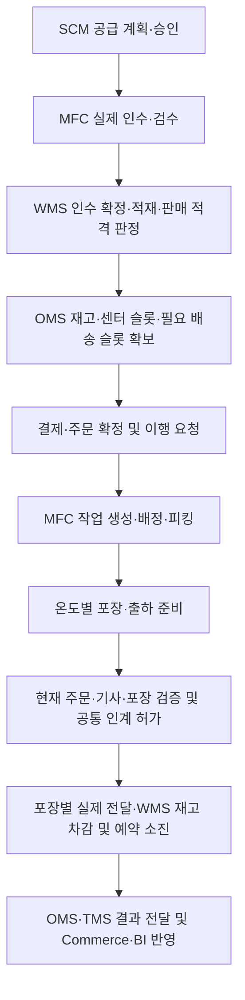
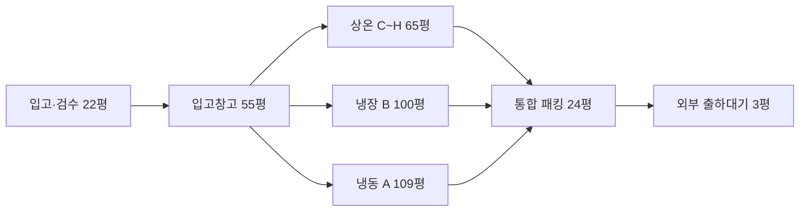
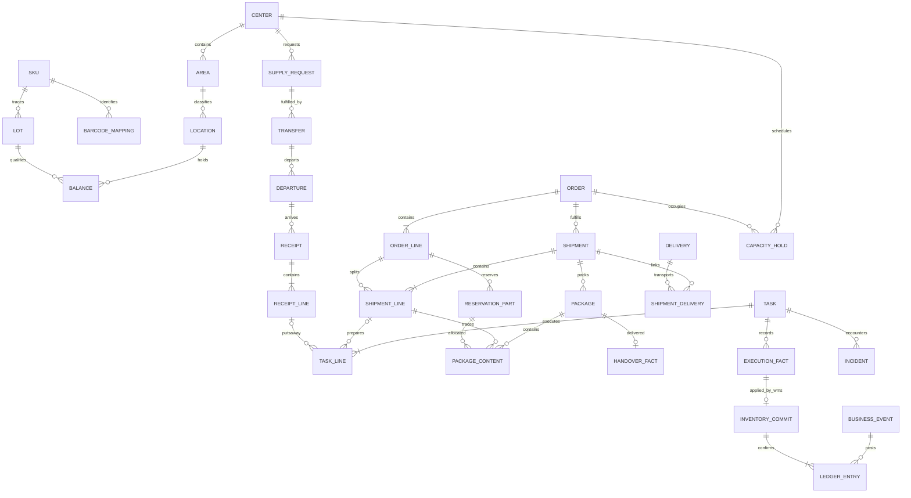

# MFC 비즈니스 로직 — 시설·작업·재고·연계·검증·미결정 통합 명세

문서 버전: 작업·재고·연계·검증·미결정 원문 버전 2.0 (2026-10-20) · 기준일: 2026-10-23 (통합일) · 상태: 기본 설계안, Q-01~Q-20 미결정 · 통합 범위: 제공된 Markdown 6개

> MFC의 공간·운영 전제부터 작업 실행, 재고 수량 변화, 외부 시스템 연계, 수용 시험 및 미결정 정책까지 한 파일에서 확인하기 위한 통합 명세다. 상세 표·산식·상태 전이·예외 처리·규칙 ID·시험 ID는 원문의 의미를 유지한다.
> 반복된 문서 표제·버전 안내와 MFC 소개를 정리하고, 제공된 파일 사이의 링크는 파일 내부 링크로 바꾸었다.

## 표기 규칙

- **상태 태그:** 제목·본문의 `[확정 입력]`, `[확정]`, `[가정]`, `[산출]`, `[산출·가정]`, `[계산]`, `[조건부 설계값]`, `[관찰·추정 분리]`, `[미확인]`, `[개념도]`, `[보존]`, `[이전안]` 등은 원문 표기를 그대로 둔다. 읽는 기준은 [0. 문서 이용 기준](#part-0)을 따른다.
- **규칙·시험 ID:** `WK-` 작업 실행(2장), `IV-` 재고(3장), `IF-` 데이터·연계(4장), `TC-` 수용 시험(5장), `Q-` 미결정사항(6장). `ID-01~ID-10`(식별 규칙)과 `S02~S21`(근거 자료)은 이 파일에 원문이 없다([출처 및 누락 참조](#source-notes)).
- **문서 약어:** TSK 작업 ID, SHP 고객 출하 문서, PKG 실물 포장, HOV 기사 인계 문서, MOV 내부 피킹선반 보충([2장 1](#1-목적책임과-주요-용어)). 수량 기호 H/Q/E/R/A/P/Rf/T/M/D는 [3장 2 수량 정의](#수량-정의)를 따른다.
- **용어 대응(`glossary.md`):** 원문 표기를 유지하며 다음과 같이 대응한다. `DC`(중앙 물류허브)·`Warehouse` → CDC, `센터` → MFC, `기사`·`배송 라이더` → 라이더(인계 대상), `B마트` → 외부 참고 브랜드. `TMS`는 원문이 배차·배송·기사 배정 주체로 쓰며 glossary의 TMS(미들마일)·Delivery(라스트마일) 구분과 같은 뜻인지 확인되지 않았다. 원문 표기를 유지한다.

## 목차

- **0.** [문서 이용 기준](#part-0)
- [출처 및 누락 참조](#source-notes)
- [핵심 흐름과 수량 원칙](#core-flow)
- **1.** [MFC 규모·시설·운영 설계](#part-1)
- **2.** [작업관리](#part-2)
- **3.** [재고관리](#part-3)
- **4.** [데이터·연계 계약](#part-4)
- **5.** [검증 시나리오](#part-5)
- **6.** [미결정사항·결정 기록](#part-6)

<a id="part-0"></a>

## 0. 문서 이용 기준

- **확정 입력:** 원문에서 확정으로 명시한 총면적 463평과 반경 3km 내 75,275가구 등의 입력이다. 랙 수·슬롯·인력·박스·처리시간·매출 모형은 각 표의 가정·산출·조건부 표시를 함께 읽는다.
- **기본 설계안:** 시스템별 정본 책임, 영문 상태, 논리 계약 및 원자성 경계는 제시된 설계다. 실제 서비스·조직·운영 정책의 확정은 해당 Q-ID 결정에 따른다.
- **미결정:** Q-01~Q-20은 모두 미결정이다. 권장안·시험값·시설 시뮬레이션을 운영 기본값으로 승격하지 않는다. 선반 보충 설정, 예약 유효시간, 상품 품질 기준은 별도 결정 대상이다.
- **규칙의 기준 위치:** 작업 실행은 2장 WK, 재고 산식·수량 변화는 3장 IV, 영역별 정본·연계는 4장 IF, 수용 시험은 5장 TC, 남은 정책은 6장 Q를 따른다. 1장의 시설·물량 모형으로 이 규칙을 대체하지 않는다.
- **장 안의 표현:** 원문에서 가져온 “이 문서”, “03”, “04”, “05”, “06” 등은 해당 장 또는 출처 문서 번호를 뜻한다. 원문 작성 시점의 “이번 작업”, “검토 결과”는 원문의 설명이며, 이번 통합으로 애플리케이션 시험을 실행했다는 뜻이 아니다.
- **자료의 범위:** 본문에 있는 운영 지침은 비즈니스 요구사항으로 수록했다. 원문에 적힌 구현·검증·승인·배포 관련 문구를 이번 파일 통합에 대한 실행 요청으로 취급하지 않았다.

<a id="source-notes"></a>

## 출처 및 누락 참조

| 장 | 제공된 출처 파일 | 통합 내용 |
|---|---|---|
| 1 | `01_MFC_규모설계.md` | 면적·온도대·SKU·랙·처리물량·인원·패킹·PDA 가정 및 검증 과제 |
| 2 | `02_작업관리.md` | WK-01~WK-14, 작업 생성·배정·실적·포장·인계·최적화·관제·슬롯·공급요청 |
| 3 | `03_재고관리.md` | IV-01~IV-13, 재고 정의·예약·보충·인계·취소·회수·실사·확정 연결 |
| 4 | `04_데이터_연계.md` | IF-01~IF-08, 데이터 사전·8개 영역 책임·멱등성·복구·요청 계약 |
| 5 | `05_검증_시나리오.md` | TC-01~TC-46 및 규칙 커버리지·판정 기록 |
| 6 | `06_미결정사항.md` | Q-01~Q-20, 권장안·구현 차단 범위·충돌 처리·결정 순서 |

위 파일은 `C:/development/pmart-project/pmart/docs/business/`에서 읽었다. 원본 파일은 수정하지 않았다.

**제공되지 않은 참조:** 원문이 연결하는 `00_README.md`, S02~S21 등의 근거 자료, ID-01~ID-10 상세 규칙은 이번 6개 파일에 포함되지 않았다. 관련 참조와 시험은 보존하되, 누락된 정의를 임의로 작성하거나 검증 완료로 간주하지 않는다. 본문의 README 링크는 이 안내로 연결한다. 외부 URL은 원문 인용을 보존한 것이며 이번 통합에서 최신성을 재검증하지 않았다.

<a id="core-flow"></a>

## 핵심 흐름과 수량 원칙

아래는 상세 규칙을 읽기 위한 요약이다. 실제 실행 조건·예외·정책 미설정 시 보류는 각 장의 규칙을 따른다.



- MFC는 현장 작업·실물 사실을, WMS 재고 책임 모듈은 수량 원장·예약을 관리한다. OMS는 주문·결제·고객 동의와 접수 조정, TMS는 배차·배송, SCM은 공급 계획·승인을 맡는다. 상세한 8개 영역 책임은 [IF-06](#if-06)에서 정의한다.
- 같은 SKU·센터·기준단위·일관성 시점에서 `A = E − R`, `0 ≤ R ≤ E ≤ H`, `0 ≤ Q ≤ H`를 유지한다. H는 센터 현물, E는 판매 적합 현물, R은 유효 현물 예약, A는 신규 출고 가능량이다. 예정 P와 이동 중 T를 현물에 더하지 않는다.
- 피킹·포장만으로 H를 줄이지 않는다. 실제 기사 인계 확정 시 H·E·R을 같은 수량만큼 줄인다. 피킹 후 취소는 E·R을 함께 제외하고 실제 복귀·적격 확인 뒤 판매 가능량을 회복한다.
- 자동 선반 보충은 `C ≤ min`일 때 `N = max(0, target − C − U)`, `지시량 = floor(min(N, S, V) / u) × u`로 계산한다. 설정 유효성·공간 점유·진행 잔량·중복 생성 검증은 [IV-04](#iv-04)를 따른다. 선반 보충의 수동 생성과 작업 담당의 수동 배정은 구분한다.
- 실물 실행, WMS 수량 확정, 외부 통지 성공은 별도로 기록한다. 접수 ACK·결과 불명·시간 초과를 업무 완료나 미실행으로 추정하지 않는다. 취소와 실제 인계의 경합은 공통 판정으로 통제한다.

---

<a id="part-1"></a>

## 1. MFC 규모·시설·운영 설계

### MFC

**MFC(Micro Fulfillment Center, 소형 주문 이행 센터)** 는 고객의 빠른 배송을 위해 지역별로 설치된 소규모 물류 거점으로, DC(중앙 물류허브)에서 상품을 공급받아 보관하고 고객 주문이 발생하면 상품을 피킹(Picking)·패킹(Packing)하여 배송 라이더에게 인계하는 시설이다.

단순히 상품을 보관하는 창고가 아니라 **입고·검수, 재고 관리, 적치, 피킹, 패킹, 출고, 반품 및 품질 관리까지 수행하는 지역 기반 물류 운영 거점**이다.

### MFC의 주요 업무

| 구분 | 주요 업무 |
|---|---|
| 입고 | DC에서 공급된 상품 하차 및 검수 |
| 보관 | 상온·냉장·냉동 구역별 상품 적치 및 보충 |
| 재고 관리 | 재고 실사, 유통기한·LOT 관리, 품질 및 격리 재고 관리 |
| 피킹 | 고객 주문에 따라 보관 위치에서 상품 수집 |
| 패킹 | 상품 검품, 온도별 포장, 보냉재 투입, 라벨 부착 |
| 출고 | 포장 완료 상품을 외부 출하대기 랙에 적재 |
| 인계 | 배송 라이더에게 상품 전달 및 인계 확인 |
| 사후 처리 | 반품 수령, 회수 상품 검수, 격리 및 폐기 |

MFC의 현장 작업은 **MFC Operations 시스템**을 통해 관리되며, 재고의 최종 수량과 상태는 **중앙 WMS**에서 통합 관리한다.

이를 통해 각 지역 MFC는 고객 주문을 신속하고 정확하게 처리하는 **라스트마일 배송의 핵심 물류 거점** 역할을 수행한다.

### 0. 요약

- **확정 설계 입력:** 463평, 3km 가구수 **75,275가구**, 상온 **65평**, 냉장 **100평**, 냉동 **109평**, 패킹 **24평**, 공용통로 **55평**. 나머지 구역도 합계 463평에 맞춰 유지한다.
- **기존 자료에서 사용한 추정:** 총 **10,900 SKU**(상온 5,450 / 냉장 3,270 / 냉동 2,180),
- **이번 통합안에서 새로 계산한 설계값:** 상온 65평에 **약 138개 랙**, 상온 SKU 피킹 슬롯 모형 **7,034개**(85% 운영 상한 **약 5,979 SKU**), 냉장 **약 125개**, 냉동 **약 105개** 피킹 랙 배치안. **랙 수·슬롯 밀도·유닛 적재량은 설계 추정이다.**
- **현장 관찰·제공 사진:** 냉동 온도계 4개(-25/-22/-21/-21℃), 냉장 온도계 3개(4.5/3.5/3.0℃)가 한 벽면에 나란히 보인다. **온도계 수 ≠ 독립된 냉동실·냉장실 수.**
- **운영 원칙:** 피킹과 패킹은 같은 작업자가 수행할 수 있으며, 장바구니를 패킹대로 가져와 수작업 포장한 뒤 주문 라벨을 붙이고 외부 출하대기 랙에 인계한다.

### 1. 건물·면적 최종 배분 — 463평

| 구역 | 평 | 면적(㎡, 약) | 범위 및 주의사항 |
| --- | ---: | ---: | --- |
| 상온 C~H | **65** | 214.9 | 구역 내 랙 사이 70cm 통로·횡단·내부 이동 포함 |
| 상온 격리 | **4** | 13.2 | 상온 문제상품 격리 |
| 냉장 B | **100** | 330.6 | 구역 내 통로·저온 피킹·보충재고·설비 접근 포함 |
| 냉장 격리 | **4** | 13.2 | 냉장 문제상품 격리 |
| 냉동 A | **109** | 360.3 | 구역 내 통로·저온 피킹·보충재고·설비 접근 포함 |
| 냉동 격리 | **4** | 13.2 | 냉동 문제상품 격리 |
| 입고·검수 | **22** | 72.7 | 입고·분류·검수 |
| 입고창고 | **55** | 181.8 | 상온 재고·박스·대형 묶음 중심 |
| 패킹 | **24** | 79.3 | 작업대 8개 위치·보냉재·구역 내 통로 |
| 출하대기 | **3** | 9.9 | 외부 2개 랙, 라이더 인계 |
| 공용 이동통로 | **55** | 181.8 | 온도구역·입고·패킹 연결 통로 |
| 휴게실 | **8** | 26.4 | 휴식 |
| 사무실 | **10** | 33.1 | 관리 |
| **합계** | **463** | **1,530.6** | **모든 공간을 한 번씩만 계산** |

> **통로 경계:** 상온·냉장·냉동의 배정 면적에는 각 구역의 **랙 사이 통로와 내부 이동·횡단 통로**가 포함된다. 공용 55평은 구역 바깥의 주 동선과 입고→피킹→패킹 연결통로에만 해당한다. 패킹 내부 24평의 통로, 출하대기 3평의 랙 접근 공간과 중복해서 계산하지 않는다.

#### 1-1. 면적 구성 비율

| 구역군 | 평 | 전체 비중 |
| --- | ---: | ---: |
| 상온+냉장+냉동 | 274 | 59.2% |
| 각 온도대 격리 | 12 | 2.6% |
| 입고검수+입고창고 | 77 | 16.6% |
| 패킹 | 24 | 5.2% |
| 출하대기 | 3 | 0.6% |
| 공용통로 | 55 | 11.9% |
| 휴게+사무 | 18 | 3.9% |
| **합계** | **463** | **100.0%** |

#### 1-2. 공용 이동통로 55평 활용 검토 [산출·가정]

- 면적은 **55 × 3.305785 = 181.8㎡**. 폭 1.5m로만 배치하면 이론상 통로 길이 **121.2m**에 해당한다(교차·출입 공간 미포함).
- **예시:** 폭 1.5m × 주 통로 총길이 100m = 150㎡(45.4평), 남은 약 **31.8㎡(9.6평)**를 교차부·출입구 전면에 배분.
- 구역 연결은 `입고검수 → 입고창고/각 온도구역 → 패킹 → 외부 출하대기`를 기본으로 설계. 피킹 작업자의 왕복 동선과 입고 운반 동선의 교차 최소화.
- 랙 사이 기본 통로 **70cm**는 기존 설계 기준으로 유지한다. 공용 이동통로는 **1.5m 개념 폭**으로 계획한다.

#### 1-3. 공간 흐름도 [개념도]



> 도면의 화살표는 처리 흐름이지 각 구역 사이의 실제 물리적 연결관계·전용 복도 수를 뜻하지 않는다. 온도대별 격리 4평씩과 공용통로 55평·사무/휴게 18평은 위 면적표에 포함된다.

### 2. SKU·품목·보관온도 기준

| 지표 | 값 | 성격 |
| --- | ---: | --- |
| 총 상품 SKU | **10,900** | 기존 자료 기준, 실측 목록 미첨부 |
| 상온 | **5,450** | 기존 비중 가정 |
| 냉장 | **3,270** | 기존 비중 가정 |
| 냉동 | **2,180** | 기존 비중 가정 |
| 카테고리 | **30개** | 원본의 번호 1~17, 20~32; 18·19는 원본 미기재 |
| 상온·냉장·냉동 SKU 비중 | 50% / 30% / 20% | 기존 재분류 가정, 판매수량 비중과는 다름 |

SKU란 서로 구분되는 상품 규격/판매 단위(예: 500mL 한 병과 1.5L 한 병은 다른 SKU)를 뜻한다. SKU 수는 실제 재고 유닛 수와 같지 않다.

#### 2-1. A~H 최종 설계 역할 [가정]

| 구역 | 온도 | 주 기능 | 대표 상품 | 색상 추정 |
| --- | --- | --- | --- | --- |
| A | 냉동 | 냉동 피킹·보충 | 아이스크림, 냉동밥/반찬/수산/육류, 냉동면·떡 | 노란색 동선의 종착 가능 |
| B | 냉장 | 냉장 피킹·보충 | 채소·과일·유제품·정육·냉장 간편식 | 노란색 동선의 종착 가능 |
| C | 상온 | 일반 가공식품 | 양념·소스·통조림·쌀·잡곡·견과 | 보라 |
| D | 상온 | 간식·음료 혼합 | 과자·시리얼·빵·잼·일반 음료·커피 | 보라 |
| E | 상온 | 생활·잡화 혼합 | 세제·위생·뷰티·청소·문구·가전·반려용품 | 보라 |
| F | 상온 | 상온 고회전 | 카테고리 무관 인기 SKU | 보라 |
| G | 상온 | 라면·상온 대표식품 | 봉지·컵라면·즉석밥·상온 간편식 | 파랑 |
| H | 상온 | 대형·묶음·벌크 피킹 | 생수 묶음·대형 음료·대용량 과자·생활제품 | 파랑 |

- 보라색/파란색은 사진의 **관찰된 라인 색상**, 실제 C~H 문자 배치는 미확인이다. 보라색 C~F / 파란색 G~H는 **설계상 대응 가설**이다.
- 노란색은 저온구역 방향, 빨간색은 상온 격리 방향으로 추정한다.
- F는 고회전 **상온** 상품을 선별하는 영역이므로 카테고리 목록에서 기본 배정 대상으로 반복 기재하지 않는다. 각 SKU는 기본적으로 **하나의 주 피킹 로케이션**을 갖되, 판매량에 따라 추가 전면 또는 보충재고를 둘 수 있다.
- H는 대형·묶음 SKU를 **우선 배치**할 뿐, 다른 구역의 대형 음료 적재를 금지하는 의미가 아니다. 실제 사진에 보라색 랙 내 대형 콜라 등이 함께 보였다는 점을 반영한다.

#### 2-2. 원본 30개 카테고리의 온도대·피킹 구역 매핑

| 번호 | 카테고리 | 가능한 배정 구역(상품별) |
| ---: | --- | --- |
| 1 | 밥·도시락 | A, B, G |
| 2 | 라면·면 | B, G (냉동 면류는 A) |
| 3 | 국·탕·찌개 | A, B, G |
| 4 | 요리·반찬 | A, B, C |
| 5 | 분식·야식 | A, B, G |
| 6 | 과일·채소·샐러드 | A, B |
| 7 | 쌀·잡곡·견과 | C, H |
| 8 | 정육·수산·계란 | A, B |
| 9 | 음료·커피·생수 | B, D, H (냉동 상품이 있다면 A) |
| 10 | 과자·초콜릿·시리얼 | D, H |
| 11 | 빵·떡·잼 | A, B, D |
| 12 | 아이스크림 | A |
| 13 | 우유·유제품 | B |
| 14 | 양념·장류·오일 | B, C |
| 15 | 햄·어묵·통조림 | B, C |
| 16 | 건강·식단관리 | C (냉장·냉동 제품은 B·A) |
| 17 | 주류 | B, H (일반 상온 단품은 D 가능) |
| 20 | 헤어·바디·쉐이빙 | E |
| 21 | 세제·방향·탈취 | E, H |
| 22 | 화장지·생리대 | E, H |
| 23 | 뷰티·클렌징·선케어 | E |
| 24 | 청소·욕실 | E |
| 25 | 생활잡화·패션 | E |
| 26 | 주방·일회용품 | E, H |
| 27 | 문구·사무용품 | E |
| 28 | 가전·게임·전기용품 | E |
| 29 | 반려동물 | A, B, D, E |
| 30 | 유아·아동 | A, B, E |
| 31 | 건강·의료용품 | E |
| 32 | 홈인테리어 | E |

> 표의 여러 구역 표시는 한 상품이 반드시 중복 진열된다는 뜻이 아니다. **상온/냉장/냉동 중 실제 보관조건에 맞는 온도대 1개**를 결정하고, 상온인 경우 크기·회전율에 따라 C/D/E/F/G/H 중 기본 위치를 선택한다. 원본에서 음료에 A가 적혀 있던 것은 동결 음료 등 별도 상품이 존재할 경우에만 해당하므로 일반 음료의 기본 구역으로 간주하지 않는다.

#### 2-3. 현장 사진에서 관찰한 혼합 진열 [관찰·추정 분리]

- **보라색 랙 관찰 예시:** 세제·건전지·반려 간식·물티슈, 과자, 간장·소형 콜라·커피·식용유, 홍초·소스·대형 콜라 등 **다른 카테고리가 한 구역/랙에 혼재**했다.
- 음료는 세워서 **가로 전면 1열/깊이 450mm 방향 복수 유닛**으로 적재될 수 있고, 랙 선반은 상품 높이에 맞춰 조절할 수 있다.
- **봉지라면이 특정 사진에 보이지 않았다**는 것은 다른 구역에 있을 수 있다는 단서일 뿐, G 구역 배치를 확정하는 증거는 아니다.
- 보라색은 패킹에 가까워 보였지만 저빈도 상품도 확인되므로 보라색 전체를 인기상품 구역으로 단정하지 않는다.

### 3. 상온 65평 — 랙·SKU·슬롯 역산

#### 3-1. 117개/55평 참고치에서 65평으로 조정

| 항목 | 이전 관찰 기반 참고 | 최종 면적 기반 계획 |
| --- | ---: | ---: |
| 상온 면적 | 55평 | **65평 [확정]** |
| 랙 수 | 약 117개 [이전 관찰] | **약 138개 [산출]** |
| 계산 | — | `117 × 65 ÷ 55 ≈ 138.27 → 138개` |
| 랙 규격 | 2,100(H) × 1,250(W) × 450(D)mm | 동일 규격 [가정] |
| 기본 선반 | 6단(조절 가능) | 동일 |
| 랙 사이 통로 | 70cm | 70cm (확장하지 않음) |
| 상온 SKU | 5,450개 | 5,450개 |

- 랙 한 개의 바닥 면적은 **1.25 × 0.45 = 0.5625㎡**. 138개는 **23.5평**을 직접 점유한다.
- 나머지 **41.5평**이 랙 사이 70cm 통로, 횡단·회전·내부 이동 및 가장자리 공간이다. **공용통로 55평은 이 밖의 공간**이다.
- 랙 1단의 명목 치수 320×1,250×450mm → **약 180L/단**. 기존 자료의 허용하중 **150kg/단**은 설계 입력으로 보존하되 실제 구매 모델의 제조사 자료 확인 필요.
- 실무 적재는 부피와 하중을 동시에 만족해야 하고, 생수·주류 등은 아래쪽/전용 구획에 우선 배치한다. 선반을 높게 조절하면 해당 랙의 유효 단수와 SKU 슬롯 수가 줄어든다.

#### 3-2. C~H 랙·평수·SKU 최종 시뮬레이션 [산출·가정]

| 색상 가설 | 구역 | 주 역할 | 계획 랙 수 | 면적(평) | SKU 계획 | 랙당 SKU |
| --- | --- | --- | ---: | ---: | ---: | ---: |
| 보라 | C | 일반 가공식품 | 24 | 11.3 | 1,050 | 43.8 |
| 보라 | D | 간식·음료 혼합 | 24 | 11.3 | 1,100 | 45.8 |
| 보라 | E | 생활·잡화 혼합 | 21 | 9.9 | 800 | 38.1 |
| 보라 | F | 상온 고회전 | 24 | 11.3 | 1,100 | 45.8 |
| 파랑 | G | 라면·상온 대표식품 | 25 | 11.8 | 1,050 | 42.0 |
| 파랑 | H | 대형·묶음·벌크 피킹 | 20 | 9.4 | 350 | 17.5 |
| **합계** | **C~H** | **상온** | **138** | **65.0** | **5,450** | **39.5** |

> 이 표의 C~H SKU 개수는 **기존의 모순된 분류표를 대체하기 위해 새로 배정한 공간계획용 목표치**이다. 랙 수는 원래 비중을 최대한 유지하면서 정수 단위로 조정했다. 보라 93개/파랑 45개 가설.

#### 3-3. 상온 슬롯 수용량 — 상온 65평 목표 모형 [산출·가정]

| 구역 | 랙 | 유효 단수/랙 | 평균 슬롯/단 | 이론 슬롯 | 85% 유효 슬롯(약) | 목표 SKU | 목표 충족 |
| --- | ---: | ---: | ---: | ---: | ---: | ---: | --- |
| C | 24 | 6 | 9 | 1,296 | 1,102 | 1,050 | 충족 |
| D | 24 | 6 | 10 | 1,440 | 1,224 | 1,100 | 충족 |
| E | 21 | 6 | 8 | 1,008 | 857 | 800 | 충족 |
| F | 24 | 6 | 10 | 1,440 | 1,224 | 1,100 | 충족 |
| G | 25 | 6 | 9 | 1,350 | 1,148 | 1,050 | 충족 |
| H | 20 | 5 | 5 | 500 | 425 | 350 | 충족 |
| **합계** | **138** | — | — | **7,034** | **약 5,979** | **5,450** | **조건부 충족** |

- 전체 평균은 **7,034 ÷ 138 ≈ 51.0슬롯/랙**이다. 각 랙의 슬롯 가로 폭과 유효 단수는 실제 상품 치수에 따라 달라진다.
- 85% 운영한도에서 계산상 남는 슬롯은 **약 529개**. 이 값은 재배치·신규 SKU에 대한 이론적 여유이고 보충재고의 물량을 직접 뜻하지 않는다.
- **중요:** `7,034`는 이론 슬롯 수, `5,979`는 그 85%를 적용한 운영상 SKU 슬롯 수다.

#### 3-4. 과거 수용량 모형 보존 및 검증 결과

| 모형 | 117개 랙 이론 슬롯 | 138개로 비례 확대(근사) | 138개 × 85% | 5,450 SKU 결과 |
| --- | ---: | ---: | ---: | --- |
| 대형 상품 비중이 큰 보수형 | 4,900 | 약 5,779 | 약 4,913 | 부족 |
| 중간형(소형 비율 높은 가정) | 6,250 | 약 7,372 | 약 6,266 | 가능 |
| **이번 구역별 설계 모형** | — | **7,034** | **약 5,979** | **조건부 가능** |

원본에 있던 **117개 랙의 중간형 상세**: 소형 45×6×11=2,970, 일반 35×6×10=2,100, 중형 22×5×8=880, 대형 15×4×5=300 → **6,250슬롯**. 이를 138개 랙으로 비례 확대하면 약 7,372슬롯, 85% 운영 시 약 6,266개 SKU 위치가 된다는 계산이었다.

**판단:** 65평이 5,450 SKU를 감당한다는 결론은 **상품 크기 분포가 이번 7,034슬롯 모형을 지지할 때에만 성립**한다. 실제 10,900 SKU 마스터의 포장 치수·적재 높이·판매단위 확인 전에는 물리적 확정 불가.

#### 3-5. 상온 피킹 재고 유닛 수량 [가정 모델]

| 구역 | 배정 SKU | SKU당 평균 전면 보유 유닛 [가정] | 전면 피킹재고 계획(유닛) |
| --- | ---: | ---: | ---: |
| C | 1,050 | 4 | 4,200 |
| D | 1,100 | 4 | 4,400 |
| E | 800 | 3 | 2,400 |
| F | 1,100 | 6 | 6,600 |
| G | 1,050 | 4 | 4,200 |
| H | 350 | 2 | 700 |
| **합계** | **5,450** | **평균 4.13** | **22,500** |

- **전면 피킹재고 22,500유닛은 상품별 부피·폭·무게가 없어서 설정한 계산 예시**다. 1개 SKU에 여러 유닛을 깊이로 적재할 수 있지만 **음료 병 크기·묶음 포장** 등은 SKU별 재산정이 필요하다.
- 랙 총 선반 수 가정은 `C~G 118랙×6단 + H 20랙×5단 = 808단`, 180L/단을 단순 적용하면 **145,440L(145.4㎥)**의 명목 부피. 실물 선반의 구조물·빈 공간을 고려하기 전 값이므로 **실제 보관가능 부피나 최대 재고량이라고 표현하지 않는다.**
- 하중 상한 예시: 1단 150kg을 초과하는 생수·주류 묶음은 단수·적층 수량을 줄이거나 하중이 검증된 다른 설비로 분리한다.

### 4. 냉장 B 100평·냉동 A 109평 설계

#### 4-1. 온도계 사진에서 확인할 수 있는 사실

| 구역 | 외부 디지털 온도계 | 사진 판독 표시(℃) | 구역 면적 |
| --- | ---: | --- | ---: |
| 냉장 B | **3개** | **4.5 / 3.5 / 3.0** | **100평 [확정]** |
| 냉동 A | **4개** | **-25 / -22 / -21 / -21** | **109평 [확정]** |

사진에는 7개의 표시 장치가 같은 벽에 나란히 있다. **각 온도계가 독립된 실 1개를 뜻하는지 알 수 없으므로 냉장실 3개·냉동실 4개라고 단정하지 않는다.** 설계 시 냉장 3지점/냉동 4지점의 계측 관리를 지원하도록 한다.

#### 4-2. 저온 피킹 랙 수 역산 [산출·가정]

| 항목 | 냉장 B | 냉동 A |
| --- | ---: | ---: |
| SKU 배정 추정 | 3,270 | 2,180 |
| 유효 단수/랙 | 5단 | 5단 |
| 평균 SKU 슬롯/단 | 7개 | 6개 |
| 운영 슬롯 비율 | 85% | 85% |
| **이론 최소 필요 랙** | **110개** | **86개** |
| **계획 배치 랙** | **125개** | **105개** |
| 계획 이론 슬롯 | 4,375개 | 3,150개 |
| 계획 85% 유효 슬롯 | 약 3,719개 | 약 2,678개 |
| SKU 대비 여유 | 약 449개 | 약 498개 |
| 계획 랙 바닥 점유 | 약 21.3평 | 약 17.9평 |
| 랙 사이 통로 | 70cm 기준 가정 | 70cm 기준 가정 |

- 최소 랙 계산: `올림[SKU ÷ (5단 × 단당 슬롯 × 0.85)]`. 기존의 냉장 110·냉동 86개는 **최소치에 가깝고 여유가 매우 작아**, 신규 계획에서는 125·105개로 늘렸다. 추가 랙 수는 제안이지 실제 현장 보유량이 아니다.
- 동일 랙 규격을 냉장·냉동에 쓰는 것은 임시 전제다. 부식·결로·서리·바닥 하중과 저온용 재질, 높은 상품 크기를 별도로 확인해야 한다.
- 아이스크림은 **A 냉동구역에 포함**한다.

#### 4-3. 각 저온구역 내부 면적 배분 [가정]

| 내부 용도 | 냉장 B | 냉동 A | 포함 공간 |
| --- | ---: | ---: | --- |
| 피킹랙·랙 사이·내부 횡단 통로 | 59평 | 50평 | 랙 접근·피커 이동 |
| 온도대별 보충재고·박스/적재 | 30평 | 46평 | 냉장/냉동 상품 보충 재고 |
| 출입구·설비 접근·작업 여유 | 11평 | 13평 | 방열·회전·온도 유지 설비 접근 등 |
| **합계** | **100평** | **109평** | 격리구역 4평씩은 별도 |

> 냉동 면적이 더 큰 이유를 **온도계 4개라는 사실만으로 설명할 수는 없다**. 본 모델에서는 냉동상품의 포장 부피·보충재고 면적을 냉장보다 크게 가정했기 때문이다. 실제 적정성은 냉동 SKU의 박스 크기/재고일수와 냉각설비 스펙 확인으로 검증해야 한다.

#### 4-4. 온도 관리 지점 분할 예시 [실 구획 아님]

| 온도 관리 단위 | 면적 모델 | 지점 |
| --- | ---: | --- |
| B1 / B2 / B3 | 34 / 33 / 33평 | 냉장 3개 모니터링 지점 가정 |
| A1 / A2 / A3 / A4 | 28 / 27 / 27 / 27평 | 냉동 4개 모니터링 지점 가정 |

실제 칸막이·출입문 개수나 독립 냉동기 수는 미확인. 하나의 대형실에 여러 센서를 두는 구조와 여러 저온실을 합친 구조 모두 가능하다.

### 5. 입고창고 55평·입고검수 22평·격리구역

#### 5-1. 입고창고(상온 보충 중심) 55평 내부 구성 [가정]

| 구성 | 평 | 예시 보관 품목 |
| --- | ---: | --- |
| 생수·음료·주류·묶음 대형상품용 적재 | 22 | 대용량 생수·음료, 주류 박스, 상품 묶음 |
| 소·중형 상온 박스/보충 랙 | 18 | 라면·과자·통조림·생활제품 예비재고 |
| 창고 내부 보충/운반 통로 | 10 | 재고 운반·회전·접근 |
| 로케이션 정리·보충 준비 | 5 | 박스 개봉, 로트/기한 구분, 진열 준비 |
| **합계** | **55** | 냉장·냉동 보충재고는 각 저온구역에 보관 |

- 입고창고의 **실제 팔레트랙 크기·단수·하중은 기존 원본에 확정 자료가 없다.** 상온 피킹랙(2,100×1,250×450mm)을 그대로 팔레트 적재용으로 쓰면 안 된다. 대형 박스와 팔레트용 적재 설비는 **별도 규격·하중 검증** 후 채택한다.
- 팔레트 수량 시뮬레이션 예: 대형 적재 22평(72.7㎡) 가운데 40%를 바닥 팔레트 구획에 사용, **1.1×1.1m/팔레트 [가정]**이면 `72.7×0.4/1.21 ≈ 24개 바닥 위치`가 이론치. **실제 통로폭·기둥·벽·하중·장비 접근을 검토하지 않은 값**이며 2단 적층 가능 여부는 별도다.
- 냉장·냉동 격리상품은 각각 별도 4평에 보관하고 정상 보충재고에 섞지 않는다.

#### 5-2. 입고·검수 22평 내부 구성 [가정]

| 기능 | 면적 |
| --- | ---: |
| 반입 물품 전개·임시 대기 | 9평 |
| 수량·바코드·유통기한 검수 | 6평 |
| 온도대별 분류·이동 준비 | 4평 |
| 로트/로케이션 등록·진열 준비 | 3평 |
| **합계** | **22평** |

#### 5-3. 격리구역 및 출하대기

| 구역 | 평 | 기능 |
| --- | ---: | --- |
| 상온 격리 | 4 | 파손·오배송·품질 확인 중 상온 상품 |
| 냉장 격리 | 4 | 냉장 품질 확인·반품·회수 대기 |
| 냉동 격리 | 4 | 냉동 온도·포장 이상 상품 분리 |
| 외부 출하대기 | 3 | **랙 2개**·주문 바코드 확인·라이더 인계 |

- 출하대기 랙은 기존 가정 규격 2,100×1,250×450mm 2개를 유지한다. 발자국 면적 1.125㎡ 외에는 접근·인계 공간이 필요하다. **라이더는 내부 보관·패킹구역으로 들어오지 않는 설계.**
- 이미지 자료에는 **포장 후 배달 시작 전까지 냉장온도 보관**한다는 설명이 있다. 외부 출하대기는 냉장 설비가 없다는 사용자 조건을 따르되, **냉장·냉동 주문을 장시간 외부에 방치하는 운영은 채택하지 않고 인계 직전 단시간 이동**으로 설계한다.

### 6. 부산 MFC점 주문·매출 추정 — 75,275가구 [확정 입력]

동래점 182,360가구의 **보수 2%×1.5회 / 기준 4%×2회 / 낙관 7%×2.5회** 구매 가정을 부산 전지점에 동일 적용한다. 가구별 실제 배달가능 여부와 가격 경쟁·상권 특성은 미보정.

| 항목 | 보수적 | 기준안 | 낙관적 |
| --- | ---: | ---: | ---: |
| 3km 배달권 가구수 | 75,275 | 75,275 | 75,275 |
| 월 구매율 | 2% | 4% | 7% |
| 구매 가구당 월 주문빈도 | 1.5회 | 2.0회 | 2.5회 |
| 월 주문건수(반올림) | **2,258건** | **6,022건** | **13,173건** |
| 일평균 주문(30일) | **75건** | **201건** | **439건** |
| 월 매출(객단가 30,000원) | **약 0.68억 원** | **약 1.81억 원** | **약 3.95억 원** |

계산식: `가구수 × 월 구매율 × 월 주문빈도 = 월 주문건수`; `월 주문건수 ÷ 30 = 일 주문건수`; `월 주문건수 × 30,000원 = 월 상품매출`.

#### 6-1. 상품 출고량·입고량 기초 모델 [가정]

> 실제 고객 장바구니 데이터가 없어서 **평균 8유닛/주문**과 **출고 유닛 구성 상온 50%·냉장 30%·냉동 20%**를 계산상의 별도 가정으로 놓았다. 온도대별 **SKU 비중과 유닛 판매 비중이 꼭 같다는 뜻은 아니다.**

| 일 출고 유닛 | 보수적(75건) | 기준안(201건) | 낙관적(439건) |
| --- | ---: | ---: | ---: |
| 전체(8유닛/주문) | 약 602 | 약 1,606 | 약 3,513 |
| 상온 50% | 약 301 | 약 803 | 약 1,756 |
| 냉장 30% | 약 181 | 약 482 | 약 1,054 |
| 냉동 20% | 약 120 | 약 321 | 약 703 |

※ 표는 **반올림된 일 주문량**이 아니라 월 주문수/30의 원값으로 계산해 표시했다. 그래서 일부 합산에 1유닛 내외 반올림 오차가 있을 수 있다.

#### 6-2. 입고·안전재고·박스 및 팔레트 시나리오 [가정]

- 기준안 평균 출고 약 **1,606유닛/일**을 같은 양만큼 입고하여 장기 평균 재고를 유지한다는 단순 모델이다. 낙관안은 **3,513유닛/일**.
- 입고·보충 목표를 **평균 출고량 2일치 + 25% 안전분**으로 잠정 설정하면 `1,606×2×1.25 ≈ 4,016유닛`. 상온 약 2,008, 냉장 약 1,205, 냉동 약 803유닛에 상당한다. **이 값만으로 전체 10,900 SKU의 최소 1개 재고를 모두 보장할 수 없음**에 주의.
- **12유닛/입고박스**와 **40박스/팔레트**를 일괄 가정할 경우 입고 평균은 기준안 **약 134박스(3.3팔레트 환산)/일**, 낙관안 **약 293박스(7.3팔레트 환산)/일**. *서로 다른 상품 크기를 무시한 거친 물량환산*이며 실제 팔레트 배치·동선/하중 확인 전 확정 불가.
- 입고 검수 22평의 처리 가능성은 박스수·대형 상품 비중·입고 차량의 도착 집중 시간·검수 작업자 수로 최종 검증한다.

#### 6-3. 발주·입고 주기 최종 운영 시나리오 [이번 보완: 고정 방문 + 차등 발주]

**사용자 확정 운영조건:** 입고 차량은 매일 오전에 반드시 방문한다. 차량 방문주기는 **매일**로 고정하며, 이는 **10,900개 SKU를 모두 매일 발주한다는 뜻이 아니다.** 전일 오후 발주 → 익일 오전 입고를 **리드타임 1일인 설계 가정**으로 두고, 공급처의 실제 발주마감·DC 배차정보로 검증한다.

| 상품군 | 발주 검토/주기 [제안] | 오전 입고 | 목표 재고포지션의 계산 예시 |
| --- | --- | --- | --- |
| 신선·유통기한 짧은 냉장 | 매일 | 매일 우선 처리 | 1~2일 내 판매·기한 범위에서 별도 산정 |
| A급 상온·냉장·냉동 고회전 | 매일 | 매일 | `일 SKU 예상판매량 × (1일 검토+1일 리드타임) + 0.5일치 임시 안전재고` |
| B급 중회전 | 2~3일 | 날짜별 그룹을 나눠 매일 차량에 혼재 | 2일 발주라면 `일 수요×(2+1+0.5)=3.5일치` |
| C급 저회전 | 7일 단위 검토 | 요일별 분산 입고 | `일 수요×(7+1+0.5)=8.5일치`, 단 최소 진열·발주수량과 기한 우선 |
| 냉동 저·중회전 | 2~3일 | 오전 냉동 운송·직행 이동 | 실판매 속도와 저온 보충공간 기준 |

주기 재고정책: `SKU별 목표 S = d×(R+L)+SS`; `재고포지션 IP = 가용재고 + 확정 발주 중 수량 − 미출고 확정수요`; `발주량 Q = max(0,S−IP)`를 박스입수·MOQ(최소발주량)에 맞춰 올림하고 각 구역의 수용한도를 넘지 않도록 제한한다. **R과 L은 모두 일 단위**, 안전재고를 임의로 잡은 0.5일치는 검증용 예시이며 소비기한·수요분산을 알고 나면 재계산해야 한다.

**주의:** 전체 10,900 SKU를 각 1유닛씩 보유하더라도 최소 10,900유닛이 필요하다. 과거 `기준안 1,606×2.5≈4,015유닛`은 단지 **판매속도에 대한 보호기간 수요**로, MFC의 총 상품재고 또는 55평 입고창고 전체 재고로 혼동하지 않는다. SKU당 최소 수량, 박스입수와 재고의 온도대별 위치를 통합해 실제 적재량을 검증해야 한다.

#### 6-4. 오전 차량 입고 물량 — 3가지 수요 시나리오 [계산]

기존 문서와 동일한 **8판매유닛/주문, 상온·냉장·냉동 판매 유닛 비중 50:30:20, 평균 12유닛/입고박스, 평균 40박스/팔레트 상당**을 가정했다. **'팔레트 상당'은 상온·냉장·냉동이 모두 동일하게 실제 팔레트 위에 온다는 뜻이 아닌 비교 단위**다. 정상 재고의 장기 평균은 매일 판매량만큼 보충하며, 2~3일/7일에 한번 주문하는 SKU는 요일별로 분산 배차한다.

| 항목 | 보수적 | 기준안 | 낙관적 |
| --- | ---: | ---: | ---: |
| 하루 주문건수(원값) | 75.28 | 200.73 | 439.10 |
| 상품 출고 ≒ 정상 평균 입고(유닛/일) | 602 | **1,606** | **3,513** |
| 입고박스 환산(12유닛/박스) | 51 | **134** | **293** |
| 팔레트 상당(40박스/팔레트) | 1.3 | **3.4** | **7.3** |
| 상온 판매·보충 예상(유닛/일) | 301 | 803 | 1,756 |
| 냉장 판매·보충 예상(유닛/일) | 181 | 482 | 1,054 |
| 냉동 판매·보충 예상(유닛/일) | 120 | 321 | 703 |

표의 박스 수는 해당 유닛을 **계산상 올림**한 값이며 서로 다른 SKU의 자투리 유닛을 한 박스에 섞어 담을 수 있다는 뜻이 아니다. 실제 발주 박스 수는 SKU별 `올림(발주유닛/상품별 박스입수)`의 합이므로 더 커질 수 있다. 표의 팔레트 수는 혼적 환산이며 공급처 실제 팔레트 구성 및 차량 적재능력과 다를 수 있다.

#### 6-5. 입고검수 22평 × 입고창고 55평 — 1회 최대 수용량 시뮬레이션 [조건부 설계값]

| 면적 요소 | 고정 면적 | 이번 계산 반영 |
| --- | ---: | --- |
| 입고검수 내 반입·임시 대기 | 9평 = 약 29.75㎡ | 1.1×1.1m 팔레트 1개 바닥 1.21㎡; 접근·운반 공간 포함 **팔레트당 약 3.0㎡**를 할당하면 `29.75/3≈9.9`, 계획 **동시 9팔레트 상당** |
| 검수·스캔 | 6평 = 약 19.83㎡ | 검수대 및 작업자 공간; 최대 3명 우선 배치, 초과 인원은 저온구역 측 검수·보조 작업으로 분산 |
| 온도대 분류·이동 | 4평 = 약 13.22㎡ | 냉장·냉동물량은 임시대기 장시간 적치 없이 우선 저온구역으로 이송 |
| 등록·진열 준비 | 3평 = 약 9.92㎡ | PDA/로케이션/입고 장부 확인, 작업 충돌 방지 |
| 상온 입고창고 내 대형 적재 | 22평 = 약 72.73㎡ | 기존 40% 바닥 팔레트 점유 가정 시 `72.73×0.4/1.21≈24개` 이론 바닥위치 |
| 입고창고 중형 상품 보충랙 | 18평 | 소·중형 상온 박스 수납, 적재수량은 랙 하중·박스규격 미확정 |
| 창고 내 통로·준비 | 15평 | 운반 통로 10평+보충 준비 5평 유지 |

**상온 적재 여유의 조건:** 대형상품 바닥위치 24개를 **설계용 이론치**로 간주하고, 평상시 80%(약 19자리)만 점유한다고 가정하면 약 **5팔레트 자리**가 비어 있다. 1회 입고 **9팔레트 상당**의 출고 구성비를 50:30:20으로 적용하면 상온 약 4.5, 냉장 약 2.7, 냉동 약 1.8팔레트 상당이므로 **상온 5자리의 여유와 일단 부합**한다. 냉장·냉동 4.5팔레트 상당은 상온 55평 창고에 넣지 않고 각 저온구역으로 즉시 이동해야 한다.

**따라서 입고 1회 처리 목표 상한 = 9팔레트 상당 = 360박스 = 4,320판매유닛 상당**으로 임시 설정한다(40박스/팔레트, 12유닛/박스 가정). 이 값은 **실제 차량 1대의 적재중량/부피 상한이나 입증된 물리적 절대 최대가 아니다.** 오전 입고를 2~3팔레트 단위로 순차 하차·검수·해당 온도구역으로 이동시키며, 9개를 22평 실내에 오래 방치하지 않는다. **상온만 9팔레트가 오거나, 바닥 팔레트 자리 5개가 이미 차 있거나, 냉장/냉동 보충구역이 꽉 찬 경우**에는 이 상한이 성립하지 않아 분할 입고·직접 랙 보충·재배차가 필요하다.

| 비교 | 기준안 | 낙관적 | 제안 1회 상한 |
| --- | ---: | ---: | ---: |
| 박스 상당 | 134 | 293 | **360** |
| 팔레트 상당 | 3.4 | 7.3 | **9.0** |
| 판매유닛 환산 | 1,606 | 3,513 | **4,320** |
| 360박스 대비 | 37% | 81% | 100% |

낙관적 평균 293박스에 **약 23%** 여유가 있고, 낙관적 판매유닛의 약 20% 증가분은 `3,513×1.2≈4,216유닛≈8.8팔레트 상당`으로 가정상 9팔레트 이내다. 그러나 품절 해소를 위한 재고 재축적, 대규모 행사, 실제 낮은 박스 입수 등은 이 한도를 초과할 수 있다.

**민감도:** 팔레트당 40박스로 동일해도 상품 1박스 입수가 평균 8개면 9팔레트는 2,880유닛 상당, 12개면 4,320유닛, 16개면 5,760유닛 상당이다. 그래서 실제 차량·DC의 입고 단위는 **유닛뿐 아니라 상품별 박스·CBM·kg·온도대**로 통제한다.

#### 6-6. 오전 검수 인원 — 입고 3시간 완료 목표 [산출·가정]

**검수 생산성 가정:** 입고박스 바코드/수량/필요 상품 소비기한 확인을 포함해 **검수자 1인당 실효 30박스/시간**. 현장 실측값이나 업계 확정 표준은 아니고 작업계획 기준이다. **오전 검수에 3시간을 배정**하면 검수자 1명당 90박스를 처리한다.

| 수요 상황 | 예상 박스 | 필요한 순수 검수 인원 `올림(박스÷90)` | 하차·구역이동 담당 | **오전 배치 총인원** |
| --- | ---: | ---: | ---: | ---: |
| 보수적 | 51 | 1명 | 1명 | **2명** |
| **기준안** | **134** | **2명** | **1명** | **3명** |
| **낙관적** | **293** | **4명** | **1명** | **5명** |
| 1회 상한 360박스 | 360 | 여유를 둔 5명 | 1명 | **6명** |

기준안 검수 생산성 여유 `2명×30박스/시간×3시간=180박스(134박스 대비 약 34% 여유)`; 낙관안 `4×30×3=360박스(293 대비 약 23% 여유)`; 1회 상한 작업 시 `5×30×3=450박스(360 대비 25% 여유)`다. **인원은 오전에 동시에 수행하는 역할 기준**이며, 전원이 종일 검수 전담이어야 한다는 뜻은 아니다. 입고완료 후 같은 작업자가 보충진열·피킹·패킹으로 전환할 수 있다.

**현장 배치 검증:** 검수대 면적은 6평뿐이므로 4~5명이 검수구역 한곳에 동시에 서는 방식은 지양한다. 기준안 2명은 검수대, 1명은 하차·이송을 담당한다. 낙관적 4명의 검수는 예컨대 공용 검수대 2~3명과 **냉장·냉동구역 안에서 온도 유지하며 수행하는 바코드·로트 확인 1~2명**으로 분산한다. 최대 6명 운영 시 인력 추가만으로 충분하다고 보지 말고 오전 배송을 2회차에 나누거나 별도 검수 위치를 확보해야 한다.

**오전 작업시간을 2시간으로 단축할 경우:** 1검수자 처리능력 60박스 기준으로 기준안 3검수+1이송=**4명**, 낙관안 5검수+1이송=**6명**이 필요하다. 도착차량이 몰리거나 한 박스에 여러 SKU가 혼재해 정밀 전수검수를 실시한다면 `30박스/시간`을 하향 보정해야 한다.

#### 6-7. 오전 입고 작업의 순서와 보호 조건 [운영설계]

1. **전일 발주:** PDA/WMS에서 SKU별 판매예측, 현재고, 미출고 주문, 전일 재고조정·폐기/반품, 확정 발주를 반영해 DC 공급량을 정한다.
2. **매일 오전 차량 도착:** 차량번호·ASN/발주서·온도대·예정 팔레트/박스/유닛을 확인하고 입고 가능 공간을 사전 예약한다.
3. **냉동·냉장 우선 하차/이송:** 온도대 확인, 파손·누수·온도이탈 1차 판정 후 각 저온구역 내부의 검수·보충 위치로 **지체 없이 이송**한다. 상온 입고검수 구역에 냉동·냉장 상품을 장시간 쌓지 않는다.
4. **바코드·수량·소비기한 검수:** 발주/ASN과 실물 박스 수, SKU·로트·소비기한을 대조하고 정상/초과/부족/손상/미발주·온도이탈을 기록한다. 전수/표본검수 수준은 상품 위험도와 DC 데이터 정확도에 따라 운영정책으로 정한다.
5. **위치 등록과 재고 전환:** 정상 검수 완료분만 WMS 가용재고로 전환하고, 격리품은 상온/냉장/냉동 각 4평에 분리 기록한다.
6. **랙 보충:** 상온은 55평 보충창고와 65평 피킹랙, 냉장/냉동은 각 구역의 저온 보충공간으로 이동한다. FEFO(소비기한 우선 출고)와 위치·하중 제한을 적용한다.
7. **입고 완료·다음 발주 반영:** 실제 수량과 차이를 DC에 전달하고 당일 판매/예측을 갱신한다.

**대응 조치:** 입고 예정이 9팔레트 상당 또는 동시 수용 가능한 온도대별 빈 위치를 넘으면, 오전 **분할 시간대 하차**, DC 분할 출고, 직접 보충 후 재반입, 안전재고 조정 등을 사용한다. 검수 병목이 생기면 온도 취약 상품을 먼저 저온공간으로 이동한다.

#### 6-8. 검증이 완료돼야 할 항목 [불확실성 명시]

- 박스당 판매 유닛 12개 및 팔레트당 박스 40개는 **상품 구성을 모를 때의 공통 환산가정**이다. 품목별 실물 치수·무게·유통기한·박스입수를 적용하면 환산 박스/팔레트가 크게 바뀔 수 있다.
- T-11형 팔레트 **1,100×1,100mm**는 국내 사용 규격의 하나로 참고한다. 참고: [한국파렛트컨테이너협회 실태조사 소개](https://www.woodkorea.co.kr/news/articleView.html?idxno=82880).
- 22평 입고검수구역의 **하차문 규격·기둥·실제 작업대 수·운반장비 회전반경**, 55평 입고창고의 **유효 높이·랙 규격·층별 하중·실제 가용 팔레트 위치**, 냉장 100평·냉동 109평 내부의 **보충재고 빈 적재공간**은 미확인이다.
- 매일 오전 차량 **2대 이상 방문은 확정 운영조건**이지만, 특정 차량의 최대 팔레트·적재중량이나 실제 배송 횟수는 확정되지 않았다. 본 9팔레트는 **한 차수의 작업 처리목표**다.
- 실제 검수시간은 ASN 정확도, 개별상품 바코드 전수스캔 여부, 소비기한·로트별 분리, 입고 사고 비중에 따라 달라진다. 30박스/시간은 현장 실측 전 계획값이다.

### 7. 패킹 24평 — 작업대 8개와 공정

#### 7-1. 패킹대 수량 역산 [가정·산출]

- 주문당 패킹 소요 **4분**(작업자/장바구니 인증, 상품·기한 확인, 포장, 영수증/주문 라벨 출력·부착, 짧은 출하대기 이동 포함 가정).
- 피크 1시간에 하루 주문량의 **20%** 집중, 패킹대의 실효 가동률 **75%** 가정.
- 작업대 1개당 처리능력 = `60분 ÷ 4분 × 0.75 = 11.25건/시간`.

| 구분 | 피크 1시간 주문건수 | 필요 동시 패킹대 | 운영 제안 |
| --- | ---: | ---: | --- |
| 보수적 | 약 15.1 | **2대** | 필요 시 2대만 가동 |
| 기준안 | 약 40.1 | **4대** | 기본 가동 4대 |
| 낙관적 | 약 87.8 | **8대** | 8대 모두 가동 |

- 8개 작업대의 낙관안 피크 처리용량은 **90건/시간**, 추정 수요는 **87.8건/시간**이므로 여유가 약 2.2건으로 작다. 포장이 5분으로 늘면 8대 용량은 72건/시간이라 부족하다. 실제 측정값 확인 후 순번 분산·추가 예비 스테이션·운영 시간 조정이 필요하다.
- **피킹과 패킹을 한 사람이 모두 수행**한다는 조건을 유지한다. 따라서 8대는 **동시에 패킹할 수 있는 자리 수**이지 총 근무자 수 8명이란 뜻이 아니다.

#### 7-2. 피킹까지 합친 근무 인원 참고 모델 [가정]

- 주문당 **피킹 7분 + 패킹 4분 = 총 11분**, 실효가동률 75%라면 작업자 1명당 `60/11×0.75≈4.09건/시간`.
- 기준안 피크 약 40.1건/시간 → **동시 피킹·패킹 작업자 약 10명**, 낙관적 피크 약 87.8건/시간 → **약 22명**.
- 인원이 많더라도 한 시점에 패킹대에서는 기준안 4명·낙관안 8명만 동시 포장하는 운영을 가정한다. 총 가용 작업 시간·휴게·입고/재고보충 별도 인력은 추가 계산 대상.

#### 7-3. 패킹대 규격·설비

| 항목 | 기준 규격 또는 구성 |
| --- | --- |
| 패킹대 상판 | **1.6m(가로) × 0.8m(깊이)** |
| 작업자 앞 작업공간 | 최소 약 1.0m 깊이 계획 |
| 작업대 1개 모듈 | **2.0m × 2.2m = 4.4㎡(약 1.33평)** |
| 장바구니 | 옆 또는 아래에 배치, 별도의 피킹 완료 바구니 대기창고 없음 |
| 작업자 인증 | **직원별 ID 바코드**, 패킹대 ID·주문 ID와 연결 |
| PDA/스캐너 | 직원·장바구니·상품·포장재·완료 바코드 판독 |
| 주문 확인 단말기 | 상품 목록·수량·포장재 지침·유통기한 확인 |
| 영수증·주문 바코드 프린터 | 포장 완료 후 출력 및 봉투 부착 |
| 봉투·보냉재·냉매·스티커·스테이플러 | 상·하부 수납과 공용 보충 선반에 비치 |
| 컨베이어 | **기본 미설치**. 상품을 장바구니에서 바로 포장하는 수작업 방식 |

#### 7-4. 패킹 24평 면적 산정표 [산출]

| 시설/활동 | 면적(㎡) | 평(약) |
| --- | ---: | ---: |
| 패킹대 8개+작업자 공간 | 35.2 | 10.6 |
| 포장 부자재·보냉재 적재 | 10.0 | 3.0 |
| 패킹구역 내부 동선·교차 | 20.0 | 6.1 |
| 출하대기 방향 인계 동선 | 6.0 | 1.8 |
| 장비·보충·작업 여유 | 6.0 | 1.8 |
| 잔여 여유/벽·기둥 대응 | 2.1 | 0.6 |
| **합계** | **79.3** | **24.0** |

> 24평은 **약 79.3㎡**. 8개 작업대에 대한 내부 통로·부자재 공간을 포함하는 계획이며, 외부 출하대기 랙 3평은 별도다.

#### 7-5. 8개 작업대 배치 개념도 [치수 모형; 현장 실측 도면 아님]

패킹실 개념 외곽을 **10.0m × 7.93m ≈ 79.3㎡(24평)**로 두고, `2m × 2.2m` 작업 모듈 4개씩 두 줄 배치한다. 가운데 접근통로는 1.5m 개념 폭을 확보하며, 측면에 포장재와 라벨 설비 보충을 둔다. 실제 출입구·소방설비·기둥·인계문은 별도 실측 후 확정한다.

```text
              피킹구역에서 장바구니 이동 ↓
┌────────────────────── 패킹 10.0m ──────────────────────┐
│ [작업대1] [작업대2] [작업대3] [작업대4]   포장재/장비   │
│   작업자 작업공간 (각 모듈 2.0m × 2.2m)                │
│ ─────────── 중앙 내부 통로·작업자 교행 ────────────── │ 7.93m
│   작업자 작업공간                                     │
│ [작업대5] [작업대6] [작업대7] [작업대8]   냉매/봉투    │
│                      주문라벨 확인 → 출하 인계문 →     │
└───────────────────────────────────────────────────────┘
                    (외부 출하대기 3평, 별도)
```

#### 7-6. B마트 패킹 작업 흐름 — 원본 13단계 유지·정리

원본이 참고한 **2021-12-24 작업 후기**의 스캔 순서를 토대로 작성한 적용안이다.

| 순서 | 단계 | 실제 작업·시스템 처리 |
| ---: | --- | --- |
| 1 | 피킹 완료 장바구니 도착 | 피커가 장바구니를 패킹대까지 직접 가져옴. 피킹·패킹 동일 인원 가정 |
| 2 | 작업자 바코드 인증 | 직원 고유 ID 바코드를 스캔하고 패킹대 ID와 함께 작업 이력 기록 |
| 3 | 장바구니 바코드 스캔 | 장바구니와 주문번호를 연결하여 주문정보·상품 목록 호출 |
| 4 | 상품 및 수량 확인 | 누락/오피킹/수량 차이 확인 |
| 5 | 유통기한 확인 및 인증 | 검사 대상 신선식품 바코드/제조·소비기한 확인, 확인 코드 스캔 |
| 6 | 포장 방법 확인 | 온도대·파손 위험에 따른 보냉재·완충재·봉투 규격과 수량 확인 |
| 7 | 포장재 바코드 스캔 | 보냉팩·아이스팩·드라이아이스 등 사용 수량을 스캔 |
| 8 | 상품별 포장 | 상온·냉장·냉동을 주문별로 통합 포장하되 온도 보호·분리 원칙 적용 |
| 9 | 주의 스티커 부착 | 파손주의·드라이아이스 주의 등 해당 주문에 적용 |
| 10 | 봉투 밀봉 | 원본 후기에 있는 손잡이 두 번 묶기 등 포장 지침 적용 |
| 11 | 패킹 완료 바코드 스캔 | 수저·젓가락 누락 안내 등 시스템 검증 후 완료 처리 |
| 12 | 영수증·주문 바코드 출력 및 부착 | 출력되는 식별 라벨을 봉투에 부착(원본의 스테이플러 방식 포함) |
| 13 | 외부 출하대기 랙 이동 | 주문 식별번호 확인 후 지정 랙에 적재, 라이더는 내부 출입하지 않음 |

#### 7-7. 포장재 규격·스캔 [원본 기준]

| 항목 | 원본 기록 | 운영 반영 |
| --- | --- | --- |
| 상온 포장 | 소·중·대 | 주문 부피에 맞춰 선택 |
| 냉장·냉동 보냉백 | **XS / S / M / L / XL** | 상품 크기·수량·온도에 따라 선택 |
| 아이스팩 | 별도 바코드 스캔 | 실제 사용 수량 기록 |
| 드라이아이스 | 포장재 스캔 항목 | 취급 주의 및 필요한 상품에만 사용 |
| 봉투 밀봉 | 손잡이 2회 묶음(후기 기록) | 포장 형태에 맞게 적용 |
| 주문 식별 | 완료 후 바코드/라벨 출력 | 영수증·주문 라벨 출력·부착 후 랙 인계 |

### 8. 피킹 PDA·로케이션·바코드 관리

#### 8-1. 기존 PDA 화면에서 읽은 예시 데이터 [과거 화면; 실시간 재고 아님]

| 구분 | 항목 | 화면 값 | 해석·주의 |
| --- | --- | --- | --- |
| 작업 | 작업 유형 | `피킹` | 상품을 찾아 수집 |
| 주문 | 영수증번호 | `102593620` | 주문/영수증 식별 |
| 상태 | 진행내역 | `3 / 5` | 5개 중 3번째 작업으로 추정 |
| 위치 | 층구분 | `1층` | 보관 또는 작업 층 |
| 위치 | 현재 로케이션 | `B04-02-205` | 현재 상품 피킹 지정 |
| 위치 | 예정 로케이션 | `B04-07-201` | 다음 위치로 추정 |
| 위치 | 층 | `1` | 상품 보관 층 |
| 보관 | 보관방법 | `냉장` | 온도대 B |
| 상품 | SKU명 | `청보 GAP 청양고추 100g` | 상품/규격 |
| 상품 | 바코드 | `8809232164335` | 상품 바코드로 추정 |
| 상품 | 추가 코드 | `A20001102` | 시리얼/내부 코드로 추정 |
| 품질 | 제조일자 | `2021-12-17` | 화면 기록 |
| 품질 | 유통기한 | `2021-12-22` | 화면 기록 |
| 재고 | 가용재고 | `61` | 화면 촬영 시점의 예시 |
| 피킹 | 지시수량 | `1` | 피킹 지시 |
| 피킹 | 기피킹수량 | `0` | 이미 처리한 수량 |
| 피킹 | 피킹수량 | `0` | 현재 처리 수량 |
| 피킹 | 바코드 | `빈칸` | 스캔/입력 영역 |

#### 8-2. 로케이션 코드 가설 [미확인]

- `B04-02-205`: `B`=냉장, `04`=랙 그룹 04, `02`=그룹 내 물리적 랙 번호, `205`=2단의 05번 슬롯이라는 해석이 현재 가장 일관된 가설.
- `B04-07-201`이 존재하므로 **B04 그룹에 적어도 7번째 랙까지 있을 가능성**이 있다.
- `C0102-01`: `C01`=상온 C의 01번 그룹, `02`=그룹 내 랙 02, `01`=선반 1단으로 해석하는 대안 코드 규칙.
- 파란 라벨은 상품/슬롯 식별 바코드와 QR이, 노란 라벨은 선반/랙 로케이션 코드가 표시된 것으로 **사진상 추정**한다. **정확한 라벨 코드 체계는 확인 필요**.
- 작업자 바코드·상품 바코드·장바구니 바코드·선반/슬롯 바코드·완료 바코드를 **서로 다른 용도**로 시스템에서 구별한다.

#### 8-3. 피킹 순서와 지점별 코드 차이 [보존]

원본 기록: **`B → A → C → D → E → F → X → Z`**, 이때 B=냉장, A=냉동, C/D/E=상온, F=인기상품, X/Z=생활용품·기타. 이는 **원본에서 관찰·추정한 또 다른 구역 코드 체계**다.

**설계용 이름은 `A(냉동), B(냉장), C~H(상온)`**을 사용한다. 원본 `X/Z`와 설계안 `G/H`는 **동일한 공식 구역이라고 확인되지 않았다.**

### 9. 품목 크기·적재 하중·수용 유닛 — 자료 공백 보완

#### 9-1. 규격·하중 입력

| 대상 | 설계 입력 | 검증 상태 |
| --- | --- | --- |
| 상온/저온 피킹 랙 | 2,100×1,250×450mm | 기존 설계 규격 |
| 기본 선반 | 6단, 가정 유효높이 약 320mm/단 | 실제 제품 높이에 맞춰 단수 변경 |
| 선반 명목 부피 | 320×1,250×450mm = **180L** | 치수에서 계산 |
| 선반 허용하중 | **150kg/단** | 원본 설계 하중 |
| 물리적 랙 바닥면적 | **0.5625㎡** | 치수에서 계산 |
| 천장 높이 | **2.5~3.2m (원본 동래점 참고치)** | 마트 적정 높이 |
| 팔레트 적재 설비 | 별도 설계 필요 | 2,100×1,250×450mm 피킹랙을 팔레트랙으로 간주하지 않음 |

#### 9-2. 상품별 실제 규격 데이터가 없는 상태의 시험값 [가정]

| 상품 유형 | 시험 단품 치수(가로×깊이×높이) | 중요 제약 |
| --- | --- | --- |
| 소형 소스·가공품 | 80×60×160mm | 슬롯 폭 작게 사용 가능 |
| 일반 간식·생활품 | 140×80×220mm | 한 단에 여러 SKU 가능 |
| 큰 봉지라면·박스 | 200×120×250mm | 유효 슬롯 수 감소 |
| 2L 생수·음료 병 | 110×110×320mm | 실제 병 높이에 맞춰 선반 조절 |
| 6개 묶음 생수 | 330×220×320mm | 무게·하단 적재·전면 폭 확인 |
| 대용량 화장지 묶음 | 450×350×300mm | 한 선반의 가로 점유 큼 |

이 값은 특정 판매 상품의 실측값이 **아니며**, 슬롯과 재고계산 양식을 완성하기 위한 예시다. 실제 SKU별 `상품명/SKU/가로/깊이/높이/실중량/박스입수/안전재고/출고량/유통기한` 자료를 받아 다시 계산해야 한다.

#### 9-3. 1단·전체 최대 적재량의 정확한 의미

- 한 단당 **명목 부피 180L·허용하중 150kg**은 각각 독립적인 제한이며, `min(상품 부피 제한, 상품 무게 제한, 선반 치수 제한)`을 모두 만족해야 한다.
- `상온 808단 × 180L = 145.4㎥`는 **빈 선반 공간의 합**일 뿐, 5,450 SKU 재고를 실제 몇 유닛 넣을 수 있는지 결정하지 않는다.
- 냉장 125랙×5단=625단 → 명목 112.5㎥, 냉동 105랙×5단=525단 → 명목 94.5㎥(동일 랙·단 부피를 사용할 경우). **입고창고·저온 보충재고의 부피는 제외**다.
- **재고 유닛 총량은 SKU별 실물 규격·실제 슬롯 수·박스입수·적재 제한이 없어 확정 불가**. 앞 절의 상온 피킹 전면 22,500유닛은 **모형 목표치**로만 사용한다.

### 10. 운영 검증에 필요한 데이터와 현재 채운 계산값

원본의 빈칸을 가능한 범위에서 **확정 입력·가정 산출·미확인**으로 채웠다.

| 분류 | 원본 질문/데이터 항목 | 통합안의 값·산출 또는 보류 이유 | 상태 |
| --- | --- | --- | --- |
| 건물 | 위치 | 부산 소재 MFC; 실제 정확한 건물 주소는 원본 미기재 | 미확인 |
| 건물 | 전용면적 | 463평 = 약 1,530.6㎡ | 확정 |
| 건물 | 천장 높이 | 원본 2.5~3.2m는 동래점 참고치; | 미확인 |
| 구역 | 입고·검수 | 22평 | 확정 |
| 구역 | 입고창고 | 55평 | 확정 |
| 구역 | 상온 C/D/E/F/G/H | 각 11.3 / 11.3 / 9.9 / 11.3 / 11.8 / 9.4평 | 가정 |
| 구역 | 상온 격리 | 4평 | 확정 |
| 구역 | 냉장/냉장격리 | 100 / 4평 | 확정 |
| 구역 | 냉동/냉동격리 | 109 / 4평 | 확정 |
| 구역 | 패킹 | 24평·기본 4대/최대 8대 | 확정/산출 |
| 구역 | 출하대기 | 3평·외부 2랙 | 확정/원본 |
| 구역 | 공용 이동통로 | 55평, 내부 통로와 별도 | 확정 |
| 구역 | 휴게/사무 | 8평/10평 | 원본 적용 |
| 랙 | 규격/단수/하중 | 2100×1250×450mm, 기본 6단, 180L·150kg/단 | 원본 계획 |
| 랙 | 상온/냉장/냉동 랙 계획 | 138 / 125 / 105개 (최소 필요 138 조건부 / 110 / 86) | 가정/산출 |
| 상품 | 총 SKU/카테고리 | 10,900 SKU / 30개 카테고리 | 원본 |
| 상품 | 상온 피킹 전면 재고 | 목표 모형 약 22,500유닛; 실제 보관능력 확정 불가 | 가정 |
| 상품 | SKU별 크기·무게 | 상품 마스터 미제공; 9-2 시험 치수만 작성 | 미확인 |
| 상품 | 상품 포장단위 | 12유닛/박스, 40박스/팔레트 단순 환산 | 가정 |
| 상품 | 보관 조건 | A 냉동, B 냉장, C~H 상온; 제품별 온도 확정 필요 | 설계안 |
| 재고 | 상품별 판매량 | 일평균 주문 기준 201건×8유닛 = 약 1,606유닛/일; 개별 SKU는 미확인 | 가정 |
| 재고 | 안전·보충 재고 | 평균 2일치 +25% ≈ 4,016유닛 (기본 재고와 별도 검증) | 가정 |
| 재고 | 발주·입고 주기 | **매일 오전 차량 도착 [확정]**, SKU 회전율별 매일/2~3일/7일 발주 [운영안]. 전일 발주·익일 입고(1일 리드타임)는 가정 | 확정/가정 |
| 피킹 | 작업자/주문당 처리 | 피킹 7분+패킹 4분; 피크 작업자 기준 10명/낙관 22명 | 가정 |
| 입고 | DC 공급량 | 평균 약 1,606유닛/일, 낙관 약 3,513유닛/일로 입고량 환산 | 가정 |
| 입고 | 1회 최대 입고량 | **9팔레트 상당 ≈ 360박스 ≈ 4,320유닛 [조건부 작업 목표]**. 차량·온도대별 실제 최대는 미확인 | 산출/가정 |
| 입고 | 검수 인원·처리량 | **기준 3명(순수 검수 2+이송 1), 낙관 5명(검수 4+이송 1), 1회 최대 6명**; 실효 30박스/검수자·시간, 3시간 가정 | 산출/가정 |
| 저온 | 냉장·냉동 온도계 | 냉장 3개·냉동 4개, 실제 방 개수 미확인 | 관찰 |

#### 10-1. 산출 공식과 검증 조건

| 산출 항목 | 공식 및 현재 결과 | 반드시 확인할 자료 |
| --- | --- | --- |
| 구역별 랙 개수 | `SKU ÷ (층수×슬롯/단×0.85)`; 냉장 최소 110, 냉동 최소 86 | 실제 랙·출입구·선반 단수 |
| 랙 1단 최대 수량 | `min(가로×깊이×높이 적합 수량, 150kg/상품 중량)` | 실제 개별 치수·포장 무게·하중 인증 |
| 상온 피킹 가능 SKU | `7,034슬롯×85% ≈ 5,979 SKU` | SKU 크기별 공간 점유 |
| 상온 재고 유닛 수 | 22,500유닛은 가정 평균으로 산출 | SKU별 보유수량·슬롯 깊이 |
| MFC 전체 최대 적재량 | **현 자료로 단일 확정 숫자 산출 불가** | 입고창고/저온 보충랙·SKU 치수 |
| 적정 운영 재고량 | `일 출고×입고간격 + 안전재고`; 기준 출고 1,606유닛/일 | SKU별 ABC 회전율·납기·유통기한 |
| 1회 최대 입고 가능량 | 입고검수 22평 기준 공간 배정까지 가능 | 차량시간·팔레트/박스 실측·검수 생산성 |
| 하루 최대 주문 처리 | `실제 피킹+패킹 시간·피크 인원` 기반; 8 패킹대는 가정상 최대 90건/피크시간 | 인력 스케줄·장바구니 크기·작업시간 |

### 11. 최종 확정사항 및 남은 검증

**면적 기준 확정**: `상온65 + 냉장100 + 냉동109 + 각 격리12 + 입고검수22 + 입고창고55 + 패킹24 + 출하대기3 + 공용통로55 + 휴게8 + 사무10 = 463평`. **가구수 확정**: `75,275가구`. **패킹 작업대**: 기본 가동 4대, 최대 설치/가동 8대 (4분·20%·75% 가정에 근거).

**검증 보류**: 실제 상온 SKU 치수 분포가 7,034 슬롯 모형과 맞는지, 냉장·냉동 125/105개 랙의 설치 가능 여부, 저온 독립실 개수, 입고창고의 실제 팔레트랙 용량, 패킹 피크 집중률/실제 작업시간, 출하대기 온도 관리, 피난·소방·구조하중. 이 항목들은 **고정 면적을 바꾸자는 뜻이 아니라 정해진 면적 안에서 설비 배치를 검증해야 한다는 뜻**이다.

---

**발주·입고·검수 추가안:** 매일 오전 차량 필수 도착, SKU별 발주 차등, 기준안 평균 134박스/일·3명, 낙관안 293박스/일·5명, 1회 작업 처리목표 9팔레트 상당(360박스)·최대 오전 6명. 이 수치는 실제 물류장비/상품규격 확인 전의 조건부 운영 모델이다.

*문서 작성 원칙: 원본 수치·후기/사진 관찰·과거 가설을 최대한 남기되, 현재 설계에 적용할 수 없는 값은 [이전안]으로 옮기고 사용자 확정 면적을 최상위 기준으로 두었다. 사용자 제공 자료 외에 관측되지 않은 실측치나 확정 재고량은 생성하지 않았다.*

---

<a id="part-2"></a>

## 2. 작업관리

### 1. 목적·책임과 주요 용어

MFC Operations가 유효 업무 근거를 실행 가능한 작업으로 만들고 담당·순서·현장 실적·예외를 관리한다. 주문/금액/공급/배차 정본은 IF-06의 외부 주체를 참조하며, 수량 변경은 WMS 재고 책임 모듈에 요청한다. TSK는 작업 ID, SHP는 고객 출하 문서, PKG는 실물 포장, HOV는 기사 인계 문서다. 적재는 기존 문서의 적치와 같은 업무로 정의한다. 보충은 MFC 내부 피킹선반 보충(MOV)이며 SCM 센터 공급 요청과 구분한다.

작업 배정은 사람·장비의 지정, 위치 선택은 기존 location_id 후보의 선택, 재고 예약은 IV-05의 물량 확보다. 셋은 같은 사건이 아니다. OR-Tools는 최적화 후보를 계산하며 주소·주문·재고 원장의 정본을 생성하지 않는다.

근거: [00의 S02·S03·S06·S08~10·S16](#source-notes). 영문 상태·계획 모델·발행 단위는 **설계**다. 화면 디자인을 새로 정의하지 않으며 PDA는 실행, 관리자 웹은 설정·배정·예외 해결을 맡는다.

#### 현장 실행과 영역별 완료의 구분

- **MFC 직접 확정:** 작업 ID·배정·실물 스캔/계수·실제 수행 증빙·포장 구성·센터 예외와 인계 확인 사실.
- **재고 결과를 받아 확정:** 수량/위치가 바뀌는 작업 실적과 완료량은 IV-13의 재고 확정 ID가 있어야 최종 반영한다. 실물은 움직였으나 응답이 없으면 `inventory_apply_status=UNKNOWN_RESULT`와 실물 위치를 보존한다.
- **외부 정본 결과 수신:** OMS 주문/동의/금액, SCM 공급승인, TMS 기사배정/배송, BackOffice 권한/정책. 단순 접수 ACK로 업무를 완료하지 않는다.
- **후속 소비:** Commerce 고객표시·BI 통지 실패는 이미 끝난 물리 작업을 되돌리지 않는다. IF-04·IF-08로 따로 복구한다.

### 2. 입력·출력·데이터 검증

입력은 원업무 문서/행, 주문 버전·예약, 현재 실적·잔량, 적격 재고/위치 후보, 작업자·장비·근무, 통행 경로, 운영정책과 실물 실행 결과다. 출력은 TSK와 지시 버전, 담당·경로·작업상태·확정실적, 보류 사유, 출하/포장 진행, 재고 반영 요청 및 결과다.

| 엔터티·필드 | 필수 조건·검증 |
|---|---|
| Task | task_id/TSK, type, center_id, source_document_id, source_line_refs, state, version, created_at. 고객 주문 없는 작업은 order_id 비필수 |
| TaskLine | task_line_id, sku_id, 기준단위, planned_qty, completed_qty, cancelled_qty, remaining_qty, 품질/로트·위치·예약 참조. `계획=확정완료+승인취소+잔량`, 모두 0 이상 |
| Assignment | worker_id, equipment_id(필요 시), assignment_version, 유효시간, 인계 확인, 전임/후임 이력. 활성 담당은 작업별 한 명을 기본 설계로 함 |
| Dependency | predecessor_task/line, 필요한 확정량·상태, release_at. 선행 작업 이름만으로 완료 판단 금지 |
| Execution | owner_domain=MFC_OPERATIONS, inventory_apply_status, applied_commit_id(재고 확정 시), execution_id, 요청 ID, task/assignment/order 버전, 실제 SKU/로트·위치·수량·발생시각·증빙·재고 확정 ID |
| OptimizationPlan | plan_id, snapshot_id, 대상 TSK/잔량, 정책·경로 버전, solver 종류/버전·상태, elapsed_time, termination_reason, 추천 배정·미배정 사유 |
| Package | pkg_id, shipment_id, version, state, 온도구분, 구성행(주문행·SKU·로트·예약·기준단위 수량), 교체 계보 |
| Shipment | shipment_id/SHP, center_id, 주문/출하행, version, state, hold_reason, 유효 PKG 집합, 배송 연결 |

위 데이터는 ID-01~10의 식별·참조 검증을 통과해야 한다. 잔량 감소는 서버 확정 실적에만 연결한다. `재고 확정 대기`와 `외부 통지 대기`는 업무 진행 상태와 별도 필드다.

### 3. 업무 규칙

<a id="wk-01"></a>

#### WK-01 — 작업 생성과 선행 조건

실행 책임(설계): MFC Operations가 관리하고 IF-06 정본 주체의 결과를 연계.

근거: **기준+설계**, S02·S03 §10/14~17·S06·S08~10.

| 항목 | 명세 |
|---|---|
| 규칙 ID | WK-01 |
| 업무명 | 업무 근거 기반 TSK 생성 |
| 발생 조건 | 아래 생성표의 사건 확정 |
| 입력 | 원업무/행·유형·센터·대상 수량·선행 조건·요청 ID |
| 사전 조건 | 유효 근거·권한·기준정보; 미설정 의존성은 식별 가능 |
| 판단 규칙 | 동일 원업무행·유형·이행구간·작업버전의 중복 생성 차단. 같은 SKU/수량이라는 이유만으로 다른 실제 업무를 중복 취급하지 않음 |
| 처리 내용 | 원행 연결 TSK/작업행 생성, 선행 조건 만족 여부 판정 |
| 결과 및 상태 변화 | 실행 가능하면 READY, 선행/설정 미충족이면 WAITING. 수량 변화 0 |
| 실패·예외 처리 | 근거 없음/취소된 주문이면 생성 거절. 설정 대기 작업에 원인과 담당 표시; 자동 READY 전환 금지 |
| 수용 기준 | 같은 사건 재수신에 TSK 하나; 미입고 예정 물량 피킹은 실행 대기; 입고 작업에 가짜 주문 ID 없음 |

| 작업 유형 | 생성 사건 | READY 조건·완료 근거 |
|---|---|---|
| RECEIVE 입고 접수·계수 | 도착 접수 및 유효 TOUT/TIN 근거 연결; 예정 알림은 사전 대기 작업만 가능 | 실물/목적센터/원출발 확인 → IV-02 실제 인수 확정 |
| INSPECT 검수 | 실제 인수 검수대상 발생 | 검수권한·추적정보 확보 → IV-02 정상/격리/보류 판정량 일치 |
| PUTAWAY 적재 | 정상 판정·적재 필요량 및 MOV 생성 | 목적지 적격·배정 가능 → IV-03 실제 도착 확정 |
| REPLENISH 보충 | IV-04 자동 계산과 MOV/물량/공간 배정 성공 | 시스템 생성된 미완료 MOV → IV-03 실제 이동 확정 |
| PICK 피킹 | OMS 유효 주문확정·SHP/출고 요청 | 유효 현물 예약·작업시점·품질·슬롯 충족 → IV-07 실적 확정 |
| PACK 포장 | 출하 대상의 피킹 완료 또는 승인된 분할 이행 구간 완료 | 유효 주문·확정 피킹량 대조 → WK-07 유효 포장 구성 확정 |
| DISPATCH 출하 준비/인계 | 출하 대상 포장완료·준비 확인 | WK-08 기사/배송/포장/주문 검증 → IV-08 포장별 전달 확정 |

부분 피킹을 임의 주문 부분출하로 전환하지 않는다. 부분 완료량은 다음 작업 후보가 될 수 있지만, 고객 동의·출하 분할 결정이 필요한 경우 WK-06·IF-01을 먼저 적용한다.

<a id="wk-02"></a>

#### WK-02 — 배정·우선순위·제약

실행 책임(설계): MFC Operations가 관리하고 IF-06 정본 주체의 결과를 연계.

근거: **기준+설계**, S06·S16. 우선순위와 자동 배정 범위는 **Q-08·Q-09**.

| 항목 | 명세 |
|---|---|
| 규칙 ID | WK-02 |
| 업무명 | 작업자·장비·영역 배정 |
| 발생 조건 | READY 작업 배정 또는 수동 배정 요청 |
| 입력 | 작업 잔량·현재 권한/근무·장비·영역·선행 조건·정책 버전 |
| 사전 조건 | 현재 센터 접근·직무·장비 자격 유효, 작업 실행 가능 |
| 판단 규칙 | 같은 시간 작업자·독점 장비 중복 점유 금지; 통행·온도·수용량·잠금·확보 물량은 강제 제약. 우선순위 미등록 시 자동 선택 보류 |
| 처리 내용 | 배정 유효성 검사 후 담당·장비·시간 점유 및 assignment_version 확정 |
| 결과 및 상태 변화 | READY→ASSIGNED. 고객 예약 재생성 없음, 현물 변화 없음 |
| 실패·예외 처리 | 적격 인력 없음은 READY/보류 사유; 관리자도 강제 제약 우회 불가. 부족 보고로 수동 보충 TSK 생성 불가 |
| 수용 기준 | 냉동구역 자격 없는 작업자 배정 거절; 두 작업에 동일 독점 장비 시간 중복 불가; 수동 배정도 동일 검증 |

**우선순위 기본 설계안:** 안전/품질 보류는 실행 대상에서 제외하고 후속 안전조치 작업을 별도 관리한다. 실행 후보는 약속 시각·선행 보충 필요·대기시간·업무 중요도를 입력받는다. 업무 유형 간 고정 서열이나 임의 가중치는 두지 않는다. Q-08 결정 전에는 적격 작업에 대한 권한자 수동 지정만 허용한다.

<a id="wk-03"></a>

#### WK-03 — 시작·실적·완료

실행 책임(설계): MFC Operations가 관리하고 IF-06 정본 주체의 결과를 연계.

근거: **기준+설계**, S02 I-05/I-12, S06.

| 항목 | 명세 |
|---|---|
| 규칙 ID | WK-03 |
| 업무명 | 작업 실행과 확정 실적 연결 |
| 발생 조건 | 시작·스캔·부분실적·완료 요청 |
| 입력 | TSK/행·배정 버전·실수량·대상 스캔·주문 버전·실행 ID |
| 사전 조건 | 유효 담당·권한·최신 버전, 선행 완료, 허용 상태 |
| 판단 규칙 | 시작 점유 한 요청만 성공. 실적≤현재 잔량, 필수 스캔 일치. 완료는 잔량 0 및 재고 반영 등 도메인 완료근거 확인 |
| 처리 내용 | MFC가 시작 점유·현장 사실을 기록하고 IV-13을 통해 WMS에 해당 IV 규칙 적용 요청. 수량/위치 변경 단계는 재고 확정 결과 후 실적 반영. 반영 불명은 IF-03 조회 |
| 결과 및 상태 변화 | ASSIGNED→IN_PROGRESS; 일부 실적이면 IN_PROGRESS 유지, 전량 충족하면 COMPLETED. 취소량이 있으면 CLOSED_PARTIAL |
| 실패·예외 처리 | 오상품/오위치/오로트/수량초과는 실적 0·원인 안내. 서버 미확정에 완료 표시 금지 |
| 수용 기준 | 두 시작 중 하나만 성공; 10 중 4 확정이면 완료4/잔량6; 재전송 후에도 완료4 유지 |

<a id="wk-04"></a>

#### WK-04 — 실패·보류·취소

실행 책임(설계): MFC Operations가 관리하고 IF-06 정본 주체의 결과를 연계.

근거: **기준+설계**, S02·S06. 실패/잔량 종결 코드와 경계는 기본 설계안.

| 항목 | 명세 |
|---|---|
| 규칙 ID | WK-04 |
| 업무명 | 작업 중단과 미실행 잔량 취소 |
| 발생 조건 | 장비 고장·위치 불가·작업 실패·원업무 취소 |
| 입력 | 대상 작업/행·실적·잔량·실물 위치·사유·권한 |
| 사전 조건 | 기존 확정량과 결과 불명 사건을 먼저 조회 |
| 판단 규칙 | 실패는 이미 실행한 사실을 취소하지 않음. 주문 취소는 IV-08, 내부 이동 중단은 IV-03의 실제 위치 확인 필요 |
| 처리 내용 | 안전 보관·문제 기록, 미실행 배정 해제. 취소 가능한 잔량만 cancelled_qty로 이동; 원업무 필요가 남으면 대기 유지 |
| 결과 및 상태 변화 | 해결 대기는 BLOCKED, 실행 실패는 FAILED. 실행0/전량취소는 CANCELLED, 실행>0/잔량취소 후 CLOSED_PARTIAL |
| 실패·예외 처리 | 실제 이동/인계 결과 불명은 취소 성공으로 처리 금지. 완료 실적 삭제·원장 자동 역산 금지 |
| 수용 기준 | 10 중 4 이동 후 잔량6 취소 시 완료4/취소6/잔량0, 총현물 유지; 고장만으로 주문 예약 해제 안 됨 |

<a id="wk-05"></a>

#### WK-05 — 교대·재배정·재개

실행 책임(설계): MFC Operations가 관리하고 IF-06 정본 주체의 결과를 연계.

근거: **기준+설계**, S06·S16. 강제/수락 방식은 **Q-09**.

| 항목 | 명세 |
|---|---|
| 규칙 ID | WK-05 |
| 업무명 | 같은 작업의 담당 변경 |
| 발생 조건 | 퇴근·지연·중지·작업 실패 복구·교대 |
| 입력 | TSK·전임/후임·완료/잔량·토트/PKG·현재 위치·결과 불명 목록 |
| 사전 조건 | 재배정 권한, 미확정 실물 확인, 후임 적격 |
| 판단 규칙 | 진행 실적은 고정, 대상은 잔량. 실제 인수 확인 전 옛 담당의 늦은 전송을 자동 반영하지 않음 |
| 처리 내용 | 필요 시 BLOCKED 전환, 인수 증빙 후 배정 버전 증가·전임 점유 해제·후임 점유 확정 |
| 결과 및 상태 변화 | ASSIGNED/BLOCKED/FAILED→ASSIGNED; 같은 TSK, 완료량 유지. 재개 시작은 WK-03 |
| 실패·예외 처리 | 옛 버전 요청은 VERSION_CONFLICT; 실제 과거 실행 증빙은 원사건 복구 대기. 후임 미확보 시 보류 유지 |
| 수용 기준 | 후임은 잔량만 실행; 전임 늦은 스캔에 수량 증가 없음; 날짜 변경/교대에도 작업 ID 동일 |

<a id="wk-06"></a>

#### WK-06 — 주문·결품·변경 연결

실행 책임(설계): MFC Operations가 관리하고 IF-06 정본 주체의 결과를 연계.

근거: **기준+설계**, S02 E-04~14, S08. 지원 처리기한은 **Q-12**.

| 항목 | 명세 |
|---|---|
| 규칙 ID | WK-06 |
| 업무명 | OMS 주문 수락과 결품 예외 해결 |
| 발생 조건 | 주문확정·변경·결품 발견·고객 결정 수신 |
| 입력 | OMS 주문/행/버전·결제 확인·예약 참조·약속 시각·동의/금액 확정 참조 |
| 사전 조건 | IV-05 유효 확보 또는 IV-06 예정 약속, IF-03 순서 검증 |
| 판단 규칙 | 주문확정 없는 피킹 금지. 결품은 다른 위치 확인 후 EXC로 기록; 대체는 상품·수량·가격·알레르기 안내와 고객 동의 필요 |
| 처리 내용 | MFC는 OMS의 유효 이행요청으로 SHP/TSK 연결. 주문/대체 변경은 OMS가 고객 동의·새 확보·금액 결과를 확정한 버전을 수신한 후 작업에 적용; 실패/불명은 기존 약속 유지 또는 명시 보류 |
| 결과 및 상태 변화 | 확정 주문 작업 생성; 연락 불가는 연결 출하 BLOCKED·지원 이관, 준비 물품 적정 보관. 예약 수량 변화는 IV-05/08/09에서 처리 |
| 실패·예외 처리 | 무응답 임의 대체·자동 부분취소 금지. 예정 지연은 IV-06. 환불 요청과 환불 완료는 구분 |
| 수용 기준 | 미동의 대체가 지시에 반영되지 않음; 변경 실패 후 신·구 예약 이중 점유 없음; 과거 주문 버전으로 작업 재개 불가 |

<a id="wk-07"></a>

#### WK-07 — 포장·재포장·준비

실행 책임(설계): MFC Operations가 관리하고 IF-06 정본 주체의 결과를 연계.

근거: **기준+설계**, S02 E-15~16, S05·S09. 포장 상세 정책은 **Q-05·Q-10**.

| 항목 | 명세 |
|---|---|
| 규칙 ID | WK-07 |
| 업무명 | 유효 포장 구성 확정 |
| 발생 조건 | 피킹 완료·검품·포장·라벨 재출력·실물 재포장 |
| 입력 | 출하/주문 최신 버전·확정 피킹 구성·온도 정책·PKG 목록 |
| 사전 조건 | 미해결 결품/품질 보류 없음, 대상별 확정 피킹량 존재 |
| 판단 규칙 | 유효 PKG 구성 합계=현재 출하 대상 확정 피킹량. 같은 재고조각의 중복 포장 금지. 실제 교체와 라벨 재출력을 구분 |
| 처리 내용 | 온도별 PKG 생성/구성 확정; 재포장은 새 PKG·이전 INVALIDATED·교체 관계. 단순 재출력은 기존 ID 유지 |
| 결과 및 상태 변화 | 포장 SEALED, 출하 PREPARING→READY. 센터 현물·고객 예약 변동 없음 |
| 실패·예외 처리 | 누락/혼입/구성 초과는 준비 완료 차단. 인계된 포장 재포장 금지. 상품 파손은 IV-09 |
| 수용 기준 | 2개 포장 중 하나 교체해도 유효 포장수2; 재출력 시 새 재고/포장 없음; 준비완료로 현물 감소 없음 |

<a id="wk-08"></a>

#### WK-08 — 출하·기사 인계 판정

실행 책임(설계): MFC Operations가 관리하고 IF-06 정본 주체의 결과를 연계.

근거: **기준+설계**, S02 E-06/E-15~18, S09~10. 외부 인계 확정 절차는 **Q-01**.

| 항목 | 명세 |
|---|---|
| 규칙 ID | WK-08 |
| 업무명 | 포장별 실제 전달과 출하 집계 |
| 발생 조건 | 현재 배정 기사 픽업·PKG 스캔·인수확인 |
| 입력 | 주문/출하/포장/배정 버전·배송 ID·기사·실제 전달 증빙·실행 ID |
| 사전 조건 | READY 또는 PARTIALLY_HANDED_OVER, 유효 기사/PKG, 취소/품질 보류 없음 |
| 판단 규칙 | 스캔만으로 전달 확정하지 않음. IV-08 주문 단위 취소/인계 직렬 판정 통과 및 실제 인수확인 필요 |
| 처리 내용 | MFC가 TMS 현재 기사배정과 인수증빙을 검증해 공통 주문 판정에 요청. 실제 전달 사실을 기록하고 WMS의 IV-08 차감/소진 결과와 연결한 뒤 HOV/PKG/출하 진행 확정. 중간 결과 불명은 IV-13 적용 |
| 결과 및 상태 변화 | PKG HANDED_OVER, 일부면 SHP PARTIALLY_HANDED_OVER. 취소/복귀로 제외한 출하량이 없고 모든 유효 전달 대상이 전달됐을 때 HANDED_OVER; 일부 전달 후 잔량 취소·복귀가 끝나면 CLOSED_PARTIAL |
| 실패·예외 처리 | 오기사·다른 배송·무효 포장 차단. 결과 불명은 RECONCILIATION_REQUIRED 표시 및 재인계 차단; 배송완료/실패로 다시 차감하지 않음 |
| 수용 기준 | 3포장 중2 전달은 부분 인계, 미전달 위치 보존; 동일 포장 반복 요청 차감1회; 취소된 포장 전달 거절 |

<a id="wk-09"></a>

#### WK-09 — OR-Tools 계산

실행 책임(설계): MFC Operations가 관리하고 IF-06 정본 주체의 결과를 연계.

근거: **설계**, S16 §2.3을 구체화. 적용 모델·목표·시간제한은 **Q-08**.

| 항목 | 명세 |
|---|---|
| 규칙 ID | WK-09 |
| 업무명 | 최적화 후보 계획 계산 |
| 발생 조건 | 배정 요청·정책상 재계산·통로/인력/재고 변동 |
| 입력 | 아래 입력·제약·목표 계약 전체와 snapshot_id |
| 사전 조건 | 강제 제약 검증 가능, 목표와 시간제한 설정, 최신 후보 재고 조회 |
| 판단 규칙 | 완료 사실과 실행 중 구간은 고정; 미시작/승인 잔량만 계산. 예정 물량을 현물 피킹 후보로 넣지 않음 |
| 처리 내용 | 후보 해 계산, solver 원상태·종료 이유·미배정 작업·근거를 저장. 업무 상태/재고와 분리 |
| 결과 및 상태 변화 | 계획 PROPOSED 또는 NO_SOLUTION/INVALID/UNDETERMINED. 실제 배정·물량점유·현물 변화 없음 |
| 실패·예외 처리 | 시간초과+유효해는 최적해로 표시 금지, 발행 정책에 따라 검토. 해 없음은 강제 제약 완화 없이 관리자 조치; 입력 오류와 불가능 증명을 구분 |
| 수용 기준 | 동일 입력·모델/정책을 재현 가능하게 저장; 미배정은 취소되지 않음; 계산만 실행해도 재고/TSK 담당 변동 없음 |

<a id="wk-10"></a>

#### WK-10 — 계획 발행·수동 배정·재계산

실행 책임(설계): MFC Operations가 관리하고 IF-06 정본 주체의 결과를 연계.

근거: **설계**, S02 I-06·S06·S16 §2.3. 자동 발행 허용은 **Q-08**.

| 항목 | 명세 |
|---|---|
| 규칙 ID | WK-10 |
| 업무명 | 최신 상태로 검증한 계획의 작업 지시 확정 |
| 발생 조건 | 최적화 계획 승인 또는 적격 수동 배정, 재계산 후 발행 |
| 입력 | plan_id·snapshot/정책 버전·대상 TSK 버전·현재 재고/공간/담당·주문·잠금 |
| 사전 조건 | 실행 가능한 해, 발행 권한 또는 등록된 자동 발행 정책 |
| 판단 규칙 | 발행 직전 모든 강제 제약·잔량·버전 재검증. 고객 예약은 참조/위치 세분화하며 추가 예약하지 않음. MOV의 기존 물량/공간 배정도 중복하지 않음 |
| 처리 내용 | 의존성으로 묶인 발행 그룹 전체에 배정·재고 실행잠금/공간·계획버전을 일관되게 확정; 성공한 그룹만 PDA에 실행가능 표시 |
| 결과 및 상태 변화 | 계획 PROPOSED→COMMITTED, 작업 ASSIGNED. 재고 현물 변화0. 새 내부 이동 배정이 필요하면 IV-03/04 경계에서 확정 |
| 실패·예외 처리 | 버전 변동은 STALE로 폐기/재계산. 분산 일부 성공은 RECOVERY_REQUIRED로 실행 차단·확정 조회 후 신규 점유만 보상. 기존 유효 주문 예약은 보상 해제 금지 |
| 수용 기준 | 계산 뒤 재고가 줄면 과거 계획 발행 실패; 동시 계획은 물량/공간 중복 점유 불가; 실패 시 일부 지시가 실행되지 않음 |

### 4. OR-Tools 모델 계약

#### 범위와 입력

최초 범위 제안은 한 센터의 적재·자동 생성된 보충·피킹 작업의 작업자 배정, 기존 적격 위치 선택, 방문 순서 계산이다. 입고/포장/출하 작업도 인력·시간표 후보로 넣을 수 있으나 기사 공도 배송 최적화·센터 공급 최적화는 별도 범위다.

| 입력 집합 | 필수 내용 |
|---|---|
| 작업 J | TSK/행, 수량·단위, 선행 관계, 실행가능 시각, 약속/마감, 예상 서비스시간, 우선순위 근거, 분할 가능 여부 |
| 작업자 W·장비 K | 근무/휴게, 현재 위치·작업·가용시간, 센터/영역/직무/장비 자격, 적재 용량 |
| 위치 L·경로 | 기존 location_id, 이동거리/시간 및 단위, 방향·통행 금지·장비 접근. 선반주소 문자열 차이를 거리로 사용 금지 |
| 재고/공간 | 적격 SKU/로트/위치·가능량·예약/이동 배정 참조, 도착 공간 잔여량, 실사 잠금 |
| 실행 설정 | snapshot/version, 모델 버전, 목적 우선순위/가중치, 계산 시간제한, 부분해 발행 허용, 발행 권한 |

**변수 제안:** 작업 j를 작업자 w에 배정하는 이진값 x[j,w], 시작/종료시각 s[j]/e[j], 위치별 배정량 q[j,l], 방문 순서, 미배정 u[j]. 분할 금지 작업은 한 담당, 분할 허용은 명시된 작업행 구간으로만 나눈다.

**강제 제약:** 미배정을 포함해 각 실행 구간의 배정은 최대 하나; 재고·공간·장비용량 상한, 픽업 후 전달, 선행 검수/적재 완료, 작업자·장비 시간 비중첩, 근무·휴게, 영역 접근, 로트/품질/기한/취소/실사 잠금, 기존 예약 유지. 고객 약속을 이미 넘긴 작업은 지연 예외로 보류/재협의하며 모델이 약속을 임의 변경하지 않는다.

**최적화 목표 제안:** 유효 우선순위 작업의 미배정 최소화 → 허용 운영 일정 내 지연 최소화 → 이동시간 최소화 → 담당 변경·작업량 편중 최소화의 사전식 우선순위를 권장한다. 정확한 순서·비용 단위·가중치·허용 지연은 Q-08로 결정한다. 안전·품질·권한·음수 재고를 벌점으로 완화하지 않는다.

**결과:** 작업→담당/장비/선택 위치/수량/순서/추천 시작·완료, 미배정과 사유, 목표별 비용, solver 원상태, 종료 이유, 유효성 검증 결과, 입력 버전. 주소 새 발급·예약 확정·작업 완료는 결과에 포함하지 않는다.

#### 계산 상태와 대안

CP-SAT를 선택하는 경우 `OPTIMAL`, `FEASIBLE`, `INFEASIBLE`, `MODEL_INVALID`, `UNKNOWN`을 구별한다. `UNKNOWN`은 불가능 증명이 아니다. 정수 모델의 단위 변환·정밀도는 명시적으로 설계해야 한다. [Google 공식 CP-SAT](https://developers.google.com/optimization/cp/cp_solver) (확인 2026-10-19).

Routing을 선택하는 경우 해당 solver의 반환 상태와 시간제한을 별도 어댑터로 보존한다. CP-SAT 상태를 그대로 반환한다고 가정하지 않는다. [Google 공식 Routing 작업](https://developers.google.com/optimization/routing/routing_tasks) (확인 2026-10-19).

| 결과 | 작업관리 행동 |
|---|---|
| 유효해·정상 종료 | WK-10 발행 검증. 최적성 증명 여부 따로 표시 |
| 시간초과·유효해 있음 | Q-08 허용 시 검토/발행; 허용값 없으면 후보 표시만 |
| 시간초과·해 없음/UNKNOWN | UNDETERMINED, 적격 기존 배정 유지 또는 수동 배정, 강제 제약 유지 |
| INFEASIBLE | 충돌 입력/미배정 대상 표시, 인력·시간·경로 보완 또는 약속 재협의 후 재계산 |
| MODEL_INVALID/입력 누락 | INVALID/설정 대기. 운영자 임의 우회 금지 |
| 진행 중 변화 | 완료 사실·집품품 고정, 잔량만 새 계획. 품질/취소 사건은 기존 계획 즉시 실행 보류 |

수동 배정은 기존 유효 작업에 담당과 허용 위치를 지정하는 대안이다. 선반 보충의 수동 요청·MOV 생성 금지를 우회하지 않는다.

### 5. 운영 관제·예외·여력·공급 요청 규칙

<a id="wk-11"></a>

#### WK-11 — 센터 운영 현황

실행 책임(설계): MFC Operations가 관리하고 IF-06 정본 주체의 결과를 연계.

근거: **설계**, S14 센터 관제·S21 업무영역 구분. 지표/최신성은 Q-19.

| 항목 | 명세 |
|---|---|
| 규칙 ID | WK-11 |
| 업무명 | 진행 현황 및 현재 조치 대상 조회 |
| 발생 조건 | 관리자/작업자 조회·업무 사건 수신 |
| 입력 | 센터/사용자 권한·기간·작업/인계 상태·집계 기준시각·정본 버전 |
| 사전 조건 | 허용 센터/직무 범위, 조회 상태와 갱신시각 제공 가능 |
| 판단 규칙 | 운영 미처리량은 최신 작업/실적/원장 결과로 계산. 물리 수행·재고확정대기·외부통지대기를 분리하고 동일 작업을 상태별로 중복 합산하지 않음 |
| 처리 내용 | 대기/진행/실패/부분인계/지연/설정필요/연계불명과 담당·다음 행동을 보여줌. BI 지표는 IF-08 별도 연계 |
| 결과 및 상태 변화 | 조회 전용, 업무/재고 변경0. 조회 없음 EMPTY와 실패 UNAVAILABLE, 지연 STALE 구분 |
| 실패·예외 처리 | BI 장애는 현장 작업 차단 이유가 아님. 원장/권한 조회 실패는 해당 확정 차단, 과거 대시보드 수치로 실행 승인 금지 |
| 수용 기준 | 작업 완료 후 통지 실패 건을 미집품으로 재집계하지 않음; 다른 센터 상세 접근 차단; 조회 오류에 재고0 표시 없음 |

<a id="wk-12"></a>

#### WK-12 — 문제함과 담당 영역 이관

실행 책임(설계): MFC Operations가 관리하고 IF-06 정본 주체의 결과를 연계.

근거: **기준+설계**, S02 I-09/I-12/E-07~08/E-20, S14. 이관 책임·기한 Q-12·Q-20.

| 항목 | 명세 |
|---|---|
| 규칙 ID | WK-12 |
| 업무명 | 예외 접수·이관·해결·종결 |
| 발생 조건 | 결품·파손·작업실패·품질/권한·공급/배송 지연·결과 불명 |
| 입력 | incident_id·원사건/작업·대상량·현재실물 위치·사유·증빙·영향 주문·담당영역 |
| 사전 조건 | 업무 범위 접근 가능, 원사건 중복 확인 |
| 판단 규칙 | 현장 사실은 MFC가 보존. 고객결정은 OMS, 공급문제는 SCM, 기사문제는 TMS, 재고차이는 WMS/승인자, 권한/전사정책은 BackOffice에 요청. 라우팅은 IF-06 |
| 처리 내용 | 담당·다음조치·보류범위 기록, 외부 요청과 응답 연결. 실제 해결근거 및 재개 조건을 확인한 뒤 종결 |
| 결과 및 상태 변화 | OPEN→TRIAGED→IN_PROGRESS/WAITING_EXTERNAL→RESOLVED→CLOSED. RESOLVED/CLOSED 이후 재발은 REOPENED→TRIAGED로 근거 연결. 해결근거 없는 CLOSED 전이는 금지. 원작업 상태는 별도 |
| 실패·예외 처리 | 담당 미지정/연계 실패는 미해결 유지. 관리자 알림 닫기로 원장/환불/작업 완료 처리 금지. 반복 같은 원사건은 기존 문제 갱신 |
| 수용 기준 | 결품 이관 접수만으로 출하 보류가 풀리지 않음; 타부서 해결 응답 후 최신 주문/품질 재검증; 문제 종결만으로 재고 변화0 |

<a id="wk-13"></a>

#### WK-13 — 센터 처리 여력과 시간대 점유

실행 책임(설계): MFC Operations가 관리하고 IF-06 정본 주체의 결과를 연계.

근거: **기준+설계**, S02 E-04/E-12/E-14, S03 §16. 슬롯 주체·모델·해제 Q-18.

| 항목 | 명세 |
|---|---|
| 규칙 ID | WK-13 |
| 업무명 | 센터 용량 제공 및 주문용 슬롯 확보 연계 |
| 발생 조건 | 근무/설비/보관 여건 변경·OMS 슬롯 확보/해제 요청·준비시각 변경 |
| 입력 | 센터·시간대·작업/포장/보관 용량·단위/환산모델·기존 점유·주문/요청ID·여력버전 |
| 사전 조건 | ID-10 유효 설정과 Q-18 계약, 약속시각/품질 조건 확인 |
| 판단 규칙 | MFC는 센터 여력과 그 점유만 관리. TMS 기사여력과 합친 고객 접수상한/약속 확정은 OMS 조정. 단계별 능력은 같은 슬롯 수용단위로 환산한 후 최소값 사용; 환산 불가는 설정 대기 |
| 처리 내용 | 센터 여력 스냅샷 제공, OMS 요청으로 원자적 점유/해제. OMS는 재고/기사슬롯 등 모두 성공 후 결제 진행, 부분 실패 시 각 성공분 보상 |
| 결과 및 상태 변화 | CapacityHold HELD→CONFIRMED/RELEASED/EXPIRED; CONFIRMED→RELEASED는 등록된 취소/슬롯 사용종료 근거가 있을 때만 허용. 재고 R과 독립. 만료/종료 해제는 Q-04/Q-18 정책 및 OMS 결과 확인, CONFIRMED의 단순 시간경과 EXPIRED 및 종료 점유 재활성화 금지 |
| 실패·예외 처리 | 이미 확정된 약속보다 용량 축소 시 영향 주문 알림/보류·OMS 협의, 점유 자동삭제 금지. 중복요청 같은 점유 반환, BI 예측값으로 현재 용량 덮어쓰기 금지 |
| 수용 기준 | 재고 충분해도 센터슬롯 부족이면 신규 접수 실패; 원슬롯 변경 실패 시 기존 점유 유지; 인계완료만으로 미정인 슬롯 해제시점을 추정하지 않음 |

<a id="wk-14"></a>

#### WK-14 — 센터 공급 요청과 SCM 진행

실행 책임(설계): MFC Operations가 관리하고 IF-06 정본 주체의 결과를 연계.

근거: **기준+설계**, S17 §3.3·S21. 공급 자동화·취소계약 Q-15.

| 항목 | 명세 |
|---|---|
| 규칙 ID | WK-14 |
| 업무명 | 센터 공급 필요 제시·요청·결과 추적 |
| 발생 조건 | 관리자 공급요청 또는 등록된 공급요청 자동화 정책 |
| 입력 | 센터·SKU/단위·필요량·현재 가용/예약/미도착·희망시각·수령제약·근거·요청 ID |
| 사전 조건 | SCM 계약/권한, 공급요청 정책·중복 미해결 요청 확인 |
| 판단 규칙 | SCM 센터 공급요청은 IV-04 자동 선반 보충과 별개. MFC가 구매PO·공급승인·원TRF 수량을 직접 확정하지 않음 |
| 처리 내용 | 로컬 요청 DRAFT/SUBMITTED 기록→SCM 응답 및 버전 수신→승인/조정된 공급 약속 연결. 변경·취소는 원요청/기이행량 검증 후 SCM에 요청 |
| 결과 및 상태 변화 | 로컬 DRAFT→SUBMITTED→ACKNOWLEDGED; SCM 결정은 APPROVED/PARTIALLY_APPROVED/REJECTED/CANCELLED 별도. 이행예정/실제 수령은 IV-12·IV-02 |
| 실패·예외 처리 | 접수 ACK를 공급승인/입고로 표시 금지. 승인불명 취소요청은 결과 조회. 이미 출발한 물량을 버튼으로 제거하지 않음 |
| 수용 기준 | 공급요청/승인 시 H 변화0; 전송 재시도에 중복TRF 없음; SCM 부분승인량과 미승인 요청잔량 구분 |

### 6. 상태와 허용·금지 전이

| 상태 | 의미·허용 다음 상태 |
|---|---|
| WAITING | 선행/설정/현물 준비 대기 → 조건 충족 READY, 취소 CANCELLED |
| READY | 배정 가능 → ASSIGNED, BLOCKED, CANCELLED |
| ASSIGNED | 담당 확정 → 시작 IN_PROGRESS, 재배정 ASSIGNED, 보류 BLOCKED, 미실행 취소 CANCELLED |
| IN_PROGRESS | 실적 진행 → COMPLETED, BLOCKED, FAILED; 실행량0 전량 취소 시 CANCELLED, 실행량>0 잔량 종결 시 CLOSED_PARTIAL |
| BLOCKED | 업무 보류 → 원인 해소 후 READY 또는 인계 확정 ASSIGNED, 안전 정리 후 CANCELLED/CLOSED_PARTIAL |
| FAILED | 실행 실패 기록 → 복구 검증 후 ASSIGNED, 잔량 정리 후 CANCELLED/CLOSED_PARTIAL |
| COMPLETED | 전체 실행 완료; 재개 금지, 오류는 별도 정정 사건 |
| CANCELLED | 실행량0·잔량 취소; 재개 금지 |
| CLOSED_PARTIAL | 일부 실행+나머지 승인 취소로 잔량0; 재개 금지 |

위 표에 없는 전이는 거절한다. 취소된 작업을 되살리는 대신 새 업무 근거와 후속 연결을 만든다. 일반 스캔 오류·통신 실패는 업무 FAILED가 아니라 요청 오류이며 실물 여부에 따라 BLOCKED/결과조회로 연결한다.

출하 상태는 `PREPARING→READY→PARTIALLY_HANDED_OVER→HANDED_OVER`다. 전량 한 번 전달 시 READY→HANDED_OVER 가능. 보류는 `hold_reason`으로 실행을 막고 이미 전달한 진행상태를 지우지 않는다. 전량 미전달 취소는 CANCELLED, 일부 전달 후 나머지 취소/복귀 완료는 CLOSED_PARTIAL로 남겨 전체 인계완료와 구분한다. 취소 포장을 유효 포장 집합에서 제외했다는 이유로 이미 전달한 포장만 남겨 HANDED_OVER로 판정하지 않는다. 취소 전 출하 목표량·취소량·실제 전달량을 함께 보존한다.

PKG는 `OPEN→SEALED→HANDED_OVER`; 미전달 재포장은 SEALED→INVALIDATED, 취소는 OPEN/SEALED→VOIDED. 인계/무효/취소 포장은 다시 인계 불가. 실제 반입은 IV-10의 별도 회수 사건이다.

### 7. 연결·화면 동작·수용 기준

PDA에는 현재 담당/버전·스캔 대상·지시/확정/잔량·현재 위치·다음 행동·전송상태를 제공한다. 시작은 WK-03 허용상태에서만, 문제 보고는 실행 중에도 가능, 완료는 서버 확정 후 표시한다. 작업 요청 취소 화면 동작이 실제 작업 취소인지는 WK-04 결과로 판정한다. 관리자 웹에는 자동계산 후보와 발행된 지시, 보류와 실패, 재배정과 신규생성을 구분해 표시한다.

OMS 주문·TSK·SHP·배송 관계는 IF-01의 유일 정의를 참조한다. 재고 증감은 IV-02~11, 스캔/권한은 ID-02~04, 전송은 IF-02~05에 연결한다.

완료 기준: TC-10~TC-19, TC-22~TC-24, TC-28~TC-31 및 TC-37~TC-46 통과. 실제 이동·고객 예약·작업 완료를 독립 사건으로 추적할 수 있고, 최적화 실패·재배정·응답 유실에도 확정 실적이 유지되어야 한다.

---

<a id="part-3"></a>

## 3. 재고관리

### 1. 목적과 책임 범위

SKU×센터×실제 위치×로트×품질/업무상태별 수량을 실제 사건과 연결해 한 번만 반영한다. **본 문서는 MFC 현장 기능이 호출할 WMS 재고 책임 모듈의 계약**이다. MFC Operations는 실물 사실·증빙·실행 ID를 관리하고, WMS 재고 책임 모듈만 원장·잔량·예약·물량/공간 배정을 확정한다. SCM 계획·OMS 주문·TMS 배송 상태·BI 집계가 잔량을 직접 덮어쓰지 않는다.

책임 분리 자체와 단일 쓰기 원칙은 IF-06 기본 설계안이다. WMS를 공통 서비스 또는 MFC 앱 내 모듈로 배치하는 선택·최종 담당 합의·취소/인계 공통 판정의 실제 구현은 **Q-01·Q-14**다. 같은 앱에 배치하더라도 두 개의 수량 정본을 만들지 않는다.

근거: [00의 S02·S03·S07·S10~13·S17](#source-notes). 확인된 업무기준과 구분하여, 아래 변수·상태·불변조건·원자성 경계는 구현을 위한 기본 설계안으로 정의한다. 이 문서에서 수량 규칙을 유일하게 정의한다.

#### 이 문서에서 MFC가 구현할 범위

| MFC Operations 직접 구현 | 재고 책임 모듈 구현/호출 | 다른 영역에서 결정 |
|---|---|---|
| 실제 계수·스캔·위치·발생시각·실행근거, 미확정 실물 및 문제 추적 | 인수/이동/인계/회수 확정, 잔량·예약·원장·중복검증 | OMS 주문/고객 동의/결제·환불·전체 접수 조정 |
| 품질 이상·실사·조정/폐기 요청, 위임된 승인 UI와 실행증빙 | 품질 적격량·실사 잠금·승인 조정/실행량 적용 | BackOffice 관리 권한/품질정책, 지정 승인자 판단 |
| 자동 보충 실행 주기·후보 수집·지시 전달·작업 실행 | IV-04 계산·MOV/물량/공간 배정의 일관된 확정 | SCM 구매·센터 공급계획, TMS 운송 사실 |
| 재고/예약/변경 이력 조회와 확정대기 표시 | 정본 버전·확정결과·읽기 투영 제공 | BI 장기 분석; MFC 현물 수정 권한 없음 |

IV-04의 계산이 MFC 자동처리에서 실행되더라도 최종 MOV·물량·공간의 중복검사/확정은 재고 책임 모듈의 단일 경계를 통과한다. OR-Tools 결과는 WK-10을 거쳐 기존 확보를 참조한다.

### 2. 용어·계산 범위

#### 수량 정의

모든 식은 같은 SKU·센터·기준단위·동일 일관성 시점에서 계산한다. 로트/위치 조건을 적용할 때는 같은 조건으로 모든 항을 제한한다.

| 기호/용어 | 정의 |
|---|---|
| H 실재고·센터 현물 | 센터에 실제 관리 중인 총수량. 선반·입고대기·작업대·토트/포장에 담긴 물량·격리 포함. 토트/PKG는 실제 위치에 연결하며 별도 복제 재고 아님 |
| Q 격리 현물 | 품질 보류·회수 검토 등 판매에서 제외한 현물. H의 부분집합 |
| E 판매 적합 현물 | H 중 품질·소비기한·추적·보관·운영 제한을 충족한 물량. 예약된 피킹/포장 물량도 적격성이 유지되면 E에 포함시켜 R과 대응시킴 |
| R 유효 현물 예약 | E에 대응해 특정 주문에 확보된 수량. 임시 확보 HELD와 확정 CONFIRMED의 잔량. 피킹 할당은 같은 예약의 세분화이며 다시 차감하지 않음 |
| A 신규 출고 가능 수량 | 현재 현물을 근거로 신규 주문에 확보할 수 있는 수량 `A=E−R`. 고객 표시로는 즉시 판매가능에 해당. 실제 특정 주문 인계 허용량과 다름 |
| P 확정 입고예정 | 아직 MFC 현물이 아닌 공급 약속. H/E/A에 합산 금지 |
| Rf 예정 약속 배정 | P의 적격 부분에 연결된 예약 주문 수량. R과 분리하며 현물 전환 전 피킹 불가 |
| T 센터 간 이동 중 | 실제 출발량−누적 실제 인수량−승인된 운송손실/잔량 해소. 도착 예정 P와 같은 물량일 수 있으므로 P+T를 현물로 합산 금지 |
| M 내부 이동 실행 배정 | 출발 재고에 대한 독점 실행 권리. 고객 예약 R과 구분. 신규 주문과 충돌하는 M 물량은 그 기간 E에서 제외하는 설계안 |
| D 이행부족 | 이미 약속했지만 적격 물량을 상실한 수량. 실재고가 아니며 R에 포함하지 않음. 예약 이력의 BLOCKED 부분으로 보존 |
| 특정 주문 인계 가능량 | 그 주문의 유효 예약 중 실제 피킹·유효 포장·품질·기사 조건까지 통과한 수량. A=0이어도 자기 예약분 인계 가능 |

E 제외 이유는 격리·검수대기·적재대기·취소복귀대기·실사잠금·분실조사·배타적 내부이동 배정 등이다. 여러 사유가 같은 물량에 붙어도 **제외 수량의 합이 아니라 대상의 합집합**으로 제외한다. 기존 주문 예약 물량을 실사·품질 제한으로 E에서 빼면 같은 부분 R도 BLOCKED로 옮겨 D로 추적한다. 원인을 해소할 때 새 주문에 노출하기 전에 기존 약속의 재확보 여부를 판단한다(Q-13).

물량을 별도 객체로 구현할 필요는 없지만, 겹치는 제외·예약을 수량 구간/행 연결로 구분할 수 있어야 한다. 숫자를 음수에서 0으로 잘라 오류를 숨기는 방식은 금지한다. `0≤R≤E≤H`, `0≤Q≤H`, `A≥0`, 잔량/공간점유≥0이 불변조건이다. 안전재고를 추가로 차감하는 산식은 미채택이며 Q-13 결정 없이 `A=E−R−SS`를 적용하지 않는다.

전체 운영 현물은 `Warehouse H + 각 MFC H + T`이며 예약·격리·예정은 다시 더하지 않는다. 고객 배송 중은 이 집계 밖이다. 회계 재고/소유권 범위는 별도 계약이다. 이 식의 T는 같은 기준시점의 확정 수령 사건을 차감한 논리 잔량이다. 외부 WMS에 수령 통지가 아직 반영되지 않았으면 그 오래된 T와 최신 MFC H를 그대로 합산하지 않는다. 원수령 사건으로 중복을 제거할 수 없으면 전체 합계를 대사 대기로 표시한다(IF-05).

실물 부족이 발견된 조사 구간의 H는 마지막 확정 원장 잔량이며, 관측 수량·차이·조사 상태를 함께 표시한다. 이를 현장 확인이 끝난 정확한 실재고라고 표시하지 않는다. 신규 사용은 해당 수량을 E에서 제외해 막고, 확인된 실제 손실은 IV-11 승인 조정으로 반영한다.

#### 상태 축

품질상태 `PENDING_INSPECTION / NORMAL / QUARANTINED / DISPOSAL_PENDING`와 업무 용도 `UNSTOWED / STORED / PICKED / PACKED / CANCEL_RETURN_PENDING`를 분리한다. 위치잠금·품질사건·예약 관계도 별도 축이다. `RESERVED`라는 현물 상태로 원래 품질·위치를 덮어쓰지 않는다.

### 3. 입력·출력·필수 데이터

입력: MFC 실제 인수·검수·이동·피킹·인계·회수·실사/승인 사실, OMS 예약/취소/주문결과, SCM 확정 예정 변경. 출력: WMS 확정 원장/사건 ID, 전후 잔량·예약·상태, 처리량·미처리량, 이행부족, MFC 후속 작업과 전달 대상 이벤트. 원장 변경 완료는 재고 모듈 응답 COMMITTED와 사건 조회로 확인하며 단순 전송 ACK는 제외한다.

| 엔터티 | 필수값·검증 |
|---|---|
| Balance | center_id, location_id, sku_id, lot_id 또는 추적 미확인 참조, quality_state, handling_state, base_unit, qty, version. 동일 키 유일·qty≥0 |
| LedgerEntry | ledger_entry_id, business_event_id, operation_type, 문서/행·작업/실행 참조, 출발/도착 키, 수량·전후상태, 원요청, 실행/승인자, 발생/확정시각, 정정 원사건 |
| ReservationPart | reservation_id/part_id, 주문/행/버전·센터·SKU·단위, source_type(HAND/FUTURE), 위치/로트 또는 약속 연결, qty, state, expiry/policy_version |
| MoveAllocation | MOV/행, 출발 물량, 목적지 공간·용량 단위, 미실행량, task/plan 참조, 상태/버전 |
| InboundPromise/Receipt | TRF/TOUT/행, 예정량·ETA·신뢰 상태, TIN 실제 인수행, 품질별량, 원출발 버전 |
| Incident/Count/Adjustment | 대상 키·기준시각·첫 계수/재계수·원인·실물 위치·증빙·요청/승인/실행자·사유·수량 |

수량은 등록 정밀도의 정확한 기준단위로 저장한다. 낱개 SKU는 정수, 중량 SKU의 허용 소수/반올림은 Q-02 결정 전 실행 보류한다. 양수 실행량만 허용하고 조정 증감은 부호 있는 별도 필드로 구분한다.

### 4. 업무 규칙

<a id="iv-01"></a>

#### IV-01 — 원장·불변조건·동시성

실행 책임(설계): WMS 재고 책임 모듈. MFC·OMS는 검증된 업무 명령으로 호출.

근거: **기준+설계**, S02 I-01~02/E-16/E-20, S03 §9, S07. 원장 저장 기술은 **Q-14**.

| 항목 | 명세 |
|---|---|
| 규칙 ID | IV-01 |
| 업무명 | 한 사건의 수량 일관성 확정 |
| 발생 조건 | 모든 재고/예약/배정 변경 요청 |
| 입력 | 사건·요청 ID, 대상 키·수량·버전·근거·권한 |
| 사전 조건 | 식별/권한 검증, 현재 원장과 업무 상태 조회 성공 |
| 판단 규칙 | §2 불변조건을 변경 전후 모두 검증. 동일 사건의 원장·잔량·예약·확정결과·전달할 이벤트를 일관된 확정 단위로 보장 |
| 처리 내용 | 잠금 또는 조건부 버전 갱신 등 동등한 수단으로 경합 직렬화. 확정 기록과 감사 이력 보존; 캐시는 읽기 투영으로만 사용 |
| 결과 및 상태 변화 | 사건 전체 성공 또는 미반영. 외부 알림 실패는 확정 사실과 별도 IF-04 처리 |
| 실패·예외 처리 | 동시 충돌은 최신 재조회 후 같은 업무 요청 판정. 음수/무근거 증감 거절, 확정 기록 삭제·직접 잔량 덮어쓰기 금지 |
| 수용 기준 | 마지막 1개에 동시 2개 요청 시 총 성공량≤1; 한쪽 위치만 이동 반영되거나 현물 차감만 되고 예약이 남는 중간 상태가 외부에 노출되지 않음 |

<a id="iv-02"></a>

#### IV-02 — 실제 인수·검수·부분 도착

실행 책임(설계): MFC 실물/검수 사실, WMS 인수/품질 수량 확정.

근거: **기준+설계**, S02 I-03/E-19, S03 §8/11, S10~11, S17 §3.4. 정상 입고 확정권한은 **Q-11**.

| 항목 | 명세 |
|---|---|
| 규칙 ID | IV-02 |
| 업무명 | MFC TIN 수령과 품질 판정 |
| 발생 조건 | 실물 도착·계수·인수 또는 후속 검수 확정 |
| 입력 | TOUT/TRF/행·목적센터·실수량·로트·위치·품질별 수량·증빙 |
| 사전 조건 | 원출발 연결과 미도착 잔량 확인; 실제 인수 권한 및 실물 확인 |
| 판단 규칙 | 도착=인수+인수 전 반송(지원 경로만), 인수=정상+격리+기타 보류. 실제 인수분만 H 증가/T 해소; 검수 후 상태 전환에서 H 재증가 금지 |
| 처리 내용 | 실제 인수 사건별 TIN 행 확정. 검수 미완료는 PENDING_INSPECTION, 추적 불명/이상은 격리. 검수적합은 NORMAL/UNSTOWED, 적재 준비 후 IV-03 |
| 결과 및 상태 변화 | H+=인수량; T−=동일 인수량. E 증가는 정상·적재/판매준비 모두 충족 후. 부분 미도착 유지 |
| 실패·예외 처리 | 원출발 초과/불명 실물은 정상 TIN에 합산 금지; 실물 보관 예외 기록·출처 조사 후 승인 인수 경로. 누락 실물은 자동 폐기 금지 |
| 수용 기준 | 12 출발·10 인수(정상8/격리2)→H10/Q2/T2; 후속 검수나 SCM ACK에서 H가 다시 증가하지 않음 |

<a id="iv-03"></a>

#### IV-03 — 적재·내부 이동·공간 배정

실행 책임(설계): MFC 위치 실행, WMS 물량·공간·위치 잔량 확정.

근거: **기준+설계**, S02 I-04~05, S04·S19. 내부 이동 중 E 제한은 본 명세 설계.

| 항목 | 명세 |
|---|---|
| 규칙 ID | IV-03 |
| 업무명 | 실제 위치 이동과 부분 실적 |
| 발생 조건 | 적재/이동 지시·실제 반출·도착·중단·잔량 취소 |
| 입력 | MOV/행·출발/목적 location_id·SKU/로트·기준수량·배정·실물 스캔 |
| 사전 조건 | 출발 잔량·적격성, 목적지 보관/혼재/공간·잠금 검증 |
| 판단 규칙 | 출발 실행 가능량과 목적지 잔여 공간을 동시에 보호. 고객 R과 충돌하는 물량 재배정 금지. 위치 등록(ID-03)과 목적지 선택은 별개 |
| 처리 내용 | 이동 물량/공간 배정 후 실제 이동만 출발 감소·도착 증가로 함께 반영. 중간 분리 전송이 필요하면 등록 임시 위치로 먼저 이동하고 최종 목적지 도착을 후속 사건으로 처리 |
| 결과 및 상태 변화 | H 불변. UNSTOWED→STORED 후 적격량 E 증가 가능. 일반 이동 배정 해제 시 제외 사유 소멸분만 E 복구 |
| 실패·예외 처리 | 도착 전 완료 금지. 중단은 현재 위치·잔량 보존. 오위치/용량/잠금 오류 차단. 취소는 미실행 점유 해제, 이미 이동한 물량은 실제 복귀 필요 |
| 수용 기준 | 10 중4 이동하면 출발6/도착4/H10, 이동 잔량6; 일부 실패에 도착0으로 되돌리거나 총량을 줄이지 않음 |

<a id="iv-04"></a>

#### IV-04 — 자동 선반 보충

실행 책임(설계): MFC 자동처리 계기/후보, WMS 계산 재검증·MOV/물량/공간의 단일 확정.

근거: **기준+설계**, S02 I-06 및 자동 보충 계산, S03 §10. 수치는 **Q-07**.

| 항목 | 명세 |
|---|---|
| 규칙 ID | IV-04 |
| 업무명 | 최소/목표 기반 MOV 자동 생성 |
| 발생 조건 | 선반 수량 변동 또는 등록 점검 주기 |
| 입력 | 현재량 C, 최소값 min, 목표값 target, 진행 보충잔량 U, 출발 이동가능량 S, 목적지 잔여용량 V, 이동단위 u |
| 사전 조건 | 모든 필수 설정 유효, min≤target, u>0, 출발/목적 적격 |
| 판단 규칙 | C≤min이면 N=max(0,target−C−U); 지시량=floor(min(N,S,V)/u)×u. V는 진행 적재/보충 공간점유를 이미 제외한 값. 완료량과 취소량은 U에서 제외 |
| 처리 내용 | 재계산·동일 대상 중복 확인·MOV 생성·출발물량/목적공간 배정을 하나의 일관된 처리로 수행 |
| 결과 및 상태 변화 | 지시량>0이면 MOV 및 WK-01 REPLENISH 생성, H 변화0. 실제 이동은 IV-03 |
| 실패·예외 처리 | 미설정은 CONFIG_REQUIRED; 출발/공간 부족은 예외 대기. 담당 재배정은 가능하나 수동 보충 요청/생성 불가 |
| 수용 기준 | 시험 C2/min2/target10/U3/S8/V6/u1이면 지시5; 같은 시점 중복 실행에도 추가 중복 MOV 없음 |

<a id="iv-05"></a>

#### IV-05 — 현물 예약·주문확정·만료

실행 책임(설계): OMS 재고/슬롯/결제 조정, WMS 재고 예약 확정, MFC 센터슬롯은 WK-13.

근거: **기준+설계**, S02 E-01/E-04~05/E-12, S03 §15. 만료·슬롯은 **Q-04·Q-06**.

| 항목 | 명세 |
|---|---|
| 규칙 ID | IV-05 |
| 업무명 | 결제 전 현물과 슬롯 확보 |
| 발생 조건 | 최종 주문조건 확인·결제 진입·주문확정·확보 만료 |
| 입력 | 주문/행/버전·센터·SKU·환산수량·약속시각·예약 요청·슬롯 참조·정책 |
| 사전 조건 | ID-05 상품/단위, 품질/기한·센터 적격, 확보 유효시간/조회 기준 등록 |
| 판단 규칙 | 행별 요청량≤A, 여러 행이 같은 SKU를 공유하면 합산 검증. 모든 재고 및 필요한 슬롯 성공 전 결제 시작 불가. 위치 할당은 기존 예약을 세분화 |
| 처리 내용 | OMS가 전체 접수를 조정하고 WMS가 동시성 제어로 R 증가·HELD 기록. 슬롯 실패 시 OMS가 WMS에 보상해제 요청; 확인 전 결제 진입 불가. OMS의 유효 결제/주문 결과 검증 후 WMS 예약 CONFIRMED |
| 결과 및 상태 변화 | 확보 q: H/E 불변,R+=q,A−=q. 확정은 R 총량 불변. 정상 해제/만료는 R−=q,A+=q |
| 실패·예외 처리 | 부족/미설정은 접수 차단. 결제 불명/만료는 OMS가 결제 결과를 확인해 조정하며 WMS는 권한 있는 결과에 따라 해제/재확보. 해제 후 늦은 승인과 재확보 불가는 OMS 환불 경로·MFC 피킹 차단. MFC 직접 PG 호출 금지 |
| 수용 기준 | E5에 두 주문 각4 동시 요청 시 하나만 성공; 재전송 동일 R; 재고 성공/슬롯 실패 후 R 원복·결제 미시작 |

<a id="iv-06"></a>

#### IV-06 — 예정 약속·지연·현물 전환

실행 책임(설계): SCM 공급약속, OMS 고객약속/접수, WMS 예정 배정/현물 전환, MFC 실제 입고.

근거: **기준+설계**, S02 E-13, S03 §16. 검토안의 예정판매 전면 금지는 미채택, **Q-06**에서 출시 범위 결정.

| 항목 | 명세 |
|---|---|
| 규칙 ID | IV-06 |
| 업무명 | 확정 공급 약속 기반 예약 |
| 발생 조건 | 예약배송 주문·예정 변경/취소·실제 입고 적격 확정 |
| 입력 | 유일 공급 약속/행·예정량·ETA·기존 Rf·주문 약속시각·입고/작업/운송 소요와 품질 정책 |
| 사전 조건 | 예정예약 기능과 필수 시간/신뢰/슬롯 설정, 약속 내 도착·출하 가능 |
| 판단 규칙 | 약속별 배정 합계≤확정 적격 예정량; ASN/TRF 등 같은 원물량의 약속 중복 금지. Rf는 H/E/R/A와 별도 |
| 처리 내용 | WMS가 OMS 요청으로 Rf 배정, MFC 실제 입고·검수·준비 사실 확정 후 Rf 감소와 현물 R 증가를 일관되게 전환. 신규 노출 전에 기존 약속 전환 |
| 결과 및 상태 변화 | 예정 예약 자체의 H 변화0; 현물 전환은 H 재증가 없이 HAND 예약. 피킹은 전환된 수량만 |
| 실패·예외 처리 | 지연/취소는 영향 주문 보류, 같은 조건 재확보 또는 고객 시간변경 동의/취소. 물량·슬롯 확보 실패를 자동 출하로 넘기지 않음 |
| 수용 기준 | 예정5에 Rf4면 나머지 예정 배정1; 실제 적격3만 도착하면 R3/Rf 또는 이행부족1 보존, 4개 피킹 금지 |

<a id="iv-07"></a>

#### IV-07 — 피킹·포장 중 재고

실행 책임(설계): MFC 피킹/포장 사실, WMS 위치·예약 관계 확정.

근거: **기준+설계**, S02 취소·출고 연결 및 E-16, S08~09.

| 항목 | 명세 |
|---|---|
| 규칙 ID | IV-07 |
| 업무명 | 주문 예약 물량의 집품과 포장 위치 추적 |
| 발생 조건 | 유효 피킹 실적·포장 구성/위치 확인 |
| 입력 | 주문/예약/작업행·토트 사용·출발/작업 위치·SKU/로트/수량·현재 버전 |
| 사전 조건 | CONFIRMED 현물 예약, 취소/품질/잠금 없음, 지정 토트/상품 일치 |
| 판단 규칙 | 집품량≤잔여 예약 실행량. 고객 물량의 이동은 같은 예약에 연결하며 일반 MOV 배정을 새로 빼지 않음 |
| 처리 내용 | 선반→실제 작업 위치로 수량 이동, 토트/포장 구성과 예약 소유 연결; 포장 사실은 WK-07 |
| 결과 및 상태 변화 | H/E/R/A 총량 불변(적격성 변화가 없는 경우). STORED→PICKED→PACKED, 위치 잔량만 이동 |
| 실패·예외 처리 | 부족/오로트는 실적 차단·WK-06 및 IV-09; 피킹 버튼/포장완료로 외부 출고 차감 금지 |
| 수용 기준 | H10/E10/R4/A6에서 4 피킹·포장 후 동일 H10/E10/R4/A6, 선반6/작업위치4 |

<a id="iv-08"></a>

#### IV-08 — 인계·취소 직렬 판정

실행 책임(설계): OMS 취소와 MFC 인계의 공통 판정 경계, WMS 현물/예약 확정.

근거: **기준+설계**, S02 E-06/E-16·취소 수량 연결, S03 §15/17. 실제 인계 권한 계약은 **Q-01**.

| 항목 | 명세 |
|---|---|
| 규칙 ID | IV-08 |
| 업무명 | 포장별 출하 차감 및 취소 복귀 |
| 발생 조건 | 기사 실제 인수확인 또는 OMS 취소 확정 요청 |
| 입력 | 주문/출하/PKG/예약 구성·버전·기사·원실행 ID·실제 전달 증빙 또는 취소 대상량 |
| 사전 조건 | 주문 단위 공통 판정 경계 확보, 실물/미확정 전달 결과 확인 |
| 판단 규칙 | 취소 선확정이면 해당 인계 차단; 인계 선확정이면 전달분 단순취소 불가·회수 연결. 같은 포장의 현물 차감과 R 소진은 한 사건 |
| 처리 내용 | 인계 q는 H/E/R 각각 q 감소. 미집품 취소는 R 해제. 집품/포장 취소는 해당 물량을 판매 제외(CANCEL_RETURN_PENDING)로 바꾸고 R 해제를 함께 처리; 실제 복귀·품질 확인 후 적격 복구 |
| 결과 및 상태 변화 | 인계 시 A 불변. 미집품 취소 시 A 증가. 집품 후 취소 직후 H 불변/E와 R 동량 감소/A 불변, 복귀 시 E/A 증가 |
| 실패·예외 처리 | 전달 결과 불명은 취소/재인계 모두 확인 대기. 일부 전달은 전달분 회수/미전달분 복귀로 분리. 환불 상태로 H를 복구하지 않음 |
| 수용 기준 | H10/E10/R4/A6에서 4 포장 취소→H10/E6/R0/A6, 복귀 후 E10/A10. 인계4라면 H6/E6/R0/A6, 배송완료에도 그대로 |

<a id="iv-09"></a>

#### IV-09 — 부족·파손·격리·이행부족

실행 책임(설계): MFC 이상보고·지정 품질권한자 판단, WMS 적격/예약 수량 처리, OMS 고객결정.

근거: **기준+설계**, S02 I-09/E-10~11·S12. E/R/D 분리는 본 명세 설계이며 부족 배분은 **Q-13**.

| 항목 | 명세 |
|---|---|
| 규칙 ID | IV-09 |
| 업무명 | 판매 차단과 원인별 재고 처리 |
| 발생 조건 | 파손·기한/온도 이상·리콜·실물 부족·로트 불명 발견 |
| 입력 | 대상 재고·연결 예약·실물 확인량·사유·증빙·현재 위치·발견자 |
| 사전 조건 | 영향 대상을 특정하거나 범위 불명 보류를 설정할 수 있음 |
| 판단 규칙 | 실제 존재하는 이상품만 Q 전환. 분실 의심량을 격리 현물로 생성하지 않음. 적격 상실분 E 제외와 그에 연결된 R의 BLOCKED 전환을 함께 처리 |
| 처리 내용 | 출하/일반피킹/보충 차단, 품질사건·조사 생성. 기존 고객 약속은 D로 보존·OMS 통보, 적격 대체 확보 시 D 감소/R 증가. 실제 손실 확정은 IV-11 |
| 결과 및 상태 변화 | 이상 발견만으로 H 차감 없음; E 감소, 연관 R 감소·D 증가. 해제는 품질 승인·적재/기한 재검증 뒤만 가능 |
| 실패·예외 처리 | 임의 동일 SKU 다른 로트 대체·무동의 상품 대체 금지. 품질 기준 미등록이면 해제 보류. 부족 배분 미정이면 해당 약속 검토 대기 |
| 수용 기준 | H5/E5/R4 중 예약3 파손→H5/Q3/E2/R1/D3/A1; 재고 부족이 음수 R나 허위 Q로 숨겨지지 않음 |

<a id="iv-10"></a>

#### IV-10 — 회수·반품·폐기

실행 책임(설계): MFC 실제 인수/처분·지정 승인자, WMS 수량 반영. OMS 환불은 별도.

근거: **기준+설계**, S02 I-10/E-17~19, S12. 재판매/승인 기준은 **Q-05·Q-11**.

| 항목 | 명세 |
|---|---|
| 규칙 ID | IV-10 |
| 업무명 | 실제 반입·반출과 처분 |
| 발생 조건 | 고객품 실제 센터 인수·공급사 반품 반출·폐기 실제 실행 |
| 입력 | 원출하/포장/행·회수/반품/DSP·실수량·품질·위치·승인·증빙 |
| 사전 조건 | 원대상/피해수량 연결, 실제 인수/반출 확인; 처분은 유효 승인 및 요청/승인자 분리 |
| 판단 규칙 | 회수 요청·환불·배송실패는 H 증가0. 실제 인수는 격리 증가. 폐기/반품 승인만으로 H 감소0, 승인 잔량 이내 실제 실행만 차감 |
| 처리 내용 | 인수량 H/Q 증가, 검수/승인 후 허용 대상만 NORMAL·적재 준비. 처분 실행량은 H/Q 감소 및 실행 잔량 기록 |
| 결과 및 상태 변화 | 회수→QUARANTINED; 폐기대기→실제 외부 반출/소멸. 원출고 R 소진을 취소하지 않음 |
| 실패·예외 처리 | 냉장/냉동 보관 이력 미입증·추적 불명은 재판매 차단. 같은 피해·실행 중복 보상/처분은 거절 |
| 수용 기준 | 인계4 후 실제 회수2→H+2/Q+2/A 변화0; 폐기 승인2·실행1이면 H/Q 각1 감소하고 미실행1 유지 |

<a id="iv-11"></a>

#### IV-11 — 실사·조정·정정

실행 책임(설계): MFC 계수·재계수·승인 요청, 지정 승인자, WMS 잠금/조정 원장.

근거: **기준+설계**, S02 I-07~08, S03 §13, S07. 주기·해제·승인선은 **Q-11**.

| 항목 | 명세 |
|---|---|
| 규칙 ID | IV-11 |
| 업무명 | 순환 실사와 승인 차이 반영 |
| 발생 조건 | 실사 계획 또는 차이 조사·확정 오류 정정 |
| 입력 | CNT·대상 위치/SKU·기준시각·장부 버전·계수/재계수·변동 이력·조정 사유 |
| 사전 조건 | 진행 수량변동 작업 정리, 계수 위치 잠금 성공 |
| 판단 규칙 | 첫 계수 장부수량 숨김, 차이 시 다른 작업자 재계수. 원이동/인계 누락은 원사건 복구 우선. ADJ 요청자와 승인자 분리 |
| 처리 내용 | 기준시각 이후 변동과 실제 수량 대조; 원인 확정·승인된 차이만 한 번 반영. 위치/로트 오기는 총량을 늘리는 ADJ로 해결하지 않음 |
| 결과 및 상태 변화 | 승인 ADJ 증감만 H 반영, E/R/D 영향 동시 정리. 완료/잠금해제는 등록 조건에 따라 처리 |
| 실패·예외 처리 | 잠금 실패는 계수 시작 차단; 원인 불명은 조사 대기. 이미 폐기/인계한 사건을 다시 손실 조정 금지; 잠금 시간 만료로 무조건 해제 금지 |
| 수용 기준 | 장부5/실물4 재계수·승인 후 H4, 동일 승인 재전송에도4; 같은 이동 누락 복구 후 ADJ로 추가 증감하지 않음 |

<a id="iv-12"></a>

#### IV-12 — 발주·SCM·원장 정본·대사

실행 책임(설계): SCM 공급계획·WMS 수량정본·MFC 실제 사실, 각 정본 주체별 대사.

근거: **기준+설계**, S01·S02 E-13/E-19~20, S03 §6~11, S17 §3.1/3.3/3.5. 운영 책임 계약은 **Q-01·Q-15**.

| 항목 | 명세 |
|---|---|
| 규칙 ID | IV-12 |
| 업무명 | 공급 계획과 실제 수량의 동기화 |
| 발생 조건 | 공급 요청/승인·TOUT/TIN·SCM 반영 응답·정기/장애 대사 |
| 입력 | 공급 요청/이관/원행·출발/인수/손실 사실·현재 원장 버전·외부 반영 ID |
| 사전 조건 | 출처 식별·단위 매핑·책임 서비스 계약, IF-02~05 적용 |
| 판단 규칙 | PO는 구매, TRF는 센터 이송, MOV는 내부 보충. SCM 승인/예정은 H 증가 근거가 아님. 원출발=누적인수+미도착T+승인운송손실 |
| 처리 내용 | MFC는 실제 인수/실행 사실 정본을 보존, WMS는 그 사실을 검증한 수량 정본·확정 ID를 유지. SCM/OMS 등에는 WMS 수량확정과 연결된 사실을 전달. 차이는 원사건별 조회·재전달·승인 정정으로 해소 |
| 결과 및 상태 변화 | 실제 업무확정과 외부 SYNC_PENDING/ACKNOWLEDGED/RECONCILIATION_REQUIRED 분리. SCM 실패로 H를 취소하지 않음 |
| 실패·예외 처리 | 양측 현재 수량을 최신 수정시각으로 덮어쓰기 금지. 중복 TIN/초과 인수/잘못된 출발은 조사. 미납 PO는 관리자 이월/부분취소/혼합·원PO 마감·별도 이월 ID; MFC가 대신 매입/마감하지 않음 |
| 수용 기준 | TOUT12/TIN10이면 T2, 인수 후 폐기2여도 누적인수10 유지; SCM 장애 복구 후 H 재증가 없이 동일 사건 대사 완료 |

<a id="iv-13"></a>

#### IV-13 — 현장 사실과 재고 확정 연결

실행 책임(설계): MFC 실행사실/표시·작업실적, WMS 내구 수량 확정결과.

근거: **설계**, S02 I-12/E-20, S21 영역 경계. Q-01·Q-14.

| 항목 | 명세 |
|---|---|
| 규칙 ID | IV-13 |
| 업무명 | 실물 실행 후 단일 재고 책임 모듈 반영 |
| 발생 조건 | MFC 인수·이동·피킹·인계·회수·처분·조정 사실의 제출/응답/복구 |
| 입력 | execution_id·원문서/행·적용할 IV 규칙·대상 버전·실제 위치/수량·승인/인계 근거·요청 ID |
| 사전 조건 | 실행 권한·사전 조건 및 필요한 점유/인계 허가가 유효. 실제 발생한 예외 사실은 사후 대사 경로로 보존 |
| 판단 규칙 | MFC 실행 사실을 WMS 확정 잔량과 분리. 같은 execution_id를 다른 요청 ID로 보내도 업무 효과는 한 번. H/E/R 변경의 유일한 완료 근거는 WMS commit_id |
| 처리 내용 | MFC가 실제 사실을 내구 기록→WMS 확정 요청→동일 원사건 결과 조회→APPLIED 확인 후 작업 확정량 반영. WMS는 IV-01의 원장/잔량/예약/발신기록 일관성 보장 |
| 결과 및 상태 변화 | inventory_apply_status: CAPTURED→SUBMITTED→PROCESSING→APPLIED 또는 REJECTED/UNKNOWN_RESULT. 응답 COMMITTED는 APPLIED로 매핑. 후속 SCM/OMS 통지는 별도 sync_status |
| 실패·예외 처리 | 이미 실물 실행 후 반영 실패는 실제 위치/담당·영향 물량 실행보류·대사, 임의 재실행/ADJ 금지. 응답 불명은 같은 ID 조회/재전송. 업무 불변조건 거절 시 승인 정정 경로 |
| 수용 기준 | 실인수10·WMS 응답유실에 미확정실물10을 표시하고 H를 두 번 더하지 않음; WMS 확정 후 MFC 실적 갱신 실패는 commit 조회로 복구; SCM 실패와 WMS 미확정을 구별 |

#### 실행 결과 표시와 재고 신뢰 상태

| 상태 | MFC 표시·행동 | 재고/작업 처리 |
|---|---|---|
| CAPTURED/SUBMITTED/PROCESSING | 실제 수행량·현재 위치·확정 대기 표시 | 새 H를 임의 확정하지 않음; 진행 실물 재실행 금지 |
| UNKNOWN_RESULT | WMS 결과조회 및 담당 대사, 영향 물량 후속 실행 보류 | 원확정 여부 확인 전 성공/실패·재고0 단정 금지 |
| APPLIED | 원장 commit_id·확정량·후속 작업 표시 | 해당 사실 한 번만 실적에 반영 |
| REJECTED | 이유·실물 존재·원상태·다음 담당 표시 | 실제 사실 삭제 금지, 승인 정정/복구 전 자동 재개 금지 |
| APPLIED + SYNC_PENDING | 업무확정, 외부 통지대기 표시 | 실제 입고/인계 반복 금지 |

공통 주문 판정에서 인계 진행으로 점유한 포장은 WMS 응답 불명 중 다른 주문/기사에 재배정할 수 없다. 판정 허가 만료가 실제 전달의 취소를 뜻하지 않는다(04의 인계 계약).

### 5. 단계별 수량·상태 변화 요약

아래는 규칙의 적용 요약이며 별도 규칙 정의가 아니다. q는 사건이 확정한 기준단위 수량이다.

| 사건 | H | E/R/A 또는 별도량 | 규칙 |
|---|---|---|---|
| 예정/공급승인 | 0 | P 변경, E/R/A 불변 | IV-06/12 |
| 실제 인수 | +q | 검수/적재대기 E 제외, T−q | IV-02 |
| 검수·적재준비 | 0 | 적격 준비 완료분만 E 증가 | IV-02/03 |
| 내부 이동 | 0 | 위치 출발−q/도착+q, 실행배정 기간 E 제한 가능 | IV-03 |
| 현물 확보 | 0 | R+q/A−q | IV-05 |
| 피킹·포장 | 0 | 적격 유지 시 E/R/A 불변, 위치 변경 | IV-07 |
| 실제 기사 인계 | −q | E−q/R−q, A 불변 | IV-08 |
| 피킹 전 취소 | 0 | R−q/A+q | IV-08 |
| 피킹 후 취소 | 0 | E−q/R−q, A 불변; 실제 복귀 후 E/A+q | IV-08 |
| 파손 격리 | 0 | Q+q, E와 영향 R/D 동시 재분류 | IV-09 |
| 회수 요청/환불 | 0 | 변화 없음 | IV-10 |
| 실제 회수 인수 | +q | Q+q, E/R/A 변화 없음 | IV-10 |
| 폐기 승인/실행 | 승인0/실행−q | 실행 Q−q, 미실행 잔량 유지 | IV-10 |
| 실사 차이/승인 조정 | 차이 발견0/승인 증감량 | 원인별 E/R/D 반영 | IV-11 |
| 외부 ACK/배송완료 | 0 | 원사건 재반영 없음 | IV-08/12 |

### 6. 허용·금지 전이

| 축 | 허용 | 금지 |
|---|---|---|
| 품질 | PENDING_INSPECTION→NORMAL/QUARANTINED; NORMAL→QUARANTINED; QUARANTINED→NORMAL은 승인·정책 통과; QUARANTINED→DISPOSAL_PENDING은 처분 승인 | 미검수 정상 판매, 환불만으로 정상, 품질사건 단순 삭제 |
| 업무 위치 | UNSTOWED→STORED→PICKED→PACKED; PICKED/PACKED→CANCEL_RETURN_PENDING→검증 후 STORED | PACKED→외부차감(인수확인 없이), 취소 즉시 STORED |
| 예약 부분 | HELD→CONFIRMED/RELEASED/EXPIRED/BLOCKED; CONFIRMED→CONSUMED/RELEASED/BLOCKED; BLOCKED→HELD/CONFIRMED는 재확보와 현재 결제/주문 상태 확인, BLOCKED→RELEASED는 유효 취소, BLOCKED→EXPIRED는 미확정 결제의 결과 확인 후 만료 | 미결제 BLOCKED를 재확보만으로 CONFIRMED 전환, CONSUMED→CONFIRMED, 해제된 예약을 늦은 결제만으로 부활 |
| 예정 약속 | FUTURE HELD/CONFIRMED→HAND 동일 약속 전환; 지연/취소 시 BLOCKED | 예정 상태에서 피킹/인계 |
| 조정/폐기 | REQUESTED→APPROVED/REJECTED; APPROVED→부분실행/COMPLETED | 자기 승인, 승인 초과 실행, 승인만으로 폐기 차감 |

부분 예약은 상태별 부분행으로 분할해 합계를 보존한다. `예약 원량=HELD+CONFIRMED+BLOCKED+CONSUMED+RELEASED+EXPIRED`이며 HAND와 FUTURE 전환은 이 합계에 이중 계상하지 않는다. 변경 주문의 증감은 새 버전과 변경 이력으로 설명한다. IV-05의 R은 이 중 **현물 HELD+CONFIRMED 잔량만**이다.

### 7. 예외·연결·수용 기준

중복·순서 역전·재시도는 IF-02~05, 작업실적은 WK-03, 품질 보류/결품 고객 결정은 WK-06, 식별은 ID-01~08로 연결한다. 재고원장 확정과 작업완료가 별도 서비스면 확정 ID로 복구하고, 작업 완료 표시가 먼저 나가 실행이 중복되지 않도록 한다.

완료 기준: TC-06~TC-09·TC-13~TC-26·TC-31 및 TC-39~TC-44·TC-46 수량/영역 경계 대조 통과. 정상/부분/취소/동시/중복/통신 실패에서 H/E/R/A/T의 불변조건 유지, 원사건부터 원장·예약·작업·외부통지까지 추적 가능. 미등록 정책에 따른 차단을 확인해야 하며, 캐시·UI 숫자만 일치하는 것은 완료가 아니다.

---

<a id="part-4"></a>

## 4. 데이터·연계 계약

### 1. 계약의 지위와 책임

이 문서는 **논리 계약의 기본 설계안**이다. 엔드포인트·HTTP 상태·메시지 브로커·DB·프레임워크·외부 팀의 구현 여부는 확정하지 않는다. 기존 기준은 S02 E-20/E-21, S03, S05, S17의 책임 분리에 근거한다([근거 목록](#source-notes)). 외부 운영 개통 전 공통 책임/연계 Q-01·Q-14와 적용 기능의 Q-15·Q-17~Q-20 결정을 확인해야 한다.

정본은 최종 수정 권한을 갖는 기록, 읽기 투영은 그 정본을 조회용으로 복제한 데이터다. **8개 영역의 책임은 IF-06을 유일한 정의로 사용한다.** 화면이 데이터를 보여 주거나 변경 버튼을 제공한다는 이유로 그 화면 서버가 정본을 소유하지 않는다.

본 세트는 MFC의 실행/작업 정본과 WMS 재고 책임 모듈의 수량 정본을 분리한 기본 설계안이다. 배포가 한 앱이어도 유일 쓰기 경계는 유지한다. 실제 서비스·조직 담당, 공통 주문 판정과 채번 서비스 위치는 Q-01·Q-14에서 결정한다. 이 문서의 “로컬 확정”은 해당 정본 소유 서비스의 확정을 뜻하며 MFC 조회 캐시의 저장 성공이 아니다.

Commerce의 주문/결제 요청은 OMS가 조정하고, BackOffice는 마스터·권한·정책 관리 화면, BI는 분석 소비 영역으로 연결한다. MFC가 외부 영역의 전체 기능을 구현할 필요는 없다.

### 2. 공통 데이터 사전

| 항목 | 논리 형식·필수 조건 | 의미/정본 규칙 |
|---|---|---|
| owner_domain / authority_ref | 논리 정본 주체·권한 근거 참조 | IF-06. 클라이언트가 전달한 owner 문자열만으로 권한 부여 금지 |
| source_version / last_synced_at / projection_status | 정본 버전·마지막 반영시각·CURRENT/GAP/STALE/UNAVAILABLE | ID-09/IF-07, 업무상태와 분리 |
| id / *_id | 불투명 문자열, 공백/빈값 금지 | ID-01, 표시명과 분리 |
| source_system | 등록 출처 식별값 | 외부 ID·멱등성 범위에 사용 |
| external_id | 원문 문자열 보존 | 숫자형 변환·앞자리 0 삭제 금지 |
| document_id / document_no | 내부 ID / 표시 업무번호 | ID-01·ID-08 |
| line_id / display_line_no | 불변 내부 행 / 표시 순서 | 순서 변경에도 원행 참조 유지 |
| center_id / area_id / location_id | 유효 마스터 참조 | 영역과 실제 잔량 위치 구분, ID-03 |
| sku_id / lot_id | SKU/추적단위 참조 | ID-05·ID-07 |
| input_qty / input_unit | 양수 정확수·등록 단위 | 입력 증거 보존 |
| base_qty / base_unit / conversion_version | 정확수·기준단위·환산 버전 | 계산은 IV-01, 소수 정밀도 Q-02 |
| order_id / order_line_id / order_version | 출처 포함 주문 참조·증가 버전 | OMS 정본, 조건부 갱신 |
| reservation_id / reservation_part_id | 주문 확보/부분행 참조 | IV-05/06, 피킹이 새 예약 아님 |
| task_id / assignment_version | TSK·담당 변경 버전 | WK-03/05 |
| shipment_id / shipment_line_id | 출하·대상 상품행 참조 | IF-01, 주문 ID와 분리 |
| package_id / package_version | 유효 실물 포장·구성 버전 | WK-07/08 |
| delivery_id / delivery_assignment_version | 출처 포함 배송·기사 배정 버전 | TMS 정본, SHP와 다름 |
| request_id / event_id / execution_id | 각각 요청·확정 사실·실제 실행 식별 | IF-02. 재시도에 원값 유지 |
| aggregate_type / aggregate_id / aggregate_version | 변경 순서를 관리하는 단위·증가 순번 | 주문/이송/예약 등 단위별, 전역 시각 정렬 아님 |
| expected_version | 요청자가 확인한 버전 | 현재와 불일치 시 충돌 |
| occurred_at / received_at / committed_at | 시간대 포함 시각 | 실제 발생/수신/서버 확정. 정렬은 버전 우선; 채번 날짜는 한국시간 |
| actor_id / approver_id / device_id | 인증 주체·승인·단말 | 전달된 값만 믿지 않고 인증 문맥과 대조 |
| policy_version / schema_version | 적용 업무정책/계약 버전 | 기존 주문 기준 보존, 안전 차단은 최신 적용 |
| correlation_id / causation_id | 흐름 묶음/직접 원인 ID | 전파·장애 추적용; 멱등키 대체 아님 |
| evidence_refs / reason_code | 접근 통제되는 증빙 ID/사유 | 사진 자체나 고객 주소를 모든 이벤트에 넣지 않음 |
| ledger_commit_id / inventory_apply_status / sync_status | WMS 수량 확정결과/MFC 실행 반영결과/수신자별 외부 전달 | IV-13과 IF-04, 실제 업무 완료와 전달 완료 분리 |
| incident_id / owner_domain / next_action | 원사건·담당 영역·후속 조치 | WK-12, 해결 응답과 종결 구분 |
| capacity_snapshot_id / hold_id / slot_id | 센터 여력버전·점유·시간대 | WK-13. 재고 reservation_id와 분리 |
| supply_request_id / scm_request_id / scm_version | MFC 요청·SCM 정본 응답·진행 버전 | WK-14, 승인/이행/수령 구분 |
| handover_authorization_id / fence_version | 공통 주문 판정의 인계 진행 권리·세대 | IV-08. 만료 자체로 물리 실행 사실을 취소하지 않음 |

부재(null)·0·알 수 없음·조회 실패를 구별한다. 모든 변경 요청에 적용 대상과 기대 버전이 필요하며, 처음 생성만 기대 버전을 생략할 수 있다. 인증키·결제 비밀·전체 고객 개인정보는 업무 이벤트 필수가 아니다.

### 3. 엔터티 관계도



이 도식의 선택 연결은 조건부다. 피킹 TASK_LINE은 SHIPMENT_LINE을 참조하고 입고/적재 TASK_LINE은 RECEIPT_LINE/MOV행을 참조한다. 둘 모두를 필수로 요구하지 않는다. 패키지는 OPEN일 때 내용이 아직 없을 수 있고 SEALED에서는 1개 이상 구성행이 필요하다. DELIVERY 연결의 다대다 저장 가능성과 자동 합배송/분할배송 허용은 구별한다. EXECUTION_FACT→INVENTORY_COMMIT은 현장 실행을 수반한 재고 사건의 연결이다. OMS 예약처럼 현장 실행 없는 재고 확정에는 MFC execution_id를 강제로 만들지 않고 원업무 요청/사건을 연결한다.

### 4. 업무 규칙

<a id="if-01"></a>

#### IF-01 — 식별 관계·분할·묶음

실행 책임(설계): IF-06 정본 소유자와 각 송수신 주체. MFC가 외부 책임을 대신 확정하지 않음.

근거: **기준+설계**, S05·S02 E-15/E-18. 묶음/분할 정책은 **Q-10**.

| 항목 | 명세 |
|---|---|
| 규칙 ID | IF-01 |
| 업무명 | 주문·작업·출하·배송 수량 연결 |
| 발생 조건 | 주문 이행 단위·작업·포장·배송 연결 생성/변경 |
| 입력 | 원주문/행·대상 수량·센터·출하/작업/포장·배송 참조·버전 |
| 사전 조건 | ID-08 참조 검증, 유효 주문과 허용 이행 범위 |
| 판단 규칙 | 주문1:N출하, 출하1:N포장, 출하행1:N작업행. 기본안은 출하 하나에 주문 하나·센터 하나. 재포장 이력 제외 유효 구성량만 집계 |
| 처리 내용 | 행별 이행 구간과 연결 수량 보존. 한 주문행의 원이행 수량 분할 합계는 현재 승인 주문량 이내. 승인 재배송은 별도 이행회차·클레임 연결로 분리 |
| 결과 및 상태 변화 | 수량 계보 생성; 현물 변동0. 여러 작업을 한 배치로 묶어도 주문행/예약/토트 분리 유지 |
| 실패·예외 처리 | 원행 없는 포장·중복 구성·무승인 자동 다회 분할배송 차단. 배송 재시도는 기존 실물, 새 상품 재배송은 새 예약/SHP |
| 수용 기준 | 주문행5를 출하행2+3으로 나누면 총5, PKG2개가 되어도 주문량 증가 없음. 같은 배송에 여러 SHP를 연결해도 각 주문 인계 결과 별도 |

<a id="if-02"></a>

#### IF-02 — 멱등성·서로 다른 중복 키

실행 책임(설계): IF-06 정본 소유자와 각 송수신 주체. MFC가 외부 책임을 대신 확정하지 않음.

근거: **기준+설계**, S02 I-12/E-20, S05 §8/10. 보존기간은 **Q-14·Q-16**.

| 항목 | 명세 |
|---|---|
| 규칙 ID | IF-02 |
| 업무명 | 동일 요청/실제 사건의 한 번 반영 |
| 발생 조건 | 변경 요청·확정 이벤트 수신 또는 재전송 |
| 입력 | source_system, operation, request_id/event_id, 정규화 본문 식별값, execution_id/원확정 ID |
| 사전 조건 | 발신 출처 인증·스키마 검증 |
| 판단 규칙 | 요청키=(출처,업무종류,request_id), 이벤트키=(출처,event_id). 같은 키 같은 본문이면 기존 결과; 같은 키 다른 본문은 충돌. 다른 요청키라도 이미 확정된 execution/PKG 인계/원수령 사건 중복은 업무 제약으로 차단 |
| 처리 내용 | 수신/처리상태·본문 지문·결과를 원장 확정과 연결. 동시 중복은 하나만 처리, 나머지는 조회 또는 동일 결과 |
| 결과 및 상태 변화 | ACCEPTED/PROCESSING/COMMITTED/REJECTED, 원장 반영 최대1회 |
| 실패·예외 처리 | IDEMPOTENCY_CONFLICT는 자동 재시도 금지. 실제 다른 부분 도착은 같은 수량이어도 새 execution_id/TIN; 내용 일치만으로 제거 금지 |
| 수용 기준 | 응답 유실 재전송에 기존 ledger_commit_id 반환; 새 request_id로 같은 PKG 인계를 보내도 재차감 없음 |

<a id="if-03"></a>

#### IF-03 — 버전·순서 역전·결과 불명

실행 책임(설계): IF-06 정본 소유자와 각 송수신 주체. MFC가 외부 책임을 대신 확정하지 않음.

근거: **기준+설계**, S02 I-12/E-05/E-06/E-20, S06.

| 항목 | 명세 |
|---|---|
| 규칙 ID | IF-03 |
| 업무명 | 최신 상태와 선행 사건 확인 |
| 발생 조건 | 변경 요청·지연 이벤트·재연결·응답 유실 |
| 입력 | expected_version·aggregate_version·원사건·요청 ID·발생/수신시각 |
| 사전 조건 | 상태/버전 관리 주체를 알고 조회 가능 |
| 판단 규칙 | 원상태 버전보다 과거는 재적용 금지, 버전 간극은 선행 조회/대기. 시각만으로 최신판정 금지. 조회 불가를 미처리로 간주하지 않음 |
| 처리 내용 | 미수신 선행 사건 조회·대사, 완료 요청은 기존 결과 반환, 미접수 확인 후 같은 ID로 재전송 |
| 결과 및 상태 변화 | 선행 부족 WAITING_DEPENDENCY, 충돌 REJECTED, 불명 UNKNOWN_RESULT. 업무 상태를 역전시키지 않음 |
| 실패·예외 처리 | 이미 실제 실행한 오래된 요청은 관리자 원사건 복구로 처리; 과거 버전 작업 자동 재개 금지 |
| 수용 기준 | 취소v3 후 확정v2 수신에 피킹 생성0; TIN이 TOUT보다 먼저 도착해도 중복 H 생성 없이 원출발 확인 대기 |

<a id="if-04"></a>

#### IF-04 — 전달·재시도·부분 실패

실행 책임(설계): IF-06 정본 소유자와 각 송수신 주체. MFC가 외부 책임을 대신 확정하지 않음.

근거: **기준+설계**, S02 E-20·S17 §3.5. 채널/횟수/시간은 **Q-14·Q-15**.

| 항목 | 명세 |
|---|---|
| 규칙 ID | IF-04 |
| 업무명 | 내부 확정 사실의 외부 전달 |
| 발생 조건 | 로컬 업무확정·발신 실패·외부 ACK·결과 불명 |
| 입력 | 불변 event_id·확정 payload·대상 시스템·원확정 ID·송신 시도 |
| 사전 조건 | 업무 사실 및 전달 의도가 내구성 있게 기록됨 |
| 판단 규칙 | 전달은 반복 가능하되 수신 반영은 IF-02로 한 번. 한 수신자의 실패가 다른 수신자의 성공이나 실제 수령을 취소하지 않음 |
| 처리 내용 | 수신자별 전달상태·횟수·다음 시도·오류 유지. 일시 오류는 설정된 지연 재시도, 처리 불명은 조회, 영구 검증 오류는 담당 조사 |
| 결과 및 상태 변화 | SYNC_PENDING→SENT→ACKNOWLEDGED 또는 RECONCILIATION_REQUIRED. 로컬 COMMITTED 유지 |
| 실패·예외 처리 | 보관된 원 payload를 수정해 같은 ID 재전송 금지. 수정 사건은 새 이벤트와 원인 연결. 재시도 소진 시 알림/작업함, 조용히 유실 금지 |
| 수용 기준 | MFC 인수10의 WMS 확정 후 SCM 장애에서도 H10 유지, 복구 후 ACK 한 번; OMS 성공/TMS 실패를 전체 실패로 숨기지 않음 |

<a id="if-05"></a>

#### IF-05 — 대사·정정·운영 복구

실행 책임(설계): IF-06 정본 소유자와 각 송수신 주체. MFC가 외부 책임을 대신 확정하지 않음.

근거: **기준+설계**, S02 E-20, S17 §3.5. 주기·허용 지연·복구 승인자는 **Q-15**.

| 항목 | 명세 |
|---|---|
| 규칙 ID | IF-05 |
| 업무명 | 원사건 기반 차이 복구 |
| 발생 조건 | 정기 대사·연계 장애 복구·합계 불일치·미해결 사건 |
| 입력 | 같은 기준버전/시점의 원장·누적 출발/수령·예약·주문/인계·외부 반영 ID |
| 사전 조건 | 비교 범위·단위·포함 상태 일치, 데이터 조회 성공 |
| 판단 규칙 | IV-12 이송식과 IV-01 잔량 불변조건 대조. 실물 사실/누락 전달/중복/잘못된 매핑/실제 손실을 구별 |
| 처리 내용 | 누락이면 같은 원사건 전달·투영 복구; 잘못된 확정은 승인된 정정 사건. 이행 불명 영역 신규 실행 제한·담당 배정 |
| 결과 및 상태 변화 | 차이 해소·양측 원확정 결과 일치 후 대사 완료; 승인 정정만 수량 변화 |
| 실패·예외 처리 | 외부 최신 수량으로 원장 덮어쓰기·원인 불명 ADJ 금지; 보존기간 경과 사건도 업무 중복방지 근거 확인 후 복구 |
| 수용 기준 | ACK 유실만으로 재입고/재차감 없음; 동일 손실을 폐기와 ADJ로 두 번 차감하지 않음 |

<a id="if-06"></a>

#### IF-06 — 8개 영역의 정본·요청·조회 경계

실행 책임(설계): IF-06 정본 소유자와 각 송수신 주체. MFC가 외부 책임을 대신 확정하지 않음.

근거: **설계**, S02 E-20/E-21·S14·S21. 물리 배치와 최종 담당은 Q-01·Q-14.

| 항목 | 명세 |
|---|---|
| 규칙 ID | IF-06 |
| 업무명 | 영역별 명령 라우팅과 단일 쓰기 권한 |
| 발생 조건 | 데이터 생성/수정/확정/조회 또는 관리 화면 명령 |
| 입력 | 인증된 호출자·센터/행위권한·원업무/버전·대상영역·원사건 |
| 사전 조건 | 아래 책임표의 정본 주체 및 위임 범위 확인 가능 |
| 판단 규칙 | 정본 소유 주체만 해당 상태/수량을 확정. MFC UI는 허용 명령을 해당 주체로 전달하며 응답/정본 갱신 전 성공표시 금지. 내부 같은앱 호출도 동일 |
| 처리 내용 | 요청/조회/직접실행을 분류, 출처·대상·권한·확정 주체를 이력 기록. 복합 업무는 원사건으로 여러 확정결과 연결 |
| 결과 및 상태 변화 | 소유 주체의 확정결과와 MFC 진행상태만 갱신. 비소유 영역의 임의 원장/주문/배차 수정0 |
| 실패·예외 처리 | 책임/권한 미등록은 CONFIG_REQUIRED 또는 FORBIDDEN. 외부 시스템이 없다고 캐시를 임의 정본으로 승격하지 않음 |
| 수용 기준 | MFC가 가격/환불/기사배정/전사역할을 직접 바꾸는 요청 거절; 재고 변경은 모든 진입점에서 동일 원장 경계에 도달 |

##### IF-06 책임표 — 정본 및 허용 행위의 단일 정의

| 영역 | 직접 관리·확정할 정본(기본 설계안) | MFC Operations가 요청/조회하는 것 | MFC 직접 처리 금지 |
|---|---|---|---|
| Commerce | 고객 탐색·장바구니·주문서 입력·표시 화면; 주문 정본은 OMS 참조 | OMS 경유 포장 수·준비/인계 상태 제공 | 고객 결제/주문 UI 전체 구현, 고객 표시를 보고 재고 확정 |
| BackOffice | 전사 센터·계정·역할/위임·SKU/바코드/환산·상품정책 관리. 실제 마스터 서비스는 Q-17 | 마스터/권한 조회·변경요청, 위임 범위·정책 버전 수신 | 전사 마스터 복제 생성·직원 전체권한 부여·가격/쿠폰·공통 정책 임의 수정 |
| WMS 재고 책임 모듈 | Warehouse/MFC 잔량·예약·로트·수량원장·실사잠금·물량/공간배정·TOUT/TIN 반영·이동중. 채번은 공통 규칙 | 현장 사실에 따른 확정 요청, 재고/예약/이력 조회·승인 조정 요청 | MFC 로컬 재고 정본 복제·수량 직접 덮어쓰기·캐시 기반 초과예약 |
| OMS | 주문/행/버전·고객동의·결제/환불 조정·고객 약속·이행 요청·결품 고객결정. 재고/슬롯 모두 확보 조정 | 유효 이행요청 수신, 결품/지연/취소가능 범위 전달, 변경 결정 수신 | 주문 수량/판매가격/환불 확정·무동의 대체·직접 PG 결과 추정 |
| TMS / Delivery | 센터 간 운송·배송/기사배정·배정버전·픽업 일정·기사여력·배송 결과·운송 증빙 | 준비시각/픽업위치 전달, 배정조회·변경요청·실인계 결과 전달 | 기사 직접 임의 배정·배송완료 추정·배송완료로 재고 재차감 |
| SCM / Replenishment | 공급사 구매발주·센터 공급계획/승인·원TRF 계획·예정량/ETA·수요 추천 | 센터 공급 필요/요청·수령 제약·실인수결과, 계획/변경/지연 수신 | 구매PO 승인·공급승인·매입/정산 확정, 예정만으로 입고 증가 |
| MFC Operations | 센터 로컬 영역/위치·장비·근무/위임 설정·처리여력/센터슬롯, TSK·현장실행/증빙·SHP·PKG·HOV 사실·문제·로컬 공급요청 | 외부 정본의 명령/조회와 결과 연계. 로컬 위치는 WMS가 동일 ID/버전 참조 | 위 영역의 정본 권한 침범. 특히 수량 원장과 전사 권한의 별도 복제 |
| BI / Analytics | 업무 사실을 이용한 지표 정의·버전·집계 결과/통계 투영 | 확정 실적 전달·지표 조회, 원사건 드릴다운 | BI 집계값으로 현재 수량/작업 상태 덮어쓰기·집계 실패로 현장 재실행 |

품질·조정·폐기 승인은 지정된 사람의 권한 행위다. BackOffice 또는 MFC 화면 어느 곳에서 수행해도 같은 승인 ID·권한 검증·요청자 분리를 사용하며, WMS가 유효 승인 근거와 실물 실행에 따라 수량을 반영한다. 재무/세무 정산은 이번 MFC 명세의 외부 경계다.

주문 이행 단위의 요청 범위는 OMS가 관리하고, 본 기본안의 SHP 실물 구성/진행은 MFC가 관리한다. OMS가 외부 출하 ID를 발급하는 기존 연계가 있으면 Q-01에서 매핑 방식을 선택하며 같은 출하를 새로 중복 생성하지 않는다.

<a id="if-07"></a>

#### IF-07 — 외부 기준정보 계약과 조회 신선도

실행 책임(설계): IF-06 정본 소유자와 각 송수신 주체. MFC가 외부 책임을 대신 확정하지 않음.

근거: **설계**, S02 E-01/E-20/E-21. Q-17.

| 항목 | 명세 |
|---|---|
| 규칙 ID | IF-07 |
| 업무명 | BackOffice 정본 스냅샷·변경 이벤트 전달 |
| 발생 조건 | 초기 동기화·정본 변경·권한 회수·버전 간극·조회 장애 |
| 입력 | owner/source·entity/type/id·버전·스키마·유효기간·변경유형·긴급 차단·스냅샷 기준점 |
| 사전 조건 | 출처/권한 계약, ID 매핑, Q-17 신선도 기준 |
| 판단 규칙 | 초기 스냅샷 기준점과 이후 변경을 연결, 누락/역전/삭제 대신 중지 상태 보존. 전사 원필드와 MFC 확장필드를 구분. 적용 업무 판단은 ID-09 |
| 처리 내용 | 읽기 투영 갱신·반영시각 기록, 간극이면 정본 재조회. 변경요청은 정본 소유자에게 전송하고 결과/새버전 연결 |
| 결과 및 상태 변화 | CURRENT/GAP/STALE/UNAVAILABLE. 데이터 수신은 재고 증감0, 관련 업무 최신성 재검증 신호만 발생 |
| 실패·예외 처리 | 필수 권한/품질 검증이 불가능하면 신규 확정 보류. 승인된 유효 캐시 사용 범위가 없으면 오프라인 허용 추정 금지 |
| 수용 기준 | 중지 이벤트 중복/역전에도 재활성화0; 스냅샷 재수신에 새 worker/SKU 중복0; 오래된 정책을 최신이라고 표시하지 않음 |

<a id="if-08"></a>

#### IF-08 — Commerce 표시·BI 분석과 운영 관제 분리

실행 책임(설계): IF-06 정본 소유자와 각 송수신 주체. MFC가 외부 책임을 대신 확정하지 않음.

근거: **설계**, S02 E-15/E-16/E-20, S21. Q-19.

| 항목 | 명세 |
|---|---|
| 규칙 ID | IF-08 |
| 업무명 | 확정 결과의 표시/분석용 제공 |
| 발생 조건 | 작업·재고·인계 확정, 정정 또는 집계 재처리 |
| 입력 | 원사건/확정ID·센터·시각·수량/상태·정정관계·지표버전·허용 표시 필드 |
| 사전 조건 | 최종 업무 확정 근거, 소비자별 접근범위·계약 등록 |
| 판단 규칙 | Commerce 고객 주문상태는 OMS가 조합. BI는 소비용 투영이며 정본 수정 불가. 물류 출고수량은 포장별 확정 차감 기준, 준비완료와 구분. 매출·결제·환불 지표는 OMS/정산 근거 및 Q-19 정의를 따르며 인계수량과 동일시하지 않음. 운영 미확정건은 미확정 지표로 별도 제공 |
| 처리 내용 | OMS에 포장/준비/인계 결과, BI에 필요한 확정 사실/정정 이벤트 전달. 수신자별 재시도·멱등 처리. 지표 산식/시간대/버전 표시 |
| 결과 및 상태 변화 | 표시/분석 상태만 변경, 원장/주문 재실행0. MFC 실시간 운영 현황은 WK-11 |
| 실패·예외 처리 | BI/고객표시 장애는 현장확정 롤백 이유 아님. 재집계 시 원사건 중복 제거, 정정은 원값 대체/상쇄 관계로 반영 |
| 수용 기준 | 같은 인계2 이벤트3회 수신해도 BI 출고2; BI 장애 중 유효 작업 가능; 고객에게 부분인계를 전체 배송완료로 표시하지 않음 |

### 5. 주요 요청·응답·이벤트

아래 이름은 API 경로가 아닌 논리 업무명이다. 모든 변경 요청에 `schema_version, source_system, request_id, operation, aggregate 참조, expected_version(갱신), occurred_at, actor/auth 문맥, correlation_id, payload`가 필요하다. 이벤트는 `event_id, event_type, aggregate_version, committed_at, causation_id, 원확정 ID`를 더한다. 필수 개인정보/보안 계약은 Q-16.

| 논리 계약 | 발신→수신·처리 시점 | payload 추가 필수값 | 성공 응답/이벤트 |
|---|---|---|---|
| ReserveInventory | OMS→WMS 재고 책임 모듈, 결제 직전 | 주문/행/버전·센터·SKU/단위/환산·요청량·약속시각·슬롯 조정 참조 | reservation/part ID·확보량·source_type·만료·정책 버전; InventoryHeld |
| ConfirmOrder | OMS→MFC, 결제승인 및 확보 확인 후 | 주문 버전·예약·결제 확인 참조·약속·승인 주문행 | 수락 주문버전·출하/작업 참조 또는 준비 대기 사유 |
| ChangeOrCancelOrder | OMS→공통 주문 판정 경계 | 원버전·변경행/수량·동의/금액 참조·취소 이유 | 확정/보류·전달/미전달 구분·취소량·복귀 대상·새 버전 |
| SupplyRequest | MFC→SCM, 센터 공급 필요 | 센터·SKU·단위·요청량·희망 도착·긴급사유·현물/확보/진행공급 근거·수령 제약 | 요청 ID·수락/거절/조정·공급계획 버전 |
| SupplyPromiseChanged | SCM→MFC/WMS, 승인/예정 변경 | 원요청·TRF/행·출발센터·목적센터·SKU/로트·승인량·ETA·취소량·버전 | 예정 반영 결과·영향 예약 목록 |
| TransferDeparted | WMS→MFC/SCM, 실제 출발 수량 확정 후 | TRF/TOUT/행·SKU/로트·단위·출발량·출발/목적센터·실제 출발시각 | 원출발 연결·이동중 참조 |
| ConfirmReceipt | PDA→MFC 사실기록→WMS 확정, 실제 인수 시 | TIN/원TOUT행·작업/배정 버전·위치·실인수량·품질별량·추적정보·증빙 | ledger_commit_id·확정량/잔량·ReceiptConfirmed |
| ReceiptConfirmed | WMS→MFC/SCM, 수령 원장 확정 후 | 원출발/수령행·실인수량·품질 분해·발생/확정시각·원장 확정 ID | 반영 ID·원사건·적용 수량·상태, IF-04 |
| CommitTaskExecution | PDA→MFC→WMS(수량 변경 시), 실제 작업 결과 | TSK/행·실행 ID·배정/주문 버전·출발/도착·상품/로트/수량·증빙 | 확정 실적·잔량·원장 확정 ID·TaskProgressed |
| ShipmentReady | MFC→OMS/TMS, WK-07 준비 후 | SHP·주문/행·유효 PKG 구성/버전·온도·중량/부피·픽업 위치·준비시각 | 수신자별 처리상태·배송/배정 참조 |
| AuthorizePackageHandover | MFC→공통 주문 판정, 실제 전달 전 | 주문/SHP/PKG/예약·구성버전·배송/기사배정 버전·권한·인계 대상량 | handover_authorization_id·fence_version·점유 범위 또는 취소/변경 충돌. 수량 변화0 |
| CommitPackageHandover | MFC/기사증빙→공통 주문 판정→WMS, 실제 전달 후 | 인계허가 ID·fence_version·주문/SHP/PKG/예약·구성버전·배송/기사배정 버전·실전달/인수증빙·실행 ID | 포장별 확정·현물/예약 커밋·미전달 목록·PackageHandedOver |
| QueryHandoverResolution | MFC/OMS→공통 주문 판정, 응답 불명/취소 경합 | 인계허가·execution_id·원요청·주문/PKG 참조 | 진행/확정/미실행 확인/결과 불명·WMS commit 참조·후속 허용 조치. 조회만으로 점유 해제 금지 |
| DeliveryResult | TMS→OMS/MFC, 배송 결과 | 배송·시도 ID·원출하/PKG·성공/실패·시각·증빙·사유 | 기록 결과, 재고 변화0 |
| ReturnReceived / StockAdjusted | MFC 사실/승인→WMS 확정→관련 시스템 | 원주문/출하/품질/실사·행·실수량·원사건·승인·원장 ID | 원확정 ID·적용량·외부 반영상태 |
| MasterChanged / MasterSnapshot | BackOffice 정본→MFC/WMS/OMS, 기준/권한 변경 | 엔터티/외부ID·버전·시행일·스키마·중지/리콜·위임범위·기준점 | 수신 반영버전·갭/오류, IF-07 |
| RequestMasterChange | MFC→BackOffice 소유자, 오류/변경 필요 | 대상/원버전·수정 제안·사유·센터·권한·증빙 | request_id·접수/반려·정본 새버전(확정 시), ID-09 |
| InventoryExecutionApplied | WMS→MFC, 원장확정 후 | execution_id·원요청·commit_id·적용량·잔량/예약 버전·결과 | MFC 확정실적 반영결과, IV-13 |
| QueryExecutionResult | MFC→WMS, 응답 불명/복구 | 출처·원요청/execution_id·대상센터/문서 | 미접수/처리중/COMMITTED/거절/불명·commit_id·실제 적용량 |
| CapacitySnapshot / HoldCapacity | MFC↔OMS, 여력 변경/접수 | 센터/슬롯·수용단위/모델버전·현재점유·신선도·주문/요청ID | snapshot_id·hold_id·확보량·만료/정책·부족사유, WK-13 |
| DeliveryAssignmentChanged | TMS→MFC, 배차/기사 변경 | 배송/배정버전·기사 참조·픽업창·유효상태·기존배정무효 | 반영 버전·인계 진행 충돌·현장 확인대기 |
| IncidentResolution | 담당 영역→MFC, 예외 결정 | incident_id·원사건·결정/버전·승인/고객동의 참조·후속 행동 | 재검증/해결/보류 결과, WK-12 |
| OperationalFact / FactCorrection | MFC/WMS 등 정본→BI, 확정/정정 후 | 원event/commit·센터·시각·단위·지표 관련 사실·정정관계 | 수신자별 ACK, IF-08 |

요청 발신 주체와 전송 어댑터를 구분한다. PDA의 actor_id를 검증한 MFC 서버가 WMS 명령을 호출하며, 단말이 owner_domain을 적어 보내는 것으로 WMS 수정권한을 얻지 않는다.

#### 논리 요청 예시 — 시험값

```json
{
  "schema_version": "1",
  "source_system": "MFC_OPERATIONS",
  "request_id": "req-receive-example-01",
  "operation": "ConfirmReceipt",
  "aggregate_type": "RECEIPT",
  "aggregate_id": "receipt-example-01",
  "expected_version": 1,
  "occurred_at": "2026-10-19T09:00:00+09:00",
  "actor_id": "worker-example-01",
  "correlation_id": "transfer-example-01",
  "payload": {
    "execution_id": "exec-receive-example-01",
    "center_id": "center-mfc-example",
    "departure_line_id": "departure-line-example-01",
    "receipt_no": "TIN-20261019-000001",
    "task_id": "task-receive-example-01",
    "assignment_version": 1,
    "location_id": "location-receive-example",
    "sku_id": "sku-example-01",
    "lot_id": "lot-example-01",
    "base_unit": "EA",
    "accepted_qty": 10,
    "normal_qty": 8,
    "quarantined_qty": 2,
    "pending_qty": 0,
    "evidence_refs": ["evidence-damage-example-01"]
  }
}
```

예시의 정상 판정 8개는 NORMAL/UNSTOWED이며, 적재·판매 준비 전에 A에 더하지 않는다.

```json
{
  "request_id": "req-receive-example-01",
  "status": "COMMITTED",
  "owner_domain": "WMS_INVENTORY",
  "inventory_apply_status": "APPLIED",
  "commit_id": "commit-receive-example-01",
  "aggregate_version": 2,
  "applied_qty": 10,
  "remaining_transit_qty": 2,
  "ledger_commit_id": "ledger-example-01",
  "sync_status": "SYNC_PENDING",
  "retryable": false,
  "next_action": "CONTINUE_PUTAWAY_AND_QUALITY_REVIEW"
}
```

`retryable=false`는 이 성공 요청을 다시 실행할 필요가 없다는 뜻이며, 응답 유실 시 같은 키로 결과 조회/재전송하는 것은 허용한다. `remaining_transit_qty=2`는 원출발12 시험 조건에서 계산한 값이다. 인증 문맥은 전송 계층에서 별도로 검증한다.

#### 오류 응답

공통 필드: request_id, status, error_code, message, field_errors(해당 시), current_version(노출권한 범위), applied_qty, commit_id(이미 확정 시), retryable, next_action, correlation_id. 미확정/불명에 `applied_qty=0`을 단정하지 않고 null과 UNKNOWN_RESULT를 사용한다.

| 오류 코드 | 의미 | 재시도/조치 |
|---|---|---|
| VALIDATION_FAILED / AMBIGUOUS_IDENTIFIER | 값·합계·스캔 대상 불일치 | 수정된 새 요청, 원요청 보존 |
| FORBIDDEN / INVALID_STATE | 권한·상태 불허 | 권한/업무 해결, 자동 반복 금지 |
| CONFIG_REQUIRED | 필수 운영값 없음 | Q-ID와 담당 제시, 설정 후 새 요청 |
| INSUFFICIENT_STOCK / CAPACITY_EXCEEDED | 재고/공간 부족 | 최신 후보·고객 약속 재검토 |
| VERSION_CONFLICT | 기대 버전 오래됨 | 최신 조회, 미실행이면 새 의도/요청 작성; 실제 실행은 대사 |
| IDEMPOTENCY_CONFLICT | 같은 키 다른 본문 | 조사·키 오용 수정, 자동 재시도 금지 |
| WAITING_DEPENDENCY | 선행 사건/연계 필요 | 원사건 조회·재수신 |
| DEPENDENCY_UNAVAILABLE | 외부/기준 조회 실패 | 같은 요청 결과 확인 후 설정된 재시도 |
| UNKNOWN_RESULT | 접수/확정 여부 불명 | 상태 조회 우선, 물리 작업 재실행 금지 |

### 6. 원자성·부분 실패 경계

로컬 재고 사건은 IV-01의 원자성, 취소/인계는 IV-08의 주문별 공통 판정, 계획 발행은 WK-10의 의존 그룹별 확정이 필요하다. 재고와 슬롯이 다른 시스템이면 조정자가 `PREPARING→READY_TO_PAY`를 관리하며 부분 확보를 보상 해제한다. 응답 불명 상태에서는 결제를 시작하지 않는다. 보상 미완료는 `RECOVERY_REQUIRED`로 노출한다.

외부 시스템을 포함한 전역 DB 트랜잭션이 가능하다고 가정하지 않는다. 내구성 있는 발신 대기 기록(outbox)·수신 중복 기록(inbox) 또는 동등 보장, 조건부 갱신, 원사건 조회, 보상 흐름은 구현 선택안이다. 최소 보장은 확정 사실 유실 방지와 업무 효과의 한 번 반영이다.

#### 취소·실제 인계의 공통 판정 절차 — 기본 설계안

1. OMS 취소와 MFC 인계 요청은 같은 주문/버전의 공통 판정 경계를 통과한다. 최신 주문·포장·기사·예약 버전을 확인한다.
2. 인계가 먼저 허가되면 해당 포장과 구성에 `handover_authorization_id/fence_version`을 발급하고 `HANDOVER_IN_PROGRESS`로 점유한다. 해당 범위 취소·재포장·다른 기사 인계는 최종 사실 확인 전 보류한다.
3. MFC는 허가된 대상만 실제 전달하고 기사 인수 증빙·execution_id를 내구 기록한다. WMS는 같은 실행으로 현물 차감·예약 소진을 확정한다(IV-08/13).
4. WMS COMMITTED 결과를 확인하면 공통 판정과 MFC HOV/PKG/출하 상태를 완료로 연결하고 OMS/TMS에 통지한다. 이 연결이 실패하면 원commit 조회로 복구하고 물건을 다시 전달하지 않는다.
5. 취소가 먼저 확정되면 인계 허가를 발급하지 않는다. 이미 일부 전달됐으면 전달분 회수·미전달분 복귀/취소로 나눈다.
6. 허가 후 결과 불명·통신단절·허가 만료가 발생하면 담당자/기사/원사건으로 실제 실행 여부를 대사한다. **시간 만료만으로 취소 성공·새 인계 허가를 내지 않는다.** 실제 미전달과 점유 해제 확인 후에만 다음 요청을 허용한다.

서비스 배치·토큰 유효시간·어느 주체가 최종 판정 기록을 보유하는지·장애 복구 승인은 Q-01에서 결정한다. 위 절차는 그 결정을 구현할 때 지켜야 할 업무 순서의 제안이며 실제 합의된 외부 API가 아니다.

#### 장애 구간별 구분

| 실패 구간 | 남기는 사실 | 복구 |
|---|---|---|
| 외부 마스터/권한 조회 실패 | 마지막 수신 버전·조회실패·영향 작업 | IF-07 최신 조회, 허용 신선도 미정이면 신규 확정 보류 |
| 실제 실행 후 WMS 응답 불명 | execution_id·실물 위치·원요청·인계허가·UNKNOWN_RESULT | IV-13 조회/동일 사건 재전송, 실행 반복 금지 |
| WMS 확정 후 MFC 실적 갱신 실패 | WMS commit_id와 불일치 작업행 | 확정사실로 투영/실적 복구, WMS 재증감 금지 |
| 재고/센터슬롯 성공·다른 슬롯 실패 | 접수 조정 ID와 성공 점유목록 | OMS가 각 주체에 보상요청, 완료 전 결제 시작 금지 |
| MFC 요청 SCM 접수·승인 불명 | 로컬/SCM 요청 ID와 최신 결과 | WK-14 결과 조회, 원TRF 중복 생성 금지 |
| 실제 인계 확정 후 OMS/TMS/BI 통지 실패 | 원인계·수신자별 전달상태 | IF-04 재전달, 물리/원장 확정 보존 |

### 7. 수용 기준

TC-05, TC-09, TC-15~TC-16, TC-20~TC-23, TC-26, TC-30~TC-31 및 TC-34~TC-46을 통과한다. 각 외부 이벤트는 원문서/행·버전·수량·확정 ID까지 역추적 가능하고, 부분 실패는 수신자별로 구분되며, 실패 재시도에 실제 재고 사건이 새로 발생하지 않아야 한다.

---

<a id="part-5"></a>

## 5. 검증 시나리오

### 1. 실행·판정 원칙

이 문서는 **아직 실행하지 않은 구현 수용 시험 명세**다. 이번 작업의 문서 검사와 애플리케이션 시험을 혼동하지 않는다. 수량·시간·설비·ID는 시험값이며 운영 기본값이 아니다. H/E/R/A/Q/T/D/Rf는 [03](#part-3)의 유일 정의를 사용한다.

버전 2.0 시험은 IF-06의 주체별 진입점으로 실행한다. MFC Operations만 단독으로 성공시키는 시험과 외부 계약을 통과한 종단 성공을 구분한다. 시험은 API 응답뿐 아니라 WMS 영속 원장·예약, MFC 작업행·실행사실·포장, OMS 주문·슬롯조정, TMS 배정, 주체별 발신/수신 기록을 대조한다. 동시 시험은 두 요청이 같은 버전을 읽은 뒤 확정을 경합하게 하고 실행 순서를 바꾸어 반복한다. 중복 시험은 같은 요청키와 다른 요청키/같은 실제 사건을 모두 포함한다. 오류 시험 후 영향 없는 다른 재고/작업은 유지되어야 한다.

공통 사전 조건: 센터 C1, 유효 작업자 W1/W2, 단위 EA, 실측 등록 위치·장비/권한·품질·보충/만료/슬롯 정책을 **시험용 버전**으로 준비한다. 별도 표기가 없으면 정상 SKU·로트이며 타센터 C2는 접근 불가다. 본문의 수량0은 조회 성공으로 확인된 0이다.

### 2. 규칙별 시나리오

| ID·대상 | 관련 규칙 ID | 사전 상태 | 입력·행동 | 기대 결과·수량/상태 변화 |
|---|---|---|---|---|
| TC-01 고유성과 채번 | ID-01, IF-02 | 같은 유형/날짜의 다음 순번, 동일 생성 요청 없음 | 별개 요청2개 동시 생성, 한 요청 재전송, 생성1개 취소 | 별개 번호2개·재전송 동일 번호. 취소 번호 재사용0. H 변화0 |
| TC-02 권한 회수 | ID-02, WK-03, WK-05 | W1 작업 ASSIGNED, W2 접근 C2만 허용 | W2 시작; W1 중지 후 옛 화면 완료 | 두 요청 거절, 실적0·원장0. W1 기존 작업 안전 인계 대상으로 남음 |
| TC-03 영역/위치 구분 | ID-03, ID-04, IV-03 | 영역A 내 위치L1/L2 등록, L1 재고5 | 영역 ID로 적재 확정; 유효 L2에 2개 실제 이동 | 영역 확정 거절. 유효 이동 후 L1=3/L2=2/H5. 새 주소 자동발급0 |
| TC-04 중지·변경·환산 | ID-05, ID-06 | L1 재고12, 묶음6×주문2 예약12, sku/주문 환산v1 | 위치 폐쇄; 표시명 변경; BackOffice에서 신규 환산v2=8 확정·수신; 기존 주문 조회 | 폐쇄 거절, 표시명 변경/이력 허용. 이전 예약12 유지. 참조 ID·H 불변 |
| TC-05 바코드·로트·외부 ID | ID-04, ID-07, ID-08, IF-01 | 같은 짧은 주소 후보2, 동일 외부 로트문자/다른 SKU, 외부 ID 문자열 동일/출처 다름 | 스캔; 로트 및 외부 연결 생성 | 스캔 모호성 차단. SKU별 lot_id 분리, 외부 출처별 연결 분리. 기한 누락품은 보류, H를 정상 판매로 만들지 않음 |
| TC-06 부분 인수·격리 | IV-01, IV-02, IV-12 | TOUT12, MFC H0/T12 | TIN10(정상8·격리2) 확정 후 적재8 | 수령 H10/Q2/T2/E0, 적재 후 E8/R0/A8. 원출발12=누적인수10+T2 |
| TC-07 후속 도착·초과 | IV-02, IF-02 | TC-06 후 T2 | 새 실제 도착2, 그 뒤 초과1 추가 요청 | 별도 TIN2, H12/T0. 초과1 정상반영 거절·실물 예외 보관 추적. 기존 TIN10 덮어쓰기 없음 |
| TC-08 자동 보충 경합 | IV-03, IV-04, WK-01 | C2/min2/target10/U3/S8/V6/u1, 기존 진행 MOV3 | 같은 변동을 두 계산기가 동시에 처리 | 신규 MOV 지시5 하나. U 총8, H 변화0. 출발/공간 점유 중복0. 최소 또는 용량 설정 삭제 후 재계산은 CONFIG_REQUIRED |
| TC-09 동시 예약·중복 행 | IV-01, IV-05, IF-02 | H5/E5/R0/A5 | 주문A4와 B4 동시 예약; 성공 요청 재전송. 별도 시험으로 같은 SKU 두 행3+3 요청 | 하나 성공해 R4/A1, 다른 건 부족. 재전송 변화0. 두 행 합6 요청은 전체 거절·부분 확보0 |
| TC-10 작업 생성 선행 | WK-01, WK-06, IV-06 | 예정예약4, 현물0, 주문확정 수신 | 피킹 생성/시작, 동일 주문 이벤트 재수신 | 대기 작업 또는 실행대기 사유, 실행 불가. 중복 TSK 없음. 입고/준비 후 적격 전환량만 실행 |
| TC-11 배정·시작 경합 | WK-02, WK-03, ID-02 | READY 작업, W1 적격/W2 장비자격 없음 | W2 배정 거절 후 W1 배정, 동일 작업 시작2개 경합 | 담당W1/활성 시작1개, IN_PROGRESS. 장비 시간 중복0, H 변화0 |
| TC-12 작업 실패·재배정 | WK-03, WK-04, WK-05 | MOV10 중4 실제 이동 확정, 잔량6 | 장비고장, 실패 기록, 후임W2 실물 확인 후 재배정; W1 늦은 요청 | FAILED→ASSIGNED, 같은 TSK·완료4/잔량6. 옛 배정버전 거절, H 불변. 별도 분기 잔량6 취소 시 CLOSED_PARTIAL |
| TC-13 피킹·포장 정상 | IV-07, WK-03, WK-07 | H10/E10/R4/A6, 주문확정4 | 선반→작업위치4 피킹, 온도별 포장 구성 | H10/E10/R4/A6 유지, 선반6/작업위치4. 출하 READY, 포장 구성 합4 |
| TC-14 포장 교체·누락 | WK-07, ID-08, IF-01 | PKG1/2 유효, 피킹4, 구성2+2 | PKG2 실제 교체→PKG3; PKG1 라벨 재출력; 구성1 누락 시도 | 유효 PKG1/3 두 개, PKG2 INVALIDATED. 재출력 동일 ID. 누락 상태 READY 금지, H/R 변화0 |
| TC-15 부분 인계·재전송 | WK-08, IV-08, IF-02 | H10/E10/R4/A6, PKG 두 개 각2 | PKG1 실제 전달2 후 응답유실, 같은 키/다른 키로 재전송 | H8/E8/R2/A6, PARTIALLY_HANDED_OVER. 두 재전송 모두 추가 차감0, 미전달 PKG2 위치 유지 |
| TC-16 취소/인계 동시 | WK-08, IV-08, IF-03 | TC-13 상태, 전달 사실 없음 | 취소와 포장 인계가 같은 주문 판정 경계에서 경합, 양쪽 순서 별도 실행 | 취소 선확정: H10/E6/R0/A6·인계거절. 인계 전량 선확정: H6/E6/R0/A6·단순취소거절/회수. 둘 다 성공 금지. 실전달 불명은 양쪽 보류 |
| TC-17 미집품 취소 | IV-08, WK-04 | H10/E10/R4/A6, 집품0 | 유효 주문취소4 | H10/E10/R0/A10, 미실행 작업 CANCELLED. 취소 재전송 변화0 |
| TC-18 집품 후 취소·복귀 | IV-07, IV-08, WK-04 | TC-13 상태 | 취소4 후 실제 복귀3, 잔량1은 아직 포장 위치 | 취소 직후 H10/E6/R0/A6, CANCEL_RETURN_PENDING4. 복귀3 후 E9/A9, 복귀대기1은 판매 제외 |
| TC-19 결품·고객 연락 불가 | WK-06, IV-09 | 주문4 예약, 실물 부족1 발견, 다른 위치 없음 | EXC 생성·고객 무응답, 임의 대체 시도 | 연결 출하 보류·지원 이관; 동의 없는 대체/부분취소0. 부족1은 조사·이행부족, 가짜 격리품 생성0 |
| TC-20 SCM 전송 실패 | IV-02, IV-12, IF-04, IF-05 | TOUT12, MFC 수령10·WMS 수량 COMMITTED | SCM 통신 실패, 복구 후 같은 이벤트 재전달·ACK 유실 후 조회 | H10/T2 유지, SYNC_PENDING→ACKNOWLEDGED. 실제 재입고0, 원확정 ID 동일 |
| TC-21 순서 역전 | IF-03, WK-06 | 주문v3 취소 확정; 별도 이송 원출발 미수신 | 뒤늦은 주문확정v2; TIN 통지가 TOUT보다 먼저 도착 | 취소 작업 재생성0. 이송 선행 대기·원출발 조회, 정상 H 조기 증가0. 확인 후 한 번만 인수 |
| TC-22 오프라인·결과 불명 | IF-02~IF-04, WK-03, WK-05 | PDA 실적 미전송, 서버 담당변경 | 재연결 후 옛 배정 결과 전송; 별도 정상 확정 요청 응답유실 | 옛 버전 일반 반영 거절·실물증빙 대사. 정상건 기존 결과조회 후 같은 요청 재전송, 완료/원장1회. 임시저장 완료표시 금지 |
| TC-23 최적화 결과 노후화 | WK-09, WK-10, IV-01 | 계획P가 최신 재고/공간 버전으로 PROPOSED | 다른 예약/공간점유 확정 후 P 발행; 부분 발행 장애 주입 | STALE/재계산, 중복 점유0. 부분 성공은 RECOVERY_REQUIRED·실행지시 미노출, 신규 점유만 복구 |
| TC-24 해 없음·시간초과 | WK-02, WK-09, WK-10 | 적격 작업이나 시간/자격 조건 충돌 | 불가능 입력·시간초과 해없음·시간초과 유효해·입력 오류 각각 실행 | NO_SOLUTION/UNDETERMINED/후보검토/INVALID 구분. 미정 정책 자동발행0; 수동배정도 강제 제약 유지; 수동 보충 생성0 |
| TC-25 파손·예약 영향 | IV-09, IV-01 | H5/E5/R4/A1 | 예약된3 파손 확인 | H5/Q3/E2/R1/D3/A1. 영향 주문 보류, 파손품 일반 피킹 차단. 해제 미승인 상태 E 복구0 |
| TC-26 회수·폐기·실사 | IV-10, IV-11, IF-05 | 별도 시험A 인계4, B 격리2, C 장부5/실물4 | A 회수요청→실인수2, B 승인2→실행1 재전송, C 위치잠금·첫계수·타담당 재계수·승인ADJ−1 재전송 | A 요청 H변화0/인수 H+2,Q+2,A변화0. B 실행 H/Q−1만, 잔량1. C 잠금 중 이동거절·승인 후H4·재전송추가0; 요청자 자기승인거절 |
| TC-27 기준정보 조회 오류·정정 | ID-06, ID-07, IF-03 | 재고 사용 중 lot/location, 기준정보 서비스 장애 | 변경 영향조회·스캔조회, 복구 후 승인 로트 정정 | 장애를 미등록/재고0으로 표시하지 않음. 변경 보류. 정정 이력·원입고/출하 추적 유지, H 증감0 |
| TC-28 우선순위·경로 | WK-02, WK-09 | 주소 문자열은 가깝지만 실제 통행 폐쇄, 다른 경로 가능 | 최소 이동 목표 계산; 실행 중 작업 포함 재계산 | 폐쇄 경로 제외, 품질/권한 제약 유지. 실행 완료 구간 고정·잔량만 재계산. 미배정 작업 취소0 |
| TC-29 예약배송·예정 전환 | IV-05, IV-06, WK-01 | P5/Rf4/H0, 약속시간 충족 시험 설정 | 실제 적격3 도착, 나머지 예정지연; 새 주문 추가 확보 시도 | H3/E3/R3/A0, 미해결 약속1 보존·OMS 영향 통지. 기존 전환 전에 새 주문 선점 금지; 미확정1 피킹 금지 |
| TC-30 묶음·분할·부분 실패 | IF-01~IF-05, WK-07, WK-10 | 주문행5, 출하2+3 승인, 주문별 포장/토트 분리 | 원행 연결 대조; OMS 전달 성공/TMS 실패; 같은 이벤트 ID 다른 수량; 슬롯 실패 | 총 원이행5 유지. 수신자별 상태 분리, 다른 본문은 충돌. 슬롯 실패 시 확보 보상해제·결제 차단. 원장0 추가반영 |
| TC-32 만료·늦은 결제 | IV-05, IF-03 | H5/E5/R4(HELD)/A1, 결제 결과 불명 | 만료 처리; 결과조회 후 미승인 확인·해제; 뒤늦은 승인 수신. 재확보 가능/불가 두 분기 | 불명일 때 무조건 해제0. 해제 후 R0/A5, 재확보 성공 시 R4/A1·주문확정; 타주문 선점으로 불가하면 환불요청·피킹0. 해제된 예약 기록 덮어쓰기 없음 |
| TC-33 취소 포장·보류 예약 복구 | WK-08, IV-08, IV-09 | A: 출하4 중 PKG1의2만 전달. B: 미결제 HELD2가 품질보류 | A 미전달PKG2 취소 후 복귀; B 품질해소·재확보 | A SHP CLOSED_PARTIAL, 취소 포장 제외로 전량 HANDED_OVER 판정 금지. B HELD 복귀, 결제승인 없이 CONFIRMED 전환0 |
| TC-34 전사 마스터 변경요청 | ID-01, ID-05, ID-09, IF-06~IF-07 | SKU 환산v1=6, MFC 조회투영 CURRENT | MFC에서 환산8 제안→BackOffice 접수ACK→정본v2 수신 | ACK만으로 환산변경0. v2 수신 후 신규 주문 적용, 기존 주문v1 유지. 마스터 중복생성0 |
| TC-35 권한회수·수신역전·장애 | ID-02, ID-09, IF-03, IF-07 | W1 권한v4 허용·진행 작업, v5 중지 | 중지v5 후 허용v4 재수신, 신규 시작; 별도 분기 정본 조회장애/허용 신선도 없음 | v4로 재활성0, 신규 시작거절·실물/실적 보존. 조회장애를 권한허용으로 추정하지 않음 |
| TC-36 위임 설정·용량 축소 | ID-03, ID-06, ID-10, WK-13, IF-06 | 센터관리자 로컬 설정만 허용, 슬롯확정4·용량5 | 전사 역할 확대/공통 온도완화 시도; 로컬 용량3 변경 | 위임 밖 수정거절. 용량축소 영향 주문 알림·검토, 기존점유4 자동삭제0. H/R 불변 |
| TC-37 관제와 BI 장애 | WK-11, IF-08 | 피킹4 재고확정·작업완료, BI 전송대기 | 운영현황 조회, BI 장애, WMS 조회장애 각각 주입 | BI 실패를 미집품4로 집계하지 않음. BI 장애만으로 현장 정지0. WMS 장애는 확정신뢰도 표시·해당 신규확정 차단, 재고0 표시 금지 |
| TC-38 예외 이관·종결 | WK-06, WK-12, IF-03, IF-06 | 결품1·연결 출하 보류, 원문제OPEN | OMS/지원 이관ACK, 관리자 알림닫기, 뒤늦은 고객 결정v3 후 작업 최신v4 충돌 | ACK/알림닫기로 출하재개0. 최신 주문 재검증·불일치 보류, 원문제/동의 이력 유지. H/R 임의변화0 |
| TC-39 센터 슬롯 경합 | WK-13, IV-05, IF-02, IF-06 | 센터슬롯 잔여1·재고 충분, 두 OMS 주문 동시진입 | 각 슬롯1 요청, 성공건 중복요청; 재고확보 성공/슬롯실패 분기 | 슬롯 성공1·중복추가0. 패자 재고확보는 OMS 보상해제, 완료 전 결제0. MFC가 고객 약속을 단독 확정하지 않음 |
| TC-40 배송 여력·슬롯 변경 | WK-13, IV-05, IF-04, IF-06 | 기존 센터/배송 슬롯 및 재고 확보, 새 슬롯센터 성공·TMS 실패 | OMS 시간변경 시도·보상; 센터 여력만 보고 판매접수 시도 | 새 센터점유 해제, 기존약속/점유 유지. TMS 조건 미충족이면 새 고객약속 확정0. 재고/센터/기사 중복점유0 |
| TC-41 공급요청·부분승인 | WK-14, IV-12, IF-02~IF-04 | MFC 공급요청10, SCM 수신 결과불명 | 같은요청 재전송→접수→SCM 부분승인6→출발 후 잔량취소요청 | 로컬/SCM 요청 유일, 접수는 승인 아님. 승인6/미승인4 추적, H변화0. 기출발분 단순취소/자동입고0 |
| TC-42 실인수 후 WMS 불명 | IV-02, IV-13, WK-03, IF-02~IF-05 | 원출발10·H0, 실제 수령10·실물 위치 확인 | WMS 반영 뒤 응답유실, MFC 미확정 표시, 같은 execution을 새 요청키로 재전송 | MFC 실물10·UNKNOWN_RESULT, 실제 H는 조회 전 단정금지. 조회 시 WMS H10·commit1개, MFC APPLIED 및 실적10 복구. 추가 H/실인수0 |
| TC-43 인계진행 장애·취소 | WK-08, IV-08, IV-13, IF-03, IF-06 | H5/E5/R2/A3, 인계허가 확보·실제 전달2, 확정응답 불명 | OMS 취소요청, 허가만료, 다른기사 인계시도, 원결과조회 | 불명 구간 취소/재인계 보류. 원확정 확인 후 H3/E3/R0/A3, OMS 단순취소 대신 회수. 만료만으로 물리 사실 원복0 |
| TC-44 비소유 영역 수정 차단 | ID-02, IF-06, IV-01 | 모든 영역 인증됨, MFC 역할은 현장 실행만 | MFC 가격/환불/기사배정/전사권한 수정, BI 잔량수정, SCM 예정으로 H증가, Commerce 주문완료 직접확정 | 각각 권한거절/정본 주체 요청으로 라우팅. 잘못된 직접 변경0. 정상 MFC 실적→WMS 확정 경로만 허용 |
| TC-45 고객표시·분석 재전송/정정 | WK-11, IF-02, IF-04, IF-08 | 두 포장 중1개2 전달확정, BI/OMS 전송 대상 | 인계2 이벤트3회, 승인 정정 이벤트 및 재집계, OMS표시조회 | BI 원인계2 중복합산0·정정관계 반영. OMS는 부분인계 표시, 주문전체 배송완료0. BI수정으로 H변경0 |

### 3. TC-31 — 주문 한 건의 접수부터 출하까지 통합

관련 규칙: ID-01~ID-08, WK-01~WK-03, WK-06~WK-10, IV-01~IV-08, IV-12, IF-01~IF-05.

실행주체: 기준정보 생성은 IF-06 소유자, 주문/결제 조정은 OMS, 재고/예약 확정은 WMS, 현장/작업/포장은 MFC, 기사배정/배송은 TMS가 수행한다. 각 단계 수량은 WMS COMMITTED 결과이며 MFC 화면 저장 성공으로 대체하지 않는다.

시험 조건: MFC C1, SKU-A/LOT-A 기준단위 EA, 초기현물0, Warehouse 실제 출발12. 수령 중 정상10/격리2. 주문 O1 한 행4, 현물 예약·필요 슬롯 확보 가능. 물품은 모든 시험 품질/기한·용량 조건을 충족한다. 즉시 주문이며 예약배송/예정 배정은 TC-29로 따로 시험한다. 보충은 예비선반에서 피킹선반으로6, PKG-P1/P2 각2다.

| 순서 | 사전 상태·입력/행동 | 기대 H/E/R/A/Q/T | 상태·연결 및 확인점 |
|---|---|---|---|
| 1 | BackOffice 전사 마스터 등록·MFC 로컬 위치/근무 등록·WMS 참조 | 0/0/0/0/0/12 | 등록만으로 현물 증가 없음, TOUT12 원출발 연결 |
| 2 | MFC TIN12 실제 인수·정상10/격리2 판정→WMS 확정 | 12/0/0/0/2/0 | 인수/검수 기록, 정상은 UNSTOWED, Q2 추적 |
| 3 | 정상10 예비선반 적재 확정 | 12/10/0/10/2/0 | MOV·TSK·원입고행 연결, H 불변 |
| 4 | 시험 min0/target6/C0/U0/S10/V6/u1로 자동 보충 생성6 | 12/4/0/4/2/0 | 이동배정6은 실행 중 판매대상 E에서 제외하는 설계 적용, 현물12 유지 |
| 5 | 보충6 실제 도착 확정 | 12/10/0/10/2/0 | 예비4/피킹6/격리2, 이동점유 해제·동일 물량 적격 복구 |
| 6 | OMS O1 접수, 결제 전 4 및 슬롯 확보 | 12/10/4/6/2/0 | 예약 HELD4, 확정 주문/피킹 아직 없음 |
| 7 | 결제 승인·유효 확보 확인, OMS 주문확정 | 12/10/4/6/2/0 | 예약 CONFIRMED4, SHP-S1 및 PICK TSK 생성, O1/행/버전 연결 |
| 8 | 최적화 후보 계산→발행 재검증→담당 확정 | 12/10/4/6/2/0 | 계획 PROPOSED→COMMITTED, TSK ASSIGNED, 추가 R 없음 |
| 9 | W1 시작·토트·피킹위치·상품/로트 검증, 4 피킹 | 12/10/4/6/2/0 | 예비4/피킹2/작업위치4/격리2, TSK 완료4, H 유지 |
| 10 | P1=2/P2=2 구성·온도별 포장·준비 | 12/10/4/6/2/0 | 유효 PKG2개, SHP READY, TMS 배송D1/기사 연결 |
| 11 | MFC 공통 인계허가→기사에게 P1 실제 전달·인수확인2→WMS 확정 | 10/8/2/6/2/0 | P1 HANDED_OVER, SHP PARTIALLY_HANDED_OVER, 인계 원장·R소진 동일 사건 |
| 12 | P1 응답유실 재전송 | 10/8/2/6/2/0 | 같은 확정 ID 반환, 추가 차감0 |
| 13 | MFC 공통 인계허가→기사에게 P2 실제 전달·인수확인2→WMS 확정 | 8/6/0/6/2/0 | 모든 유효포장 전달, SHP HANDED_OVER·작업 COMPLETED. 고객 배송은 별도 |
| 14 | TMS 배송완료 및 SCM/OMS 지연 ACK | 8/6/0/6/2/0 | 배송 결과·외부 반영만 갱신, 재고 변동0 |

최종 검증: 센터 잔량은 예비4+피킹2+격리2=8. 원인수12−실제 인계4=8. 유효 포장 구성4=누적 인계4=예약 소진4. 주문4=출하행4, P1/P2 재전송에도 업무 효과1회씩. 공급사 신규 매입 생성0.

통합 실패 분기:

- 순서6 슬롯 실패: R4 보상해제→R0/A10, 결제 시작0. 보상 불명은 복구대기.
- 순서9 피킹 후 취소4: H12/E6/R0/A6, 복귀4·품질 확인 후 H12/E10/R0/A10. 포장 인계 금지.
- 순서11 이후 취소요청: 이미 인계2는 회수 경로, 미전달2는 E/R에서 함께 제외 후 복귀. H10/E6/R0/A6, 미전달2 복귀 후 E8/A8. SHP는 전량인계로 표시하지 않음.
- 순서2 SCM 실패: H12 확정 유지, 외부 전달 대기. 복구 시 같은 수령 사건 재전달만 하고 실제 인수를 반복하지 않음.

### 4. TC-46 — 8개 영역 책임 경계 통합

관련 규칙: ID-09~ID-10, WK-01~WK-03, WK-06~WK-14, IV-01~IV-08, IV-12~IV-13, IF-01~IF-08. 통합 의미상 참조이며 개별 규칙의 경계 시험은 위 TC로 확인한다.

시험 조건: 센터 C1·SKU-A/EA·기한/품질/위치·근무·장비·슬롯 정책 시험용 등록, 초기 H0. 실제 공급6, 주문2, 포장P1/P2 각1. 운영값을 새 확정한 것이 아니다.

| 단계 | 실행 주체·입력 | 성공 판정과 다른 영역 연결 | 수량 H/E/R/A |
|---|---|---|---|
| 1 | BackOffice가 작업자/센터/SKU/권한v1 확정, MFC가 영역/위치·근무/여력 등록 | 외부 원필드와 로컬 확장 분리, WMS 동일 ID 참조 | 0/0/0/0 |
| 2 | MFC 공급요청6→SCM 승인·TRF계획6 | 로컬 접수와 SCM 승인을 구분, H 증가0 | 0/0/0/0 |
| 3 | Warehouse 실제 출발→WMS T6, TMS 운송상태 제공 | 운송 도착 표시만으로 MFC 인수 증가0 | 0/0/0/0 |
| 4 | MFC 실제 인수/검수6 사실 저장→WMS 반영→MFC 실적 확인 | execution/commit 연결, T0. MFC 실제 사실 보존, 수량정본은 WMS | 6/0/0/0 |
| 5 | MFC 적재6 실행→WMS 위치/적격 확정 | 정상·판매준비 충족, 완료 지시와 원장 연결 | 6/6/0/6 |
| 6 | Commerce 주문서2→OMS가 WMS재고·MFC센터슬롯·필요 TMS슬롯 확보 | 모두 확보 확인 전 결제/약속확정0 | 6/6/2/4 |
| 7 | OMS 결제/주문확정·이행버전 전달→MFC SHP/TSK 생성 | MFC 직접 결제/고객약속 수정0 | 6/6/2/4 |
| 8 | MFC 최적화 후보→발행검증→담당배정·피킹2→WMS 위치확정 | 기존 예약 참조, 원장 외 별도 R 생성0 | 6/6/2/4 |
| 9 | MFC 포장P1/P2·준비시각→TMS 기사배정v1 | 배정정보 수신, 포장준비로 H 차감0 | 6/6/2/4 |
| 10 | MFC 현재기사 대조·공통인계허가→P1 실전달→WMS 차감/소진 | SHP 부분인계, OMS 고객상태에 부분진행 전달 | 5/5/1/4 |
| 11 | 같은 절차로 P2 전달확정 | SHP 전량인계, OMS/TMS 결과통지·BI 확정사실2건 | 4/4/0/4 |
| 12 | TMS 배송완료, OMS 고객상태 갱신, BI 재수신/집계 | 고객표시 및 총출고2; 중복 전달로 새 원장 없음. MFC 관제는 완료/미동기화 구분 | 4/4/0/4 |

필수 실패 분기: BackOffice 권한회수(TC-35), 센터/기사 슬롯 일부 실패(TC-39/40), SCM 접수/승인 불명(TC-41), 실제 인수 후 WMS 불명(TC-42), 실제 인계 진행 중 취소/만료(TC-43), BI 중복/장애(TC-37/45). 서로 다른 실패를 단일 FAILED로 뭉개지 않는다.

완료 판정: 각 정본의 변경은 IF-06 책임과 일치하고 원사건/버전으로 연결된다. MFC 화면에 주문/재고/공급/기사/지표가 함께 나타나더라도 외부 정본의 직접 수정은 0이다.

### 5. 규칙 커버리지 색인

| 규칙군 | 직접 확인 시나리오 |
|---|---|
| ID-01 | TC-01 |
| ID-02 | TC-02, TC-11 |
| ID-03 | TC-03 |
| ID-04 | TC-03, TC-05 |
| ID-05 | TC-04 |
| ID-06 | TC-04, TC-27 |
| ID-07 | TC-05, TC-27 |
| ID-08 | TC-05, TC-14 |
| WK-01 | TC-08, TC-10, TC-29 |
| WK-02 | TC-11, TC-24, TC-28 |
| WK-03 | TC-02, TC-11~TC-13, TC-22 |
| WK-04 | TC-12, TC-17~TC-18 |
| WK-05 | TC-02, TC-12, TC-22 |
| WK-06 | TC-10, TC-19, TC-21 |
| WK-07 | TC-13~TC-14, TC-30 |
| WK-08 | TC-15~TC-16, TC-33 |
| WK-09 | TC-23~TC-24, TC-28 |
| WK-10 | TC-23~TC-24, TC-30 |
| IV-01 | TC-06, TC-09, TC-23, TC-25 |
| IV-02 | TC-06~TC-07, TC-20 |
| IV-03 | TC-03, TC-08 |
| IV-04 | TC-08 |
| IV-05 | TC-09, TC-29, TC-30, TC-32 |
| IV-06 | TC-10, TC-29 |
| IV-07 | TC-13, TC-18 |
| IV-08 | TC-15~TC-18, TC-33 |
| IV-09 | TC-19, TC-25, TC-33 |
| IV-10 | TC-26 |
| IV-11 | TC-26 |
| IV-12 | TC-06, TC-20 |
| IF-01 | TC-05, TC-14, TC-30 |
| IF-02 | TC-01, TC-07, TC-09, TC-15, TC-22, TC-30 |
| IF-03 | TC-16, TC-21~TC-22, TC-27, TC-30, TC-32 |
| IF-04 | TC-20, TC-22, TC-30 |
| IF-05 | TC-20, TC-26, TC-30 |
| ID-09 | TC-34~TC-35 |
| ID-10 | TC-36 |
| WK-11 | TC-37, TC-45 |
| WK-12 | TC-38 |
| WK-13 | TC-36, TC-39~TC-40 |
| WK-14 | TC-41 |
| IV-13 | TC-42~TC-43 |
| IF-06 | TC-34, TC-36, TC-38~TC-41, TC-43~TC-44 |
| IF-07 | TC-34~TC-35 |
| IF-08 | TC-37, TC-45 |

### 6. 구현 완료 판정 기록 형식

각 TC에 `실행일 / 구현 버전 / 정책 버전 / 입력 fixture / 요청·확정·원장 ID / 실제 결과 / 기대값 비교 / 성공·실패 / 미해결 사유`를 남긴다. 테스트 실패를 맞추려고 운영 기준을 임의 변경하지 않는다. 미정 정책은 해당 Q 결정 또는 명시된 시험용 설정으로 분리한다.

문서 검토 결과는 이 버전 README에 기록한다. 실제 서버/DB·PDA·OR-Tools·외부 시스템 통합 시험은 수행하지 않았으며, 위 시나리오는 향후 구현의 수용 시험 입력이다. 외부 역할을 모의 객체로 시험한 결과와 실연동 결과도 각각 기록해야 한다.

---

<a id="part-6"></a>

## 6. 미결정사항·결정 기록

### 1. 사용 원칙

현재 상태는 아래 모든 Q-ID가 **미결정**이다. 이 버전은 IF-06에 논리 책임 분리의 기본안을 제시했지만, 실제 담당 조직·서비스 배치·위임·운영값이 합의됐다고 간주하지 않는다. 권장안은 설계 제안이며 채택된 운영값이 아니다. 코드·화면·검토 문서에 숫자나 동작이 있다는 사실만으로 정책을 확정하지 않는다. 결정 시 선택 결과·정확한 값/단위·적용 센터/상품/업무·시행일·정책 버전·결정자·근거를 이 문서에 기록하고 영향 규칙/시나리오도 함께 갱신한다.

`구현 차단`은 해당 기능의 운영 가능한 완성을 뜻한다. 다른 기능·인터페이스 골격·차단 상태·계약 테스트까지 모두 중단해야 한다는 뜻은 아니다. 시험 데이터는 05에서 명시한 예시값을 쓸 수 있으나 운영 설정으로 배포하지 않는다.

### 2. 결정 목록

| 질문 ID | 결정할 내용·필요한 이유 | 선택지 | 권장안과 근거 | 영향 문서·규칙 ID | 결정 없이는 구현 불가능한가 / 보류 동작 |
|---|---|---|---|---|---|
| Q-01 | 단일 재고 책임 모듈의 서비스/조직 담당, MFC SHP와 OMS 이행단위 매핑, 취소/인계 공통 판정 주체·인계 진행 토큰·미실행 확인/불명 복구. 논리 책임을 실제 운영에 연결해야 함 | 공통 WMS 서비스; MFC 앱 내부 단일 재고 모듈; 공통 주문 판정의 배치 선택 | IF-06대로 MFC 실행사실/WMS 수량정본/OMS 주문/ TMS 배차 책임 분리, 동일 원장 단일 쓰기. 실제 전달과 취소의 경합은 공통 판정으로 통제. S02 E-06/E-16/E-20 | 00/02/03/04: WK-06, WK-08, WK-10, IV-01, IV-05, IV-08, IV-12~IV-13, IF-03~IF-06 | **실제 통합 구현·운영 완성 차단.** 계약/모의 시험 가능. 결과 불명에서 자동취소/재인계 허가 금지 |
| Q-02 | 작업자/센터/SKU 코드 유일 범위·형식, 등록 관리자, 인증 연결·장비 자격, 바코드 종류/정규화·수기 입력, 단위 정밀도·중량 반올림 | 전사 코드/조직별 코드; 표준 바코드/내부 라벨 병용; 정수/정확소수 SKU | 내부 불변 ID+코드/외부 매핑 분리, 앞자리 0 보존, 단위별 정확수. S02 I-01/E-21·S05. P/B 약어를 임의 단위로 해석하지 않음 | 01/04: ID-01~ID-02, ID-04~ID-06, IV-01, IF-01~IF-02 | **실계정·실데이터 등록 완성 차단.** 기본 ID/검증 구조 구현 가능, 미등록 바코드/단위 실행 보류 |
| Q-03 | 신규 선반주소 문법·영역 분류, 짧은 라벨 범위, 실제 배치·용량·온도·혼재·통행 모델 및 폐쇄 절차 | S04 계층형 주소 채택; 기존 주소+별칭; 현장별 별칭 체계 | location_id 불변+실측 주소/별칭 유일 매핑. S04/05의 주소는 설계안이며 문서 간 채택 표현이 달라 현장 승인 필요 | 01/02/03: ID-03~ID-04, ID-06, WK-02, WK-09, IV-03 | **실제 적재/피킹 위치 활성화 차단.** 영역/위치 모델 구현 가능, 미검증 위치 사용 금지 |
| Q-04 | 재고/슬롯 확보 유효시간·결제 결과 조회 종료·늦은 승인 처리기한·조정자 및 보상 완료 조건 | 고정/상품군별 유효시간; 결과조회 기반 연장; 수동 검토 이관 | 결제 상태 확인과 만료를 연결, 불명은 검토 대기. S02 E-04~05. 검토안의 10분을 기본값으로 채택하지 않음 | 02/03/04: WK-06, IV-05, IF-03~IF-04 | **결제 전 실제 접수 차단.** 슬롯/재고 부분확보 보상 로직·시험은 가능 |
| Q-05 | 상품군별 소비기한·약속 수령일 판단·온도·대기한계·로트 선택·포장/회수 재판매 기준 | 등록 FEFO; 단일 로트 우선; 혼합 허용 한도; 상품군별 회수 금지/조건부 | 기한·품질 강제 제약+적격 후보 내 기한 우선 검토. 최대2로트·특정 일수·회수품 일괄 금지는 채택 근거 없으므로 별도 선택. S02 E-10/11/14/17 | 01/02/03: ID-05, ID-07, WK-06~WK-09, IV-02, IV-05~IV-10 | **해당 품목 판매/출하/격리해제 차단.** 격리 인수·추적은 가능 |
| Q-06 | 예약배송·예정재고 예약 출시 범위, 확정 공급약속 인정조건·입고/준비/운송 시간·고객 약속 조건 | 현재 현물 먼저 단계 출시; 현물+예정 동시 출시; 정책 제한은 명시 변경 | S02 E-12~14 조건부 허용 유지. SCM 약속→WMS 예정 배정→OMS 약속 조정→MFC 현물 준비로 연결. 슬롯 주체·점유는 Q-18 | 00/02/03/04: WK-01, WK-06, WK-13, IV-05~IV-06, IF-01, IF-06 | **예약배송·예정예약 운영 차단.** 미입고 물량을 현물 피킹/즉시판매로 합산 금지 |
| Q-07 | 선반별 최소/목표/이동단위·목적 용량·출발 선택·점검 주기·부분 보충 재계산 조건 | SKU/선반별 설정; 상품군 기본+센터 승인 예외 | 실제 용량과 단위를 등록, 진행 잔량/공간 중복 제외. S02 I-06의 산식은 확정, 값만 미정 | 02/03: WK-01, WK-10, IV-03~IV-04 | **자동 보충 운영 차단.** CONFIG_REQUIRED 표시, 수동 보충 생성 대체 금지 |
| Q-08 | OR-Tools solver/버전, 배정·경로 결합 여부, 목표/우선순위·가중치·시간제한·유효 부분해·자동 발행·재계산 빈도 | CP-SAT/경로 solver/단계 결합; 관리자 검토 발행/정책 자동 발행 | 최초에는 적격 후보·명시 목표·검토 발행, 모델 규모별 시험 후 자동화. S16 연결 설계와 공식 solver 상태 구분 | 02: WK-02, WK-09~WK-10 | **최적화 자동 실행/발행 완성 차단.** 입력 검증·후보/수동배정 인터페이스 가능, 임의 가중치/시간 금지 |
| Q-09 | 작업 지연 기준·동시 보유량·휴게·재배정 권한·강제 인계/후임 수락·실행 점유 만료 | 수락형/권한자 강제형/업무별 혼합; 명시 종료/점유 만료 후 검토 | 실물·완료/잔량 확인 뒤 배정버전 갱신. 만료만으로 진행 실물 재배정 금지. S06 | 01/02: ID-02, WK-02~WK-05 | **교대/자동 재배정 운영 완성 차단.** 적격 단일작업 배정과 보류 경로는 구현 가능 |
| Q-10 | 주문/출하 분할·합배송·배치피킹·포장 용량/온도 정책, 재배송 이행회차 | 주문별 단일SHP 기본; 승인된 복수SHP; 다주문 배치·다배송 | 기본은 주문별·센터별 출하, 온도별 복수PKG. 승인 재배송은 새 이행회차. S02 E-15/18의 자동 다회 분할배송 미제공 유지; 10kg 기준 미채택 | 02/04: WK-01, WK-06~WK-08, IF-01 | **확장 분할/합배송 완성 차단.** 최소 주문별 이행은 가능, 용량 정책 없는 포장 확정은 보류 |
| Q-11 | 정상 인수 확정권한, 품질/실사/조정/폐기 승인자·위험 임계·실사 주기·잠금 해제·긴급 안전이동 사후정리 | 역할별 기본 승인; 위험 추가 승인; 계수 완료/조정 완료별 해제 | 요청/승인 분리·다른 담당 재계수 유지, 수량/금액 기준은 별도 등록. S02 I-07~11. 검토안의 금액·건수·3영업일 임의 적용 금지 | 01/03: ID-02, IV-02, IV-09~IV-11 | **승인/해제 운영 완성 차단.** 계수·조사·격리 기록은 가능, 무승인 조정/폐기 불가 |
| Q-12 | 결품 연락 횟수·지원 처리기한·약속 변경·고객사유 취소/금액 예외 | 지원 수동 결정; 고객 재동의 후 처리; 합의한 자동화 일부 | 연락 불가 출하 보류·지원 이관은 이미 기준. 자동 무응답 취소로 대체하지 않음. 금액 정본은 OMS/결제, S02 E-07~09 | 02/03: WK-06, IV-08, IV-09 | **지원 자동 종결·금액 예외 기능 차단.** 보류/동의 후 재개는 구현 가능 |
| Q-13 | 부족/품질/실사 잠금으로 막힌 기존 약속 재확보 순서, 안전재고의 사용 목적, 내부 이동 배정의 판매 제한 모델 | 기존 약속 우선+기한 기준; 승인 수동 배분; 보호량 별도 운영 | E/R/D 분리와 원약속 보존, 재확보는 등록 우선순위 또는 관리자 검토. 안전재고 자동 차감은 별도 채택. S18 충돌표, 기존 산식의 중복 차감 방지 | 03: IV-01, IV-03, IV-05, IV-09, IV-11 | **다주문 부족 자동 배분 차단.** 영향 약속 보류·수동 해결 가능, 음수예약/허위 현물 불가 |
| Q-14 | 논리 소유자별 저장소·트랜잭션·조건부 갱신·채널·스키마·채번·멱등 보존 및 MFC 실행사실/WMS 확정결과 연결 | 공통 앱 내 단일 모듈; 분리 서비스와 내구 발신/수신·복구; 공통 채번 서비스 | IF-06 단일 쓰기를 유지하면서 IV-01·IV-13·WK-10의 원자성/확정대기를 보장하는 기술 선택. 브로커/DB 특정 안 함 | 02/03/04: WK-10, IV-01, IV-13, IF-02~IF-07 | **실제 영속·연계 구현 착수 시 필수.** 독립 계약/모의 시험은 가능 |
| Q-15 | SCM 공급요청 생성/승인·부분승인/변경/취소·TRF 계약, 재시도/대사 주기·지연·담당 | 관리자 요청; 자동 추천 후 요청; 정책 자동 요청 | MFC 로컬 요청과 SCM 접수/승인/실제 수령을 분리. 이미 출발한 물량은 자동취소 금지. 선반 자동보충은 별개. S17/18 | 02/03/04: WK-14, IV-02, IV-12, IF-03~IF-06 | **SCM 실제 공급요청·연계 운영 완성 차단.** 로컬 초안/연계대기 가능, 승인/입고 추정 금지 |
| Q-16 | 고객정보·증빙 접근권한·보존기간·단말 임시저장/삭제·대체 증빙 승인·감사와 복구 | 최소 정보 참조; 암호화 단말 보관; 서버 증빙 중심 | 사건에는 증빙 참조만, 업무 최소권한·접근 이력. S02 I-11/E-21; 보존기간 추정 금지 | 01/02/03/04: ID-02, WK-03, WK-08, IV-02, IV-10~IV-11, IF-02~IF-05 | **실개인정보/증빙 운영 차단.** 가상자료 시험 가능, 임의 외부전송·기한 삭제 금지 |
| Q-17 | BackOffice가 관리하는 실제 마스터 서비스·권한 정본, MFC 위임 설정 범위·변경승인·초기 스냅샷/증분·신선도·긴급 중지 적용 | 공통 마스터 API; 이벤트+조회; 위임 로컬 설정과 전사 분리 | 전사 원필드 읽기전용+변경요청, 로컬 확장 별도. 긴급 안전/권한 차단은 진행 작업도 재검증. S02 E-21·S21 | 01/04: ID-01~ID-03, ID-05~ID-07, ID-09~ID-10, IF-06~IF-07 | **실제 마스터 편집/권한 연계 완성 차단.** 신선도 확인 불가면 신규 민감 확정 보류 |
| Q-18 | 센터·배송 슬롯의 정본 및 OMS 조정 계약, 수용단위 환산·여력신선도·점유만료/종료·축소 대응 | MFC 센터점유+TMS 배송점유; 통합 슬롯서비스에 각 영역 여력 제공 | 첫 안을 기본 계약으로 제시. OMS가 모두 확보/보상, MFC는 자체 여력/점유만 관리. 같은 주문 중복점유 차단. S02 E-04/E-12 | 01/02/03/04: ID-10, WK-13, IV-05, IF-03~IF-04, IF-06 | **슬롯 접수 운영 완성 차단.** 여력조회·설정대기 구현 가능. 재고 소진과 슬롯 해제 동일시 금지 |
| Q-19 | Commerce 표시 경로/필드·부분인계 문구, BI 지표 정의/단위·기준시각/시간대·원사건/정정·신선도·재처리 | OMS 경유 고객표시; 승인된 직접 요약 API; BI 사건기반/배치 | 고객 상태는 OMS 조합, BI는 원사건 중복제거·정정 관계 반영, MFC 운영관제는 현재 작업 기준. 고객에 내부 민감 상세 노출 금지. S02 E-15/16·S21 | 02/04/05: WK-11, IF-06, IF-08 | **실제 고객표시/BI 지표 계약 완성 차단.** BI 미연결을 현장 입고/피킹 중단 이유로 사용하지 않음 |
| Q-20 | 예외 유형별 담당 영역·인계 수락·처리기한·상신/종결 권한, 양쪽 응답 불명 시 책임 | 중앙 문제함; 영역별 문제함+연결ID; 센터 조정자 | MFC 원사건/실물 보존+담당영역 이관, 외부 결정 수신 후 현재 업무 재검증. 알림 닫기와 해결 분리. S14·S21 | 02/04: WK-12, IF-03~IF-06 | **자동 이관·자동 종결 완성 차단.** 수동 담당 지정·보류·조사 기록 가능 |

### 3. 기존 충돌과 이 명세의 처리

| 주제 | 확인 근거 | 이 명세의 현재 처리 | 남은 결정 |
|---|---|---|---|
| 예정재고 예약 | S02 E-13 조건부 허용 vs S18에 기록된 검토안의 전면 금지 | IV-06으로 조건부 허용 유지, 미설정은 보류 | Q-06 출시 범위/값; 금지로 변경하려면 명시 결정 |
| 집품 후 취소 예약 해제 | S02 취소 수량 연결은 판매 제외+예약 해제 동시; S17 앞부분/검토안에는 복귀까지 확보 유지 표현 | IV-08에서 현재 적용지침 우선, E/R 동량 감소로 조기 판매 복구 방지 | 별도 재승인 불필요; 표현 모델 변경 시 Q-13 영향 검토 |
| 신규 위치주소 | S04 신규 형식 적용 문장과 설계안 표기, S05 확장안 검토 후 적용 | ID-03 불변 ID/별칭 설계만 구체화, 코드 문법 확정 안 함 | Q-03 |
| 최대 2로트·안전재고 산식·10분 확보 | 검토 문서 내부 채택 표현만 있고 S18에서 미채택 충돌로 구분 | 기존 운영 숫자로 사용하지 않음 | Q-04/05/13 |
| 수동 업무 | S02 수동 선반 보충 생성 금지, 작업 담당 재배정·센터 공급/이송 할당은 별도 | IV-04 자동생성 유지, WK-02 수동 담당 배정 허용 범위 분리 | Q-08/09/15의 역할/범위 |
| 코드의 취소 버튼 | PDA 화면은 로컬 문구 전환 | 서버 취소 기준으로 채택하지 않음 | WK-04 구현 시 실제 상태·잔량 연결 |
| 재고 정본 책임 | 원본은 “MFC 재고”와 실제 배포 주체가 혼재 | IF-06: MFC 실물/작업, 단일 WMS 수량정본. 내부 모듈 배치 가능 | Q-01/14 |
| 전사 마스터와 MFC 설정 | 원본의 등록 규칙은 최종 소유자 구분이 약함 | ID-09/10: 외부 정본 수신·변경요청과 로컬 위임 설정 분리 | Q-17 |
| 고객표시·통계 | 8영역 화면에 Commerce/BI가 별도 영역 | IF-08: MFC 결과 제공, 고객 상태/지표 정본 별도 | Q-19 |

### 4. 구현 전 우선 결정 순서

1. Q-01·Q-14: 수량원장과 취소/인계 확정 책임, 영속성/동시성 경계.
2. Q-02·Q-03·Q-17: 전사 마스터·실데이터 식별·실제 위치·단위·로컬 위임.
3. Q-04·Q-05·Q-06·Q-18: 예약·결제·품질·슬롯 주체·출시 범위.
4. Q-07~Q-11: 자동 보충·최적화·인력·포장·승인.
5. Q-12~Q-13·Q-15~Q-16·Q-19~Q-20: 예외·부족배분·공급/배차·고객표시/분석·보존 운영.

결정 기록 형식: `Q-ID / 결정 상태 / 선택안·값·단위 / 범위 / 시행일 / 정책 버전 / 결정자 / 근거 / 갱신 규칙 / 재검증 TC-ID`. 아직 입력된 결정 기록은 없다.
