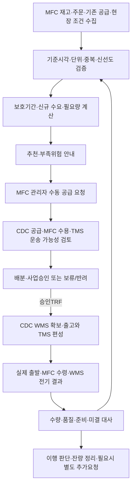

# SCM 비즈니스 로직 — 칠곡 DC→MFC 공급 계획·재고 보충

문서 버전: 1.1 · 작성·상세 보강일: 2026-10-20 · 상태: 프로젝트 설계안 / 운영 정책·연계 계약 승인 전

> SCM은 **어느 MFC에 어떤 상품을 얼마나, 언제 사용 가능하도록 공급할지** 판단하고, 공급 요청·배분·승인·변경·추가 공급·이행을 관리한다. WMS가 재고를 확정하고, TMS가 운송을 계획·수행하며, MFC가 현장 작업을 실행한다. 본 문서는 실제 서비스 운영·구현·통합시험 완료 보고서가 아니다.

## 표기 규칙

- 상태 태그: 제목의 `[설계안]`·`[기본 설계안]`·`[선택·기본 비활성]`·`[승인 전]`·`[명칭 제안]`·`[제안·미실행]`. 자료의 지위 구분(원문 명시·이번 설계안·기존 정책 후보·가정·확인 필요)은 0.2절 참조.
- 규칙 ID `SCM-D01`~`SCM-D12`는 처리 규칙, `ST-xx`는 23장 수용 검증 시나리오 ID다.
- DC = CDC(용어집 표준). 본문의 "칠곡 DC"와 "CDC"는 같은 중앙 물류센터를 가리킨다.
- 약어(TRF·TIN·Transit 등)는 [용어집](glossary.md)을 따른다.

## 목차

- [0. 문서 기준·범위·자료의 지위](#0-문서-기준범위자료의-지위)
- [1. SCM의 고유 책임과 다른 영역의 경계](#1-scm의-고유-책임과-다른-영역의-경계)
- [2. 하위 업무·참여자·전체 흐름](#2-하위-업무참여자전체-흐름)
- [3. 계획 기준정보·정책·스냅샷](#3-계획-기준정보정책스냅샷)
- [4. 재고·수요·공급 수량 사전](#4-재고수요공급-수량-사전)
- [5. 신규 수요와 확정 고객 약속의 분리](#5-신규-수요와-확정-고객-약속의-분리)
- [6. 보호기간과 사용 가능시각](#6-보호기간과-사용-가능시각)
- [7. 기존 공급 I의 적격성·중복·불명](#7-기존-공급-i의-적격성중복불명)
- [8. 보충 필요량 계산·정책 선택](#8-보충-필요량-계산정책-선택)
- [9. 운송 배수·추천 상한·다품목 수용](#9-운송-배수추천-상한다품목-수용)
- [10. MFC 공급 요청·접수·변경](#10-mfc-공급-요청접수변경)
- [11. 공급 부족과 센터별 배분](#11-공급-부족과-센터별-배분)
- [12. 공급 사업승인·부분승인·추가승인](#12-공급-사업승인부분승인추가승인)
- [13. 승인 TRF 실행·진행 추적](#13-승인-trf-실행진행-추적)
- [14. 상태와 수량 불변식](#14-상태와-수량-불변식)
- [15. 미출발 잔량·변경·취소](#15-미출발-잔량변경취소)
- [16. 부분수령·격리·손실·추가 공급](#16-부분수령격리손실추가-공급)
- [17. CDC 공급 부족·과잉·기한 위험](#17-cdc-공급-부족과잉기한-위험)
- [18. 업무 예외·운영자 조치](#18-업무-예외운영자-조치)
- [19. 시스템 연계 계약·데이터 계보](#19-시스템-연계-계약데이터-계보)
- [20. 동시성·멱등·응답불명·승인 보존](#20-동시성멱등응답불명승인-보존)
- [21. 운영 화면·권한·관측](#21-운영-화면권한관측)
- [22. 실적·이행 지표](#22-실적이행-지표)
- [23. 수용 검증 시나리오 [제안·미실행]](#23-수용-검증-시나리오-제안미실행)
- [24. 운영 정책·계약 승인 대기](#24-운영-정책계약-승인-대기)
- [25. 자료 대응·근거·변경 기록](#25-자료-대응근거변경-기록)

## 0. 문서 기준·범위·자료의 지위

### 0.1 현재 프로젝트 기준

| 항목 | 적용 기준 |
|---|---|
| 공급망 | 칠곡 DC1곳→초기 부산 MFC5곳, 확장 검토26곳. 실제26곳 공급관계는 TMS 문서의 확인 필요 사항 유지 |
| 공급 시작 | 승인된 CDC 초기 보유 재고가 등록된 이후 |
| 센터 간 공급 | MFC 필요 제시/수동 요청→SCM 사업승인→CDC WMS 확보/출고→TMS 운송→MFC 현장 수령·자체 입고 확정→CDC Transit대사 |
| 실행 제약 | 승인 요청1건·TRF1건·실제출발1회. 같은 TRF의 후속 분할출발 금지 |
| 상품 단위 | 공통 E/B SKU, 센터별 재고·예약 분리. BOX/PLT는 취급 단위이며 상품 수량과 별도 |
| 고객 판매 | 지정 MFC의 현재 적격 현물만 사용. 예정 공급으로 고객 주문을 예약판매하지 않음 |
| 제외 | 공급업체 구매·실제 CDC 입고/ASN·공급사 포털·매입/정산/지급, MFC간 재고이관, 출발후 타MFC 전환·CDC반송 |

### 0.2 원문·설계·확인 필요

- **원문 명시:** 현재 WMS/TMS/MFC/OMS/Commerce/Delivery와 사용자 지시에서 확인한 업무 경계·실행 제약. 문서에 적혀 있다는 사실과 실제 운영에서 검증됐다는 사실은 다르다.
- **이번 설계안:** 아래의 계획 수량 사전·계산·추천·배분 후보·상태·계약·수용 시나리오. 운영 채택·실제 설정값은 별도 승인 대상이다.
- **기존 정책 후보:** 이전 WMS의 수동 요청, 일반6시간/긴급2시간, 공급가능량50% 초과 추가승인 등. 이번 SCM에서 해당 책임과 검토 지점을 정의하되 삭제 전의 '확정' 표기만으로 현행 운영 승인값으로 복원하지 않는다.
- **가정:** 모든 계산 사례의 수량·날짜·배수·수요·시간. 실제 센터 마스터 값이 아니다.
- **확인 필요:** 예측방법·정책값·승인선·배분 우선순위·SLA·데이터 최신성·실제 시간창/용량 등. 미설정을0/무제한/정상으로 대체하지 않는다.

기존 SCM 조사자료는 PO·공급사·ASN까지 다루지만, 현재 범위가 우선한다. 상용제품의 기능·수식·상태를 PMart의 검증된 구현으로 소개하지 않는다. 외부 제품의 최신 동작을 이번 작성에서 재검증한 것은 아니다.

## 1. SCM의 고유 책임과 다른 영역의 경계

| 영역 | 해당 영역이 확정 | SCM의 역할 |
|---|---|---|
| SCM | 계획 수요·보충정책·필요량·공급배분·공급승인·미충족·추가공급·이행판단 | 자기 계획·사업승인 원장 관리 |
| CDC WMS | CDC 현물·예약·LOT/LOC/LPN·확보·피킹/검품·실상차·TOUT·원출발Transit | 적격 공급가능량·준비예상·출발/미정산 결과 소비, 승인 이관 전달 |
| MFC | 자기 MFC 현물·예약·품질별 수량·TIN·원장 | 재고/예약·실수령 전기 결과 소비. SCM 직접 수량전기0 |
| MFC | 필요 사유·수동요청·수령창·현장 용량·계수/검수·적치·판매준비 사실 | 현장 필요/제약 소비, 추천·승인·ETA/미충족 제공 |
| TMS | DC→MFC 실차·기사·구획·순회·시간표·운송·ETA·인계증빙 | 운송 가능성·기한·적재상한을 조회하고 승인 이관/변경 전달 |
| OMS | 고객 주문·유효 미이행 약속·취소·클레임·환불 판단 | 수요·약속·품절/이행불가 사실 소비, 공급 영향 제공. 고객 약속 삭제/대체 금지 |
| Commerce | 고객 상품조회·장바구니·구매 입력·고객 표시 | 계획 수요 근거가 되는 적절한 집계만 참조. 장바구니를 확정 주문으로 보지 않음 |
| Delivery | 고객 라이더 배차·실제 픽업/전달/회수·ETA | 고객배송 지연/실패가 주문 수요에 반영된 OMS 결과 참조. 간선 배차를 맡기지 않음 |
| 관제/BackOffice·승인자 | 권한·정책·예외승인·사건 담당 | 위임된 공급 승인 역할을 검사하고 결과·증빙 유지 |
| BI | 분석 모델·지표·장기 집계 | 공급 계획/승인/이행 원천 제공. BI가 승인·원장 수정 금지 |

센터 **내부** 선반 자동 보충/MOV는 WMS 재고 실행이다. SCM은 센터 **간** 공급계획을 관리하며 같은 부족량으로 내부MOV와 새TRF를 각각 중복 생성하지 않는다. 같은 직원이 여러 화면을 사용해도 소유권은 유지한다.

## 2. 하위 업무·참여자·전체 흐름

### 2.1 하위 업무

| 업무 | 판단 결과 |
|---|---|
| 공급 기준정보·정책 | 유효 공급센터/대상MFC/SKU·단위·기간·정책버전 |
| 수요 근거 | 확정 미이행 수요와 겹치지 않는 신규 예측수요·신뢰도 |
| 기존 공급 대사 | 같은 공급의 유효 잔량·사용가능시각·중복/불명 |
| 보충 계산 | 필요한 시점·수량·추천/미충족·계산 근거 |
| 요청 접수 | MFC 요청·버전·중복·변경/철회 적격 |
| 희소 공급 배분 | 센터별 승인 후보·미충족·우선순위/수동 판단 |
| 공급 사업승인 | 승인/부분승인/반려·승인자·조건·유효버전 |
| 실행 요청·조율 | WMS 확보/출고·TMS 편성 결과 연결 |
| 이행·잔량 | 미승인·미확보·미출발·미수령·격리·준비대기 구분 |
| 추가 공급 | 원수요/기존공급/대체분을 대사한 별도 요청·승인 |
| 감사·복구·실적 | 원계보·불명 복구·지표 원천·미결 담당 |

업무 행은 마이크로서비스 개수가 아니다. 실제 배포·DB·화면 배치는 별도 결정이다.

### 2.2 참여자

MFC 관리자는 현장 사유·기존 공급·희망 사용시각을 확인해 요청한다. SCM 계획 담당자는 계산·배분 후보와 위험을 정리한다. 공급 승인자는 권한 범위에서 사업승인을 한다. CDC 담당자는 WMS의 공급가능/확보·출고 결과를 제공하고, TMS 담당자는 운송 가능성을 확정한다. 품질·재고손실·고객환불 승인자는 별도다. SCM 공급승인이 그 승인을 대체하지 않는다.

### 2.3 정상 흐름



도식은 업무 의존 관계이며 전체를 한 동기 호출/DB 거래로 묶는다는 뜻이 아니다. 추천은 요청·승인이 아니고 승인·배차도 실제 재고 입고가 아니다.

## 3. 계획 기준정보·정책·스냅샷

### 3.1 필수 설정

| 설정 | 적용 단위·검증 |
|---|---|
| 공급 경로 | 출발CDC·목적MFC·SKU 취급·유효기간. 동일센터/미승인 경로 금지 |
| 수량 단위 | SKU 기준 판매단위·운송 배수·포장환산버전. 배수>0·정확수·승인 규격 |
| 수요 방식 | 예측사용 여부·기준기간·실적 기준·주문소비 방식·대체수동 입력 |
| 보충 방식 | 센터/SKU/기간마다 활성 정책 하나. 보호기간 목표 방식 또는 승인된 다른 방식 |
| 안전량/최소구색 | SCM 정책값·버전·효력일. WMS가 실행하는 안전보호 설정과 매핑/반영상태 |
| 검토 주기·기한 | 다음 검토·필요 사용시각·회차/마감·현장 준비 조건 |
| 승인·배분 | 역할·추가승인 조건·정책 우선순위·동률·미충족 처리 |
| 신선도 | 재고·주문·공급·운송·현장 데이터별 허용지연·재조회 조건 |

정책 우선순위는 제안상 `유효 센터+SKU 개별설정→승인된 그룹설정→전역설정`으로 둔다. 동순위 중복·유효기간 충돌·Min>Max·음수 안전량·배수0은 설정 오류다. 명시적0과 미설정을 구분하며 실제 정책값이 승인되기 전 자동 공급확정을 하지 않는다.

안전량 정책 변경은 SCM 승인과 WMS 실행설정 반영결과를 각각 추적한다. 전송 성공만으로 판매 제한이 전센터에 반영됐다고 표시하지 않는다. 품질/리콜 차단은 해당 최신 안전정책을 우선 적용한다.

### 3.2 계산 스냅샷

`planRunId`, 센터/SKU·기준단위·`asOf`, 보호기간·정책/예측버전, WMS 재고/예약버전, OMS 약속버전, 기존 공급 행/수령ID, TMS 계획/ETA버전, MFC 창·준비/공간버전을 연결한다.

모든 원천이 같은 DB나 완전히 같은 시각이라고 가정하지 않는다. 허용 시차·누락·중복·인과관계를 확인해 `계산가능/참고값/보류`를 표시한다. 데이터가 바뀌면 새 스냅샷으로 재계산하되 승인/기확보/실출발 사실은 보존한다.

### SCM-D01 — 계산에 사용할 정책과 원천 스냅샷을 확정하는 처리

**목적·시작:** 정기 검토 또는 판매급증·품질차단·공급지연 등의 사건이 생기면 해당 센터/SKU의 보충 필요를 다시 판단한다. 사건을 받았다는 사실만으로 새 요청을 만드는 것이 아니라 어떤 정책과 어느 시점의 사실로 계산할지 먼저 정한다.

**입력:** 센터/SKU·단위, 정책 유효기간/버전·예측기준·안전량·배수, MFC 현물/예약/품질·기한, OMS 유효약속, 기존공급 계보, TMS ETA와 MFC 수령/준비조건을 받는다. 각 원천의 시각·버전·조회상태가 필수다.

**정상 순서:**
1. 센터/SKU의 공급경로·취급·접근권한을 확인하고 유효정책 하나를 선택한다.
2. 정상현물·예약차감후가용·품질제외·이행부족을 구별해 입력 필드를 검증한다.
3. OMS 약속과 기존공급을 원행/원사건으로 조회하고 중복·누락/버전간극을 확인한다.
4. 보호기간과 사용준비시점에 필요한 TMS/MFC 데이터를 연결한다.
5. 승인된 허용시차와 최신성 조건을 검사해 CALCULABLE/REFERENCE_ONLY/INPUT_PENDING으로 구분한다.
6. 입력 묶음·선택정책·근거/누락을 planRunId에 보존한 뒤 계산단계로 넘긴다.

**판단 분기·복구:** MFC 재고조회가 실패한 경우 H0으로 계산해 대량추천하지 않는다. 정책SS가 없는 경우0을 넣지 않는다. 정책이 동순위로2개면 임의선택하지 않는다. 원천들이 시간차로 같은 수령을 H와I에 동시에 보여주면 원receipt 대사/재조회로 넘긴다. 영향없는 다른 센터/SKU는 계산을 계속할 수 있다.

**완료·운영자 조치:** 계산가능 스냅샷 또는 누락항목·담당·다음조회/보완사유가 남아야 한다. 운영자는 승인된 정책값/원천매핑을 보완하고 새버전으로 재검토한다. 조회사본 수치를 고쳐 원장 정합성을 맞추지 않는다. 같은 planRunId 응답유실은 저장한 원결과로 복구한다.

## 4. 재고·수요·공급 수량 사전

| 기호/수량 | 정의 | 중복 방지 |
|---|---|---|
| H | 기준시각에 정상·기한·현재 사용준비 조건을 충족한 MFC 적격 현물. **고객 예약 차감 전** 수량 | WMS의 예약 차감 후 가용값으로 대체하지 않음 |
| C | 보호기간에서 책임져야 하는 유효 미이행 고객 약속. 이행불가/BLOCKED도 의무가 유효하면 포함 | WMS 연결예약과 다름. 예약 해소만으로 약속 삭제 금지 |
| I | 보호기간 안에 실제 사용 준비 가능한 기존 공급의 **유효 미수령 잔량** | 승인·확보·출발을 같은 공급으로 연결, 한 번만 포함 |
| P(t) | 기수령·기전기됐지만 H에 아직 포함되지 않은 물량 중 시각t까지 정상 사용준비될 것으로 확인한 양 | 같은 물량을 H·I와 동시 계상하지 않음. 준비결과 불명·격리는 제외 |
| F | C와 겹치지 않는 보호기간의 신규 예상 수요 | 예측에 이미 포함한 확정 주문을 다시 더하지 않음 |
| SS | 적용 정책의 안전량/보호목표 | H에서 이미 뺀 값이면 다시 차감 금지 |
| S | 본 설계의 목표 `F+SS` | 현재 실재고가 아님 |
| IP | 계획 재고포지션 `H−C+I` | 부족이면 음수 허용 |
| N | 원수요 부족량 `max(0,S−IP)` | 배수 올림 수량과 구분 |
| 요청량 Qr | MFC가 실제 제출한 수량 | 추천량을 수정할 때 사유·버전 보존 |
| 승인량 Qa | SCM이 해당 버전에 사업승인한 수량 | WMS 확보/실출발/수령과 다름 |
| 확보량 Qalloc | CDC WMS가 실제 예약/할당한 수량 | 승인량을 확보량으로 표시 금지 |
| 출발량 D | 해당 TRF의 유효 실제 출발 수량 | 실피킹/상차완료를 출발로 보지 않음 |
| 수령량 R | MFC TIN 확정 누계, 정상+격리 | 정상합격량과 별도 |
| 사용준비량 Uready | 정상·기한·적치/운영 조건까지 충족한 양 | TIN/차량도착만으로 확정 금지 |

현재 격리·불량·판매 부적격·리콜/차단 수량은 H에 넣지 않는다. 미래 특정 시점에 기한 적격을 잃는 현물은 시간대별 계획에서 제외하며 **실물 원장을 차감하지 않는다.** 실제 LOT·기한 판정/FEFO·예약·피킹은 WMS가 수행한다.

이 문서의 IP는 보충계획용이며 고객 신규판매 가능량과 다르다. 고객 주문은 Commerce/OMS가 자기 MFC의 실제 확보 결과로 처리한다.

## 5. 신규 수요와 확정 고객 약속의 분리

### 5.1 원천과 기준

OMS의 유효 미이행 약속을 주문/행·수량·필요시점·취소/인계 상태와 연결한다. 고객 주문취소·품절 선택·클레임 판정은 OMS 결과를 소비한다. SCM이 주문량을 줄이거나 환불을 실행하지 않는다.

판매 실적에는 집계 기준(주문확정/실제인계/전달 중 선택)·취소/반품 처리·영업시간·품절구간·센터/SKU를 명시한다. 기준이 다른 숫자를 섞지 않는다. 품절 중 판매0은 수요0의 증거가 아니다. 이력부족·누락·신규SKU는 신뢰도 부족/승인 수동수요를 사용하고 자동0으로 축소하지 않는다.

### 5.2 초기 예측 후보 [설계안]

유효 비교일의 동일 기준 판매량 이동평균을 기초 후보로 사용할 수 있다. 예를 들어3일 `10,14,12`이면 평균12개/유효일이다. N일 수·요일/시간대 보정·품절일 처리·반품 처리·신규SKU 초기값은 승인 입력이다. '매일12개'로 모든 MFC/SKU를 고정하지 않는다.

부분 영업일 수요를 계산할 때 일평균을 무조건24시간으로 나누지 않는다. 승인된 영업/시간대 가중치·판매 가능시간을 사용한다. 할인/행사 기능이 현재 제외됐다면 예측 기능을 이유로 프로모션 공급 실행을 추가하지 않는다.

### 5.3 예측 소비

예측이 **기준시각 이후 전체 수요(기존 약속 포함)**를 나타내는 경우, 같은 센터/SKU/시간구간에 매핑되는 약속을 소비해 `F=max(0,남은 전체예측−예측에 포함된 C)`로 만든다. 이미 '미확정 신규수요만' 예측한 모델이면 C를 또 빼지 않는다.

예: 남은 전체예측20, 그 안의 약속6이면 F14·C6이다. 예측이4이고 약속6이면 F0·C6이며 약속을4로 축소하지 않는다. 기간 전체 예측에 과거 판매까지 들어 있다면 먼저 과거 소비를 분리한 잔여 예측을 만들어야 한다. 서로 다른 기간의 C를 무작정 예측에서 차감하지 않는다.

원수요 키·주문행·예측버킷·소비량을 남겨 한 약속이 여러 버킷이나 여러 엔진에서 두 번 반영되지 않게 한다.

### SCM-D02 — 확정 고객약속을 예측에서 소비해 신규 수요를 만드는 처리

**업무 목적·입력:** 이미 책임져야 하는 주문과 아직 발생하지 않은 예상수요를 구분한다. 센터/SKU·예측버킷·예측이 의미하는 기간/시점, OMS 유효주문행·미이행수량·기한·취소/인계 결과, 실제실적의 집계기준을 받는다.

**정상 순서:**
1. 예측이 기간전체·기준시각이후 전체·신규미확정수요 중 어느 것인지 확인한다.
2. 기간전체 예측이면 과거소비를 먼저 분리한다. 현재H는 이미 과거 실제출고를 반영한 값이므로 과거판매를 C로 다시 빼지 않는다.
3. 남은 예측버킷과 같은 센터/SKU·기간에 대응되는 유효 고객약속만 소비 대상으로 매핑한다.
4. 포함된 약속은 예측에서 빼 F를 만들고 약속 자체는 C에 보존한다. 주문이 예측을 넘으면 F0이며 C를 축소하지 않는다.
5. 품절·취소·지연 이벤트로 입력이 바뀌면 소비배분 버전을 다시 만든다. 원주문행과 총소비량을 보존한다.
6. 예측의 신뢰도·미포함구간·소비근거와 F/C를 계획에 제공한다.

**사례·분기:** 남은 전체예측20에 이미약속6이 포함됐다면 F14/C6이다. 신규미확정만14를 예측한 모델이면 C6을 다시 빼 F8로 만들지 않는다. BLOCKED약속2는 WMS 연결예약에서 빠졌더라도 OMS상 의무가 유효하면 C에 남긴다. 배송실패/환불을 SCM이 주문취소로 추정하지 않고 OMS의 유효상태를 확인한다.

**실패·완료:** 버킷정의·집계기준이 불명이면 FORECAST_BASIS_PENDING으로 보류하고 승인 수동수요 또는 명확한 대체기준을 요청한다. 데이터가 적다는 이유로 항상0을 반환하지 않는다. F와C의 근거가 재현되고 하나의 약속을 여러버킷에서 중복소비하지 않으면 이 단계가 끝난다. 이 처리 자체는 고객약속·재고를 변경하지 않는다.

## 6. 보호기간과 사용 가능시각

보호기간은 기준시각부터 **다음 검토에서 결정할 공급이 실제 사용 준비되는 시각**까지를 기본 설계로 한다. 단순 `리드타임+검토주기` 근사는 마감·휴일·DC회차·MFC 수령창·검수/적치 지연을 반영할 때만 사용한다.

1. 다음 검토시점과 CDC 준비/출고 마감을 확인한다.
2. TMS의 가능한 운행·도착·인계시각을 받는다.
3. MFC의 수령창·인력·검수/적치·판매준비 예상과 연결한다.
4. 실제 사용준비 예상 및 위험범위를 계산하고 그때까지의 C/F·기한 적격을 평가한다.

고객영업09~24시는 물류 입고창이 아니다. TMS의03:25 상차 예시는 DC/MFC 새벽창이 승인돼야 실행할 수 있다. 새벽창이 없으면 SCM은 전날 보충·승인된 다음회차·위험 안내를 검토하며 가상의 새벽 수령창을 생성하지 않는다.

**시간대별 부족 검증:** 기간 말 IP/S가 적정해도 오전에 부족하고 오후에 공급이 올 수 있다. 수요/공급 사건시각마다 예상 잔량과 의무를 평가해 최초 부족시각·최대부족·다음 회복시각을 별도 표시한다. 예: 아침현물5, 오전미이행6, 오후입고10이면 기간말 총량만 보고 오전충족으로 표시하지 않는다.

## 7. 기존 공급 I의 적격성·중복·불명

### 7.1 인정 조건

| 공급 단계 | 계획 처리 |
|---|---|
| 추천/미제출·미승인 요청 | I에 넣지 않음. 중복 요청을 막기 위한 진행의도는 별도 추적 |
| 승인됐으나 미확보·운송 불가/미확인 | 확정 사용가능 공급으로 인정하지 않음. 승인미이행/보류로 표시 |
| 유효 승인·확보·실행가능 운송과 준비시각 근거 확보 | 실제 가용성·확정 정도를 표시하고 승인된 계획인정 정책 범위의 미수령량만 I |
| 실제 출발·기한 내 사용준비 가능 | 원출발의 유효 미수령 잔량을 I로 연결 |
| 미수령이나 기한 초과·ETA/품질 불명 | 해당 기간 I에서 제외/보류. Transit 원장을 손실로 지우지 않음 |
| 실제 수령·정상·준비완료 | 같은 물량을 I에서 제거하고 WMS/현장 정합 스냅샷의 H에 포함 |
| 실제 수령·격리·미판정·준비대기 | 미도착 I로 남기지 않음. 정상 H에 자동 포함하지 않고 대기량·예상준비를 별도 추적 |

입고됐으나 준비대기인 물량은 별도 P(t)와 시간대별 준비전환 사건으로 다룬다. MFC 기전기·품질 적격·MFC의 준비예상이 확인된 범위만 해당 기한의 P(t)로 인정한다. **이 물량은 미수령 I와 별도 필드**이며, 준비완료가 H에 반영되면 같은 수량을 P에서 제거한다. 전기/준비결과가 불명이면 확정 사용가능으로 세지 않고 계산을 참고/정합대기로 표시한다. 그 양만큼 무조건 추가 승인하지 않는다.

### 7.2 고유 공급 계보

원수요→요청/행→승인TRF/행→WMS 확보→TMS 운행/출발→MFC receipt/TIN을 연결한다. 승인24·확보24·출발24는 공급72가 아니라 같은24다. 여러통지·계획버전·회차변경도 신규 공급이 아니다.

같은 원수요에 미승인/미확보 요청이 남아 I가0이어도 요청을 무한 생성하지 않는다. 기존 요청의 보완·변경·미충족 검토를 먼저 제시하고 새 요청은 원수요·기존 의무·추가분을 명시해 중복 여부를 검증한다.

### 7.3 TIN 전기와 CDC ACK 사이

MFC TIN은 성공했으나 CDC Transit대사가 늦으면 양쪽 원천을 단순 합산하지 않는다. `receiptId`로 기수령을 확인하고 I에서 같은 수령량을 제거한다. H의 스냅샷이 아직 수령전이면 H에 임의로 가산하지 않고 신선도/정합대기로 재조회한다. 응답불명을 공급취소나 미수령 확정으로 바꾸지 않는다.

### SCM-D03 — 기존 공급의 유효 잔량과 사용 가능시각을 갱신하는 처리

**입력·사전 조건:** 원요청/승인TRF·행·버전, CDC 확보·실출발, MFC 원수령/TIN·품질·준비, TMS 최신 ETA, 보호기간을 받는다. 서로 다른 단계의 숫자가 같은 공급을 뜻하는지 연결할 수 있어야 한다.

**정상 순서:** 원공급별 계보구성→취소/미확보/실행불가 범위제외→확보/운송/현장 근거로 인정가능 미수령량 판정→수령ID별 기수령량제거→기한내 사용준비 가능량만 I에 포함→기수령 준비대기는 P(t), 실제준비된 것은 H스냅샷으로 연결한다. 공급의 현재단계가 바뀌어도 이전단계를 남겨 여러공급으로 더하지 않는다.

**부분수령 사례:** 같은 공급24가 승인24/확보24/출발24이고10개를 받았다면 미수령은14다. 받은10 중 정상준비8/격리2이고 정상8이 H에 반영됐으면 H에8·기한유효 I14가 되며24 또는수령10을 I에 또 남기지 않는다. 기수령 준비대기량은별도 P로 한 번만 다룬다. 수령/품질/준비 결과가 아직 불명이면 해당구간은 확정충족으로 취급하지 않는다.

**통지지연 분기:** TIN10 성공 후 CDC가 아직Transit24를 보인다면 원receiptId로 기수령10을 확인해 계획의 공급중복을 제거한다. CDC 장부를 SCM이 직접14로 수정하지 않는다. H스냅샷까지 과거라면 재조회·정합대기로 표시하고 임의8을 더하거나 부족으로10을 새승인하지 않는다.

**지연 분기·운영자 조치:** 미수령14의 준비예상이 보호기간 밖으로 늦어지면 해당기간 I에서 제외/재평가하되 원Transit14를 손실처리하지 않는다. 담당자는 기한위험·대체요청 필요·기존진행공급/추가계획 중복을 함께 확인한다. 기존승인/미확보 요청은 I가0이어도 진행의도로 남겨 중복요청을 막는다.

**완료·복구:** 공급별 인정/제외량·이유·시각·근거버전과 H/I/P 전환이 재현돼야 한다. 늦은 사건은 원공급에 연결해 재계산하고 새 공급을 만들지 않는다. 정상수령 누계와 현재잔고를 동일시하지 않는다.

## 8. 보충 필요량 계산·정책 선택

### 8.1 보호기간 목표 방식 [기본 설계안]

```text
S = F + SS
IP = H - C + I
N = max(0, S - IP)
```

이 기본식의 전제는4장의 수량정의·7장의 공급대사·동일 단위/기간이며 별도 기수령 준비대기 P가 없거나 이미 H에 반영된 상태다. 유효 P(t)가 있으면 같은 평가시각에 `IP(t)=H−C(t)+I(t)+P(t)`, `N(t)=max(0,S(t)−IP(t))`로 검토한다. 미래 기한부적격 현물은 해당 평가시각의 H 적격분에서 제외하고 그 근거를 남긴다. 물리원장은 바꾸지 않는다. 실제 시간대별 부족은6장의 사건순서를 함께 검증한다.

예: H18/C6/I24/F72/SS18이면 S90·IP36·N54다. H2/C5/I0이면 IP−3이다. IP를0으로 잘라 미이행3을 숨기지 않는다. F0/SS0이어도 유효C가H보다 크면 부족이 발생할 수 있다. SS0은 승인된 예시값이지 운영 기본값이 아니다.

### 8.2 품질 보류와 고객 약속

가정: H10·C6·I0, 안전/추가제약0이면 IP4다. 예약품2가 격리되면 H8·C6·IP2다. 정상 현물에 실제 연결된 WMS 예약은4이므로 신규판매한도는8−4=4로 유지될 수 있다. 격리로 이행이 막힌 약속2는 C에 남는다.

SCM은 실제 예약4를 C로 대체해 약속2를 지우지 않는다. 반대로 C6을 '현재 정상재고 연결예약'으로 WMS에서 재차감하지 않는다. 대체 확보·고객 결품 판단은 WMS/MFC/OMS 결과를 소비한다.

### 8.3 Min/Max 대안 [선택·기본 비활성]

정책을 Min/Max로 선택했다면 `IP와 Min의 비교→max(0,Max−IP)→배수/상한 검증`으로 계산할 수 있다. `<` 또는 `≤` 경계와 반올림 후Max 초과 허용 여부를 정책에 명시해야 한다. 예시정책 `<`: IP4/Min5/Max25/배수6이면 순부족21·배수희망24, IP5이면 미발생이다.

같은 센터/SKU/기간에 보호기간 목표 방식과 Min/Max·DDMRP가 각각 새 요청을 만들지 않는다. DDMRP 버퍼/스파이크 모델은 이번 기본 구현에 채택하지 않는다. 연구자료의 개념과 현재 적용정책을 구분한다.

### 8.4 추천·알림과 실제 요청

등록 임계치·현재/미래부족·기한위험을 근거로 추천·팝업·알림을 제공한다. 현재 원문의 수동 요청 경계를 기본으로 유지하여 MFC 관리자가 확인·제출한다. 자동 제출/승인 기능을 단순 재계산·경보 이벤트로 우회하지 않는다. 임계치 비교경계는 센터내부 선반MOV의 '최소이하 자동생성'과 별도다.

### SCM-D04 — 시간대별 부족을 판정하고 필요량을 산출하는 처리

**시작·입력:** 일관된 스냅샷과 선택정책이 준비됐을 때 H/C/I/P·F·SS·다음검토·CDC마감·TMS운송·MFC준비를 받는다. 목표량은 SCM정책이며 실제창/운송시간은 해당 주관의 결과다.

**정상 순서:**
1. 다음검토에서 공급할 물량이 언제 실제로 사용준비 가능한지 순서대로 역산한다.
2. 그때까지의 주문기한·예측버킷·입고/준비전환·기한상실을 시간순 사건으로 만든다.
3. 평가시점별 적격H·의무C·유효I/P와 해당정책 목표S를 계산한다.
4. IP는 음수까지 보존하고 부족량N만0이상으로 제한한다.
5. 기간말 필요량과 별도로 최초부족시각·기간중최대부족·예정회복을 기록한다.
6. 근거스냅샷·정책·필요수량·필요시각·신뢰도를 추천단계에 전달한다.

**사례·분기:** 아침현물5에 오전약속6, 오후입고10이면 기간말 재고가 남아도 오전부족1은 존재한다. 당일 공급이 그 오전을 맞출 수 없다면 전날보충/다른회차 가능성을 검토하되 가상의 새벽창으로 해결하지 않는다. H18/C6/I24/F72/SS18의 단순조건은 N54이지만 그54가 언제 필요한지까지 표시해야 정상 추천이다.

**실패·복구:** 준비시각이 불명인 공급을 즉시 I로 인정하지 않는다. 시간대별 모델에서 준비대기 P의 위치를 설명할 수 없으면 계산을 참고/보류로 표시한다. 계산 도중 출발/수령/약속이 바뀌면 새스냅샷으로 다시 계산하고 기존승인·실행을 덮지 않는다. 완료조건은 수량·시각·미충족/불명 이유가 함께 결정되는 것이다.

## 9. 운송 배수·추천 상한·다품목 수용

동일 SKU 기준단위 배수 m>0, 원부족N≥0인 가정에서:

```text
배수 희망량 W = m × ceil(N / m)       (N=0이면 W=0)
단품 기준 실행상한 B = min(CDC 신규공급가능량,
                         MFC 추가수용량,
                         TMS가 해당 운행/기한에 허용한 물량상한)
배수 상한 K = m × floor(B / m)
추천 후보 Q = min(W, K)
원수요 미충족 = max(0, N - Q)
원수요 초과 완충 = max(0, Q - N)
```

N54/m12/B48이면 W60/K48/Q48·원부족미충족6이다. B10/m12이면 K0이며12로 올려 강제공급하지 않는다. N5/m6/B12이면 Q6·원수요초과1로 표시하며 기한/보관/과잉 정책을 재검토한다. 운송배수는 공급사 MOQ/구매배수와 다르며 이번 범위에 구매 MOQ를 도입하지 않는다.

다품목은 품목별 상한의 최소값만으로 전체 적재를 보장하지 않는다. 각 SKU가 차량에 들어가도 합계 중량·부피·냉동/냉장 구획·MFC공간을 초과할 수 있으므로 전체 화물안으로 TMS/MFC 검증을 받는다. 이 결과는 SCM 승인후보의 제약이며 SCM이 구획·운행을 대신 확정하지 않는다.

WMS의 공급가능량이 이미 기존예약·안전보호·품질을 제외했다면 다시 빼지 않는다. 자기 신규요청을 검토하는 동안의 임시보호와 기확보를 구분하고 동일 물량을 이중 차감하지 않는다.

### SCM-D05 — 필요한 수량을 실제 요청 가능한 추천안으로 바꾸는 처리

**입력:** 원부족N·필요시각·SKU운송배수, CDC 신규공급가능량, MFC 추가수용량, TMS 적격상한·전체화물 조건을 받는다. 업체MOQ와 센터간 운송배수를 혼동하지 않는다.

**정상 순서:** 단위/배수검증→N의 배수희망량 산출→동일기준의 실행상한을 배수내림→후보Q/원부족미충족/배수초과완충 분리→다품목 전체공간·구획·기한 검증→원수요/기존공급·현재미해결요청 중복검사→추천과 이유·유효스냅샷 제시 순이다.

**사례:** N54·배수12·실행상한48이면 희망60/추천48/원부족미충족6이다. 희망60과 상한48 차이12를 원수요미충족12라고 표시하지 않는다. 상한10이면 배수12를 강행하지 않고0으로 추천한다. N5·배수6·상한12이면 후보6의 초과1을 과잉/기한정책으로 검토한다.

**다품목·실패 분기:** 품목별 계산이 통과해도 합산 냉동구획이 초과하면 전체화물안을 다시 검토한다. TMS가 제공한 상한은 운송검증 결과이며 SCM이 임의로 늘리지 않는다. 미설정 물성·상한은 무제한으로 채우지 않는다. 추천을 만들 수 없는 경우는 원부족0과 구분해 보완대기/제약불가로 반환한다.

**완료·실행 경계:** 원부족·후보·미충족·초과·병목·원스냅샷이 보존되면 추천이 끝난다. 경보를 보냈다고 MFC가 요청한 것이 아니고 WMS 재고예약이나 SCM 사업승인도 아니다. 관리자는 실제요청량/희망시각·사유를 확인해 제출하며 추천수정은 새버전으로 남긴다.

## 10. MFC 공급 요청·접수·변경

### 10.1 요청 입력

원센터·SKU/행·단위·수량·희망 **사용준비 시각** 또는 도착/인계기한의 의미, 일반/긴급·사유·추천참조·기존요청/공급·수령제약·요청ID/버전·인증주체를 받는다. MFC 로컬 DRAFT/SUBMITTED와 SCM 접수/승인을 별도 상태로 연결한다.

동일 요청·동일 본문은 원결과, 동일 키 다른 본문은 충돌이다. 원요청ID가 달라도 같은 원수요/기간의 기존 미해결 요청을 검사한다. 합당한 추가 수요는 허용하되 추가분·사유·기존 공급 반영 근거를 남긴다.

추천54를 요청60으로 바꾸거나 반대로 줄이면 배수·시간·현장제약과 변경사유를 검증한다. 고객 E/B 구성낱개10개 구매제한은 센터간 보충 요청에 적용하지 않는다.

### 10.2 변경·철회

접수/심사중은 새 버전과 사유를 기록한다. 승인후 변경은 이전 승인·기확보·TMS배정·실물 작업 영향을 대사하고 재심사한다. 실제출발/인계 여부가 불명이면 단순 철회 성공을 반환하지 않는다. 이미 출발했다면 미출발취소로 되돌리거나 타MFC로 전환하지 않는다.

### SCM-D06 — MFC의 수동 요청을 받아 심사 가능한 원요청을 만드는 처리

**목적·입력:** MFC관리자가 제출한 원센터·행/SKU·양수수량/단위·희망사용시각·일반/긴급사유·기존공급·추천/원수요참조·현재버전·권한을 검증한다. MFC 로컬저장/전송상태와 SCM의 접수/심사는 별개다.

**정상 순서:** 인증/센터접근확인→동일요청키·기존본문/결과조회→단위/배수/목적/기한의미검증→같은원수요의 진행요청/승인·대체분 대사→유효 요청버전 내구저장→접수결과/보완항목 반환→심사대상 등록 순이다.

**중복과 정당한 추가:** 같은 원수요에 미확보요청12가 있는데 새요청ID로 또12가 들어오면 두 건을 무조건 승인풀에 더하지 않는다. 기존보완/변경인지, 새약속 증가로 필요한 순증12인지 사유·수요변화를 확인한다. 정당한 추가요청이면 기존요청·추가분·구분근거를 연결한다. 상품/수량이 같다는 이유만으로 실제다른수요를 단순삭제하지도 않는다.

**거절·보류:** 권한/센터불일치는 거절, 단위/필요시각누락은 보완대기, 기존출발여부불명은 대사대기다. 추천54 대신60을 요청했다면 승인사업판단에서 배수·기한·수용·추가사유를 확인한다. 고객구매10개 제한을 센터공급에 가져와60개를 거절하지 않는다.

**부분성공·완료:** 저장성공/응답유실은 원요청조회로 기존 접수를 돌려준다. 동일키 다른본문은 충돌이며 원수량을 바꾸지 않는다. 완료조건은 원요청/행/버전·접수/보완/충돌·담당이 확인되는 것이며 승인·TRF실행·입고는 아직 아니다.

## 11. 공급 부족과 센터별 배분

### 11.1 사업 판단과 실행 확보의 구분

SCM은 같은 CDC 재고를 요구하는 센터별 요청·필요시점·긴급사유·기존 고객약속·품절위험·유효 기존공급·수령/운송제약을 비교한다. 배분 후보·승인량은 사업 결정이며 WMS 실제확보와 다르다. 기존 다른 센터의 유효확보를 새 계획이 자동 회수하지 않는다.

승인후 동시재고 경합으로 미확보가 생길 수 있다. SCM 심사 중인 계획용 예산/임시보호를 두는 설계는 WMS 재고예약과 구분하며 실제 구현·점유만료는 합의 대상이다. 어떤 경우에도 여러 승인이 WMS에 없는 재고를 만들어내지 않는다.

### 11.2 배분 정책 후보 [승인 전]

| 방식 | 판단 | 주의 |
|---|---|---|
| 운영자 수동 | 위험·증빙·대안·사유를 보고 승인 | 필수제약 동일 적용·감사 |
| 요청시각 순 | 같은 우선순위에서 먼저 요청한 건 우선 | 긴급/품절 위험과의 우선관계 승인 필요 |
| 위험 우선 | 고객약속·품절시점·대체회차 등 정책 | 가중치/동률 미승인 시 자동확정 금지 |
| 비례 추천 | 같은 정책등급의 적격 부족량 비율로 추천 | 공식제품 규칙이 아닌 프로젝트 제안 |

정책이 미확정이면 배분 근거를 제시해 권한자 수동 심사로 보낸다. 설정이 없다고 전체 요청을 선착순 자동승인하지 않는다.

### 11.3 배수 포함 비례 추천 예시

같은 우선순위·같은SKU·공통배수12, 적격요청 A60/B36/C24, 신규공급가능72인 가정:

| 단계 | A | B | C | 합계 |
|---|---:|---:|---:|---:|
| 비례 원값 | 36 | 21.6 | 14.4 | 72 |
| 배수 내림 | 36 | 12 | 12 | 60 |
| 남은12를 큰 잔여 B에 추천 | 36 | 24 | 12 | 72 |
| 원요청 미충족 | 24 | 12 | 12 | 48 |

동률은 승인된 요청시각/안정식별순 등 재현 가능한 정책을 사용한다. 요청상한·센터수용·운송 적격을 넘는 센터에는 배분하지 않고 재검토한다. 배수·기한이 서로 다르면 이 단순식을 그대로 쓰지 않는다. 배분합≤가용, 각배분≤유효요청/실행상한, 비음수·단위정합을 검증한다. 남은 재고를 배수 때문에 못 쓰면 잔여로 표시하고 소멸시키지 않는다.

### SCM-D07 — 희소 공급을 센터별로 배분하고 미충족을 남기는 처리

**입력·사전 조건:** 같은 평가구간의 유효요청·기존확보/공급·품절/약속위험·수령/운송상한, CDC 신규공급가능량, 승인된 우선/동률/배수정책을 받는다. 이미 타센터에 유효예약된 물량은 신규공급예산이 아니다.

**정상 순서:**
1. 반려/철회·이미실행/기공급 요청을 대사해 실제배분대상 잔량을 정한다.
2. 필수제약 미충족 요청을 보류분으로 분리한다. 우선순위가 높아도 안전/진입/온도 제한을 무시하지 않는다.
3. 정책등급별로 가용량을 비교한다. 충분하면 각 적격요청 상한 내 후보를 제시한다.
4. 부족하면 등록정책으로 배분후보를 만들고 배수·수용/운송상한을 다시 적용한다.
5. 남은 가용의 재배분은 요청상한·배수·동률규칙을 통과한 대상에만 한다.
6. 배분합·잔여재고·센터별미충족·정책/근거버전을 승인자에게 제시한다.

**사례·분기:** A60/B36/C24·가용72·공통배수12의 예시비례안은36/24/12다. B가 추가수용12밖에 없다면24를 그대로 승인후보로 두지 않고 B상한·잔여12·타센터 적격을 다시 평가한다. 다른배수/필요시각이 섞였는데 단순공통배수식으로 통과시키지 않는다.

**운영자·완료:** 배분정책 미승인 또는 동률미정이면 근거가 있는 수동심사로 넘긴다. 새배분을 위해 기존 타센터의 유효확보를 회수하지 않는다. 후보완료는 사업결정 근거가 준비된 상태이며 실제재고확보는 WMS가 별도로 확정한다. 재고버전 변경 시 영향을 재평가하고 이전후보를 감사이력으로 보존한다.

## 12. 공급 사업승인·부분승인·추가승인

### 12.1 승인 전 판단

요청·정책·권한·중복공급·현재 공급가능량·WMS 실행가능·MFC 공간/수령창·TMS 단일출발/구획·기한을 확인한다. 승인자는 공급 필요·우선순위·미충족·대안을 보고 결정한다. 준비·운송이 아직 확정되지 않았다면 승인조건/실행보류를 명시하고 실제출발 가능으로 표시하지 않는다.

사업승인과 WMS 수량확보는 각각의 정본에서 확정한다. 승인자 역할·자기요청 승인 분리·대행·긴급권한·만료·예외 추가승인은 정책버전으로 관리한다. 필요한 승인선 미설정 시 자동승인을 하지 않는다.

### 12.2 기존50% 기준의 검토 지점

이전 원문에는 '요청량이 현재 CDC 공급가능량50% 초과면 본사 추가승인, 정확히50%는 그 조건만으로 추가승인 아님'이 있었다. 이 업무의 소유자는 SCM이다. **현행 적용 여부, 비교대상(원요청/승인후보), 공급가능량 스냅샷·자기확보 제외 방식, 다품목 판정, 승인유효기간**을 정책으로 승인해야 한다.

해당 정책을 그대로 채택하고 요청량 기준이라면 가용100/요청50은 경계상 추가승인 미발생, 요청51은 발생한다. 가용0은 비율 계산 불가·실행불가이며0%로 처리하지 않는다. 다른 단위의 SKU를 합쳐 총개수로 비율을 만들지 않는다. 재고·요청 버전이 바뀌어 승인구간이 달라지면 재심사한다. 절대1000개 등의 새 기준을 임의 도입하지 않는다.

### 12.3 승인·부분승인 결과

요청100/승인60이면 미승인40과 사유를 남긴다. WMS 확보48이면 승인미확보12를 따로 추적한다. 승인60을 확보60·출발60으로 합치지 않는다. 원문상의 부분승인 후 MFC 재승인 생략은 정책 후보로 두며, 실제 적용·중대한 필요시각 변경의 재확인 방식은 승인 대장에 남긴다.

승인 결과에는 TRF/행·버전·승인량·단위·출발/목적센터·기한 의미·우선순위·조건·승인자/근거·정책버전을 넣는다. 추천·알림·MFC 접수 ACK·계산 성공은 이 결과를 대체하지 않는다.

### SCM-D08 — 사업승인·부분승인·반려를 유효한 승인버전으로 확정하는 처리

**시작·입력:** 권한자가 심사대상을 열고 승인후보·원요청버전·현재공급/수용/운송·승인선·원스냅샷을 확인한다. 승인자가 화면을 연 시점과 확정시점 사이에 데이터가 바뀔 수 있으므로 마지막확인을 생략하지 않는다.

**정상 순서:**
1. 현재요청이 유효하고 이미철회/기승인/실출발된 버전이 아닌지 확인한다.
2. 요청자/승인자의 권한·대행기간·자기승인분리와 필요한 추가승인 근거를 검사한다.
3. 승인량≤유효요청량·단위정합·목적/필요시각·실행제약을 검증한다. 부족사유·부분승인 미충족을 기록한다.
4. 공급가능량·정책이 변경돼 승인구간/실행조건이 달라졌으면 재심사한다.
5. 사업승인ID·TRF/행·승인버전·조건·정책/증빙·수량을 확정한다.
6. WMS/TMS/MFC에 보낼 불변 승인결과와 수신자별 전달의도를 보존한다.

**판단 분기:** 요청100/승인60이면 미승인40을 남긴다. 확보48이 돌아왔다고 사업승인을48로 조용히 덮지 않는다. 기존50%정책을 적용하려면 그정책의 채택·비교수량/분모·다품목 규칙이 등록돼야 하며 미설정을 기존문구만으로 실행하지 않는다. 승인이 모자라면 APPROVAL_PENDING이며 권한자의 승인행위를 만들어내지 않는다.

**경합·복구:** 같은버전 동시승인에서는 현재사업결정 하나만 유효해야 한다. 승인저장성공/알림실패는 원승인을 반환하고 알림만 복구한다. WMS가 실제재고경합으로 미확보를 회신하면 원승인·미확보를 유지해 공급대안을 심사한다. 완료는 유효사업결정과 미충족/전달의무가 명확한 상태이며 확보/출발의 성공이 아니다.

## 13. 승인 TRF 실행·진행 추적

1. 유효 승인 이관을 CDC WMS에 전달해 원승인별 실제확보/부족/불명 결과를 받는다.
2. TMS에 승인 수요와 기한·화물 준비/물성 참조를 제공해 운송 요청·편성/배정/미편성 결과를 받는다. 두 연계의 상세 선후·임시예약은 구현 계약으로 합의한다.
3. WMS 작업 준비와 TMS 자원·MFC 수령창을 대조한다. 한쪽만 성공하면 부분실행 준비/보류로 표시하고 실패단계만 조정한다.
4. 피킹·검품·실상차·실제출발·TOUT은 CDC WMS/TMS의 사건을 소비한다. SCM 승인상태 변경으로 재고를 차감하지 않는다.
5. MFC 현장 실수령/검수/준비와 MFC TIN·CDC대사를 각각 확인한다.
6. 승인 대비 실출발·정상/격리수령·사용준비·미수령·미출발 의무를 대사해 이행/미결을 판단한다.

1TRF를 여러Task·LPN으로 작업하거나 한차량에 여러TRF를 싣는 것은 가능하지만 **같은 TRF의 여러 실제출발은 금지**다. 여러차량/날짜가 필요하면 별도 요청/승인을 검토하고 원수요 중복과 추가분을 명시한다. TMS가 용량 부족을 이유로 원승인량을 임의 축소하거나 분할출발하지 않는다.

### SCM-D09 — WMS 확보와 TMS 편성을 연결하고 부분 성공을 처리하는 업무

**입력:** 승인TRF/행·버전·승인수량/조건, WMS 실제확보·화물준비, TMS 접수/편성·기한가능성, MFC 수령제약을 받는다. SCM은 각 원결과를 연결하는 조정자이며 해당 재고·차량을 직접 쓰지 않는다.

**정상 순서:** 승인결과를 원ID로 전달→수신자별 접수/처리상태기록→WMS확보/부족과 TMS편성/미편성 회신수집→승인조건/기한/화물버전대조→모든실행조건 충족/부분준비/실행보류로 구분→MFC에 실제가능 결과 안내 순이다. 기술상 상세선후가 어떤방식이든 성공/불명/부족을 독립 기록해야 한다.

**부분 성공 사례:** WMS48확보/TMS차량없음이면 재고는 실제확보된 권리로 남고 운송은미편성이다. SCM은 허용된 다음회차·필요시각/수용·승인조건을 검토한다. 전회차불가를 이유로 새TRF48을 만들어 다시확보하지 않는다. 취소/축소가 필요하면 미출발확인·WMS작업/실물정리를 거친다. WMS실패/TMS임시예약성공도 마찬가지로 새로확보한 예약의 상태를 대사해 정리한다.

**실제출발:** TMS 발차사실과 CDC TOUT 결과를 연결한다. 실제출발48을 확인하면 같은TRF의 출발구성을48로 동결하고 미출발잔량을 별도 유지한다. 한차량의 여러TRF 중 일부전기불명은 불명TRF만 조회하고 차량전체성공으로 합치지 않는다.

**완료·운영자 조치:** 각승인행의 실제확보·운송/준비·출발·미충족·불명과 다음담당이 설명돼야 한다. 공급준비가 끝난 것과 MFC수령/판매준비는 별개다. 운영자는 원결과 재조회·미전달 재전송·조건변경 심사를 할 수 있지만 재고/배차결과를 SCM에서 강제성공으로 고치지 않는다.

## 14. 상태와 수량 불변식

### 14.1 독립 상태 축 [명칭 제안]

| 축 | 예시 상태 | 소유 |
|---|---|---|
| 계획 | INPUT_PENDING / CALCULATED / PROPOSED / SUPERSEDED | SCM |
| 요청·사업승인 | RECEIVED / UNDER_REVIEW / APPROVED / PARTIALLY_APPROVED / REJECTED / WITHDRAWN | SCM, MFC 로컬전송상태와 별도 |
| 실행준비 | ALLOCATION_PENDING / PARTIALLY_ALLOCATED / TRANSPORT_PENDING / EXECUTION_HOLD / READY | 원WMS/TMS 결과를 SCM이 추적 |
| 이행 | NOT_DEPARTED / DEPARTED / PARTIALLY_RECEIVED / RECEIVED / USAGE_PENDING / RECONCILIATION_REQUIRED | 실제사건의 정본 참조 |
| 행정잔량 | OPEN / RESIDUAL_CLOSE_PENDING / RESIDUAL_CLOSED | SCM 승인선·WMS 실물/권리 결과 연결 |
| 전달·복구 | PENDING / ACKNOWLEDGED / UNKNOWN_RESULT / RECONCILIATION_REQUIRED | 수신자별 관리 |

RECEIVED는 정상 판매준비나 전량보충성공과 다르다. 공급업무 전체종결은 미승인·미출발·미수령·품질·준비·통지 의무의 처리결과를 확인한다. 미결 담당을 이관했다면 이관 사건이 열려 있음을 표시하고 해결 완료로 위장하지 않는다.

### 14.2 출발 전후 보존식

동일 승인버전·동일SKU/단위에서 원승인량 A0에 대해:

```text
A0 = 실제출발 D + 승인취소 Cpre + 미출발잔량종료 Uclosed + 열린 미출발 Uopen
D  = MFC 확정수령 R + 승인된 운송손실 L + 대사후 미정산 T
R  = 정상수령 Rnormal + 격리수령 Rhold
```

승인변경 버전은 원버전·증감/취소 계보를 보존하고 과거출발을 새 승인량으로 덮지 않는다. 미출발잔량종료와 공급승인취소를 중복 집계하지 않는다. 위T는 수령결과가 대사된 값이며 TIN성공/CDC확인대기의 잠정Transit과 구분한다.

WMS 확보량은 진행 단계별 권리 스냅샷이므로 출발량·수령량과 단순 더해 승인량과 비교하지 않는다. 승인·확보·피킹·상차·출발을 같은 수량의 서로 다른 단계로 추적한다.

## 15. 미출발 잔량·변경·취소

### 15.1 승인60·실출발48 사례

출발구성48은 한 번 동결한다. 미출발12는 CDC 실제위치·작업·예약/할당 정리 대상으로 남는다. SCM 담당이 원승인·사유·실물/권리 정리 확인·승인선으로 잔량종료를 처리하면 `60=출발48+미출발잔량종료12`다.

이는 12가 MFC에 도착했거나 사업 필요가 사라졌다는 뜻이 아니다. 원승인 분모를48로 몰래 바꿔 공급100%로 표시하지 않는다. 추가 필요는 최신 H/C/I/F/SS·기존공급·대체계획을 다시 평가한 **별도 MFC 요청/승인**이다. 같은TRF로12를 다음차에 보내지 않는다.

### 15.2 변경 단계

| 시점 | SCM 조치 | 실행 상대·금지 |
|---|---|---|
| 미승인 | 요청 새버전·철회·재계산 | 원요청 이력 유지 |
| 승인·미확보 | 승인변경/취소 심사·통보 | WMS/TMS 실제미실행 확인 |
| 확보·작업중 | 중지/잔량·실물 위치·권리 정리 확인 후 변경 | SCM이 예약 직접해제/실물삭제 금지 |
| 상차·미출발 | WMS 하차/복귀·온도/기한·TMS 배정 대사 | 출발경합/불명은 결과조회 |
| 실제출발후 | 사실보존·기한/공급영향·미결 관리 | 원TRF 미출발취소·목적MFC전환·CDC반송 금지 |
| 수령/준비후 | 실제결과·차이·품질/과잉 대응자료 제공 | 원수령을 취소해 CDC재고복원 금지 |

부분성공·응답불명에서 전체 변경완료를 반환하지 않는다. 이미 물건이 움직였다면 계획상태를 되돌리기보다 실제사건·정정·후속의무를 연결한다.

### SCM-D10 — 변경·취소·미출발 잔량 종료를 실제실행과 대사하는 처리

**입력·사전분류:** 원요청/승인버전·변경사유/목표수량, WMS확보·실집품/상차·현재위치, TMS발차·배정, 기존정리결과를 받는다. 미실행·실행중·실제출발·불명을 먼저 구분한다. 이벤트 수신순서만 보고 미출발이라고 판단하지 않는다.

**정상 순서:** 변경범위/사업권한검증→원실행의추가수행 제한요청→WMS/TMS의 실제중지/미실행/정리결과 확인→승인범위의 새버전 또는잔량종료 결정→해제된권리·남은실물·미처리/통지의무 기록 순이다. 물품이 이미피킹·상차됐다면 실제복귀/품질확인 전 현재가용으로 되돌리지 않는다.

**승인60/출발48 사례:** 남은12는 미출발의 실제위치·예약·Task·출발경합을 확인해야 한다. 적법한정리 확인과 종료권한이 갖춰지면 Uclosed12로 남겨60=48+12를 보존한다. 출발분48은 취소하지 않는다. 잔량을 종료해도 필요수요12가 해결된 것은 아니므로 별도부족/추가검토를 남긴다.

**거절·불명:** 발차가 확인된범위에 대한 미출발취소는 지원하지 않는다. 중지응답이 늦었으면 원중지/원출발을 조회하고 '취소요청'만으로 재고해제·새차량공급을 허가하지 않는다. 부분정리8/잔량불명4라면 정리8을 보존하고4를 열어둔다. 원승인 전체를 종료상태로 합성하지 않는다.

**완료·복구:** 실제출발·취소·미출발잔량종료·열린잔량이 원승인과 맞고 각정리ID·권한·다음담당이 있어야 한다. 응답유실은 원결과 조회로 복구한다. 새요청이 필요한 추가공급은 원수요/원TRF를 연결해 별도 수동심사를 거친다.

## 16. 부분수령·격리·손실·추가 공급

### 16.1 물류 미이행과 신규 부족은 다르다

출발20/확정수령17/미수령3이면3은 운송중/조사 대상이다. 이것만으로 새3 또는 새20을 자동 공급하지 않는다. 그3의 사용준비 가능시각·품질·현위치, 새 수요와 기존추가요청을 반영해 필요량을 다시 계산한다. 원Transit은 WMS가 유지한다.

### 16.2 정상·격리·미수령을 분리한 예

가정: 출발48, MFC 수령46=정상44+격리2, 미수령2. 고객약속/신규수요0, 사용가능 목표48이며 정상44는 이미H에 반영됐다.

- 미수령2가 기간 안에 사용준비 가능하면 `H44/I2/S48→N2`다. 격리2는 H/I에서 제외한다.
- 미수령2도 기한 초과로 해당기간 공급에 못 쓰면 `H44/I0/S48→N4`다. 미수령2의 원Transit은 지우지 않는다.
- 격리 해제·정상준비 또는 늦은 수령이 뒤에 확인되면 기존추가추천/미출발승인과 중복되는지 다시 검토한다. 이미실행/출발한 사실을 자동취소하지 않는다.

### 16.3 대체 공급 요청

추가량은 재계산 결과와 위험을 제시하고 원수요·원TRF·문제량·원인·대체분·기존공급 처리예상을 연결한다. 원출발 재실행이 아닌 새 승인TRF를 만든다. 원문상의 수동 요청 원칙을 유지하고 알림만으로 자동발주/승인하지 않는다.

손실·폐기·격리해제는 지정 승인자/현장/WMS의 결과를 소비한다. SCM이 운송 지연을 손실로 전기하거나 격리품을 판매 정상으로 바꾸지 않는다. 대체공급 필요는 손실 회계승인과 별도로 판단할 수 있으나 실물 계보·중복위험·권한을 명시한다.

### SCM-D11 — 미수령·격리·지연을 신규 부족과 구분해 추가공급을 판단하는 처리

**업무 목적:** 원물량의 운송문제와 고객/센터의 새부족을 구별한다. 출발량−수령량을 그대로 추가요청량으로 사용하지 않는다. 출발·원수령/TIN·정상/격리·준비결과, 현재 H/C/F/SS, 유효기존공급·추가진행요청을 같은기준으로 받는다.

**정상 순서:** 원출발 보존식대사→미수령/기수령격리/준비대기/전기불명 분리→각물량의 해당기간 사용가능성판정→H/I/P와 고객약속 재구성→새부족·최초위험시각 계산→이미진행중인 추가요청과 중복제거→관리자에게 순증필요·원인·원계보·실행상한 제시 순이다.

**사례:** 출발48·수령46(정상44/격리2)·미수령2, H44·S48·C0인 가정에서 미수령2가 정시유효하면 필요2, 기한밖이면 필요4다. 격리2를 미수령2에 포함해 동일물량4라고 하거나 수령46전체를 정상H로 보지 않는다. 손실인가 여부와 기간안에 필요한 추가공급인가는 다른 판단이다.

**승인·뒤늦은 회복:** 관리자가 필요를 확인하면 새요청은 원수요·문제TRF·대체분·기존공급 반영근거를 가진다. 자동신청/승인은 하지 않는다. 추가추천후 원물량이 도착/격리해제됐으면 미승인추천을 재계산하고 미출발승인은 변경심사한다. 이미추가물량이 출발했다면 과잉가능성을 남기며 두원출발을 삭제/반송으로 해소하지 않는다.

**실패·완료:** 수령TIN불명·품질/준비시각 미확인이 크면 확정추가량 대신 원천확인/위험/임시대안을 제시한다. 지연을 손실로 확정해 WMSTransit을 지우지 않는다. 완료조건은 현재부족과 원물량조사·추가의무가 각각 추적되는 것이고, 품질/손실은 해당승인자와 WMS가 확정한다.

## 17. CDC 공급 부족·과잉·기한 위험

CDC의 예약후 신규공급가능량을 입력받으면 이미확보된 승인수요를 다시 차감하지 않는다. 남은 신규 적격 요청 중 같은 물량을 한 번만 집계해 부족/미충족을 산출한다. CDC 안전보호·품질 제외가 이미 반영된 값에서 같은 보호량을 또 빼지 않는다.

부족이면 센터별 배분·요청량/시점 재검토·기존공급 지연 대응·운영자 경보를 제공한다. **초기범위에서 공급사 PO·ASN·CDC 재고증가를 생성하지 않는다.** 외부조달 필요량을 향후 검토자료로 보여줄 수 있지만 구매실행이나 유효 입고예정 I로 간주하지 않는다.

수요감소·취소·과잉·기한임박은 미승인 추천을 재계산하고 미출발승인은 변경심사한다. 이미출발한 물량의 타MFC 우회·자동 역이관·강제반송을 실행하지 않는다. 정상 판매 여부·기한처분은 WMS/MFC/OMS의 해당 정책을 따른다.

## 18. 업무 예외·운영자 조치

| 상황 | SCM 판단/결과 | 담당·금지 |
|---|---|---|
| 재고/약속 조회불명 | 계산/승인 참고·보류, 마지막기준 표시 | 0재고·0수요로 단정 금지 |
| 판매급증/품절구간 | 예측신뢰·새부족·추가요청 근거 검토 | 판매0을 수요0으로 자동축소 금지 |
| 예약품 품질BLOCKED | H감소·C유지·부족위험 | 고객약속/예약 강제삭제 금지 |
| CDC 확보부족 | 승인량/미확보 분리·배분/시점 재검토 | 사업승인=확보 합성 금지 |
| TMS 차량/기한불가 | 미편성·수량·가능후보·기한위험 | 강제배정·한TRF 분할출발 금지 |
| MFC 창/공간불명 | 영향 신규공급 실행보류 | 기존이동물 안전수령 조율 유지 |
| 실제출발후 취소도착 | 원출발 유지·남은의무/수요 재평가 | CDC 현물복원 금지 |
| 수령/전기/CDC ACK 불일치 | 원receipt/TIN조회·시간차대사 | 재입고·신규공급 중복 금지 |
| 정상수령·준비지연 | I미도착과 구분·준비예상 재검토 | 차량도착=판매준비 합성 금지 |
| 손실·격리·리콜 | 원계보·추가부족·승인담당 연결 | SCM 품질해제/폐기전기 금지 |
| 운영중지·재개 역순 | 최신 제한/권한으로 승인/실행 검토 | 과거정상 이벤트로 제한해제 금지 |
| 승인 알림실패 | 승인보존·수신자별 재전달 | 재승인·새TRF 생성 금지 |

일반6시간/긴급2시간의 기존 목표는 정확한 시작(승인 등)·종료(도착/인계/준비 중 선택)·영업/실시간·권역·제외조건을 승인해야 지표/약속에 적용한다. 칠곡 장거리·회차·현장작업을 무시해 전권역 보장 SLA로 쓰지 않는다. 긴급도 안전·품질·승인·기한조건을 생략하지 않는다.

## 19. 시스템 연계 계약·데이터 계보

### 19.1 계약 후보

| 계약 | 제공→수신 | 입력/결과 | 완료와 복구 |
|---|---|---|---|
| SupplyRequest | MFC→SCM | 원요청/행·센터/SKU·수량·기한·사유·버전 | 접수/충돌/심사대기. ACK≠승인 |
| InventorySnapshot | WMS(CDC)·MFC(자기센터)→SCM | 센터별 적격현물·예약·품질·기한·기준시각/단위 | 원장복제/직접쓰기 금지·신선도 표시 |
| CustomerCommitment | OMS→SCM | 원주문/행·유효미이행·기한·BLOCKED/취소·버전 | F소비·C, 중복/구버전 대사 |
| ReceivingCapability | MFC→SCM | 수령창·공간·인력·검수/적치·준비예상 | 승인조건 참조. TMS창 생성 대행 금지 |
| TransportFeasibility | TMS↔SCM | 원요청·예정화물·필요시각 / 적격·가능회차·상한·사유 | 후보와 실제배정 구분·변경시 재검증 |
| ApprovedTransfer | SCM→CDC WMS/TMS | TRF/행·승인버전·출발/목적·SKU/단위/수량·기한의미·우선순위·승인근거 | 수신자별 결과·확보/편성 별도 |
| TransferChanged/Cancelled | SCM→WMS/TMS | 원승인·expectedVersion·변경/취소범위·사유 | 실출발경합/미실행 확인 후 결과 |
| Allocation/DepartureResult | CDC WMS→SCM | 실제확보·부족·원출발·실출발량·미출발 | 원계보 한 번, 공급수량 새가산 금지 |
| Receipt/UsageResult | MFC→SCM | receipt/TIN·정상/격리·준비결과·원출발 | I/H중복/전기대기 구분 |
| ReconciliationResult | CDC WMS→SCM | 원출발·기수령확인·미정산·승인손실 | 수령ACK대기와 물류미수령 구분 |
| SupplyDecision/Performance | SCM→MFC/관제/BI | 추천/승인/미충족·각실적·이유·버전 | 전달실패만 복구·원사업결정 보존 |

실제 URI·필드·이벤트명·기술방식은 승인 전 제안이다. 모든 영역을 직접 동기호출하거나 공통DB로 묶지 않는다. WMS에 MFC재고 증가명령을 CDC WMS를 경유해 보내는 구조를 만들지 않는다.

### 19.2 최소 데이터

공급정책/버전·예측버킷/소비·계산실행/스냅샷·원수요/요청행·승인TRF/행/버전·승인기록·WMS확보/출발·TMS운행/정차/계획버전·receipt/TIN·수량전기/ACK·준비결과·추가공급/원인·잔량종료·사건/담당을 연결한다.

`requestId`, `eventId`, `sourceSystem`, `schemaVersion`, `aggregateId/version`, `expectedVersion`, 발생/수신시각·시간대, 원인/추적ID·정책/권한·증빙참조를 보존한다. 요청·승인·운송·수령·고객주문은 각각 별도 ID다. 번호 날짜/표시순번으로 사실의 전후·권한을 추정하지 않는다.

## 20. 동시성·멱등·응답불명·승인 보존

1. 같은 출처/업무/requestId·같은본문은 기존결과, 다른본문은 충돌이다. 새키라도 원수요/원TRF/원실행을 중복 생성하지 않도록 업무 유일성을 검사한다.
2. 계획 계산의 중복억제와 사업승인·WMS확보·실제출발·수령의 멱등은 별개다. 계산키 하나만으로 전과정 한 번을 보장했다고 하지 않는다.
3. 계산중 원재고/약속/정책/운송이 바뀌면 확정 직전 재검증한다. 같은 버전을 본 동시승인도 WMS 실제확보 경합을 통과해야 한다.
4. 재계산은 미승인 제안을 대체할 수 있으나 기승인·기확보·실출발을 삭제하지 않는다. 변경후보·영향·재승인 필요를 별도로 만든다.
5. 타임아웃은 실패가 아니다. 원승인/원요청·WMS확보·TMS배정·원출발·TIN을 조회한 뒤 미완료만 복구한다.
6. 로컬사업결정과 전달의도를 내구성 있게 연결하는 방식(예:outbox)을 제안한다. WMS성공/TMS실패·MFC통지실패/BI성공을 분리한다.
7. 늦은/역순사건은 원객체버전·선행사실을 조회한다. 실제발생을 삭제하거나 과거승인으로 현재제한을 덮지 않는다. 버전간극·불명은 대기/조사한다.
8. 재시도 간격·총횟수·보존기간·장기미결 상신기한은 승인 입력이다. 실패·불명은 작업함의 원ID·담당·다음조치로 남긴다.

### SCM-D12 — 응답불명·재계산·사업결정/전달의 부분실패를 복구하는 처리

**시작·입력:** 승인·확보·편성·출발·수령·잔량정리에서 응답유실/역순/중복 또는원천불일치가 발견되면 원요청/업무ID·입력버전·저장결과·실제증빙·수신자별 전달상태를 조회한다. 장애알림이 발생했다는 이유로 모두실패/전량취소하지 않는다.

**정상 복구 순서:**
1. 이미확정된 SCM사업결정과 타시스템 원결과를 원ID로 확인한다.
2. 미접수·처리중·성공·영구거절·불명을 구분한다. 성공한효과는 고정한다.
3. 미접수가 확인된 단계만 같은원ID·불변본문으로 재전달한다. 불명은 원결과 재조회/담당조사로 둔다.
4. 실제사건을 수신했으나 선행이 누락됐으면 원출발/원승인을 조회하고 그실제사실을 버리지 않는다.
5. 입력오류 정정은 원기록을 보존한 새버전/정정사건으로 처리한다. 같은eventId의 본문을 고쳐 보내지 않는다.
6. 수량·원계보·미결담당·후속전달이 맞는지 다시 대사한다.

**부분성공 사례:** SCM승인성공/WMS접수성공/TMS통지유실이면 새TRF를 만들지 않고 TMS 원접수결과를 조회한다. MFC TIN성공/CDC대사유실이면 MFC를 재입고시키지 않고 CDC의 원수령 확인을 복구한다. 재계산은 새추천을 만들 수 있지만 기존승인·실출발을 삭제하지 않는다.

**종결·운영자 조치:** 담당자는 원사실확인·중복충돌해소·실패전달재개·정책/입력보완을 수행한다. 자동재시도 소진은 무시/완료가 아니라 사건상신이다. 복구완료는 원수량과 각원결과·남은의무가 설명되는 상태이며, UI숫자 일치·알림닫기·SCM 로컬저장만으로 종결하지 않는다.

## 21. 운영 화면·권한·관측

| 화면 | 사용자의 실제 업무 |
|---|---|
| 보충 현황 | H/C/I/F/SS·출처/기준시각·최초부족·기존공급·추천/미충족 조회 |
| MFC 요청함 | 실제수량/사유·희망준비시각·기존요청 확인·수동제출·변경/철회 |
| 공급 심사 | 최신 CDC/MFC/TMS 조건·승인선·배분후보·부분승인/반려 |
| 승인/실행 추적 | 사업승인·WMS확보·TMS편성·출발·수령/준비·각불명 구분 |
| 미결/추가공급 | 미출발·미수령·격리·준비대기·원계보·중복위험·담당/조치 |
| 정책 관리 | 센터/SKU 정책·효력일·버전·임계치·역할·실행반영 확인 |
| 실적·감사 | 당시 추천/승인근거·변경·정정·미충족·원사건/지표 확인 |

센터·업무·요청/승인·정책변경·잔량종료·정정·모의입력 권한을 구분한다. 요청자/승인자·현재권한·대행기간·전후버전·사유를 남긴다. 관제나 SCM 화면에서 타시스템 원장 숫자를 직접 수정하는 기능은 두지 않는다.

신선도·미편성·미확보·불명·장기미수령·품질/준비대기·중복충돌을 관측한다. 알림 발송·읽음은 업무 처리완료가 아니다. 위치/개인정보는 필요한 권한 범위로 참조하고 운전자/고객 전체정보를 공급 이벤트에 복제하지 않는다.

## 22. 실적·이행 지표

| 지표 후보 | 계산 기준/주의 |
|---|---|
| 추천→요청 전환 | 추천과 실제제출의 대응. 반복알림을 여러수요로 집계하지 않음 |
| 요청 승인율 | 유효요청량 대비 승인량, 반려/철회 제외기준 버전관리 |
| 승인 대비 출발률 | 승인기준량 대비 실출발. 미출발잔량종료로 분모를 조용히 축소하지 않음 |
| 승인 대비 수령/정상/준비율 | 총수령·정상수령·사용준비를 각각 표시 |
| 정시 사용준비 달성 | 당시 약속시각과 실제 MFC준비결과. 최신 ETA로 기준변경 금지 |
| 미충족/추가공급 | 원수요부족·배수초과·미승인·미확보·미출발·미수령·격리 구분 |
| 예측오차/결품위험 | 예측 당시버전·관측기준·품절구간/데이터부족 표시 |
| 공급 리드타임 | 요청/승인/확보/출발/인계/TIN/준비 각시각을 분리 |

예: 승인60·출발48이면 출발률80%다. 수령46/60≈76.67%, 정상44/60≈73.33%이며 소수표시정책을 명시한다. 잔량종료12를 정상공급에 더하지 않는다. BI가 최종 정의·분모/분자·제외·시간대·늦은정정 버전을 관리하고 SCM은 재현 가능한 원천을 제공한다. 운송비·원가·회계지급 지표는 해당 원천 없이 확정하지 않는다.

### 전체 연결 사례 — 필요량54부터 부분출발·수령과 추가부족10까지

**가정:** 같은MFC/SKU·기준단위, 최초H18/C6/기존유효공급I24/F72/SS18, 운송배수12다. 목표S90이며 고객의새주문/취소·실제고객출고는 이후사례동안 발생하지 않는다. 초기심사시점의 CDC/MFC/TMS 상한은60이상이라 희망60이 후보가 되고, 사업승인후 WMS실제확보 단계에서 다른유효권리/조건 변화로48만 확보됐다고 가정한다. 공급사업승인과 물리확보의 차이를 설명하는 사례이며 승인정책을 우회하라는 뜻이 아니다.

| 순서 | 원사건·담당 | SCM 판단·남는수량 | 다음업무/완료조건 |
|---|---|---|---|
| 1 | 스냅샷·정책검증 | IP18−6+24=36, N90−36=54 | 데이터/기존공급중복 없음을 확인 |
| 2 | 배수/상한검증 | 희망60·추천60·원부족초과완충6 | 과잉/기한·전체화물검토·아직미제출 |
| 3 | MFC관리자 수동60요청 | 추천과실제요청·원수요 연결 | 새사업승인 심사 |
| 4 | 적격조건과유효승인선 확인·60승인 | Qa60, 사업승인ID/TRF1·버전동결 | 확보/운송은별도결과 |
| 5 | CDC WMS48확보·미확보12 | 승인미확보12·실제확보48 | 나머지12를확보성공으로표시0·실행대안/승인조건 검토 |
| 6 | 유효정책/조율상48부분출발허용 확인 후실제발차 | 원TRF D48동결·미출발12 | 같은TRF12후속출발금지·실물/권리정리 |
| 7 | 미출발12 실제정리확인·SCM잔량종료 | A60=D48+Uclosed12 | 종료12는 정상공급이아님·부족영향유지 |
| 8 | 기존별도공급24 실제정상수령·준비 | H42·기존I24제거, 신규D48별도추적 | 받은24를H와I에동시가산0 |
| 9 | 신규D48 중46수령(정상44/격리2)·정상준비 | H86·격리2별도·미수령2 | 수령46과정상44/준비를구분 |
| 10 | 미수령2의준비가해당기간밖이라고확인 | 해당기간I0·원CDCTransit2유지 | 지연을손실차감하지않음 |
| 11 | 현재동일기간수요로재계산 | IP86−6=80, N90−80=10 | 원계획 미충족6+격리2+기간내못쓰는미수령2 |
| 12 | 원수요/기존추가요청 대사·관리자검토 | 새배수희망12·원부족초과완충2 | 별도요청/승인과현시점상한검증·자동신규출발0 |

초기부터 실행상한48이었다면2단계 추천도48이어야 하며60을 실행가능 추천으로 내면 오류다. 이 사례의60승인→48확보는 **사이에 원천조건이 변한 부분실패**를 설명한다.48만으로 출발할 수 있는지에 필요한 정책/승인조건도6단계에서 별도 확인해야 한다.

미출발 종료12 전부가 원수요 부족12인 것도 아니다. 초기원부족54를 배수60으로 올린 완충6이 포함돼 있으므로 실제출발48 대비 원부족 미충족은6이다. 여기에 격리2와 해당기간에 못쓰는미수령2가 더해 최종 새부족10이 된다. 행정잔량·원수요부족·배수완충을 같은 숫자로 취급하지 않는다.

10단계의2가 다시 정시공급 가능해지거나 격리2가 정상준비되면12단계의추가추천을 재계산한다. 미승인/미출발대안은 수정심사할 수 있지만 이미추가출발한 사실을 취소하거나 고객약속6을지워 과잉/부족을 숨기지 않는다. 원요청별 실제수령누계·현재정상재고·원부족·배수완충·운송미결을 각각 남긴다.

## 23. 수용 검증 시나리오 [제안·미실행]

| ID | 입력/상황 | 기대 결과 |
|---|---|---|
| ST-01 | H18/C6/I24/F72/SS18 | S90/IP36/N54 |
| ST-02 | WMS예약후가용12를H18대신사용 | 정의충돌 탐지·C이중차감 금지 |
| ST-03 | H2/C5/I0 | IP−3 유지·의무부족 숨김0 |
| ST-04 | 전체잔여예측20·포함약속6 | F14/C6·중복수요0 |
| ST-05 | 전체잔여예측4·약속6 | F0/C6·고객약속축소0 |
| ST-06 | 신규미확정수요만 예측14·C6 | F14 유지·C재차감0 |
| ST-07 | 품절기간판매0·이력부족 | 신뢰부족/확인대기·자동수요0금지 |
| ST-08 | 승인/확보/출발 각24 | 동일공급I 최대24·72금지 |
| ST-09 | 승인24·미확보·운송불명 | I확정인정0·기존요청중복제출차단 |
| ST-10 | 기간내 도착하나 준비는기간밖 | 해당기간 공급충족으로 인정0 |
| ST-11 | TIN성공·CDC ACK불명 | 원receipt대사·이중I/H·MFC재입고0 |
| ST-12 | 수령확인·H스냅샷수령전 | 정합/신선도대기·임의H가산/추가승인0 |
| ST-13 | 현재준비H4·기수령준비대기P6·기한내준비확인·C0/I0/S20 | IP(t)10/N(t)10·P를I/H에중복계상0·즉시판매개시0 |
| ST-14 | 기간말충족·오전5현물/6약속 | 오전최초부족1 경보 |
| ST-15 | N54/m12/B48 | 희망60/추천48/원미충족6 |
| ST-16 | B10/m12 | 추천0·12강제올림0 |
| ST-17 | N5/m6/B12 | 후보6·초과완충1·과잉/기한검증 |
| ST-18 | m0·음수SS·Min>Max | 정책오류·자동확정0 |
| ST-19 | MinMax선택/IP4/Min5/Max25/m6 | 해당예시정책 `<`에서후보24 |
| ST-20 | 보호기간/MinMax동시활성 | 동일부족 복수요청0·설정충돌 |
| ST-21 | H10/C6 예약품2격리 | H8/C6/IP2·의무2유지·신규판매는WMS판정 |
| ST-22 | 추천/알림발생 | 수동제출전 승인TRF생성0 |
| ST-23 | 같은요청재전송·새키동일원수요 | 원결과/중복검사·중복공급0 |
| ST-24 | 같은키다른본문 | 충돌·자동덮어쓰기0 |
| ST-25 | 센터A60/B36/C24·가용72·배수12 | 예시비례정책채택시36/24/12·합72 |
| ST-26 | 배분후센터수용/차량구획초과 | 전체화물재검증·상한위반승인0 |
| ST-27 | 기존타센터 유효확보 존재 | 신규계획이무단회수0 |
| ST-28 | 가용100/요청50또는51 | 원문50%정책채택시50추가선미발생/51발생 |
| ST-29 | 가용0·양수요청 | 비율불명/실행불가·0%판정0 |
| ST-30 | 요청100/승인60/확보48 | 미승인40·승인미확보12 분리 |
| ST-31 | 계산중재고/정책버전변경 | 승인전재검증·기승인실적삭제0 |
| ST-32 | 동시사업승인·CDC재고부족 | WMS확보결과로미확보추적·재고생성0 |
| ST-33 | 승인60·실출발48 | 미출발12·같은TRF후속출발0 |
| ST-34 | 미출발12정리·종료승인 | A60=D48+Uclosed12·공급률100%위장0 |
| ST-35 | 두TRF한차량·같은실출발 | 원TRF별수량·승인·전기1회 |
| ST-36 | 출발20·수령17·미수령3 | 조사/I적격재평가·자동신규3/20생성0 |
| ST-37 | 출발48·정상44/격리2수령·미수령2정시 | 가정S48/H44/I2→N2 |
| ST-38 | 같은사례미수령2기한초과 | I0/N4·Transit2유지 |
| ST-39 | 추가추천후격리해제/지연공급수령 | 기존추가계획중복재검토·기출발삭제0 |
| ST-40 | 출발후취소/타MFC전환/CDC반송 | 초기미지원·실제사실/안전의무유지 |
| ST-41 | WMS확보성공·TMS실패 | 부분결과·원확보유지/승인된정리·재확보중복0 |
| ST-42 | 승인성공·통지실패 | 원승인보존·미전달만복구 |
| ST-43 | 수령/출발역순·오프라인지연 | 선행조회·원사건대사·상태역행/중복0 |
| ST-44 | CDC전체공급부족 | 미충족경보·외부PO/ASN/초기재고자동가산0 |
| ST-45 | 고객전체취소·실제인계경합 | OMS결과대사·SCM고객환불실행0 |
| ST-46 | 센터내부선반최소도달 | WMS MOV계약·같은신호새센터간TRF자동생성0 |
| ST-47 | 고객E/B10개제한·센터간60개요청 | 고객상한자동적용0·센터공급제약별도 |
| ST-48 | 미설정안전량/승인선·조회불명 | 해당확정대기·0/무제한대체0 |
| ST-49 | 야간24시·영업일/수령일상이 | 날짜·시간대·영업일별기한정합 |
| ST-50 | 승인60·출발48·수령46·정상44 | 지표80%/76.67%/73.33% 별도 |

수식·명세 검토와 실제 구현시험은 다르다. 이 표를 실행해 통과한 것으로 보고하지 않는다. 구현 때 SCM 의사결정 원장·WMS 원전기·TMS 배정·현장사실·수신자별 전달결과를 함께 대조한다.

## 24. 운영 정책·계약 승인 대기

| 결정 항목 | 필요한 결정·현재 제한 |
|---|---|
| 예측방법·기준기간·품절/반품·시간대 | 초기모형후보만 정의. 실값/관측기준 승인필요 |
| 보호기간/MinMax 선택·경계·SS/최소구색 | 유효정책1개·미설정자동승인금지 |
| 기존공급 I 인정단계·신뢰·준비대기 모델 | WMS확보/TMS가능성·정합계약 확정필요 |
| 계획/실행 데이터 신선도·허용시차 | 오래된조회로정상확정금지 |
| 요청 수동원칙·자동화 여부 | 현재는추천/알림+수동제출. 자동화는별도승인 |
| 기본/추가승인선·자기승인분리·50%조건 | 역할/비교수량/분모·다품목·유효기간 확정필요 |
| 부분승인 후 MFC재확인 | 원문후보와 실제필요시각/수량변경동의 계약 확정 |
| 배분 우선·비례·동률·잔여 | 정책미승인시수동심사,예시자동확정금지 |
| 승인/할당/배정/시설예약의 연결 | 분산부분성공·취소/출발경합 계약 필요 |
| 미출발잔량종료 승인·기준 | WMS실물/권리결과·추가공급계보 필수 |
| 기한/일반6시간·긴급2시간 | 측정시작/종료·권역·영업시간·실행가능성 확인 |
| 26MFC 실제공급관계·주소·수령/준비창 | TMS/현장확인 필요. 전권역공급실측사실 아님 |
| 단위/배수·MFC수용·차량구획 | 실제마스터/전체화물검증 필요 |
| 장애재시도·장기미결·보존·권한 | 운영입력승인·불명자동실패금지 |
| 미래 구매·PO·공급사/ASN·DC입고 | 현재미포함. 별도범위승인 이후 확장 |

## 25. 자료 대응·근거·변경 기록

### 25.1 현재 문서 연결

- 시스템 책임 경계(원문 미보관): 각 영역의 고유 책임과 완료조건.
- [WMS-business-logic.md](WMS-business-logic.md): CDC-F-014~016의 승인입력/사실제공·확보, CDC-F-020~025의 단일출발·수령/Transit대사, 품질/손실/예약 경계.
- [TMS-business-logic.md](TMS-business-logic.md): 칠곡→MFC 편성·실차/기사·시간창·준비 역산·1TRF1출발·미편성/지연 결과.
- MFC 작업관리(원문 미보관) WK-14: 공급필요 제시·수동요청·로컬전송/SCM결과 구분.
- MFC 재고계약(원문 미보관)·데이터연계(원문 미보관): MFC 현장·자체 재고 단일쓰기·원사건·수령/예약·복구.
- [OMS](OMS-business-logic.md): 유효고객약속·이행불가·취소/클레임 판단. [Commerce](Commerce-business-logic.md): 예정공급 예약판매금지·고객표시. [Delivery](Delivery-business-logic.md): 고객배송 수행과 간선의 구분.

### 25.2 기존 SCM 조사 항목의 현재 처리

기존 자료의 항목ID는 조사서 내부 번호다. 새 문서의 검증된 구현 기능ID로 승격하지 않는다.

| 조사 항목 | 현재 처리·대응 |
|---|---|
| S01·S02 | 4~8장 수요/재고정의·예측소비·기존공급대사. 예약/예측 중복 차감 보완 |
| S03·S04·S10 | 3/8/9장 정책선택·경계·배수/상한. 동시엔진중복방지 |
| S05·S08 | DDMRP/스파이크는 미채택. 일반약속·신규수요의 시간대별 검토만 적용 |
| S06·S11 | DC→MFC 경로만 적용. 구매/타MFC경로 자동분기 제외 |
| S07·S09 | 보호기간·원수요연결·TMS/MFC 실제사용준비시각으로 검토 |
| S12·S15·S16 | 공급사선정/평가·구매PO는 현재제외 |
| S13·S14 | 12/13/20장 기승인보존·수동사업승인→TRF 실행계약으로 적용 |
| S17 | 11장 배분 후보·배수/상한·동률. 비례안은 프로젝트 제안 |
| S18·S19 | 14~16/20장 수량불변식·미수령/추가부족분리·멱등 |
| S20 | 17장 CDC부족 경보/배분만. 공급사구매실행으로 연결하지 않음 |
| S21·S22 | 공급사거래적격/평가·점수는 현재제외 |
| S23 | 구매MOQ는 제외. 단위정합/운송배수 원칙만9장에서 적용 |
| S24·S25·S26 | 구매이월·공급사확약·PCH는 현재제외. 같은공급중복방지 원칙은7/20장 |
| S27·S28·S29 | 구매ASN/PO이월·후속PO계보는 현재제외. 승인TRF잔량종료와 혼동금지 |
| S30 | 공급사대체조달 제외. 현재범위의 추가센터공급은16장 별도요청/승인 |
| S31·S32 | 공급사CDC입고/초과납품은 제외. MFC실수령/TIN/차이대사는7/14/16/19장 |

참고한 내부 자료: SCM 통합 분석설계 v2(원문 미보관), SCM 적합성 재검토 보고서(원문 미보관), 수정 전 WMS의 공급정책 검토자료(원문 미보관). 기존 수식/승인표현을 그대로 확정하지 않고 최신 책임·범위와 검토보고서의 중복/잔량 문제를 반영했다.

### 25.3 이번 작성 결과

2026-10-20 사용자 요청으로 프로젝트 루트에 이 파일을 신규 작성했다. 초기범위의 공급 필요량·배분·사업승인을 SCM에 모으고 재고/운송/현장/고객주문을 연계 계약으로 구분했다. 실행값·정책 승인·프로그램 구현·실제 현장/통합시험은 별도다. 기존 인포그래픽을 이번 SCM 내용으로 생성·갱신한 작업은 아니다.
