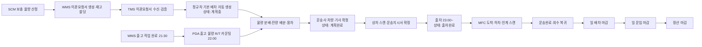
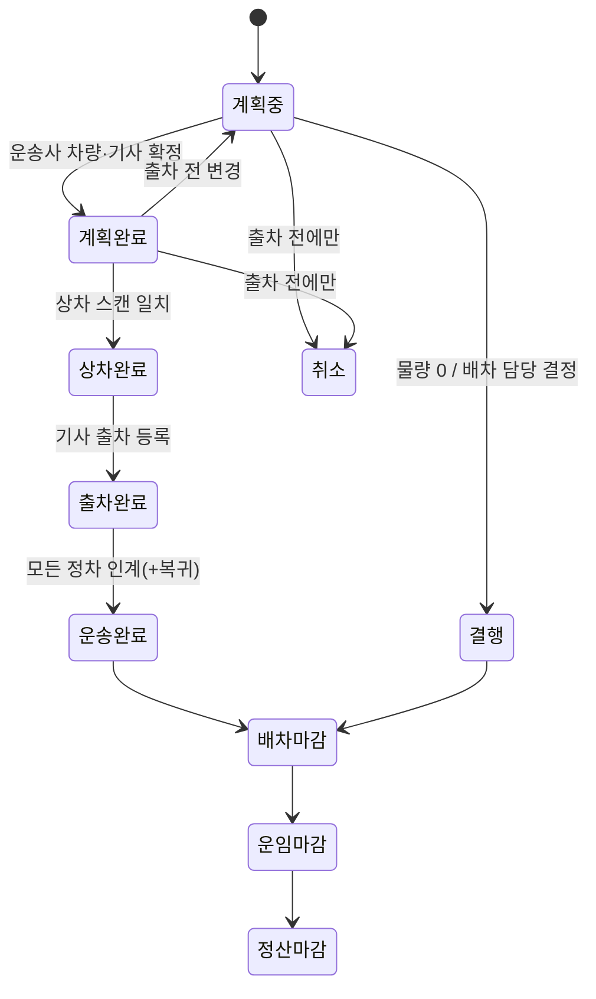

# TMS 비즈니스 로직 — 칠곡 DC → 26개 MFC 간선 운송

문서 버전: 2.1 · 작성일: 2026-10-30 · 상태: 설계 확정본(수치 일부 가정값 포함)

> 이 문서는 B마트 칠곡 DC에서 충청·강원, 경상·전라 MFC 26곳으로 상품을 보내는 **배차·상차·출차·운송·인계·마감·정산**의 업무 규칙을 정의한다.
> 기준 자료는 `TMS 노션`(배민 공식 기술블로그·후기 조사, 팀 설계)이다. 노션에 없거나 비어 있는 부분만 기존 `TMS-business-logic.md`에서 필요한 원칙을 골라 노션 기준으로 고쳐 보완했다.

## 표기 규칙

| 태그 | 의미 |
|---|---|
| **[실제]** | 배민 기술블로그·공식 자료·후기에서 확인된 내용 |
| **[확정]** | 노션에서 팀이 설계해 정한 내용, 또는 노션 내부 충돌을 이 문서에서 하나로 정리한 내용 |
| **[보완]** | 노션에 없어서 기존 `TMS-business-logic.md`에서 가져와 노션 기준으로 고친 내용 |
| **[가정]** | 설계를 진행하려고 넣은 수치. 실측·계약 자료가 생기면 바꾼다 |

- DC = CDC(용어집 표준 표기). 이 문서는 노션 원문을 따라 DC로 쓴다.

## 목차

- [0. 결정 로그 — 노션 내부 충돌과 빈칸을 어떻게 정리했나](#0-결정-로그--노션-내부-충돌과-빈칸을-어떻게-정리했나)
- [1. TMS의 개념과 범위](#1-tms의-개념과-범위)
- [2. 시스템별 업무 구분과 전체 흐름](#2-시스템별-업무-구분과-전체-흐름)
- [3. 운영 시간표](#3-운영-시간표)
- [4. 기준정보](#4-기준정보)
- [5. 이관요청서 수신과 자동 검증](#5-이관요청서-수신과-자동-검증)
- [6. 출고 물량 집계 (PDA)](#6-출고-물량-집계-pda)
- [7. 배차](#7-배차)
- [8. 운송지시서](#8-운송지시서)
- [9. 상차·출차·운송 관제](#9-상차출차운송-관제)
- [10. MFC 도착·하차·인계](#10-mfc-도착하차인계)
- [11. 운송 예외 처리](#11-운송-예외-처리)
- [12. 회수·왕복 운송](#12-회수왕복-운송-확정)
- [13. 재고와 운송의 경계](#13-재고와-운송의-경계-보완)
- [14. 운송 완료·마감](#14-운송-완료마감-실제--확정)
- [15. 운송료 정산](#15-운송료-정산-실제--확정--금액은-가정)
- [16. 데이터 구조와 식별값](#16-데이터-구조와-식별값)
- [17. 타 시스템 연계](#17-타-시스템-연계-확정--보완)
- [18. 운영 화면](#18-운영-화면-실제--확정)
- [19. 경로 최적화 (OR-Tools)](#19-경로-최적화-or-tools)
- [20. 지표](#20-지표-보완--노션-시간표-기준)
- [21. 상세 처리 절차 (P01~P12)](#21-상세-처리-절차-p01p12)
- [22. 전체 연결 사례 — RT-04 냉장, 부산 3곳 멀티드롭](#22-전체-연결-사례--rt-04-냉장-부산-3곳-멀티드롭-가정-수치)
- [23. 수용 검증 시나리오](#23-수용-검증-시나리오-제안미실행)
- [24. 남은 확인 사항](#24-남은-확인-사항)
- [25. 참고 자료](#25-참고-자료)

---

## 0. 결정 로그 — 노션 내부 충돌과 빈칸을 어떻게 정리했나

| # | 쟁점 | 노션에 있던 내용 | 이 문서의 결정 |
|---|---|---|---|
| D-01 | 배차·출차 시각 | 블로그 그림: 21:30 출고 완료 → 22:00 R/T 카운팅 → 배차계획 30분 → 22:30 출차 / 팀 설계: 22:00 배차·상차 → 23:00 출차 | 두 내용을 하나의 시간표로 합침: **21:30 WMS 출고 완료 → 22:00 R/T 카운팅 완료 → 22:00~22:30 배차 계획 확정 → 22:30 상차 시작 → 23:00 첫 출차**. 블로그 시간표는 참고로만 남김 |
| D-02 | MFC 도착 마감 | "첫 MFC 05~06시, 마지막 MFC 09시 전" / "적어도 08:30 도착, 하차 30분" | **첫 MFC 도착은 05:00~06:00, 마지막 MFC 도착은 08:30까지, 하차·인계 완료는 09:00까지**. 09:00 이후 검수·진열은 MFC 업무 |
| D-03 | DC 수 | "DC는 칠곡 1곳" / 자료 요청표의 "인천·칠곡 등 CDC" / 이관요청서 예시의 "인천 DC" | **출발 DC는 칠곡 1곳**. 인천은 예시 표의 흔적이라 삭제 |
| D-04 | 이관요청서와 배차신청 주체 | "TMS 관리자가 이관신청" / "이관요청서 담당은 WMS" | **이관요청서는 WMS가 만들고 TMS가 받는다.** TMS 배차 담당자가 하는 일은 그 요청서를 근거로 한 **배차 계획(운송지시서) 수립**이다 |
| D-05 | 서류 이름 | 이관신청서 / 이관요청서 / 운송신청서 / 운송지시서 | **이관요청서**(WMS, 재고 이동 요청), **운송지시서**(TMS, 차량 운송 실행) 두 개로 통일 |
| D-06 | 온도대와 차량 | 차량 유형은 상온·냉장·냉동으로 나뉨 / 혼적 정책은 "설계 필요" | **차량 한 대는 온도대 하나만 싣는다(혼적 금지).** 그래서 이관요청서도 온도대마다 따로 발행 |
| D-07 | 적재·검증 단위 | 박스·팔레트·롤테이너 / 블로그 "R/T 카운팅" / MFC는 "박스째로 롤테이너에 실어 이동" | **적재 용량은 롤테이너(R/T) 기준, 수량 검증은 박스 바코드 기준.** 팔레트는 간선 운송에 쓰지 않음 |
| D-08 | 위치 관제 | 팀 설계: "MFC 도착마다 위치 저장" / 블로그: "GPS 실시간 추적 근거 없음" | **실시간 GPS 추적은 하지 않는다.** 입차·출차·도착·인계 같은 **이벤트가 일어날 때 시각과 위치를 기록**한다 |
| D-09 | 배차 담당 근무 시간과 도착 마감 | 담당 근무 22:00~07:00, 도착·하차는 09:00까지 | 07:00에 아직 끝나지 않은 운행은 **주간 운영 담당에게 미결 목록으로 넘긴다** **[보완]** |
| D-10 | 이관요청서 분할 | 노션: "부분할당·출고 변경 시 물량 조정" / 기존 문서: 1요청·1이관·1출발 | **이관요청서 1건은 차량 1대로 보낸다(분할 상차 금지).** 차량 한 대에 다 안 들어가면 WMS가 요청서를 나눠 다시 발행 **[보완]** |
| D-11 | 회수 운송 | 노션 13번 "MFC→DC 반환 물량", PPC→DC 회수품 / 기존 문서: 반송 제외 | **회수는 포함한다.** 다만 범위는 빈 롤테이너와 OMS/CS가 접수한 회수품뿐이다. 출차한 뒤 화물의 목적지를 바꾸는 기능은 만들지 않는다 |
| D-12 | 노선과 경로 최적화 | 정규차는 고정 노선 / "27개 노드·702개 조합으로 최적 방문 순서·노선 조합 계산 예정" / 블로그: 자동 경로 최적화는 향후 과제 | **OR-Tools(VRPTW)로 노선 조합과 방문 순서를 계산해 고정 노선 마스터를 확정한다(노선 설계).** 일일 배차는 고정 노선을 그대로 쓰고, OR-Tools는 잔량·용차 묶음 후보 계산에만 보조로 쓴다. 매일 노선을 새로 짜지는 않는다(19장) |
| D-13 | PPC와 MFC | 그림은 PPC, 본문은 MFC | 같은 의미. 이 문서는 **MFC**로 표기 |

---

## 1. TMS의 개념과 범위

### 1.1 정의 [실제]

B마트에서 TMS는 **'배차 시스템화 프로젝트', 즉 물류센터에서 상품이 나가는 과정의 배차와 관련된 모든 것**을 말한다.
SCM이 계산한 공급 발주 수량으로 이관과 배차 계획을 세우고, 알맞은 톤수·유형의 차량과 기사를 배차한다. 운송 중인 차량의 흐름을 관리하고, MFC에 보낸 물량이 제대로 도착했는지까지 확인한다.

### 1.2 포함 범위 [확정]

1. 기준정보: DC·MFC·운송사·차량·기사·노선·계약 운임 등록
2. 운송 물량 수집: WMS 이관요청서 수신과 검증
3. 출고 물량 집계: PDA 박스 스캔, 온도대별 R/T 수 집계
4. 배차: 정규차 기본 배차 자동 생성, 차량별 물량 분배, 잔량 배분, 용차·대체 차량
5. 운송지시서 발행과 상차·출차 관리
6. 운송 관제: 출차·도착·지연을 이벤트로 관리
7. MFC 하차·인계 증빙 수신과 수량 대조
8. 회수(왕복) 운송
9. 마감과 정산: 일 배차 마감 → 일 운임 마감 → 월 정산 마감
10. 경로 최적화: OR-Tools 기반 노선 설계와 잔량 보조 계산

### 1.3 제외 범위

| 제외 | 이유·담당 |
|---|---|
| 공급사 → DC 입고 | 오프라인 영역이라 개발 대상이 아님. DC에 들어온 상품은 모두 정상품으로 본다 **[확정]** |
| 보충 수량 산정, 이관 승인 | SCM |
| 재고 할당, 피킹, 출고 처리, 재고 수불(출고 차감·이동 중 재고·입고) | WMS(DC) / MFC. **TMS는 재고 수량을 직접 바꾸지 않는다** **[보완]** |
| MFC 하차 이후의 검수·적치·피킹 | MFC |
| MFC → 고객 배송(라이더) | 배달 시스템. 간선 차량·기사와 ID를 공유하지 않는다 **[보완]** |
| 실시간 GPS 추적 | D-08 |
| 매일 노선을 새로 짜는 일일 자동 최적화 | 정규차는 고정 노선 계약이라 하지 않는다. OR-Tools는 노선 설계와 잔량 보조 계산에만 쓴다(D-12, 19장) |
| 운송 중 목적지 변경, 환적 자동화 | 지원하지 않음. 사고가 나면 수동으로 처리 **[보완]** |

### 1.4 참여자와 권한

| 참여자 | 하는 일 | 할 수 없는 일 |
|---|---|---|
| DC 운영팀 / 배차 담당(우아한청년들, 22:00~07:00) **[실제]** | 이관요청서 확인, 배차 계획(계획중), 잔량 배분, 용차 요청, 예외 승인, 일 배차 마감 | 이관 수량·목적지 변경, 재고 조정 |
| 운송사 **[실제]** | 계획완료 단계에서 차량·기사 지정과 수정, 대체 차량 등록, 운임 확인 | 물량 배분 변경, 노선 변경 |
| 기사(운송사 소속 또는 계약 기사) **[실제]** | 입차·상차완료·출차·도착·인계 이벤트 입력, 적재함 온도 기록 | 수량 수정, MFC 인수 확인 |
| DC 상차 작업자 | PDA 박스 스캔, R/T 적재, 상차 수량 확정 | 배차 변경 |
| MFC 수령 담당 | 하차 박스 스캔, 인계 확인(인수 서명), 수량 차이 등록 | 운송지시서 변경 |
| 주간 운영 담당 | 07:00 이후 미결 운행 관제, 예외 마무리 | — |

### 1.5 블로그 TO-BE와 이 문서의 구현 [실제 → 확정]

| 업무 | TO-BE(배민 블로그) | 이 문서의 구현 | 위치 |
|---|---|---|---|
| 출고물량 카운팅 | PDA 기반 실시간 출고 물량 등록 및 관리 | 박스 스캔 → R/T 매핑, 22:00 확정 | 6장 |
| 라우팅 | 운송사 계약정보 기반 고정차량 배차 데이터 자동 생성 | 노선 × 온도대 운송지시서 자동 생성 | 7.1 |
| 라우팅 | 유연하고 쉬운 잔량 배분 | 잔량 배분 4단계, 잔여 물량 화면 | 7.3, 18장 |
| 라우팅 | 생성/수정/완료 이력 관리 | 운송지시서 버전·변경 이력 | 8.2, 16장 |
| 배차 관제 | 운송사 시스템 입력 | 운송사가 차량·기사를 직접 입력 | 7.5 |
| 배차 관제 | 실시간 입차/출차 관리 및 진행상황 모니터링 | 이벤트 기반 관제(GPS 제외) | 9.3 |
| 배차 관제 | 온도/품목별 실 상차완료수량 관리 | 온도대·이관요청서별 상차 대조 | 9.1 |
| 배차 결과 등록 | 불필요 | 운송사 입력이 곧 배차 결과 | 7.5 |

### 1.6 기능별 근거와 이 문서에서 정한 정책

| 기능 | 근거 | 정한 정책 | 위치 |
|---|---|---|---|
| 이관요청서·재고 할당 | WMS 블로그 [실제] | 온도대별 발행, 할당 상태별 분기(V6), 부분할당은 할당분만 수용 | 5장 |
| 정규차 자동 배차 | TMS 블로그 [실제] | 고정 노선 11개 × 온도대, 물량이 0이면 결행 후보 | 4.3, 7.1 |
| 적재 물량 자동 분배 | TMS 블로그 [실제] | R/T와 중량 동시 판정, 이관요청서 1건은 차량 1대 | 7.2 |
| 잔여 물량 배분 | TMS 블로그 [실제] | 같은 노선 → 인접 노선 → 용차 → 미배차 회신 | 7.3 |
| 멀티드롭 | 현장 운영·대응 사례 | 최대 3곳, 방문 역순 상차 | 7.4 |
| PDA 출고 물량 집계 | TMS 블로그 [실제] | 박스 스캔, 확정 후 수정은 승인과 이력 필수 | 6장 |
| 대체 차량 등록 | TMS 블로그 [실제] | 같은 운송사 우선, 온도대가 같고 용량이 같거나 큰 차량 | 7.6 |
| 차량·기사 배정 | TMS 블로그 [실제] | 운송사 직접 입력, 중복 배정 금지 | 7.5 |
| 입출차·운송 관제 | TMS 블로그 [실제] | 이벤트 기반, 30분 이상 늦으면 지연 플래그 | 9장 |
| 운임 마감·정산 | TMS 블로그 [실제] | 일 배차 → 일 운임 → 정산 마감, 운임 미등록은 산정 불가 | 14, 15장 |
| 자동 경로 최적화 | 블로그: 당시 향후 과제 / 노션: 702개 조합 최적화 계획 | 노선 설계에 OR-Tools 적용, 매일 노선을 새로 짜지 않음 | 19장 |
| WMS·OMS 연계 고도화 | 블로그: 향후 계획 | 이관요청서·출차·인계·회수 연계 | 17장 |

---

## 2. 시스템별 업무 구분과 전체 흐름

### 2.1 시스템 책임 [확정]

| 시스템 | 책임 |
|---|---|
| SCM | MFC별 보충 물량 산정, 이관 요청(영업일 고려) |
| WMS | 이관요청서 생성, SKU별 재고 할당, 피킹·패킹, 출고, 재고 이관 이력 |
| **TMS** | **차량 배차, 상차·출차, 운송 진행, 인수 결과 대조, 운송료 정산** |
| MFC | 도착 상품 하차 스캔·인계 확인, 이후 검수·입고 |
| OMS/CS | 반품·회수 요청 접수 → TMS 회수 운송 → WMS 반품 입고 |

### 2.2 전체 흐름



### 2.3 핵심 객체 [보완 — 노션 DB 기준으로 재구성]

| 객체 | 의미 | 혼동하지 말 것 |
|---|---|---|
| 이관요청서 | WMS가 발행한 DC→MFC 재고 이동 요청(온도대 1개) | 운송 실행이 아니다. 출차 전까지 버전이 바뀔 수 있다 |
| 이관요청서_SKU | 요청서의 상품별 요청·할당 수량 | TMS는 SKU 수량을 바꾸지 않는다 |
| 운송지시서 | 차량 1대의 운행 1회(배차) | 이관요청서 N건을 담는다. 이관요청서 1건은 운송지시서 1건에만 연결된다 |
| 정차 | 운송지시서 안의 MFC 방문 1회 | MFC 마스터와 다르다. 회수 정차와 DC 복귀도 정차다 |
| 화물(박스·R/T) | 바코드로 식별하는 실물 단위 | 박스는 수량 검증용, R/T는 적재 용량용 |
| 스캔 이력 | 상차·하차·회수 때의 박스·R/T 스캔 기록 | 계획 수량과 실제 수량을 구분하는 근거 |
| 이벤트 | 입차·출차·도착·인계·복귀의 시각과 위치 | 실시간 위치 추적이 아니다 |
| 인계 증빙 | 정차별 MFC 인수 수량·차이·인수자 | 도착 이벤트와 다르고, MFC 입고 확정과도 다르다 |
| 예외 | 미상차·수량 차이·지연 등의 사건 | 운송지시서 상태가 아닌 별도 기록. 운송완료 뒤에도 남는다 |
| 일 운임 | 운송지시서 1건의 운임 계산 결과 | 정산 마감 전까지는 확정 금액이 아니다 |

---

## 3. 운영 시간표

### 3.1 역산 근거 [확정]

- 고객 앱 주문 가능 시간은 MFC 기준 **09:00~24:00**이다. 그래서 MFC는 09:00부터 피킹할 수 있어야 한다.
- 09:00 전후로 선반 적재가 끝나야 하므로 **마지막 MFC 도착은 08:30**, 하차 30분을 더해 **인계 완료는 09:00**까지다.
- MFC 한 곳에서 동시에 하차할 수 있는 차량은 **최대 3대**이고, 1대당 하차 시간은 **30분**이다.

### 3.2 일일 시간표 (D일 = 출고일) [확정]

| 시각 | 업무 | 주체 |
|---|---|---|
| D일 주간 | SCM 보충 물량 산정 → WMS 이관요청서 생성·할당 → TMS 수신 | SCM·WMS·TMS |
| ~21:30 | 정규차 기본 배차 자동 생성(예상 물량 기준), 상태 **계획중** | TMS |
| **21:30** | WMS 이동 출고 작업 완료 [실제] | WMS |
| **22:00** | 출고 물량 R/T 카운팅 완료(PDA), 배차 담당 근무 시작 [실제] | DC 작업자·배차 담당 |
| **22:00~22:30** | 실물량 반영 물량 분배, 잔량 배분, 용차 확정, 운송사 차량·기사 확정 → **계획완료**. 배차 계획에 주어진 시간은 30분 [실제] | 배차 담당·운송사 |
| **22:30~** | 상차 시작. 노선별 출차 시각 30분 전부터 상차 | DC 작업자·기사 |
| **23:00~** | 첫 출차. 장거리 노선부터 노선별 출차 시각에 맞춰 순차 출차 | 기사 |
| D+1 **05:00~06:00** | 첫 MFC 도착 | 기사 |
| D+1 **07:00** | 야간 배차 담당 근무 종료, 미결 운행을 주간 담당에게 인계 [보완] | 배차 담당 |
| D+1 **08:30** | 마지막 MFC 도착 마감 | 기사 |
| D+1 **09:00** | 모든 하차·인계 완료, MFC 영업 시작 | MFC |
| D+1 오전 | 회수 물량 싣고 DC 복귀 → 운송완료 | 기사 |

> 참고 [실제]: 배민 기술블로그의 시간축은 21:30 출고 완료 → 22:00 R/T 카운팅 → 배차계획 30분 → **22:30 출차 시작**이다. 이 문서는 팀 설계안대로 22:30을 상차 시작, 23:00을 첫 출차로 정했다(D-01).

### 3.3 노선별 출차 시각 계산 [확정]

```text
첫 MFC 도착 목표 = 05:00~06:00 범위 안
출차 시각        = max(23:00, 첫 MFC 도착 목표 − DC→첫 MFC 주행시간)
각 정차 도착     = 앞 정차 출발 + 구간 주행시간
각 정차 출발     = max(도착, 하차 슬롯 가용 시각) + 하차 30분
검증            : 마지막 MFC 도착 ≤ 08:30, 마지막 하차 완료 ≤ 09:00
```

- 대구처럼 가까운 노선은 늦게 출차하고, 강원·전남 같은 장거리 노선은 23:00에 먼저 출차한다.
- 상차를 마친 차량은 DC 야드에서 냉장·냉동 가동 상태로 대기하다가 지정 시각에 출차한다.
- 같은 MFC에 같은 시간대 도착이 3대를 넘으면 하차 대기가 생긴다. 이 경우 노선별 도착 시각을 30분 단위로 엇갈리게 편성한다.

### 3.4 시간 저장 규칙 [보완]

- 모든 시각은 날짜와 시간대를 포함해 저장한다(`2026-10-21T05:30:00+09:00`).
- 하나의 운송지시서에 **출고일(D)**과 **도착일(D+1)**을 함께 둔다. 자정을 넘는 운행이 정상이기 때문이다.
- 계획 시각, 최신 예상 시각, 실제 시각을 따로 저장한다. 늦은 예상 시각으로 원래 계획을 덮어쓰지 않는다.

---

## 4. 기준정보

### 4.1 운송망 [확정]

| 구분 | 내용 |
|---|---|
| DC | **칠곡 1곳** — 배민B마트 칠곡 중앙물류센터, 경상북도 칠곡군 지천면 산단터널로 240 |
| MFC | **26곳** — 충청·강원 9곳, 경상·전라 17곳 |
| 거점 노드 | 27개(DC 1 + MFC 26) |
| 방향별 이동 조합 | 출발 27 × 도착 26 = **702개**(MFC→DC 회수, MFC 간 이동 포함). 19장 OR-Tools 시간 행렬의 크기 |

### 4.2 MFC 목록 [확정 — 명칭·권역 / 주소는 수집 중]

| 권역 | 계획 그룹 | MFC |
|---|---|---|
| 경상·전라(17) | 대구·경산 | 대구달서, 대구북구, 대구수성, 대구중구, 경산 |
| | 부산 | 부산진구, 부산해운대, 부산사하, 부산남구, 부산동래 |
| | 울산 | 울산남구 |
| | 김해·창원 | 김해, 창원 |
| | 전주 | 전주 |
| | 광주·목포 | 광주서구, 광주광산, 목포 |
| 충청·강원(9) | 대전·세종 | 대전유성, 대전중구, 대전서구, 세종 |
| | 청주·천안 | 청주상당, 청주흥덕, 천안 |
| | 강원 | 원주, 춘천 |

MFC 공통 조건 [확정]
- 모든 건물에 롤테이너를 실을 수 있는 화물 승강기가 있다.
- 하차와 입고 구역 운반에 5~10명이 동시에 투입될 수 있는 통로가 있다.
- 동시 하차 가능 차량은 **최대 3대**, 1대당 하차 시간은 **30분**이다.

MFC 마스터에 거점마다 등록할 항목 [보완]: MFC ID, 지점명, 권역, 주소, 하차 위치, 동시 하차 슬롯 수(기본 3), 하차 가능 시작 시각(기본 05:00), 도착 마감(기본 08:30), 승강기 정보, 연락 담당, 사용 여부.
주소·하차 위치가 확인되지 않은 MFC는 배차 대상에서 보류하고 사유를 표시한다.

### 4.3 고정 노선 초안 [확정 구조 / 노선 구성은 가정]

정규차는 모두 **고정 노선(안정 노선)**으로 운행한다 [실제]. 노선 한 개는 온도대별로 정규차 한 대씩, 최대 3대를 둔다.
멀티드롭은 노선당 **최대 3곳**을 방문한다 [확정]. 아래 구성은 권역 그룹을 기준으로 잡은 초안이다. 실측 거리·시간 행렬을 확보하면 19장의 OR-Tools 노선 설계로 다시 계산하고, 3.3절 검증식을 통과한 결과를 고정 노선으로 확정한다.

| 노선 ID | 방문 순서 | 정차 수 | 출차 순서 |
|---|---|---:|---|
| RT-01 | 대구달서 → 대구중구 → 대구북구 | 3 | 늦은 출차(근거리) |
| RT-02 | 대구수성 → 경산 | 2 | 늦은 출차(근거리) |
| RT-03 | 울산남구 → 부산해운대 → 부산동래 | 3 | 중간 |
| RT-04 | 부산진구 → 부산남구 → 부산사하 | 3 | 중간 |
| RT-05 | 창원 → 김해 | 2 | 중간 |
| RT-06 | 대전서구 → 대전중구 → 대전유성 | 3 | 중간 |
| RT-07 | 세종 → 청주흥덕 → 청주상당 | 3 | 중간 |
| RT-08 | 천안 | 1 | 이른 출차 |
| RT-09 | 원주 → 춘천 | 2 | 23:00 우선 출차(장거리) |
| RT-10 | 광주서구 → 광주광산 → 목포 | 3 | 23:00 우선 출차(장거리) |
| RT-11 | 전주 | 1 | 이른 출차 |
| 합계 | | **26** | |

### 4.4 차량 [확정 / 용량 수치는 가정]

| 항목 | 내용 |
|---|---|
| 기본 톤수 | **5톤** [실제]. 용차는 다른 톤수와 섞어 쓸 수 있다 |
| 차량 유형 | **상온 / 냉장 / 냉동** 분리 [확정]. 한 대에 온도대 하나 |
| 등록 항목 | 차량번호(ID), 운송사, 계약 구분(정규/용차), 톤수, 차폭·적재함 크기, 온도대, 최대 적재 R/T, 최대 적재 중량, 사용 여부 |
| 적재 용량 판정 | `적재 가능 = 최대 R/T 이내 AND 최대 중량 이내` — 둘 다 충족해야 한다 |
| 5톤 기본값 | 최대 **20 R/T**, 최대 **5,000kg** [가정] |

톤수와 차폭에 따라 실을 수 있는 물량이 다르므로, 배차 물량은 차량마다 등록된 값으로 계산한다 [실제].

### 4.5 운송사·기사·계약 [실제 + 확정]

- 차량과 기사는 **외부 계약 운송사**가 공급한다. 기사는 운송사 소속이거나 계약 기사다.
- 운송사마다 **왕복/편도를 따로 등록**하고, 배차마다 **기사를 따로 배정**하며, **운임 정보를 따로 등록**한다 [실제].

| 항목 | 정규차 | 용차 |
|---|---|---|
| 계약 방식 | 정기·고정 계약 | 필요할 때 추가 배차 |
| 기본 배차 | 자동 생성 대상 | 부족 물량이 생겼을 때 호출 |
| 차량 정보 | 사전 등록 | 운송 의뢰·수배 후 등록 |
| 노선 | 고정 노선에 매핑 | 운행 건마다 지정 |
| 운임 기준 | 노선·온도대별 고정 계약 단가 | 운행별 확정 운임 |
| 운행 변경 | 차량·기사 대체 처리 | 취소·변경·재수배 |
| 정산 | 계약 운임 + 수행 이력 | 확정 운임 + 수행 이력 |

---

## 5. 이관요청서 수신과 자동 검증

### 5.1 이관요청서 (WMS → TMS) [확정]

이관요청서는 **(출발 DC, 목적 MFC, 출고예정일, 온도대)** 단위로 1건씩 발행한다(D-06).

| 항목 | 설명 | 예시 |
|---|---|---|
| 이관요청서 ID | 고유 식별값 | TR-20261020-001 |
| 버전 | 수정될 때마다 1씩 증가 [보완] | 1 |
| 출발지 센터 ID | 칠곡 DC | DC-CG01 |
| 목적지 센터 ID | 받는 MFC | MFC-BS01(부산진구) |
| 온도대 | 상온 / 냉장 / 냉동 [확정 추가] | 상온 |
| SKU 종류 수 | 요청 상품 종류 수 | 2종 |
| SKU별 요청 수량 | 상세 테이블로 분리 | S01234 깨끗한 물티슈 3개 / S05678 삼다수 500mL 2개 |
| 총 이관 요청 수량 | 전체 상품 수 | 5개 |
| 재고 할당 상태 | 미할당 / 할당 / 부분할당 / 취소 | 할당 |
| SKU별 할당 수량 | DC가 실제 확보한 수량 | 물티슈 3개 / 삼다수 2개 |
| 출고 예정일 | D일 | 2026-10-20 |
| 예상 박스·R/T 수 | 할당 시점 예상값(가배차용) | 1박스 / 1 R/T |
| 확정 박스·R/T 수 | 출고 포장 확정 뒤 입력(PDA 카운팅) | 22:00 확정 |

SKU별 상세는 별도 테이블(`이관요청서_SKU`)로 관리한다.

| SKU ID | 상품명 | 요청 수량 | 할당 수량 | 상태 |
|---|---|---:|---:|---|
| S01234 | 깨끗한 물티슈 | 3개 | 3개 | 할당 |
| S05678 | 삼다수 500mL | 2개 | 2개 | 할당 |
| 합계 | 2종 | 5개 | 5개 | 할당 |

### 5.2 자동 검증 분기 [확정]

TMS는 이관요청서를 받으면 아래 순서로 검증해 **수용 / 보류 / 반려 / 제외**를 자동으로 판정한다.

| 순서 | 검증 | 실패 시 결과 | 보완 주체 |
|---|---|---|---|
| V1 | 필수값(ID, 출발, 목적, 온도대, 출고예정일, SKU 상세) 존재 | **반려** | WMS |
| V2 | 출발지가 칠곡 DC이고, 목적지가 등록·사용 중인 MFC이며, 출발지와 목적지가 다름 | **반려** | WMS / 기준정보 |
| V3 | 목적 MFC의 주소·하차 정보 확인 완료 | **보류**(기준정보 대기) | 기준정보 담당 |
| V4 | 같은 ID·버전으로 다시 수신 | 내용이 같으면 **무시**(기존 결과 반환), 다르면 **충돌 반려** [보완] | WMS |
| V5 | 같은 ID에 새 버전 수신 | 출차 전이면 **변경 반영**(배차 재계산), 출차 후면 **반려** | — |
| V6 | 재고 할당 상태 | 할당 → 수용 / 부분할당 → **할당 수량만 수용** / 미할당 → **보류**(할당 대기) / 취소 → **제외** | WMS |
| V7 | 수신 시각 | 21:30 이후 수신 → 당일 배차는 **배차 담당 승인 시에만** 수용, 아니면 익일로 **이월** | 배차 담당 |
| V8 | 예상 R/T가 해당 온도대 최대 차량 용량 이하 | **보류**, WMS에 요청서 분할 재발행 요청(D-10) | WMS |

수용된 요청서만 배차 대상 풀에 들어간다. 보류·반려된 건은 사유, 담당, 필요한 입력과 함께 **잔여 물량 화면**에 계속 표시한다. 차량 부족과 정보 누락은 구분해서 표시한다 [보완].

---

## 6. 출고 물량 집계 (PDA)

### 6.1 집계 규칙 [실제 + 확정]

- 상차 작업자가 PDA로 **박스 바코드를 스캔**해 실제 출고 물량을 집계한다. 모든 출고 수량을 WMS에서 자동으로 받아오는 방식이 아니다 [실제].
- 박스를 롤테이너에 실으면서 **R/T 바코드에 박스를 묶는다**(R/T ↔ 박스 매핑).
- 집계는 **이관요청서 × 온도대** 단위로 하고, 22:00에 R/T 카운팅을 확정한다 [실제].
- 온도별·품목별 **실제 상차 완료 수량**을 관리한다 [실제].

### 6.2 확정과 수정 [확정]

| 상황 | 처리 |
|---|---|
| 상차 작업자가 집계 완료 | 이관요청서의 확정 박스·R/T 수로 반영 |
| 확정 후 수정 | 배차 담당 승인 후에만 수정. 변경 전·후 값, 사유, 승인자를 이력으로 남긴다 |
| 다른 MFC 박스 스캔 | PDA에서 즉시 경고하고 상차 차단 |
| 할당 수량보다 스캔 수량이 적음 | **미상차** 예외(11장) |
| 할당 수량보다 스캔 수량이 많음 | 상차 차단, WMS 확인 |

---

## 7. 배차

### 7.1 정규차 기본 배차 자동 생성 [실제 + 확정]

1. 출고일(D)의 운행 요일에 해당하는 **고정 노선 × 온도대** 조합을 불러온다.
2. 조합마다 계약된 정규차와 기본 기사로 **운송지시서 초안**을 만든다(상태 **계획중**).
3. 노선에 속한 MFC의 수용된 이관요청서를 해당 운송지시서에 연결한다(예상 R/T 기준).
4. 물량이 0인 노선·온도대도 운송지시서를 만들고 **결행 후보**로 표시한다. 결행 여부는 배차 담당이 22:30까지 정한다.

### 7.2 차량별 물량 분배 [실제 + 확정]

22:00 R/T 카운팅이 확정되면 예상 물량을 실물량으로 바꾸고 다시 분배한다.

```text
차량 적재량 = Σ(연결된 이관요청서의 확정 R/T), Σ(확정 중량)
적재 가능   = 적재 R/T ≤ 최대 R/T  AND  적재 중량 ≤ 최대 중량
잔여 용량   = 최대 R/T − 적재 R/T
```

- 이관요청서 1건은 반드시 차량 1대에 싣는다. 쪼개서 여러 차량에 나누지 않는다(D-10).
- 화면에는 **잔여 물량**(아직 배정 안 된 이관요청서)과 **차량별 적재 가능 수**를 함께 보여준다 [실제].

### 7.3 잔량 배분 순서 [확정]

정규차 용량을 넘었거나, 노선이 없는 MFC의 물량은 아래 순서로 배분한다.

1. **같은 노선·같은 온도대 정규차**에 남은 용량이 있으면 배정
2. **인접 노선 정규차**: 같은 온도대이고, 그 MFC를 추가해도 정차 3곳 이하이며, 3.3절 시간 검증을 통과하면 배정
3. **용차 호출**: 1·2로 해결되지 않는 잔여 물량. 이관요청서 단위로 묶어 직송 또는 멀티드롭 용차를 요청(묶음 후보는 OR-Tools 보조 계산을 쓸 수 있다, 19.1절)
4. 22:30까지 배정되지 않은 물량은 **미배차**로 남기고 SCM·WMS에 회신한다(익일 이월 또는 별도 조치). 화면에서 숨기지 않는다 [보완]

### 7.4 멀티드롭 [확정]

- 한 차량이 여러 MFC를 차례로 방문한다. **최대 3곳**이다.
- 방문 순서는 노선 마스터의 순서를 따른다. 용차는 배차 담당이 지정한다.
- **상차 순서는 방문 순서의 역순**이다. 마지막에 들를 MFC 물량을 적재함 안쪽에 먼저 싣는다 [보완].
- 차량 한 대의 물량이 여러 MFC로 가더라도 MFC별 박스·R/T·인계 수량은 섞지 않고 따로 관리한다 [보완].

### 7.5 차량·기사 배정 (운송사) [실제 + 확정]

- 배차 담당이 물량 분배를 마치면 운송사가 운송지시서마다 **차량과 기사를 확정**한다. 운송사가 시스템에 직접 입력하므로 별도 배차 결과 등록은 필요 없다 [실제].
- 배정 검증: 차량의 온도대 일치, 적재 용량, 같은 시간대 차량·기사 중복 배정 금지 [보완]. 수동 배정에도 자동 배차와 같은 검증을 적용한다.
- 모든 운송지시서에 차량·기사가 확정되면 상태는 **계획완료**가 된다.

### 7.6 용차·대체 차량 [실제 + 확정]

| 상황 | 처리 |
|---|---|
| 정규차 용량 부족(잔량) | 7.3절 순서에 따라 용차 호출 |
| 정규차 고장(출차 전) | 같은 운송사에 **대체 차량 등록**을 먼저 요청 → 안 되면 용차 |
| 기사 결근 | 같은 운송사에서 대체 기사를 지정 → 안 되면 용차 |
| 용차 등록 | 운송 의뢰·수배 후 차량번호·기사·톤수·온도대·확정 운임을 입력 |
| 이력 | 원래 차량·기사, 대체 사유, 변경 시각, 승인자를 모두 남긴다 |

대체 차량은 원래 차량과 온도대가 같고 적재 용량이 같거나 커야 한다.

---

## 8. 운송지시서

### 8.1 이관요청서와 운송지시서 [확정]

| 구분 | 이관요청서 | 운송지시서 |
|---|---|---|
| 목적 | DC에서 MFC로 이동할 재고 요청 | 실제 차량 운송 수행 |
| 담당 | WMS | TMS(우아한청년들 배차 담당) |
| 단위 | DC × MFC × 출고일 × 온도대 | 차량 1대 × 운행 1회 |
| 주요 내용 | SKU, 요청·할당 수량, 할당 상태 | 운송 물량, 차량, 기사, 노선, 정차 순서, 일정 |
| 생성 기준 | 재고 이관 필요 | 운송 계획 수립 및 확정 |
| 관계 | 운송지시서 1건에 이관요청서 N건(멀티드롭) | 이관요청서 1건은 운송지시서 1건에만 연결 |

### 8.2 운송지시서 항목 [확정]

| 항목 | 예시 |
|---|---|
| 운송지시서 ID | TO-20261020-007 |
| 출고일 / 도착일 | 2026-10-20 / 2026-10-21 |
| 노선 ID / 계약 구분 | RT-04 / 정규차 |
| 운송사 / 차량 / 기사 | CR-01 / VH-5T-0412 / DR-0233 |
| 온도대 | 냉장 |
| 운행 형태 | 편도 / 왕복(회수 포함) |
| 연결 이관요청서 | TR-20261020-031, -032, -033 |
| 정차 목록 | 정차 순번, MFC, 계획 도착, 계획 출발, 하차 박스·R/T 수 |
| 계획 상차 시작 / 출차 / 운송완료 | D+1 03:10 / 03:40 / 09:40 (22장 사례) |
| 적재 합계 | 17 R/T, 3,420kg |
| 실적 | 실제 상차 수량, 실제 출차, 정차별 실제 도착·인계 |
| 상태 / 버전 | 계획완료 / v2 |

운송지시서가 바뀌면 버전을 올리고, 기사 앱에서는 최신 버전만 실행할 수 있게 한다 [보완].

---

## 9. 상차·출차·운송 관제

### 9.1 상차 [실제 + 확정]

1. 기사가 **입차**를 등록한다(시각 기록).
2. 작업자가 PDA로 박스를 스캔하며 R/T에 적재하고, R/T를 방문 역순으로 상차한다.
3. 시스템은 실제 상차 수량과 계획 수량을 **온도대·이관요청서별로 대조**한다.
4. 모두 일치하면 **상차완료**가 된다. 차이가 있으면 미상차·부분출고 예외로 넘긴다(11장).
5. 기사가 적재함 온도를 기록한다 [보완 — 콜드체인 관리].

### 9.2 출차 [확정]

- 출차 조건: 상차완료 + 차량·기사 확정 + 계획 출차 시각 도달(또는 배차 담당의 조기 출차 승인).
- 기사가 **출차**를 등록하면 상태가 **출차완료**가 되고, 출차 시각과 위치를 기록한다.
- TMS는 출차 사실을 WMS에 전달한다. 출고 확정 같은 재고 처리는 WMS가 한다(13장).
- 실제로 출차하지 않았는데 상차완료만으로 출차를 자동 처리하지 않는다 [보완].

### 9.3 관제 (이벤트 기반) [실제 + 확정]

| 이벤트 | 입력 | 저장 값 |
|---|---|---|
| 입차 | 기사 | 시각, 위치 |
| 상차완료 | PDA(작업자) | 시각, 실제 수량 |
| 출차 | 기사 | 시각, 위치, 적재함 온도 |
| MFC 도착 | 기사 | 시각, 위치, 적재함 온도 |
| 하차 시작 / 인계 완료 | MFC 스캔 | 시각, 인계 수량 |
| 정차 출발 | 기사 | 시각 |
| DC 복귀 | 기사 | 시각, 회수 물량 |

- 실시간 GPS는 쓰지 않는다. 이벤트 시점의 위치만 저장한다(D-08).
- 다음 정차 예상 도착은 `마지막 이벤트 시각 + 남은 구간 주행시간 + 남은 하차 시간`으로 다시 계산한다.
- **지연 판정**: 예상 도착이 계획 도착보다 30분 이상 늦거나, 08:30 마감을 넘길 것으로 예상되면 **지연** 플래그를 세우고 배차 담당과 MFC에 알린다. 지연은 상태가 아니라 플래그다 [보완].
- 마지막 이벤트 후 예상 시각보다 30분 넘게 다음 이벤트가 없으면 **정보 지연**으로 표시하고 기사에게 확인한다 [보완].

---

## 10. MFC 도착·하차·인계

### 10.1 하차 절차 [확정]

1. 기사가 **도착**을 등록하고 하차 슬롯을 배정받는다(최대 3대 동시).
2. MFC 담당이 박스 바코드를 스캔한다. 하차 단계에서는 **운송지시서·이관요청서의 운송 수량과 실제 받은 수량을 대조하는 일만** 한다.
3. 박스를 R/T째 화물 승강기로 옮겨 온도별 입고 검수 구역으로 이동한다(여기부터는 MFC 업무).
4. 스캔 결과로 **MFC 인계 증빙**을 만든다. 운송이 정상적으로 이루어졌다는 근거가 된다.
5. 기사는 정차 출발을 등록하고 다음 MFC로 이동한다.

### 10.2 인계 증빙 [확정]

| 항목 | 내용 |
|---|---|
| 인계 증빙 ID | HO-20261021-0412 |
| 운송지시서 / 정차 순번 / 이관요청서 | TO-20261020-007 / 2 / TR-20261020-032 |
| 출고 수량(박스·R/T) | 상차 스캔 기준 |
| 인수 수량(박스·R/T) | 하차 스캔 기준 |
| 차이 수량·유형 | 부족 / 초과 / 오배송 / 파손 |
| 인계자 / 인수자 | 기사 / MFC 담당 |
| 도착·인계 완료 시각, 적재함 온도 | |
| 결과 | 일치 / 불일치(예외 등록) |

### 10.3 인계 결과 판정 [확정]

- 출고 수량 = 인수 수량 → **인계완료(일치)**
- 다르면 → **인계완료(불일치)** + 수량 차이 예외 등록(11장). 차량 출발은 막지 않고, 예외는 운행이 끝난 뒤에도 따로 남는다 [보완].
- GPS나 도착 버튼만으로 인수를 확정하지 않는다. **스캔 기반 인계 증빙**이 있어야 정차가 끝난다 [보완].
- TMS는 이 증빙으로 배차 계획이 적절했는지, 운송이 문제없었는지를 검증한다 [확정].

---

## 11. 운송 예외 처리

| 예외 | 발생 시점 | 처리 [확정 / 보완] |
|---|---|---|
| 출고 지연 | 21:30에 WMS 출고 미완료 | 해당 이관요청서를 예상 물량으로 둔 채 배차, 상차 시작 전까지 확정이 안 되면 노선 출차 시각 재계산. 08:30 도착이 불가능하면 미배차 처리 후 SCM·WMS에 회신 |
| 부분출고 | 부분할당, 또는 스캔 수량 < 할당 수량 | 실제 스캔 수량으로 운송지시서를 확정. 못 보낸 수량은 같은 이관요청서로 다시 출차하지 않고 WMS에 회신(재요청은 WMS/SCM) |
| 미상차 | 상차 대상인데 차에 싣지 못함 | 배차 담당이 ① 같은 노선 다른 차량에 이관요청서 단위로 옮기기 ② 용차 ③ 미배차 회신 중 선택 |
| 용량 초과 | 확정 R/T > 차량 용량 | 7.3절 잔량 배분 |
| 차량 고장·기사 결근(출차 전) | | 7.6절 대체 차량·용차 |
| 차량 고장·사고(출차 후) | | 안전 확보 → 위치·화물·온도 기록 → 배차 담당이 운송사와 수동으로 처리. 자동 환적·재출차 기능은 없다. 도착이 불가능한 MFC에는 지연을 통보 |
| 도착 지연 | 예상 도착 > 계획 + 30분 또는 > 08:30 | 지연 플래그, MFC에 예상 시각 통보, 사유 기록(운송사 귀책 여부 → 정산에 반영) |
| 하차 대기 | 슬롯 3개가 모두 사용 중 | 대기 시간 기록. 30분을 넘기면 대기 사유와 귀책을 기록(정산 대기 요금 판단 근거) |
| 수량 부족 | 인수 < 출고 | 차량 안 잔류 여부를 즉시 확인 → 없으면 상차 스캔 이력과 대조해 미상차/분실을 판정. 결과를 WMS에 회신. 자동으로 손실 처리하지 않는다 |
| 수량 초과·오배송 | 다른 MFC의 박스가 섞임 | 해당 박스는 하차하지 않는다. 같은 운행의 다음 정차가 원래 목적지면 그곳에 하차하고, 아니면 회수 물량으로 DC에 복귀시켜 익일 재배차 |
| 온도 이탈 | 출차·도착 기록 온도가 기준 밖 | 해당 화물을 표시하고 MFC 검수 담당에게 통보. 판매 가능 여부는 MFC/품질 담당이 판단 |
| 출차 후 이관 취소 요청 | | 받지 않는다. 이미 출차한 화물은 원래 목적지로 인계하고, 이후 처리는 MFC·WMS가 한다 |

### 11.1 시점별 변경·취소 가능 범위 [보완 — 노션 상태 기준]

| 운송지시서 상태 | 허용되는 변경 | 확인할 것 | 금지 |
|---|---|---|---|
| 계획중 | 물량 이동, 노선 간 이관요청서 이동, 결행, 취소 | 용량, 정차 수, 시간 검증 | — |
| 계획완료 | 차량·기사 교체(대체 차량), 물량 재분배(계획중으로 되돌림), 취소 | 온도대·용량, 운송사 재확인, 버전 증가 | 운송사 확인 없는 차량 변경 |
| 상차완료(출차 전) | 이관요청서를 내려 다른 차량으로 이동, 출차 시각 조정 | 하차 스캔으로 실물 확인, 상차 수량 재대조 | 스캔 없이 시스템에서만 물량 이동 |
| 출차완료(운행 중) | 지연 통보, 남은 정차 예상 시각 재계산 | 이벤트 기반 재계산 | 목적지 변경, 정차 추가, 출차 취소 |
| 인계 후 | 인계 증빙 정정(승인 필요), 수량 차이 조사 | 원래 스캔 이력 | 인계 기록 삭제 |
| 배차 마감 후 | 정정 이력 추가 | 승인자, 사유 | 원래 기록 덮어쓰기 |

SCM·WMS의 이관 취소 요청은 출차 전이면 해당 이관요청서를 운송지시서에서 빼고 다시 분배한다. 출차 후면 거부하고, 이미 출차했다는 사실을 회신한다.

---

## 12. 회수·왕복 운송 [확정]

- 운송사 계약에 **왕복/편도**를 등록하고, 운송지시서에 운행 형태를 지정한다.
- 회수 대상: ① 빈 롤테이너 ② OMS/CS가 접수한 반품·회수품(MFC → DC).
- 흐름: OMS/CS 반품·회수 요청 → TMS가 해당 MFC를 지나는 왕복 운송지시서에 **회수 정차**로 추가 → 마지막 정차 뒤 DC 복귀 → WMS 반품 입고·수령 확인.
- 회수 물량도 박스·R/T 바코드로 스캔해 회수 증빙을 남긴다.
- 편도 계약 차량에는 회수를 배정하지 않는다. 회수가 필요한데 왕복 차량이 없으면 용차(회수 전용)를 호출한다.
- 회수 정차는 출차 전에만 추가한다.
- 운송완료 시점: 편도는 마지막 MFC 인계 완료, 왕복은 **DC 복귀와 회수 물량 인계 완료**.

---

## 13. 재고와 운송의 경계 [보완]

TMS는 재고 수량을 바꾸지 않는다. 재고 수불은 WMS(DC)와 MFC가 각자 확정하고, TMS는 그 근거가 되는 **운송 사실**을 제공한다.

| 사건 | TMS가 하는 일 | 재고 처리(담당) |
|---|---|---|
| 상차완료 | 실제 상차 수량 기록 | 변화 없음 |
| 출차 | 출차 사실을 WMS에 전달 | WMS: DC 출고 확정, 이동 중 재고 증가 |
| MFC 인계 | 인계 증빙(인수 수량) 생성·전달 | MFC: 입고 확정 / WMS: 이동 중 재고 해소 |
| 수량 차이 | 출고·인수 차이와 조사 근거 제공 | WMS·MFC: 손실·정정 판단 |

수량 관계식: `출고(상차) 수량 = MFC 인수 수량 + DC 회수 수량 + 확인된 운송 손실 + 조사 중 수량`

---

## 14. 운송 완료·마감 [실제 + 확정]

배민 블로그의 배차 흐름은 **계획중(DC운영팀) → 계획완료(운송사) → 출차완료 → 일 배차 마감 → 일 운임 마감 → 정산 마감**이다. 이 문서는 출차완료와 마감 사이에 운송 단계를 추가해 확정한다.

| 단계 | 조건 | 주체 | 시점 [가정] |
|---|---|---|---|
| 운송완료 | 모든 정차 인계 완료(+ 왕복은 DC 복귀) | 시스템 자동 | D+1 오전 |
| 일 배차 마감 | 그날 모든 운송지시서가 운송완료·결행·취소 중 하나이고, 미결 예외에는 담당이 지정됨 | 주간 운영 담당 | D+1 12:00까지 |
| 일 운임 마감 | 운송지시서별 운임 계산 → 운송사 확인(이의 제기) → 확정 | 배차 담당·운송사 | D+2 18:00까지 |
| 정산 마감 | 월간 운송사별 정산서 확정 | 정산 담당·운송사 | 익월 5영업일까지 |

- 일 배차 마감 이후에 발견된 실적 오류는 원래 기록을 덮어쓰지 않고 **정정 이력**으로 반영한다 [보완].
- 미결 예외(수량 차이 등)는 마감을 막지 않는다. 담당과 함께 별도로 계속 추적한다.

---

## 15. 운송료 정산 [실제 + 확정 / 금액은 가정]

실제 배차 이력과 양사 계약 운임을 바탕으로 신뢰할 수 있는 정산 금액을 계산한다 [실제].

### 15.1 운임 구조 [확정]

```text
정규차 일 운임 = 노선·온도대·편도/왕복별 계약 일 단가
               + 추가 정차 요금 × (실제 정차 수 − 계약 정차 수)⁺
               + 대기 요금 × ceil((하차 대기 − 30분) / 30분)⁺   ※ 운송사 귀책이 아닐 때만
               − 결행 차감(운행하지 않은 날은 0원)
용차 운임      = 운행별 확정 운임 + 위와 같은 추가 요금 규칙
월 정산 금액   = Σ 일 운임(일 운임 마감 확정분) ± 정정분
```

- 계약 일 단가에 이미 포함된 정차는 다시 청구하지 않는다(이중 청구 방지) [보완].
- 운임이 등록되지 않은 운행은 0원이 아니라 **산정 불가**로 표시하고 마감을 보류한다 [보완].
- 운임 계산에는 운행 당시의 계약 버전을 적용한다. 나중에 단가가 바뀌어도 과거 운행 금액은 바뀌지 않는다 [보완].
- MFC가 인계 뒤 자체적으로 하는 적치 작업 시간은 기사 대기로 청구하지 않는다 [보완].

### 15.2 계산 예시 [가정 금액]

RT-04 냉장 정규차, 왕복 계약, 일 단가 350,000원, 계약 정차 3곳, 추가 정차 30,000원, 대기 30분당 15,000원이라고 가정한다.
- 실제 정차 3곳(추가 없음), 부산사하에서 MFC 사정으로 70분 대기
- 대기 요금 = ceil((70−30)/30) = 2 × 15,000 = 30,000원
- **일 운임 = 350,000 + 0 + 30,000 = 380,000원**

---

## 16. 데이터 구조와 식별값

### 16.1 DB 구성 [확정 — 노션 6개 DB 매핑]

노션의 6개 DB를 각각 운영해 작업과 박스(화물)의 이동 이력을 따로 기록한다.

| 노션 DB | 엔터티 | 핵심 내용 |
|---|---|---|
| 이관신청서 | 이관요청서, 이관요청서_SKU | 5.1절 |
| 운송 DB | 운송지시서, 정차, 이벤트 이력, 예외 | 8.2절, 9.3절, 11장 |
| 트럭 DB | 운송사, 차량, 기사, 계약 운임, 노선 | 4장 |
| 하차 DB | 정차별 도착·하차 슬롯·대기·인계 시각 | 10.1절 |
| 화물 DB | 박스, R/T, 박스↔R/T 매핑, 스캔 이력(상차·하차·회수) | 6장 |
| MFC 인계 증빙 DB | 인계 증빙, 수량 차이 | 10.2절 |
| (추가) 정산 DB [보완] | 일 운임, 월 정산서, 정정 이력 | 15장 |
| (추가) 노선 설계 DB [보완] | 시간 행렬(702개), OR-Tools 계산 이력·입력 버전·결과 | 19장 |

### 16.2 식별값 체계 [확정]

| 대상 | 형식 | 예시 |
|---|---|---|
| 센터 | DC-지역코드 / MFC-지역코드 | DC-CG01, MFC-BS01 |
| 이관요청서 | TR-출고일-순번 | TR-20261020-001 |
| 운송지시서(배차) | TO-출고일-순번 | TO-20261020-007 |
| 정차 | 운송지시서 ID-S순번 | TO-20261020-007-S02 |
| 노선 | RT-번호 | RT-04 |
| 운송사 / 차량 / 기사 | CR- / VH- / DR- | CR-01, VH-5T-0412, DR-0233 |
| R/T / 박스 | RT 바코드 / 박스 바코드(WMS 발번) | — |
| 인계 증빙 | HO-도착일-순번 | HO-20261021-0412 |
| 정산서 | ST-운송사-연월 | ST-CR01-202610 |

### 16.3 상태값 [확정]

**운송지시서 상태** (블로그 흐름 + 운송 단계)



- 출차완료 이후에는 계획중·취소로 되돌아가지 않는다 [보완].
- 지연, 정보 지연, 예외는 상태가 아니라 **플래그**로 관리한다.

**정차 상태**: 도착예정 → 도착 → 하차중 → 인계완료(일치/불일치) → 출발

**이관요청서 상태**: 수신 → (보류 / 반려 / 제외) → 배차대기 → 배차완료 → 출차 → 인계완료

**예외 상태** [보완]: 등록 → 담당지정 → 조치중 → 해결 → 종결

---

## 17. 타 시스템 연계 [확정 / 보완]

| 연계 | 방향 | 내용 | 시점 |
|---|---|---|---|
| 이관요청서 | WMS → TMS | 5.1절 전체 항목, 버전, 할당 상태 | 수시(D일) |
| 출고 완료 | WMS → TMS | 이관요청서별 출고 완료 여부 | 21:30 |
| 출고 물량 카운팅 | PDA → TMS | 박스·R/T 스캔, 확정 수량 | ~22:00 |
| 검증 결과 회신 | TMS → WMS | 수용·보류·반려·제외와 사유 | 수신 즉시 |
| 출차 통보 | TMS → WMS | 운송지시서, 출차 시각, 이관요청서별 상차 수량 | 출차 시 |
| 도착 예정 | TMS → MFC | 차량, 예상 도착, 이관요청서·박스 목록 | 출차 시·지연 시 |
| 인계 증빙 | MFC → TMS | 인수 수량, 차이 | 인계 시 |
| 미배차·부분출고 회신 | TMS → SCM·WMS | 못 보낸 이관요청서와 수량 | 22:30 / 상차 시 |
| 회수 요청 | OMS/CS → TMS | 회수 MFC, 회수품 | 수시 |
| 회수 인계 | TMS → WMS | 회수 물량, 복귀 시각 | DC 복귀 시 |
| 운임·정산 | TMS ↔ 운송사 | 일 운임 확인, 정산서 | 마감 시 |

연계 원칙 [보완]
- 같은 메시지를 다시 받아도 결과는 한 번만 반영한다(ID·버전 기준 중복 처리).
- 응답이 오지 않는 것은 실패가 아니다. 원래 처리 결과를 조회한 뒤 빠진 부분만 다시 보낸다.
- 받는 쪽마다 전달 상태를 따로 기록한다. 한 곳에 전달하지 못했다고 실제 출차·인계를 취소하지 않는다.

### 17.1 시스템별 최종 책임

| 영역 | 그 영역이 확정하는 것 | TMS가 받는 것 | TMS가 주는 것 |
|---|---|---|---|
| SCM | 보충 물량, 이관 필요 판단, 미배차 물량 재요청 | — | 미배차·부분출고 회신 |
| WMS | 이관요청서, 재고 할당, 출고, DC 재고 수불, 반품 입고 | 이관요청서, 출고 완료, 확정 수량 | 검증 결과, 출차 통보, 회수 인계 |
| MFC | 인수 확인, 입고·검수, MFC 재고 | 인계 증빙 | 도착 예정 |
| 운송사 | 차량·기사 공급과 지정, 운임 확인 | 차량·기사 입력, 운임 이의 | 운송지시서, 일 운임, 정산서 |
| OMS/CS | 반품·회수 접수 | 회수 요청 | — |
| 배달 시스템 | MFC → 고객 배송 | 연계 없음(간선과 별도) | 연계 없음 |
| **TMS** | 배차, 운송지시서, 운송 이벤트, 인계 대조, 운임·정산 | — | — |

---

## 18. 운영 화면 [실제 + 확정]

| 화면 | 표시 | 주요 동작 | 사용자 |
|---|---|---|---|
| 기준정보 | 센터, 노선, 운송사, 차량, 기사, 계약 운임 | 등록·수정 | 관리자 |
| 노선 설계 | OR-Tools 계산 결과, 현재 노선과 비교, 사후 검증 결과 | 계산 실행, 노선 승인 | DC 운영팀 |
| 이관요청서함 | 수신 목록, 검증 결과, 보류·반려 사유 | 보완 요청, 늦은 수신 승인 | 배차 담당 |
| **배차 현황** | 노선 × 온도대별 운송지시서, 상태, 적재율 | 자동 생성, 물량 이동, 결행 | 배차 담당 |
| **잔여 물량** | 미배정 이관요청서, 차량별 적재 가능 수 [실제] | 잔량 배분, 용차 호출, 보조 계산 | 배차 담당 |
| 운송사 배정 | 담당 운송지시서 | 차량·기사 입력, 대체 차량 등록 | 운송사 |
| 상차·출차 | 실제 상차 수량, 차이, 출차 대기 | 상차 확정, 출차 승인 | DC 작업자·배차 담당 |
| **차량 관제** | 입차·출차 현황, 정차별 계획·예상·실제, 지연·정보 지연 플래그 [실제] | 기사 연락, 지연 통보 | 배차 담당·주간 담당 |
| MFC 도착 예정 | 도착 예정 차량, 박스 목록 | 하차 스캔, 인계 확인 | MFC |
| 예외 | 미상차, 수량 차이, 지연, 온도 이탈 | 담당 지정, 처리 결과 기록 | 배차 담당 |
| **정산** | 일 운임, 월 정산, 산정 불가 건 | 일 운임 마감, 정산 마감 | 정산 담당·운송사 |
| 실적·지표 | 20장 지표 | 조회 | 운영 담당 |

금지된 동작은 버튼을 숨기지 말고 사유, 담당, 지금 할 수 있는 행동을 함께 보여준다 [보완].

---

## 19. 경로 최적화 (OR-Tools)

### 19.1 적용 위치 [확정]

| 용도 | 시점 | 입력 | 결과 | 확정 주체 |
|---|---|---|---|---|
| **A. 노선 설계** | 초기 노선 확정, MFC 추가·폐점, 물량 구조 변화 시(분기 1회 재검토 [가정]) | 27×27 시간 행렬, 온도대별 MFC 평균·피크 R/T, 시간창 | 고정 노선 조합, 방문 순서, 노선별 출차 시각 | DC 운영팀 승인 → 노선 마스터 등록 |
| **B. 일일 보조 계산** | 22:00~22:30 잔량 배분 | 미배정 이관요청서, 정규차 잔여 용량, 가용 용차 | 인접 노선 편입·용차 묶음 후보 | 배차 담당 선택 |

블로그는 자동 경로 최적화를 향후 과제로 소개했고, 정규차는 고정 노선으로 계약한다. 그래서 매일 노선을 새로 짜지 않는다. 노션의 "702개 조합으로 최적 방문 순서와 노선 조합을 계산한다"는 계획은 A 용도로 구현한다.

### 19.2 모델 구성 (VRPTW) [확정 / 수치는 가정]

| 업무 규칙 | OR-Tools 모델 요소 |
|---|---|
| 칠곡 DC 출발·복귀 | depot = DC 노드(0번) |
| 방문 대상 | 노드 = MFC(노선 설계) 또는 이관요청서(일일 보조). 같은 MFC의 요청서가 2건이면 같은 위치에 노드 2개 |
| 온도대 혼적 금지 | 온도대별로 모델을 따로 푼다(상온·냉장·냉동 3회) |
| 차량 용량 | Capacity dimension 2개: R/T, 중량(차량별 최대값) |
| 멀티드롭 최대 3곳 | 방문 수 dimension, 차량당 상한 3 |
| 출차 23:00 이후 | 차량 시작 노드의 시간창 ≥ 23:00 |
| 도착 05:00~08:30 | Time dimension의 MFC 노드 시간창 [05:00, 08:30]. 일찍 도착하면 대기(slack) 허용 |
| 첫 MFC 도착 06:00 이전 | 모델 밖에서 사후 검증 |
| 하차 30분 | 노드 서비스 시간 30분(이동 시간에 더함) |
| 이관요청서 1건은 차량 1대 | 노드 하나는 한 차량만 방문(기본 성질) |
| 미배차 허용 | Disjunction 벌점. 넣지 못한 노드를 미배차로 돌려받음 |
| 목표 | 1순위 차량 수 최소, 2순위 총 주행시간 최소 [가정] |

시간 단위는 분이고, D일 00:00을 0으로 둔다. 23:00 = 1380, D+1 05:00 = 1740, 08:30 = 1950이다.

### 19.3 입력 데이터

- **거리·시간 행렬은 OR-Tools가 만들어 주지 않는다.** 27개 노드 주소로 지도 경로 API나 실측을 이용해 702개 방향별 값을 따로 모은다. 방향에 따라 값이 다를 수 있고(비대칭), 야간 주행 기준 시간을 쓴다.
- MFC별 R/T: 노선 설계에는 온도대별 평균과 피크를, 일일 보조에는 22:00 확정값을 쓴다.
- MFC 동시 하차 3대 제한은 여러 차량이 함께 쓰는 자원이라 기본 모델에 들어가지 않는다. 사후 검증에서 걸리면 도착 시각을 30분 단위로 엇갈리게 조정한다(3.3절).
- 계산할 때 쓴 행렬·물량·차량 정보의 버전을 결과와 함께 저장한다. 나중에 같은 결과를 다시 설명할 수 있어야 한다 [보완].

### 19.4 결과 처리 [보완]

| 계산 결과 | 표시 | 다음 조치 |
|---|---|---|
| 해 있음 | 후보 노선, 차량 수, 총 시간, 노드별 도착 시각 | 사후 검증(첫 도착 06:00, 하차 슬롯 3대, 기사 중복) → 배차 담당 확정 |
| 시간 제한 안에 해를 못 찾음 | 계산 미완료 | 제한 시간을 늘려 다시 계산하거나 수동으로 편성. "불가능"으로 단정하지 않는다 |
| 미배차 노드 있음 | 노드와 사유(용량/시간창) | 용차 호출 또는 SCM·WMS 회신 |
| 입력 부족 | 누락 항목(행렬, 주소, R/T) | 기준정보 보완 |

- 찾은 해는 좋은 후보일 뿐, 전역 최적이 증명된 결과가 아니다.
- 계산 결과는 바로 실행하지 않는다. **최신 조건 재검증 → 배차 담당 확정 → 운송지시서 반영** 순서를 거친다.
- 안전·용량·시간 같은 필수 조건을 완화해서 억지로 편성하지 않는다. 못 넣은 물량은 미배차로 드러낸다.
- 계산 시간 제한은 노선 설계 5분, 일일 보조 30초다 [가정]. 일일 보조는 22:00~22:30 배차 시간 안에 끝나야 한다.
- 고정 노선 변경은 운송사 계약에 영향을 주므로, 승인을 받은 뒤 적용일을 정해 반영한다.
- 구현 언어와 배포 구조(Python 서비스 분리 등)는 이 문서가 정하지 않는다.

---

## 20. 지표 [보완 — 노션 시간표 기준]

| 지표 | 산식 | 원천 | 주의 |
|---|---|---|---|
| 배차 계획 소요 시간 | 계획완료 시각 − 22:00 R/T 카운팅 완료 | 운송지시서 상태 이력 | 목표 30분 [실제] |
| 정시 출차율 | 계획 출차 ±15분 이내 출차 / 전체 출차 [가정 15분] | 출차 이벤트 | 계획을 바꾼 경우 확정 시점의 계획을 기준으로 |
| 첫 MFC 도착 준수율 | 05:00~06:00 도착 운행 / 전체 운행 | 도착 이벤트 | |
| 마감 도착 준수율 | 08:30 이전 도착 정차 / 전체 정차 | 도착 이벤트 | 최신 예상 시각으로 기준을 바꾸지 않는다 |
| 09:00 인계 완료율 | 09:00 전 인계 완료 정차 / 전체 정차 | 인계 증빙 | 도착률과 구분 |
| 인계 수량 일치율 | 일치 인계 / 전체 인계 | 인계 증빙 | 박스 기준 |
| R/T 적재율 | 적재 R/T / 최대 R/T | 운송지시서 | 온도대별로 따로 보고, 중량 적재율도 별도 |
| 용차 비율 | 용차 운행 / 전체 운행 | 운송지시서 | 사유별(용량·고장·결근) |
| 미배차 | 22:30 기준 미배정 이관요청서 수·R/T | 이관요청서 | 보류(정보 누락)와 구분 |
| 하차 대기 시간 | 하차 시작 − 도착 | 하차 DB | 30분 초과 건은 귀책별로 |
| 예상 도착 오차 | 예측 시점별 예상 도착 − 실제 도착 | 이벤트 | 마지막 예측만 남기지 않는다 |
| 정보 지연 건수 | 정보 지연 플래그 수 | 이벤트 | |
| 빈 R/T 회수율 | 회수 R/T / 출고 R/T(누적) | 스캔 이력 | |
| 운송사별 귀책 지연 | 운송사 귀책 지연 건수 | 예외 | 정산 반영 근거 |

분모와 제외 조건은 운영 담당이 확정한다. 지표를 계산할 때 TMS 원천 데이터는 수정하지 않는다.

---

## 21. 상세 처리 절차 (P01~P12)

### P01 — 이관요청서 수신·검증

- **시작·입력:** WMS가 이관요청서(헤더와 SKU 상세, 버전, 할당 상태, 예상 R/T)를 보낼 때.
- **처리 순서:** ① ID·버전으로 기존 수신 이력을 조회한다. ② V1~V8 순서로 검증한다(5.2절). ③ 수용이면 배차 대상 풀에 넣고, 해당 노선의 운송지시서가 이미 있으면 연결한다. ④ 결과를 WMS에 회신한다. ⑤ 수신 원문과 검증 결과를 저장한다.
- **분기:** 부분할당이면 할당 수량만 받는다. 미할당이 나중에 할당으로 바뀌면 새 버전으로 다시 검증한다. 출차 후 들어온 새 버전은 반려한다.
- **예:** TR-031 v1이 세 번 들어와도 1건이다. 22:10에 v2(6 → 7 R/T)가 들어오면 연결된 운송지시서의 용량을 다시 검증한다.
- **완료 기준:** 수용·보류·반려·제외 중 하나와 사유가 기록되고 WMS에 회신된 상태. 배차 완료를 뜻하지 않는다.

### P02 — 정규차 기본 배차 자동 생성

- **시작:** D일 21:30 이전, 출고일 D 대상.
- **처리 순서:** 운행 요일의 노선 × 온도대를 조회한다 → 계약된 정규차와 기본 기사로 운송지시서(계획중)를 만든다 → 노선에 속한 MFC의 이관요청서를 연결한다 → 정차 순서와 노선별 출차 시각을 계산한다(3.3절) → 예상 적재량을 표시한다.
- **분기:** 물량이 0이면 결행 후보로 둔다. 정규차가 정비 등으로 사용 불가로 등록돼 있으면 대체 차량 요청을 표시한다. 노선에 없는 MFC의 물량은 잔여 물량으로 보낸다.
- **완료 기준:** 모든 노선 × 온도대에 운송지시서나 결행 후보가 있다. 같은 날 다시 실행해도 운송지시서를 중복으로 만들지 않는다.

### P03 — 실물량 반영·물량 분배·잔량 배분

- **시작:** 22:00 R/T 카운팅 확정.
- **처리 순서:** 예상 수량을 확정 수량으로 바꾼다 → 차량별 R/T·중량을 다시 판정한다 → 용량을 넘은 차량에서 이관요청서 단위로 잔여를 분리한다(시스템은 인접 노선에 넣기 쉬운 요청서를 제안하고, 배차 담당이 고른다) → 7.3절 순서로 배분한다 → 필요하면 OR-Tools 보조 후보를 쓴다 → 배차 담당이 확정한다.
- **분기:** 정차가 3곳을 넘거나 시간 검증에 실패한 후보는 뺀다. 22:30까지 해결되지 않으면 미배차로 회신한다.
- **예:** RT-04 냉장 정규차의 최대가 20 R/T인데 확정이 22 R/T다. 사하 요청서 6 R/T를 RT-05 냉장(창원·김해, 잔여 8 R/T)에 넣는 안을 검토한다. 정차 3곳 이하이고 시간 검증을 통과하면 편입하고, 아니면 용차를 부른다.
- **완료 기준:** 수용된 모든 이관요청서가 운송지시서 1건에 연결됐거나, 미배차 사유와 함께 남아 있다.

### P04 — 운송사 차량·기사 확정

- **시작:** 배차 담당이 물량 분배를 마치면 운송사에 알린다.
- **처리 순서:** 운송사가 차량·기사를 입력한다 → 시스템이 검증한다(온도대, 용량, 같은 시간대 차량·기사 중복, 차량 사용 여부) → 통과하면 계획완료로 바꾸고 버전을 올린다 → 기사 앱에 운송지시서를 보낸다.
- **분기:** 검증에 실패하면 입력을 거절하고 사유를 보여준다. 운송사가 22:30까지 입력하지 않으면 배차 담당에게 알리고 용차 전환을 검토한다. 고장·결근은 7.6절로 처리한다.
- **완료 기준:** 운송지시서마다 차량·기사가 확정되고, 기사에게 최신 버전이 전달됐는지 기록된다. 전달에 실패하면 다시 보내고, 배정은 그대로 둔다.

### P05 — 상차 스캔·대조

- **시작:** 노선별 상차 시작 시각, 기사 입차.
- **처리 순서:** 입차를 등록한다 → 방문 역순으로 R/T를 실으며 박스·R/T를 스캔한다 → 이관요청서·온도대별로 계획과 대조한다 → 일치하면 상차완료 → 적재함 온도를 기록한다.
- **분기:** 다른 MFC 박스나 다른 온도대 박스는 바로 막는다. 수량이 부족하면 미상차·부분출고 예외(11장), 많으면 막고 WMS에 확인한다. 이전 버전 운송지시서로 상차하려 하면 막는다.
- **완료 기준:** 상차완료와 실제 상차 수량이 저장된 상태. 출차나 출고 확정은 아니다.

### P06 — 출차와 WMS 통보

- **시작:** 기사가 출차를 등록할 때.
- **처리 순서:** 출차 조건을 확인한다(9.2절) → 출차 이벤트(시각·위치·온도)를 저장한다 → 출차완료 → WMS에 출차를 통보한다(이관요청서별 상차 수량) → MFC에 도착 예정을 보낸다.
- **분기:** 조건을 충족하지 않았는데 차량이 실제로 나갔다면 출차 사실은 기록하고 '무승인 출차' 예외를 등록한다. WMS 응답이 없으면 원래 처리 결과를 조회하고 빠진 이관요청서만 다시 보낸다. 출차는 취소하지 않는다.
- **완료 기준:** 출차 사실, WMS 수신 결과, MFC 통보 상태가 각각 기록된다.

### P07 — 운송 관제·지연

- **시작:** 출차 후 이벤트를 받거나, 예상 시각이 지났을 때.
- **처리 순서:** 이벤트가 올 때마다 남은 정차의 예상 시각을 다시 계산한다 → 계획보다 30분 이상 늦거나 08:30을 넘길 것으로 예상되면 지연 플래그를 세운다 → MFC와 배차 담당에게 알린다 → 07:00에 미결 운행을 주간 담당에게 넘긴다.
- **분기:** 앞 정차의 지연을 뒤 정차의 여유 시간이 흡수할 수 있다. 남은 정차를 모두 같은 시간만큼 일괄로 미루지 않고 각각 다시 계산한다. 이벤트가 30분 동안 없으면 정보 지연으로 표시하고 기사에게 연락한다.
- **완료 기준:** 계획·최신 예상·실제 시각이 따로 저장되고 지연 사유가 기록된다.

### P08 — MFC 하차·인계

- **시작:** 기사가 도착을 등록할 때.
- **처리 순서:** 하차 슬롯을 배정한다(최대 3대) → 하차를 시작한다 → 박스를 스캔한다 → 이관요청서와 대조한다 → 인계 증빙을 만든다(인수자 확인) → 정차를 출발한다.
- **분기:** 슬롯이 모두 차 있으면 대기를 기록한다. 다른 MFC 박스는 내리지 않는다(11장 오배송). 수량이 부족하면 차량에 남았는지 확인한 뒤 예외를 등록한다. 오프라인에서 스캔했다면 단말에 저장했다가 재연결 때 같은 ID로 보내고, 다시 인계하지 않는다.
- **완료 기준:** 정차별 인계 증빙(일치/불일치)이 생성된다. MFC 입고 확정과는 별개다.

### P09 — 예외 처리

- **시작:** 11장의 예외가 발생할 때.
- **처리 순서:** 안전을 확보한다 → 영향 범위(운송지시서·정차·이관요청서·박스)를 기록한다 → 꼭 필요한 행동만 보류한다 → 담당을 지정한다 → 조치 결과를 연결한다 → 종결한다.
- **분기:** 운행 하나에 예외가 여러 개면 각각 따로 종결한다. 차량 수리가 끝났다고 수량 차이가 해결된 것은 아니다. 알림을 닫거나 기사와 통화했다고 예외가 해결된 것도 아니다.
- **완료 기준:** 영향 수량·조치·담당·결과와 귀책(운송사/DC/MFC/기타)이 기록된다. 귀책은 정산 근거가 된다.

### P10 — 운송완료·회수·차량 재가용

- **시작:** 마지막 정차 인계(편도) 또는 DC 복귀(왕복).
- **처리 순서:** 모든 정차의 인계를 확인한다 → 회수 물량을 스캔해 WMS에 넘긴다 → 운송완료 → 차량·기사의 다음 가용 시각을 계산한다(복귀 + 정비·세척 준비 60분 [가정]).
- **분기:** 미결 예외가 있어도 운송완료는 할 수 있다(예외는 남는다). 같은 완료 이벤트가 두 번 와도 한 번만 반영한다. 늦게 들어온 정차 실적은 원래 운송지시서에 연결해 정정하고 새 운송지시서를 만들지 않는다.
- **완료 기준:** 운송완료, 회수 인계, 실적 확정 대기.

### P11 — 연계 응답 불명 복구

- **시작:** WMS·MFC·운송사의 응답이 없거나, 메시지가 중복되거나 순서가 뒤바뀌어 올 때.
- **처리 순서:** 원래 ID로 상대 시스템의 처리 결과를 조회한다 → 처리됨/안 됨/거절을 구분한다 → 안 된 부분만 같은 ID로 다시 보낸다 → 받는 쪽별 전달 상태를 갱신한다.
- **분기:** 같은 ID에 다른 내용이 오면 충돌로 보고 조사한다. 인계 증빙이 출차 통보보다 먼저 오면 보관했다가 연결한다. 재시도를 다 써도 해결되지 않으면 담당을 지정한 미결 작업으로 남긴다.
- **완료 기준:** 받는 쪽별 상태를 설명할 수 있다. 새 운송지시서나 새 출차로 우회하지 않는다.

### P12 — 일 운임 계산·마감·정산

- **시작:** 일 배차 마감 후.
- **처리 순서:** 운송지시서별 운임을 계산한다(15.1절) → 산정 불가 건을 분리한다 → 운송사 확인과 이의 제기 → 일 운임 마감 → 월말에 운송사별로 합산한다 → 정산서 → 정산 마감.
- **분기:** 이의가 들어오면 증빙(이벤트·대기·귀책)과 대조한 뒤 정정 이력을 남긴다. 마감 뒤 발견된 오류는 정정 이력으로 다음 정산에 반영한다.
- **완료 기준:** 정산서가 확정된다. 실제 송금은 회계 영역(범위 밖)이다.

---

## 22. 전체 연결 사례 — RT-04 냉장, 부산 3곳 멀티드롭 [가정 수치]

**가정:** 출고일 2026-10-20. RT-04 냉장 정규차 VH-5T-0412(최대 20 R/T·5,000kg), 기사 DR-0233, 왕복 계약. 주행시간은 칠곡→부산진구 110분, 진구→남구 20분, 남구→사하 25분, 사하→칠곡 115분이다.

| 시각 | 업무 | TMS 상태·기록 | 다른 시스템 |
|---|---|---|---|
| D 15:00 | 이관요청서 수신: TR-031 진구 6 R/T(120박스), TR-032 남구 5 R/T(100박스), TR-033 사하 6 R/T(96박스), 모두 냉장·할당 | 3건 수용(V1~V8 통과) | WMS에 회신 |
| D 21:00 | 정규차 기본 배차 자동 생성 | TO-20261020-007 계획중, 예상 17 R/T, 계획 출차 D+1 03:40(첫 도착 05:30 − 110분) | — |
| D 21:30 | 출고 완료 | — | WMS |
| D 22:00 | R/T 카운팅 확정: 17 R/T, 316박스, 3,420kg | 용량 검증 통과 | PDA |
| D 22:20 | 운송사가 차량·기사 확정 | 계획완료 v2 | 운송사 |
| D+1 03:10 | 입차, 사하 → 남구 → 진구 순서로 상차 스캔 | 316박스 일치, 상차완료, 온도 2℃ | — |
| 03:40 | 출차 | 출차완료 | WMS 출차 통보, MFC 3곳에 도착 예정 |
| 05:30 | 부산진구 도착 → 06:00 인계 | 120/120 일치 | MFC 인수 |
| 06:20 | 부산남구 도착 → 06:50 인계 | 99/100 불일치, 차량 안에서 찾지 못함 → 수량 부족 예외 | MFC 인수 99 |
| 07:15 | 부산사하 도착 → 07:45 인계 | 96/96 일치. 하차 뒤 적재함에서 남구 박스 1개 발견 | MFC 인수 |
| 07:45 | 남구 박스는 사하에 내리지 않고 차량에 둔다. 빈 R/T 12개 회수 스캔 | 예외 원인: 상차 위치 오류(R/T 이탈), 손실 0 | 남구 MFC·WMS에 통보 |
| 09:40 | DC 복귀, 회수 물량과 남구 박스 1개 인계 | 운송완료. 예외는 WMS 익일 재출고 확인 때까지 유지 | WMS 회수 입고 |
| 12:00 | 일 배차 마감 | 배차마감(예외는 담당 지정 상태로 마감 가능) | — |
| D+2 | 일 운임 350,000원(추가 정차·대기 없음) 확인 | 운임마감 | 운송사 |

**검증:** 첫 도착 05:30은 05:00~06:00 안이다. 마지막 도착 07:15는 08:30 이전, 마지막 인계 07:45는 09:00 이전이다. 수량은 `출고 316 = 인수 315 + DC 회수 1`로 맞는다(13장 관계식).
이 사례에서 **차량 운송완료, 수량 예외 종결, 일 배차 마감은 서로 다른 완료**다. 남구 1박스를 자동으로 손실 처리하거나 새 이관요청서로 바꾸지 않는다. 재출고 판단은 WMS가 한다.

---

## 23. 수용 검증 시나리오 [제안·미실행]

| ID | 입력·상황 | 기대 결과 |
|---|---|---|
| TT-01 | 같은 이관요청서 ID·버전을 3번 수신 | 1건만 수용, 나머지는 기존 결과 반환 |
| TT-02 | 같은 ID·버전인데 수량이 다름 | 충돌로 반려, 덮어쓰지 않음 |
| TT-03 | 출발지가 칠곡 DC가 아님 | 반려(V2) |
| TT-04 | 목적 MFC 주소 미확인 | 보류(V3), 차량 부족과 구분해서 표시 |
| TT-05 | 온도대 누락 | 반려(V1) |
| TT-06 | 부분할당(요청 10, 할당 7) | 7만 수용 |
| TT-07 | 미할당 | 보류, 할당 후 새 버전으로 다시 검증 |
| TT-08 | 취소 상태 | 제외, 연결된 운송지시서에서 해제 |
| TT-09 | 21:40 수신 | 배차 담당이 승인하면 당일, 아니면 이월 |
| TT-10 | 예상 25 R/T > 최대 20 R/T | 보류, WMS에 분할 요청 |
| TT-11 | 출차 후 새 버전 수신 | 반려 |
| TT-12 | 기본 배차 자동 생성을 2번 실행 | 운송지시서 중복 생성 없음 |
| TT-13 | 노선·온도대 물량 0 | 결행 후보 |
| TT-14 | 확정 22 R/T > 20 R/T | 잔량을 분리해 7.3절 순서로 배분 |
| TT-15 | R/T는 여유 있고 중량 초과 | 적재 불가 |
| TT-16 | 인접 노선 편입 시 정차 4곳 | 편입 불가 |
| TT-17 | 인접 노선 편입 시 마지막 도착 08:40 | 편입 불가 |
| TT-18 | 22:30까지 미배정 | 미배차로 회신, 화면에 계속 표시 |
| TT-19 | 이관요청서 1건을 두 차량에 나눠 배정 시도 | 차단 |
| TT-20 | 냉동 요청서를 냉장 차량에 배정 | 차단 |
| TT-21 | 같은 기사를 같은 시간에 두 차량에 배정 | 차단 |
| TT-22 | 수동 배정이 용량 초과 | 자동 배차와 똑같이 차단 |
| TT-23 | 운송사가 22:30까지 미입력 | 배차 담당에게 알림, 용차 검토 |
| TT-24 | 정규차가 출차 전 고장 | 같은 운송사 대체 차량 우선, 온도대·용량 검증 |
| TT-25 | 이전 버전 운송지시서로 상차 | 차단 |
| TT-26 | 상차 중 다른 MFC 박스 스캔 | 즉시 차단 |
| TT-27 | 상차 스캔 수량 < 계획 | 미상차·부분출고 예외, 같은 요청서로 다시 출차하지 않음 |
| TT-28 | 상차완료만 있고 출차 이벤트 없음 | 출차완료 아님, WMS에 출차 통보 없음 |
| TT-29 | 출차 이벤트가 새 이벤트 ID로 중복 수신 | 출차는 1회만 반영 |
| TT-30 | WMS 출차 통보 응답 없음 | 원래 결과 조회 후 빠진 건만 재전송, 출차 유지 |
| TT-31 | 근거리 노선(주행 40분) 출차 시각 계산 | max(23:00, 첫 도착 목표 − 40분) |
| TT-32 | 예상 도착이 계획보다 35분 늦음 | 지연 플래그, MFC 통보, 원래 계획 유지 |
| TT-33 | 이벤트가 40분 동안 없음 | 정보 지연 표시, 마지막 위치를 현재 위치처럼 보여주지 않음 |
| TT-34 | 같은 MFC에 4대 동시 도착 | 4번째는 대기 기록, 편성 단계에서 경고 |
| TT-35 | 도착 버튼만 있고 하차 스캔 없음 | 인계 완료 아님 |
| TT-36 | 인수 99 / 출고 100 | 불일치 인계 + 예외, 자동 손실 처리 없음 |
| TT-37 | 다른 MFC 박스 발견 | 내리지 않고 다음 정차에 하차하거나 DC로 회수 |
| TT-38 | 오프라인 하차 스캔을 재연결 뒤 전송 | 인계 1건, 다시 인계하지 않음 |
| TT-39 | 출차 후 목적지 변경 요청 | 거부 |
| TT-40 | 출차 후 이관 취소 요청 | 거부, 원래 목적지에 인계 |
| TT-41 | 왕복 운행에서 마지막 인계는 끝났고 복귀 전 | 운송완료 아님 |
| TT-42 | 운송완료인데 예외 미결 | 운송완료와 예외 분리, 담당이 지정돼 있으면 마감 가능 |
| TT-43 | 운임 미등록 운행 | 산정 불가, 0원으로 표시하지 않음 |
| TT-44 | MFC 귀책 하차 대기 70분 | 대기 요금 2단위 |
| TT-45 | 운송사 귀책 지연으로 생긴 대기 | 대기 요금 없음 |
| TT-46 | 마감 후 실적 오류 발견 | 정정 이력 추가, 원래 기록 유지 |
| TT-47 | 출고일 D 23:00 ~ D+1 09:00 운행 | 날짜 포함 시각, 출고일·도착일 모두 저장 |
| TT-48 | OR-Tools가 시간 제한 안에 해를 못 찾음 | 계산 미완료 표시, 불가능으로 단정하지 않음 |
| TT-49 | OR-Tools 결과의 첫 도착이 06:20 | 사후 검증 실패, 확정 불가 |
| TT-50 | OR-Tools 결과를 바로 적용하려 함 | 배차 담당 확정 전에는 운송지시서에 반영하지 않음 |

이 표는 수용 기준이다. 실제 앱·지도·차량·현장 테스트는 아직 하지 않았다.

---

## 24. 남은 확인 사항

| 항목 | 현재 상태 | 정해지지 않았을 때의 처리 |
|---|---|---|
| 26개 MFC 상세 주소·하차 위치 | 칠곡 DC 주소만 확보 | 해당 MFC 배차 보류(V3) |
| 거리·시간 행렬 수집 방법(지도 API 또는 실측) | 미정 | 노선 초안(4.3절)을 유지하고 OR-Tools 노선 설계는 보류 |
| MFC별 일일 박스·R/T 물량 | 기존 MFC 설계값 활용 예정 | 노선별 차량 수·용차 규모 산정 불가 |
| 롤테이너 규격, 5톤 차량 적재 R/T | 20 R/T 가정 | 가정값으로 계산 |
| 운송사 계약 운임 | 가상 계약 | 15.2절 예시 금액 사용 |
| 일 배차·운임·정산 마감 시점 | 14장 가정값 | 가정값으로 운영 |
| OR-Tools 목표 가중치와 계산 시간 제한 | 19장 가정값 | 가정값으로 후보를 계산하고 배차 담당이 확정 |
| 지표 목표치와 정시 허용 범위 | 20장 가정값(±15분) | 측정만 하고 목표 판정은 보류 |
| 온도대별 적재함 허용 온도 범위 | 미정 | 기록만 하고 이탈 판정은 MFC 검수 담당에게 넘김 |

---

## 25. 참고 자료

- 배민 기술블로그 — TMS 배차 시스템화: https://techblog.woowahan.com/17466/
- 배민 기술블로그 — WMS 재고 이관: https://techblog.woowahan.com/17416/
- `TMS 노션/TMS 노션.md` 및 첨부 이미지(배차 시간축, 공급망 흐름, 배차 상태 흐름)
- `TMS-business-logic.md` v1.1 — 채택: 1이관 1출발, 재고 경계, 중복 수신·버전 처리, 상태 되돌리기 금지, 산정 불가 원칙, OR-Tools 적용 원칙, 지표·검증 시나리오·처리 절차의 틀. 노션 기준으로 고쳐서 반영함. 채택하지 않음: 부산 근거리 시간표, 기존 회차 수치(06/11/16/21시), 도크 10개 같은 근거 없는 수치
- Google OR-Tools VRPTW: https://developers.google.com/optimization/routing/vrptw
- Google OR-Tools Common Routing Tasks(초기 경로·탐색 시간 제한): https://developers.google.com/optimization/routing/routing_tasks
