# WMS 상세 비즈니스 로직 — CDC 창고 실행·재고·출고와 이동 중 대사

문서 버전: v8.1 · 기준일: 2026-10-20 · 상태: 설계안 (구현·통합 테스트·팀 전체 계약 승인 미완료)

> CDC WMS는 CDC 재고·작업·TOUT·원출발 Transit, MFC는 자기센터 수량을 소유한다. 별도 MFC용 WMS를 두지 않으며, WMS는 CDC 원장·작업·출고·이동 중 대사를 맡는다.

## 표기 규칙

- 정책 지위 표기 `[확정 정책]`·`[채택 설계]`·`[설계안]`·`[팀 확인 필요]`의 정의는 제2부 §2.2를 따른다. `[설계안·승인 대기]`는 같은 `[설계안]` 계열에 승인 대기 상태를 함께 적은 것이다.
- 제3부 부록 2~4의 `[권장안]`·`(권장)`·`(추가 권장안)`·`[제안]` 등은 V6.6 원문 세부 정책의 표기를 유지한 것이며, 원문의 권장안을 사업 확정으로 승격하지 않는다(§2.2).
- 약어(CDC·MFC·TRF·TOUT·TIN·SKU·LOT·LOC·LPN·BOX·PLT·MOV·ADJ·CNT·FEFO 등)는 [공통 용어집](glossary.md)을 따른다.
- 기능 ID `CDC-F-001~035`의 접두어와 참조 원문 제목 `DC의 상세 비즈니스 로직 (4).md`의 `DC`는 식별자·원문 제목이므로 바꾸지 않는다. 기능 ID의 DC는 시설의 별도 명칭이 아니다(§1.4). 레거시 `DC-F` 별칭은 §30 SEP-18 참조.
- `관제`·`통합관제`는 본문 전반에서 일관되게 쓰인 원문 표기이므로 유지한다(용어집상 BackOffice의 다른 표기).
- 절 번호는 다른 설계 문서가 인용하므로 원래 번호를 유지한다(19~25·33~34 결번, 부록 1의 13.x 등 부록 내 하위 번호 포함).

## 목차

- [문서 기준](#문서-기준)
- **제1부 — CDC WMS 책임·원장과 MFC 연계**: 0.1 운영·정본 구조 · 0.2 구조도 · 0.3 수량 원장 불변식과 분산 대사 규칙 · 0.4 CDC 중심 기능 범위 · 0.5 5대 식별자 · 0.6 원문에 따른 CDC 구현 가정의 보존
- **제2부 — CDC WMS 상세 업무 기능 35개 (원문 기반·권한 재귀속)**
  - 1\. CDC의 정의·구현 범위·시스템 책임
  - 2\. 공통 용어·식별·정책 적용 기준
  - 3\. CDC 업무 전체 생명주기와 상태
  - 4\. CDC 시설·보관 제약 (CDC-F-001)
  - 5\. 공통 상품·초기 보유 (CDC-F-002~003)
  - 6\. 로케이션·후보 선정 (CDC-F-004~005)
  - 7\. 물류 단위·화물 구성 (CDC-F-006~007)
  - 8\. 재고·예약·기한 기준 (CDC-F-008~009)
  - 9\. 적치·재배치 지시·결과·재개 (CDC-F-010~012)
  - 10\. 내부 선반 자동 보충 (CDC-F-013)
  - 11\. MFC 공급 검토·승인 협업 (CDC-F-014~015)
  - 12\. 이관 할당·Wave·실제 피킹 (CDC-F-016~018)
  - 13\. 가상 분류·검품·상차와 단일 출발 (CDC-F-019~022)
  - 14\. 운송 결과·MFC 원수령·수량 대사 (CDC-F-023~025)
  - 15\. 취소·품질 처분·실사·조정 (CDC-F-026~030)
  - 16\. 운영 제한·권한·원사건 복구 (CDC-F-031~035)
  - 17\. 예외 상황별 구현 예방선
  - 18\. 미결정 정책·운영 승인 대기 사항
- **제3부 — CDC WMS의 5대 식별자 상세 정책과 센터 간 보존계약**
  - 부록 1. 창고 실행에 필요한 SKU·단위 식별 계약
  - 부록 2. LOC 위치 코드·적치 정책 (정책 14.x)
  - 부록 3. LPN/BOX/PLT 화물 구성 정책 (정책 15.x)
  - 부록 4. LOT·FEFO·회수 추적 정책 (정책 16.x)
  - 부록 5. CDC Wave·Pick Task 실행 계약 (정책 17.x)
- **제4부 — CDC WMS 중심 도메인 연계 계약 및 검증 기준**: 26 공통 계약 기록 방식 · 27 유지할 계약 목록 · 28 상태·버전·재처리 공통 약속 · 29 수용 검증 · 30 미결정 및 팀 공동 합의 대장 · 31 충돌·범위 제외 대장 · 32 후속 소유권·계약 검증 방법
- **제5부 — 책임 정리·정합성 검수**: 35 삭제/수정한 내용과 이유 · 36 추가 수용 시나리오 · 37 현재 정본과 참조 관계

---

## 문서 기준

| 항목 | 내용 |
|---|---|
| 책임 경계 정리 (2026-10-20) | CDC WMS는 CDC 재고·작업·TOUT·원출발 Transit, MFC는 자기센터 수량을 소유한다. MFC 현장/고객배송/주문 업무와 SCM 수요·배분·공급승인 상세를 제거·계약화했다. SCM 상세는 [SCM-business-logic.md](SCM-business-logic.md)를 참조하며 운영값은 승인 대기다. 공통 SKU 발급 서비스의 배치는 미확정이다. 공통 기준(원문 미보관) |
| 문서 기준·상태 | 2026-10-20 / CDC 상세 기능의 원문 기반 통합 및 WMS·MFC 책임 정리 설계안. 구현·통합 테스트·팀 전체 계약 승인을 완료했다는 의미가 아니다. |
| 최신 사용자 요구 | 별도 MFC용 WMS를 두지 않는다. 기존 MFC 시스템이 자기센터 현장 작업과 재고·예약·입고/인계 확정을 함께 소유한다. WMS는 CDC 원장·작업·출고·이동 중 대사를 맡는다. |
| 참조 원문 | 사용자 업로드 `DC의 상세 비즈니스 로직 (4).md`의 35개 CDC-F 기능 전체와 기존 `WMS V6.6`의 5대 식별자 상세 정책. |
| 범위 | CDC 초기 보유→LOC/LPN/LOT→적치·이동·품질→SCM 승인 이관→Wave·피킹·검품·상차→TMS 실제 출발→MFC 수령 결과 대사→장애 복구·감사. 고객 MFC 내부 피킹·재고 운영의 자세한 구현은 MFC 문서가 담당한다. |
| 유지 | 상용 WMS 조사 L01~L33 및 REP-01~35 등 과거 WMS v6.6의 근거 원문은 해당 버전에서 계속 참조한다. 새 본문에 중복 복제해 CDC 구현 요구로 오인하지 않는다. |

### 이번 재작성의 적용 기준

이 문서는 **WMS가 어떤 입력을 검증하고 어떤 실제사건에 대해 재고·예약·위치·작업을 확정하는지** 상세하게 정의한다. CDC WMS는 CDC 창고실행·CDC 재고/원출발Transit, MFC는 자기센터 재고·예약·TIN/고객인계 수량과 현장작업 배정·검수/포장 실행을 함께 소유하며 상세는 기존 MFC 문서에 둔다. 고객 주문사업판단은 OMS, 공급량·배분/승인은 SCM, 간선운송은 TMS, 고객배차/전달은 Delivery가 담당한다.

기존 CDC-F-001~035의 식별자를 유지하되 다른영역의 내부절차·미검증 시설/승인수치는 삭제·계약화했다. 상세한 창고실행·오류·복구를 단순 기능표로 대체하지 않는다. MFC의 수량·예약·품질·인계 상세는 기존 MFC 재고관리(원문 미보관)에 통합하며 이 문서에 중복 정의하지 않는다. 예약배송은 현재 현물예약만 사용하고 예정재고 고객예약은 지원하지 않는다.

프로젝트 원문의 기한/식별규칙과 신규 구현설계, 미승인 운영값을 구분한다. 실제설비·현장·API/DB 통합시험은 수행하지 않았다. 물리 DB·배포·공통상품 발급서비스는 별도 결정이다. 수정전 원문은 재작성 전 보존본(원문 미보관)에 남긴다.

### 읽기 안내

**제1부** CDC WMS와 MFC의 책임·원장·연계 불변식 → **제2부** 원문 35개 CDC 기능 전체 → **제3부** 5대 식별자별 정책 상세 → **제4부** 연계 계약·사례·수용 시나리오·미결정 대장 → **제5부** 변경·범위·추가 검증.

---

## 제1부 — CDC WMS 책임·원장과 MFC 연계

### 0.1 운영·정본 구조 — 이번 개정의 우선 적용 규칙

| 구분 | CDC WMS | MFC | 실행 사실/결정의 주관 |
|---|---|---|---|
| 물리적인 재고 소유 범위 | **CDC**의 SKU/LOT/LOC/품질/현물·CDC 이관 예약 | **각 MFC 센터**의 SKU/LOT/LOC/품질/현물·고객 주문 예약 | CDC/PDA 작업은 CDC WMS, MFC/PDA 현장은 MFC |
| 고객 주문 | 고객 주문 상태·결제/취소 결정을 직접 관리하지 않음 | OMS의 예약/해제·이행 요청을 검증해 MFC 재고에 적용 | OMS, MFC, Delivery |
| 공급 결정 | SCM 승인 TRF의 실행 가능성/실물 확보/출고 | 입고 예정/실수령 및 센터 가용 정보를 제공 | SCM은 공급 판단·승인 |
| 이관·운송 | 출발 매니페스트, 실제 CDC 출발 시 CDC 현물 감소, 이동 중 **미정산 수량** 추적 | 출발 참조 정보를 수신하고 실수령 품질·LOT/LOC별 TIN 반영 | TMS 운송·실출발 사실, MFC 실수령 사실 |
| 작업 계획 | CDC Wave·Pick Task, 분류/검품/상차·원출발 | MFC 고객용 작업과 입고·적치 관련 로컬 작업 | 서로 독립적인 작업 ID 발급 및 실행 |
| 상품·SKU | 프로젝트 공통 E-/B- SKU와 유효 버전 사용. **전역 상품 정본의 발급·배포 주체는 추가 계약 확인** | 승인 상품 버전을 받아 센터 취급·상태와 연결. SKU 재발급 금지 | 공통 상품 승인 주체와 발급 서비스 확정 필요 |
| 타 센터 원장 쓰기 | **MFC 수량 직접 증가·정정 금지** | **CDC 수량 직접 차감·정정 금지** | 각각의 자기 DB 트랜잭션만 보장 |
| 원장 간 일치 | 출발·미정산 Transit·MFC 수령 확정 응답을 대사 | 수령 전기 결과·원수령 ID를 재조회·중복 응답 | 관제는 이상 감지·조치 요청, 직접 수량 변경 금지 |

**책임 기준:** WMS는 CDC, MFC는 자기센터의 현장 운영과 자체 재고를 소유한다. 별도 MFC용 WMS나 제3의 재고 정본을 추가하지 않는다. 각 영역 내부에서 실제사건과 수량변경을 연결하고, 영역 사이에서는 확정 결과·원사건 조회로 대사한다. 물리 DB·배포 기술은 이 업무 구분을 바꾸지 않는다.

### 0.2 구조도 — 직접 변경이 아니라 계약으로 연결

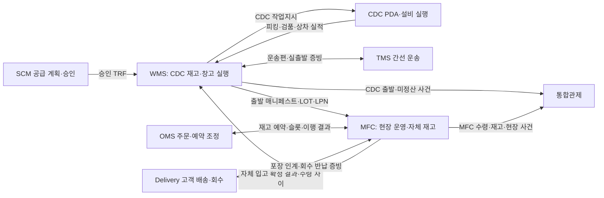

**규칙:** MFC는 실제 수령 증빙과 자체 입고 원장을 함께 확정한다. 실제 MFC TIN 완료 여부는 CDC WMS에 **새 재고 증가 명령**이 아니라 **전기 결과 사실**로 전달된다.

### 0.3 수량 원장 불변식과 분산 대사 규칙

| 사건 | CDC WMS CDC 현물 | CDC WMS Transit 미정산 | MFC 현물 | 후속 처리 |
|---|---:|---:|---:|---|
| SCM 승인/CDC 할당 | 변화 없음 | 변화 없음 | 변화 없음 | CDC 예약만 확보 |
| 실제 피킹·상차 | CDC 총현물 변화 없음 | 변화 없음 | 변화 없음 | LOC·LPN·작업 상태만 변화 |
| **TMS 실제 출발 확인 후 CDC TOUT** | `-q` | `+q` | 변화 없음 | CDC WMS 내부 단일 거래 |
| **MFC 실제 수령→MFC TIN** | 변화 없음 | 아직 그대로일 수 있음 | `+r`(정상+격리) | MFC 내부 단일 거래 |
| **CDC WMS가 TIN 성공 결과 확인** | 변화 없음 | `-r` | 변화 없음 | 같은 `receiptId` 1회 대사; MFC 재입고 금지 |
| MFC 검수·적치·가용 변환 | 변화 없음 | 변화 없음 | 총현물 변화 없음(LOC/품질 등은 전이 가능) | MFC 내부 업무에서 별도 처리 |

**예시:** CDC가 12개를 보냈고 MFC에서 10개(정상 8·격리 2)를 받았다면, CDC에서 `CDC -12 / Transit +12`, MFC에서 `MFC +10`, 이후 CDC에서 `Transit -10`을 기록한다. 최종 Transit 미정산은 2이다. **MFC의 TIN 10 성공과 CDC WMS의 Transit -10은 네트워크 지연으로 시간차가 발생할 수 있다.** 합산 현황에서는 10을 재고로 두 번 계산하지 않도록 수령 ID로 연결해야 한다.

**정합성 조건:** 한 출발 품목행에 대해 `출발q = MFC 확정 수령 누계r + 승인 운송 손실l + CDC 미정산t`. 단, 기전기 수령 결과가 CDC에 아직 전달되지 않았다면 CDC 관점의 잠정 미정산과 MFC 확정 수령이 겹쳐 보일 수 있다. 이 경우 *원본 스냅샷을 단순 합산해서 총재고를 확정하지 않고* 원수령 재조회·시간차 대사 후에만 확정 집계를 제공한다. 미확정 증빙 자체는 정상 가용에 합산하지 않는다.

#### 0.3.1 각 시스템이 금지해야 할 처리

1. CDC WMS가 MFC 현물·예약·LOT/LOC 수량을 직접 수정하는 처리.
2. MFC가 CDC 출발 원장을 임의 차감하거나 CDC의 과거 출발량을 덮어쓰는 처리.
3. **MFC 실수령 사실만으로** CDC 측에서 MFC 재고 증가에 성공했다고 간주하는 처리.
4. TMS 차량 도착·상차 완료·Wave 완료를 CDC 실제 출발 또는 MFC TIN과 동치로 처리하는 것.
5. 배송 주문이 생겼다는 이유로 CDC 보충 TRF를 자동 승인하거나 고객 예약을 CDC 재고에 직접 생성하는 것.
6. 수령·출발 응답 유실을 재고가 늘거나 줄지 않았다는 증거로 취급하여 새 ID로 재실행하는 것.
7. 출발한 실물의 단순 취소 요청만으로 CDC 재고를 복원하는 것.
8. LOT 코드·LPN·Wave·SKU·LOC를 동일 식별자로 사용하거나 BOX/PLT 상·하위 수량을 중복 계상하는 것.

### 0.4 CDC 중심 기능 범위 — 실행 모듈의 위치

| CDC WMS 논리 모듈 | CDC에서 반드시 수행할 일 | MFC/외부 도메인 연계 |
|---|---|---|
| W-01 진입·접수 | CDC 명령 인증·센터 접근·멱등·이벤트 인수 | SCM/TMS/MFC 인가·버전 검증 |
| W-02 기준정보·LOC/LPN | CDC 위치/화물·공통 SKU 버전·온도·용량·라벨 | MFC에 승인된 SKU/출발 화물 스냅샷 전달 |
| W-03 최초 보유 | 승인된 **CDC 초기 보유** 1회 도입·개시 | MFC 최초 보유를 CDC WMS가 생성하지 않음 |
| W-04 CDC 재고 | **CDC 수량·이관 예약·품질·LOT/LOC·CDC-origin Transit 미정산** | MFC 수량을 직접 쓰지 않음; 수령 성공 후 미정산 해소 |
| W-05 LOT/FEFO/품질 | CDC LOT·만료 적격·격리·리콜 출발 영향 | MFC에 LOT/품질 사건과 위험 전파 |
| W-06 센터내 이동 | CDC 적치/MOV/선반 보충, 총현물 보존 | MFC 로컬 MOV를 CDC 모듈로 실행하지 않음 |
| W-07 이관 확보 | SCM 승인 TRF의 CDC 물량 할당·예약 | MFC 고객 주문 예약을 담당하지 않음 |
| W-08 CDC 작업지시 | CDC Wave·피킹·분류·검품·상차 작업·자원 점유 | MFC 고객 피킹은 MFC 업무 |
| W-09 출고·계약 | TMS 출발 확인, CDC TOUT, 전송·수령 응답 대사 | MFC가 MFC TIN을 원자 처리하고 회신 |
| W-10 실사·조정 | CDC 현물 계수·조정·폐기 | MFC 실사/폐기는 MFC가 자체 승인·반영 |
| W-11 감사·복구 | CDC 제한, 출발 대기·미수령·중복·배포 지연 사건 | 통합관제에 미해결 사건 통지 |

**주의:** W-01~W-11은 기획상의 논리 모듈이며 11개 마이크로서비스 설치 의무가 아니다. 이번 변경으로 기존 V6.6의 W-04 “CDC·MFC·Transit 통합 원장” 설명은 **CDC W-04만의 쓰기 경계**로 조정된다. MFC의 내부 모듈명/물리 구조는 이 문서에서 임의 결정하지 않는다.

### 0.5 5대 식별자 — CDC에서의 유일성/보존과 MFC 연계

| 식별자 | CDC WMS 주업무 | MFC와의 계약 | 미결정 금지/확인 |
|---|---|---|---|
| **SKU** `E-/B-` | 공통 승인 버전의 상품 종류, 실제 출고 SKU/판매단위 | MFC는 **동일 글로벌 SKU**로 수령. 상품 최종 승인·전역 번호 발급 시스템은 지정 필요 | MFC 별도 SKU 재번호 발급 금지 |
| **LOC** 7구간 | CDC 물리 위치와 용도·온도·잠금·점유 | **MFC 자체 센터 LOC**. CDC LOC를 MFC 신규 위치로 복사 금지 | 표시 주소의 유일성은 센터 맥락 필수 |
| **LPN** BOX/PLT | CDC 화물 구성·부모/자식·분할·출발 매니페스트 | MFC에서 **같은 실물 LPN 추적 계보**로 수령·해체·재적치 | 별도 LPN-코드 중복 발급 지양(현재 설계안), 분할 자식키 규칙 승인 필요 |
| **LOT** | 제조사 LOT 원문+내부 LOT 키, SKU/품질·기한 | 출발 LOT·제조사 원문/기한/품질 버전 전달; MFC 로컬 식별자 매핑 | 내부 `lotId`를 공통 전역 동일 PK로 강제하지 않음 |
| **Wave** | CDC 승인 이관의 Pick Task 그룹·이력 | 통상 MFC 수령 계약에 **Wave 사용을 강제하지 않음**, 원 TRF·화물·출발·수령 연결 | MFC 고객 Wave와 CDC Wave의 동일 코드·상태 공유 금지 |

### 0.6 원문에 따른 CDC 구현 가정의 보존

이번에 첨부한 CDC 상세 원문은 **자동화 설비 자체를 구현하지 않고 가상 설비 결과를 CDC WMS가 검증하는 모델**을 기술한다. 적치·선반 보충·분류·상차는 가상 어댑터, 실제 피킹은 작업자와 PDA 중심의 모델로 작성되었다. 실제 AGV/PLC·컨베이어 제어 기능은 범위에서 제외한다. 이는 **현재 첨부 원문에서 채택한 업무 모델**이며 이전 V6.6의 사람 중심 설명과 차이가 있다. 실제 MVP에서 해당 모의 어댑터를 사용할지, 작업자 배정 수동/자동, OR-Tools 적용을 확정하는 것은 아직 별도 팀 승인 대상이다. 원문의 수용량·회차·지연 목표도 그 원문에서 말한 정책 지위를 유지한다.

---

---

## 제2부 — CDC WMS 상세 업무 기능 35개 (원문 기반·권한 재귀속)

작성 기준일: 2026-10-20. CDC의 초기 보유·상품/위치 기준, 적치·보관·피킹·MFC 공급·출발·수령 대사와 사고 복구를 다루는 상세 업무 문서다. 상세 DB 스키마·API 필드·코드·화면 설계는 별도 개발 문서에서 작성한다. 여기서는 1차 구현에서 잘못된 재고 증감·중복 작업·범위 확대가 발생하지 않도록 기능의 입력·판단·실행·상태·복구·완료 경계를 정한다.

### 1. CDC의 정의·구현 범위·시스템 책임

CDC는 여러 MFC에 상품을 공급하는 물류 시설이며, CDC 상품 참조·위치·재고·예약·작업 정본은 **CDC WMS**다. MFC의 물리 재고·예약·LOC·LOT 재고 원장은 **기존 MFC 시스템**의 정본이다. SCM은 보충 계산·MFC 수동 요청·승인과 공급 약속, TMS는 간선 편성·운송/ETA, MFC는 목적 MFC의 현장 수령·검수·적치/판매 준비 사실을 맡는다. CDC WMS와 MFC는 서로 다른 쓰기 권한과 저장 경계를 가진다. **MFC는 현장 사실을 검증해 자체 현물 원장에 반영한다.** 센터 간 연계에서 CDC WMS는 자기 출고·원출발 Transit과 수령결과 대사를 수행하며 MFC의 자체 재고를 변경하지 않는다. 본사 승인·관제 조율·WMS 실행은 별도 책임이다.

고객 주문/취소·환불은 OMS, 고객 접점은 Commerce, 라이더 실제 수행은 Delivery다. 이 CDC 문서가 그 업무를 새로 구현하거나 간선 기사 앱·외부 운송사 연계를 추가하는 근거가 되지 않는다. 하위 시스템은 논리적 업무 책임이며 마이크로서비스·서버 수가 아니다.

#### 1.1 현재 범위

외부 공급업체 구매발주·ASN·입차·CDC 실입고/검수는 초기 제외다. 본사 승인 CDC 보유 스냅샷을 파일/시드로 한 번 개시하며 초기화 UI를 제공하지 않는다. 기존 재고의 적치/재배치·보관·자동 선반 보충, 승인된 CDC→MFC 공급의 할당·피킹·분류·검품·상차·출발·운송/수령 대사, 품질·실사·승인 조정·실제 폐기·복구는 포함한다.

CDC 출발 후 원이관 취소·타MFC 목적지 전환·자동 역이관·실제 CDC 반송은 초기 제외다. 프로모션·할인·쿠폰과 예정재고 예약판매·BI 상세 구현도 제외다. 기본 상품/재고·품질·운영 감사 사건은 유지한다. 정확한 센터 운영값·안전량·회차/수령 창·하중·저온 대기 한도는 승인 입력이며 예시를 기본값으로 사용하지 않는다.

#### 1.2 CDC 중심 시스템 협업

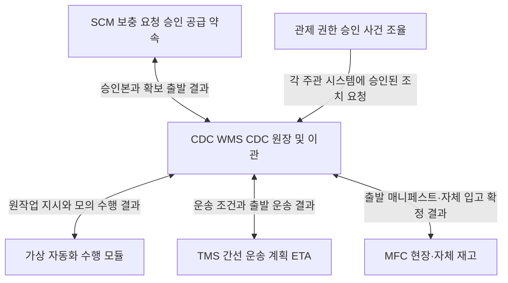

범례: 사각형은 업무 영역/모듈, 양방향 화살표는 요청과 결과의 협업, 단방향 화살표는 업무 요청이다. 직접 API·동기 통신·별도 배포를 확정하지 않는다. SCM 승인·TMS 도착·MFC 실수령·**MFC 수령전기**·**CDC WMS 이동 중 해소**를 서로 다른 사건으로 취급한다.

| 하위 시스템 | 담당 업무·관리 상태 | 최종 판단 경계 |
|---|---|---|
| 상품·초기 보유 | 상품 승인버전·CDC취급·초기검증/승인/반영/개시 | 본사 승인 후 WMS 정본·실제 보유를 각각 확인 |
| 위치·물류 구성 | 위치 상태/하중·현점유/예약용량·BOX/PLT/LPN 소속 | WMS가 실제 구성/위치와 단일 수량을 추적 |
| 재고·LOT·품질 | 정상/격리·원예약/BLOCKED·안전량·기한/FEFO | WMS 정본, 품질 승인과 현장 근거 별도 |
| 적치·내부 보충 | 지시/전달·모의수행·완료/잔량·예약/용량 | 가상 결과를 WMS가 검증해 위치 이전 |
| 이관·피킹·출고 | 승인본·할당·Wave·실피킹·분류/검품/상차·출발 | SCM 승인·작업자 실피킹·모의 물리공정·WMS출발 분리 |
| 수령·대사·복구 | 이동 중·원수령/반영·손실/격리·실사/조정·제한 | MFC 자체 입고 확정/CDC Transit 대사·통지·사건 종결 구분 |

#### 1.3 공정별 실행 주체와 자동화 설비 제외 범위

| 공정 | 운영상 수행 주체/가정 | 1차 프로젝트의 실행 범위 | 결과 확정과 금지선 |
|---|---|---|---|
| 초기 보유 | 본사 승인·WMS 개시 | 파일/시드로 승인 보유 반영 | 실입고/초기 적치 수행 이력 생성 없음 |
| 적치·재배치 | 자동 운반/적재 설비 가정 | WMS 대상/위치/용량·지시 + 가상 시작/완료/부분/실패 | 어댑터가 재고 수정 불가·WMS검증 후 위치 반영 |
| 내부 선반 보충 | 자동 운반 설비 가정 | WMS 최소 이하 자동 계산/지시 + 가상 이동 결과 | 작업자의 정상 운반/지게차 수행 기능 추가 없음·수동 새 보충 요청 제외 |
| 피킹 | 실제 CDC 작업자 | 유효 작업 배정·위치/상품/LOT 확인·실계수·실적 | 이 공정은 실제 작업자 수행·확인, 로봇 피킹 구현 없음 |
| 목적 MFC 분류·물류 포장 구성 | 자동 분류/취급 설비 가정 | 분류/구성 지시·가상 분류/분리/배치 결과·구성 검증 | 새 수동 분류/운반 작업 흐름을 만들지 않음 |
| 검품 | 설비 판독·품질/관리 판단 | 가상 계수/식별/중량/포장 결과 + WMS 승인 기준 검증 | 물리 자동계측 구현 없음. 관리자의 이상 조사/품질 승인은 유지 |
| 상차·미출발 하차/복귀 | 자동 운반 설비 가정 | TMS조건/WMS화물 검증 + 가상 상차/하차·복귀 결과 | LOADED만으로 CDC차감/출발확정 없음 |
| CDC 실제 출발 | 현장/운송 사실 확인 | 원이관·차량 운송편에 연결한 출발 사실 모의 + WMS 검증 | 단순 성공 버튼·상차결과가 출발 사실을 대신하지 않음 |
| 운송·MFC 수령 | TMS 간선 증빙·MFC 실수령·MFC 수령원장 | CDC WMS는 출발 매니페스트와 MFC의 기전기·수령 응답을 소비. MFC 자체 재고 기능을 CDC에 복제하지 않음 | **MFC 수령 반영 후 CDC WMS가 출발 미수령과 Transit 대사를 수행** |
| 품질·실사·처분 | 현장 사실/본사 승인·실제 실행 증빙 | 품질 판단·계수·승인 조정·원실물의 처분 근거 검증 | 사진/승인만으로 실제 폐기 확정 금지·폐기장비 제어 없음 |

실제 컨베이어·AGV/AMR·PLC·DAS/DPS·분류기·상차장비 제어, 이동 경로/충돌 회피·설비 텔레메트리는 모든 공정에서 제외한다. 정상 가상 수행과 관리자의 예외 조사/승인/정정은 별개다. 후자를 근거로 자동화 공정마다 새 작업자 운반·수동 상차 기능을 만들지 않는다.

본문의 `실제 수량/위치/출발`은 업무상 확정해야 하는 사실을 뜻한다. 프로젝트 가상 구간에서는 모의임을 구분한 결과를 입력으로 사용하고 WMS 업무 검증을 동일하게 거친다. 실제 설비 동작/현장 시험 완료로 표시하지 않는다. 가상 완료와 원장 반영·상대 통지는 서로 다른 결과다.

#### 1.4 문서의 단일 기능 정의 원칙

시설 표기는 CDC/MFC로 통일한다. 파일명과 기존 기능 식별자 `CDC-F-001~035`는 추적 연속성을 위해 유지한다. 기능 ID의 DC는 시설의 별도 명칭이나 새 기능을 뜻하지 않는다.

1~3장은 정의·경계·공통 기준·전체 흐름이다. 실행 가능한 기능의 정본은 4~16장의 **CDC-F 기능 ID가 붙은 절 한 곳**이다. 부록은 해당 기능의 식별·구성·추적 조건을 구체화하는 보조 설명이며 별도 실행 기능이나 수량 반영 주체를 추가하지 않는다. 다른 절의 같은 ID 언급은 그 기능의 협업/의존 관계이며 새 기능·서비스 생성 지시가 아니다.

각 기능은 시작 조건·입력·검증·상세 처리·상태 변화·오류/복구·완료 조건을 함께 읽는다. 조회·명령·외부 사실·원장 반영·통지를 나누되 화면 구성/버튼/이동·테이블/컬럼·코드는 여기서 설계하지 않는다. 예시 산술과 상태도는 업무 조건을 설명하는 자료이며 실제 운영 입력·실행 테스트 결과가 아니다.

### 2. 공통 용어·식별·정책 적용 기준

#### 2.1 상품·물류 단위·위치의 구별

| 용어 | 이 문서에서의 의미 |
|---|---|
| E- SKU | 단품을 식별하는 상품 코드. 접두어 뒤 전역 공통 8자리 일련번호를 사용한다. |
| B- SKU | 제조사 등이 밀봉한 독립 실물 묶음 상품. E와 별도 재고·가격·바코드를 가진다. |
| SKU 판매단위 수량 | 해당 SKU의 실제 관리 개수. B 6입 1팩은 B 1개이며 E 6개 재고와 합치지 않는다. |
| LOT | 제조·생산 배치의 별도 추적 기준. 내부 식별자와 제조사 LOT 원문을 구분한다. 식품 필수·비식품 선택이며, 같은 기한이어도 다른 제조 배치는 합치지 않는다. |
| BOX·PLT | 박스/팔레트의 물류 취급 구성. 상품 SKU나 별도의 추가 상품 재고가 아니다. |
| LPN | BOX·PLT의 구성·위치·상태·이력을 추적하는 물류 취급 단위 식별 개념. `[설계안]` BOX/PLT 번호 자체를 사용하고 별도 LPN 번호는 중복 발급하지 않는다. 토트·고객 포장·빈 팔레트 자산을 같은 의무 식별 범위로 확대하지 않는다. |
| 로케이션 | 센터 안 실제 보관·작업 위치. CDC와 MFC를 구분하고 상품·LOT·화물 식별과 분리한다. |
| 적치·적재 | 적치는 지정 위치에 물품을 배치하는 업무, 적재는 랙/보관설비에 취급 단위를 싣는 행위와 배치 상태다. |
| MOV | 같은 센터 안 재고의 위치 이동 작업. 센터 총현물의 증감 거래가 아니다. |
| TRF | 승인된 CDC→MFC 이관 업무. 고객 주문과 별개로 요청·승인·할당·출발을 연결한다. |
| TOUT·TIN | TOUT는 **CDC WMS**의 실제 CDC 출발 원장 거래, TIN은 **MFC**의 실제 MFC 수령 원장 거래. 전역 단일 트랜잭션이 아니며, 번호 발급·도착 통지만으로 어느 원장도 변하지 않는다. |
| Wave | 원요청의 피킹 작업을 편성·배포하는 계획 그룹. 재고 예약·BOX/PLT·차량·출발과 별개다. 실행과 실적은 Pick Task 및 그 작업행으로 추적한다. |
| 가상 설비 어댑터 | 지시를 받아 모의 시작·성공·실패·부분 완료 결과를 생성하는 모듈. 재고를 직접 수정하지 않는다. |

#### 2.2 수량·시간과 정책 지위

모든 업무 수량은 동일 SKU의 판매단위 개수로 환산해 비교하며 중량(kg), 부피, BOX/PLT 슬롯, 금액(원), 시간(분/일)을 섞어 더하지 않는다. EA는 해당 SKU의 판매단위 개수이며 B 상품을 EA로 표시해도 구성 낱개로 전환한다는 뜻이 아니다. 날짜·기한·업무시각은 Asia/Seoul을 사용한다.

`[확정 정책]`은 사용자 확정 또는 확인된 프로젝트 기준, `[채택 설계]`는 기존 사용자 위임으로 채택한 운영안이다. `[설계안]`은 업무를 구체화하는 제안으로 사업/구현 합의 전 확정 정책이 아니며, `[팀 확인 필요]`는 운영값·권한·사업 판단의 승인이 남았다는 뜻이다. 별도 표시 없는 단계 설명은 현행 정책을 실행하기 위한 업무 요구사항이며 실제 운영·장비·PG 시험 완료 보고가 아니다. LPN 통합 식별·상속 위치·BOX/PLT 수명주기, LOT 내부 코드·정정, Wave/Task 운영 모델의 신규 보완은 아래에서 `[설계안]`으로 구분하며 원문의 권장안을 사업 확정으로 승격하지 않는다. 이미 채택한 재고 소유·출발/수령 반영·기한·단일 출발 시점은 새 자료의 미결정 목록 때문에 다시 미정으로 돌리지 않는다.

최신 사용자 결정과 채택 설계를 먼저 적용한다. 이전 자료의 상품/재고 소유, 단품 접두어, 소비기한, 다회 출발·반송 제안은 현재 결정을 바꾸지 않는다. 단품 E-/밀봉 묶음 B-와 공통 8자리 번호를 사용하며, E/B 포장 전환을 지원하지 않는다. 고객의 기초상품 구성 합산 기본 10개 제한과 고객 배송 10kg 초과 분할은 CDC 이관 상한·BOX 최대중량이 아니다.

운영값이 없으면 0·무제한·임의 예시값으로 실행하지 않는다. 검증할 수 없는 대상의 신규 할당/이동/출발만 보류하고 기존 현물의 안전 보관·조사·이미 출발한 물량의 안전 수령·다른 적격 업무는 유지한다. 안전·품질 제한을 일반 예외 승인으로 우회할 수 없다.

### 3. CDC 업무 전체 생명주기와 상태

#### 3.1 운영의 시작과 종료

CDC의 시작은 **승인된 기준정보·위치와 실제 보유 근거 준비 → 초기 보유 검증·승인 → 한 번 반영 → 운영 개시**다. 이후 등록된 재고를 적치·보관·내부 이동하며 MFC 수동 요청의 승인본을 실행한다.

MFC 공급은 **SCM 승인 → CDC 재고 할당 → 내부 보충 검토 → 작업 릴리스 → 실제 피킹 → 목적 MFC별 분류·검품 → 상차 → 실제 출발 → TMS 운송 → MFC 검수·자체 TIN 확정 → CDC WMS의 수령결과 대사 → 미결 수량·품질·잔량 확인**으로 이어진다. 계획·승인·피킹·상차는 CDC 총현물을 줄이지 않는다.

적치/이관/품질 사건의 종료는 완료 요청 접수나 차량 도착 시각으로 정하지 않는다. 실제 수량·현재 위치·원장 반영·남은 예약/용량·미수령/미출발 의무·승인/품질 사건을 각각 확인한다.

#### 3.2 사건별 수량 변화

| 사건 | CDC 현물 | 목적지 현물·이동 중 | 예약·용량·후속 결과 |
|---|---|---|---|
| 초기 보유 개시 | 승인된 실제 보유를 1회 반영 | 근거 없는 MFC/이동 중 생성 없음 | 초기 검증 범위 운영 가능 |
| 적치 지시 | 총량·위치 현물 변경 없음 | 목적지 현물 증가 없음 | 출발 이동 할당·목적지 예정 용량 확보 |
| 적치/MOV 완료 | 센터 총량 변화 0 | 출발 위치 감소·목적/실제 임시 위치 증가 | 완료분 작업 점유/용량을 해소·잔량 유지 |
| 이관 승인·할당 | 현물 변화 0 | 이동 중 증가 없음 | 승인과 실제 재고 확보를 분리 |
| 피킹·검품·상차 | CDC 총량 변화 0 | MFC 증가·이동 중 증가 없음 | 현재 위치·화물·작업 상태만 변경 |
| 실제 CDC 출발 | 출발량만 감소 | 같은 양 이동 중 증가 | 해당 이관 확보 소진 |
| MFC 실제 수령 반영 | CDC 복원 없음 | **MFC가 정상/격리 현물을 전기**하고, CDC WMS는 **확정 수령 응답을 근거로 이동 중 대기량을 차감**한다. 두 시스템 처리는 비동기 | 판매 준비는 별도 확인. 합산조회는 접수/전기/응답유실 상태를 식별자로 중복 제거 |
| 품질 보류·해제 | 총현물 변화 0 | 정상/격리·사용 가능 상태 변경 | 영향 작업 차단·BLOCKED 의무 유지 |
| 실제 폐기·승인 손실·조정 | 실제 해당 구간에서 실행/승인량 반영 | 같은 실물 이중 차감 없음 | 원사건·증빙·승인·잔량을 보존 |

#### 3.3 서로 합치지 않는 상태 축

| 상태 축 | 업무상 구분 |
|---|---|
| 요청·승인 | 초안·접수·심사·승인/부분 승인·반려·미출발 취소/종료 |
| 재고 할당 | 미확보·부분 확보·확보·품질 BLOCKED·해제·실제 출발 소진 |
| 현장 작업 | 미릴리스·릴리스·시작·부분 완료·완료·중지·실물 정리 후 취소 |
| 적치 수행 | 생성·용량 예약·지시 전달·수행 중·부분 완료·완료·실패·예외 보류·취소 |
| 운송·수령 | 미출발·이동 중·부분 수령·수량 대사 완료 |
| 품질·준비 | 미판정·정상·격리·혼합, 미준비·부분 준비·준비 완료 |
| 연계 반영 | 미접수·처리 중·반영 완료·검증 거절·확인 불가 |
| 사건·마감 | 조사 중·승인 대기·조치 중·대사 완료·행정 마감, 품질 사건 별도 종결 |

같은 원작업·원이관과 연결해 상태를 조회하되 작업 완료를 출발로, 수량 대사를 정상 판매 가능으로, 행정 마감을 품질 해제로 변환하지 않는다. 영문 상태 코드의 실제 채택은 구현 계약에서 정한다.

#### 3.4 이관 문서 계보·승인 잔량의 보존

이관은 **원요청/품목행 → 승인 버전/행 → LOT·위치별 할당 → MOV·Wave·피킹/검품·화물 → 한 번의 실제 출발 → 여러 실제 수령 → 품질·손실·조정 사건**으로 연결한다. 같은 공급이 승인 목록·피킹 목록·이동 중 목록에 각각 표시돼도 서로 다른 공급으로 합산하지 않는다. 각 작업은 어떤 승인행의 어느 수량을 처리했는지 설명할 수 있어야 한다.

동일한 원승인 버전·SKU 판매단위에서 `원승인량 = 미출발 취소량 + 승인 잔량 종료량 + 실제 출발량 + 미출발 미해결량`을 대사한다. 각 구간은 서로 겹치지 않는다. 승인 잔량 종료는 물리 손실/폐기가 아니라 공급 약속을 끝내기로 승인한 수량이다. 미승인 요청량은 원승인량 밖의 미충족이며 이 식에 다시 넣지 않는다.

승인60·출발48·미출발미해결12이면60=0+0+48+12다. 남은12의 실물/예약 정리와 원승인선 확인 뒤 종료하면60=0+12+48+0이다. 이 종료12를 출발48의 운송 손실로 넣거나 같은 요청의 다음 출발량으로 사용하지 않는다. 취소와 잔량 종료는 같은12에 동시에 기록하지 않는다.

승인 변경은 원버전·변경 이유·전후량·승인자·영향 작업을 남기고 과거 버전의 전체 수량을 새 공급으로 더하지 않는다. 목적 MFC·SKU·단위·승인량의 변경은 미출발 범위의 기존 할당/작업·실물·운송 조건을 대사한 뒤 재심사한다. 출발 후 원목적지나 출발량을 몰래 고치지 않는다.

조회에서는 승인·할당·작업·운송·품질·준비·조사·마감을 별도 축으로 제공한다. 영문 `RELEASED`를 쓰는 경우 작업 전달인 **릴리스**와 재고 확보 **해제**가 어느 축의 결과인지 반드시 구별한다. `DONE`은 작업 완료, `QUANTITY_SETTLED`는 운송 수량 대사, `CLOSED`는 해당 행정 의무 마감의 코드 제안일 뿐 같은 사건이 아니다. 실제 코드 채택은 구현 계약이며 부분 수량·미결 품질 의무를 숨기지 않는다.

#### 3.5 CDC 전체 흐름과 정상·예외의 갈림

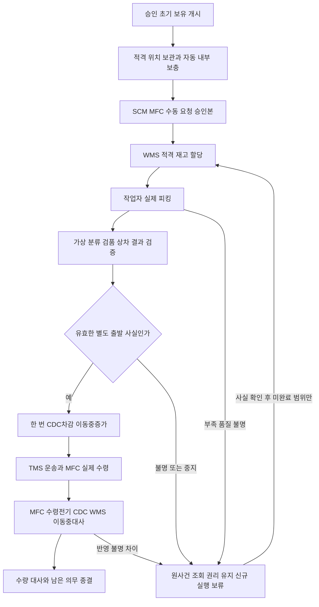

범례: 사각형은 업무 단계, 마름모는 사실 확인, 화살표는 조건부 업무 연결이다. 예외에서 할당으로 돌아오는 선은 필요한 원단계만 복구한다는 뜻이며 새 이관·기완료 피킹·출발을 다시 만들라는 뜻이 아니다. SCM 승인·자동화 결과·출발·MFC 판매 가능을 한 상태로 합치지 않는다.

#### 3.6 현물·위치 변화와 원출발 대사의 구별

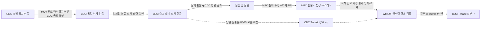

범례: 실선은 물품의 현재 위치·보유 구간 변화, 점선은 원장 기록·확정결과 전달이다. MFC 현물은 MFC의 자체 TIN 때 증가하며 CDC ACK를 기다려 증가하는 것이 아니다. CDC Transit은 미정산 장부로서 기수령·미통지량이 잠시 남을 수 있다. 실제 운송 중 현물과 미정산 장부를 동일 수량으로 단정하지 않는다. 정상·격리는 MFC 현물의 하위 구분이고 정상 중에서도 판매 준비가 남을 수 있다.

### 4. CDC 시설·보관 제약

#### CDC-F-001 시설·위치 수용조건을 적용한 창고 실행 적격 검증

**주관·실행 주체:** CDC WMS의 실행검증. 시설 설계·인증·품질/안전 기준의 최종승인은 해당 시설/품질 책임자다.

**시작 조건:** 위치 활성/변경, 적치·재배치·피킹·출고 후보 선정, 시설 제한 변경 시 해당 물량의 실행 가능성을 판단한다.

**입력:** 승인된 센터/위치 마스터, 실제 온도·허용중량/부피/높이/슬롯·장비접근·혼재조건, SKU/포장 실물물성, 현재점유·진행작업의 예약용량, 기준/제한 버전.

**사전 검증:** 위치가 실제 존재하고 승인범위에서 사용가능한지, 물성과 제한의 단위/버전이 맞는지 확인한다. 전체센터 목표면적/EA가 남았다는 이유로 개별위치 적격을 대체하지 않는다.

**정상 처리:**
1. 대상SKU/LOT·품질·LPN 하위구성을 전개하고 상품별 승인 보관조건을 확인한다.
2. 위치 온도·사용/잠금상태·혼재·접근·위생/품질 제한으로 불가후보를 제거한다.
3. 상품·포장재·BOX/PLT를 포함한 실제중량/외형을 적용한다. 상하위 LPN은 같은공간으로 중복계상하지 않는다.
4. 각필수 한도에서 현재점유+타진행예약+이번예정량을 검사한다.
5. 최신상태에서 목적용량 예약과 원작업을 연결하고 후보/확정예약/실제적치를 구분한다.
6. 불가면 제한종류·대상물량·현재실물·담당·보완값을 반환한다. 이미있는 재고를 삭제하지 않는다.

**판단 사례:** 한위치 허용100/점유70/진행예약20이면 새20은 불가, 새10까지만 후보가 된다. 두작업이 동시에10을 조회해도 하나확정 뒤 다른작업은 재검증해야 한다. 허용하중이 미등록이면0이나 설계최대치를 넣는 대신 해당신규배정을 보류한다.

**삭제한 잘못된 확정:** 평수·랙규격·하중·통로폭·소방이격·도크/차량대수·센터별 수용능력을 WMS가 설계/인증한 것처럼 정의하지 않는다. 과거8,600평/14,000SKU/520만EA 등은 이전문서의 프로젝트 목표이며 실제위치/상품별 적격수용 근거가 아니다. 설계원문은 보존본에서 확인한다. 냉장확장4,000SKU는 면적4,000평이 아니다.

**상태·수량:** 기준/위치 적격·공간예약만 변경한다. 후보선택·예약으로 센터현물을 가산하지 않는다.

**실패·복구:** 용량예약성공/지시저장불명은 원예약/원작업 조회로 누락만 복구한다. 안전/품질 불명은 영향신규작업만 보류하고 안전보관·조사는 유지한다.

**완료 조건:** 적용위치·물성·제약/예약·버전·불가사유와 실물위치가 설명되며 후속실행이 같은조건을 재검증할 수 있다.

### 5. 공통 상품·초기 보유

#### CDC-F-002 승인된 상품·물류 규격·바코드 버전 반영

**주관·실행 주체:** 상품/품질 승인입력의 WMS 소비 및 물류취급 검증. 전역상품 발급서비스·상품기획/가격결정은 WMS 창고기능에서 새로 정하지 않는다.

**시작 조건:** 공통SKU/물류규격·바코드·단위환산·온도/LOT 추적기준의 승인버전이 배포되거나 센터취급을 변경할 때.

**입력:** 승인ID·상품/SKU·버전/효력시각, E/B 독립실물 포장·기준단위, 바코드/유효맥락, 제조LOT/기한추적·온도·치수/중량·BOX/PLT 환산, 현재재고/작업 영향.

**사전 검증:** 발신/승인·스키마·전역SKU 참조·실물규격/단위·바코드 단일해석을 확인한다. 미승인변경을 물류운영자가 임의발급/재매핑으로 반영하지 않는다.

**정상 처리:**
1. 원승인/버전·기반영 결과를 조회해 같은배포를 한 번만 반영한다.
2. E-낱개와 B-독립밀봉묶음을 구분하고 BOX/PLT 포장과 혼동하지 않는다.
3. 동일SKU 기준단위·바코드 스캔결과·물류환산이 일관되는지 검증한다. 선행0을 보존한다.
4. 변경영향 재고·예약·LOT/LPN·진행작업을 조회한다. 과거확정실적은 당시버전을 보존한다.
5. 미출발작업에 새규격/품질조건이 필요하면 영향범위 실행보류·재검증을 지시한다.
6. 승인물류기준 반영과 센터취급 활성, 외부통지/조회반영을 각각 기록한다.

**분기:** 같은맥락/시점의 바코드가 두SKU를 가리키면 자동선택하지 않는다. 새바코드가 알려졌어도 기존실물이 다른규격이면 같은수량으로 병합하지 않는다. 가격/전시명/카테고리 변경만으로 SKU나 재고를 재발급하지 않는다. B6입1팩과 E6개는 별도현물이며 포장전환은 초기미지원이다.

**상태·수량:** 물류기준/취급 유효버전 변경만 발생한다. 재고·과거환산·원예약은 자동증감하지 않는다. SKU 비활성도 현재현물을 삭제하지 않는다.

**실패·복구:** 승인반영 성공/조회캐시 갱신실패는 조회반영만 복구한다. 동일SKU·같은승인에 다른내용이면 충돌로 보존하고 원승인 주체에 정정을 요청한다.

**완료 조건:** 승인참조·적용버전·구/신실물 식별·영향작업의 재검증/보류와 미완료전달이 명확하다. 고객 판매허용·가격/구매제한 확정은 해당 영역의 결과다.

#### CDC-F-003 승인 초기 보유 검증·개시

**주관·실행 주체:** 본사 재고 책임자 승인·WMS 파일/시드 반영

**시작 조건:** 운영 개시 기준시점의 실제 CDC보유 근거와 기준정보가 준비됐을 때.

**입력:** 원개시 실행·기준시점/승인범위·SKU/LOT/기한·실위치·정상/격리·실수량·구성/정책버전.

**검증:** 중복개시·품질/기한·E/B단위·구성중복·위치용량·승인 총량과 기반영을 확인한다.

**처리:**

`[채택 설계]` 본사 재고 책임자는 운영 개시 기준시점의 실제 CDC 보유 스냅샷을 승인한다. 승인 대상은 SKU/판매단위·LOT/기한·실제 센터/위치·정상/격리·수량·BOX/PLT 구성·기준 버전이다. 파일/시드로 자동 반영하며 관리자 초기화 UI를 제공하지 않는다.

1. 공통 상품·센터·실제 로케이션·보관 조건·사용 상태가 등록되어 있는지 확인한다.
2. 식품 LOT/기한·수량 비음수·환산 정수·E/B 독립성·중복 실물/구성 여부를 검증한다.
3. 위치별 중량·부피·슬롯·상위/하위 구성 중복 점유를 확인한다. 최대 목표 520만 EA를 실제 보유로 채우지 않는다.
4. 품질 근거가 불명인 식품은 정상 출고 가능으로 만들지 않는다. 정상/격리 수량과 총수량을 대사한다.
5. 기준시점·대상 범위·총수량·정책 버전·검증 결과를 본사 재고 책임자가 확인·승인한다.
6. 같은 개시 실행을 구분해 한 번 반영하고 `INITIAL_BALANCE`라는 초기 보유 원인으로 이력을 남긴다. 실제 공급업체 입고·검수·가상 적치 완료를 생성하지 않는다.
7. 승인 범위 전체와 실제 반영 수량·위치가 일치하면 운영을 개시하고 정상 적격 재고의 피킹 가능량을 제공한다.

초기 상태는 준비 → 검증 보류/완료 → 승인 → 반영 확인 → 운영 개시로 구분한다. 중간 실패는 이미 반영한 범위를 조회해 누락분만 복구한다. 응답 유실을 전량 미반영으로 간주해 파일 전체를 다시 가산하지 않는다. 대사가 맞기 전 영향 범위를 운영 개시하지 않는다.

운영 후 차이는 재초기화가 아닌 실사·승인 조정으로 처리한다. 초기 보유의 라벨 재출력·BOX/PLT 구성 재조회·위치 검증은 추가 입고가 아니다. 근거 없는 MFC/이동 중/고객 예약을 초기값으로 생성하지 않는다. 실제 MFC 보유가 없다면 0으로 시작하고 CDC 실제 출발과 MFC 실제 수령으로 공급한다.

운영 중 적치는 기존 등록 재고를 적치 대기 버퍼→보관 랙, 같은 CDC 위치 간 재배치, 임시 보류 위치→적합 위치로 옮기는 업무다. 품질 보류 재고는 적합 온도 위치로 옮겨도 품질 승인 없이 정상화하지 않는다.

`[설계안·테스트 전용]` 테스트 환경에서 신규 재고 유입을 검증할 필요가 있으면 출처·권한·수량을 명시한 `SIMULATED_STOCK_INJECTION`을 일반 적치와 구분할 수 있다. 이는 운영 재고 증가를 허용한 결정이나 초기화 UI 도입이 아니다. 허용 여부·환경 분리·권한이 승인되기 전 운영 수량 증가 경로로 제공하지 않는다.

초기 보유를 확인하는 운영자는 상품 등록 수와 실제 보유 수량을 구분해 조회한다. 같은 SKU가 여러 LOT/위치에 있으면 각 실제 보유를 추적하되 상위 화물과 하위 수량을 더하지 않는다. 조회는 운영 개시·초기 반영 재실행 명령이 아니다.

| 확인·실행 | 입력과 검증 | 반환·표시할 결과 | 실패 후 다음 조치 |
|---|---|---|---|
| 공통 상품/센터 취급 조회 | 정확한SKU·CDC·적용시각, 상품 승인/활성·CDC취급·온도·LOT/환산 버전 | 유효 기준과 취급/제한 사유. 상품 존재·현물 보유·공급 가능은 별도 표시 | 조회 불명을 미등록/재고0으로 바꾸지 않고 WMS 원기준 재조회 |
| 초기 검증 결과 조회 | 원개시·승인 기준시점·대상범위·검증 결과 | 전체/검증보류·승인·반영/미반영 수량과 위치/품질 구분 | 오류 대상/원인을 보완하고 승인 범위를 확인 |
| 승인 개시 반영 | 원승인·대상 버전·기반영 범위·운영 개시 여부 | 원개시별 누적 반영과 남은 범위, 성공분의 실제 위치 | 일부 실패는 누락만 복구, 운영 이후 재초기화 금지 |
| 운영 개시 확인 | 승인 총수량/정상·격리·위치·구성과 누적반영 일치 | 해당 범위 운영 가능·보류와 사유 | 대사 불일치는 안전 보관/조회 유지·해당 신규 출고 보류 |

조회 응답이 유실되면 원개시·상품 기준을 재조회한다. 이미 반영한 수량에 대해 초기 반영을 다시 실행하는 복구를 만들지 않는다. 예를 들어 승인100개 중60개 반영 후 응답이 끊겼다면 기반영60을 확인하고 미반영40만 처리하며, 최종100이 맞기 전 그100 전체가 운영 개시됐다고 확정하지 않는다. 100/60/40은 부분 복구의 설명용 수량이다.

개시 반영 직전에는 승인 범위별 기반영/미반영을 대사하고, 반영 뒤에는 같은 원개시의 현물 증가 누계=승인된 실제 보유량인지 확인한다. 정상+격리·위치별 구성의 합계가 그 누계와 같아야 한다. 같은 실행 재전달 전후에는 모든 기반영량이 그대로며 승인 범위가 아닌 목표/예정 물량은 증가시킬 수 없다. 부분 반영과 운영 개시 허용 범위는 분리한다.

##### 초기 LOT·LPN·위치 연결의 교차 확인

`[설계안]` 실제 추적 대상 BOX/PLT가 있으면 기존 단위 식별·활성 부모·확정 구성 버전·직접/유효 위치를 초기 보유의 SKU·LOT·품질·수량과 대사한다. 직접 보관 재고에는 가상 BOX/PLT/LPN을 강제 발급하지 않는다. 실제 단위의 추적 등록은 초기 보유에 이미 포함된 상품을 새로 입고하는 사건이 아니다.

식품 LOT 누락, BOX 구성 LOT와 원재고 LOT의 불일치, 폐기 이력 물량의 정상 등록, B 완제품에 E LOT을 근거 없이 연결한 건은 영향 수량을 미확인/격리로 구분한다. LOT 식별 확인 완료와 품질 적격·출고 가능은 각각 확인한다. 하나의 위치에 같은 SKU의 두 LOT가 실제 보관돼 있으면 위치가 같다는 이유로 합치지 않고 각 LOT 수량을 보존한다.

초기 구성 검증 성공·일부 실패가 섞이면 실제 승인 보유와 각 반영 결과를 유지하고 실패한 연결만 보완한다. BOX/PLT 등록을 다시 했다는 이유로 INITIAL_BALANCE를 재실행하지 않는다. LOT 내부 코드 형식이나 LPN 추적 범위 승인이 없으면 해당 추적 구현은 승인 대기로 두되 식품 LOT 불명 수량을 정상 운영에 개시하지 않는다.

**상태 변화:** 준비→검증보류/완료→승인→반영대기/부분/완료→운영개시. 승인 보유만1회 INITIAL_BALANCE로 가산한다.

**오류·복구:** 일부저장/응답유실은 원개시 기반영 조회 후 누락만 복구한다. 운영후 차이는 실사/조정이며 재초기화·운영 신규 모의유입 경로를 만들지 않는다.

**완료 조건:** 승인범위 전체와 반영 현물/정상·격리/위치·수량이 일치하고 해당 범위 개시를 확인했다.

### 6. 로케이션·후보 선정

#### CDC-F-004 위치 기준 등록·사용 제한 관리

**주관·실행 주체:** WMS 위치 기준 담당·권한별 승인/조사

**시작 조건:** 위치를 등록/변경/폐지하거나 점검·사용 제한을 적용할 때.

**입력:** 센터/7구간위치·도면·온도/용도·하중/치수·고정SKU·실점유/예약/작업·상태버전·권한.

**검증:** 실재 위치·비랙 승인 표현·빈고정SKU·잔여실물/작업/잠금·해제승인을 확인한다.

**처리:**

`[확정 정책]` 위치는 **센터-온도구역-세부구역/통로-랙-베이-단-포지션**으로 식별한다. `CDC01-R-04-R018-B03-L02-P01`은 CDC01·냉장 R·세부구역/통로 04·랙 18·베이 03·2단·포지션 01의 설명 예시다. 04의 센터별 의미는 도면에서 통로 또는 세부존 중 하나로 승인해야 한다. 문자열 일부만으로 온도·용량·접근성을 판정하지 않고 승인된 위치 정보와 대조한다.

베이는 랙 기둥 사이의 보관 구획이며 단은 높이 방향, 포지션은 같은 단의 실제 세부 자리다. 주소가 같은 통로에 있어도 서로 다른 단/포지션은 다른 작업 위치다. 실제 도면에 없는 단·포지션을 코드 생성만으로 추가하지 않는다.

도크·격리·출고대기·임시·평치 등 비랙 위치도 같은 7구간 표준 안에서 승인한다. 미정 표현을 임의 코드나 두 번째 체계로 만들지 않는다. 위치는 센터 안에서 유일하고 다른 센터의 같은 표시 주소는 다른 위치다. SKU/LOT/BOX/PLT와 위치를 혼동하지 않는다.

신규 위치는 실제 도면·랙 단수/포지션·용도·온도·허용 상품·치수·중량/부피·접근 장비·혼재·전용 SKU·잠금 조건을 검증·승인한 뒤 활성화한다. 폐쇄·점검·파손·보류 위치는 신규 배정 후보에서 제외한다. 비활성/용도 변경 전 잔여 현물·예약·작업·잠금을 대사하며 과거 위치 참조는 보존한다. 차단 위치의 상품을 폐기한 것으로 간주하지 않고 안전 반출·품질 판정을 별도로 수행한다.

고정 피킹 위치는 재고 0이어도 지정 SKU를 유지한다. 하나의 SKU가 여러 고정 위치를 가질 수 있다. 동적 리저브는 현물·진행 작업·할당·잠금이 해소되고 보관 조건을 통과한 위치만 재사용한다. 번호만으로 실제 거리나 장비 경로를 확정하지 않는다.

위치 검증은 지시 위치 → 슬롯 라벨 식별 결과 → 현재 작업 위치 대조 → 해당 업무의 현장 확인값 검증 → 상품·LOT·LPN·실제 단/포지션·수량 확인 순서다. 피킹에서는 작업자의 실제 확인을 받고, 자동화 가정 구간은 같은 의미의 가상 식별/위치 결과를 받는다. 자동 적치·내부 보충마다 작업자 스캔 수행 기능을 추가하지 않는다. 위치 불일치와 현장 확인값 불일치는 구분해 재확인 전 수량·위치를 확정하지 않는다.

빔 라벨과 상단 주소 표식은 함께 쓸 수 있으나 상단 스캔이 실제 높이·슬롯을 보증하지 않는다. 두 번째 포지션도 독립적으로 식별한다. 위치 라벨·상품 바코드·LOT 라벨은 각각의 업무 의미로 확인한다. 현장 확인값과 바코드 심벌 체크문자는 다르며 모든 작업에 같은 확인값을 필수라고 가정하지 않는다. 인쇄 크기·스캔 거리·각도·다중 인식은 실제 검증 대상이다. 라벨 재출력은 같은 식별자를 유지하고 물류 실적을 생성하지 않는다.

| 운영 동작 | 확인할 입력·현재 조건 | 성공 시 변경·표시 | 보류·경합 처리 |
|---|---|---|---|
| 위치 현황 조회 | CDC·위치·온도/용도·현재 점유·진행 작업 예약·상태/버전 | 현재 현물·예정 용량·실제 잔여 한도를 구분 | 조회 실패를 빈 위치로 표시하지 않음 |
| 적치 후보 추천 | 원대상SKU/LOT·취급단위·수량·온도·품질·치수/하중·혼재 | 적격 후보와 추천 근거, 후보 조회 시각 | 적격 없음/용량부족/위치차단/동시예약충돌을 구분해 재검토 |
| 목적지 예약 | 원작업·최신 위치·출발 점유·다른 예약·현재 허용량 | 해당 원작업에만 연결된 예정 용량. 현재 현물 변화0 | 동시 선점이면 최신 잔여량으로 재탐색·중복 예약 금지 |
| 위치 사용 제한 | 권한·대상 범위·사유·잔여 현물/예약/작업·제한 강도 | 신규 배정 차단과 영향 작업 확인·현물 위치 유지 | 점유 중 위치를 삭제/빈 위치로 만들지 않고 안전 이동 조율 |
| 제한 해제/용도 변경 | 해제 권한·품질/안전 승인·실제 검증·기존 점유 대사 | 승인된 조건/시점부터 적격 후보로 제공 | 시간 경과·시설 회복만으로 자동 해제하지 않음 |

표시 주소나 라벨이 바뀌어도 기존 상품·LOT·이동 이력은 보존한다. 용도/허용값 변경 후 과거 추천 응답이 도착하면 현재 버전과 다름을 확인하고 예약·실행에 재사용하지 않는다. 추천 목록 선택은 재고 이동 완료가 아니며 적치 원작업의 예약·지시·결과까지 연결해야 한다.

##### 위치 사용 상태와 물류·재고 상태의 구분

`[설계안]` 위치 마스터 상태는 등록 중 DRAFT → 승인 활성 ACTIVE로 관리한다. 안전·작업 제한은 BLOCKED, 신규 적치를 금지하고 잔여를 정리하는 상태는 INACTIVE, 정리가 끝나 폐지한 상태는 RETIRED로 구분한다. 실제 전이 코드와 승인 역할은 확정이 필요하다. 보관·피킹·출고대기·검수·격리의 위치 용도와 실사 잠금은 별도 속성/통제이며 상태 코드에 모두 합치지 않는다.

RETIRED로 끝내기 전 직적치 SKU, 독립 BOX, 상위 PLT와 하위 구성, 유효 예약·미완료 이동·출고 작업이 모두 해소됐는지 확인한다. 실제 위치 의미가 바뀌는 랙 개조·이동은 기존 코드 종료와 신규 코드 발급으로 이력을 잇는 방안을 사용한다. 과거 위치 코드를 다른 실물 위치에 재사용하지 않는 것이 권장안이다.

BOX가 SEALED이거나 PLT가 READY여도 현재 위치가 BLOCKED면 정상 신규 피킹/출고를 허용하지 않는다. 반대로 위치가 ACTIVE여도 그 내용물의 LOT 미확인·품질 보류·작업 점유는 유지한다. 안전 반출은 별도 승인과 실제/모의 이동 결과로 처리하며 위치 제한 해제만으로 상품을 정상화하지 않는다.

**상태 변화:** 등록/승인/활성·차단/해제와 위치버전만 바뀐다. 실제 이동은 CDC-F-010·CDC-F-011의 결과로 반영한다.

**오류·복구:** 도면/라벨/실물불일치·미설정하중은 영향 배정 보류다. 제한해제는 CDC-F-031의 승인범위를 따르고 오래된 후보를 재사용하지 않는다.

**완료 조건:** 위치/제한과 실제잔여 의무가 설명되고 적용버전·후속검증 결과가 제공된다.

#### CDC-F-005 적치 후보·회전배치 적격성 판단

**주관·실행 주체:** WMS 위치/재고 검증·승인된 추천기준

**시작 조건:** 등록 재고의 적치/재배치 후보를 조회할 때.

**입력:** 대상SKU/LOT/품질·출발지·취급구성/수량·온도·중량/용적·후보상태/점유·배치기준.

**검증:** 보관필수조건→수용→효율 순서이며 동시예약·상위/하위 중복점유를 검사한다.

**처리:**

1. **온도구역**: 상온/냉장/냉동 등 SKU의 보관 조건과 일치해야 한다.
2. **사용 상태**: 폐쇄·점검·파손·보류된 위치는 배정하지 않는다.
3. **적재 용량**: 무게, 부피, PLT/BOX 수용 슬롯 등 정해진 단위를 기준으로 한도를 초과하지 않는다.
4. **혼적/격리**: LOT, 식품·비식품, 냄새 전이, 오염 위험 등 별도 정책에 따라 혼적 여부를 확인한다.
5. **취급 단위**: BOX/PLT 식별 단위가 실제 수량 및 허용 포지션 조건과 맞아야 한다.
6. **기존 작업 예약**: 물리적으로 아직 적치 완료되지 않은 예약 점유량까지 반영한다.
7. **피킹 접근성**: 피킹 가능 구역과 보관 전용 구역을 구분해야 하는 경우 그 역할을 확인한다.

**[설계안]** 필수 제약을 모두 만족하는 로케이션 중 다음 순서로 선정한다.

1. 같은 SKU·LOT를 이미 보관 중인 적합한 위치(혼적 정책이 허용하는 경우)
2. 기존 취급 단위를 분할하지 않아도 되는 위치
3. 남는 용량이 지나치게 파편화되지 않는 위치
4. 피킹 또는 향후 보충 작업에 유리한 위치
5. 최종적으로 로케이션 코드 순으로 결정하여 재현 가능성 확보

실제 우선순위와 가중치는 **[팀 확인 필요]**이다. 개발 초기에는 순서 기반의 결정론적 규칙으로 충분하다.

적합한 위치가 없다면 무조건 가까운 위치로 우회 적치하지 않는다.

- `NO_ELIGIBLE_LOCATION`: 보관 조건을 만족하는 위치 없음
- `CAPACITY_SHORTAGE`: 적합한 위치는 있지만 남은 용량 부족
- `LOCATION_BLOCKED`: 후보 위치가 폐쇄·점검 상태
- `CONCURRENT_RESERVATION_CONFLICT`: 동시 작업으로 예약 충돌

각 결과는 보류 작업으로 표시하고 관제 시스템에 노출한다. 관리자 승인도 상품 온도·품질·안전 필수 조건을 무시하는 근거가 될 수 없다.

현재 점유 + 다른 미완료 작업의 예약 용량 + 이번 신규 예정 용량이 각 허용 한도 이하인지 동시에 검증한다. 중량·부피·슬롯·수량 중 승인된 필수 한도 하나라도 초과하면 배정하지 않는다. 위치 허용 하중이 미등록이면 설계 최대값을 자동 대입하지 않는다.

예를 들어 동일 단위의 허용량 100·현재 점유 70·기존 예약 20인 위치에는 신규 20을 예약할 수 없다. 가용 자리는 10이며 동시 두 작업이 각각 10을 조회했어도 합계 20을 확정하지 못하게 최신 예약을 확인한다. 예약 성공과 작업 지시 생성이 한쪽만 성공하면 원작업의 예약 존재를 조회해 미완료 단계만 복구한다.

하나의 PLT를 점유한 공간과 그 하위 BOX/SKU를 같은 공간의 추가 점유로 더하지 않는다. 부분 분리 뒤 원PLT/분리 BOX가 실제 다른 공간을 점유하게 됐다면 그 구성 변화와 실제 위치를 근거로 각각 검사한다. 위치 사용 중지·하중 변경이 발생하면 이미 배정한 미완료 작업도 재검증하되 완료 실적은 삭제하지 않는다.

`[설계안]` 적격 위치 사이의 효율 비교에는 해당 온도구역 안의 실제 출고/피킹 빈도·보충 빈도·회전등급·이동 경로·주문 연관·피킹면 용량을 사용할 수 있다. ABC는 승인된 기준으로 나눈 회전등급이며 상품군 이름이나 SKU 문자열만으로 고회전이라고 고정하지 않는다. 산정기간·등급 경계·재배치 주기는 승인 입력이다.

고정 피킹면과 가까운 적격 리저브, 같은 통로·같은 베이 위아래 보관을 후보로 제시할 수 있으나 필수 조건은 아니다. 온도·하중·압궤·LOT/혼재·장비/보행 접근·진행 예약이 우선이다. 같은 상품이더라도 이미 이관/피킹에 확보된 양은 원확보 계승 없이 효율 재배치에 사용하지 않는다.

등급/배치 변경은 현재 고정 위치·리저브·진행 MOV·목적지 예약·실물 분리·라벨 영향을 확인해 승인된 재배치로 실행한다. 빈 고정 피킹면의 SKU 배정도 자동 제거하지 않는다. 후보 추천 순위가 바뀌었다고 실제 위치를 일괄 변경하거나 기존 작업을 다른 위치에서 완료하지 않는다. 통로 홀짝 번호·기준 방향은 도면/운영에서 승인하며 번호만으로 실제 거리·최적 경로를 확정하지 않는다.

##### 상위 포장 전개와 실물 용량 검사

`[설계안]` PLT 후보를 검사할 때 하위 BOX 안의 SKU뿐 아니라 PLT에 직접 적재한 SKU까지 전개해 LOT·품질·보관 조건을 확인한다. 외부 PLT가 적격이어도 하위 일부가 부적격이면 전체 이동을 자동 승인하지 않는다. 적격분 분리가 가능한지는 구성 변경의 승인 범위와 각 후속 위치를 확인한다.

하중은 상품과 실제 BOX·PLT·포장재 무게를 포함하고, 부피·높이·슬롯은 그 실물 외형과 적재 방식으로 계산한다. B 6입 4팩은 4팩의 실제 외형으로 검증하며 구매 제한 환산 24개를 24개 슬롯으로 사용하지 않는다. 같은 위치의 복수 BOX/PLT 허용 여부는 승인 설정으로 검사한다. 미설정이면 공간이 남아 보인다는 이유로 혼적하지 않는다.

**상태 변화:** 추천/후보없음/용량부족/차단/예약충돌 결과만 제공한다. 후보조회는 이동예약·현물변경이 아니다.

**오류·복구:** 부적격후보로 자동우회하지 않고 담당자와 부족사유를 반환한다. 실제 예약은 CDC-F-010에서 최신값으로 다시 판단한다.

**완료 조건:** 적격 후보·근거/기준시각 또는 명확한 보류사유가 원대상에 연결된다.

### 7. 물류 단위·화물 구성

#### CDC-F-006 동일 SKU 물류 환산·단위 검증

**주관·실행 주체:** WMS 상품/물류 기준 판단

**시작 조건:** 이동·피킹·공급·공간/차량 검증에 판매단위/BOX/PLT 환산이 필요할 때.

**입력:** 원SKU·판매단위·바코드·물류구성/양의정수계수·적용버전·Ti/Hi·실계수단위.

**검증:** 독립B상품과물류포장·대체환산경로·정수수량·중량/높이/하중을 검사한다.

**처리:**

BOX/PLT 구성에는 실제 SKU·LOT·판매단위 수량을 연결한다. 같은 SKU의 승인된 양의 정수 환산과 당시 버전을 사용하며 서로 다른 E/B SKU를 한 환산 체계로 합치지 않는다. B 상품 6입 4팩을 운송 BOX에서 꺼내도 재고는 B 4팩이다. E 24개로 전환하지 않는다.

예를 들어 E상품 1BOX=20개, 1PLT=2BOX면 실제 수량은 E 40개다. PLT 1개·BOX 2개·E 40개를 추가 상품으로 모두 더하지 않는다. BOX 없이 PLT 직적재, BOX/PLT 없이 SKU 직적치도 실제 구성에 맞게 추적한다.

Ti는 팔레트 바닥 한 층의 BOX 수, Hi는 적재 가능한 층수다. 같은 SKU/적재 패턴 버전에서 BOX/PLT=Ti×Hi를 검증하고 높이·총중량·압착·LOT 혼재 조건을 함께 확인한다. 상온 40~60BOX/PLT·20~30EA/BOX, 냉장 48~64·12~20, 냉동 50~70·10~20은 참고 범위이며 SKU별 환산 기본값이 아니다. 수학적 수량이 맞아도 안전/적재 조건이 틀리면 적재하지 않는다.

BOX/PLT 코드 자릿수·발급 범위, 동일 ID 유지/신규 발급, 추적할 포장 범위, 혼합 SKU/LOT, 봉인·최대중량·MFC PLT 취급·부분 해체/재포장 승인값은 확정이 필요하다. 코드 예시를 SKU와 같은 공통 8자리 확정 정책으로 간주하지 않는다. 허용되지 않은 분할 단위를 적치 일부 완료로 입력해 우회하지 않는다. 미확정 구성의 작업은 해당 범위를 보류하고 실물 추적·안전 보관을 유지한다.

같은 SKU의 물류 환산은 출고·공간·차량 계산의 기준 수량을 일치시키는 기능이다. BOX/PLT의 승인된 구성과 적용 버전을 확인하고 여러 환산 경로를 동시에 합하지 않는다. 이동·피킹 실적에는 당시 기준과 실제 스캔 단위가 설명돼야 한다.

설명용 E상품에서1BOX=E5개,1PLT=6BOX=E30개라면2PLT+3BOX는E75개다. 직접 PLT→E 환산60에 BOX→E 환산15를 더하는 방식과 PLT→BOX→E로 모두 계산하는 방식은 대체 경로다. 두 계산 결과를 더해150으로 만들지 않는다. 이 포장 구성/수량은 교육 예시이며 실제 SKU의 PLT 적재 기본값이 아니다.

밀봉5입 B상품3팩의 구성 낱개는15개지만 실제 B재고·피킹은3팩이다. 구성 낱개 수를 품목 이해/고객 상한에 사용하더라도 B3을E15 현물로 바꾸지 않는다. 상품 실물 묶음의 구성과 물류 BOX/PLT 환산을 같은 규칙으로 처리하지 않는다.

계수 미등록·단위/버전 충돌·분수 판매단위가 나오면 반올림해 맞추지 말고 원포장·실수량·바코드를 재확인한다. 구성 경로가 순환하거나 같은 하위 BOX가 두 활성 상위 화물에 연결되면 작업을 보류한다. 오류가 생긴 일부 구성만 구분해 현재 실물 위치를 보존하고 이미 확정된 다른 실적은 유지한다.

**상태 변화:** 확인된 판매단위 정수와 물류량을 제공하며 환산 자체의 현물변화는0이다.

**오류·복구:** 미등록/충돌/분수·순환구성은 보류하고 원실물/버전을 확인한다. 반올림/상위하위합산/E↔B전환 금지.

**완료 조건:** 원실물의 단일 판매단위 수량과 승인환산이 설명되고 과거기준을 보존했다.

#### CDC-F-007 BOX·PLT·LPN 구성 변경·계보 관리

**주관·실행 주체:** WMS 구성 검증·가상 취급/분리 결과·관리자 이상 확인

**시작 조건:** 추적할 물류 단위의 생성/봉인·라벨 재출력·전체/부분 이동·개봉/분리/재포장·부분 수령·종료/정정이 필요할 때.

**입력:** 원/대상 BOX·PLT 번호와 유형·하위 SKU/LOT/품질·실수량·활성 부모·구성 버전·직접/유효/마지막 위치·원작업/출발/수령·허용 분할/ID·상태/종료 정책·라벨 근거·모의 결과.

**검증:** 한BOX한활성PLT·현재한위치·모든하위조건·실수량/구성보존·승인된분할방식을 확인한다.

**처리:**

`[설계안]` PLT→BOX→SKU의 명시적 구성과 직적치를 추적한다. 하나의 BOX는 동시에 하나의 활성 PLT에만 속하고 PLT는 하나의 현재 위치를 가진다. PLT 소속 BOX는 상위 위치를 따르며 일부 BOX 분리 시 실제 분리 수량·새 소속/위치·원구성을 보존한다. 임의 깊이의 재귀 LPN이나 빈 팔레트 자산 관리를 기본 기능으로 확대하지 않는다.

전체 LPN 이동은 같은 화물 번호와 내용물·수량을 유지하고 실제 위치만 갱신한다. 일부 BOX 이동은 옮긴 구성만 분리하며 원PLT 전체를 목적지에 옮겼다고 표시하지 않는다. 혼합 화물은 모든 하위 SKU/LOT의 온도·품질·목적지·하중이 적격이어야 전량 이동할 수 있다. 일부만 적격이면 승인된 분리 조건과 새 구성을 확인한다.

포장·라벨 확정 전 원이관·목적 MFC·SKU/LOT·수량·품질·온도·중량을 검품한다. 물류 BOX 개봉은 상품 식별을 유지하지만 밀봉 B의 개봉/재조립은 금지된 E/B 전환이다. 파손 재포장은 원BOX와 새BOX의 잔량·원인을 연결하고 차이는 조사한다. 전량 해체한 구성에 잔여 소속을 남기지 않는다.

| 동작·사례 | 수행 전에 확인할 것 | 변경되는 것 | 변경되지 않는 것·실패 처리 |
|---|---|---|---|
| PLT 전체 스캔·이동 | 현재 소속BOX·하위SKU/LOT·수량·목적지 조건·원작업 | 적격 전량의 현재 위치와 작업 이력 | 하위 상품 수량 추가 가산0. 일부 부적격이면 전량 자동 이동 거절 |
| PLT 일부 BOX 분리 | 허용된 부분 해체 단위·실제 옮긴 구성·잔여 소속·실제 위치 | 옮긴 구성의 소속/위치와 원구성 잔량 | 원PLT 전체를 목적지에 복제하지 않음. ID처리 미승인 범위는 보류 |
| E40개가 든 BOX2/PLT1 조회 | 승인환산20개/BOX·현재 구성·중복 스캔 여부 | 같은40의 포장/상품 관점 조회 | 재고 합계40 유지·BOX/PLT를 추가 상품으로 더하지 않음 |
| B6입4팩의 물류BOX 개봉 | B밀봉 유지·물류BOX 개봉 범위·원구성 | 물류 구성/위치가 실제 바뀐 경우만 반영 | B4팩 유지·E24전환0. B실물 개봉/재조립은 초기 금지 |
| 파손BOX 재포장 | 실제 내용물/잔량·품질·원/새 구성·권한·ID정책 | 승인된 재포장 계보·현재 실제 위치 | 차이 수량은 조사/승인 대상, 재포장만으로 손실 차감/재고 증가 금지 |

상위 스캔 후 하위 검품 중 오류가 나면 확인된 구성과 미확인 구성·품질 보류를 나눠 유지한다. 하위 확인을 다시 하는 것을 추가 상품 인수나 이동 완료로 처리하지 않는다. 구성 반영 응답이 불명이면 원변경·현재 소속/위치·누적량을 조회하고 이미 분리된 BOX를 또 분리하지 않는다.

전체 화물 이동은 같은 내용물의 이력을 이어서 CDC 현재 위치→운송 구간→목적 MFC 실제 위치로 연결한다. 물리적 추적을 위해 출발/수령 목록에 함께 보이더라도 같은 내용물의 현재 보유 구간은 하나다. CDC에 남은 미출발 화물, 이미 출발한 내용물, 실제 받은 내용물을 같은 PLT 전체로 복제하지 않는다.

예를 들어 원화물의 같은SKU12개가 전량 출발했고 MFC가10개를 받았다면 원출발12 중 수령구성10과 이동중잔량2를 구별한다. 수령10을 정상8·격리2로 나누더라도 추가 상품을 만든 것이 아니다. MFC의 격리2와 이동중2는 서로 다른 내용물/현재 위치이며 각 처분·수령으로 추적한다.

물류 구성 분리 시 원/대상 화물·하위SKU/LOT·실수량·현재 위치·원출발/원수령을 연결한다. 분할된 화물의 새 ID 또는 기존 ID 유지 여부는 승인된 추적 정책을 적용하며 미확정 형식을 강제로 확정하지 않는다. 필요한 구분이 불가능하면 정상 판매/새 이동을 보류하고 실물 위치·내용물 대사를 먼저 한다. 실제 잔량의 추가 수령 또는 승인 손실로 원출발을 해소하며 초기 제외인 실제 CDC 반송·타MFC 전환으로 정리하지 않는다.

##### LPN 식별·구성 확정·수명주기의 상세안

`[설계안·승인 대기]` BOX는 박스형 LPN, PLT는 팔레트형 LPN으로 취급하고 실제 BOX/PLT 번호 자체를 공통 추적에 사용한다. 예시 `BOX-00000001`·`PLT-00000001`의 형식·자릿수·유형별 시퀀스는 확정값이 아니다. 별도 `LPN-...` 번호를 같은 실물에 하나 더 발급하지 않는 통합안이며, SKU·LOT·LOC 식별자는 그대로 유지한다. PLT는 적재 구성의 ID이고 재사용 빈 팔레트 자산번호가 아니다.

1. 원피킹/이동 작업, 단위 유형, SKU·LOT·품질·실수량, 하위 BOX 및 직접 SKU를 확인한다. 구성 미확정 상태를 출고 가능 단위로 제공하지 않는다.
2. BOX의 PACKING·PLT의 BUILDING 중 임시 번호를 둘 수 있지만, 구성·온도·중량·부피·목적지 검증 후에만 각각 SEALED·READY로 확정한다. 이 문서의 자동화 구간은 가상 취급/봉인 결과를 WMS가 검증하며 새 수동 포장·지게차 작업을 만들지 않는다.
3. 각 BOX의 활성 상위 PLT는 최대 하나이며 순환·중복 부모를 금지한다. PLT→BOX→SKU, PLT→직접 SKU, 독립 BOX→SKU, LOC→직적치 SKU를 구분한다. 직접 재고를 BOX로 옮겼으면 원직적치 연결과 새 BOX 연결에 같은 수량을 동시에 남기지 않는다.
4. 구성 변경은 원작업·전후 구성·버전·현재 위치·실제/모의 수행 근거를 대사한 뒤 확정한다. 이동·피킹·봉인·출발 지시의 구성 버전과 다르면 영향 실행을 보류한다. 봉인과 추가 피킹이 경합하면 기존 SEALED 구성을 몰래 수정하지 않는다.
5. 라벨 훼손은 원실물·원번호·권한을 확인해 같은 번호로 재출력한다. 재출력은 신규 단위 발급·상품 증가·재포장이 아니다. 미등록/종료 단위나 라벨만 발견하면 출처 조사 전 새 재고를 만들지 않는다.

| 구성 변경 | 권장 식별·상태 처리 | 반드시 남길 후속 관계 |
|---|---|---|
| PLT 일부 BOX/직접 SKU 분리·추가 | 원PLT 유지와 구성 버전 변경 | 분리량·잔류량, BOX의 새 부모 또는 직접 LOC, 원작업 |
| PLT 전량 해체 | 원PLT DISMANTLED/종료, 재적재는 신규 단위 | 모든 하위 BOX/직접 SKU의 후속 위치·소속, 원PLT 이력 |
| 물류 BOX 개봉·일부 인출 | 원BOX OPENED/종료 | 꺼낸 실물과 남은 실물의 SKU·LOT·수량·직접 위치/후속 포장 |
| 물류 BOX 교체·잔량 재포장 | 원BOX 종료 후 새BOX 연결 | 원BOX→후속BOX, 품질·실잔량·사유·수행 결과 |
| 잘못 등록/종료된 단위 정정 | 삭제·번호 재사용 대신 승인 정정 | 원사건·전후 상태·후속 ID 또는 이력 취소 근거 |

BOX의 일부만 꺼냈어도 원SEALED BOX의 수량만 줄이고 계속 봉인 상태로 두는 방식을 기본안으로 쓰지 않는다. 예를 들어 물류 BOX의 E20 중7을 꺼냈다면 원BOX 종료와 인출7·잔여13의 후속 소속/위치를 모두 추적한다. 재포장한13은 새BOX에 연결하며 상품 합계20은 유지한다. 이 수명주기 선택은 원문의 권장안이고 실제 ID 유지/정정 계약은 승인 전 확정으로 취급하지 않는다.

BOX의 SEALED→IN_TRANSIT→RECEIVED→OPENED, PLT의 READY→IN_TRANSIT→RECEIVED→DISMANTLED는 물류 진행 상태안이다. EXCEPTION에는 원래 진행 단계·사유·영향 LOT/수량·안전 위치·승인/복구를 연결한다. RECEIVED만으로 검수 완료·정상 재고·판매 준비를 확정하지 않으며, LPN에 별도의 중복 상태 원장을 추가하지 않는다. 포장 종료는 그 내용물의 폐기·소진을 뜻하지 않는다.

**상태 변화:** 구성/소속/현재위치·분리계보가 바뀌며 상품 총량은 유지한다. 물리구간 결과반영은 해당 이동/수령 기능과 같은 원인으로 한 번 연결한다.

**오류·복구:** 부분구성/실위치불명은 보류하고 원구성을 조회한다. 새ID정책 미승인을 임의확정하지 않으며 원PLT전량복제/상품가산 금지.

**완료 조건:** 원/분리구성·현재위치·하위실수량·잔량이 일치하고 다른기능의 상품반영과 중복되지 않는다.

### 8. 재고·예약·기한 기준

#### CDC-F-008 CDC 공급 가능량·안전량·BLOCKED 약속 보호 판단

**주관·실행 주체:** WMS 재고 정본·SCM 요청/부족 회신

**시작 조건:** 가용 조회·예약/대체·품질보류 영향·안전량 변경이 있을 때.

**입력:** 센터/SKU·정상적격현물·연결예약/작업점유·안전량·원약속순서·LOT/위치/기한제한.

**검증:** 같은시점/단위·같은현물에연결된예약·안전량합계·기존약속·중복차감/초과확보를 검사한다.

**처리:**

정상 보유는 유효 예약을 포함한 정상품 현물이다. 격리·미판정·파손은 별도로 보관하며 정상량에서 이미 빠진 제약을 다시 감산하지 않는다. 예약은 특정 수요에 사용할 권리를 확보한 것이고 현물 감소가 아니다. 출발 전 피킹·검품·상차 상태여도 CDC 현물이다.

이 기능은 가용 한도·안전량·기존 약속 보호의 공통 판단을 제공한다. 새 이관 확보/대체/해제의 실행은 CDC-F-016, 품질 상태 차단/해제는 CDC-F-028의 원사건으로 반영한다. 동일 예약을 별도 가용 서비스와 할당 서비스에서 각각 생성하거나 차감하지 않는다.

계산 전 같은 센터·SKU·시점·필터에서 적격 현물 E, 그 현물에 연결된 유효 이관 예약 R, 승인된 CDC 안전량 S를 구분한다. 품질 정상만 확인된 수량에는 위치 잠금·미준비·배타적 작업 점유가 남아 있을 수 있으므로 그대로 E로 사용하지 않는다. 같은 제약의 중복 제외와 기존 예약의 계승 관계를 확인한다. `0≤R≤E≤CDC 장부 현물`, `S≥0` 및 원장/원사건 일치 여부를 먼저 검사한다. `R>E`이면 정합성 보류로 조사하고 max 계산 결과0으로 정상 조회처럼 숨기지 않는다. 안전량의 값/유효버전이 없으면0으로 대체하지 않는다.

CDC 신규 공급 한도는 적격 필터가 적용된 정상 보유량 기준으로 `max(0,E−R−S)`이다. max는 0과 계산값 중 큰 값 선택이며 단위는 같은 SKU의 판매단위 개수다. 실제 할당은 이 한도와 함께 기한·품질·위치 잠금·접근/출고 가능 여부, 해당 LOT/위치의 미점유 잔량을 검사한다. 적격 현물만 모아 계산한다면 그 현물에 실제 연결된 예약만 차감해 범위를 맞춘다.

안전량은 센터·SKU 합계 보호량이며 LOT마다 가상의 안전 예약을 추가하지 않는다. 내부 이동 점유는 같은 이관 예약의 위치 이동을 추적하는 권한으로 연결하고 별개의 외부 수요처럼 두 번 감산하지 않는다. 기존 예약 물량의 이동은 확보를 계승하는 유효 작업만 가능하며 다른 이관이 재사용할 수 없다.

예시로 정상 100·유효 이관 예약 30·안전량 20이면 신규 공급 한도는 50이다. 그중 12가 내부 이동 중이라면 동일 수요/작업 연결을 확인하고 위치별 중복 할당을 막는다. 이동 중 12를 신규 공급 후보에 다시 넣거나 예약 30과 같은 원물량을 외부 수요 12로 중복 계산하지 않는다.

예약 LOT 보류는 현물 소멸·이관 약속 취소가 아니다. 영향 작업/출발을 차단하고 원이관의 BLOCKED 의무를 보존한다. 적격 현물·그 현물에 연결된 예약을 재계산하고 기존 약속의 재확보 여부를 신규수요 노출 전에 확인한다. 복수 공급 약속의 우선순위·동률은 유효한 SCM 공급 제약·승인 정책을 소비하며 WMS가 임의의 사업 우선순위를 확정하지 않는다. 정책 불명·경합은 담당 검토로 남긴다. 대체에도 안전량·기한·최신 제한을 적용한다.

대체 확보와 기존 부적격 연결 정리는 같은 원약속으로 대사한다. 한쪽만 성공하거나 응답이 불명하면 복구 대기로 유지하고 예약을 두 개 만들지 않는다. 적격 대체가 없으면 SCM에 미충족·영향·현재 실물 위치를 회신한다. 품질불량 예약을 해제했다는 이유로 해당 불량품이 신규 가용이 되지 않는다.

안전량 상향은 신규 할당에 적용하고 기존 적격 확보를 강제로 해제하지 않는다. 보호량 부족을 경보하며 무단 차용·수요 감추기를 금지한다. 고객 주문에 미치는 간접 영향은 SCM·MFC를 통해 OMS에 전달하며 CDC WMS가 고객 예약을 직접 판단하지 않는다.

**상태 변화:** 현재 정본의 확보/BLOCKED/대체 결과를 기준으로 가용 한도·우선 보호 의무를 반환한다. 이 판단만으로 새 예약·해제·현물 변경을 만들지 않는다. 실행은 각 원기능에 연결하며 실제 출발 전 현물 차감은0이다.

**오류·복구:** 대체실패는 SCM회신·원약속유지다. 정상연결해소와새확보 중 한쪽불명은대사하고 안전량차용·불량품가용화 금지.

**완료 조건:** 원예약·적격현물·보호량/작업점유와신규한도가 일치하고 부족/BLOCKED 의무를 누락하지 않았다.

#### CDC-F-009 LOT·소비기한·FEFO 적격 판단

**주관·실행 주체:** WMS 기준 판단·본사 품질 승인

**시작 조건:** 초기 보유/진행 재고의 LOT 연결·식별 확인/정정, 할당/피킹/출발·기한 점검·예상 도착 변경·품질 영향 평가가 필요할 때.

**입력:** SKU 품목군·내부 LOT 참조/제조사 LOT 원문·제조사/공급사·원라벨/정정 증빙·검증 제조일/총기간·표시 기한·Asia/Seoul 판정시점·예상 MFC 도착·최초 정상 인수·품질/제한·영향 위치/LPN/작업·승인 버전.

**검증:** 총기간/잔여일수 근거·날짜형/시각형차단·올림/단기신선하한·기존예약/안전량·센터별동률을 검사한다.

**처리:**

`[채택 설계]` 총 소비기간 T는 검증된 제조일과 표시 소비기한 날짜의 Asia/Seoul 달력 일수 차이, 잔여일수 D는 표시 소비기한 날짜−판정일이다. T와 D의 단위는 일이며 당일을 포함한다며 1일을 더하지 않는다. 제조사가 확인한 총기간 일수도 근거로 사용할 수 있으나 날짜 계산과 충돌하면 조사한다. 제조일/총기간 근거가 없거나 T≤0·표시 충돌이면 추정 계산하지 않고 보류한다.

| 상품군 | 최소 잔여일수 |
|---|---|
| 신선 | ceil(T×0.30) |
| 가공식품·음료·기한관리 생활용품 | min(ceil(T×0.20), 30) |
| 총기간 7일 이하 신선의 출고 | max(ceil(T×0.30), 2) |

ceil은 소수를 다음 정수로 올림, min은 작은 값, max는 큰 값 선택이다. 정상 판정·예약에는 공통 품목군 기준을 적용하고, 출고에는 표의 단기 신선 추가 하한까지 적용한다. 임의 단계별 완충일은 추가하지 않는다. 최소값과 같은 D는 통과하지만 날짜형은 소비기한 당일 00:00부터 차단하고 시각형은 명시시각 초과부터 차단한다. 시각과 정확히 같아 초과 차단이 없더라도 다른 최소일수·품질 검사를 모두 통과해야 한다.

신선은 총기간의30%를 올림한 일수, 가공 등은20% 올림과30일 중 작은 값을 적용한다는 뜻이다. 총기간7일 이하 신선 출고의2일은30%기준을 낮추는 값이 아니라 추가 최소 하한이다.

총 7일 신선은 최소 3일이므로 잔여 2일 출고는 차단한다. 총 3일 신선은 공통 최소 1일·출고 최소 2일이다. 가공 총 151일은 20% 올림 31일과 30일 중 작은 30일을 적용해 잔여 30일은 적격·29일은 부적격이다. 과거 일반 70%·신선 80%·특채 허용을 현행 기준에 중첩하지 않는다.

CDC 할당·실피킹·실제 출발에서 당시 조건과 최신 예상 MFC 도착일의 기한을 확인하고 MFC는 실제 수령 때 재판정한다. ETA가 바뀌어 도착 시 부적격이면 과거 통과를 이유로 출발시키지 않는다. 실제 만료·리콜·안전 제한은 진행 재고에도 적용한다. 일반 기한 정책 변경은 신규 최초 인수 LOT부터 적용하고 기존 LOT의 기준 이력을 임의 변경하지 않는다.

FEFO는 기한이 빠른 적격 LOT를 먼저 사용하는 규칙이다. 날짜형은 해당일 00:00·시각형은 표시시각을 정렬 기준으로 한다. 동기한은 해당 CDC 최초 정상 인수시각, 그다음 안정된 LOT 식별 순이다. 내부 이동·같은 LOT 추가 수령으로 최초 정상 인수순서를 초기화하지 않는다. 초기 개시 LOT에 과거 인수 근거가 없으면 가짜 실입고를 만들지 않고 승인된 초기 정렬 근거를 준비한다.

CDC→MFC 대량 이관에는 고객 품목행의 최대 2LOT 제한을 적용하지 않는다. 적격 FEFO 순으로 필요한 LOT 수를 배정하고 각 LOT 수량을 추적한다. 고객 품목행의 허용LOT수 등 유효이행제약은 OMS 계약과 MFC 확보판정에서 적용한다. CDC 총공급량이 고객예약 성공을 보장하지 않는다.

FEFO 순서 예외는 센터 물류 책임자+품질 책임자 이중 승인으로 적격품에만 적용한다. 기한 미달·실제 온도이탈·파손을 특채로 정상화하지 않는다. 자정 배치·매시간 점검과 할당/피킹/출발 실시간 재검증을 병행하며 배치 실패 시 적격 여부를 확인할 수 없는 대상만 차단한다.

온도 알람·문/냉각 이상은 실제 시각·구역·SKU/LOT·누적 노출을 확인해 영향 사용을 먼저 보류한다. 범위 불명이면 보수적인 임시 범위를 기록한 뒤 증빙으로 좁힌다. 시설 정상화만으로 상품을 해제하지 않는다. 저온 대기 한도는 본사 품질 승인 분 단위 설정을 사용하고 미등록·초과·이력 불명은 품질 보류한다. 날짜 정정은 품질 승인과 원증빙·전후값·진행 물량 영향 재검증이 필요하다.

##### 제조 LOT 식별·연결·정정과 FEFO 입력

`[설계안]` 내부 LOT 식별자와 제조사 LOT 원문은 따로 유지한다. `LOT-8자리`는 제안 형식이며 확정된 코드가 아니다. 제조사 원문은 그대로 보존하고 검색용 정규화가 필요해도 원문을 덮어쓰지 않는다. 제조일·소비기한을 LOT 코드에서 파싱하거나 일련번호가 작다는 이유로 FEFO 우선으로 판단하지 않는다.

1. SKU, 제조사·공급사, 제조사 LOT 원문, 필요한 제조일/증빙으로 기존 기록을 조회한다. 같은 배치임이 확인되면 기존 참조에 연결하고 단순 문자열 동일·동일 기한만으로 다른 배치를 병합하지 않는다.
2. E와 B에 같은 제조사 LOT 문자가 있어도 완제품 포장/제조 단위의 동등성 근거 전에는 LOT 공유를 자동 가정하지 않는다. 배치 참조를 연결해도 E/B 실물·잔고는 독립이다.
3. 식품 LOT 누락·훼손·충돌은 해당 수량의 정상 출고를 막고 포장·공급사 자료·기존 추적으로 확인한다. 임시 조사 기록은 검증된 제조 LOT을 대신하지 않는다. 비식품 LOT 미적용에는 가짜 LOT을 발급하지 않고 적용 설정을 명시한다.
4. 식별 상태 UNVERIFIED/VERIFIED/INVALID, 품질 상태, 센터·위치별 재고/예약 상태, BOX/PLT 진행 상태를 분리하는 안을 사용한다. VERIFIED가 곧 품질 적격이나 판매 가능을 뜻하지 않는다. 상태 명칭·확인 권한은 승인 대상이다.
5. 오등록 LOT·날짜 정정은 원증빙 접수→현재/이동 중/기출고·진행 작업 영향 조사→권한 승인→WMS 참조/값 반영→전후 이력 보존 순서다. 승인한 정정은 실제 미출발 할당·피킹·구성·수령 대사에 전파하고 오래된 작업 버전은 재검증한다.
6. 이미 출고된 이력도 당시 참조와 후속 정정 관계를 함께 조회한다. 동일 배치의 중복 기록 정정과 서로 다른 제조 배치의 병합은 다르다. 정정 자체의 현물 증감은0이며 실제 차이는 별도 조사/승인 조정으로 처리한다.

같은 LOT100을 BOX60/40으로 나누면 제조 LOT은 유지하고 보유 위치·포장·상태별 수량만 나뉜다. 일부 파손을 전체 LOT 폐기로 확대하지 않으며 제조사 전배치 리콜은 일부 BOX 손상보다 넓은 별도 영향 범위로 판단한다. 피킹 후보는 정확한 SKU→센터/유효 위치→현물/원예약→식품 LOT 식별→품질/기한→FEFO 순서로 검사한다. 동선 효율은 그 뒤에만 적용하며 현행 C06 기한·동률·다LOT 이관 규칙을 바꾸지 않는다.

**상태 변화:** LOT 식별 확인·승인 정정 이력, 적격/부적격·FEFO 후보·영향 작업 재검증 결과를 제공한다. 식별 정정의 물리 수량 증감은0이며 실제 보류/처분은 CDC-F-028에 연결한다.

**오류·복구:** 필수기한근거누락/충돌·온도이력불명은보류. 과거통과·효율/일반승인으로부적합을정상화하지 않는다.

**완료 조건:** 제조 LOT 원문·내부 참조·SKU/현재 재고 연결과 정정 전후 이력이 설명되고, 현재/필요 이행시점·도착 조건의 판정 근거·후보 순서·제한 영향이 확인되거나 미확인 보류 범위가 명시됐다.

### 9. 적치·재배치 지시·결과·재개

#### CDC-F-010 적치 지시·출발 점유·목적지 예약

**주관·실행 주체:** WMS 지시/예약 판단·가상 자동화 수행

**시작 조건:** 등록된 이동 대상이 있고 출발/목적지·수량/용량 검증이 가능할 때.

**입력:** 원작업·센터·SKU/LOT/취급구성·출발지/목적지·지시량·가용/용량·정책/제한버전·시도식별.

**검증:** CDC-F-005후보를최신재검증하고 이동가능잔량·중복할당·유효원작업·정수단위·온도/품질·하중을 검사한다.

**처리:**

물리적 자동화가 가정되어도 WMS의 위치 판단·작업 지시·수량 검증을 생략하지 않는다. WMS는 등록된 적치 대상의 출발지·SKU/LOT·BOX/PLT·품질·수량을 확인하고 출발 재고를 점유하며 목적지 용량을 예약한다. 가상 설비는 성공·실패·부분 완료 결과만 만들고 WMS가 검증한 완료분만 위치에 반영한다. 실제 장비가 움직였다고 주장하는 실적과 개발용 모의 결과는 구분해 추적한다.

운영자 권한은 센터·온도구역·작업별로 검사한다. 테스트 결과 주입은 별도 테스트 권한으로 제한하고 실제 피킹 실적·품질 판단과 구분한다. 관리자도 온도·품질·기한·하중을 무시하는 강제 완료를 만들 수 없다. 결과가 늦거나 재고 반영이 불명인 동안 같은 실물의 새 이동·피킹을 중복 실행하지 않는다.

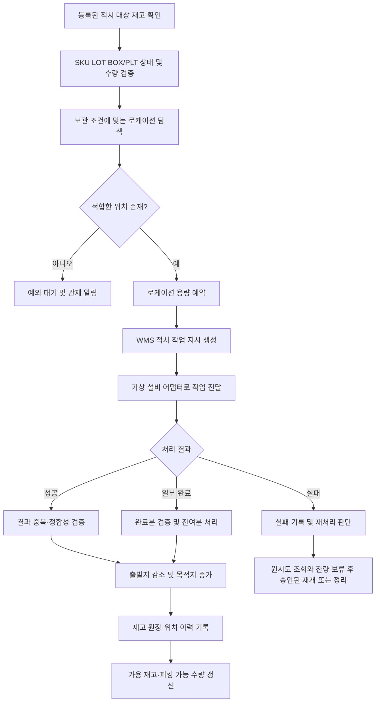

**Mermaid 범례**: 직사각형은 처리 업무, 마름모는 분기 조건, 화살표는 다음 처리 순서다. 이 그림의 성공·부분 완료 경로에서 실제 수량 변경은 WMS만 수행한다.

| 순서 | 처리 | 반드시 확인할 내용 |
|---|---|---|
| 1 | 적치 대상 식별 | SKU, LOT, 취급 단위 ID, 현재 로케이션, 재고 상태 |
| 2 | 이동 수량 검증 | 이동 수량 > 0, 출발지의 이동 가능 수량 이하 |
| 3 | 위치 후보 검색 | 보관 온도 일치, 위치 사용 가능, 상품 취급 제한 및 혼적 정책 충족 |
| 4 | 용량 검증 | 기존 점유 + 미완료 작업의 예약 용량 + 신규 예정 용량 ≤ 허용량 |
| 5 | 위치 예약 | 다른 동시 작업이 동일 용량을 초과 배정하지 못하도록 처리 |
| 6 | 실행 가능한 작업 지시 확정 | 고유 작업 ID, 출발지, 목적지, 수량, 예상 취급 단위, 예약 연결과 상태 기록 |
| 7 | 가상 수행 | 성공/실패/부분 완료 이벤트를 생성하되 재고 변경은 하지 않음 |
| 8 | 완료 결과 확인 | 작업 ID·이벤트 ID, 누적 완료 수량, 목표 위치 일치, 중복 수신 여부 |
| 9 | 재고 이동 확정 | 출발지 감소·목적지 증가·원장·예약을 함께 일치시키는 원자적 반영 |
| 10 | 이력·상태 갱신 | 재고 원장, 예약량, 작업 상태, 가용 재고, 피킹 가능 여부 갱신 |

작업 식별과 초안은 용량 예약 전에 생성할 수 있다. 이때 `CREATED`는 실행 전 초안이며, 위 표의 작업 지시 확정은 초안에 출발 점유·목적지 예약을 연결해 전달 가능한 지시로 만드는 단계다. 예약이 원작업과 연결되지 않은 채 남거나 예약 없는 지시가 어댑터에 전달되지 않도록 결과를 대사한다.

##### LPN 직접 위치·유효 위치·마지막 확인 위치의 연결

`[설계안]` 직접 LOC는 최상위 PLT, 독립 BOX 또는 직적치 재고가 직접 놓인 위치다. PLT 소속 BOX와 그 하위 SKU의 유효 LOC는 상위 PLT의 직접 LOC를 따른다. BOX에 과거 직접 LOC가 있더라도 활성 상위 관계와 상충하는 현재 위치로 확정하거나 별도 점유로 합산하지 않는다. 이동/운송 중 마지막 확인 LOC는 이력이며 예정 목적 LOC가 현재 적치 위치라는 뜻이 아니다.

이동 지시에는 실제 LPN 번호·유형·활성 부모·구성 버전·직접/유효 출발 위치를 연결한다. 부분 이동은 원구성에서 분리할 BOX/SKU·수량, 잔류 구성과 새 직접 LOC 또는 새 부모를 함께 검증한다. 구성이 분리되지 않은 PLT 전량 이동과 일부 BOX 이동을 같은 지시로 확정하지 않는다. 부분 완료도 승인된 실제 분할 단위에 한정하며 하나의 BOX/LPN을 두 위치에 복제하지 않는다.

구성·부모·위치·작업 결과의 한쪽만 반영됐으면 완료를 반환하지 않는다. 원변경을 조회해 확정된 범위·안전 위치를 유지하고 누락된 연결을 복구한 뒤 해당 수량의 후속 작업을 허용한다. 실제 위치 확인은 자동화 구간의 가상 결과, 실피킹 구간의 작업자 확인으로 구분한다.

**상태 변화:** CREATED→RESERVED, 접수확인 뒤 DISPATCHED. 출발점유/목적지예약만 확보하며현물변화0.

**오류·복구:** 미접수전달실패와접수불명을구분하여 CDC-F-012로 처리한다. 출발점유/목적지예약 한쪽만 성공이면미완료를조회/복구하고 실행가능지시로 제공하지 않는다.

**완료 조건:** 유효 원작업/시도에 지시량·출발점유·목적지용량이 대응하고 실제접수/대기/실패를 명확히 반환한다.

#### CDC-F-011 적치 완료·부분 완료의 수량 반영

**주관·실행 주체:** 가상 어댑터 결과·WMS 검증/위치 원장 반영

**시작 조건:** 유효 원작업/시도의 시작·완료·일부 완료 결과가 수신됐을 때.

**입력:** 원작업/시도·원수행/사건식별·이번완료증가분·누적/잔량·실제목적지·SKU/LOT/구성·발생/수신시각.

**검증:** 기반영/내용 충돌·시도 유효성·실제 목적지·품질/단위·동시 수량/용량 일치를 검사한다. 완료/일부 완료의 새 반영량은 양의 정수·잔량 이하이며, 수행 시작은 상태만 확인하고 수량 반영은0이다. 중복 결과는 새 증가분으로 처리하지 않는다.

**처리:**

##### 수량 개념

- **현재 수량(On-hand)**: 해당 로케이션에 실제 적치된 것으로 확정된 재고
- **예약 수량(Reserved)**: 피킹·출고 또는 이동에 할당되어 자유롭게 사용할 수 없는 수량
- **보류 수량(Held)**: 품질·LOT·소비기한·운영 사유로 사용 불가능한 수량
- **적치 예정 용량(Reserved Capacity)**: 물리적 완료 전 목적지에 예약한 자리. **현재 수량과 다르다.**
- **가용 수량(Available)**: 정상 적격 현물에서 그 현물에 연결된 유효 예약과 센터/SKU 안전량을 제외하고 0 이상으로 제한한 수량. 위치별 작업 점유·기한·잠금까지 확인하며 같은 제약은 중복 차감하지 않는다.

##### 재고 이동 원칙

- 적치 지시 생성 단계에서는 **출발지와 목적지의 현재 수량을 변경하지 않는다.**
- 이동 예정 수량은 출발지에서 다른 작업에 중복 배정하지 못하도록 잠근다.
- 적치 완료가 검증된 수량만큼 출발지 감소·목적지 증가를 **하나의 원자적 거래**로 확정한다.
- 부분 완료는 실제 확정된 수량만 반영하고 잔여 수량에 대한 예약·상태를 별도로 유지한다.
- 모든 수량 변경에는 재고 이동 원장을 남긴다.
- 출발지와 목적지의 수량 합계는 이동 전후 동일해야 한다. 단, 별도 원인 이벤트(폐기, 조정 등)는 제외한다.

###### 위치 이전의 수량 사례

출발 로케이션에 LOT-A 재고 100개가 있고 목적지로 60개 이동 지시를 생성한다.

| 시점 | 출발지 현재 수량 | 출발지 이동 할당 | 목적지 현재 수량 | 목적지 예정 적치량 |
|---|---:|---:|---:|---:|
| 작업 전 | 100 | 0 | 0 | 0 |
| 지시 후 | 100 | 60 | 0 | 60 |
| 40개 완료 | 60 | 20 | 40 | 20 |
| 나머지 20개 완료 | 40 | 0 | 60 | 0 |

최초 100개는 전 과정에서 보존된다. 단, 실제 물리적 이동 도중 재고의 현재 위치를 어떻게 모델링할지(이동 중 버퍼 또는 예약 기반)는 **[팀 확인 필요]**다. 본 예시는 단순화를 위해 완료 전까지 출발지에 기록한다.

##### 중복 이벤트 방지

가상 설비가 같은 완료 결과를 여러 번 보낼 수 있다는 전제로 설계한다.

- 이벤트마다 고유 `eventId`를 가진다.
- WMS는 이미 처리된 `eventId`를 다시 적용하지 않는다.
- `taskId` 단위 누적 완료 수량은 지시 수량을 초과할 수 없다.
- 상태 전이·재고 원장 기록·위치별 수량 갱신·이벤트 처리 기록은 함께 일치한 결과로 확정한다. 단일 저장소에서는 하나의 거래로 처리하는 설계안을 사용할 수 있으나 실제 저장소·분산 구현 방식은 별도 계약이다.
- 처리 도중 오류가 발생하면 출발/목적 위치·원장·예약에 불완전한 성공을 남기지 않고 일관된 상태로 복구한 후 같은 사건을 안전하게 재수신할 수 있어야 한다.

가상 설비는 지시 수신·수행 시작·전량 완료·일부 완료·실패를 모의하고, 테스트용 지연·중복·역순 결과와 실패 사유를 전달할 수 있다. 재고 직접 수정·WMS 미검증 목적지 변경·지시량 초과 완료·임의 신규 상품 생성은 허용하지 않는다. 실제 장비 제어와 운행 알고리즘을 구현하지 않으며 지시/결과의 업무 의미를 보존해 이후 연계 변경에 대응한다.

지시에는 원작업 식별, 출발/목적 위치, 정확한 SKU·LOT, BOX/PLT 유형과 해당 화물, 지시량·단위를 연결한다. 예시로 E-00000001·LOT-A 60개를 출발 위치에서 승인된 목적지로 옮긴다면 60은 해당 SKU 판매단위 개수다. BOX/PLT의 분할이 허용되지 않으면 취급 단위 전체 지시로 검증하며 분수/부분 입력으로 우회하지 않는다.

결과는 고유 사건 식별·원작업·결과 종류·이번 새 완료 증가분·실제 목적지·발생시각·사유를 제공한다. `[설계안]` 완료 증가분은 누적량과 혼용하지 않는다. 60개 지시 중 사건 A에서 40개·사건 B에서 20개 완료라면 총 60이다. A를 다시 보내도 40을 다시 더하지 않는다. 다른 사건번호로 같은 수행 결과를 중복 제출해도 원작업/원수행·잔량을 대사하며 누적이 지시량을 넘지 않게 한다. 실제 API 필드명·사건 번호 형식은 별도 구현 계약이다.

같은 사건 식별에 다른 수량·작업·목적지가 오면 단순 중복 성공으로 처리하지 않고 충돌로 격리해 원결과를 확인한다. 사건 발생시각·수신시각·처리 결과를 구분해 지연/역순을 조사하고 원장과 결과 이력을 연결한다.

가상 수행 결과의 종류는 수행 시작, 남은 수량 전량 완료, 0보다 크고 잔량 이하인 일부 완료, 사유가 있는 실패, 같은 사건번호 중복 재전송이다. 전량 완료 모의 요청은 현재 잔량만 대상으로 한다. 모의 결과 주입 권한을 일반 업무 권한과 분리하고 무권한 수행 결과를 받아들이지 않는다.

##### 완료 결과를 확정할 때 함께 맞아야 하는 값

원지시량Q, 누적 검증완료C, 미완료U, 취소/종료로 실행하지 않을 정리량K는 같은 SKU 판매단위 개수다. 항상Q=C+U+K이고 모두0이상이다. 정상 부분 수행 중에는K=0이다. 원지시량·기완료를 편집해 오류를 숨기지 않는다. 원작업의 출발 이동 점유와 목적지 예정 용량은 실행 예정인U에 대응해야 하며 다른 이관 수요의 점유를 중복 감산하지 않는다.

| 검증 시점/사건 | 누적완료 C | 미완료 U | 출발위치 잔고 | 목적위치 잔고 | 출발 이동 점유 | 목적지 예정 적치량 | 전체CDC현물 |
|---|---:|---:|---:|---:|---:|---:|---:|
| 시작 현물100·60지시 | 0 | 60 | 100 | 0 | 60 | 60 | 100 |
| 원사건A로40검증/반영 | 40 | 20 | 60 | 40 | 20 | 20 | 100 |
| 같은A 재전달 전후 | 40 | 20 | 60 | 40 | 20 | 20 | 100 |
| 같은원작업 잔여20 재지시 | 40 | 20 | 60 | 40 | 20 | 20 | 100 |
| 새로운 적격사건B로20완료 | 60 | 0 | 40 | 60 | 0 | 0 | 100 |

목적지 예정 적치량은 여기서 설명용 판매단위 환산량이다. 실제 예약 kg/부피/슬롯도 같은 잔여 구성에 대응해 갱신하며 서로 다른 단위를 숫자만 같게 맞추지 않는다. 실제 임시 위치를 쓰면 출발/임시/목적 합계가100인지를 대사하고 같은 실물을 출발지에도 남기지 않는다.

반영 직전에는 원사건의 기반영 여부·작업/시도 유효성·새 증가분>0/잔량이하·위치/SKU/LOT·정수 환산·품질/제한·잔여 용량을 검사한다. 출발 감소량=목적/실제임시 위치 증가량=이번 반영량, 완료 증가량과 점유/용량 해소가 그 반영량에 대응해야 한다. 원장·처리 결과·작업 상태도 함께 일치해야 성공을 반환한다.

반영 후에는 저장된 원사건 결과와 누적C/U/K·양측 위치·점유/용량·전체CDC총량을 다시 설명할 수 있어야 한다. 한 항목만 성공한 중간값을 완료로 제공하지 않는다. 실패하면 일관된 반영 전 또는 확인된 반영 후 결과로 복구하고, 불명이면 원사건 조회 전 추가 가산/차감·예약 해제를 하지 않는다. DB 트랜잭션/락/스키마 선택을 여기서 확정하는 것은 아니다.

같은 사건의 같은 내용은 위 값 전체를 그대로 반환한다. 같은사건 다른수량/위치는충돌이고 다른사건번호로 같은수행을 보낸 경우도 원수행/시도·누적을 대사한다. 누적이Q이하라는 검사만으로 다른번호의 중복수행을 허용하지 않는다. 남은20취소라면C40/U0/K20과 실제 잔여 위치·점유/예약해소를 확인하며, 완료60으로 표시하지 않는다.

**상태 변화:** 이번증가분만위치이전·누적C증가/U감소·출발점유/목적지예약해소. 같은원사건은상태/수량불변.

**오류·복구:** 오위치/초과량/중복수행/저장불명은자동확정하지 않는다. 원사건반영결과와실제/모의위치를조회하고기완료보존·잔량보류한다.

**완료 조건:** C/U/K·위치증감·원장/결과·점유/용량·전체CDC총량이같은반영량으로일치했다. 전량완료는U=0/K=0,부분은미완료의무를남긴다.

#### CDC-F-012 적치 예외·잔량 재지시·취소 경합 조율

**주관·실행 주체:** WMS 원작업 대사·가상 원시도 조회/중지·관리자 예외 승인

**시작 조건:** 전달실패/불명·부분완료재개·수행실패·취소요청·늦은결과가 발생했을 때.

**입력:** 원작업/기존시도/사건·지시Q/C/U/K·실위치·잔여점유/용량·접수/중지/종료근거·최신품질/권한·승인.

**검증:** 원시도의추가수행가능성·기반영·미수행확실성·현재잔량/위치·동시취소/완료·재시도승인을 확인한다.

**처리:**

[설계안] 아래 상태는 원적치 작업의 지시량·누적 완료·잔량과 함께 관리한다. `RETRY_READY`는 완료분을 유지한 채 남은 범위의 재시도를 승인한 상태다. 원작업은 유지하고 전달 시도만 구분한다. 별도 잔여 자작업이 필요하더라도 부모의 동일 잔량을 동시에 실행하지 않는다.

| 상태 | 의미·유지할 의무 |
|---|---|
| CREATED | 원작업 초안·대상/수량 식별. 예약 없는 수행 불가 |
| RESERVED | 출발 이동 점유·목적지 용량이 원작업 잔량과 연결됨 |
| DISPATCHED | 해당 지시 시도를 어댑터가 접수했음이 확인됨 |
| IN_PROGRESS | 유효 원시도의 수행 시작이 확인됨 |
| PARTIALLY_COMPLETED | 검증 완료분 반영·미완료량/점유/용량 유지 |
| FAILED | 확정된 전달/수행 실패. 완료량/현재 위치 확인 전 자동 해제하지 않음 |
| EXCEPTION_HOLD | 수행 여부/수량/위치/권한 불명·중지 대사. 신규 재실행 금지 |
| RETRY_READY | 원시도 중지/종료·완료분 대사 후 잔량 재시도 승인 |
| COMPLETED | 지시 전량 반영·잔량0·잔여 점유/예약용량0 |
| CANCELLED | 완료분 보존·남은 실행 중지/실물 정리와 점유 해소 확인 |

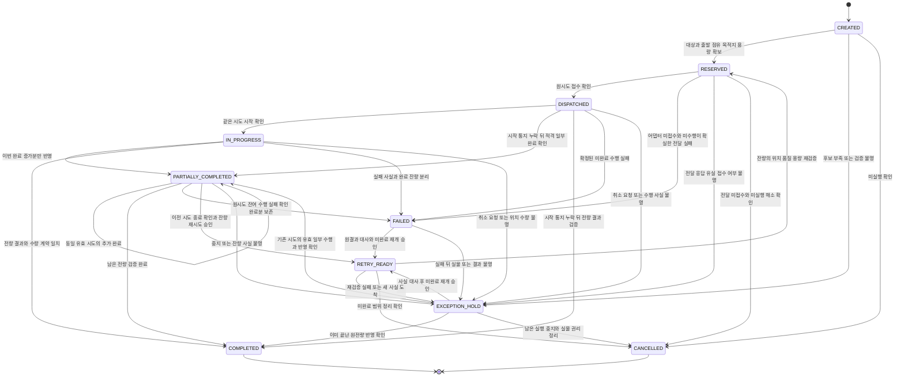

범례: 노드는 원작업 상태, 선의 문구는 전이 조건이다. 취소 요청 자체는 CANCELLED 전이가 아니다. 실패 코드는 수행0을 보장하지 않으므로 기완료와 원시도 결과를 먼저 확인한다. 재개는 같은 완료분/잔량을 계승하며 재검증만으로 새 재고를 생성하지 않는다.

**예약 뒤 전달 실패:** 미접수/미수행이 확실하면FAILED에 실패 사유와 잔여 권리를 남기고 동일 원작업의 재전달 또는 취소를 판단한다. 접수 응답만 없으면EXCEPTION_HOLD에서 원시도 조회를 한다. 접수됐을 가능성이 있는데 새 작업으로 같은60을 보내거나 목적지 자리를 풀지 않는다.

**부분 완료 뒤 재지시:**60중40이 반영됐으면 재개대상은20이다. 이전 시도의 추가 수행 중지/종료·40반영·20현재 위치/점유/목적지 용량을 확인해야RETRY_READY로 간다. 재전달 직전 기한·품질·제한·실물/용량을 다시 확인하고 기존20예약을 재사용/변경한 차이만 반영한다.20을 새로 더해40으로 중복 점유하지 않는다. 늦은 원시도 결과가 오면 어느 수행을 가리키는지 대사해 아직 유효한 미완료만 처리한다.

**FAILED 후 재개:** 실패 전에 반영된 양·실제 이동 주장·원사건 처리결과를 먼저 확인한다. 재개 가능한 미완료량과 현재 위치가 설명될 때만RETRY_READY로 전환한다. 사실 불명이면FAILED를 성공/취소로 덮어쓰지 않고 보류한다. 재개 승인과 물리적 수행은 별개다.

**완료와 취소의 경합:** 원작업의 유효 결과를 한 순서로 확정한다. 완료가 먼저면 해당 완료량은 유지하고 후행 취소는 남은 범위만 심사한다. 취소가 먼저라도 미접수/미수행·잔여 실물/권리 정리 확인 전에는CANCELLED로 끝내지 않는다. 취소 확정 뒤 같은 완료 재통지는 재반영하지 않으며, 새로운 실제 이동 주장이 있으면 원작업에 연결한 예외 조사/승인 정정으로 처리한다. 종결 상태를 지우고 원지시 전량을 다시 실행하지 않는다.

| 예외 | 탐지 조건 | WMS 조치 | 사건 분류 |
|---|---|---|---|
| 적치 가능 위치 없음 | 적합 후보 0개 | 작업 보류, 임의 위치 강제 배정 금지 | 위치 부족 |
| 용량 초과 | 점유+예약+신규 예상치가 한도 초과 | 예약 거절 및 재탐색 | 용량 충돌 |
| 동시 작업 충돌 | 동일 위치·재고에 경쟁 예약 | 잠금 또는 낙관적 버전 검증 후 재시도 | 경쟁 예약 |
| 가상 설비 실패 | `FAILED` 결과 | 미완료분 확인, 재시도 또는 수동 보류 | 적치 실패 |
| 일부 완료 | 완료 수량 < 지시 수량 | 완료분 반영·미완료분 별도 관리 | 부분 완료 |
| 중복 완료 이벤트 | 이미 처리된 `eventId` | 재고 재반영 없이 기존 결과 반환 | 중복 수신(진단) |
| 잘못된 목적지 | 실제 완료 위치가 지시 위치와 다름 | 자동 확정 거절, 위치 검증 보류 | 위치 불일치 |
| 허용량 초과 완료 | 누적 완료 > 작업 지시 수량 | 해당 결과 거절 및 조사 | 수량 초과 |
| 결과 지연 | 제한 시간 내 결과 없음 | 작업은 미확정 유지, 상태 조회 우선 | 타임아웃 |
| 이미 종료된 작업 결과 도착 | 종료 상태 작업에 신규 완료 이벤트 | 자동 재적용 금지, 이벤트 격리 | 종료 후 이벤트 |
| 재고 원장 저장 오류 | 저장 중 오류·반영 불일치 | 불완전 변경을 성공 처리하지 않고 일관성 복구 후 재처리 | 시스템 오류 |

##### 재시도 원칙

1. 결과가 늦었다는 이유만으로 작업을 즉시 실패 처리하지 않는다. 먼저 현재 처리 상태를 확인한다.
2. 동일 지시를 재전송하는 경우 동일 작업 식별자와 중복 처리 규칙을 유지한다.
3. 이미 확정된 부분 완료 수량은 되돌리지 않고 남은 수량만 재처리한다.
4. 기존 목적지 예약을 해제하거나 재배정할 때는 남은 수량·예약 용량만 대상으로 한다.
5. 반복 실패, 상태 불명, 위치 불일치는 관제 승인 대기 대상으로 분류한다.

명확한 미실행은 작업 중지 확인 후 출발 점유·목적지 예약을 해제할 수 있다. 지시 전달/수행이 시작됐거나 사실이 불명하면 먼저 원작업과 결과를 조회하고 필요한 현장 확인을 거친다. 단순 타임아웃·실패 표시만으로 자리를 풀고 다른 작업을 넣지 않는다. 부분 완료 40은 유지하고 잔여 20의 실제 위치·실행 가능 여부·예약만 재처리한다.

완료/취소 뒤 늦은 결과는 자동 가산하지 않지만 실제 이동 주장이 있으면 원실물 위치를 조사한다. 취소 상태를 이유로 실제 이동 사실까지 버리지 않으며 원작업을 참조한 승인 정정으로 설명한다. 검증 거절 결과·중복 수신 기록·수동 조치와 승인 이력은 보존한다. 재배정은 이전 가상 수행 시도의 추가 실행을 막고 완료량·운반 중 수량·남은 목적지 예약을 새 유효 시도/관리 담당자에게 인계한다.

**상태 변화:** 실패/불명/부분→대사→RETRY_READY→잔량RESERVED→재접수, 또는 실물/권리정리후CANCELLED. COMPLETED/기완료를자동되돌리지않는다.

**오류·복구:** 확인없는재지시/해제금지. 종료후새실제이동주장은원작업예외조사/승인정정으로처리하며같은완료를재가산하지않는다.

**완료 조건:** 재개대상잔량과시도/권리계승이명확하거나취소의미완료정리·누적/실물/원장대사가완료됐다.

### 10. 내부 선반 자동 보충

#### CDC-F-013 최소 이하 감지·자동 MOV·잔량 처리

**주관·실행 주체:** WMS 자동 계산/지시·가상 자동화 이동 결과·관리자 이상 조사

**시작 조건:** 고정 피킹 위치 적격수량이 승인된 최소량 이하이고 유효 기준이 있을 때.

**입력:** 센터/목적위치/SKU·최소/목표·현재적격량·유효미완료보충·출발/도착한도·이동배수·원예약/작업.

**검증:** 동일목적진행작업·정수환산·안전/품질·기준누락·기존확보계승·동시점유/용량을검사한다.

**처리:**

`[확정 정책]` 피킹 위치의 현재 적격 수량이 등록 최소량 **이하**이면 시스템이 자동 보충 작업을 계산한다. 수동 선반 보충 요청/새 작업 생성은 초기 제공하지 않는다. 운영자는 기존 작업의 오류 수정·중지·재검증/재시도를 수행한다. 일반 재배치 승인 여부와 기존 작업 재처리는 별개이며 가상 적치 결과 주입을 수동 선반 보충 생성 경로로 우회하지 않는다.

필요량은 `max(0, 목표 피킹량 − 현재 적격 피킹량 − 미완료 유효 보충량)`이다. 지시량은 `이동 단위 × floor(min(필요량, 출발 이동 가능량, 목적지 잔여 수용량) / 이동 단위)`다. 모든 수량은 같은 SKU 판매단위 개수이며 floor는 허용 배수 이하로 내림, min은 제약 중 작은 값 선택이다. 계산 결과 0은 작업을 만들지 않고 부족·단위·용량 사유를 표시한다.

출발 점유와 목적지 예정 용량, 같은 센터/목적지/SKU의 미완료 작업을 함께 검사해 동시 부족 감지로 중복 작업이 생기지 않게 한다. 최소·목표·환산·용량 누락은 설정 대기, 센터 전체 적격 현물 부족은 SCM 공급 검토로 구분한다. 취소 진행 중 실물 복귀 미확인량을 새 작업 가용으로 쓰지 않는다.

자동 생성 작업에는 원피킹 위치·SKU/LOT·출발 위치·지시량·허용 단위·목적지 예약을 연결한다. WMS가 가상 자동화 모듈에 지시하고 유효 시도의 결과만 수신한다. 관리자는 현재 지시·권한·버전과 오류를 확인하며 정상 운반을 수행하는 새 작업자 기능을 만들지 않는다. 담당/시도 변경은 기존 추가 수행을 막은 뒤 완료/잔량·예약을 계승한다.

가상 원시도의 출발 수량/수행 시작 확인 → 모의 운반 중 위치 확인 → 목적지/적치 결과 수신 → WMS 완료분 검증·위치 반영 → 잔량/예약 재검증 순서다. 실제 장비 제어·현장 작업자 운반/스캔 수행을 정상 자동 보충 기능으로 추가하지 않는다. 가상 적치 완료 전에는 출발지 기록+이동 할당으로 표현하는 설계안을 사용할 수 있으나, 실제 출발지에서 꺼낸 현장 사실을 관리하는 MOV는 실제 임시 위치를 기록한다. 두 표현 모두 센터 총량 보존·중복 사용 금지를 지켜야 하며 실제 적용 모델은 합의가 필요하다.

지시 12개 중 8개 이동이면 실제 목적지 8·미완료 4다. 4가 여전히 유효한 보충 작업이면 다음 계산의 미완료 보충량에 한 번 반영한다. 실행 불가가 확인되면 예정 보충에서 제외하되 실제 보관·차이 의무를 없애지 않는다. 이미 완료한 8을 전체 취소로 원복하지 않는다.

전체 LPN은 내용물을 유지해 이동하고 일부 BOX는 옮긴 구성만 분리한다. 원위치·임시 위치·목적지의 동일 실물을 동시에 계상하지 않는다. 이미 확보된 물량은 원이관 예약을 계승하고 임의 피킹 대상 변경을 하지 않는다. 재배정·재시도는 원작업의 누적 완료·현재 잔량·예약과 연결한다.

교육 사례에서 상온 피킹 8→20BOX, 리저브 24→12BOX, 다른 LOT 30BOX면 전체 62BOX가 유지된다. 냉장 피킹 6→18BOX, 리저브 18→6BOX, 다른 LOT 24BOX면 전체 48BOX다. 최소/목표 10/20·8/18은 예시이며 운영 기본값이 아니다. 전체 60BOX=1,440개 팔레트 이동은 그 SKU에 해당 환산이 승인된 사례일 때만 사용한다.

중단 후 통신이 복구되면 기존 결과를 먼저 조회한다. 완료된 위치 반영은 유지하고 미완료량만 복구한다. 취소 요청만으로 운반 중 상품이 출발 위치로 돌아온 것으로 표시하지 않는다. 종결은 실제 위치·구성·누적 완료·잔량·작업 점유·목적지 용량이 일치한 상태다.

| 판단 조건 | 작업·재고 처리 | 운영자가 확인할 결과·후속 담당 |
|---|---|---|
| 최소/목표/환산/용량 미등록 | 신규 작업 생성 보류·현재 실물 유지 | WMS 기준 담당이 누락값을 보완. 목표0/무제한 임의 적용 없음 |
| 리저브 적격 재고 충분·목적지 용량 부족 | 허용 배수 내 가능한 지시 또는 보류·사유 제공 | 공간 담당이 기존 점유/예약·위치 제한을 확인, 안전 제약 우회 없음 |
| 적격 출발 부족 | 실제 가능한 범위/미충족을 구분 | CDC 재고 담당 조사·SCM 공급 영향 검토, 자동 외부 발주/이관 생성 없음 |
| 기존 동일 목적 유효 보충 있음 | 미완료량을 계산에 한 번 반영 | 운영자는 새 작업 대신 원작업의 완료/잔량을 확인 |
| 부분 완료·나머지 실물 위치 불명 | 완료분 유지·잔량 작업/점유 확인 대기 | CDC 담당자가 실물/임시위치 확인 후 재개·정리 판단 |
| 취소 요청·복귀 불명 | 취소 접수/실물 정리 대기를 구분·즉시 재사용 차단 | 원담당/새담당이 실제 복귀 위치·잔량 대사 후 해제 |

자동 보충 발생 조건이 충족된 사례에서 목표20·현재8·미완료 유효 보충4라면 필요량은8이다. 이동단위6, 출발 가능24·도착 여유10이면 신규 지시6·배수 때문에 남는 필요2를 표시한다. 기존4와 신규6이 모두 완료됐을 때 피킹18이며, 부족2가 해소됐다고 표시하지 않는다. 이후 계산도 실제 적격 수량·유효 미완료·배수로 다시 판단한다. 이 예시의 목표·배수는 운영 기본값이 아니다.

**상태 변화:** 자동지시와가상수행의완료/잔량을관리한다. 공통이동결과는CDC-F-011·CDC-F-012에따라한번반영·센터총량유지.

**오류·복구:** 수동새보충작업금지·기준누락은보류·전체부족은SCM영향회신이다. 부분/복귀불명은원작업잔량을유지하며새중복작업을만들지않는다.

**완료 조건:** 지시량/0사유·기완료/유효잔량·실제/모의위치·원예약·목적지예약이설명되고다음계산에미완료를한번반영한다.

### 11. MFC 공급 검토·승인 협업

#### CDC-F-014 공급 판단용 CDC 사실·실행 가능 조건 제공

**주관·실행 주체:** CDC WMS. 공급 필요량·안전재고 정책·배분·승인은 SCM 영역이며 [SCM-business-logic.md](SCM-business-logic.md)를 참조한다. 운영값/승인은 별도다.

**시작 조건:** 공급 승인 주체가 CDC 재고·작업/출발 가능성 또는 원이관 실적을 조회한다.

**입력:** 출발센터·SKU/기준단위·조회 기준시각, 원요청/이관 참조, 조회 권한·버전.

**검증:** 자기센터 조회권한, 현물·예약·품질·기한·기존확보의 기준시각/단위, 조회 신선도와 원사건을 확인한다.

**처리:** CDC WMS는 CDC 적격현물·유효예약·품질/기한 제한·기존확보·작업 준비 예상과 원출발/미정산 사실을 제공한다. 목적MFC 현물·고객예약은 MFC 정본을 참조하도록 연결하며 CDC가 대신 확정하지 않는다. 운송/ETA는 TMS, 수령·검수·판매준비는 MFC의 결과를 참조한다.

CDC WMS에서 MFC별 수요예측, H/C/I/F/SS 보충 수식, 공급배수 추천·희소배분·보호기간을 확정하지 않는다. 기존 상세 수식/사례는 수정 전 보존본에 있고 현행 계산·정책 검토는 SCM-business-logic.md를 참조한다. 운영값/정책 승인은 별도다. 공급예정은 현재 판매 가능 재고가 아니다. 미수령·기수령 전기대기·격리·실제정상·준비완료를 별도 회신한다.

**상태 변화:** 조회/가용·준비/대사 결과만 반환. 새 이관 승인·자동발주·MFC 현물 변경0.

**오류·복구:** 조회불명을0재고로 대체하지 않는다. 기준충돌·신선도·미정산을 표시하고 원조회/원사건으로 복구한다.

**완료 조건:** 자기센터 사실·기준시각/버전·미확인 조건과 후속 담당이 명확하다.

#### CDC-F-015 외부 승인 이관 인수·CDC 확보 전 실행 검증

**주관·실행 주체:** CDC WMS는 승인 결과 소비·확보 검증만 수행한다. 공급 승인 주체/승인선·부분승인·배분 정책은 [SCM-business-logic.md](SCM-business-logic.md)에서 정의한다. 운영 승인 상태는 별도다. 동일 직원이 WMS 화면에서 공급승인 화면으로 이동해도 승인 업무는 별도다.

**시작 조건:** 외부 승인 결과가 도착하거나 유효 승인 이관의 CDC 확보를 요청한다.

**입력:** 승인TRF·버전·승인 참조·출발/목적센터·행/SKU·승인수량·단위·기한/조건·취소상태.

**검증:** 승인 출처·권한·유효 버전·동일요청/본문, CDC 품질/기한·현재현물·기존예약과 실제 확보 가능성을 확인한다. 승인량을 실제 확보량으로 간주하지 않는다.

**처리:** 유효 승인 범위 내에서 CDC-F-016에 확보를 요청하고 성공·미확보·결과불명을 원승인에 연결한다. 요청100/외부승인60/확보48인 예에서는 미승인40·승인미확보12를 구분한다. WMS가 추가승인·승인량 변경·다른MFC 확보 회수·우선 배분을 대신하지 않는다. 50% 추가승인선·비례배분 예시 등 기존 공급정책 상세는 이 문서에서 삭제하고 SCM 검토대기로 남긴다.

승인요청1건은1이관1출발이라는 실행 제약을 유지한다. 같은TRF를 여러 차량/날짜로 나누지 않는다. 실행불가·미확보·미출발잔량은 공급 승인 주체에 회신하고 추가공급은 별도승인을 요구한다.

**상태 변화:** 승인 인수/충돌/실행보류 및 실제 확보 결과. 공급사업 승인 상태를 WMS가 새로 만들지 않는다.

**오류·복구:** 승인/확보 응답불명은 원결과 조회. 알림 실패로 재승인·재예약하지 않는다.

**완료 조건:** 유효 승인과 확보/미확보·통지 의무가 분리돼 확인된다.

### 12. 이관 할당·Wave·실제 피킹

#### CDC-F-016 승인 이관의 적격 재고 할당·해제 경계

**주관·실행 주체:** WMS 재고예약/할당·SCM 승인본

**시작 조건:** 유효승인본의할당/변경/해제요청이들어왔을때.

**입력:** 원승인행/버전·출발/목적센터·SKU/허용량·단위·예상출고/도착·원예약/기반영·LOT/위치잔량.

**검증:** CDC-F-008·CDC-F-009적격성·안전량/기존약속·승인한도·중복/동시확보·피킹/이동점유를검사한다.

**처리:**

WMS는 SCM 승인본의 출발 CDC·목적 MFC·정확한 SKU·허용량·물류 배수/환산 버전·요청/승인 버전·희망 시각을 확인한다. 동일 승인 재전달은 기존 처리 결과를 반환하고 다른 내용의 같은 요청은 충돌로 보류한다. 승인 미처리 잔량을 초과하거나 다른 SKU/E/B를 현장 대체하지 않는다.

할당 후보는 적치가 확정된 위치의 적격 정상 재고다. 목적지 예정 적치량이나 출발 이동 할당 수량을 새 피킹에 중복 배정하지 않는다. 최신 기한·예상 도착·품질·온도·위치 잠금·안전량·기존 확보를 확인하고 CDC 다LOT FEFO로 확보한다. 실물·원장·예약이 경합하면 최신 결과로 재검증하며 음수/초과 확보를 금지한다.

마지막 12개를 두 MFC가 동시에 요청해도 전체 유효 확보는 12개 이하만 가능하다. 일부 할당이면 성공 LOT/위치/수량·미할당·사유를 SCM에 회신한다. 원승인량을 임의 축소·증가하지 않는다. 할당 LOT가 나중에 보류되면 BLOCKED 의무를 남겨 대체 검토한다.

`[설계안]` 기한/LOT를 관리하지 않는 비식품의 후보 순서는 확인 가능한 센터 보유/인수 이력의 선입 순을 기본 후보로 제시할 수 있다. 실제 적용 기준·동률 처리·초기 보유의 정렬 근거는 승인해야 하며 허위 입고시각/LOT를 만들지 않는다. 필수 LOT/기한 관리 상품에는 이 방식을 적용해 FEFO·품질 검사를 우회하지 않는다.

이미 피킹 할당된 재고를 다른 적치·MOV가 자유롭게 사용하지 않는다. `[설계안]` 기본적으로 피킹 할당 재고의 임의 재배치를 막고 불가피한 이동은 원확보를 계승하는 승인·중지/재배정 절차로 검토한다. 허용 범위는 승인 대기다. 적치 지시만 받은 목적지 수량을 피킹 가용량으로 제공하지 않으며, 출발 이동 점유도 새 피킹에 이중 배정하지 않는다.

##### 원요청·작업 후보·재고 예약의 연결

실행 후보는 센터·SKU·LOT·출발 유효 LOC·품질/재고 상태·현재 LPN 소속/구성 버전까지 확인한다. SCM 요청·승인 버전과 기존 이관 예약을 연결하고 Wave 초안에 후보가 보인다는 이유로 추가 예약하지 않는다. 이 문서에서는 유효 WMS 할당을 실제 릴리스의 선행조건으로 유지한다. 새 정책의 다른 예약 시점 선택지를 근거로 예약 책임을 Wave로 옮기지 않는다.

원요청이 여러 Wave/Task에 나뉘어도 같은 확보량을 각 작업에 중복 부여하지 않는다. 후보 선택 후 위치 잠금·품질 차단·LPN 분리가 바뀌면 배포/실피킹 직전 다시 검사한다. 후보 조회 실패는 재고0·예약 해제 근거가 아니며, 이미 피킹된 실물은 현재 작업 위치·원예약을 확인하기 전 신규 가용으로 돌리지 않는다.

**상태 변화:** 미확보/부분/확보/BLOCKED/해제와LOT/위치연결 갱신. 현물증감0.

**오류·복구:** 부족은성공량/잔량·사유회신, 변경은원버전재심사다. 해제는CDC-F-026의중지/미출발/복귀확인없이는실행하지않고불량품가용화금지.

**완료 조건:** 유효연결예약이실제적격잔량/승인한도안이며원요청결과·미확보/보류의무가유지된다.

#### CDC-F-017 Wave·피킹 작업 배정·부분 릴리스

**주관·실행 주체:** WMS 작업 조율·실제 피킹 작업자 권한

**시작 조건:** 유효 이관/할당의 작업 계획·편성·검증·배포·배정/수락·재편성·종료 대사가 필요할 때. 실제 릴리스는 할당·준비·권한을 확인한 범위만 허용한다.

**입력:** 원승인/할당행·회차/온도/구역·장비/피킹위치·목적MFC·작업자권한/근무·내부보충·작업버전.

**검증:** 한작업유효담당·이관행별권리/LOT·미릴리스잔량·자동공정과실제피킹경계·단일출발정책을확인한다.

**처리:**

재고 확보와 작업자 배정은 다르다. 목적지·작업구역·필요 내부 보충·인력/장비·지시 버전이 유효할 때 작업을 릴리스한다. 작업자는 자기 센터·온도구역·업무/장비 권한·현재 근무·배정 상태를 확인한다. 이전 단말·다른 작업자의 동시 시작을 차단한다.

Wave는 회차·온도·구역·장비·피킹 위치로 묶되 이관행·목적 MFC·LOT·화물별 권리를 유지한다. 합산 집품 후 분류를 하더라도 원이관 목적을 잃지 않는다. Wave와 차량은 일대일로 고정하지 않으며 하나의 원이관을 여러 출발로 나누지 않는다. 전체 Wave를 한 번에 모두 성공/실패로 처리하기보다 완료된 실제 작업 단위를 추적한다.

재배정·교대 시 완료량·잔량·작업 중 위치·용기·원예약·최신 버전을 넘기고 이전 단말의 추가 실행을 막는다. 새 작업자가 최초 지시량 전체를 다시 시작하지 않는다.

Wave는 여러 이관행의 작업을 묶을 수 있고 한 차량에는 여러 Wave에서 나온 화물이 실릴 수 있다. 반대로 같은 Wave의 서로 다른 원이관은 다른 적격 운송편으로 연결될 수 있다. 이 작업 묶음 관계를 근거로 **하나의 원요청을 여러 실제 출발로 나누지는 않는다.** 묶음 안에서도 원이관행·SKU/LOT·목적MFC·확보량·실피킹/분류·화물을 유지한다.

작업 릴리스는 준비된 유효 할당 범위만 대상으로 한다. 승인량·할당량·릴리스량·실제 피킹량·검품량·상차량을 각각 확인하고 일부만 릴리스됐다고 승인 미처리 잔량을 없애지 않는다. 적격 위치에 없는 미할당량을 Wave 총량에 포함해 실제 피킹 완료를 만들지 않는다. SKU 분류 문자열만으로 작업자·분류 목적지를 자동 결정하지 않는다.

예를 들어 같은SKU의 원이관A36·B24를 합산60개 피킹했다면 분류도 A36·B24와각LOT/화물로 설명돼야 한다. 실제 분류가A36·B20으로56만 확인되면4는 미설명 수량이다. 원피킹·분류 용기·잔량/단위·실물 위치를 조사하고 영향 검품/상차·출발을 보류한다. 피킹60을56으로 덮어쓰거나 차이4를 근거 없이 손실로 지우지 않는다. 원인이 확인되면 원작업을 참조해 누락된 실적 복구 또는 승인 정정한다.

각 실제 작업·분류/검품 결과는 원사건으로 확정한다. Wave 일부 작업이 끝난 뒤 다른 작업이 실패해도 기완료 전체를 자동 재실행/롤백하지 않는다. 실패 범위·기완료·원확보·현재 위치를 구분해 재개한다. 물품이 오분류됐으면 실제 위치를 확인해 적격 목적 용기로 옮기고 재검품하며 계획상 목적지만 바꾸어 출고하지 않는다.

`[설계안]` 피킹중→피킹완료→검품완료→상차완료의 작업 진행과 HOLD/중단을 구분한다. 재포장·내용물 교체·차량/온도 조건 변경 등으로 선행 검증이 무효가 되면 필요한 검품/상차 대조를 다시 수행하되 원실적·변경 이유는 보존한다. 상차완료 코드나 Wave전체완료가 실제 TOUT 출발을 대신하지 않는다.

##### Wave 편성·배포·작업자 점유의 상세안

`[설계안]` 원보충 요청/행→Wave 편성행→Pick Task/작업행→실피킹→후속 분류/포장 관계를 유지한다. 한 요청은 온도·구역별 여러 작업으로, 한 Wave는 여러 요청으로 편성할 수 있다. 작업행은 SKU·LOT·원천 위치별 실적을 식별하고 합산 집품이면 원요청행별 배분 근거를 잃지 않는다. 편성은 요청의 단일 이관/출발 권리를 나누지 않는다.

1. SCM 원요청·승인·이관의 현재 버전과 취소/종료 여부, 목적 MFC·정확한 SKU·수량·희망 도착·원확보를 확인한다. 오래된 재전송은 이미 중단한 작업을 재시작시키지 않는다.
2. 동일 실행 CDC·보충 업무를 기본으로 묶고 회차·온도·구역·장비·피커 여력·출고 마감을 고려한다. 다른 센터 실행이나 MFC 고객 주문 피킹은 같은 실행 Wave에 섞지 않는다. 목적 MFC별 실물/분류 귀속은 끝까지 구별한다.
3. 품질·안전·유효 요청/할당을 먼저 통과시킨 뒤 마감 위험, SCM의 승인 우선순위, 이동/대기 효율, 장기 대기 순으로 추천할 수 있다. 구체 가중치·크기·편성 주기는 승인 대기이며 가까운 LOC가 FEFO·안전량·기존 예약보다 우선하지 않는다.
4. 계획 완료와 배포를 분리한다. 배포 직전 최신 재고·LOT·LOC·구성/제한·원승인을 재검증하고 준비된 할당 범위만 릴리스한다. 수동/자동 배포·배정 선택과 단건 DIRECT 여부는 추가 승인 대상으로 둔다. 어떤 방식이든 동일 작업 검증을 재사용한다.
5. 작업자는 자기 센터·구역·근무·권한·현재 담당/버전과 원요청을 확인해 수락한다. 동시 두 피커의 수락은 한 유효 담당만 성공시키고 나머지에는 최신 상태를 반환한다. 수락/착수와 실피킹 완료는 별개다.
6. 교대·미수락·장기 중지는 원담당의 추가 수행 가능성, 실피킹·임시 보관·잔량·원예약을 확인해 재배정한다. 미수락 시간만으로 실물/예약을 풀지 않는다. 타임아웃·자동 배정·재배정 권한 수치는 임의로 만들지 않는다.

Wave/Task 식별자는 원SCM 사건과 연결해 중복 생성을 막는다. `WAV-...`, `PICK-...`는 형식 예시이며 확정 코드가 아니다. 원요청·이관·Wave·Task·실행 사건은 서로 다른 식별자다. 생성 응답 유실은 원생성 결과부터 조회하고 새 Wave/Task를 복제하지 않는다. 작업 용기/토트 식별도 BOX/PLT/LPN과 별도 승인 대상으로 두며 고객 포장까지 강제하지 않는다.

##### Wave와 Task의 독립 상태·종료 조건

아래는 신규 정책을 반영한 `[설계안]`이다. 단계 명칭과 결과값의 구현 표현은 승인해야 하며 기존 실피킹·분류·출발 상태를 덮어쓰는 제2의 원장으로 만들지 않는다.

| Wave 상태 | 전이 조건과 남는 의무 |
|---|---|
| DRAFT | 편성 중. 실행 가능한 할당/작업이 없으면 수행 불가 |
| PLANNED | 편성·제약 검증 완료. 배포 전 변경은 DRAFT로 돌아가 재검증 |
| RELEASED | 유효 작업 배포. 최초 Task 착수 시 IN_PROGRESS |
| IN_PROGRESS | 일부 Task 착수/실적 존재. 나머지 중단 가능하나 기실적 삭제 금지 |
| WORK_DONE | 모든 Task가 실피킹·최종 부족·승인 취소/정정 등으로 판정됨 |
| CLOSED | 요청행 누계·후속 잔량/Task·예외 담당·결과 보고 대사 완료 |
| CANCELLED | 실행 전 또는 배포 뒤 미착수·무실적 범위의 승인 취소 |

Wave 보류는 단계와 별도 사유/영향 범위로 유지하는 안을 사용한다. 실피킹이 하나라도 있으면 전체를 CANCELLED로 지우지 않고 기실적을 유지해 WORK_DONE과 대사로 종료한다. WORK_DONE/CLOSED는 BOX 봉인·검품·상차·출발·MFC 수령 완료가 아니다. 해결되지 않은 출고 제한은 Wave 종료 뒤에도 유지한다.

Task는 CREATED→ASSIGNED→ACCEPTED→IN_PROGRESS→PARTIAL/DONE을 기본안으로 두고, EXCEPTION은 중지/대사, CANCELLED는 유효 중지와 실물 정리 조건을 연결한다. DONE은 작업행의 정상·부족·취소 결과가 모두 판정됐다는 뜻이며 공급 수량100% 충족을 뜻하지 않는다. PARTIAL을 중간 상태로 둘지 최종 부족 결과값으로 표현할지 선택하되 같은 작업에 상충하는 두 정본 상태를 두지 않는다.

각 Task 종료에는 실제 SKU·LOT·수량·출발 유효 LOC·원요청/행·현재 실물/목적 구획·작업자/시각, 필요한 LPN 변경과 잔량 판정이 있어야 한다. Wave 종료에는 모든 Task 결과와 다음 Wave/Task로 넘어간 잔량을 연결한다. 종료 후 새 사실은 원실적을 삭제하지 않고 별도 정정 사건으로 조율한다.

**상태 변화:** Wave 편성/배포/작업 판정/대사 종료와 Task 배정/수락/진행/부분·결과 종료를 구분한다. 유효 범위만 릴리스하며 원작업 완료/잔량을 계승하고 포장·출발 상태는 자동 변경하지 않는다.

**오류·복구:** 교대/실패는기완료유지·이전단말차단·잔량/현재위치인계다. Wave집품/분류불일치는CDC-F-019에연결해영향출발보류한다.

**완료 조건:** 원이관/LOT/목적 MFC별 릴리스/실적/미처리·담당/버전이 일치하고 종료 작업의 잔량·후속 Task·예외 보고가 대사됐다. 배포 완료와 Wave 종료·차량 출발을 각각 구분한다.

#### CDC-F-018 작업자 실피킹·부족 보고·재진행

**주관·실행 주체:** 실제 CDC피킹 작업자 수행·WMS 검증/실적반영

**시작 조건:** 유효배정/릴리스된작업을작업자가수행할때.

**입력:** 원작업/버전·실제출발위치·SKU/LOT/LPN·포장단위·이번실계수·분류대상/현재위치·품질/잔량.

**검증:** 자기배정/권한·원할당·정확한슬롯/상품·기한/품질·양의정수/잔량·중복실적을확인한다.

**처리:**

피킹은 실제 작업자 업무로 구현한다. 작업번호·목적 MFC·최신 버전 확인 → 지시 출발 위치 확인 → LPN 또는 SKU/LOT/포장단위 확인 → 실제 계수/환산 → 완료량·부족량 기록 → 목적 MFC 분류 용기·다음 위치 확인 → WMS 실적과 확보 위치 반영 순서다. 적치 완료 후에도 LOT·기한·FEFO·품질·가용을 다시 확인한다.

오위치·오상품·오LOT·기한 미달·단위 미등록은 진행을 차단한다. 지시 100·실제 80이면 80만 피킹 완료, 20은 미해결이다. 차이 보고로 현물 20을 삭제하지 않는다. 원작업을 중지하고 위치·단위·품질·실물을 재계수한 후 WMS가 다른 적격 LOT를 재할당한다. 재할당 없이 작업자가 다른 상품·LOT·타MFC 확보로 바꿔 담지 않는다.

피킹은 CDC 총현물 차감이 아니다. 실제 분류/작업 위치로 이동한 수량과 이관 예약 연결을 유지한다. 피킹 실적 확정은 검증을 통과한 실제 수량만 확정하며 통신 유실 뒤 원실적 조회·재전달로 한 번 반영한다. 잘못 확정한 실적은 원사건을 참조한 승인 정정으로 고친다.

피킹 요청/조회는 자기 센터·현재 권한·유효 배정 작업을 대상으로 한다. 유효 대상0건·조회 오류·작업 종료·타작업자 수행 중을 구분하며 조회 오류를 대상 없음으로 바꾸지 않는다. 원이관/목적MFC·지시위치·SKU/LOT·단위/수량·기완료/잔량·최신 버전·품질/제한을 처리 판단의 입력으로 제공한다.

| 작업자의 행동 | WMS가 검사할 조건 | 성공 결과·오류 시 행동 |
|---|---|---|
| 작업 시작 | 현재 배정·권한·원작업 버전·미취소·현장 제한·적격 할당 | 해당 작업 시작. 이미 수행 중이면 원결과 조회·중복 시작 차단 |
| 위치/상품 스캔 | 실제 슬롯·SKU/LOT/LPN·포장단위·기한·지시 일치 | 해당 대상 확인. 불일치 사유와 재스캔/담당 확인, 임의 대체 불가 |
| 실제 수량 확정 | 이번 완료량>0·잔량 이하·정수환산·실제 위치/목적 분류용기 | 실피킹량/확보 위치 갱신·CDC 총현물 변화0 |
| 부족/파손 보고 | 원작업·현재 실계수·사유·실물 위치·증빙 | 해당 범위 보류·재계수/품질/재할당 담당 연결. 자동 손실 차감 없음 |
| 중단·교대 후 재진입 | 누적 완료·잔량·현위치·용기·현재 배정/버전 | 원작업 이어 하기, 구단말의 늦은 확정은 대사 전 반영 금지 |
| 완료 응답 유실 | 원피킹 사건·누적 반영·잔량 | 기반영 결과 회복·누락만 재전달, 같은 물품 재피킹 금지 |

실물 부족 보고 뒤 다른 LOT를 발견해도 작업자가 그 LOT로 완료하지 않는다. WMS가 적격성·원예약/승인 한도·안전량을 확인해 재할당한 작업 버전으로 진행한다. 전체 작업/행정 완료는 원이관별 피킹·분류 합계와 미해결 부족·품질 의무가 설명돼야 한다.

##### 원천 포장별 실피킹 검증과 후속 물류 연결

`[설계안]` 작업행에서 원Task/버전→출발 유효 LOC→정확한 E/B SKU→실제 제조 LOT→실수량/단위→원요청과 목적 구획을 차례로 대조한다. LOT·LOC·LPN을 합친 문자열로 검증하지 않는다. 실피킹 확정 직전 최신 품질·회수 차단과 잔량을 다시 확인한다.

| 원천 형태 | 피커 확인과 후속 구성 처리 |
|---|---|
| PLT 전체 | PLT 구성 버전·하위 BOX와 직접 SKU·LOT·원할당이 전량 일치하는지 확인. 상위 스캔만으로 실계수 생략 금지 |
| PLT 안 BOX 일부 | 현재 부모와 상속 위치 확인 후 BOX 분리 사실 제출. WMS는 CDC-F-007의 구성 변경과 새 소속/위치를 같은 원작업으로 대사 |
| PLT 직접 SKU 일부 | 인출·잔류 SKU/LOT·수량을 구분하고 원PLT 구성과 목적 위치/구획 연결 |
| 독립 BOX 안 일부 | 물류 BOX 개봉·인출·잔량 사실 확인. 원BOX 종료와 잔량 후속 포장은 CDC-F-007의 승인 수명주기안으로 연결 |
| LOC 직적치 SKU | 직접 LOC·SKU·LOT·수량으로 확인. 피킹을 위해 가상 LPN을 강제 생성하지 않음 |

작업자는 실피킹과 인출/개봉 사실을 확인하고, 후속 구성·포장·분류의 가상 수행 결과와 WMS 확정은 별도로 연결한다. 원천 BOX를 실제로 개봉했는데 이전 SEALED 구성·상속 위치를 그대로 두고 새 목적 BOX에도 같은 수량을 더하지 않는다. 후속 반영 불명 동안 해당 실물의 새 피킹/출발을 보류하고 안전 위치를 유지한다.

스캔 훼손에 대한 수기 확인은 `[설계안·승인 대기]`다. 승인된 경우 사유·확인자·증빙·필요 승인과 SKU/LOT/LOC 재대조를 남긴다. 오프라인 지원 자체·동기화 계약은 미확정이며 서버 확인 전 기록은 임시 사실로만 보존한다. 단말 단절을 이유로 미검증 피킹·새 할당·출발을 성공으로 확정하지 않는다.

##### 실피킹·부족·취소·미처리 수량의 분류 계약

`[설계안]` 같은 원요청행의 동일 승인 버전·동일 SKU 판매단위에서 **유효 작업 대상량 = 누적 실피킹 확정량 + 최종 부족량 + 미피킹 취소 확정량 + 미처리량**을 대사한다. 편성량·활성 할당·임시 스캔량은 진행 중 관점이므로 이 식에 다시 더하지 않는다. 승인 전 원요청량·미승인량·미출발량과도 별개다.

최종 부족은 다른 적격 위치/LOT 탐색과 재지시 검토가 끝난 범위에만 사용한다. 지시10 중7 실피킹·3차이 신고면 아직 탐색할3은 미처리다. 적격 재할당3이 확정되면 새 작업은3만 수행한다. 후보가 없고 SCM이 허용 범위를 판정하면 그3을 최종 부족으로 분류하며 현물3을 손실 차감하지 않는다. 이미 부족 분류한 범위의 재검토는 분류 변경 이력과 원승인/잔량을 대사한 뒤 수행한다.

SCM 수량 변경은 요청/승인 버전을 보존해 현재 실피킹·취소/부족·미처리를 다시 맞춘다. 이미 집품된 물량을 미피킹 취소량에 중복 포함하지 않는다. 그 물량의 복귀/정정은 원실피킹을 잇는 별도 사실로 대사한다. 재Wave는 미처리 잔량과 기존 유효 Task 중지/종료를 확인한 범위만 편성하고 기존 스캔 실적을 복제하지 않는다.

실피킹5 확정 직후 응답이 끊겼으면 같은 원Task행/실행 사건으로 서버 결과를 조회한다. 성공 확인은 기존5 반환, 미반영 확인은 같은 사건 재전달, 배정·구성·요청 버전 충돌은 대사다. 새로운 사건번호로 같은5를 다시 피킹한 것처럼 제출하지 않는다. 같은 사건번호에 다른 수량/LOT는 중복 성공이 아니라 충돌이며 누적량이 목표 이하라는 사실만으로 허용하지 않는다.

**상태 변화:** 유효 릴리스 뒤 피킹 중→부분 피킹/전량 피킹 완료로 진행한다. 부족/품질은 해당 범위 보류, WMS 재할당·새 유효 버전 확인 뒤 잔량만 재개한다. 실피킹 누계·확보 위치를 갱신하되 CDC 총현물/이동 중은 피킹만으로 바뀌지 않는다.

**오류·복구:** 오피킹·부족/파손은보류/재계수·WMS재할당후재개다. 작업자임의LOT/SKU대체·실적불명재피킹·자동손실차감금지.

**완료 조건:** 실제확인한수량만원이관/LOT/위치에반영되고기완료/잔량/현재담당·미해결부족이설명된다.

### 13. 가상 분류·검품·상차와 단일 출발

#### CDC-F-019 가상 분류·구성·검품 결과 확정

**주관·실행 주체:** 가상 분류/취급·가상 판독 결과·WMS 규칙 검증·품질 이상 판단

**시작 조건:** 실피킹된원이관별물량의분류/구성/검품결과가도착할때.

물류 구성·분리 계보 자체는 CDC-F-007의 단일 규칙을 사용한다. 여기서는 원피킹에 연결된 가상 분류/검품의 적격 실적을 확정하며, 같은 구성의 상품 수량을 별도로 입고하거나 이동 완료를 중복 반영하지 않는다.

**입력:** 원피킹/분류지시·이관행/목적MFC·SKU/LOT·실수량/포장·모의분류/계수/중량/봉인·화물/위치·사건.

**검증:** 실피킹합계=목적지별분류합계·하위구성·품질/기한/온도·단위/하중·중복/부분결과를대사한다.

**처리:**

실피킹 합계와 목적 MFC별 분류 합계를 맞춘다. 이관행/목적 MFC → SKU/LOT → 실수량/환산 → 품질/기한 → 온도·누액/파손 방지 포장 → 유효 라벨/봉인·화물 계보 순서로 검품한다. BOX/PLT 내용물의 하위 수량까지 연결하고 상위 스캔과 하위 검품을 같은 실물 한 번으로 대사한다.

적격 화물만 승인된 온도별 MFC 출고 대기 위치에 둔다. 라벨에는 화물·목적 MFC·취급 조건·내용물/수량·원이관 연결을 제공하며 빈 운반자산 번호와 구분한다. 라벨 재출력은 새 화물/추가 상품을 생성하지 않는다. 실제 구성 교체·분할은 전후 계보와 위치를 남긴다.

불일치 화물은 HOLD 후 재분류·재계수·재검품한다. 사진은 이상 증빙이며 실제 계수·품질 판정의 대체가 아니다. 혼합 PLT 일부가 부적격이면 영향 구성을 격리하고 적격 구성 분리·새 위치·하중을 검토한다. 분류기·DAS/DPS·자동 운반의 물리 제어는 제외하며 모의 결과는 WMS 검증 없이 출발을 만들지 않는다. 관리자가 모의 실패/오분류를 조사·승인 정정할 수 있어도 정상 수동 운반/분류/상차 실행 흐름을 추가하지 않는다. 예외 정정 뒤 늦은 가상 완료는 같은 원작업으로 대사해 이중 실적을 막는다.

분류 결과를 반영할 때는 원피킹량=분류 확정량+미분류/조사 잔량으로 대사한다. 전량 분류 완료는 미분류 잔량0일 때만 가능하다. 검품 합격량과 보류량은 각 실제 구성에 연결하고 미검품량을 남긴다. 분류/검품 재통지는 그 상태/누계를 변경하지 않으며 결과 저장 불명은 원사건 조회 전 새 구성/실적을 가산하지 않는다.

##### 원피킹에서 봉인 구성으로 넘기는 경계

`[설계안]` 목적 MFC·원이관행별 실피킹을 BOX의 PACKING 구성에 연결하고, 모든 SKU·LOT·품질·실수량·포장 조건을 확인한 가상 봉인 결과를 받아 SEALED로 확정한다. PLT 사용은 선택이며 BOX 목록과 직접 적재 SKU를 함께 전개해 READY 구성·버전·총중량을 검사한다. 가상 분류/포장/검품의 단일 실행 범위를 유지한다.

원피킹 실물은 미분류·분류완료/미포장·BOX/PLT 확정·검품 보류의 현재 귀속을 추적한다. 원피킹20을 BOX구성20과 PLT 하위20으로 두 번 배분하지 않는다. 혼합 허용·온도·중량·봉인 값이 미승인인 구성은 출발 적격으로 만들지 않는다. 실제 포장이 바뀌면 구버전 검품/상차 적격은 필요한 범위에서 무효화하고 후속 구성으로 재검증한다.

이관A36·B24 합산60의 목적별 분류는 각 원요청행·실제 LOT·화물로 추적한다. 새 자료의 MFC 고객 배치 피킹·Pick-to-Tote 권장안을 CDC의 기존 가상 목적지 분류를 삭제하거나 수동 고객 패킹을 추가하는 근거로 사용하지 않는다. 고객 주문 합류·포장·LOT별 고객 출고는 MFC의 자체 업무이며 CDC WMS는 필요한 원출발 추적 결과만 제공한다.

**상태 변화:** 분류 대기→모의 수행 중→부분/전량 분류 완료 또는 보류, 검품은 미확인→합격/보류를 별도 관리한다. 재검품은 무효화된 범위만 대상으로 하며 원실적/누계는 보존한다. 화물 구성/현재 위치·품질 상태는 갱신하되 CDC 총현물 변화는0이다.

**오류·복구:** 불일치화물만보류·원피킹/분류위치조회·가상재분류/재검품한다. 관리확인은새수동분류/운반기능이아니며기완료모의결과이중반영금지.

**완료 조건:** 원이관/LOT별실피킹·분류·검품/화물수량이설명되고상차허용/보류범위가분리됐다.

#### CDC-F-020 외부 운송·수령조건을 소비한 WMS 출발 준비 검증

**주관·실행 주체:** CDC WMS의 자기 작업/화물 적격판정. 회차·실차/기사·경로/ETA는 TMS, 수령창/현장여력은 MFC가 제공한다.

**시작 조건:** 작업릴리스·상차·실출발 직전 또는 차량/화물/창/제한이 변경됐을 때.

**입력:** 유효TRF·할당/피킹/검품/실상차, 현재 TMS 운행/배정버전·차량/구획·정차/ETA, 승인CDC 작업/출발창·도크예약, MFC 수령가능 결과, 저온누적대기/허용기준·최신제한.

**정상 처리:**
1. 작업/이관·현재운송/현장조건의 버전과 유효성을 확인한다.
2. CDC 화물의 실제준비·온도·단위/물성·봉인과 TMS 구획/목적정차가 일치하는지 검사한다.
3. 자기상차/도크조건, MFC 수령가능 결과와 예상도착/기한을 연결한다.
4. 누적대기/노출·품질제한을 확인한다. 회차변경으로 누적값을 초기화하지 않는다.
5. 준비적격 또는 사유별 HOLD를 원작업에 기록한다. 실제상차/출발 사실은 별도기능에서 확인한다.

**분기 사례:** 차량도착이 가능한 창이라도 인계/검수창이 불명이면 실행가능으로 합성하지 않는다. 새벽상차 예시를 이유로 CDC06시 작업안을 자동03시로 바꾸지 않는다. 구획변경·ETA지연으로 기한/온도가 부적격이면 기존검품통과를 이유로 출발시키지 않는다.

**범위 삭제:** 기존4회차 시간표·도크10개/일차량60~80대·일반6시간/긴급2시간을 WMS 운영확정값으로 정의하지 않는다. 현재 승인된 TMS/시설/SCM 계약값만 검증한다.

**상태·실패·복구:** 해당작업의 준비적격/보류와 근거만 변경하며 새운송/현물증감을 만들지 않는다. 필수조건 불명은 담당보완·원조회로 복구한다. 이미떠난 물품은 과거출발을 취소하지 않고 현재안전수령/품질대사에 필요한 자기정보를 제공한다.

**완료 조건:** 현재버전의 WMS 화물/작업과 외부조건이 일치하거나 불가사유·영향물량·담당/다음조치가 남는다.

#### CDC-F-021 가상 상차·하차/복귀 결과 대조

**주관·실행 주체:** 가상 자동화 상하차 결과·WMS검증·TMS조건 제공

**시작 조건:** 검품된화물의상차또는미출발중지후하차/복귀결과가도착할때.

**입력:** 원검품/화물·원상차지시/사건·차량/운송편·목적MFC/정차·온도구획/예냉·중량/부피·실제/모의수량·위치.

**검증:** 유효검품/구성·차량조건·단위/온도·원지시잔량·누락/과상차/타MFC혼입·중복·기한/저온한도를대사한다.

**처리:**

TMS 최신 차량·운송편·노선·목적 MFC/정차 순서·온도 구획·예냉·중량/부피와 실제 화물을 대조한다. 누락·과상차·타MFC 혼입을 차단하고 실상차 수량을 기록한다. 차량 변경·회차 이월은 기한·MFC 창·온도/누적 대기시간을 재검증한다. 지연 대기가 기준을 벗어나면 적합 위치로 복귀·품질 판정 후 다시 검품한다.

WMS는 유효 검품 화물에 연결한 상차 지시를 가상 모듈에 전달하고, 해당 원시도의 모의 상차/부분 상차·실패·위치/수량 결과를 검증한다. 관리자가 차량/화물 불일치를 조사하더라도 정상 수동 상차 작업을 구현하지 않는다. 미출발 취소 뒤 하차/복귀도 같은 원화물의 별도 유효 가상 결과와 현재 위치·예약을 확인한다.

각 SKU/LOT/원이관에서 상차 확정량≤검품 합격량≤분류 확정량≤실피킹량≤유효 할당량≤승인량을 확인한다. 원상차 지시량=누적 상차 확정+미완료/중지 정리량이고 같은 실물을 CDC 위치와 차량 적재 위치에 두 번 가산하지 않는다. 같은 상차 결과를 다시 받으면 누계·현물·원예약은 그대로다. 완료/하차/복귀 불명은 원시도 대사 전 예약 해제·출발 허용으로 처리하지 않는다.

**상태 변화:** 상차 대기→모의 수행→부분 상차/상차 완료(LOADED) 또는 보류를 관리한다. 미출발 하차/복귀는 별도 결과로 현재 위치·예약 연결을 확인한다. 검품/차량 조건이 무효가 되면 필요한 범위를 다시 검증하지만 기존 실제/모의 수행 이력을 지우지 않는다. 출발/현물 차감은 여기서 확정하지 않는다.

**오류·복구:** 차량변경·대기초과·수량불일치는보류/재검품·원결과확인이다. 수동상하차작업기능을추가하지않고모의복귀미확인해제금지.

**완료 조건:** 원이관/화물별검품·상차/하차·실위치·잔량/권리가일치하고출발조건또는미출발정리근거가제공된다.

#### CDC-F-022 1요청·1이관·1출발 확정·중복 통지 대사

**주관·실행 주체:** WMS출발/재고확정·원차량출발사실모의·TMS연계

**시작 조건:** 별도의유효한실제출발사실(프로젝트의모의출처구분)이원이관/차량에연결됐을때.

**입력:** 원요청/승인이관·행별SKU/LOT/화물·실상차/실출발량·차량운송편/출발사실·시각·미취소/제한·기반영.

**검증:** CDC-F-016·CDC-F-019·CDC-F-020·CDC-F-021 결과·승인/할당/피킹/검품/상차 한도·동일 원이관 출발 기반영·취소 경합·차량별 다이관을 검사한다. 실제 반영 출발량q는 같은 SKU 판매단위의 양의 정수이며0출발로 단일 출발 권리를 소진하지 않는다.

**처리:**

실제 q개 출발에서 CDC 해당 현물 −q·이관 연결예약 −q·이동 중 +q를 함께 일치시킨다. 한쪽만 반영된 결과를 성공으로 회신하지 않는다. 업무상 함께 확정해야 하는 불변 조건이며 특정 DB·분산 트랜잭션 기술을 확정하는 요구가 아니다.

출발 직전 승인량·할당량·실피킹량·검품 합격량·실상차량·품질/제한·취소 여부를 비교한다. 별도 출발 사실의 증빙/모의 출처·시각·차량/회차·목적지·원화물/LOT/수량이 유효할 때만 확정한다. TMS 통보와 CDC 출발 확인이 중복돼도 같은 원출발은 한 번이다. CDC-F-021의상차완료는이판단의선행조건이며실행대체가아니다.

`[확정 정책]` **1요청1이관1출발**이다. 승인 60 중 실제 48만 출발하면 이동 중은 48, 미출발 12는 CDC 실제 위치·예약·작업 정리 대상으로 남는다. 같은 요청으로 12를 나중에 두 번째 출발시키지 않는다.

`[채택 설계]` 미출발 잔량은 자동 소멸·자동 종료하지 않는다. WMS의 실물/작업/할당 해소와 원승인선을 확인한 뒤 SCM에서 사유를 남겨 수동 종료한다. 추가 공급은 기존 잔량·수령·미충족을 재계산한 별도 MFC 수동 요청이다. 출발 통보가 실패해도 출발/차감은 유지하고 통보만 복구한다.

교육 사례로 요청100·승인60·확보60 중 실피킹/검품48·미피킹12라고 하자. 업무 결과는 요청 미승인40, 승인 미피킹12, 검품48을 구분한다. 검품48만 실제 상차했고 출발 전 조건이 유효해 차량이 실제 출발하면 WMS는48만 CDC 차감/이동 중 증가·연결예약 소진으로 반영한다. 미피킹12를 이동 중에 넣지 않는다.

출발 통보 응답이 유실되면 원출발을 조회해48 반영 여부를 확인하고 통지만 재전달한다. CDC에 남은12는 위치·작업·원예약을 대사해 실제 해소하고 원승인선 확인 뒤 수동 종료한다. 공급 미충족은 미승인40과 종료12를 구분해 SCM에 알린다. 추가 공급 검토는 남은 수요·기존 운송/수령을 다시 계산한 별도 MFC 수동 요청이다.

취소 요청이 실제 출발보다 먼저 확정돼 유효 중지가 걸렸다면 상차48이라도 출발하지 않는다. 하차/계수·현재 위치·할당 정리가 확인된 범위만 해제한다. 실제 출발이 선확정됐거나 불명이면48을 출고 전 취소로 복원하지 않고 원출발/운송 확인으로 연결한다. 어느 경로든 요청 접수 순서만으로 실물 사실을 추정하지 않는다.

##### 요청·이관·차량·실제 출발·통지의 단위

1요청은 하나의 승인 이관에 연결하고 그 이관은 한 번의 업무상 실제 출발만 확정한다. 한 요청의 여러SKU/LOT/BOX/PLT는 그 출발의 구성이다. 여러통지·재전송·분류/상차 완료를 새로운 출발로 세지 않는다. 구현상 문서행/통지 식별이 여러 개여도 원이관의 실제 출발 사실은 하나다.

한 차량/운송편은 목적 MFC가 다른 여러 이관의 화물을 함께 실을 수 있다. 차량=이관=출발로 동일시하지 않는다. 각 이관은 자기 요청·승인·화물·실출발량·목적지·후속 원수령을 유지한다. 같은차량의 출발 사실이 여러이관에 적용될 때도 각이관의 유효 구성/실상차/미취소를 검사하고 다른이관의 수량을 대신 차감하지 않는다.

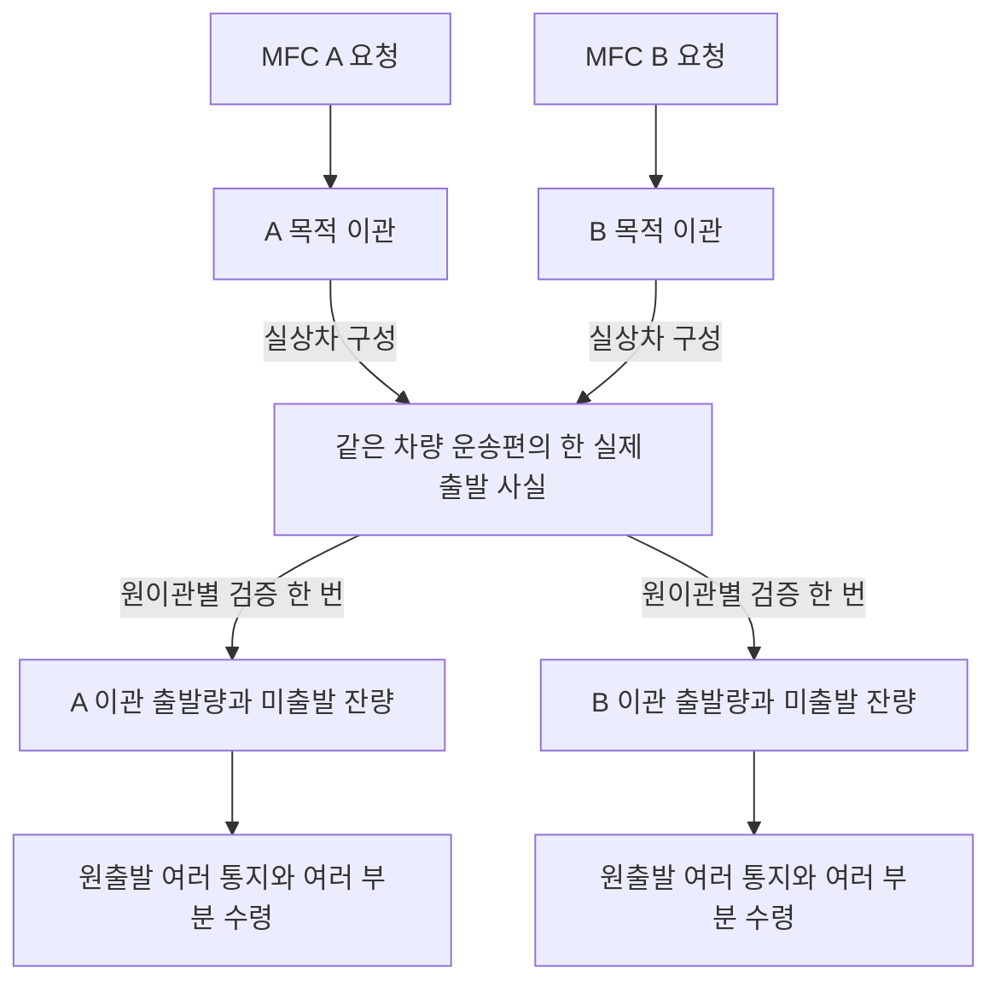

범례: 사각형은 요청/이관/사실/실적, 화살표는 계보 연결이다. 차량의 한출발과 이관별 수량반영 단위를 분리한다. 여러부분수령/중복통지는 동일요청의 여러출발이 아니다.

**여러 통지:** CDC 결과·TMS 통보·지연 재통지·응답 재시도는 원이관/원차량출발 사실/원화물 구성을 대조한다. 이미확정됐으면같은 출발량/잔량을 반환하고CDC차감/이동중가산을 반복하지 않는다. 다른수량/차량/시각 주장으로충돌하면수정사유·실제증빙·기반영을 조사하며새출발을 만들지 않는다.

**일부 미출발:** 승인60중실상차/출발확정48이면출발구성48을 한 번 동결하고 미출발12는CDC정리의무로 남긴다. 다음차량/회차에 같은이관12를 보내지 않는다. 원승인선·실물/할당 해소 후 수동종료하고 추가공급은별도MFC수동요청이다. 처음에는 일부통지만 와서 원출발구성이 불명이라면 전체 출발 성공을 추정하지 말고 그 사실을 조회한다. 뒤늦게 확인된 동일출발의 누락기록은 원출발 정정/복구이지 새 실제출발이 아니다.

**다이관 부분 성공:** 같은차량의A반영성공/B응답불명이면A를 다시출발시키지 않는다. B의원출발/실상차/처리결과를 조회해누락만복구하고통합사건은미완료로유지한다. 차량이 이미떠난 사실을 지우거나 목적지정정으로 우회하지 않는다.

**출발 전후 수량 계약:** 각SKU/LOT/원실물에서실출발q는유효승인/할당·실피킹·검품·실상차·CDC현물잔량 이내다. 검증된q에대해CDC현물감소=이동중증가=원예약소진=q를함께확정한다. 같은원출발재전달뒤에도각누적값은그대로다. 한쪽반영/응답불명은추가실행전원결과조회·대사로복구한다. 전체차량완료표시만으로 이관별불명을성공으로바꾸지않는다.

**상태 변화:** 미출발/출발 확인 대기→출발 반영 완료, 또는 사실 불명/중지 대기로 구분한다. 유효한 한 번의 확정에서 CDC현물/원예약−q·이동중+q를 반영한다. 미출발 잔량은 별도 정리 의무·SCM 수동 종료로 관리하고 기출발 이력은 유지한다.

**오류·복구:** 응답불명/통지중복은원출발조회·누락만복구. 같은요청잔량재출발·차량전체성공추정·출발후목적변경/반송금지.

**완료 조건:** 원이관별유효출발구성/수량과CDC/예약/이동중·원사건이일치하고미출발/통지의무가분리됐다.

### 14. 운송 결과·MFC 원수령·수량 대사

#### CDC-F-023 운송 사건의 CDC 출고·추적·대사 영향 처리

**주관·실행 주체:** CDC WMS는 원출발/화물 계보·CDC 제한·미정산 대사만 처리한다. 운행관제·ETA계산·배차변경은 TMS가 담당한다.

**시작 조건·입력:** TMS의 지연·온도/봉인·오배송/미도착 사건 또는 원출발조회 요청을 원TRF/출발·LPN/LOT·수량·시각·증빙·현재책임과 함께 받는다.

**정상 처리:** 원출발/실상차 구성을조회→사건의 대상/구성/시각대조→미출발 작업/동일LOT의 품질제한 영향검사→출발사실·미정산·현물의 책임분리→TMS/MFC/SCM에 필요한 자기원천회신→원수령/손실/정정 계약의 후속의무등록 순이다.

**분기:** ETA가 늦어도 CDC현물/Transit은 자동변하지 않는다. 차량GPS도착·TMS운송종료만으로 MFC TIN이나 Transit해소를 하지 않는다. 실물은 MFC가10받았다고 하지만 TIN불명이면 원수령전기 결과를 조회하고 임의수량으로 CDC대사를 끝내지 않는다.

**오배송/품질:** 출발LOT·봉인/구성·원출발수량과 실제증빙을 비교해 불일치를 조사한다. 타MFC로 목적지를 바꾸거나 실제CDC반송을 새기능으로 생성하지 않는다. 출발후실물의 현재위치/보관책임은 해당현장/TMS 사실을 참조한다. CDC WMS가 MFC검수·품질처분·추가공급을 대신확정하지 않는다.

**상태·수량:** 운송사건 참조·CDC영향/제한·미결대사만 변경한다. 현물/Transit 증감은 유효한 원출발·TIN확인·승인손실 기능으로만 수행한다.

**실패·복구:** 같은사건재전달은 원결과, 서로다른수량/LOT주장은 충돌로 조사한다. 사건상태가 닫혔어도 관련미수령/품질/원장불명은 별도해소 확인 전 유지한다.

**완료 조건:** 사건과 CDC원출발/미정산의 관계·자기처리·외부결정대기·담당이 설명된다. 차량경로/고객안내/공급수량은 자기원장 밖의 결정이다.

#### CDC-F-024 MFC 실제 입고 확정 결과 인수·Transit 대사·복구

**주관·실행 주체:** MFC는 실수령·검수와 자기센터 TIN을 확정한다. CDC WMS는 그 확정 결과를 받아 자기 원출발 Transit만 대사한다. MFC 재고를 대신 쓰거나 적치·판매 준비를 승인하지 않는다.

**시작 조건:** 원출발에 연결된 MFC 자체 입고 확정 결과가 도착하거나, 현장 수령 주장·결과 유실·순서 역전 때문에 원수령 조회가 필요할 때. 단순 수령 주장은 조사 시작 근거이며 Transit 차감 근거가 아니다.

**입력:** 출처 MFC/권한, 원TRF·승인/출발행·departureId·manifest 버전, 원receiptId·postingId·확정버전/시각, SKU·기준단위·LOT/LPN 계보, 실수령 r·정상 n·격리/미판정 h, 원결과 상태·정정 참조. MFC 내부 LOC/준비 정보는 추적용 참조다.

**사전 검증:** 실제 출발과 목적 MFC, 발신 주체·확정 결과의 진위/버전, 같은 원수령의 기존 처리·내용 충돌, 단위·출발 LOT/LPN 연결을 확인한다. `r>0`, `n≥0`, `h≥0`, `n+h=r`이며 해당 SKU의 수량은 정수다. 원출발 수령 누계·손실·미정산이 출발량을 초과하지 않아야 한다. 미확정 현장 관측값을 TIN 성공으로 간주하지 않는다.

**정상 처리:**

1. 동일 출처·센터·원receiptId/receiptLineId·departureLineId의 기존 대사 결과를 조회한다. 같은 확정 결과의 반복이면 해당 행의 기존 대사 ID/잔량을 반환하고 새 차감은0이다. 다른 본문·확정버전은 자동 덮어쓰지 않는다.
2. MFC TIN의 COMMITTED/성공과 postingId·수량을 검증한다. 메시지만으로 확인할 수 없으면 MFC의 원수령 결과를 조회한다. MFC에는 신규 입고 명령을 보내지 않는다.
3. 출발행별 SKU·LOT·단위·실수령 귀속과 최신 미정산을 대사한다. 누락 출발·초과·이종 SKU/LOT·손실과의 충돌은 영향 행만 보류해 원증빙을 조사한다.
4. 검증된 r에 대해 **CDC Transit−r·원수령 대사 기록·누적 확인 수령량·원출발 잔량·통지 의도**를 WMS 안에서 일관되게 한 번 확정한다. CDC 현물과 MFC 현물은 이 단계에서 바뀌지 않는다.
5. MFC/SCM/관제에 대사 완료·잔량/차이·원대사 ID를 제공한다. 결과 통지 유실은 원대사 조회·통지만 복구한다.
6. 남은 미수령·품질 사건·준비 지연·외부 통지를 구별한다. 수량 대사가 끝나도 MFC의 품질 해제·판매 준비·현장 사건을 자동 종결하지 않는다.

**상태별 복구와 담당:**

| 확인된 사실 | WMS 처리·표시 | 후속 조치·담당 |
|---|---|---|
| 현장 수령 주장만 있고 MFC TIN 미접수/실패 | Transit 유지·MFC 입고 확정 대기 | MFC가 자기 원실행을 조회·복구. WMS가 TIN을 대신 생성하지 않음 |
| MFC TIN 처리 중/결과 불명 | 원수령 후보·확인 시각·미확정 범위 유지 | MFC 원receipt/execution 결과 조회. 새 입고·손실·CDC 복원 금지 |
| MFC TIN 성공, CDC 통지 미수신/대사 미접수 | MFC 기수령·CDC 미대사로 구분 | 동일 확정 결과를 재전달하거나 WMS가 조회 후 같은 receiptId로 대사 |
| CDC 대사 중/저장 결과 불명 | 원대사 확인 대기·차감 성공을 추정하지 않음 | WMS가 원reconciliation/receipt 결과 조회. 기반영이면 반환·미반영 확인 시 같은 결과만 재처리 |
| CDC 대사 완료, ACK 유실 | 확인 수령 누계·미정산 잔량 보존 | 원대사 결과/ACK만 재전달. MFC 추가 입고0·CDC 추가 차감0 |
| 원출발·단위·SKU/LOT·수령 버전 충돌 | 차이·원결과를 보존하고 대사 보류 | WMS는 자기 출발/대사를, MFC는 자기 수령/재고를 각자 조사·승인 정정 |
| 출발 기록보다 수령 통지가 먼저 수신 | 선행 출발 조회·순서 대기 | 새 출발을 합성하지 않음. MFC의 실제 보관·미확인 구분은 MFC 책임 |

**다품목·부분 성공:** 한 원수령이 여러 SKU/단위·출발행을 포함하면 대사 수량·멱등 결과를 행별로 유지한다. 서로 다른 SKU 수량을 합한 r로 잔량을 차감하지 않는다. A행 대사 성공/B행 불명이면 A를 재차감하지 않고 B의 원대사 결과만 조회·복구한다. 수령 문서 전체 성공은 모든 대상 행의 결과가 확인됐을 때만 표시한다. receiptId 하나가 존재한다는 이유로 미처리 행을 중복으로 버리지 않는다. 실제 스키마는 제안이며 계약에서 행 식별·부분 결과를 확정해야 한다.

**수량 사례:** 출발12·MFC 확정수령10(정상8/격리2)이면 MFC 현물은 이미10 증가한 상태다. 통지 유실 중에는 CDC 원장Transit이12일 수 있다. 같은 수령 결과를 확인해 대사하면 Transit은2다. 실제 운송 중과 겹쳐 보이는 기수령10을 통합 합계에 두 번 넣지 않는다. CDC의 ACK 지연만으로 MFC가 이미 적격·준비를 확인한 물량의 자체 판매 권한을 새로 판단하지 않는다. MFC TIN/품질·준비 자체가 불명이면 MFC가 신규 가용 노출을 보류한다.

나중에 남은 실물2를 받으면 새 실제 수령의 receiptId/TIN으로 처리한다. 기존10을12로 덮어쓰지 않는다. 격리2의 실제 폐기는 MFC 현재 격리만 줄이며 수령 누계10이나 별도 미수령2를 다시 줄이지 않는다. 원출발 한도를 넘는 실물은 귀속 조사 대상으로 보존한다.

**LPN·LOT 계층:** PLT1·BOX2가 같은 SKU40을 나타내면 수령 귀속은40 한 번이다. 출발 LPN의 원구성/버전·제조사 LOT과 MFC 확정 결과를 연결하며 MFC 로컬 LOT 키를 CDC PK로 강제하지 않는다. 출발 LOT과 실물 LOT이 다르면 원출발을 마지막 스캔으로 덮지 않고 MFC의 격리·조사 결과와 원출발 정정 필요를 각각 확인한다. MFC의 후속 개봉·해체·적치·준비는 새 수령이 아니다.

**확정 수령의 후속 정정:** 현재 품질/준비 상태 변화와 과거 입고 수량의 오류 정정을 구분한다. 정상8/격리2가 후속 해제로 정상10이 돼도 원수령 누계10과 CDC Transit은 그대로다. 수령 수량 자체가 틀렸다면 MFC가 자기 원장에 승인 정정을 확정한 증거·원receiptLineId·정정ID/버전·종전/정정 누계·정정 사유를 제공해야 한다. WMS는 마지막 확인 수령량과 대조해 `δr=정정 누계−기확인 누계`, `Transit 변화=−δr`만 같은 정정 사건으로 한 번 반영한다. 원출발 q·승인 손실 l에 대해 정정 후 `0≤r`, `0≤q−r−l`을 검사한다. WMS가 MFC 원장을 직접 정정하거나 원출발량을 바꾸지 않는다.

예를 들어 출발12·기확인수령10·Transit2에서 MFC가 실제 계수/원전기 오류를 승인 정정해 수령누계를8로 바꿨다면 `δr=−2`이고 Transit은4가 된다. 이는 잘못 해소했던 미정산2를 다시 여는 기록이며 실제 CDC 반송·MFC에서 물건이 다시 출발했다는 뜻이 아니다. 수령누계를10으로 유지한 채 품질만 바뀌면 δr=0이다. 같은 정정ID를 반복해도 추가 변화는0이다. 원버전 누락·수령/손실 귀속 충돌·결과 불명이면 자동 반영을 보류하고 원정정 결과를 조회한다. 승인된 수량 정정·역순 버전 처리의 구체 연계 계약은 CWC-08~09/SEP-06에서 확인한다.

**수령·손실 경합:** 로컬 Transit 잔량 검사만으로 MFC의 동시 TIN과 WMS 손실 확정의 충돌이 해결된다고 가정하지 않는다. CDC-F-027의 양측 원결과 확인·대상 잔량 조정 조건을 만족하기 전 손실 해소를 보류한다. 같은 실물 수령과 손실이 충돌하면 원기록을 보존하고 승인 정정한다.

**상태 변화:** MFC의 TIN 확정과 WMS의 대사 확정은 독립적이다. WMS 상태는 수령 결과 확인 대기→대사 처리 중→대사 완료 또는 충돌/불명으로 관리한다. 원receiptId/receiptLineId·departureLineId별 최초 대사는 한 번이며 승인 정정은 원정정 사건의 차이만 반영한다. 총수령 누계와 현재 MFC 잔고를 혼동하지 않는다. 영문 상태·API 필드명은 구현 계약의 제안이다.

**완료 조건:** 검증된 MFC 확정 결과가 원출발행·WMS 대사 ID에 한 번 연결되고 `출발q=확인 수령누계r+승인 손실l+미정산t`가 맞는다. 미통지 기수령·차이·품질·준비·통지 의무는 각자 담당과 다음 조치를 유지한다. 한 번의 DB 거래로 WMS와 MFC를 함께 확정한다고 가정하지 않는다.

#### CDC-F-025 원출발·수령·손실·미출발 수량 종결 대사

**주관·실행 주체:** **CDC WMS 원출발·미출발·이동중 대사**, **MFC 기전기 수령 누계 제공**, SCM 승인/잔량 종료, 관제 사건 조율

**시작 조건:** 부분/전량수령·승인손실·미출발정리·사건마감판단때.

**입력:** 원이관승인버전/출발량·미출발취소/종료/미해결·누적실수령/처분이력·승인운송손실·미수령·미결품질/통지.

**검증:** 3장의원승인보존식·출발=누적수령+승인손실+미수령·상호배타원실물·현재MFC잔고와수령누계차이를검사한다.

**처리:**

같은 SKU 판매단위로 `출발량 = MFC 입고 확정 누계 + 승인 운송 손실량 + CDC WMS 미정산 이동 중 잔량`을 대사한다. 누적 수령은 당시 정상/격리와 수령 후 처분 이력을 포함하는 실적 누계이며 현재 MFC 잔고가 아니다. 미수령 잔량과 MFC 격리 폐기는 서로 다른 물량이다.

| 독립 이송 사례 | CDC 현물 | 이동 중 | MFC 현물 | 합계 |
|---|---:|---:|---:|---:|
| 시작 | 1,000 | 0 | 18 | 1,018 |
| 승인·피킹·상차 | 1,000 | 0 | 18 | 1,018 |
| 실제 출발 48 | 952 | 48 | 18 | 1,018 |
| MFC 자체 수령46 및 CDC 결과 대사 완료 | 952 | 2 | 64 | 1,018 |
| 미수령 2의 손실 조사·승인 반영 | 952 | 0 | 64 | 1,016 |

표의 이동 중은 각 단계의 수령 결과 대사까지 완료된 잔량이다. MFC 입고와 CDC 대사 사이의 시간차 중간값을 단순 합산하지 않는다. 마지막 단계는 승인 손실이 실제 확정된 대안이다. 나중에 2를 찾아 수령하는 대안과 동시 적용하지 않는다. MFC 격리 2는 별도 현물로 남아 품질 처분이 필요하다. MFC 현재 정상/격리·예약·판매준비와 신규가용은 자기MFC가 별도로 계산한다.

**상태 변화:** 수량대사/잔여의무·행정마감가능여부만확정, 새로운현물증감은원수령/손실/조정기능에서수행.

**오류·복구:** 차이를맞추려원출발/수령을삭제하거나새조정으로상계하지않는다. 반영불명/미결조사·품질의무가있으면해당종결보류.

**완료 조건:** 동일판매단위의승인/출발/수령/손실/잔량과처리상태가모두설명되고남은품질/판매준비/사건은별도로추적된다.

### 15. 취소·품질 처분·실사·조정

#### CDC-F-026 미출발 취소·축소·실물/권리 정리

**주관·실행 주체:** SCM변경접수/승인·WMS중지/재고확인·가상하차/복귀

**시작 조건:** 유효원이관의출발전취소/축소또는미출발잔량종료요청때.

**입력:** 원요청/승인/버전·대상량·할당/피킹/검품/상차·원출발사실/기반영·중지/가상복귀/현위치·승인선.

**검증:** 실제출발선확정/불명·현재잔량/실물·진행중모의시도의중지·권리/용량·유효승인을확인한다.

**처리:**

SCM의 유효 취소/축소 요청은 WMS 작업 중지·실물·해제 결과를 확인해 처리한다. 요청 철회 접수와 취소 실행 성공은 다르다. 출발/취소가 경합하면 실제 선확정 결과와 최신 원작업을 확인하고 후행 명령을 재심사한다. 출발 사실 불명인 동안 취소 성공·예약 해제를 모두 보류한다.

| 현재 사실 | CDC 처리 순서 | 수량·권리 결과 |
|---|---|---|
| 승인·미할당 | 유효 버전/미출발 확인 → 취소 결과 통보 | 현물 변화 0 |
| 할당·미피킹 | 릴리스/시작 차단 → 작업 점유 확인 → 승인 범위 해제 | 적격분만 신규 가용 회복 |
| 피킹 완료 | 중지 → 분류/임시 위치·실수량 확인 → 적합 위치 실제 복귀 → 해제 | 총 CDC 현물 유지·복귀 전 재사용 금지 |
| 상차·미출발 | 출발 차단 → 실제 하차·계수 → 위치/작업/상차 정정 → 해제 | 실제 정리된 미출발분만 취소 |
| 실제 출발/출발 불명 | 일반 취소 차단/결과 조회 → 원출발·운송 사건 조율 | CDC 자동 복원·동일 요청 재출발 없음 |

승인 60=출발 48+미출발 종료/취소 12의 12는 실제 CDC에 남은 위치와 원할당을 확인해야 한다. 남은 수량의 수동 종료는 추가 출발 권한이 아니다. 일부 성공·응답 유실은 누적 정리된 수량만 조회·복구하고 최초 60 전체를 해제하지 않는다.

##### Wave·실피킹 경계별 중지와 복귀

`[설계안]` 최신 SCM 취소/축소 버전과 원이관의 미출발 사실을 먼저 확인한다. 미배포는 편성 제외/재계획, 배포 뒤 미착수는 작업 중지와 할당 해제 검증, 진행 중은 피커 중지 확인→실피킹/미처리 분리→현재 위치/물류 구성 확인 순서다. 이미 피킹했거나 모의 분류/상차한 물량은 원실적을 지우지 않고 승인된 복귀·재적치·품질 재검증과 잔량 정리로 이어간다.

미확인 중지·오프라인 피커·늦은 피킹 결과가 있으면 Wave 취소 표시만으로 예약을 풀지 않는다. 실제 출발이 먼저 확인되면 출고 전 취소 경로를 막고 기존 운송/수령 사건으로 대사한다. 새 정책의 잔량 이월·반송 가능 제안은 같은 요청의 재출발·출발 후 실제 CDC 반송을 허용하는 뜻으로 적용하지 않는다.

**상태 변화:** 접수→중지/확인대기→실물/권리정리→해제/SCM취소·종료확인. 기출발/기완료실적자동원복0.

**오류·복구:** 출발불명중취소/해제성공금지. 상차분은CDC-F-021의모의하차/복귀결과확인후해소하며같은범위재사용을막는다.

**완료 조건:** 미출발대상·실제/모의복귀위치·예약/작업해소와원승인선/누적정리가일치하고추가공급권한으로재사용되지않는다.

#### CDC-F-027 수량 차이 조사·운송 손실 승인 반영

**주관·실행 주체:** CDC/TMS/MFC사실대사·본사승인·WMS해당잔량반영

**시작 조건:** 출발/수령차이·미도착/발견·손실의심이발생했을때.

**입력:** 원출발/수령·미수령·SKU/LOT/단위·실물위치/보관자·상차/봉인/운송증거·평가/조사·승인·기반영.

**검증:** 미반영수령/이동·단위오류·동일잔량의수령/손실경합·조사/상신/종결권한을검사한다.

**처리:**

출발48·수령46이면2는 우선 미수령 잔량이다. 단위·실상차·정차/인계·봉인·MFC 위치·미반영 원수령을 조사하고 도착 불명을 자동 손실로 차감하지 않는다. 뒤늦게 실제2를 확인하면 원출발에 연결한 수령, 실제 손실2를 확정하면 조사/승인 후 이동 중 손실을 반영한다. 같은 잔량에 두 처리를 중복하지 않는다.

**손실 확정 전 양측 확인:** 원출발행·잔량·SKU/LOT·대상 실물을 특정하고, MFC의 누적 TIN·처리 중/불명 수령·확정 결과 미통지와 TMS 인계 증빙을 먼저 확인한다. MFC가 이미 TIN한 물량은 통지 지연만으로 운송 손실에 넣지 않는다. 아직 수령될 가능성이 있는 동일 잔량을 MFC가 수령 처리하는 중에 WMS가 손실로 종결하지 않는다. 양측이 합의한 대상 범위의 조정 절차와 유효한 확인 근거가 갖춰질 때만 손실을 해소한다. 구체적인 조정권한·처리 중 수령 통제·확인 유효성 계약은 확인 필요다. 그 계약이 없거나 응답 불명이면 **손실 자동 확정/Transit 종결을 보류**하고 현물 안전 보관·미결 조사·MFC의 실제 수령 사실 기록을 유지한다. 승인과 WMS의 로컬 잔량 검사만으로 교차 영역 중복 해소 방지를 보장했다고 표시하지 않는다.

조사기한·추정손실 상신·전자종결 권한은 등록된 재고사건 정책을 적용한다. 기존3영업일/10만원 등의 숫자를 승인근거 없이 모든센터의 운영값으로 고정하지 않는다. 사고 수량별 추가 상신 기준·평가 근거가 미정이면 임의 단가로 승인 구간을 낮추지 않는다. 사건에는 원요청/출발/수령·SKU/LOT·수량/단위·실물 위치/보관자·시각·증빙·조치·담당·다음 확인을 남긴다.

이미 손실로 해소한 양이 나중에 발견되면 무조건 추가 수령 가산하지 않고 원손실·발견 실물·귀속을 대사해 승인 정정한다. 동일 물량을 원장 조정·운송 손실·폐기로 여러 번 차감하지 않는다.

**상태 변화:** 조사/승인대기·확인된운송손실만미수령구간에서한번해소. 발견물정정은원손실/실물대사.

**오류·복구:** 지연자동손실·초과승인/이중폐기금지. 등록된조사/상신정책·단가/단위불명보완, 응답불명원사건조회.

**완료 조건:** 승인원인/수량과반영·남은미수령/현재보관·후속발견정정·전자종결권한이설명된다.

#### CDC-F-028 품질 보류·리콜·해제·실제 폐기 반영

**주관·실행 주체:** 현장/품질사실·본사품질승인·WMS상태/현물반영

**시작 조건:** 품질/리콜이상·적격해제검토·실제폐기증빙이접수됐을때.

**입력:** 원실물/SKU/LOT·현위치/센터·영향예약/작업/운송/고객계보·품질/기한근거·승인량·실제실행량/증빙·기반영.

**검증:** 안전차단·실제부적합과정보오류구별·품질해제/처분승인·소유상태·동일손실중복·누적실행한도를확인한다.

**처리:**

품질 보류는 정상 사용을 차단하는 상태 전환이며 현물 수량 차감이 아니다. SKU/LOT·위치·확인시각·영향 할당/작업·이동 중·MFC·고객 출고 계보를 확인한다. 필요하면 실제 격리 이동을 수행하고 정상 복귀는 품질 근거·해제 승인·적합 위치·기한을 다시 검사한다. 설비 복구·시간 경과·일반 운영자의 강제 확인으로 해제하지 않는다.

리콜은 CDC·운송·MFC·고객 출고 LOT까지 추적해 신규 할당/출발을 차단하고 SCM/TMS/OMS·관제 대응을 연결한다. 이미 출발/전달한 사실을 삭제하지 않는다. 실제 부적합품은 본사 품질 책임자의 전자 승인 후 실제 폐기 증빙이 확인된 수량만 해당 현물 구간에서 차감한다.

폐기 승인5·실제3이면3만 차감하고2는 보류 현물로 남긴다. MFC 수령 격리품의 처분은 MFC가 자체 확정하며 WMS는 결과를 참조한다. CDC나 미정산 Transit을 추가 차감하지 않는다. 폐기 승인·사진 증빙만 있고 실행이 불명이면 완료로 확정하지 않는다. 공급업체 반품/실제 CDC 반송 실행을 처분 경로로 추가하지 않는다.

CDC 기등록 현물46개가 정상44·격리2로 구성된 교육 사례에서 다음 두 경로를 구별한다. 승인 개시량46이라는 근거를 유지하며 격리2의 같은 실물에 두 경로를 중복 적용하지 않는다. 이 표는 CDC 초기 보유 이후의 품질 상태/처분 예시이며 신규 입고 구현이 아니다.

| 실제 판단·승인·실행 | 정상 | 격리 | 현재 현물 합계 | 원장 의미 |
|---|---:|---:|---:|---|
| CDC 기등록 현물 | 44 | 2 | 46 | 정상44·격리2, 신규 입고0·격리 출고0 |
| 정보 오류/미판정이 해소돼 실제 적격 확인·품질 해제 승인·보관/기한 재검증 | 46 | 0 | 46 | 상태만 이동, 신규 수령·총현물 증가0 |
| 부적합 확정·폐기 승인만 완료 | 44 | 2 | 46 | 아직 실물2 보류, 승인만으로 차감0 |
| 부적합2 실제 폐기·증빙 확인 | 44 | 0 | 44 | 해당 구간 격리2만 한 번 차감 |

표의 해제 경로와 부적합 폐기 경로는 서로 다른 대안이다. 실제 파손·온도이탈·기한 미달을 문구 수정이나 일반 승인으로 적격 해제하지 않는다. MFC에 이미 수령된 격리품을 MFC가 폐기하더라도 CDC 원출발의 별도 미수령 잔량은 변하지 않는다. CDC WMS는 MFC 처분을 직접 집행하지 않는다.

상태 해제·처분 뒤 공급 가능/예약 대체·SCM 보충·고객 영향이 바뀌는지 재평가한다. 재고/상태 반영은 성공하고 조회/알림만 실패했다면 그 전파만 복구한다. 실사에서 같은 부적합2가 안 보인다는 이유로 폐기 이력과 별도의−2조정을 다시 집행하지 않는다.

##### LOT 영향 범위 추적과 차단 전파 확인

`[설계안]` 회수 접수는 사유·제조사/공급사·SKU·제조사 LOT 원문·근거 자료로 범위를 식별하고 내부 LOT 참조와 연결한다. 제조사 LOT 문자열이 같다는 이유로 다른 제조사의 물량까지 합치지 않는다. 일부 BOX 파손·시간/구역별 온도 이탈과 제조사 전배치 회수는 영향 범위가 다르므로 대상 SKU·LOT·위치·LPN·수량을 명시한다.

1. CDC/MFC 현재 보관·작업/검수 위치의 정상/격리·예약 물량, 원출발 이동 중 구성, 이미 고객 출고된 실적을 나누어 조회한다. LOT 하나가 여러 위치/포장에 나뉘어 있어도 같은 배치의 흐름을 연결한다.
2. 미출발 할당·진행 피킹·분류·검품·상차·출발의 영향 범위를 차단하고 WMS 원예약/BLOCKED·SCM 공급 약속을 유지한다. 계획 때 적격이었어도 현재 차단이면 피킹 확정/출발을 금지한다.
3. 센터·작업별 차단 요청과 실제 반영 성공·실패·확인 대기를 구분한다. 발송했다는 이유로 전센터 차단 완료로 표시하지 않고 누락 전파만 복구한다. 이동 중 물량은 TMS와 목적 MFC에 안전 수령/격리를 조율하며 새 경로 전환·역이관을 만들지 않는다.
4. 정방향으로 제조 LOT→현재 LOC/LPN·원출발·MFC 수령·고객 출고를, 역방향으로 주문상품의 실제 LOT→MFC 집품/수령→CDC 출발/초기 보유를 연결한다. 고객 주문·개인정보·고객 연락/환불 결정은 OMS/Commerce가 맡고 CDC는 필요한 영향 참조만 제공한다.
5. 미확인 물량·담당·다음 조치·해제/실제 폐기 상태를 남긴다. 회수 대상 등록, 격리, 현장 회수, 처분 승인, 실제 폐기, 고객 환불은 별개다. LOT 정정과 보존기간의 구체 권한/기간은 승인 대기로 유지한다.

**상태 변화:** 보류/해제는상태이전·총량0변화. 실제폐기분만현재귀속센터/상태에서차감·승인미실행잔량유지.

**오류·복구:** 설비회복/승인/사진만으로정상화/폐기완료금지. 일부실행/반영불명은원사건조회·누락만복구, 격리폐기로미수령/다른센터추가차감금지.

**완료 조건:** 원실물의상태/실제처분·승인/누적량/잔량·영향예약과계보가일치하고미결품질/고객의무를별도유지한다.

#### CDC-F-029 위치 실사·재계수·원거래 차이 조사

**주관·실행 주체:** WMS실사통제·현장계수/독립재계수·재고담당조사

**시작 조건:** 순환/수시실사대상과기준시점이정해졌을때.

**입력:** 위치/SKU/LOT/상태·기준시각/원장버전·작업잠금·실계수/재계수·미완료이동/출발/수령·단위/사유.

**검증:** 장부비공개첫계수·독립재계수·잠금전후거래·기반영/누락·실물/예약제약을확인한다.

**처리:**

위치별 순환 실사를 기본으로 대상 위치·SKU/LOT/상태·기준시각·장부 버전을 정하고 해당 이동/할당을 통제한다. 첫 계수자는 장부 수량을 보지 않고 계수하며 차이는 다른 작업자가 재계수한다. 잠금 전후 이동·출발·미완료 적치·단위·중복 결과·원장 미반영을 먼저 조사한다.

장부10·실물8에 미반영 이동2가 확인되면 원이동을 복구하고 조정 차이를 다시 계산한다. 곧바로 −2 조정해 손실을 만들지 않는다. 승인 대기 중 새로운 실적이 발생하면 기준을 재대사한다. 조정 요청자와 승인자는 분리하고 원조사 사건·계수·사유·전후값·평가 근거를 보존한다. 과거 원장을 삭제하거나 숫자를 직접 덮어쓰지 않는다.

##### 계층 스캔과 위치 차이의 구분

`[설계안]` 실제 LOC를 확인한 뒤 직적치 SKU, 독립 BOX, PLT 하위 BOX/직접 SKU를 구별해 계수한다. PLT 스캔은 예상 구성 조회이며 하위 실물 확인의 깊이는 승인 실사 기준을 따른다. 원장·구성·직접/유효 위치·실계수의 어느 축이 다른지 분리하고 상위 PLT와 하위 BOX를 추가 재고로 더하지 않는다.

실물은 맞고 부모/LOC 연결만 틀리면 원구성/이동 정정으로 처리하고 자동 수량 조정을 하지 않는다. 반대로 LOC가 맞아도 실수량이 부족하면 차이 사건을 남긴다. 미등록 LPN 발견은 재고 증가 근거가 아니며 출처·종료/재포장 계보를 확인한다. 같은 실물의 위치 정정과 손실 조정을 중복 집행하지 않는다.

**상태 변화:** 실사계수/조사·보정후남은차이확정. 계수보고만으로현물조정하지않는다.

**오류·복구:** 장부10/실물8이라도원MOV누락2이면원MOV복구후재대사. 새실적/응답불명은기준재검증·자동−2조정금지.

**완료 조건:** 미반영원사건·단위/실물오류가분리되고남은조정대상/평가근거가CDC-F-030심사에제공된다.

#### CDC-F-030 조사 차이의 승인·부분집행·원장 조정

**주관·실행 주체:** 지정 재고승인자의 판단을 해당 WMS가 검증·집행한다. 사업승인선·평가단가·회계가치 정책은 WMS가 임의정하지 않는다.

**시작 조건:** 실사/원거래조사로 실제차이·원인이 식별되고 조정요청이 제출될 때.

**입력:** 원조사·센터/SKU/LOT/LOC/상태별 차이, 장부버전/실계수·재계수·원거래 증거, 정규화행·위험평가/단위·승인정책버전·승인량/잔량·기집행/손실/폐기참조.

**사전 검증:** 누락입고/이동/출고는 원거래 복구가 우선인지 확인한다. 같은손실을 ADJ/폐기/Transit손실로 중복처리하지 않는다. 요청자/승인자 분리·승인센터/행/단위·현재잔량·만료/철회를 검사한다.

**정상 처리:**
1. 조사대상과 기준시각 이후 변동을 대사해 조정이 필요한 원차이를 확정한다.
2. 승인정책에서 요구하는 정규화행·평가근거를 검증한다. 금액기준을 사용하는 경우 승인된 단위당평가와 절댓값 기준을 사용하고 증감상계/사건쪼개기로 승인선을 낮추지 않는다.
3. 필요한 권한/승인을 요청하고 APPROVAL_PENDING과 집행대기를 분리한다.
4. 집행직전 원승인/기반영·현재원장/예약/품질·동시행 영향을 재검증한다.
5. 승인잔량 이내의 실제차이만 원장·잔량·가용/예약상태·집행ID·통지의도와 함께 한 번 확정한다.
6. 부분집행/미결조사·영향약속·통지 결과를 보존한다.

**사례·분기:** 승인−5 중−3 성공·다음응답불명이면 원집행결과를 조회한다. 나머지미반영2가 확인된 후에만 승인잔량−2를 집행하며 새−5를 하지 않는다. 조정후 정상적격이 유효예약보다 적어지면 영향을 BLOCKED/이행부족으로 연결해 조사·권한판단을 거친다. 음수현물로 강행하지 않는다.

**삭제한 미확정 숫자:** 이전10/50행·10/100만원 승인표, 미설정이면 무조건 본사2인에게 보내는 대체승인선을 실행정책으로 두지 않는다. 현재 승인선/평가정의가 없으면 조정집행을 보류하고 정책책임자에게 보완을 요청한다. 긴급안전 차단/격리는 수량조정 승인과 분리해 먼저 수행할 수 있다.

**상태·복구·완료:** 요청/승인/집행/부분/불명·승인잔량이 분리되고 원조사와 actual commit가 연결돼야 한다. 성공원장을 취소해 통지실패를 복구하지 않는다. 완료는 실제차이·기반영/잔량·예약/품질영향·후속의무가 맞는 상태다.

**완료 조건:** 원조사별 유효 승인량·실제집행·미집행잔량과 현재원장/예약/품질의 관계가 일치하고 미결처리·승인/통지 담당이 남아 있어야 한다.

### 16. 운영 제한·권한·원사건 복구

#### CDC-F-031 CDC 운영 제한·승인 재개

**주관·실행 주체:** WMS CDC제한정본·CDC관리자/현장책임자·필요본사운영/품질승인

**시작 조건:** 혼잡/안전/품질사고·본사부과제한또는해제검토때.

**입력:** 센터/온도대/SKU/업무범위·제한강도/사유·현장검증·본사승인·중첩제한·적용버전·현재작업/기출발.

**검증:** 실행/해제권한·업무별최강조건·필요품질승인·현재기존의무/안전수령을검사한다.

**처리:**

`[채택 설계]` CDC 운영 제한 정본은 WMS다. 센터·온도대·SKU·업무별 정상·출고 제한/중지·안전 작업 중지 범위를 관리한다. CDC 관리자는 혼잡 제한·회복 해제를, 현장 책임자는 안전상 긴급 제한을 실행한다. 본사 부과/안전 사고 재개는 본사 운영 승인·현장 검증, 품질 관련은 본사 품질 해제를 추가한다.

중첩 제한은 업무별 가장 강한 조건을 적용하고 시간 경과만으로 자동 재개하지 않는다. 신규 할당·이동·상차·출발 전 최신 제한을 확인하고 조회 실패면 해당 신규 처리를 보류한다. 이미 출발한 과거 실적을 취소하지 않는다. 미설정 수령 창·온도 한도·위치 용량은 그 영향 업무만 제한한다.

**상태 변화:** 제한/해제와영향신규실행허용갱신. 과거출발/실물/고객거래자동취소0.

**오류·복구:** 제한조회불명·필수운영값미등록은영향신규업무보류·안전보관/수령지속. 시간/시설회복만으로자동해제금지.

**완료 조건:** 유효제한/재개근거·적용버전·후속검증과기존미결의무/안전관리범위가명확하다.

#### CDC-F-032 역할·승인·정책 버전 적용

**주관·실행 주체:** 관제권한/본사정책승인·WMS원업무실행

**시작 조건:** 업무요청·승인·재배정·정책/핵심기준변경을적용할때.

**입력:** 현재역할/센터/업무범위·원요청/승인/정책·적용시각/버전·실제담당/구지시·진행품질/예약영향.

**검증:** 요청/승인분리·실행권한·일반신규적용과안전진행영향·구단말/시도유효성을확인한다.

**처리:**

계획/요청·TRF 승인·CDC 할당·피킹/검품/상차·출발 확인·품질·실사/조정·관제·테스트 권한을 구분한다. 소속만으로 다른 센터 재고를 변경할 수 없고 요청/승인·실행을 역할별로 검사한다. 조정·손실·폐기 요청/승인 분리를 유지한다. 교대·재배정·취소·정책 변경 뒤 오래된 단말 지시는 무효화한다.

정책은 승인자·적용시각·버전·영향 센터/SKU/업무를 보존한다. 일반 변경은 신규 건 기준을 따르며 안전/리콜은 진행 물량도 영향 평가한다. 과거 환산·기한·평가 실적을 새 기본값으로 재계산하지 않는다. 가상 설비/테스트 사용자도 WMS 검증을 건너뛸 수 없다.

**상태 변화:** 승인기준·권한/현재담당·정책버전갱신, 원업무의수량변경은그기능을통해서만확정.

**오류·복구:** 권한/버전 불명은 조회/심사를 보류하고 구실적을 보존한다. 조직 소속·모의 결과 주입 권한·새 기본값을 근거로 과거 재계산이나 제약 우회를 허용하지 않는다.

**완료 조건:** 승인/정책/실행주체와영향원업무·구지시해소가연결되고감사근거를남겼다.

#### CDC-F-033 조회·명령·사건의 중복/불명 복구

**주관·실행 주체:** 각정본의원결과확인·WMS반영/전파·관제담당조율

**시작 조건:** 통신/저장/전파오류·동일요청재전달·역순/오프라인·부분성공때.

**입력:** 업무/센터별원요청/시도/사건·동일내용·버전·기반영/잔량·실제/모의위치·수신/발생/반영시각·현재권한/원증빙.

**검증:** 동일키다른내용·원수행중복·선행사건·기완료/미완료·정본/조회사본·권한·수량계약을검사한다.

**처리:**

같은 업무/센터의 같은 요청 식별과 같은 내용은 원결과를 반환한다. 같은 식별에 수량·목적지·원문서가 다르면 자동 덮어쓰지 않는다. 응답 없음 → 원요청/작업/원장 결과 조회 → 미처리 확인 시 같은 요청 재전달 순서로 복구한다. 원장 성공·알림/조회 실패면 미완료 통지/조회만 복구한다.

| 실패·경합 | 확인할 근거 | 복구·종결 기준 |
|---|---|---|
| 적치 지시 전달 실패 | 원작업·예약·어댑터 접수/수행 여부 | 미접수만 재전달, 수행 불명은 상태 대기 |
| 부분 완료·재고 반영 실패 | 원결과·누적 반영·실제 위치 | 완료분 중복 없이 누락 반영·잔량 정리 |
| 목적지/단위/LOT 불일치 | 지시 버전·현장/모의 결과·실물 | 격리·조사·유효 정정, 임의 가산 금지 |
| 수령이 출발보다 먼저 수신 | 원출발·기반영·수령 사실 | 선행 조회/순서 대기, 새 출발 생성 금지 |
| 수령·손실 동시 반영 | 동일 출발 미수령 잔량·누적 해소 | 한 잔량은 한 원인으로만 해소 |
| 취소·출발 경합 | 실제 출발/미출발·원승인·작업 | 선확정 사실 기준·불명 해제 보류 |
| 관리자 예외 정정 뒤 늦은 가상 결과 | 원작업·승인 정정·남은 수량 | 추가 실적 자동 반영 금지·계보 대사 |
| 오프라인 스캔 | 임시 기록·권한·최신 버전·잔량/기한 | 서버 재검증 전 완료/출발 확정 금지 |

재고 이전은 출발/목적 수량·예약·원장·처리 결과가 함께 일치해야 성공이다. 처리 도중 저장 오류는 불완전 변경을 성공으로 노출하지 않고 일관된 상태로 복구 후 같은 사건을 안전하게 재처리한다. 저장 방식·락·발행 대기·분산 보상 기술은 별도 구현 설계이며 업무상 한 번 반영·총량 보존 요구를 대신하지 않는다.

조회는 기준시각·현재 센터·원작업/이관·상태 출처를 제공하고, 미확인 정보와 확정된0/빈 결과를 구별한다. 명령은 현재 권한·원요청·대상 버전·실제 수량/위치·필요 승인을 검사한다. 요청 중복 억제만으로 업무 멱등성을 보장했다고 간주하지 않으며 오래된 조건의 명령도 정본에서 다시 판단한다.

| 요청/처리 상황 | 보존할 원입력·결과 | 허용할 후속 처리 |
|---|---|---|
| 조회 중/실패 | 마지막 확인 결과·확인시각·갱신 실패 범위 | 재조회·원사건 확인. 불명 데이터를 근거로 신규 확정 금지 |
| 필수 입력 누락/형식 오류 | 원작업과 입력을 유지·항목별 사유 | 해당 항목 보완 후 재검증, 임의 기본 단위/수량 적용 금지 |
| 버전/배정/제한 변경 | 기존 입력과 현재 유효 상태 차이를 구분 | 최신 작업·잔량/권한 확인 후 재진행, 구지시 자동 적용 금지 |
| 실행 접수·결과 대기 | 같은 원시도·성공/실패 미확정 | 원결과 조회, 새 시도로 중복 이동/예약/출발 금지 |
| 일부 실행 성공 | 완료/반영 수량·잔량·실물 위치·남은 예약/용량 | 성공분 유지·미완료 범위만 복구·승인 변경 시 재심사 |
| 작업 이탈·재접속 | 서버 원결과·실물/임시위치·담당/버전으로 복원 | 단말 임시값 재검증, 업무 재진입으로 처음부터 전량 실행 금지 |

업무 거절/보류 사유는 잘못된 위치/LOT·실제 부족·승인 부족·품질 보류·현재 배정 변경·조회/반영 불명을 구분해 다음 담당과 조치를 알려야 한다. 일반적인 실패 한 줄로 원인을 합쳐 실물을 다시 옮기도록 유도하지 않는다. 성공 상태도 지시 성공·부분 수행·원장 반영·상대 통지·종결 중 무엇이 끝났는지 명시한다.

실행 요청에는 요청자/역할·센터·원문서/행·대상 버전·SKU/LOT/화물·출발/목적 위치·수량/단위·환산 기준·발생시각·실제 증빙 중 해당 업무에 필요한 정보를 연결한다. 단말이 계산한 환산/가용·권한을 그대로 신뢰하지 않고 WMS 최신 기준으로 검증한다. 결과는 원요청·원장 사건·실반영량·현재 버전/상태·거절/보류 사유와 연결해 재조회할 수 있어야 한다.

같은 요청의 같은 내용을 업무/센터 범위에서 대조해 원결과를 반환한다. 같은 식별에 다른 수량·센터·원문서·목적지를 보내면 충돌로 차단한다. 새 업무/승인 변경과 단순 재전송을 구분하고, 응답이 없다고 새 식별로 같은 수량을 다시 실행하지 않는다. 중복 통지 수신은 이미 확정한 사건의 조회/계획 상태만 갱신하며 동일 현물을 다시 반영하지 않는다.

| 업무 사건·확정 주체 | 발행 전 확인할 사실 | 수신 측 처리·완료 확인 |
|---|---|---|
| 이관 승인·SCM | 원요청/승인행·버전·승인자·수량/조건 확정 | WMS할당 검토·목적MFC 예정조회. 승인만으로 재고 점유/현물 변경 없음 |
| 실제 출발·WMS | 유효 원출발과 CDC차감/예약소진/이동중증가의 일치 | TMS운송·SCM계획·MFC예정 갱신. 운송출발통지와 중복 반영 금지 |
| 실제 수령 사실·MFC | 원출발·원수령번호·실수량·품질·위치/시각 | MFC가 자체 TIN 확정. WMS에는 관측 사실만으로 Transit 차감을 요청하지 않음 |
| 입고 확정 결과·MFC / Transit 대사·WMS | MFC 자체 TIN postingId와 WMS 원수령 대사 ID를 각각 확인 | 각 확정 결과·CDC 잔량·SCM 계획을 연결. 한쪽 성공을 다른 쪽 성공으로 합성하지 않음 |
| CDC 품질/사용 가능 변경·WMS / MFC 변경·MFC | 현장판정/해제·기한·위치·준비 사실과 승인/적용 버전 | 영향 작업·할당·SCM·OMS/Commerce 조회갱신. 예정공급만으로 판매개시 금지 |
| 조정·폐기·손실 반영·WMS | 유효 승인·실제 실행/확인 근거·원실물·누적/잔량 대사 | 관련수요/조회/사건 후속복구. 같은손실 추가차감 금지 |

사건은 원인 요청/문서행·센터·SKU/LOT·실수량/단위·버전·발생/반영/수신시각을 구분해 추적한다. 원장 반영과 통지할 의무가 함께 유실되지 않게 관리하며 수신자는 같은 원사건을 한 번 처리한다. 발행대기/중복제거의 저장 구현·락/트랜잭션 기술은 별도 설계이고 현재 업무 정본을 바꾸지 않는다.

통지 누락·영구 검증 오류·역순 사건은 원문서·담당·다음 조치를 가진 복구 사건으로 남긴다. 실제 사실은 확인됐으나 원장 반영이 불명이면 원사건 대사부터 수행하고 통지 순서만 맞추기 위해 허위 출발/수령을 생성하지 않는다. 출발 후 목적지 변경 사건이나 실제 반송 실행은 초기 제외 범위를 우회하는 연계 기능으로 제공하지 않는다.

##### 정상 확정과 결과 불명의 처리 차이

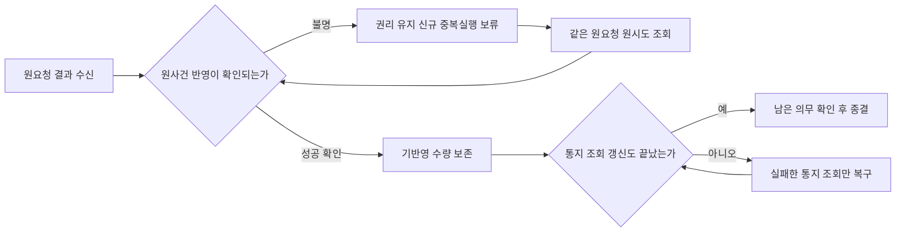

범례: 사각형은 업무 조치, 마름모는 확인 조건이다. 불명 경로는 원결과 확인으로 돌아가고 성공 경로의 통지 실패는 통지만 복구한다. 어떤 선도 기완료 수량을 새로 반영하거나 새 출발/수령을 생성하는 뜻이 아니다. 이 그림은 별도 실행/테스트 명세가 아닌 동일 기능의 복구 원칙이다.

##### Wave·LOT·LPN 연계에서 보존할 원사건

`[설계안]` Wave 편성/배포/종료, Task 배정/수락/스캔, LOT 식별 정정, LPN 부모·구성·위치 변경을 원요청/행·버전·원실행 사건과 연결한다. 필요한 기록은 실제 BOX/PLT 번호와 단위 유형, 전후 부모/구성 버전·직접/유효/마지막 확인 위치, SKU·제조 LOT·수량/품질, 실피킹/가상 수행 출처, 발생·수신·반영시각, 작업자·승인자·사유다. 별도 서비스나 물리 스키마의 확정 목록은 아니다.

구성 변경 통지보다 늦은 구버전 스캔, Task 재배정 뒤 구단말 확정, LOT 정정 중 구LOT 피킹은 원사건·당시 실물·현재 권리를 대사한다. 늦은 실제 수행 주장을 단순 폐기하지 않되 현재 버전에 조용히 덮어쓰지도 않는다. 한쪽 반영/한쪽 미반영은 원결과로 복구하고 같은 수량의 새 실피킹·새 LPN·새 수령을 만들어 맞추지 않는다. 기록 보존기간·수기/오프라인 허용 범위·정정 권한은 승인 설정이며 기존 다른 업무의 기간을 임의 전용하지 않는다.

**상태 변화:** 기반영유지·미완료검증/통지/조회만복구. 상태는반영대기/완료/거절/불명과원사건에연결.

**오류·복구:** 미접수확인없이새식별재실행·오프라인새승인·역순허위출발생성·통지실패현물재반영금지. 영구오류는담당/다음조치와사건유지.

**완료 조건:** 원사건의최종/확인대기결과와미완료담당·변경수량/통지의무가설명되고재전달후누적값이늘지않는다.

#### CDC-F-034 일일 현물/작업 대사·교대·행정 종결

**주관·실행 주체:** WMS원장/작업담당·SCM/TMS/MFC원사건·관제사건관리

**시작 조건:** 정기대사·교대·원업무/사건마감검토때.

**입력:** 시작/종료현물·수불·원승인/출발/수령/손실·위치/구성·작업/예약/용량·품질·조회버전·보관자/다음담당.

**검증:** 음수/초과예약·원실적누락·센터내총량·원출발보존·품질/위치불명·통지/조회지연을분리한다.

**처리:**

실제 할당·출발·조정은 최신 정본으로 검증한다. 원문의 조회 사본 최대3초 지연과 매일 새벽1회 대사는 프로젝트 목표/운영안이며 실제 성능 보장이 아니다. 적용 SLA·측정 범위·배치시각·지연 경보는 승인된 설정으로 관리한다. 기준/신선도를 확인할 수 없는 조회는 확인 대기로 표시하고 신규 확정의 근거로 쓰지 않는다. 차이는 경보하고 조회 숫자를 원장에 일괄 덮어쓰지 않는다.

CDC 시작 현물 + 승인 조정 증가 − 실제 출발 − 실제 폐기 − 승인 조정 감소 = 종료 현물을 같은 CDC·SKU·기준단위·기간의 **모든 위치/품질 상태 합계**로 확인한다. 내부 적치/MOV·정상↔격리 전환은 이 센터 합계에서만 변화0이다. LOT/위치/품질별로 분해하면 해당 구간의 이동 유입−유출·품질 전환·LOT 승인 정정의 전후 귀속을 추가로 대사해야 한다. 예를 들어 정상10 중2를 격리하면 정상8·격리2이며 각 상태를 변화0으로 계산하지 않는다. 초기 개시는 해당 개시 시점에만 한 번 포함한다. 원출발별 이동 중은 누적 수령·승인 손실·미수령으로 별도 확인한다.

작업별 출발 이동 할당·이관 예약·실물 위치·누적 완료·미완료량·목적지 예약 용량을 대사한다. 일부 완료 후 해제되지 않은 잔여 공간과 이미 취소했지만 실물이 남은 공간을 구분한다. 조사 순서는 음수/초과 확보 → 미반영 실수령/출발/이동 → 출발/수령 차이 → 품질 BLOCKED → 위치/구성 → 조회 지연을 우선하되 기존 약속 우선권·승인선을 바꾸지 않는다.

위치 부족·용량 충돌·반복 적치 실패·결과 지연·기한/온도 이상·미수령·원장 차이는 원작업/이관과 연결한다. 최초 발생·영향 수량·현 위치·담당·다음 확인시각·조치·승인을 남긴다. 경보 확인은 복구 완료가 아니며 정확한 타임아웃·재조회 횟수·야간 대행은 승인 설정이다.

교대는 원작업/TRF/출발/수령·완료/잔량·실물 위치/보관자·예약·목적지 용량·품질·ETA·최근 조회·요청 식별·증빙·다음 조치/담당을 넘긴다. 새 담당자가 인계를 수락하고 원장 결과를 확인할 때까지 미결 사건을 삭제하지 않는다. 미수령2와 MFC격리2를 같은 잔량으로 넘기지 않는다.

운영 사건으로 작업 처리량·실패율·공간 부족·이동 중 체류·정상 수령·사용 준비시간을 확인할 수 있다. 승인 충족률은 평가 승인량, 원수요 충족률은 원래 유효 필요량을 분모로 구분하고 0이면 N/A·미완료는 잠정으로 표시한다. BI 화면 상세·재무 소유권/회계 인식은 이 문서 범위가 아니다. 수량 정리·판매 준비·품질 종결·행정 마감은 각각의 의무를 확인한다.

**상태 변화:** 차이/복구담당·교대수락·수량/행정종결여부갱신. 대사만으로원장자동조정/품질해제0.

**오류·복구:** 차이를일괄ADJ로없애지않고원사건부터복구한다. 새담당확인전미결삭제·현재MFC잔고로수령누계역산·예약의무누락금지.

**완료 조건:** 수불/수량/권리/현재위치·미결품질/조사·다음조치가설명되고해당의무별완료/계속추적을분리했다.

#### CDC-F-035 운영 사건·성과 기준 조회

**주관·실행 주체:** WMS/SCM등확정사건소비·승인된운영평가기준

**시작 조건:** 원천운영사건을기준으로충족/정상수령/준비/예외상태를확인할때.

**입력:** 평가범위/시점·원수요/승인량·실수령/정상/준비·단위·취소/정정관계·평가버전.

**검증:** 분모/분자단위일치·동일사건중복·부분/미판정·기준변경/0분모를확인한다.

**처리:**

`[설계안·운영 확인 기준]` 다음 항목은 실제 원천 사건을 운영자가 점검하는 의미를 정의한다. 별도 BI 대시보드나 성과 목표 수치를 추가하지 않는다. 평가 대상/시간·단위·부분/취소/정정 처리·정상 판정 버전을 승인해 같은 기준으로 비교해야 한다.

| 확인 항목 | 계산·해석 | 오해를 막는 조건 |
|---|---|---|
| 승인 수요 충족률 | 약속 기한 안 정상 수령량÷평가 승인량 | 승인량 축소/취소로 과거 기준을 몰래 바꾸지 않고 평가 버전 보존 |
| 원수요 충족률 | 기한 안 정상 공급량÷원래 유효 필요량 | 실제 승인/출발량을 분모로 대체해 미충족을 숨기지 않음 |
| 정상 수령률 | 정상 판정 수령량÷실제 수령량 | 수령 중 격리·미판정 포함 범위와 후속 판정 기준시점 구분 |
| 사용 준비 시간 | 실제 적치/사용 준비 확인시각−실제 수령시각 | 수령 직후 준비 완료로 추정하지 않고 부분 준비는 물량/구간 구별 |
| 약속 준수·전량/품질 | 평가 약속시각과 실제 수령·정상량·사용 준비를 함께 비교 | 부분 도착/전량 수량정리와 정상 사용준비 성공을 합치지 않음 |
| 예외 운영량 | 출발 준수·수령차이·이동중 체류·위치/원장차이·기한손실·긴급비중 | 같은 원사건 재통지/후속 정정을 신규 실적으로 중복 집계하지 않음 |

분모0은N/A, 아직 미완료/미판정이면 잠정으로 구분한다. 서로 다른SKU의 개수나BOX/PLT·판매단위를 임의 합한 비율을 확정 지표로 내지 않는다. 승인량·원수요·실수령/정상량의 평가 시점·단위를 보존하고 후속 정정으로 바뀐 결과를 추적한다. 이 운영 지표가 현물 원장·품질 판정·고객 환불을 확정하는 근거를 대신하지 않는다.

경보는 오상품/기한 미달/수량 초과의 실행 차단, 리콜/사고/미확인 화물의 안전 대응, 부족/지연/용량 부족의 계획 검토, 기준누락/연계지연의 설정·복구로 구분해 담당을 연결한다. 대응시간·야간 대행·재조회/상신 값은 운영 승인 후 적용하며 미등록인 영향 신규 실행만 보류한다.

**상태 변화:** 확인결과/N/A/잠정·정정관계만제공. 원장/고객거래/품질상태변경없음.

**오류·복구:** 자료불명/단위혼용은확정성과로표시하지않는다. 승인축소로과거분모변경·분석값으로현물/환불확정금지.

**완료 조건:** 평가단위/기준/버전·잠정/정정/누락을설명하고별도BI구현/목표수치승인을뜻하지않는다.

### 17. 예외 상황별 구현 예방선

**이 장은 기능별 예외에서 반드시 지킬 조치만 짚는 참고 가이드다. 수용 시나리오·테스트 실행 계획이 아니며, 각 행을 하나하나 실행하거나 테스트 코드로 작성할 필요는 전혀 없다.** 구체적인 입력·상태·처리·완료 조건은 해당 CDC-F 기능의 단일 정의를 사용한다. 상세 DB 스키마·구현 코드는 별도 개발 문서에서 다룬다.

| 예외 상황 | 반드시 할 조치 | 즉시 금지할 행동·기능 주관 |
|---|---|---|
| 초기 반영 응답 유실 | 원개시 기반영 조회·누락만 복구 | 파일전량재가산·가짜입고생성 금지, CDC-F-003 |
| 바코드/환산·품질 정보 충돌 | 실물/적용버전 확인·영향 신규 처리 보류 | 다른SKU/E/B로대체·반올림 금지, CDC-F-002·CDC-F-006·CDC-F-009 |
| 위치 예약 충돌·제한/하중 미설정 | 최신점유/적격후보 확인 | 빈자리추정·안전조건강제우회 금지, CDC-F-004·CDC-F-005·CDC-F-010 |
| 적치 전달/수행 불명 | 원시도 조회·권리/용량 유지 | 신규중복지시·타임아웃해제 금지, CDC-F-012 |
| 부분 완료·취소/완료 경합 | 기완료보존·잔량/원시도중지·실물/권리정리 확인 | 전량재실행·완료량편집·취소선표시 금지, CDC-F-011·CDC-F-012 |
| PLT/BOX 부모·위치/구성 충돌 | 원부모·구성 버전·직접/유효 LOC와 실물 대사 | 마지막 스캔 덮어쓰기·두 위치 복제 금지, CDC-F-007·CDC-F-010 |
| Wave 종료/재편성 중 잔량 불명 | 원요청행의 기실피킹·미처리·기존 Task 중지 확인 | 기완료 복제·CLOSED로 출발 허용 금지, CDC-F-017·CDC-F-018 |
| LOT 정정·회수 전파 일부 실패 | 원증빙/영향 범위와 성공·대기별 차단 확인 | LOT 날짜 추정·정정 가산·미확인 범위 자동 정상화 금지, CDC-F-009·CDC-F-028 |
| 내부 보충/피킹 부족 | 유효미완료와원확보 확인·실계수/적격재할당 | 수동새보충생성·임의LOT대체·자동손실차감 금지, CDC-F-013·CDC-F-016·CDC-F-018 |
| 분류/검품/상차 차이 | 원이관/화물/LOT/실상차 대사·영향출발보류 | 가상완료만으로출발·새수동운반흐름추가 금지, CDC-F-019·CDC-F-021 |
| 출발 성공 뒤 응답 유실·중복통지 | 원이관/차량출발사실 조회·통지/누락만복구 | CDC재차감·동일요청재출발 금지, CDC-F-022 |
| 출발 후 미수령/오배송 | 실제보관/온도·원출발/수령/계획영향 조사 | CDC복원·타MFC전환·실제반송우회 금지, CDC-F-023·CDC-F-027 |
| MFC TIN 확정/CDC 대사 중 한쪽 불명 | MFC 원TIN과 WMS 원대사를 구분해 조회 | 같은 실물 재입고·불명 수령의 손실 처리 금지, CDC-F-024·CDC-F-025 |
| 폐기/조정 일부 실행·통지 실패 | 해당원사건 누적반영/실물/잔량 확인 | 승인전량차감·실사/폐기이중손실 금지, CDC-F-028·CDC-F-030 |
| 제한/품질 해제 미승인 | 현장검증·필요본사승인 확인 | 시간/설비회복만으로자동재개 금지, CDC-F-031 |
| 조회·사건 순서/단말 복구 오류 | 원결과/최신권한/버전과현재위치 대사 | 빈결과/실패/미수행추정·기완료재실행 금지, CDC-F-033 |

고객 결제 타임아웃이 CDC 문의로 들어오더라도 CDC에서 재결제·환불·고객 재고 해제를 직접 실행하지 않는다. OMS가 원거래·원주문을 조회해 판단하는 경계로 연결한다. CDC 기능에서는 같은 원작업/출발/수령의 결과가 불명일 때 원결과를 확인한다는 원칙을 적용한다.

### 18. 미결정 정책·운영 승인 대기 사항

미결정은 이전에 선택한 상품 정책과 **WMS는 CDC, 기존 MFC는 자기센터 현장·자체 재고를 소유한다는 책임 기준**, E/B 공통8자리, 실제 출발/수령 기반 반영, MFC 수동 요청·단일 출발·출발 후 반송 제외를 다시 미정으로 되돌리는 뜻이 아니다. 승인 대기는 담당·단위·미설정 처리를 함께 관리한다.

| 승인·결정 항목 | 현재 적용·제안과 남은 질문 | 미설정/미승인 처리 |
|---|---|---|
| 실제 시설·하중·용량 | 프로젝트 규모/랙 설계와 실제 인증·도면·냉각·소방 검증 구분. 위치 필수 중량/부피/슬롯 한도 승인 필요 | 영향 위치 신규 배정 보류·현물 안전 관리 유지 |
| 위치 표준의 상세 | 04 의미·필드 사전·비랙7구간 표현·라벨/확인값·현장 스캔 검증 | 단일7구간 유지·임의 코드/기본 하중 없음 |
| 적치 위치 추천 순위 | 동일 SKU/LOT 집적→단위 보존→공간 파편 최소→피킹/보충 편의→위치코드 순은 설계안. 가중치/우선순위 승인 필요 | 필수 안전·추적 조건 우선, 승인 없는 효율 우회 없음 |
| 이동 중 위치 표현 | 완료 전 출발지+이동할당 또는 실제 임시 버퍼. 실제 현장 사실과 가상 수행 범위·추적 방법 합의 | 총량/중복 사용 금지·위치 불명 보류 |
| BOX/PLT 추적·분할 | 코드/발급 범위·혼합SKU/LOT·부분 완료 허용 단위·해체/재포장 동일ID·봉인/하중 | 미승인 분할/혼재 차단·실물 계보 유지 |
| 적치 부분 완료의 세부 구현 | 기본은 같은 원작업의 완료/잔량을 유지하고 전달 시도를 구분한다. 별도 잔여 자작업을 쓰는 경우 부모/자식 잔량 귀속·동시실행 차단·식별 형식은 추가 합의 | CDC-F-012 재개 조건·Q=C+U+K 유지·부모와 자작업의 동일 잔량 중복 실행 금지 |
| 적치 결과 지연·재시도 | 경보 분·상태 재조회·재시도 한도·승인 담당·야간 대행 | 시간 경과로 예약/수량 자동 해제하지 않음 |
| 적치 수동 예외 권한 | 위치 변경·재지시·강제 종료·정정의 역할별 권한. 운영자 요청·관제 기록은 제안 | 현물/예약 의무 확인·품질/안전 우회 불가 |
| 테스트 재고/결과 주입 | 신규 테스트 유입 허용 환경·승인·격리와 테스트 사용자 범위 | 운영 신규 유입/초기화 UI 미도입 유지 |
| 피킹 예약과 재배치 | 예약 피킹 재고 임의 이동 금지 기본안, 승인 이동/확보 계승의 상세 | 이중 할당 차단·원작업 중지/조율 |
| 센터 간 수요·안전량·배수·배분 | SCM-business-logic.md의 소관이며 CDC WMS 내부 정책에서 제외 | CDC 사실·실행 가능성만 회신, 승인 입력 없으면 출고0 |
| CDC회차·MFC수령·운송 | 정확한 오전 마감·일반/긴급 비용·실제 수령 창·도크/차량 여력 | 배치안만으로 출발 금지·해당 신규 실행 보류 |
| 품질·저온 대기 | 상품별 온도·혼재·누적 노출·품질 승인 분 단위 한도 | 미등록/초과/이력불명 품질 보류 |
| 초기 LOT FEFO 보조값 | 기존 최초 정상 인수 근거가 없는 개시 LOT의 승인 정렬 근거 | 허위 입고이력 생성 금지·기한/안전 우선 |
| 실사 통제·조정 평가 | 잠금/스냅샷 범위·정규화 행수/평가단가 정의 사업 승인·최초 단가·사고 수량 상신 | 원사건 조사·본사 상신·단가/단위 보완 후 집행 |
| 초과/오배송 귀속 | 원출발/단위 오류·실제 보관 위치·정정 승인·평가 기준 | 정상판매/임의 출발 증액·타MFC전환/반송 우회 없음 |
| 상품/바코드 변경·잔여 취급 | 신규SKU판정·대표바코드 유효범위·구/신실물 분리·구SKU잔여 신규취급/처분 | 본사 승인/WMS반영 구분·동일시점 중복해석 보류·과거실적 유지 |
| 회전등급·배치/리저브 추천 | 등급산정기간·경계·재배치주기·가까운리저브/수직인접 효율기준 | 적격위치만 추천·현위치 자동변경/고정SKU해제 없음 |
| 운영 성과 평가 기준 | 약속/정상수령/준비·집계단위/시점·부분/취소/정정·평가버전 | 승인목표수치/BI상세도입 없음·분모0 N/A·미완료잠정 |
| 기한/LOT 미관리 비식품의 후보 순서 | 확인 가능한 선입 이력·동률·초기 보유 정렬 근거의 승인 | 허위 인수시각/LOT 없음·필수 기한/LOT 상품은 기존FEFO 유지 |
| LPN 통합 식별·위치 상속 | BOX/PLT 번호를 LPN으로 사용하고 별도 LPN 번호는 발급하지 않는 설계안. 직접/유효/마지막 위치·계층·버전·초기 추적 범위와 상태 코드 승인 필요 | 실물 이중 소속/이중 위치/중복 수량 금지. 미승인 구조의 신규 확정만 보류 |
| BOX/PLT 수명주기·검수 깊이 | BOX 개봉/교체 원ID 종료·후속 연결, PLT 부분 변경 유지/전량 해체 종료, 라벨 동일번호 재출력은 권장안. 혼합/하중·상위 스캔 검수 수준·정정 역할 승인 필요 | 봉인 구성 임의수정·종료ID 재사용·상위스캔 무검수 정상화 금지 |
| LOT 내부 식별·정정·회수 운영 | LOT 코드 형식·동일 배치 확인 근거·E/B 배치 참조·정정 승인·부분 보류/차단 전파·추적자료 보존기간 | 식품 LOT 필수·현재 기한/FEFO·실제 수령 반영은 유지. 코드로 날짜 추정·정정으로 수량 증감 금지 |
| Wave/Task 운영 상세 | 번호·직접 작업 여부·편성 크기/주기·묶음/우선순위·수동/자동 배정·수락/재배정·상태 코드/결과값·경보 임계치 | 유효 할당·실피킹·미처리 잔량을 한 번 연결. 다른 센터/업무 혼합·단일 요청 다출발 금지 |
| 피킹 예외·수기/오프라인 | 부족 최종 판정/재Wave 권한·수기 실물 증빙·오프라인 허용/동기화·원천 BOX 개봉 잔량의 후속 계약 | 기완료 재피킹·불명 자동해제·서버 미확인 완료 금지. 기존 실피킹/가상 후속 공정 경계 유지 |

확정이 필요한 항목이 발견돼도 전체 CDC를 자동 중단하지 않는다. 영향 대상의 신규 업무를 보류하고 근거 보완·안전 보관·조회·대사·기존 물량 수령을 계속한다. 실제 운영값을 승인하면 당시 근거·적용시각·버전과 진행 업무 영향을 확인한 뒤 사용한다.

---

## 제3부 — CDC WMS의 5대 식별자 상세 정책과 센터 간 보존계약

> **적용 경계:** 이 장은 WMS 물류 식별·구성·추적 계약이다. 자기센터 재고/위치만 확정하고 타센터는 원출발/원수령 참조로 연결한다. MFC 현장 실행·고객 주문·가격·공급/운송 사업판단을 이 장의 실행 기능으로 정의하지 않는다. 권장 코드/운영값은 승인 상태를 구분한다.

### 부록 1. 창고 실행에 필요한 SKU·단위 식별 계약

SKU는 상품물류 식별이고 가격/전시/주문정책의 실행모듈이 아니다. 공통SKU 발급/승인 서비스의 배치는 미확정이며 WMS는 유효 승인버전을 소비한다. 센터별 재발급·중복번호·코드재사용은 허용하지 않는다.

#### 13.1 E/B와 물류단위

원문 공통형식은 E-/B-와8자리 전역공유 일련번호다. E-00000001 다음 B상품을 만들 때 B-00000001을 별도카운터로 재발급하지 않는다. B는 제조사 독립실물묶음, BOX/PLT는 그상품을 담는 취급단위다. E6개와 B6입1팩의 실제잔고는 구분하고 포장전환은 초기미지원이다.

1. 승인SKU/버전·현재센터취급·물류기준단위를 확인한다.
2. 스캔바코드를 해당작업 맥락·유효시점의 SKU/단위로 유일하게 해석한다.
3. BOX/PLT 하위 SKU·LOT·정수환산을 전개하고 상위수량을 다시 더하지 않는다.
4. B6입4팩의 잔고는 B4팩이다. 상품구성낱개24를 E재고24로 가산하지 않는다.
5. 실물규격·포장변경은 원승인/버전으로 반영하고 과거수불을 재환산하지 않는다.

#### 13.2 제외한 상세와 필요한 인터페이스

카테고리 개수/노출경로·가격/할인/쿠폰 적용순서·고객구매10개 상한·판매오퍼 생성·상품등록심사 절차는 WMS 본문에서 삭제했다. 이 정보가 필요한 스캔/상품참조는 승인입력으로 받으며 SCM 센터간 보충에 고객구매제한을 적용하지 않는다.

바코드미등록/중복·유효기간충돌·환산미설정·분수환산·다른실물은 영향작업 보류와 원승인주체 확인으로 처리한다. 미등록상품을 현장편의 코드로 만들어 정상재고에 합치지 않는다. 같은배포/라벨재출력은 신규SKU/추가입고가 아니다.

<a id="identifier-loc"></a>

### 부록 2. LOC 위치 코드·적치 정책 — V6.6 원문 세부 정책

> **입력 원문:** `로케이션 코드 및 적재 위치 운영 정책_LPN반영.md`. 아래는 코드·비즈니스 로직·사례·테스트·미결정 사항을 상세 유지한 내용이다. **기존 확정 정책과 새 권장안을 구분**해 읽는다. 제1부 0.1~0.4와 제2부 CDC-F 기능의 책임·수량 규칙을 적용한다. 아래 부록의 상대 시스템 단계는 연계 설명이며 CDC 구현 요구가 아니다.

> **문서 상태:** 확정된 로케이션 단일 표준을 반영한 **상세 운영 정책 초안**. 기존 운영 규칙을 유지하면서 BOX·PLT(LPN) 연계 규칙을 보완했다. LPN 통합 관리와 본 문서의 권장 절차·검증·상태 모델은 팀 의사결정 전까지 확정 정책이 아니다.  
> **적용 시스템:** CDC WMS, MFC 운영 시스템, 관제시스템(조회·승인·예외 관제), BOX·PLT(LPN) 물류 취급 단위 운영 연계.  
> **적용 범위:** 로케이션 등록·사용 상태·적재 용량, CDC 기등록 재고 적치·이동·피킹·출고, MFC 수령·검수 후 적치, 실사 및 위치 예외 처리.  
> **프로젝트 전제:** 1차 구현에서 **CDC 외부 입고 프로세스는 제외**한다. CDC에 재고가 적재 완료된 상태에서 시작한다.  
> **관련 정책:** `SKU 코드 및 묶음판매 확정정책_EB반영.md`, `BOX 및 PLT 물류 취급 단위 운영 정책_LPN반영.md`, `LOT 코드 부여 및 추적 상세 정책.md`, 재고 수량·재고 상태 정책, 소비기한·FEFO 정책, CDC 운영 정책.  
> **범위 밖:** 건축·소방·시설 안전 인증, 실제 랙 구조 계산, 지게차 운영 안전 규정의 확정, SKU 발급, BOX·PLT 번호 발급, 재고 회계 차감 시점.

---

#### 정책 14.1 목적과 기본 원칙

로케이션(LOC)은 재고·BOX·PLT가 **물리적으로 어디에 있는지**를 식별하는 위치 코드다. 로케이션은 상품 종류(SKU)나 물류 포장(BOX·PLT)과 구별해야 하며, 이동해도 SKU/BOX/PLT ID는 바뀌지 않고 해당 단위의 현재 위치 연결만 바뀐다. **LPN(License Plate Number)**은 BOX·PLT를 함께 취급·이동·검수하는 단위로 추적하기 위한 개념이다. [추가 권장안] 별도 `LPN-...` 번호는 발급하지 않고 **`BOX-...`(박스형 LPN)와 `PLT-...`(팔레트형 LPN)를 그대로 LPN 식별번호로 사용**한다. LOC·SKU·LOT의 고유 식별자는 변경하지 않는다.

**확정된 원칙**

1. `센터-온도구역-세부구역/통로-랙-베이-단-포지션`을 **유일한 위치 코드 표준**으로 사용한다.
2. 코드 예시 `CDC01-R-04-R018-B03-L02-P01`은 **CDC01 / 냉장 R / 세부구역04 / 랙18 / 베이03 / 2단 / 자리01**이다.
3. 기존 문서의 `Zone–Aisle–Bay–Level–Slot`은 개념을 설명하는 **축약 논리 구조**일 뿐, 다른 실물 코드를 별도로 운영하지 않는다.
4. 코드의 `04`는 해당 센터 현장 도면에 따라 **세부존 또는 통로** 중 하나의 의미로 정의·등록한다. 같은 센터의 같은 필드에 의미를 혼용하지 않는다.
5. 코드 자체에 SKU·LOT·BOX·PLT(LPN)를 붙이지 않는다. 위치와 보관 단위는 연결 관계로 관리한다.

**운영 권장 원칙**

- 동일 실물 위치에 활성 로케이션 ID를 중복 발급하지 않는다.
- 위치 사용 가능 여부와 해당 위치에 놓인 재고의 판매 가능 여부를 별도로 판정한다.
- 위치 이동 이벤트만으로 재고 총량을 차감·복구하지 않는다.
- 상품의 온도·품질·하중·치수 등 필수 적재 조건이 부적합하면 적치를 차단한다.
- 중복 스캔이나 재시도로 이동 또는 재고 반영이 이중 실행되지 않도록 한다.
- **[LPN 연계 권장안]** 활성 LPN의 현재 위치는 최상위 물류 단위 또는 독립 BOX의 물리 위치에 연결하고, 하위 BOX·SKU의 **유효 위치는 상위 단위의 LOC를 상속**해 조회한다. 별도 `LPN-...` 문자열을 위치 코드에 추가하지 않는다.
- **[LPN 연계 권장안]** LPN 상태·구성·스캔 이벤트만으로 수량을 증감시키지 않는다. 상품·LOT 상태/적격 변화는 해당 센터의 재고·품질 기능에서 같은 원사건으로 함께 반영한다. 별도 정책 참조가 수량·가용 불변을 뜻하지 않는다.

#### 정책 14.2 코드 구조와 필드 해석

##### 14.2.1 코드 표준

**`센터-온도구역-세부구역/통로-랙-베이-단-포지션`**

| 순서 | 필드 | 예시 값 | 뜻 | 정책 구분 |
|---:|---|---|---|---|
| 1 | 센터 | `CDC01` | CDC 센터 01 | 코드 형식 확정, 센터 번호 사전은 등록 필요 |
| 2 | 온도구역 | `R` | 냉장 | 상온 `A`, 냉장 `R`, 냉동 `F` 사용 권장 |
| 3 | 세부구역/통로 | `04` | 구역 또는 통로 04 | **현장 도면 기준 단일 의미 확정 필요** |
| 4 | 랙 | `R018` | 랙 18 | 예시의 랙 표기 유지 |
| 5 | 베이 | `B03` | 베이 03 | 예시의 베이 표기 유지 |
| 6 | 단 | `L02` | 2단 | 예시의 단 표기 유지 |
| 7 | 포지션 | `P01` | 자리 01 | 예시의 포지션 표기 유지 |

- 예시 코드: **`CDC01-R-04-R018-B03-L02-P01`**.
- 위의 `R`(냉장 구역)과 `R018`(랙 번호 접두어)는 **서로 다른 필드**다. 위치 코드 파싱 시 승인된 구분자·필드 순서·필드별 형식으로 구분한다. 자릿수 자체는 승인 전 고정하지 않는다.
- CDC와 MFC 모두 **동일한 7개 논리 구간 구조**를 적용하되, 센터코드(`CDC01`, MFC 센터코드 등)의 발급 목록과 시설 구성은 각각 등록한다.
- 표준 코드의 자릿수·접두어, 없는 랙/단이 발생하는 평치·도크·검수·출고대기 구역의 정규 표현은 **팀 추가 결정**으로 남긴다. 별도의 비공식 두 번째 코드 체계를 임의 도입하지 않는다.

##### 14.2.2 코드 유일성과 생성 규칙

**권장 규칙**

1. 센터 마스터 및 해당 센터의 현장 배치도를 먼저 등록한다.
2. 온도구역과 `세부구역/통로`의 의미 및 허용 번호 목록을 등록한다.
3. 실제 랙→베이→단→포지션을 생성하고 물리 위치와 1:1로 매핑한다.
4. 같은 센터 내 중복 실물 위치/코드가 존재하면 신규 등록을 차단한다.
5. 발급 후 위치를 이동·합치거나 랙을 개조할 때는 기존 사용 이력의 의미가 바뀌지 않도록 **기존 코드 종료 + 신규 코드 발급**을 기본 권장안으로 한다.
6. 종료한 로케이션 코드는 과거 이동·실사 기록 해석을 위해 재발급하지 않는다.

`CDC01-R-04-R018-B03-L02-P01`의 세부구역 `04`가 *통로*라고 결정되었다면, 동일 센터에서 일부 코드는 통로·다른 코드는 작업존이라는 식으로 해석해서는 안 된다.

##### 14.2.3 위치 계층과 축약 표현

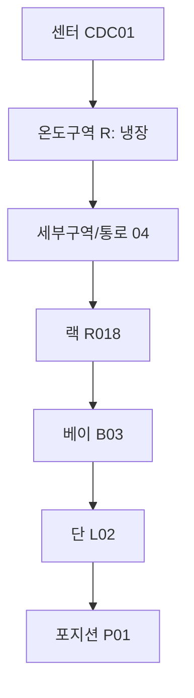

**범례:** 화살표 = 물리 위치 상·하위 계층 / 노드 = 최종 표준 코드의 구간. `Zone–Aisle–Bay–Level–Slot`은 이 계층을 추상화해 설명할 때만 사용하며 별도 식별번호가 아니다.

#### 정책 14.3 로케이션 유형과 사용 목적

**권장 위치 유형**은 업무 기능을 나타내는 별도 속성으로 관리한다. 위치 유형을 코드에 끼워 넣어 새 형식을 만들지 않는다.

| 유형 | 목적 | 주 작업 | 추가 검증 |
|---|---|---|---|
| `STORAGE` | 일반 보관 | 적치·보충·이동 | 온도·하중·치수·용량 |
| `PICKING` | 피킹 전용 또는 피킹 우선 위치 | 재고 선택·피킹 | 출고 가능 상태·FEFO |
| `STAGING` | 작업/출고 대기 | 임시 배치·인계 | 체류시간·출고 건 연결 |
| `INSPECTION` | MFC 검수 | 수령 대조·검사 | 미검수/검수완료 구분 |
| `QUARANTINE` | 품질·수량 보류 | 격리·판정 | 출고·피킹 차단 |
| `COUNT_HOLD` | 실사 잠금 등 일시 작업 제어 | 재고실사 | 해당 범위 이동 통제 |

- `COUNT_HOLD`는 영구 물리 유형이 아니라 별도 작업 잠금 상태로 구현해도 된다.
- **현장에 실제 존재하는 위치만 등록**한다. 랙 외 평치·검수장·도크 등을 7구간 표준에 어떻게 표현할지 확정하지 못했다면 해당 위치의 코드 예시를 임의로 생성하지 않는다.
- 하나의 위치가 보관·피킹 겸용일 수 있으므로 필요하다면 `location_type`과 `allowed_operations`를 분리한다.

#### 정책 14.4 로케이션 마스터 등록·변경·중지

##### 14.4.1 등록 절차(권장)

1. 센터 관리자 또는 시설 담당자가 실물 도면, 적재 장비, 작업 용도를 확인한다.
2. 온도구역·세부구역/통로·랙/베이/단/포지션을 사전 등록한다.
3. 최소 속성(위치 코드, 센터, 온도, 유형, 높이·폭·깊이, 허용하중, 접근 방식, 사용 여부)을 입력한다.
4. 코드 중복과 실물 위치 중복, 상위 위치 유효성을 검증한다.
5. 안전 및 운영 승인 후 `ACTIVE`로 활성화하고 바코드/QR 라벨을 발행한다.
6. 랙 실물 표기와 시스템 조회 결과의 일치 여부를 확인한다.

##### 14.4.2 권장 상태 모델

| 상태 | 의미 | 허용 업무 |
|---|---|---|
| `DRAFT` | 등록 진행 | 정보 수정, 승인 요청 |
| `ACTIVE` | 정상 사용 | 조건 충족 시 적치·이동·피킹 |
| `BLOCKED` | 안전·작업·품질 사유로 사용 제한 | 조회·조사·승인된 해제/반출 |
| `INACTIVE` | 신규 적치 금지, 정리 대기 | 재고 반출·실사 및 종료 처리 |
| `RETIRED` | 폐지, 재사용 금지 | 이력 조회 |

- 차단된 위치에 재고가 이미 있다면 **위치 차단이 재고 폐기를 의미하지 않는다**. 재고 품질 상태와 안전 반출 계획을 별도 판정한다.
- `RETIRED` 전 해당 위치에 남은 SKU/BOX/PLT, 진행 중 작업, 미완료 이동 예약이 없어야 한다.
- 위치 코드의 본질적 의미가 달라지는 시설 변경은 코드 덮어쓰기보다 이력 보존 방식으로 처리한다.

#### 정책 14.5 적재 가능 여부 판정

##### 14.5.1 적재 전 검증 순서(권장)

1. **위치 유효성:** 대상 코드가 존재하고 목적 센터의 사용 가능한 물리 위치인지 확인.
2. **상태:** `ACTIVE` 여부, 점검·실사 잠금, 접근 제한 확인.
3. **온도:** SKU의 실제 보관 온도와 위치의 온도 조건 비교. 카테고리의 복합 온도 표기로 대신 판정하지 않음.
4. **상품/품질:** SKU 취급 가능 여부, LOT·소비기한, 격리/보류 여부 확인.
5. **포장:** BOX 또는 PLT(LPN)를 스캔해 활성 상태·현재 소속·구성 버전을 확인하고, **모든 하위 BOX와 직접 적재 SKU**를 포함한 **모든 하위 SKU**의 조건을 검증.
6. **설비:** 해당 랙·베이·단·포지션의 허용 중량·부피·높이, 접근 장비, 포지션 점유 여부 확인.
7. **작업 충돌:** 다른 작업의 목적지 선점/예약과 충돌하는지 확인.
8. **확정:** 적치 스캔 및 승인 후 현재 위치와 작업 이력 기록.

**권장 판정식(개념적 표현)**

```text
적치 가능 = 위치 사용 가능
          AND 온도 적합
          AND 모든 내용물 적치 허용
          AND 허용하중/치수/용량 충족
          AND 작업 충돌 없음
```

- `허용하중/치수/용량`의 실제 수치값은 현장 승인값을 사용한다. 8,600평 CDC 전체 면적이나 일반 랙 규격만으로 개별 포지션의 하중을 임의 확정하지 않는다.
- 중량에는 상품뿐 아니라 적용되는 BOX·PLT·포장재의 중량을 포함해야 한다.
- FEFO 판정은 이동 자체에 적용되는 요건과 **출고/피킹 시점의 출고 가능 LOT 선정**을 구별한다.

##### 14.5.2 용량과 복수 적재(권장)

- 포지션은 기본적으로 실제 점유 상태를 가지며, **복수 BOX/PLT 적재 허용 여부**는 위치별로 설정한다.
- 한 포지션에 PLT(LPN)가 적재돼 있다면 하위 BOX/SKU의 현재 위치를 별도로 중복 점유 처리하지 않고 PLT 위치를 상속해 조회한다. 용량·하중은 실제 포장재·하위 재고를 포함한 **물리 점유량을 한 번** 집계한다.
- 동시 접근으로 용량 초과가 발생하지 않도록 목적지 선점과 최종 적치 검증을 트랜잭션 또는 동등한 원자적 방식으로 처리한다.
- 위치/예정 용량 잠금은 실패·취소 표시만으로 해제하지 않는다. CDC-F-012에 따라 원시도 중지/미수행·기완료·실물 위치·잔량을 확인한 범위만 해제하고 재개할 잔량은 계승한다.

#### 정책 14.6 SKU·BOX·PLT(LPN)와 LOC의 연결

> **LPN 연계의 정책 지위:** 아래에서 `BOX-...`와 `PLT-...`를 LPN으로 사용하는 방식은 `BOX 및 PLT 물류 취급 단위 운영 정책_LPN반영.md`의 **권장안**을 참조한다. 확정된 것은 로케이션 단일 표준이며, LPN의 별도 발급 여부·상태 등은 팀 승인 전까지 권장안이다.

| 대상 | 현재 위치의 기준 | 유의 사항 |
|---|---|---|
| 개별 SKU 재고 | 직접 위치 또는 속한 BOX/PLT(LPN)의 **유효 위치** | 동일 수량을 직적치·상위 포장으로 중복 집계 금지 |
| BOX 단독(박스형 LPN) | PLT에 소속되지 않은 BOX의 직접 LOC | 단독 적치 때만 독립 LOC 확정 |
| PLT 소속 BOX(하위 LPN) | 상위 PLT의 LOC를 상속한 **유효 위치** | PLT에 속해 있는 동안 별도의 상충 LOC를 확정하지 않음 |
| PLT(팔레트형 LPN) | PLT의 직접 LOC | 하위 BOX·직접 SKU의 유효 위치가 따라 바뀜 |
| BOX·PLT 없이 직적치한 SKU | 해당 재고 단위의 직접 LOC | 가상 LPN 발급 의무 없음 |
| 이동·운송 중인 LPN | 이동 작업 상태, 마지막 확정 위치·인계 구간 | 운송 중 목적지 LOC에 적치 완료된 것으로 확정 금지 |

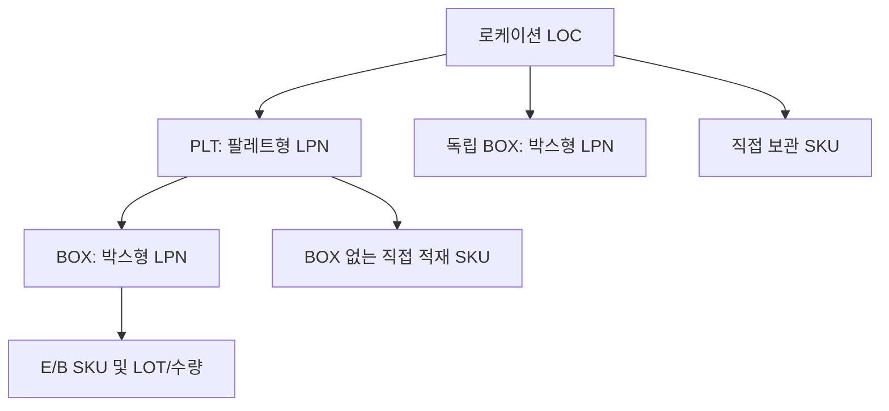

**범례:** 화살표 = 포함 또는 현재 보관 위치 관계 / LOC = 물리 위치 / PLT·BOX = 각각 팔레트형·박스형 LPN(새로운 LPN 번호를 별도 발급하지 않음) / SKU = 상품 단위. 그림은 허용 가능한 배치 사례의 조합이며, 모든 재고가 반드시 PLT와 BOX를 모두 거친다는 뜻이 아니다.

**중요한 금지 규칙**

- 물류 BOX 개봉 및 PLT 해체를 `E`↔`B` SKU 상품 전환으로 처리하지 않는다.
- BOX/PLT 위치 이동과 재고 수량 예약·차감·복구를 동일 이벤트로 중복 집계하지 않는다.
- 하나의 활성 BOX 또는 PLT가 서로 다른 두 위치에 동시에 존재하도록 갱신하지 않는다.
- **부분 이동**은 원래 물류 단위의 구성에서 대상 수량/BOX를 먼저 분리하고 각 현재 위치를 독립적으로 확정한다.
- 동일 BOX가 둘 이상의 활성 PLT에 소속되거나, 상위·하위 LPN이 순환 참조하지 않도록 한다.

##### 14.6.1 LPN과 위치의 연결 기준(추가 권장안)

- LPN은 물류 단위의 **식별·구성·이력**을 위한 개념이며 로케이션 마스터의 ID를 대신하지 않는다. 위치 마스터의 코드 형식은 기존 7구간 표준을 그대로 쓴다.
- **직접 위치(direct LOC):** 물류 단위 또는 직적치 재고가 현장에서 직접 놓인 곳을 가리킨다. PLT는 직접 위치를 갖고, 상위 PLT에 소속되지 않은 BOX도 직접 위치를 갖는다.
- **유효 위치(effective LOC):** 상위 LPN이 있으면 그 상위 PLT의 직접 위치를 따라 계산하여 표시하는 조회값이다. 상위 관계가 없는 BOX·직적치 SKU는 직접 위치가 곧 유효 위치다.
- **마지막 확인 위치(last confirmed LOC):** 이동 또는 운송 중 아직 목적지 적치가 확정되지 않았다면 마지막으로 확인된 물리 위치를 이력으로 보유한다. 마지막 확인 위치를 현재 목적지 위치로 오인하지 않는다.
- **위치 관계 정합성:** 활성 BOX가 PLT에 포함돼 있으면 BOX의 독립 직접 LOC는 미사용/비활성으로 취급하거나 상위 PLT 기준 조회만 허용한다. 동일 BOX가 직접 적치와 PLT 하위 적치로 **동시에 점유·재고 집계되지 않아야** 한다.

| 구성 사례 | 직접 LOC 기준 | SKU/하위 단위 조회 기준 | 금지할 처리 |
|---|---|---|---|
| `LOC → PLT → BOX → SKU` | PLT의 LOC | BOX·SKU가 PLT 위치 상속 | BOX·SKU를 같은 LOC의 추가 PLT 점유량으로 중복 집계 |
| `LOC → PLT → 직접 SKU` | PLT의 LOC | 직접 SKU가 PLT 위치 상속 | 직접 SKU를 직적치 재고로도 중복 등록 |
| `LOC → BOX → SKU` | 독립 BOX의 LOC | SKU가 BOX 위치 상속 | 소속 없는 BOX를 존재하지 않는 PLT에 강제 연결 |
| `LOC → 직접 SKU` | SKU 재고의 LOC | 그 LOC 자체 | 별도 LPN을 자동 생성하여 두 종류 재고로 취급 |
| `이동 중 PLT/BOX` | 이동·운송 상태 및 마지막 확정 지점 | 목적지 확인 전 목적 LOC 확정 보류 | 도착 예정 정보만으로 최종 위치 선반영 |

##### 14.6.2 위치 연결·상속의 검증 조건(추가 권장안)

1. **식별번호 검사:** 스캔한 `BOX-...` 또는 `PLT-...`가 실제 등록된 LPN 유형과 일치하고 종료·미등록 상태가 아닌지 확인한다. `LPN-...` 형태의 추가 번호를 추측해서 생성하지 않는다.
2. **센터/작업 검사:** 요청 센터와 LPN의 현재 소속 센터 또는 인계 작업, 작업자의 권한, 작업 지시의 대상이 일치하는지 확인한다.
3. **부모 관계 검사:** BOX의 활성 상위 PLT는 최대 1개로 제한하며, 다른 PLT에 연결하려면 기존 부모 분리부터 확정한다. 순환 연결을 허용하지 않는다.
4. **위치 검사:** 목적 LOC가 실제 등록·사용 가능한 센터의 위치인지, 활성 상태·온도·하중·치수·잔여 용량·작업 잠금 조건을 만족하는지 확인한다.
5. **내용물 검사:** PLT 하위 BOX들과 PLT 직접 적재 SKU까지 모두 펼쳐서 SKU·LOT·소비기한·품질 조건을 검사한다. 하위에 부적합 상품이 있으면 상위 PLT 전체 적치의 허용 여부를 별도 예외 처리한다.
6. **구성 버전 검사:** LPN의 구성에 변경이 있었다면 최신 확정 구성과 작업 지시·스캔 대상이 일치해야 한다. 다른 작업의 분리·추가·이동과 충돌 시 먼저 대사한다.
7. **원자적 확정:** 부모 변경/위치 변경/작업 상태 갱신이 동시에 일관되게 완료되도록 한다. 확정 실패 시 중간 상태를 보관하되 해당 LPN이 두 위치에 확정된 것처럼 노출하지 않는다.

**위치 점유/재고 수량 주의:** 상위 PLT와 하위 BOX를 모두 스캔해도 보관 위치 점유량 및 SKU 수량을 단순 합산하지 않는다. **물리 점유량은 상위 적재 단위의 실제 치수·하중과 해당 위치의 수용 기준**으로 검증하고, **상품 수량은 구성 내 SKU·LOT별 수량을 중복 없이 조회**한다.

##### 14.6.3 LPN 위치 이동과 스캔 처리(추가 권장안)

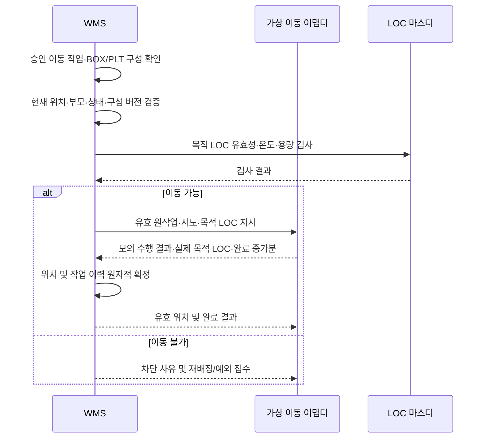

**범례:** WMS = 구성·작업·위치 확정 / 가상 어댑터 = 모의 이동 결과 제공·재고 직접 수정 금지 / LOC 마스터 = 유일한 물리 위치 코드·적치 조건 / 실선 화살표 = 요청·처리 / 점선 화살표 = 결과 응답. 위치 이동은 SKU 총재고 변동이 아니라 실제 위치 관계 변경이다.

1. CDC PLT 전체 이동은 **원작업/LPN 구성 확인 → 출발 상태 검증 → 가상 어댑터 수행/목적 LOC 결과 → WMS 이동 확정** 순서다. 실제 피킹 구간만 작업자 확인을 사용한다. 하위 BOX 및 SKU의 유효 위치는 PLT LOC를 상속해 바뀐다.
2. PLT에 속한 BOX 하나만 다른 위치로 옮기려면 **먼저 BOX의 PLT 소속을 해제**하고, 분리된 BOX의 직접 LOC 또는 새 PLT 소속을 등록한다. PLT와 분리 BOX의 작업 결과를 같은 사건으로 추적한다.
3. CDC 독립 BOX 이동은 원작업의 BOX LPN·목적 LOC와 유효 가상 수행 결과를 검증해 확정한다. 스캔만으로 BOX 내부 SKU·LOT 수량을 새로 생성하거나 이중 입고하지 않는다.
4. 직적치 SKU는 실제 물량 및 작업 지시를 기준으로 직접 LOC를 변경한다. 가상 LPN 발급을 전제 조건으로 삼지 않는다.
5. 네트워크 오류·동일 이벤트 재전송·중복 스캔에 대해 이동 작업 ID와 이벤트 키로 **멱등성**을 검사하고, 이미 확정된 작업은 기존 결과를 반환한다.
6. 이동 지시와 실제 LPN 구성의 버전이 다르거나 출발 LOC 불일치가 있으면 덮어쓰기 대신 작업을 보류하고 조사·재지시한다.

##### 14.6.4 분리·해체·재포장 후 위치 확정(추가 권장안)

| 업무 | LPN·구성 처리 | 로케이션 처리 | 재고 처리 경계 |
|---|---|---|---|
| PLT에서 BOX 분리 | BOX 부모 연결 해제, PLT 구성 버전 변경 | 분리 BOX의 실제 직접 LOC 또는 새 부모를 확정 | 상품 총수량 불변 |
| PLT에 BOX 추가 | 단독 BOX를 PLT 하위에 연결, 이중 소속 검사 | BOX 직접 LOC 대신 PLT 유효 LOC 상속 | 상품 총수량 불변 |
| PLT 일부 직접 SKU 분리 | 실제 분리 수량을 PLT 구성에서 차감하고 후속 소속 연결 | 분리 상품의 새 직접 LOC 또는 다른 활성 LPN 위치 확정 | 이중 소속·수량 중복 금지 |
| PLT 전량 해체 | 기존 PLT LPN 종료, 하위 BOX/직접 SKU 모두 분리 | 하위 단위마다 후속 LOC 또는 활성 부모를 확정 | SKU·LOT 총량 불변 |
| 물류 BOX 개봉/교체 | 원 BOX LPN 종료, 필요하면 새 BOX LPN 발급 | 내용물의 직접 LOC·새 BOX·PLT 소속을 확정 | `E/B` SKU 전환 아님 |
| BOX/PLT 라벨 재출력 | 기존 식별번호 유지 | 위치 변경 없음 | 수량 변동 없음 |

- 물류 BOX를 개봉하는 것과 판매용 `B` SKU 완제품을 낱개 `E` SKU로 변환하는 것은 다른 작업이다. **`B`→`E` 포장 전환은 1차 구현에서 금지**한다.
- 종료된 BOX/PLT의 마지막 위치·이력과, 분리된 재고·하위 LPN의 새 위치를 **모두 조회 가능하게** 보존한다. 종료 단위를 신규 물류 단위로 재활성화하지 않는다.
- 한 LPN의 내용물이 물리적으로 서로 다른 두 위치로 갈라지면 동일한 활성 LPN 하나에 두 직접 LOC를 주지 않는다. 구성 분리 후 위치/소속을 각각 확정한다.

##### 14.6.5 LPN 상태와 LOC 상태의 구분(추가 권장안)

- 로케이션은 정책 14.4.2의 `DRAFT`, `ACTIVE`, `BLOCKED`, `INACTIVE`, `RETIRED` 상태를 사용한다.
- LPN은 별도의 새로운 위치 상태를 만들지 않고 **BOX·PLT 정책의 해당 물류 상태**를 참조한다. 예를 들어 BOX `SEALED`·`IN_TRANSIT`·`RECEIVED`·`OPENED`, PLT `READY`·`IN_TRANSIT`·`RECEIVED`·`DISMANTLED`를 구분한다.
- `PLT READY`라고 해서 그 PLT가 놓인 LOC가 `ACTIVE`인 것은 아니다. 반대로 `LOC ACTIVE`라도 LPN 품질·수량 예외가 있다면 피킹·출고할 수 없다.
- `LPN IN_TRANSIT`은 **운송 중이라는 물류 작업 상태**이고, MFC 랙 LOC에 적치되었다는 뜻이 아니다. 도착·검수 중이라면 **현장에 실제 존재하는 검수/대기 위치**와 미검수 상태를 나누어 관리한다. 미확정 비랙 코드 문자열을 임의로 만들지 않는다.
- LPN 이동·해체로 상품 총량은 바뀌지 않는다. 실제 위치·준비/실행 제한·품질 조건이 변하면 해당 센터의 적격/가용과 예약 연결도 함께 재검증한다. 기존 유효 예약은 계승하고 상태 변화만으로 새 예약·무근거 품질 해제를 만들지 않는다.

##### 14.6.6 LPN–LOC 감사 이력·조회 항목(추가 권장안)

**권장 최소 정보:** 작업 이벤트 ID·멱등 키, 물류 단위 유형 및 실제 `BOX-...`/`PLT-...` LPN 번호, 활성/종료 여부, 상위 LPN(있을 때), 구성 버전, SKU·LOT·품질·수량 요약, 현재 센터, 직접 LOC, 상위로부터 상속한 유효 LOC, 마지막 확인 LOC 또는 운송 구간, 출발/목적 LOC, 원본/후속 LPN, 관련 보충·이동·실사 지시, 작업자·승인자, 실제 스캔·처리 시각, 정정 사유.

- WMS 위치 조회는 **어느 LOC에 무엇이 있는지**와 **특정 LPN이 어느 LOC에서 어떤 상위 관계로 관리되는지**를 양방향으로 제공하는 것을 권장한다.
- 확정된 부모·위치 변경 이력은 과거 특정 시점의 PLT→BOX→SKU 구성과 위치를 재현할 수 있어야 한다.
- 조회용 유효 LOC를 상위에서 계산하는 구현을 우선 권장하나, 별도 성능용 조회 필드를 두더라도 **상위 PLT LOC와 불일치하는 독립 확정 사실로 취급하지 않는다.**
- 로케이션 운영자는 LPN의 **위치 연결·해제·적치 검증**을 수행한다. LPN 자체의 번호 발급·포장 구성·상태 전이·폐기 절차는 BOX·PLT 정책에 남겨 중복 비즈니스 로직을 만들지 않는다.

#### 정책 14.7 CDC 내부 작업별 위치 처리

##### 14.7.1 시작 상태: 기등록·적재 완료 재고

- 1차 개발에서는 공급업체→CDC 입고·검수·신규 입고 적치 과정을 구현하지 않는다.
- 초기 재고에는 최소한 **센터, SKU, LOT(필요한 상품), 상태, 수량, 현재 LOC, 상위 BOX/PLT(존재하는 경우)**가 일관되게 연결돼 있어야 한다. BOX·PLT가 존재하는 초기 적재 재고는 해당 `BOX-...`/`PLT-...` 번호를 **기등록 LPN으로 조회**하고 상위 관계·유효 LOC·구성 수량을 대사한다. 직적치 재고에 가상 LPN을 의무 발급하지 않는다.
- 시작 재고가 위치 미확인 상태라면 임의 적치 완료로 간주하지 않고 초기 데이터 정합성 오류로 처리한다.

##### 14.7.2 보관 위치 간 이동(권장)

1. 이동 지시에서 출발 LOC, 목적 LOC, SKU/BOX/PLT 및 작업 수량을 확정한다.
2. 출발지의 재고·소속·수량과 이동 허용 상태를 검사한다.
3. 목적지의 온도·용량·안전 제한을 사전 검증하고 충돌을 방지한다.
4. 가상 어댑터에 유효 지시를 전달하고 원시도의 출발·대상 LPN·모의 인출 결과를 확인한다.
5. 유효 가상 완료/부분 완료 결과에서 목적 LOC·구성·이번 완료량을 확인한다.
6. 단일 작업 이벤트로 현재 LOC를 변경하고 이전·이후 위치를 감사 이력에 남긴다. LPN 이동이면 **대상 LPN·상위 관계·구성 버전**을 함께 기록하고, 상위 PLT의 위치 변경에 따라 하위 BOX·SKU의 유효 LOC를 일관되게 갱신·조회한다.
7. 이동 실패·연결 끊김 시 중복 재고 반영 없이 마지막 확정 단계에서 재개한다.

**이동 중 상태(권장):** 출발지 확인(`PICKED_UP`) → 운반 중(`MOVING`) → 목적지 스캔 완료(`PLACED`). 이는 위치 작업 상태이며 판매 가능 재고 상태와 동일하지 않다.

##### 14.7.3 보충 피킹·출고 대기(권장)

- WMS의 FEFO·재고 상태 정책에 따라 피킹 가능한 SKU·LOT·LOC를 확정한다.
- 출발 LOC에서 피킹 후 상품을 BOX에 포장하거나 출고 대기 위치로 이동한다.
- 이때 위치 이력은 남기되 **재고 예약/차감 시점**은 별도 재고 정책이 우선한다.
- 출고 대기 로케이션에서 재적치 또는 재피킹하는 경우 원 작업 지시와 연결해 이력을 유지한다.
- PLT 전체 이동 시에는 PLT LPN(`PLT-...`) 스캔으로 하위 BOX LPN 목록과 구성 SKU·LOT를 일괄 **조회**할 수 있다. 실제 이동 완료는 목적 LOC 스캔과 작업 확정이 필요하며, 하위 BOX·SKU의 수량을 별도로 중복 이동·차감하지 않는다.

#### 정책 14.8 CDC → MFC 보충과 MFC 적치

**대상 흐름:** CDC 기존 적재 위치 → 피킹/BOX 포장 → (선택) PLT 적재 → 출고 대기 → 운송 인계 → MFC 검수 → MFC 적치.

| 단계 | 위치 정책상 필수 검증 | 책임 경계 |
|---|---|---|
| CDC 피킹 | 출발 LOC·재고 위치 일치 | WMS |
| CDC 출고 대기 | BOX/PLT(LPN) 목록·구성 버전과 실제 대기 LOC 대사, 온도 유지 | WMS |
| 운송 인계 | LPN별 마지막 확정 LOC, 인계 이벤트, 이동 중 상태 연결 | WMS/TMS |
| MFC 도착 | 실제 LPN 스캔으로 예정·실물 일치 및 목적 센터 확인, 미검수 분리 | MFC/TMS |
| MFC 자체 검수·입고 | 확정 결과의 원출발·LPN·SKU/LOT·단위·수령량 확인 | MFC 자체 실행, WMS는 결과 인수·Transit 대사만 |
| MFC 후속 적치 | 수령 뒤 LPN 계보·실제 위치를 필요한 추적 범위로 조회 | MFC 자체 실행, CDC WMS는 위치를 직접 쓰지 않음 |
| 완료 대사 | MFC TIN 결과·CDC 원출발·미정산 차이 조회 | WMS가 자기 Transit 대사, 관제는 조율 |

**권장 규칙**

- 운송 중인 상품을 MFC의 특정 랙 위치에 이미 적치된 것으로 표시하지 않는다.
- MFC 검수 전 상품은 실제 물리 보관 지점과 **검수 미완료** 상태를 구별하여 조회한다.
- BOX·PLT(LPN)가 MFC에서 해체되면 하위 상품·BOX의 새로운 직접 LOC 또는 활성 상위 LPN 소속을 확정하고, 종료된 상위 단위의 과거 위치 이력은 유지한다. 검수 과정의 LPN 중복 스캔을 **중복 수령·중복 위치 확정**으로 처리하지 않는다.
- 실제 MFC 배치도·코드가 정해지지 않았다면 검수장·평치장의 로케이션 문자열을 임의 생성하지 않고 추가 의사결정 대상으로 관리한다.

**CDC가 확인할 LPN 연계 사례:** CDC에서 PLT-00000001과 BOX2개·SKU/LOT·출발구성을 확정해 매니페스트로 전달한다. MFC는 자기 수령·검수·입고·적치를 실행하고 WMS에는 원출발/원수령·postingId·실수령량·차이·필요 LPN 계보를 제공한다. WMS는 확정수령량만 Transit에서 한 번 대사한다. MFC의 BOX 개봉·부모 변경·목적 LOC 배정은 기존 MFC 재고관리(원문 미보관)의 자체 처리이며 CDC의 명령/API로 다시 구현하지 않는다. 후속 적치·해체를 추가 TIN으로 집계하지 않는다.
#### 정책 14.9 실사 및 위치 불일치 처리

##### 14.9.1 실사 방식(권장)

- 특정 센터·온도구역·로케이션 범위를 기준으로 순환실사 또는 지정 실사를 지시한다.
- 작업 중 해당 범위의 이동을 잠그거나 스냅샷과 작업 이벤트를 대사하는 방식을 선택한다.
- 로케이션을 먼저 스캔하고 실제 SKU/LOT/BOX/PLT(LPN)·수량을 확인한다. PLT 스캔으로 예상 하위 BOX를 조회할 수 있으나 **실물 단위·검수 깊이**는 승인된 실사 기준에 따라 검증한다.
- 예상값과 실제값이 다르면 즉시 임의로 수량을 덮어쓰지 않고 **차이 사건**을 기록한다.
- 승인된 재고 조정 정책에 따라 확정하되 위치 정정과 재고 증감 정정은 구분한다.

##### 14.9.2 대표 예외와 처리

| 예외 | 즉시 조치 | 후속 처리(권장) |
|---|---|---|
| 존재하지 않는 LOC 스캔 | 적치/이동 중지 | 실물 라벨과 위치 등록 확인 |
| 출발 LOC 불일치 | 원 작업 보류 | 실제 위치 추적·정정 승인 |
| 다른 온도구역 목적지 | 적치 차단 | 대체 LOC 지정·필요 시 품질 확인 |
| 중량·높이·포지션 용량 초과 | 적치 차단 | 분리 적재·안전 담당 확인 |
| 랙 폐쇄 또는 작업 잠금 | 신규 적치 차단 | 안전한 반출 계획·해제 승인 |
| BOX/PLT(LPN) 중복 소속·이중 위치 | 작업 보류 | 활성 부모·직접/유효 LOC·구성 버전 조사 |
| 종료·미등록 LPN 스캔 | 적치/이동 및 자동 재고 생성 중지 | 실물·원본 LPN·종료/재포장 이력 확인 |
| PLT 스캔과 하위 BOX 스캔 중복 처리 | 두 번째 수량·위치 확정 차단 | 기존 작업 이벤트·구성 목록 대사 |
| LPN 이동 도중 구성 변경 | 이동 확정 보류 | 이동 지시·구성 버전·원/후속 관계 확인 |
| PLT 분리 후 BOX의 LOC 누락 | 분리 작업 확정 보류 | BOX 직접 LOC 또는 새 부모 확인 후 확정 |
| 미확인 물류 단위 발견 | 격리·자동 재고 생성 금지 | 해당 단위 이력과 실사 대사 |
| 위치는 일치하지만 수량 부족 | 차이 등록 | 재고 조사·승인된 조정 |
| 스캔 중복·네트워크 재전송 | 두 번째 이동 반영 금지 | 기존 처리 결과 반환 |
| 실사 중 다른 작업으로 변경 | 결과 확정 보류 | 잠금/스냅샷 규칙에 따라 재검증 |

#### 정책 14.10 권한·승인·감사

| 역할 | 권장 권한 | 제한 |
|---|---|---|
| CDC 시설/물류 관리자 | LOC 신설·폐지 요청, 용량·동선 검토 | 승인 없이 활성 코드 의미 변경 금지 |
| CDC WMS 운영자 | 승인된 위치의 적치·이동·피킹·실사 | SKU 마스터 및 임의 재고 조정 불가 |
| MFC 운영자 | MFC 위치 적치·이동·실사·예외 접수 | 다른 센터 위치 마스터 임의 변경 금지 |
| 관제시스템 관리자 | 센터별 운영 상태 조회·고위험 예외 승인 | 실제 스캔 작업이 수행된 것으로 임의 기록 금지 |
| 시스템 | 코드 유일성·온도·용량·중복 이벤트 검증 | 실패 이벤트를 성공으로 자동 확정 금지 |

**감사 항목(권장):** 이벤트 ID/요청 ID·멱등 키, 센터, SKU/LOT 또는 **BOX/PLT(LPN) 실제 ID**, 상위 LPN 및 구성 버전, 직접/유효 LOC·마지막 확인 LOC, 작업 종류, 출발·목적 LOC, 전후 상태·수량, 원본/후속 LPN(해체·재포장 시), 작업자·승인자, 발생/처리 시각, 사유, 관련 보충 지시 또는 실사 사건 ID.

- 수동 정정 시 원 이벤트를 삭제하지 않고 정정 이벤트로 연결한다.
- 위치 등록/폐지, 차단 해제, 용량·하중 변경은 일반 이동보다 높은 권한으로 분리한다.
- 위치 스캔 재전송은 동일 작업 ID로 멱등 처리한다.

#### 정책 14.11 설명용 시나리오 — 현장 검증 미실행

##### 14.11.1 냉장 랙의 PLT 전체 이동

1. `PLT-00000001`에는 `BOX-00000001`, `BOX-00000002`가 포함된다.
2. 출발 LOC는 `CDC01-R-04-R018-B03-L02-P01`이다.
3. 이동 작업에서 **별도 등록된 실제 목적 LOC**를 지정하고 온도·용량을 검증한다.
4. 가상 이동 어댑터가 원PLT·목적 LOC·완료량을 보고하고 WMS가 CDC-F-011에 따라 검증·반영한다. 실제 지게차 작업 기능을 추가하지 않는다.
5. PLT LPN(`PLT-00000001`)의 위치가 변경되며, 하위 BOX LPN(`BOX-00000001`, `BOX-00000002`)의 **유효 위치는 새 PLT LOC를 상속**해 조회된다. 별도 하위 이동 이벤트를 재고 차감으로 만들지 않는다.
6. BOX 내 `E/B` SKU 수량은 이동 자체로 변하지 않는다.

##### 14.11.2 물류 BOX 개봉 후 낱개 위치 적치

1. `BOX-00000003`에 `E-00000001` 생수 20병이 들어 있다.
2. 개봉 전 BOX에 연결된 유효 LOC를 확인한다.
3. 물류 BOX를 개봉하고 `E-00000001` 20병을 적치 가능한 위치로 이동한다.
4. 새 LOC의 적재 가능 여부를 검증하고 적치 이력을 저장한다.
5. 원 BOX LPN(`BOX-00000003`)은 종료 처리하고 상품의 새 직접 LOC·후속 물류 단위 이력을 연결한다. `E-00000001` 20병의 SKU 종류나 총량은 바뀌지 않는다.

##### 14.11.3 실물 묶음 상품의 위치 이동

1. 독립 완제품 6입 SKU `B-00000002` 4팩이 해당 LOC에 있다.
2. 해당 물량을 다른 위치로 이동하더라도 `B-00000002 × 4` 그대로 유지한다.
3. `base_unit_qty=6`은 상품 구성의 참조이며 LOC 점유는 **4팩의 실제 포장 치수·중량**으로 계산한다. 구성 낱개24를24개 위치 점유로 바꾸지 않는다.
4. `B`를 개봉하여 `E` 24병으로 전환하는 것은 1차 구현 범위 밖이다.

##### 14.11.4 PLT에서 BOX 일부를 분리하는 경우(추가 권장안)

1. `PLT-00000001`의 현재 LOC는 `CDC01-R-04-R018-B03-L02-P01`이며, 하위 `BOX-00000001`·`BOX-00000002`가 있다.
2. `BOX-00000002`만 다른 **실제 등록된 목적 LOC**로 옮기는 작업을 생성한다. 목적 위치의 온도·용량 및 BOX 내부 SKU/LOT 조건을 검증한다.
3. 기존 PLT 구성에서 `BOX-00000002`의 부모를 해제하고 PLT 구성 버전을 증가시킨다.
4. 분리 BOX를 스캔하고 목적 LOC 적치를 확인한 뒤 BOX의 독립 직접 LOC를 확정한다. 남은 `BOX-00000001`은 계속 PLT의 LOC를 상속한다.
5. 구성·위치 변경은 하나의 작업 이력으로 연결하며 SKU·LOT 전체 수량은 바뀌지 않는다. 분리 BOX를 PLT와 목적 LOC 양쪽에서 동시에 점유 집계하지 않는다.

##### 14.11.5 MFC 수령 후 분리 적치 결과를 추적하는 경우

원PLT/BOX·SKU/LOT 출발구성을 보존하고 MFC가 제공한 확정 원수령·후속 LPN 계보를 연결한다. MFC에서 PLT가 해체되거나 BOX를 개봉해도 WMS는 같은 수령량의 Transit을 다시 차감하지 않는다. MFC 내부의 적치·부모 변경·수량 확정은 MFC 정본에서 조회하며 CDC LOC를 MFC 목적 LOC로 복사하지 않는다. 이 절은 CDC의 추적 결과 검증 사례이며 MFC 작업 절차의 중복 정의가 아니다.
#### 정책 14.12 타 정책과의 책임 경계

| 정책 | 본 문서에서 다루는 내용 | 원 정책에 남겨 둘 내용 |
|---|---|---|
| SKU 정책 | LOC에 놓이는 `E/B` SKU 식별 연계 | 코드 발급, 판매 묶음, `base_unit_qty`, 구매 제한 |
| BOX·PLT(LPN) 정책 | LPN의 직접/유효 LOC, 상위 위치 상속, 위치 적합성·이동 스캔 연계 | BOX/PLT(LPN) 번호 발급·구성·상태·재포장·해체·인계·검수 규칙 |
| 재고 수량·상태 정책 | 위치별 재고 조회·작업 중 잠금 | 가용/예약/차감/복구·재고 조정·재고 소유 |
| LOT·소비기한/FEFO | 적치 전 상태 및 조건 검증 | LOT 발급·추적 상세 및 FEFO 출고 선정 기준 |
| CDC 운영 정책 | 랙·구역·설비와 LOC 매핑 | 구역 면적·설비 수량·동선·설비 안전 승인 |
| TMS/SCM/MFC | CDC→MFC 이동 시 위치 이벤트 연계 | 배차, 배송 상태, 보충량 산식 및 주문 정책 |

#### 정책 14.13 팀에서 추가로 결정해야 할 항목

아래 내용은 **확정된 코드 표준을 변경하자는 제안이 아니다.** 운영을 위해 구체값이나 승인 주체가 필요한 항목이다.

| 번호 | 미결정 항목 | 권장 방향 | 결정 영향 |
|---:|---|---|---|
| 1 | 7구간 중 `세부구역/통로`의 단일 뜻 | 현장 도면에서 택일 후 센터별 사전 등록 | 코드 파싱 및 실물 라벨 |
| 2 | 랙 없는 평치·검수·도크·출고대기 위치의 7구간 표현 | **동일 표준 내 예약값/표현 규칙을 별도 승인** | 비랙 LOC 생성 가능 여부 |
| 3 | CDC/MFC 센터코드 발급 규칙 및 코드 자릿수 | 전역 유일 센터 식별 목록 등록 | 센터 간 중복 방지 |
| 4 | `A/R/F` 온도구역 확정 및 혼합 시설의 표현 | 실제 온도 관리 구획과 일치 | 온도 검증 |
| 5 | 위치별 복수 BOX/PLT 점유 허용 여부 | 위치별 수용 개수·조건 설정 | 과적·중복 적재 차단 |
| 6 | 랙·포지션별 허용하중/치수와 지게차 접근 조건 | 시설·안전 담당 승인값 사용 | 적재 판정 |
| 7 | 로케이션 관리 권한/승인 절차 | 시설 등록과 WMS 실물작업 분리 | 변경 통제 |
| 8 | 이동 중 상태 및 스캔 확정 단계 | 출발·목적지 이중 확인 | 위치 추적 정합성 |
| 9 | 실사 시 작업 잠금 또는 스냅샷 채택 | 센터 운영 방식에 맞춰 결정 | 실사-이동 충돌 |
| 10 | 차단·폐지 시 잔여 재고 반출 책임 | 관리자 승인 및 실물 확인 | 안전·이력 |
| 11 | MFC 내 검수·피킹·보관 위치 구획 | MFC 도면 반영 | 작업 동선 및 코드 등록 |
| 12 | 안전·용량 예외 승인 및 강제 적치 금지 범위 | 안전 위반은 관리자라도 일반 승인 우회 금지 | 사고 예방 |
| 13 | 랙 재배치 시 기존 LOC 이력·라벨 전환 방법 | 종료 코드 보존 + 신규 코드 재발급 | 감사 추적 |
| 14 | LPN 식별 전략의 팀 승인 | 기존 `BOX-...`·`PLT-...`를 LPN으로 사용하고 `LPN-...` 별도 번호는 발급하지 않는 안 | BOX·PLT 정책 D-14와 공동 확정 |
| 15 | PLT 하위 BOX의 위치 구현 방식 | 상위 PLT의 LOC를 유효 위치로 상속, 상충하는 하위 직접 LOC 금지 | 위치 조회 정합성·동시성 |
| 16 | 이동 중 LPN의 마지막 위치와 운송 상태 표현 | 마지막 확인 LOC·운송 구간·예상 목적 LOC를 분리 | 미도착 오적치 방지 |
| 17 | LPN 분리·구성 변경과 위치 작업의 동시 확정 기준 | 구성 버전·부모 관계·LOC 변경을 단일 작업으로 대사 | 부분 이동·중복 소속 방지 |
| 18 | MFC 검수 시 상위 LPN 스캔 처리 범위 | 예상 목록 조회와 실제 하위 실물 검수를 구분 | 허위 검수·중복 수량 반영 방지 |
| 19 | 초기 기등록 BOX/PLT의 LPN 전환·연결 범위 | 실제 존재하는 추적 대상 단위만 연결, 직적치 가상 LPN 금지 | CDC 입고 기능 제외 조건 준수 |

#### 정책 14.14 정책 요약 및 구현 검수 기준

- [ ] 로케이션 형식은 `센터-온도구역-세부구역/통로-랙-베이-단-포지션` **하나**만 사용한다.
- [ ] `CDC01-R-04-R018-B03-L02-P01`의 의미를 승인된 필드 사전과 대조한다.
- [ ] `04`의 현장 의미를 확정하기 전 임의로 통로·세부존을 혼용하지 않는다.
- [ ] `Zone–Aisle–Bay–Level–Slot`을 별도 코드로 발급하지 않는다.
- [ ] SKU `E/B`, 물류 BOX·PLT(LPN), 물리 LOC를 별도 식별자로 유지한다.
- [ ] LPN 통합 권장안 적용 시 `BOX-...`·`PLT-...`를 LPN으로 사용하고 별도 `LPN-...` 번호를 중복 발급하지 않는다.
- [ ] PLT→BOX→SKU 및 직적치 사례 모두 위치 조회가 가능하며 수량이 중복 합산되지 않는다.
- [ ] PLT 하위 BOX·SKU의 유효 LOC는 상위 PLT에서 상속되며, 별도 직접 LOC와 이중 점유하지 않는다.
- [ ] BOX 분리·PLT 해체·BOX 개봉 후 모든 재고의 후속 직접 LOC 또는 상위 LPN 소속을 확정한다.
- [ ] LPN 상태와 LOC 상태, 재고·품질 상태를 구분한다.
- [ ] 위치 이동만으로 상품 총재고가 변하지 않는다.
- [ ] 온도·품질·하중·부피·작업 잠금 위반을 적치 전에 검증한다.
- [ ] CDC 입고를 구현하지 않는 프로젝트 범위를 준수한다.
- [ ] CDC→MFC 보충, 검수, MFC 최종 적치를 로케이션 이력으로 추적한다.
- [ ] 반복 스캔·재시도·실사 차이·차단 위치·미등록 코드 예외를 처리한다.
- [ ] 상위 PLT LPN 스캔이 자동 검수 완료나 SKU 수량 이중 증가로 연결되지 않도록 한다.
- [ ] LPN 작업 이벤트의 구성 버전·부모 변경·전후 직접/유효 LOC·멱등 키를 추적한다.
- [ ] 미결정 운영값을 확정 사항으로 오인하지 않는다.

> **최종 경계:** 이 문서는 **위치를 어떻게 식별하고, 어떤 조건에서 재고 및 물류 단위를 그 위치에 놓고 이동시키는가**를 정의한다. 상품 정체성은 SKU 정책, 물류 단위·LPN의 번호 발급·구성·상태 전이·종료는 BOX·PLT(LPN) 정책, LOT 판정은 LOT·품질 정책, 재고 증감과 회계적 반영은 재고 정책의 책임이다. **LPN 연계는 단일 로케이션 코드 표준을 변경하지 않는다.**

<a id="identifier-lpn"></a>

### 부록 3. LPN/BOX/PLT 화물 구성 정책 — V6.6 원문 세부 정책

> **입력 원문:** `BOX 및 PLT 물류 취급 단위 운영 정책_LPN반영.md`. 아래는 코드·비즈니스 로직·사례·테스트·미결정 사항을 상세 유지한 내용이다. **기존 확정 정책과 새 권장안을 구분**해 읽는다. 제1부 0.1~0.4와 제2부 CDC-F 기능의 책임·수량 규칙을 적용한다. 아래 부록의 상대 시스템 단계는 연계 설명이며 CDC 구현 요구가 아니다.

> **문서 상태:** SKU 확정 정책과 로케이션 단일 표준을 반영한 운영 **권장 초안**. LPN 통합 운영을 포함한 신규 상세 규칙은 팀 승인 전까지 확정 사항으로 간주하지 않는다.  
> **적용 범위:** CDC 내부 보관·이동·출고, CDC → MFC 보충 운송, MFC 검수·개봉·적치 및 BOX·PLT의 LPN 기반 추적.  
> **운영 전제:** 프로젝트 1차 범위는 CDC 입고 프로세스를 구현하지 않으며, CDC에 이미 적재·등록된 재고에서 시작한다.  
> **참조 정책:** `SKU 코드 및 묶음판매 확정정책_EB반영.md`, 재고 수량 및 상태 정책, LOT·소비기한/FEFO 정책, 로케이션 코드 및 적재 위치 정책.  
> **별도 관리:** 상품 SKU 발급·판매 옵션, 수량의 예약/차감/복구, 상세 LOT 판정, 상세 로케이션 생성 규칙, 운송 배차·도착 SLA.

#### 정책 15.1 목적과 기본 원칙

BOX(Box)는 상품을 담아 취급하는 **물류 박스 단위**, PLT(Pallet Load)는 팔레트에 적재된 상품/박스의 **물류 적재 단위**를 의미한다. LPN(License Plate Number)은 WMS가 포장·적재 단위의 구성과 위치 및 이동 이력을 추적하는 **물류 취급 단위 식별 개념**이다. 이 문서의 BOX·PLT 코드는 운반·검수·추적을 위한 식별자이며 **상품 SKU가 아니다**.

**[LPN 추가 권장안]** 물류 단위의 식별번호를 `BOX-...` 또는 `PLT-...`로 유지하고, 해당 번호 자체를 LPN으로 취급한다. 별도 `LPN-...` 일련번호를 중복 발급하지 않는다. LPN은 SKU·LOT·LOC를 대체하지 않는다.

| 구분 | 무엇을 식별하는가 | 예시 | 상품 SKU인가 |
|---|---|---|---|
| `E` SKU | 낱개 상품 | `E-00000001`(생수 500mL 1병) | 예 |
| `B` SKU | 독립 실물 묶음 상품 | `B-00000002`(공급사 완제품 6입 팩) | 예 |
| `B` SKU + `CASE` | 별도 판매·재고 대상인 독립 완제품 박스 | `B-00000005`(판매용 20입 박스) | 예 |
| BOX | 운송·보관을 위해 상품을 담은 물류 박스이자 박스형 LPN | `BOX-00000001` | 아니요 |
| PLT | 특정 적재 구성을 나타내는 팔레트 적재 단위이자 팔레트형 LPN | `PLT-00000001` | 아니요 |
| LOC | 물리적 적재 위치 | `CDC01-R-04-R018-B03-L02-P01` | 아니요 |
| LPN | BOX·PLT의 구성·위치·상태를 추적하는 공통 식별 개념 | 기존 `BOX-...`/`PLT-...` 번호 사용 | 아니요 |

**핵심 규칙**

1. BOX·PLT를 생성하거나 해체해도 그 자체로 SKU 종류와 총 상품 수량은 변하지 않는다.
2. `E` ↔ `B` 간 조립·해체·재포장에 따른 **상품 SKU 전환은 1차 구현에서 지원하지 않는다.** `B` 완제품 박스의 개봉을 `E` 상품으로 바꾸는 기능과 물류 BOX 개봉은 서로 다르다.
3. 동일 SKU가 물류 BOX 없이 PLT에 직접 적재되거나, BOX/PLT 없이 로케이션에 직접 보관될 수 있다.
4. 박스와 팔레트의 **실물 이동 기록**과 **재고 수량 차감/복구**는 구별한다. 수량 변경은 재고 정책 및 승인된 업무 이벤트를 통해서만 발생한다.
5. 물류 추적 시 포장/적재 단위의 현재 구성, 위치, 상태, 작업자, 작업 시각과 이력을 남긴다.
6. LPN 관리는 **BOX·PLT에 공통으로 적용하는 추적 규칙**이다. LPN 등록·스캔만으로 새로운 SKU 재고를 발생시키거나 BOX/PLT 물량을 이중 계산하지 않는다.

#### 정책 15.2 식별번호 및 발급 기준

##### 15.2.1 권장 코드 형식

| 구분 | 제안 코드 | 발급 대상 | 발급 주체 | 고유성 범위 |
|---|---|---|---|---|
| BOX (박스형 LPN) | `BOX-00000001` | 추적할 실제 포장 완료 물류 박스 1개 | CDC 신규단위는 WMS, MFC 신규단위는 MFC | 공유 식별의 유일성/발급 조정 방식은 승인 필요 |
| PLT (팔레트형 LPN) | `PLT-00000001` | 추적할 적재단위 1개 | CDC 신규단위는 WMS, MFC 신규단위는 MFC | 공유 식별의 유일성/발급 조정 방식은 승인 필요 |

- 코드 내에 SKU, 센터, 온도구역, 로케이션을 넣지 않는다. 단위가 이동하더라도 식별번호가 바뀌지 않도록 한다.
- 같은 유형 안에서 중복 발급·재사용을 금지한다. BOX 번호와 PLT 번호는 접두어로 구별하며 각각 독립 시퀀스로 운영하는 안을 권장한다.
- 수기 입력보다 바코드/QR 생성·스캔을 우선한다. 판독 실패 때 수기 조회는 권한 및 로그를 남긴다.
- 상품 바코드(GTIN)와 박스/팔레트 물류 식별 바코드를 혼용하지 않는다.
- **[LPN 추가 권장안]** LPN의 표시 번호는 발급된 BOX/PLT 번호 그대로 사용한다. 하나의 물류 단위에 `BOX-ID`와 독립된 `LPN-ID`를 2개 발급하여 각각 스캔하도록 만들지 않는다.
- 라벨에 인쇄되는 기계 판독값은 해당 물류 단위의 유일 식별번호와 일치해야 한다. 라벨 재출력은 **동일 번호 재출력**이며 신규 발급이 아니다.
- **구분 주의:** `PLT`는 팔레트 **자산 자체**가 아니라 **적재 구성을 식별하는 적재단위 ID**이다. 회수용 팔레트 자산관리(고정 자산번호)는 1차 범위에서 별도로 구현하지 않는다.

##### 15.2.2 식별자의 생명주기

- BOX: 포장이 완료되어 추적 시작 시 발급 → 이동·검수·보관 동안 유지 → 개봉 완료/폐기 등의 종료 사유로 사용 종료. 사용 종료 번호는 재발급하지 않는다. `PACKING` 중에는 임시 등록된 식별번호가 있을 수 있지만, **포장 확정 전에는 출고 가능 LPN으로 취급하지 않는다.**
- PLT: 팔레트에 적재할 구성을 확정할 때 발급 → 이동·적치 동안 유지 → 완전 해체/출고 종료 등의 사유로 사용 종료. 사용 종료 번호는 재발급하지 않는다.
- **제안 규칙:** 적재 단위의 일부를 꺼내거나 추가하는 경우 기존 PLT를 유지하되 구성 버전과 변경 이력을 기록한다. 전량 해체 뒤 재적재하면 새로운 PLT를 발급한다. BOX는 재포장·교체 시 기존 BOX 종료 후 새 BOX 발급을 권장한다. LPN의 시작·종료 시점도 해당 BOX/PLT 생명주기와 일치한다.

#### 정책 15.3 상품·BOX·PLT·로케이션 관계

##### 15.3.1 논리 관계

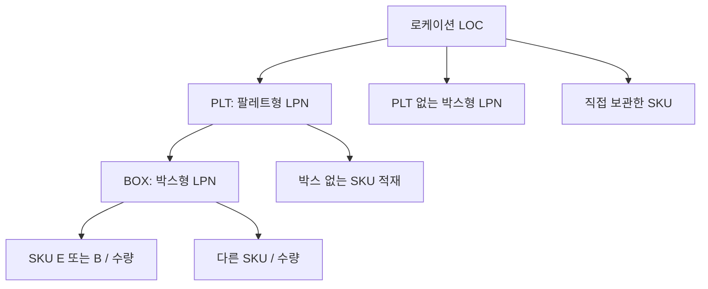

**범례:** LOC=물리 위치 / PLT=팔레트 적재단위(팔레트형 LPN) / BOX=물류 포장(박스형 LPN) / LPN=두 유형을 아우르는 추적 개념(별도 추가 번호 아님) / SKU=상품 재고 단위 / 화살표=상위 보관·포함 관계. 도식은 가능한 관계이며 모든 물류 단위가 반드시 PLT→BOX→SKU를 거쳐야 한다는 뜻은 아니다.

- BOX 구성에는 SKU별 수량을 보존하며, 필요한 경우 LOT 및 소비기한·상태별로 상세 구분한다.
- 하나의 BOX는 동시에 둘 이상의 활성 PLT에 속할 수 없다. 하나의 PLT는 특정 시점에 단일 위치를 가진다.
- BOX의 현재 위치는 PLT에 실려 있으면 상위 PLT 위치를 상속하고, 독립 보관 중이면 BOX 자체 위치를 가진다. 한 BOX에 상충하는 두 현재 위치가 생겨서는 안 된다.
- SKU 수량은 **물류 단위별 구성 수량을 연결**해 조회할 수 있어야 하지만, 재고 총량과 물류 구성 수량을 중복 합산하면 안 된다.
- LPN 계층은 **PLT(상위) → BOX(하위) → SKU 구성**을 기본으로 하며, PLT에 직접 적재된 SKU와 PLT 소속이 없는 BOX/직적치 SKU도 허용한다. 하나의 BOX가 동시에 둘 이상의 상위 PLT에 연결되지 않도록 검증한다.

##### 15.3.2 로케이션 연계: 확정 표준

로케이션 형식은 다음 **한 가지**만 사용한다.

`센터-온도구역-세부구역/통로-랙-베이-단-포지션`

예: `CDC01-R-04-R018-B03-L02-P01` = CDC01 / 냉장 R / 세부구역 04 / 랙 18 / 베이 03 / 2단 / 자리 01.

기존 `Zone–Aisle–Bay–Level–Slot`은 설명용 축약 논리 구조로만 유지하며 별도 위치 코드를 발급하지 않는다. `04`가 **통로 번호인지 세부 존 번호인지**는 현장 도면을 기준으로 한 가지 뜻만 등록한다. BOX·PLT 식별자에 로케이션 코드를 합쳐 쓰지 않는다.

#### 정책 15.4 LPN(License Plate Number) 공통 관리 규칙

> **정책 구분:** 본 장은 기존 BOX·PLT 코드에 LPN 추적 규칙을 통합하는 **추가 권장안**이다. 팀 확정 전에는 새로운 코드 발급·재고 반영 방식으로 간주하지 않는다.

##### 15.4.1 LPN의 목적과 식별 범위

LPN은 WMS에서 **실제로 함께 취급·이동·검수하는 물류 단위의 고유 식별번호**를 뜻한다. 바로픽에서는 별도 `LPN-` 번호를 추가하지 않고, **박스형 LPN=`BOX-00000001`, 팔레트형 LPN=`PLT-00000001`**로 통합하여 관리한다.

| 항목 | LPN이 담당하는 것 | LPN이 담당하지 않는 것 |
|---|---|---|
| 식별 | 실제 박스/팔레트 적재단위 1개의 식별 | 판매 상품 종류(SKU) 식별 |
| 구성 | 하위 BOX 및 SKU·LOT·수량 관계 추적 | `E` SKU를 `B` SKU로 전환 |
| 위치 | 상위 단위의 LOC·운송 상태와 하위 단위의 유효 위치 추적 | 새로운 로케이션 코드 발급 |
| 업무 | 포장·적재·이동·인계·수령·해체 스캔 | 별도 재고 차감/입고 이벤트 자동 생성 |
| 이력 | 담당자·시간·전후 상태·전후 구성·관련 지시 추적 | LOT 번호 자체를 대체 |

- 동일 SKU의 두 박스는 서로 다른 BOX/LPN이며, 같은 BOX/LPN을 다른 센터로 옮겨도 식별번호는 유지한다.
- 팔레트형 PLT/LPN은 **적재 구성 단위**이지, 재사용 가능한 빈 팔레트 자산번호가 아니다.
- 박스를 쓰지 않는 낱개 직적치 재고나 BOX 없이 직접 PLT에 적재한 상품을 위해 **가상 LPN을 의무 발급하지 않는다.**
- 한 번 종료한 LPN은 재사용하지 않으며, 동일 LPN으로 새로운 실물 박스·팔레트 적재단위를 시작하지 않는다.

##### 15.4.2 LPN 생성·확정·라벨·스캔

1. WMS가 유효 CDC 피킹/보충 작업과 BOX/PLT 유형을 확인한다. 실제 피킹은 작업자 입력, 구성/포장은 가상 수행 결과를 사용하며 별도 수동 포장 흐름을 만들지 않는다.
2. BOX는 SKU·LOT·품질상태·실수량을 확인하고, PLT는 하위 BOX 목록과 직접 적재 SKU·수량을 확인한다. 확정 전 작업 기록은 관련 작업 지시로 추적할 수 있다.
3. 구성·중량·온도·취급 조건을 검사하고, WMS가 기존 식별번호 중복·재사용 여부를 확인하여 해당 유형의 ID를 발급한다.
4. BOX는 `SEALED`, PLT는 `READY`로 확정하고 해당 BOX/PLT ID를 LPN으로 사용한다. 이미 `PACKING`·`BUILDING` 단계에서 ID를 선발급한 경우에도 확정 전에는 출고·인계를 허용하지 않는다.
5. 라벨에는 **실제 발급된 BOX 또는 PLT 식별번호**가 판독되도록 기록하고, 스캔 시 같은 물류 단위가 조회되어야 한다.
6. 라벨 훼손 시 원 단위 확인·권한 검증 후 **원래 번호로 재출력**한다. 새 LPN 자동 발급으로 재고를 복제하지 않는다.

**권장 검증:** 유효하지 않은 코드, 미등록·종료 단위, 다른 센터의 처리 권한 없는 단위, 상태상 허용되지 않는 작업은 차단 또는 조사 대기로 전환한다. 바코드 표현 방식(1D/QR 등)은 별도 팀 결정 사항이며 외부 표준 바코드 체계와 혼용하지 않는다.

##### 15.4.3 LPN 계층과 구성 수량의 정합성

| 관계 | 허용 기준 | 필수 검증 |
|---|---|---|
| PLT → BOX | 1개 PLT에 여러 BOX 적재 가능 | 각 BOX의 활성 상위 PLT는 최대 1개 |
| PLT → 직접 SKU | BOX 없이 SKU 적재 가능 | SKU·LOT·상태·수량 추적 |
| BOX → SKU | 단일/혼합 SKU 가능 | 구성 SKU별 LOT·수량·품질 구분 |
| LOC → PLT | PLT 위치 스캔 | 하위 BOX/SKU는 유효 위치 상속 |
| LOC → BOX | 독립 BOX 위치 스캔 | 해당 BOX가 PLT 소속이 아닐 것 |
| LOC → SKU | 직적치 재고 | BOX/PLT 구성분과 이중 연결·합산 금지 |

- PLT 하위에 자기 자신을 두거나 동일 BOX를 둘 이상의 PLT에 넣는 **순환·다중 부모 관계를 금지**한다.
- PLT와 하위 BOX를 함께 스캔해도 **같은 SKU 수량을 두 번 수령·이동·재고 반영하지 않는다.** 상위 스캔은 포함 관계 확인 또는 일괄 작업의 근거이며, 최종 재고 수량 확정은 해당 WMS·재고 정책에 따른다.
- LPN 구성의 SKU·LOT·수량을 변경하는 작업은 관련 작업 지시, 물리적 작업 결과, 이전/이후 구성을 대사한 뒤 확정한다.
- 직접 적재 SKU가 BOX로 포장되면 동일 SKU 수량이 **직접 적치 구성과 BOX 구성에 동시에 남지 않도록** 구성 소속을 전환한다. 이는 상품 총재고를 증가시키는 업무가 아니다.

##### 15.4.4 LPN 이동·분리·재포장·종료

| 업무 | 식별번호 처리 | 위치·구성 및 재고 처리 |
|---|---|---|
| PLT 전체 이동 | `PLT-...` 유지 | 상위 위치 변경, 하위 BOX/SKU의 유효 위치 따라 변경; SKU 총수량 불변 |
| PLT에서 BOX 분리 | 기존 PLT/BOX 유지 | 부모 연결 해제 후 BOX의 실제 새 위치/부모 등록; 수량 불변 |
| PLT에 BOX 추가 | 기존 PLT/BOX 유지 | 구성 버전 증가, 중복 소속 검사; 수량 불변 |
| PLT 부분 적재 변경 | PLT 유지(권장) | 이전/이후 구성·버전·작업자 기록; 서로 다른 위치로 나누어 이동할 물량 분리 |
| PLT 전량 해체 | 원 PLT 종료 | 모든 하위 BOX/직접 SKU의 후속 위치 또는 소속 확정 |
| BOX 개봉·교체 | 원 BOX 종료, 필요하면 신규 BOX 발급 | 내용물의 SKU·LOT·수량 보존, 원본→후속 관계 기록 |
| LPN 라벨 재출력 | 기존 BOX/PLT 번호 유지 | 실제 물류 구성·재고 변경 없음 |
| LPN 등록 취소/오등록 정정 | 원 ID 이력 보존 | 삭제·재사용 없이 정정 사유/승인/후속 ID 기록 |

- **실물 단위가 분리되어 두 곳에 놓인 상태를 하나의 활성 LPN으로 동시에 대표할 수 없다.** 작업 완료 전 임시 상태와 최종 위치를 명확히 구분한다.
- BOX를 개봉해 일부 수량을 꺼내는 경우, 본 문서의 기존 BOX 정책대로 **원 BOX는 종료**하고 나머지 내용물을 재포장한다면 신규 BOX에 연결한다. 작업 중 임의로 기존 `SEALED` BOX의 구성만 고치지 않는다.
- PLT의 구성 변경은 기존 PLT 식별번호를 유지할 수 있으나, 변경 이력과 구성 버전을 함께 기록하여 과거 출고·검수 내역을 재현할 수 있어야 한다.

##### 15.4.5 LPN 상태, 재고 상태, LOT·품질 상태의 분리

- LPN은 새로운 독립 상태 집합을 만들기보다 **기존 BOX/PLT 상태 모델(정책 15.9)**을 재사용한다. `SEALED`, `READY`, `IN_TRANSIT`, `RECEIVED`, `OPENED`, `DISMANTLED` 등의 의미는 단위 유형에 따라 적용한다.
- 물류 진행 상태(운송·수령), 품질 보류 여부(파손·온도 이탈), 재고 상태(가용·예약·보류·이동 중)는 서로 다른 업무 축이다. LPN 상태 변화만으로 상품을 판매 가능 처리하지 않는다.
- 동일 LPN에 여러 LOT이 있을 수 있다. 해당 경우 반드시 **LOT별 실제 SKU 수량·소비기한·품질 상태를 구분해** 검수하고 FEFO 정책을 적용한다.
- `EXCEPTION` 발생 시 원래 진행 단계, 예외 사유, 관련 LOT/수량, 격리 위치 및 재처리 승인 정보를 보존한다.
- LPN이 종료되어도 연결된 SKU/LOT의 재고가 자동 폐기되거나 판매 가능한 재고로 자동 전환되지는 않는다.

##### 15.4.6 LPN 기반 CDC → MFC 인계·수령·대사

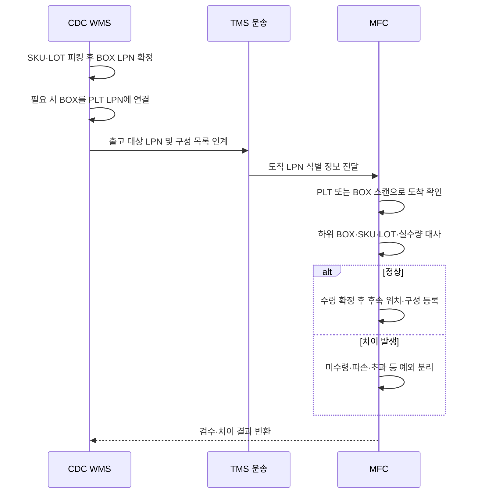

**범례:** CDC WMS=출고 구성·단위 확정 / TMS=인계·운송 이벤트 / MFC=도착 스캔·실물 검수·대사(재고 TIN 확정은 MFC 원장) / LPN=BOX 또는 PLT 번호 / 화살표=업무 정보·처리 흐름. 이 도식의 '정상 수령'은 SKU 재고 반영 시점을 새로 확정한다는 뜻이 아니며, 별도 재고 전이 정책을 따른다.

- PLT 스캔 1회로 예상 하위 BOX 목록을 **조회**할 수 있으나, 현장 검수 수준에 따라 하위 BOX·SKU의 실물 확인이 필요한지 별도 규칙으로 정해야 한다. **상위 LPN 스캔만으로 실제 검수와 수량 확정을 무조건 완료하지 않는다.**
- CDC 인계 구성과 MFC 실제 수령 구성의 **LPN별/BOX별/SKU·LOT별** 차이를 대사한다. 누락 LPN은 곧바로 재고 손실로 확정하지 않고 미도착·오배송·검수 진행 상태와 구분한다.
- 동일 인계·수령 이벤트가 재전송되면 이벤트 고유 키와 기존 처리 결과를 검증하여 **멱등 처리**한다. 중복 스캔이 재고 증가 또는 중복 검수 완료를 유발하지 않게 한다.
- BOX/PLT 해체 후 최종 적치 시 기존 LPN의 이동 이력은 유지하고, 하위 재고의 실물 위치·새 소속을 확정한다.

##### 15.4.7 LPN 감사 추적과 예외 복구

**최소 기록 항목(권장):** BOX/PLT 번호(LPN), 단위 유형, 현재 상태, 상위 LPN(있는 경우), 센터·현재 LOC 또는 운송 구간, 구성 버전, SKU·LOT·수량·품질, 관련 보충/출고/검수 작업, 이벤트 고유 키, 이전/이후 구성·위치, 작업자·승인자·시각, 예외/정정 사유, 후속 LPN(재포장 시).

| 예외 | 기본 조치 | 금지 사항 |
|---|---|---|
| 동일 LPN 중복 스캔/이벤트 재전송 | 기존 처리 결과 조회, 재처리 중복 방지 | 수량·이동 이벤트 이중 확정 |
| 미등록 또는 종료된 LPN 스캔 | 물리적 단위 확인, 예외 접수 | 스캔만으로 새 SKU 재고 생성 |
| 한 BOX의 다중 PLT 소속 | 해당 작업 보류 후 부모 관계 조사 | 마지막 스캔으로 과거 기록 덮어쓰기 |
| 라벨 파손·판독 실패 | 원 단위 확인 후 동일 코드 재출력 | 내용물 미확인 상태에서 임의 새 ID 연결 |
| 구성 수량·LOT 불일치 | 정상분/차이분 분리, 권한에 따른 정정 | LOT·재고 수량 임의 조정 |
| 전량 해체 후 동일 PLT ID 재사용 | 이전 LPN 종료, 새 단위 ID 발급 | 종료된 번호 재활성화 |

**경계:** 본 장은 LPN 관점에서 추적·대사·감사에 필요한 규칙만 다룬다. 물리 위치 코드 발급은 로케이션 정책, 실제 재고 수량의 예약·차감·증감·복구는 재고 운영 정책, LOT 발급·FEFO 및 품질 판정은 각 별도 정책에서 정의한다.

#### 정책 15.5 BOX 운영 규칙

##### 15.5.1 물류 BOX 생성 및 포장

**권장 절차**

1. CDC 보충 출고 작업에서 대상 SKU·수량·LOT·품질상태를 확인한다.
2. 물류 박스에 담을 상품을 스캔하고 구성 내역을 기록한다.
3. 허용 중량·부피·온도·파손 위험을 검증한다.
4. 구성 확정 시 BOX ID(박스형 LPN)를 발급하고 라벨을 출력한다. 번호는 BOX 정책에 따라 사용하며 별도 LPN 번호를 추가 발급하지 않는다.
5. BOX를 PLT에 적재하거나 직접 출고 대기 위치에 배치한다.

- 한 SKU만 담는 **단일 SKU BOX**, 여러 SKU를 담는 **혼합 SKU BOX**를 모두 허용하는 방안을 권장한다. 혼합 허용 여부는 온도, LOT 추적, 취급 안전 기준을 만족해야 한다.
- BOX 구성 변경은 이력(변경 전/후 SKU·LOT·수량, 사유, 작업자)을 남긴다.
- BOX에 `B` SKU 완제품이 들어갈 수 있으나 물류 BOX를 `B` SKU로 변환해서는 안 된다.
- 박스 최대중량·부피·밀봉 방식은 실제 상자 규격과 MFC 배송 단위에 맞춰 별도 승인한다. **고객 주문 10kg 초과 분할배송 규칙을 CDC→MFC BOX 중량 제한으로 그대로 적용하지 않는다.**

##### 15.5.2 BOX 개봉·재포장·폐기

- **물류 BOX 개봉:** BOX를 종료하고 내부 `E`/`B` SKU를 기존 SKU 그대로 다른 BOX, PLT 또는 위치에 배치한다. 상품의 품목 종류가 변하지 않는다.
- **물류 BOX 교체:** 파손된 BOX ID를 종료하고 새 BOX에 실제 잔량을 재포장한다. 구성·잔량 및 부모/후속 BOX 이력을 연결한다.
- **판매용 B 상품 개봉:** 독립 완제품 묶음 `B`를 `E`로 전환하는 행위이므로 **1차 구현 금지**. 단순 물류 박스 개봉과 혼동하지 않는다.
- 분실·파손·부족 수량 발견 시 임의 수량 보정은 금지한다. 격리·차이 접수 후 기존 재고 운영 정책에 따른 승인 프로세스로 연결한다.

#### 정책 15.6 PLT 운영 규칙

##### 15.6.1 적재 및 로케이션 배정

**권장 절차**

1. 적재 대상 BOX 또는 직접 적재할 SKU를 선정한다.
2. PLT ID(팔레트형 LPN)를 발급하고 구성 목록(BOX ID, 직접 적재 SKU, 수량)을 확정한다.
3. 총중량, 적재 높이, 팔레트 규격, 온도구역, 랙/베이/단/포지션의 수용 조건을 검사한다.
4. 가상 적재 결과의 PLT·구성·목적 LOC를 검증해 WMS가 완료를 확정한다. 라벨 생성과 적치 완료는 별개다.
5. 이후 CDC 이동은 유효 가상 원시도·PLT/목적 LOC·완료량에 따라 CDC-F-010~012로 반영한다. 실제 지게차 수행 기능은 범위 밖이다.

- 팔레트 치수/중량 허용치, 랙 하중과 적재 높이는 실제 설비 승인값을 사용한다. 규격을 이 문서에서 임의 확정하지 않는다.
- 승인 보관조건이 양립하지 않는 상품의 동일 PLT 혼재는 차단한다. 혼재를 검토할 때도 모든 내용물이 같은 실제 보관조건에서 적격임을 품질 근거로 확인해야 하며 일반 팀 승인만으로 온도 부적합을 우회하지 않는다.
- 1개 PLT에 서로 다른 SKU·LOT가 공존할 수 있지만 구성 단위별 추적성과 품질·FEFO 판정이 가능해야 한다.

##### 15.6.2 이동·부분 해체·전량 해체

| 작업 | 물류 식별 처리 | 재고 수량 처리 |
|---|---|---|
| PLT 전체 위치 이동 | PLT 유지, 위치 및 이력 변경 | 기본적으로 총량 변화 없음 |
| PLT에서 BOX 1개 분리 | PLT 구성에서 BOX 제거, BOX의 새 소속/위치 기록 | 총량 변화 없음 |
| PLT에 BOX 추가 | PLT 구성에 BOX 연결, 구성 버전 증가 | 총량 변화 없음 |
| PLT 전량 해체 | PLT 종료, 하위 단위의 위치/소속 확인 | 총량 변화 없음 |
| 실제 출고 인계 | PLT 및 구성에 출고 이벤트 연결 | 재고 차감 시점·방식은 재고 정책 준수 |
| 수량 차이 확인 | 해당 단위 격리·차이 사건 등록 | 승인된 재고 조정 절차만 허용 |

PLT의 부분 해체 중 일부 상품만 다른 위치에 놓이면 해당 수량/BOX를 PLT 구성에서 분리해야 한다. 하나의 PLT ID가 물리적으로 갈라진 두 곳을 동시에 대표하도록 사용하지 않는다.

#### 정책 15.7 LOT·소비기한·온도 및 품질 검증

**확정 정책과의 연결:** 식품 LOT 추적 필수, 비식품은 선택적으로 적용한다. 소비기한·FEFO 상세 판정은 해당 별도 정책이 우선한다.

**추가 권장 규칙**

- 동일 SKU라도 LOT·소비기한·재고 상태가 다르면 BOX·PLT의 구성 내역에서 구분해 기록한다.
- BOX·PLT(LPN) 이동 스캔으로 LOT 이력이 함께 추적되도록 한다.
- FEFO 대상 SKU를 부분 출고할 때 WMS가 지정한 출고 가능 LOT를 확인한다. BOX 또는 PLT 단위 이동이 FEFO 예외 승인을 뜻하지 않는다.
- 온도 조건에 맞지 않는 구역으로의 이동은 차단하고 예외 조치/이동 이력을 남긴다.
- 훼손·온도 이탈·소비기한 판정 불가 물량은 정상 판매 가능 물량과 구분하여 격리 후 처리한다.

#### 정책 15.8 CDC → MFC 보충 출고 및 검수

CDC 입고를 구현하지 않는다는 프로젝트 범위를 유지한다. **CDC 기등록 재고 → 보충 지시 → 피킹 → BOX 포장 → (필요 시 PLT 적재) → 출고 인계 → MFC 수령·검수 → 적치** 흐름을 대상으로 한다.

##### 15.8.1 권장 정상 흐름

1. **승인 인수·실행 지시:** SCM이 목적 MFC·SKU·공급량을 사업 승인한다. WMS는 승인 범위 안에서 실제 확보·피킹/출고 작업만 지시하며 공급량을 별도 승인하지 않는다.
2. **CDC 피킹:** 가용 수량·LOT·위치를 확인하고 지정 수량을 물류 처리 대상으로 선정한다.
3. **BOX 생성:** SKU·LOT·수량별 BOX 내용물을 등록하고 박스형 LPN 라벨을 발급한다.
4. **PLT 적재(선택):** 팔레트 운송 필요 시 BOX LPN을 PLT LPN에 연결한다. 필요 없으면 BOX만 운송한다.
5. **출고 검증:** 지시 대비 BOX/PLT 구성 수량 및 목적지·온도 조건을 비교한다.
6. **운송 인계:** 인계 시각, 인계 주체, 단위 ID, 수량·상태를 기록한다. 운송 구간 상세는 TMS 정책을 따른다.
7. **MFC 도착:** 목적 MFC에서 BOX/PLT(LPN) 스캔으로 예정 목록과 실제 수령 단위를 대조한다. 상위 PLT 스캔만으로 하위 실수량 검수를 무조건 완료하지 않는다.
8. **검수:** 파손·누락·초과·오배송·LOT 차이를 검사한다. 불일치는 예외 접수 후 정상분과 분리한다.
9. **개봉·적치:** 필요에 따라 BOX/PLT를 해체하고 실제 SKU 수량을 로케이션에 적치한다.
10. **완료 대사:** CDC 출고 내역, 이동 중 내역, MFC 검수 결과의 차이를 추적한다. 수량 소유·재고 차감/증가 시점은 기존 재고 정책과 일치시켜야 한다.

##### 15.8.2 수량 대사와 중복 처리 방지

- 실제 출발량 기준으로 `출발q=확정 수령누계r+승인 운송손실l+대사 후 미정산t`를 확인한다. `r=정상n+격리/미판정h`다. 계획량·미출발량은 이 식 밖이며 차이 접수는 수량 처분 범주가 아니다. 기수령 격리·조사 중 미수령·초과 실물을 차이 한 칸으로 섞어 더하지 않는다. 초과·오귀속은 별도 사건으로 보존한다.
- BOX/PLT(LPN) 스캔 이벤트는 작업·단위·이벤트 유형별 중복 처리 방지를 적용한다. 반복 스캔이 두 번 입고·출고되도록 해서는 안 된다.
- PLC/스캐너 오류, 네트워크 재전송 등으로 중복 이벤트가 도착하면 기존 처리 결과를 반환하고 재고를 중복 반영하지 않는다.
- 팔레트 단위 검수 완료와 구성 BOX별 검수 완료를 **동시에 독립적인 수량 증가 이벤트로 중복 집계하지 않는다.**

#### 정책 15.9 상태와 허용 작업

다음은 구현용 **권장 상태 모델**이며, 팀 합의 후 명칭·전이를 확정한다. LPN의 상태는 별도 중복 모델을 만들지 않고 **해당 BOX/PLT 상태와 동일하게 취급**한다.

| 대상 | 상태 | 설명 | 허용 작업 예시 |
|---|---|---|---|
| BOX | `PACKING` | 구성 작업 중 | SKU 스캔·수량 수정 |
| BOX | `SEALED` | 포장 확정 | PLT 연결·출고 대기 |
| BOX | `IN_TRANSIT` | 실제 CDC 출발 확인·운송 중 | 도착 확인·사고 접수 |
| BOX | `RECEIVED` | 수령 및 검수 진행/완료 기록 | 검수 결과 저장·적치 |
| BOX | `OPENED` | 박스 개봉 후 내용물 분리 | 종료, 후속 단위 연결 |
| BOX | `EXCEPTION` | 누락·파손 등 보류 | 격리·조사·승인 |
| PLT | `BUILDING` | 팔레트 적재 중 | BOX/SKU 추가·제외 |
| PLT | `READY` | 적재 확정 | 위치 이동·출고 |
| PLT | `IN_TRANSIT` | 운송 중 | 도착 처리 |
| PLT | `RECEIVED` | 도착 확인 | 하위 단위 검수·분리 |
| PLT | `DISMANTLED` | 전량 해체됨 | 종료·이력 조회 |
| PLT | `EXCEPTION` | 적재/운송 차이 보류 | 조사·수정 승인 |

- `EXCEPTION`은 원래 진행 단계와 별도 보류 사유를 갖도록 구현할 수도 있다. 이 경우 현재 업무 단계와 품질 보류 상태를 분리한다.
- 완료·종료된 식별번호를 재활성화하거나 재사용하지 않는 것을 원칙으로 한다. 잘못 종료한 경우 이력 취소 또는 신규 단위 재발급 등 정정 절차를 거친다.

#### 정책 15.10 예외 처리

| 예외 상황 | 즉시 처리 | 후속 승인/대사 |
|---|---|---|
| 박스 일부 누락 | 차이 접수, BOX 정상 확정 중단 또는 부분 검수 | 정상 수령분과 부족분 분리 대사 |
| 박스 파손 | 격리, 내부 수량·품질 재검수 | 재포장 시 신규 BOX 발급 및 연결 |
| 팔레트 적재 정보 불일치 | PLT 이동/출고 보류 | 실제 BOX 목록 확인 후 이력 보존 수정 |
| 미등록 BOX·PLT(LPN) 스캔 | 신규 재고 자동 생성 금지 | 출처·목적지 확인 후 책임자 처리 |
| LPN 라벨 재출력 요청 | 실물·기존 번호 확인 후 동일 코드로 재출력 | 이력 없이 신규 단위·수량 중복 생성 금지 |
| BOX의 중복 PLT 소속 | 작업 보류, 실제 소속 확인 | 승인 후 부모 연결 이력 정정 |
| 다른 MFC로 오배송 | 실물 안전보관·미귀속 구분·운송 이상 접수 | 원목적지·귀속을 확인하고 담당자 조치 대기. 임의 재운송/반송 지시 금지 |
| 다른 온도구역 적치 시도 | 적치 차단 | 적합 위치 재배정 및 품질 확인 |
| 동일 단위 중복 스캔 | 추가 수량 반영 금지 | 기존 처리 이벤트 조회 |
| LOT/소비기한 불명확 | 판매 가능 처리를 보류 | LOT/품질 정책에 따른 판정 |

#### 정책 15.11 작업자 권한과 감사 이력

| 주체 | 권장 권한 | 제한 |
|---|---|---|
| CDC WMS 운영자 | BOX/PLT(LPN) 생성·스캔·포장·출고, PLT 적재·이동·해체 | SKU 마스터 변경 불가 |
| MFC 운영자 | 도착 확인·검수, BOX 개봉, MFC 위치 적치 | CDC 출고 내역 임의 변경 불가 |
| 물류 관리자 | 예외 조사·재처리·구성 정정 승인 | 이력 삭제·승인 없는 수량 조정 금지 |
| 관제시스템 운영자 | 센터 간 이동 진행 현황·예외 관제 | 물리 작업을 수행한 것으로 자동 기록 금지 |
| TMS/운송 담당 | 인계·도착 및 운송 상태 기록 | 물류 단위 구성·SKU 재고 임의 수정 불가 |

최소 감사 항목(권장): 이벤트 ID, BOX/PLT ID(LPN), 단위 유형·상위 LPN·구성 버전, 연결 보충 지시/이동 건, 이전·이후 구성, 이전·이후 위치, 이벤트 종류, 작업자·승인자, 처리 시각, 원인·예외 코드. 비정상 재처리와 수동 정정은 **원 이벤트를 삭제하지 않고 보정 이력**으로 남긴다.

#### 정책 15.12 설명용 운영 사례 — 현장 검증 미실행

##### 15.12.1 생수 E SKU를 BOX와 PLT로 운송

- 기초상품: 생수 500mL; SKU `E-00000001`.
- CDC에서 `E-00000001` 40병을 보충 출고 대상으로 선정한다.
- `BOX-00000001`에 20병, `BOX-00000002`에 20병을 포장한다.
- 두 BOX를 `PLT-00000001`에 적재하여 이동·출고한다. 이때 BOX·PLT 번호가 각각 해당 단위의 LPN 역할을 하며 별도 LPN 번호는 없다.
- MFC에서 PLT 1개를 스캔하고 BOX 2개를 검수하여 **최종 SKU 수량 40병만** 정상 수령으로 계산한다.
- BOX 개봉 시 상품 SKU는 계속 `E-00000001`이며, `B` SKU가 새로 생성되지 않는다.

##### 15.12.2 완제품 B SKU를 물류 BOX에 담는 경우

- 제조사 밀봉 6입 완제품 SKU: `B-00000002`, 기초상품 환산 수량 `base_unit_qty=6`.
- 물류 BOX 하나에 `B-00000002` 4팩을 담으면, 구성은 **`B-00000002 × 4`**, 기초상품 환산 총량은 24개다.
- WMS 재고는 `B` 4팩으로 보존한다. 물류 BOX를 개봉해 B 팩 4개를 꺼낼 수 있지만 B 팩 자체를 개봉하여 `E` 24병으로 바꾸지는 않는다.
- 고객 주문 구매 제한 10개는 별도의 주문 검증 규칙이므로, **센터 간 보충 24개 환산 이동을 고객 구매 제한 위반으로 판정하지 않는다.**

##### 15.12.3 독립 CASE 상품과 운송 BOX 구분

- 공급사가 공급하는 독립 완제품 20입 박스가 판매·재고 상품이라면 `B-00000005`(`CASE`)를 쓴다.
- 이를 다른 외부 운송 박스로 한 번 더 포장한다면 그 외부 박스만 `BOX-00000003`으로 관리한다.
- `B-00000005`를 구성하는 20개 낱개를 임의로 꺼내 `E` 상품으로 변환하는 작업은 지원하지 않는다.

#### 정책 15.13 연계 정책 및 책임 경계

| 정책/시스템 | 이 문서에서 정의하는 연결 | 해당 문서/시스템의 책임 |
|---|---|---|
| SKU 코드 및 묶음판매 정책 | BOX·PLT 안에 `E`/`B` SKU가 포함됨 | 신규 SKU 발급, 완제품 묶음 구분, `base_unit_qty` |
| 재고 수량 및 상태 정책 | 포장·이동·검수 업무 이벤트 전달 | 가용·예약·차감·복구·재고조정, 센터 간 재고 전이 |
| LOT·FEFO·품질 정책 | LPN 구성단위에 LOT·소비기한·품질상태 유지 | 출고 가능 LOT 선정, 소비기한 차단, 품질 판정 |
| 로케이션 운영 정책 | BOX/PLT(LPN)의 물리 위치 연계 | 유일한 LOC 코드, 용량·중량·온도 적합성 |
| SCM/보충 | 이동 지시와 물량 검증 | 보충량 산정, 지시 생성/변경 |
| TMS | 인계·운송·도착에 BOX/PLT ID(LPN) 제공 | 배차, 운송 추적, 인수인계·운송 예외 |
| 관제시스템 | 단위별 현황·이상 징후 조회 | 전사 관제, 예외 승인 범위·감사 |

#### 정책 15.14 팀에서 추가로 결정해야 할 항목

아래는 **아직 최종 결정되지 않은 운영 상세**이며 임의로 확정하지 않는다.

| 번호 | 결정 항목 | 이 문서의 권장안 | 결정 필요 이유 |
|---|---|---|---|
| D-01 | BOX/PLT 코드 형식과 번호 자릿수 | `BOX-`/`PLT-` + 8자리, 전역 유일 | 바코드 및 이력 관리 표준 |
| D-02 | BOX 단위 추적 범위 | 보충 출고용 물류 BOX 우선, 필요 구역 확대 | 모든 박스에 ID 발급 시 작업량 증가 |
| D-03 | BOX 혼합 SKU·LOT 허용 범위 | 동일 온도·추적 가능 조건에서 허용 | 검수 난이도 및 FEFO 영향 |
| D-04 | BOX 최대 중량·부피·봉인 조건 | 실측 규격과 취급 안전 기준 별도 등록 | 파손·작업 안전 |
| D-05 | PLT 최대 높이·하중·혼재 | 랙/설비 승인값 기준 | 지게차 및 랙 안전 |
| D-06 | PLT 부분 해체 시 ID 유지 | 기존 PLT 유지 + 구성 이력·버전 관리 | 추적 일관성 |
| D-07 | BOX 재포장 시 ID | 원 BOX 종료 + 신규 BOX 발급 | 파손·재포장 이력 |
| D-08 | MFC 인수 확정 세분화 | 단위 도착과 SKU 수량 검수 완료를 구별 | 과입고·중복 반영 방지 |
| D-09 | 회계 소유권과 이미 정한 수량 반영의 구분 | CDC는 실제 출발, MFC는 자체 TIN, CDC Transit은 결과 대사 시 반영. 이 시점은 재선택하지 않음 | 법적/회계 소유권·계약만 별도 확인 |
| D-10 | RFID/QR/1D 바코드 | 우선 1D 또는 QR 스캔 검증 | 현장 단말·라벨 비용 |
| D-11 | MFC에서 PLT 실제 취급 여부 | CDC PLT 추적 필수, MFC는 시설에 따라 선택 | 거점 설비·하역 방식 차이 |
| D-12 | 박스 및 PLT 상태·정정 권한 | 본 문서 제안 상태 모델을 초기안으로 사용 | 실무 책임과 오류 복구 |
| D-13 | 작업 구역 위치 식별 | 확정한 LOC 단일 표준 사용; 비랙 임시 작업 위치 표현은 로케이션 정책에서 결정 | 도크·출고대기 위치의 현장 표기 일관성 |
| D-14 | LPN 식별 전략 | **별도 `LPN-...` 번호 없이 BOX·PLT 기존 번호를 LPN으로 사용** | 식별자 이중 발급·이중 스캔 방지 |
| D-15 | LPN 계층 허용 범위 | PLT→BOX, PLT→직접 SKU, BOX→SKU까지만 우선 지원 | 혼합·다층 포장 시 운영 복잡도 |
| D-16 | 상위 LPN 스캔의 검수 범위 | 도착 확인과 최종 실수량 검수를 구분 | 무검수 자동 입고·오수령 위험 |
| D-17 | LPN 라벨 재출력·재포장 | 동일 물류단위의 라벨 재출력은 기존 ID 유지, 물류 BOX 교체는 신규 ID | 이력 연속성과 파손 추적 |
| D-18 | 구성 변경 시 버전·잠금 | PLT 구성 버전 및 이동/출고 중 구성 변경 제한 | 동시 작업·중복 소속 방지 |
| D-19 | CDC 초기 적재 재고의 LPN 연결 | 실제 추적 대상 BOX/PLT만 초기 LPN로 등록, 나머지 직적치 허용 | CDC 입고 기능 미구현 조건에서 초기 이력 정합성 |

> **결론:** BOX·PLT는 상품 SKU가 아니라 WMS 물류 취급 단위이며, 각각 **박스형·팔레트형 LPN**으로 공통 추적할 수 있다. `E/B` SKU 정의를 유지하고 **별도 `LPN-...` 코드를 중복 발급하지 않는 통합안**을 적용하여 구성·이동·검수·해체를 추적한다. 로케이션은 확정한 단일 표준만 사용한다. **확정된 사실**과 **팀 검토가 필요한 신규 권장안**을 혼동하지 않는다.

<a id="identifier-lot"></a>

### 부록 4. LOT·FEFO·회수 추적 정책 — V6.6 원문 세부 정책

> **입력 원문:** `LOT 코드 부여 및 추적 상세 정책.md`. 아래는 코드·비즈니스 로직·사례·테스트·미결정 사항을 상세 유지한 내용이다. **기존 확정 정책과 새 권장안을 구분**해 읽는다. 제1부 0.1~0.4와 제2부 CDC-F 기능의 책임·수량 규칙을 적용한다. 아래 부록의 상대 시스템 단계는 연계 설명이며 CDC 구현 요구가 아니다.

> **문서 상태:** 기존 확정 사항을 반영한 **상세 운영 정책 초안**. 이 문서에서 새로 제안한 LOT 코드 형식, 확인·승인 절차, 상태 및 예외 대응은 팀 승인 전까지 **[권장안]**으로 취급한다.  
> **적용 시스템:** 관제시스템, CDC WMS(CDC 재고·출발·대사), MFC(현장·자체 재고), SCM/Replenishment, OMS 및 배송 연계 구간(필요한 범위만).  
> **적용 업무:** CDC에 이미 존재하는 재고의 LOT 식별 및 정합성 확인 → CDC 보관·이동·보충 피킹 → BOX·PLT(LPN) 연결 → CDC→MFC 이동·검수 → MFC 적치·피킹 → 주문·배송 이력 연계 → LOT 추적·회수.  
> **1차 개발 범위:** **공급업체→CDC 입고·검수·입고 적치 프로세스를 구현하지 않는다.** CDC에 기등록·적재 완료된 재고에서 시작한다.  
> **관련 문서:** `SKU 코드 및 묶음판매 확정정책_EB반영.md`, `BOX 및 PLT 물류 취급 단위 운영 정책_LPN반영.md`, `로케이션 코드 및 적재 위치 운영 정책.md`, 재고 수량 및 상태 정책, 소비기한·FEFO 판정 상세 정책, CDC·MFC 보충 운영 정책.  
> **책임 경계:** 본 문서는 **LOT의 식별·연결·추적·정정·회수 대상 지정**을 정의한다. 재고의 예약·차감·복구, 소비기한 기준값·FEFO 우선순위의 상세 산식, 운송 SLA, 환불·보상 확정 로직은 각각의 담당 정책을 따른다.

---

#### 정책 16.1 목적과 확정된 전제

##### 16.1.1 LOT이 필요한 이유

LOT(Lot/Batch)은 동일 제조·생산 배치에 속하는 상품을 식별해 **어느 물량이 어디에 있었고, 어디로 이동했으며, 어떤 주문으로 출고되었는지** 추적하기 위한 기준이다.

- 같은 SKU라도 생산 배치가 다르면 LOT을 구분한다.
- 하나의 LOT이 서로 다른 CDC/MFC, 로케이션, BOX, PLT에 나누어 존재할 수 있다.
- 하나의 BOX 또는 PLT(LPN)에 여러 LOT이 있을 수 있으나, 구성 수량은 LOT별로 구분한다.
- LOT 식별은 실제 재고 수량 증감을 뜻하지 않는다. 재고 반영은 별도 재고 정책의 적법한 업무 이벤트에 따른다.
- 소비기한이 같아도 제조 LOT이 다른 경우 동일 LOT으로 합치지 않는다.

##### 16.1.2 기존 프로젝트에서 확정된 사항

| 구분 | 기존 확정 기준 | 본 문서 적용 |
|---|---|---|
| SKU 유형 | 낱개 `E-`, 독립 실물 묶음 `B-` | 두 SKU를 별개 재고 상품으로 보며 SKU별 LOT 관계를 추적 |
| SKU 재사용 | 전역 유일 SKU, 사용 중지 후 재사용 금지 | LOT 변경만으로 새로운 SKU 발급 금지 |
| LOT 추적 대상 | **식품 필수, 비식품 선택** | 식품 SKU의 LOT 누락·확인 불가 물량은 정상 출고 대상으로 자동 확정하지 않음 |
| 묶음 전환 | 1차 구현에서 `E`↔`B` 포장 전환 미지원 | B 상품의 물류 BOX 개봉을 E 상품 전환으로 처리하지 않음 |
| BOX·PLT | 상품 SKU가 아닌 물류 취급 단위 | SKU·LOT·수량을 하위 구성으로 연결 |
| LPN 통합 | BOX/PLT 식별번호 자체를 LPN으로 활용하는 **별도 문서 권장안** | 별도 `LPN-...` 코드를 새로 가정하지 않음 |
| 로케이션 | 7구간 단일 표준 | LOT 코드와 LOC 코드를 합쳐 새 식별번호 생성 금지 |
| CDC 범위 | 공급사→CDC 입고 구현 제외 | 시작 재고의 LOT 연결·검증부터 처리 |

**중요:** `LOT-...` 형식은 **아직 확정된 프로젝트 코드가 아니다.** 정책 16.3.1에서 형식을 제안하며 정책 16.18의 결정 목록에 명시한다.

#### 정책 16.2 주요 용어 및 개념 구분

| 용어 | 의미 | 예시 또는 주의 사항 |
|---|---|---|
| SKU | 판매·재고 관리 대상 상품 종류 | `E-00000001`과 `B-00000002`는 별도 SKU |
| 제조사 LOT 번호 | 제조사·공급사가 표시한 배치번호 원문 | 제조사별 체계가 다를 수 있어 형식 강제 금지 |
| 내부 LOT ID | 바로픽 시스템에서 LOT 기록을 고유하게 참조하는 식별번호 | **[권장안]** `LOT-00000001` |
| LOT 연결 | SKU와 실제 LOT·수량·센터·재고상태의 연결 | SKU만 같다고 LOT이 같은 것은 아님 |
| 제조일자 | 생산·제조 날짜 | LOT 번호에서 임의 계산하지 않음 |
| 소비기한 | 상품·LOT별 소비 가능 또는 판매 제한 판정에 사용되는 날짜 정보 | 정책에서 요구하는 날짜 종류를 분명히 저장 |
| FEFO | 소비기한이 먼저 도래하는 출고 가능 물량을 우선 선택하는 원칙 | 세부 순서·차단 기준은 FEFO 문서가 결정 |
| BOX / PLT | 물류 박스 / 팔레트 적재단위 | 각각 박스형/팔레트형 LPN으로 추적 가능 |
| LOC | 물리 보관 위치 | `CDC01-R-04-R018-B03-L02-P01` |
| 품질 보류 | 특정 LOT 전량 또는 일부 재고를 출고 대상에서 제외하는 업무 조치 | LOT 식별자 자체 삭제와 다름 |
| 회수(Recall) | 문제 있는 생산 배치의 유통·출고·판매 경로를 확인해 필요한 후속 조치를 진행하는 업무 | 재고 강제 폐기·환불 자동 확정과 구분 |

#### 정책 16.3 LOT 식별번호와 원본 제조사 정보

##### 16.3.1 내부 코드 부여 방식 **[권장안]**

**`LOT-8자리`는 내부 표시 형식 제안이며 전역 공통 PK 강제가 아니다.**

| 구분 | 코드 예시 | 뜻 |
|---|---|---|
| 내부 LOT ID | `LOT-00000001` | 발급 주체의 namespace 안에서 LOT 기록을 참조하는 내부 식별번호 예시 |
| 제조사 LOT | `MFG-241015-A` | 제조사가 실제 제공한 배치번호(예시) |
| SKU | `E-00000001` | 해당 LOT이 연결된 상품 코드 |
| BOX(LPN) | `BOX-00000001` | 이 LOT 물량 일부를 담는 물류 박스 |
| PLT(LPN) | `PLT-00000001` | 해당 BOX 등을 적재한 팔레트 단위 |

- 내부 LOT ID에서 센터·온도·SKU·기한을 추정하지 않는다. CDC 원LOT 참조는 발급 주체·namespace와 함께 전달하고 MFC는 자체 LOT 키와 매핑할 수 있다. 제조 배치 추적은 유지하되 동일 DB PK·공통 채번 서비스를 필수로 가정하지 않는다.
- 식별의 유일성은 발급 주체·namespace·내부 LOT ID의 조합으로 보장하는 안을 사용한다. 같은 namespace에서 과거 ID를 다른 배치에 재사용하지 않는다. 전역 채번을 선택할지는 추가 계약이며 현재 MFC에 강제하지 않는다.
- 제조사 LOT 번호는 **공급사가 제공한 값 그대로 보존**한다. 화면 검색을 위해 공백 등 표현을 정규화하더라도 원본 문자열을 덮어쓰지 않는다.
- 내부 LOT ID와 제조사 LOT 번호는 같은 의미의 필드가 아니다. 제조사 LOT 번호 자체를 전체 공급사·SKU에 대해 유일하다고 가정하지 않는다.
- LOT ID를 새로 발급하거나 변경하더라도 상품 SKU가 자동 변경되거나 기존 BOX/PLT·재고가 복제되어서는 안 된다.

##### 16.3.2 동일 LOT 판정과 중복 등록 **[권장안]**

1. 해당 SKU의 제조사·공급사 식별, 제조사 LOT 원문, 필요 시 제조일자 및 확인 자료를 조회한다.
2. 동일 제조 LOT으로 확인된 기존 기록이 있으면 **기존 내부 LOT ID를 재사용하여 연결**한다.
3. 제조사 LOT 문자가 같더라도 제조사나 생산 정보가 다르면 자동 병합하지 않는다.
4. 제조사 LOT은 같지만 서로 다른 `E`·`B` SKU인 경우, 포장·제조 단위의 동등성이 공급사 자료로 확인되기 전까지 LOT 공유를 **자동으로 가정하지 않는다**.
5. 동일 제조 배치의 참조 관계가 필요한 경우, SKU별 LOT 기록과 공급사 배치 근거를 연결하되 `E`↔`B` 실물 전환은 수행하지 않는다.
6. 두 LOT 기록이 실제로 같은 배치를 중복 등록한 것으로 확인되더라도, 출고·검수 이력이 존재하면 코드 덮어쓰기 대신 **승인된 정정·연결 이력**을 남긴다.

**식별 원칙:** `제조사 LOT 번호 1개 = 반드시 내부 LOT ID 1개` 또는 `내부 LOT ID 1개 = BOX 1개`라고 고정하지 않는다. 동등성 확인 규칙과 SKU별 이력 연결은 팀에서 최종 확정해야 한다.

##### 16.3.3 제조사 LOT이 없거나 판독할 수 없는 경우 **[권장안]**

| 상황 | 처리 원칙 | 금지 사항 |
|---|---|---|
| 식품 SKU의 LOT 자료 누락 | 미확인 상태 등록, 해당 수량의 출고·판매 가능 처리 보류 | 날짜·SKU만으로 제조사 LOT 임의 생성 |
| LOT 라벨 훼손 | 원본 포장·공급사 자료·기존 추적 이력으로 확인 후 승인 | 추정 코드 임의 등록 |
| 제조사 LOT 코드 중복 | 제조사·SKU·관련 자료 기준으로 식별 충돌 조사 | 문자열 같다는 이유로 무조건 통합 |
| 비식품 LOT 선택 미적용 | SKU에 LOT 관리 미적용 여부 명시, 재고 정책대로 처리 | 가짜 LOT 번호 생성 의무화 |
| 자료 정정 필요 | 권한 승인 후 이력 보존 정정 | 이미 출고된 LOT의 과거 기록 삭제 |

미확인 물량을 조사하기 위한 **내부 임시 추적 기록**을 둘 수 있으나, 그것을 실제 제조 LOT이 검증되었다는 의미로 사용하지 않는다. 권한 승인만으로 미확인 식품 LOT을 정상 출고하지 않는다. 실제 제조 배치 근거와 품질·기한 적격성이 확인된 범위만 해당 정본 주체가 정상화한다.

#### 정책 16.4 LOT 필수 관리 대상과 정보 보존

##### 16.4.1 SKU별 추적 요구 수준

| 상품 구분 | LOT 추적 | 추가 관리 원칙 |
|---|---|---|
| 식품 E SKU | **필수 [확정]** | 제조 LOT, 재고 연결, 이동·출고 이력 |
| 식품 B SKU | **필수 [확정]** | 완제품 묶음의 제조 LOT, 별도 SKU 재고 추적 |
| 비식품 E/B SKU | **선택 [확정]** | LOT 추적 대상 설정 시 동일 이력 규칙 적용 |
| 식품인데 LOT 불명 | **정상 출고 차단** | 제조 LOT 근거 확인과 품질 적격 검증이 선행돼야 하며 일반 예외 승인으로 우회하지 않음 |

카테고리에 온도 표시가 함께 있더라도 LOT 추적 대상·보관 조건의 최종 판정은 **실제 SKU 속성 및 품질 정책**으로 수행한다.

##### 16.4.2 LOT 기록에 유지할 업무 정보 **[권장안]**

| 정보 범주 | 필요 정보 | 목적 |
|---|---|---|
| 식별 | 내부 LOT ID, 제조사 LOT 원문, 대상 SKU, 제조사·공급사 | 정확한 배치 식별 |
| 일자 | 제조일자(있는 경우), 소비기한·품질 관련 일자(있는 경우), 기록·확인 시각 | FEFO·품질 판정 자료 |
| 증빙 | 원본 라벨·공급사 자료·작업/검수 근거 참조 | 사후 검증 |
| 신뢰도 | 검증 여부, 누락·추정·오류 사유, 검증 담당자 | 미확인 LOT 분리 |
| 재고 연결 | 센터, LOC, SKU, LOT, 수량, 재고·품질 상태, BOX/PLT(LPN) | 현재 위치와 물량 파악 |
| 흐름 연결 | 보충 요청, 피킹 지시, 출고 인계, 운송, 수령·검수, 적치, 주문 출고 | 정방향·역방향 추적 |
| 감사 | 사건 ID, 작업자·승인자, 시각, 전후 값, 정정 사유 | 변경 재현·중복 처리 방지 |

- 위 항목은 **비즈니스 규칙에 필요한 정보 목록**이지 DB 테이블 설계나 API 스키마를 강제하는 내용이 아니다.
- 제조일자와 소비기한은 서로 다른 정보다. **LOT 코드에서 제조일자·소비기한을 파싱해 확정하지 않는다.**
- 소비기한이 존재하지 않거나 법·상품 특성상 관리 방식이 다른 품목은 품질 정책에 따른다. 근거 없는 날짜를 채워 넣지 않는다.

#### 정책 16.5 LOT 확인·변경·상태 관리

##### 16.5.1 LOT 식별 기록의 흐름 **[권장안]**

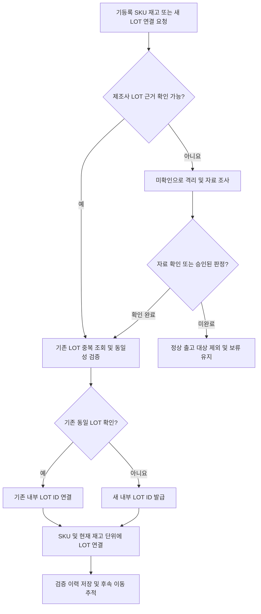

**범례:** 사각형=처리 업무 / 마름모=판단 / 화살표=처리 흐름 / 내부 LOT ID=바로픽 식별자 / 제조사 LOT=공급사 제공 원본 정보 / 보류=해당 물량의 후속 출고 제한. 본 도식은 CDC 입고 프로세스를 의미하지 않으며 **기등록 재고 연결 및 후속 운영**을 설명한다.

##### 16.5.2 LOT 식별·품질·재고 상태 구분

| 상태 축 | 예시 상태 **[권장안]** | 의미 | 다른 상태와의 관계 |
|---|---|---|---|
| LOT 식별 검증 | `UNVERIFIED`, `VERIFIED`, `INVALID` | 배치 식별 근거 확인 수준 | LOT 검증 완료가 판매 가능을 의미하지 않음 |
| 품질 판정 | 정상, 검사 중, 보류, 회수 대상, 폐기 판정 | 해당 LOT 또는 LOT의 일부 수량에 대한 품질 판단 | 회수·보류는 재고 정책과 연계해 적용 |
| 재고 상태 | 가용, 예약, 이동 중, 보류 등 | 특정 센터·LOT·위치·수량의 운영 상태 | 변경 시점과 증감은 재고 정책 담당 |
| LPN 진행 상태 | `SEALED`, `READY`, `IN_TRANSIT`, `RECEIVED` 등 | BOX·PLT 물류 진행 단계 | 포장 상태만으로 LOT 품질을 확정하지 않음 |

- 단일 LOT의 일부 수량만 파손·품질 보류될 수 있으므로 LOT 전체를 한 가지 재고상태로 단순 치환하지 않는다.
- 특정 제조 LOT **전체에 적용해야 하는 회수·품질 차단**과 일부 수량에만 적용되는 **파손·온도 이탈**을 구분한다.
- LOT 정보 정정으로 과거 거래·이동 내역이 사라져서는 안 되며, 변경 전후 자료가 조회되어야 한다.
- 품질 보류 해제는 적정 권한의 검사·승인 결과가 있을 때만 진행한다. 작업자가 BOX를 다시 밀봉하거나 PLT를 이동했다고 자동 해제되지 않는다.

#### 정책 16.6 CDC 시작 재고의 LOT 구성 및 검증

**1차 구현 시작점:** 공급업체 입고 과정을 재현하지 않고, **CDC에 이미 적재된 재고**의 SKU·LOT·위치·품질·수량 정보를 준비한다.

##### 16.6.1 초기 재고 준비 **[권장안]**

1. 시작 재고를 SKU·센터·LOC·품질/재고상태·실수량 기준으로 확인한다.
2. 식품 SKU에 제조사 LOT 근거가 있는지 확인하고 기존 내부 LOT ID에 연결하거나 신규 등록한다.
3. LOT별 제조·소비기한 관련 정보가 있으면 자료 출처와 함께 연결한다.
4. 이미 포장·적재돼 있는 BOX/PLT가 있다면 해당 LPN 구성에서 SKU·LOT별 수량이 일치하는지 확인한다.
5. 식별 불명·서로 다른 LOT 혼재·수량 불일치 물량은 조사 대상으로 분리하고 정상 출고 가능 재고에 섞지 않는다.
6. 초기 자료 승인 후 CDC 보관·피킹·출고 업무를 시작한다.

**제약:** 초기 재고를 시스템에 적재하는 작업은 프로젝트 시뮬레이션·초기화 작업이며 **공급사 입고 검수 및 발주/입고 프로세스를 추가 구현하라는 뜻이 아니다.**

##### 16.6.2 초기 불일치 사례

| 발견 사례 | 처리 방식 |
|---|---|
| 식품 SKU는 있으나 LOT이 비어 있음 | 해당 수량 미확인 격리, LOT 근거 확인 요청 |
| 하나의 위치에 동일 SKU의 LOT 2개 | LOT별 수량을 별도로 유지, 위치는 동일하게 둘 수 있음 |
| BOX 내 LOT 구성과 현재 재고 LOT가 다름 | BOX 작업 보류, 실물 확인·구성 정정 이력 보존 |
| 이미 폐기된 LOT이 가용으로 초기 등록됨 | 품질·재고 상태를 검증하고 출고 차단 후 정정 |
| B 완제품에 E 단품 LOT이 대신 연결됨 | 제조사 자료 확인 전 LOT 공유를 자동 가정하지 않음 |

#### 정책 16.7 SKU·LOT·BOX·PLT(LPN) 연결

##### 16.7.1 계층·구성 관계

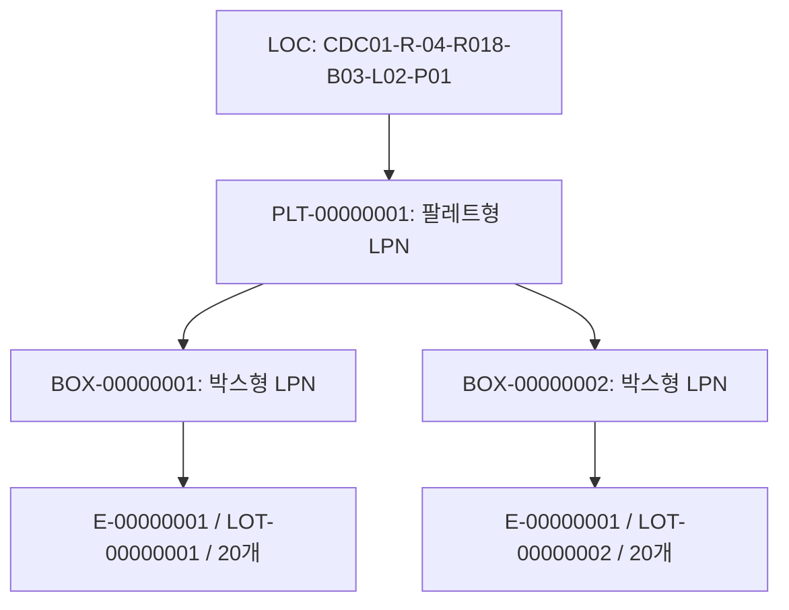

**범례:** LOC=물리 위치 / PLT=팔레트 적재단위 / BOX=물류 박스 / LPN=BOX·PLT 식별번호 자체 / SKU=상품 종류 / LOT=제조 배치 식별 / 화살표=위치·포함 관계. **20개는 이해를 돕는 예시 수량**이며 모든 박스의 표준 수량을 뜻하지 않는다.

- BOX에 여러 SKU 또는 여러 LOT을 혼합할 수 있는지는 BOX 정책의 온도·추적 조건과 팀의 혼합 허용 결정에 따른다.
- 구성 항목은 **SKU + LOT + 수량 + 품질 구분**을 잃지 않아야 한다.
- PLT를 스캔하여 하위 BOX 구성 내역을 조회할 수 있으나, 그것만으로 MFC의 실물 수량 검수가 자동 완료되는 것은 아니다.
- BOX에 담지 않고 PLT에 직접 적재한 SKU·LOT 및 LOC에 직적치된 재고도 추적 대상에 포함한다.
- 한 BOX를 두 PLT에 동시에 소속시키거나, 같은 SKU·LOT 수량을 상위/하위 LPN과 직접 적치 재고에 중복 계상하지 않는다.

##### 16.7.2 물류 단위 변경 시 LOT 보존

| 작업 | LOT 처리 | 재고 총수량 처리 |
|---|---|---|
| BOX 생성·포장 | 기존 SKU·LOT 연결을 새 BOX에 소속 | 포장만으로 증감 없음 |
| BOX 개봉 | 기존 BOX와의 연결·이력 보존, 실물 SKU·LOT을 직접 재고 또는 신규 BOX에 연결 | 개봉만으로 증감 없음 |
| BOX 재포장 | 원 BOX 종료 및 후속 BOX 연결, LOT·수량 이력 보존 | 재포장만으로 증감 없음 |
| PLT 적재·분리 | 하위 BOX/SKU·LOT 관계 유지, 적재 이력 갱신 | 적재만으로 증감 없음 |
| PLT 전체 이동 | PLT에 포함된 LOT의 유효 위치 함께 변경 | 이동만으로 총재고 증감 없음 |
| 상품 파손·누락 | 실제 차이와 대상 LOT 확인 후 별도 승인된 재고 사건 연결 | 재고 정책에 의한 조정만 가능 |

**주의:** 물류 BOX를 개봉하는 것과 제조사가 완제품으로 공급한 `B` SKU를 해체하여 `E` SKU로 바꾸는 것은 다르다. `E`↔`B` 변환은 1차 개발 대상이 아니다.

#### 정책 16.8 LOT과 로케이션의 연결

##### 16.8.1 확정 로케이션 표준

**`센터-온도구역-세부구역/통로-랙-베이-단-포지션`**

예: `CDC01-R-04-R018-B03-L02-P01` = CDC01 / 냉장 R / 세부구역 04 / 랙 18 / 베이 03 / 2단 / 자리 01.

- 동일 물리 위치에 별도의 `Zone–Aisle–Bay–Level–Slot` 코드를 발급하지 않는다. 해당 표기는 논리적 설명에만 사용한다.
- `04`가 통로인지 세부존인지는 실제 도면을 기준으로 **한 가지 의미**로 등록한다.
- LOT ID에 LOC 코드나 센터 코드를 포함하지 않는다. 동일 LOT 재고가 여러 위치에 분산되어도 LOT ID는 그대로 유지한다.
- LOC에 여러 LOT을 적재할 수 있는지, 동일 SKU의 LOT을 물리적으로 구분해야 하는지는 보관 용량·품질·실사 조건에 따라 결정한다.

##### 16.8.2 위치 이동과 추적성 **[권장안]**

1. WMS가 출발 LOC, 대상 SKU·LOT·수량, 물류 단위(LPN 유무)를 확인한다.
2. 목적 LOC의 온도·용량·품질 격리 조건을 검증한다.
3. CDC 이동은 유효 가상 원시도의 목적 LOC·완료량을 검증해 동일 SKU·LOT·수량의 위치 연결을 갱신한다. 실제 피킹 구간은 작업자 확인을 적용한다.
4. 진행 중 물량이 출발지와 목적지에 동시에 확정 재고로 존재하지 않도록 이동 중/미완료 상태를 둔다.
5. 작업 완료 후 출발·도착 위치, 작업자, 시각, 사건 ID를 기록한다.

**분리 규칙:** LOC 이동은 제조 LOT 정정이 아니며, LOT 정정도 LOC 이동을 암묵적으로 수행해서는 안 된다.

#### 정책 16.9 CDC 보충 피킹·출고의 LOT 처리

##### 16.9.1 LOT 선정 전 확인

1. SCM/MFC 보충 요청에서 필요한 SKU·요청 수량·목적 MFC를 확인한다.
2. CDC WMS는 보관된 SKU별 **LOT·LOC·가용 상태·소비기한 관련 정보**를 조회한다.
3. 품질 보류·회수 대상·미확인 식품 LOT·기한 기준 미충족 물량은 **출고 후보에서 제외**하고 제한을 유지한다.
4. 실제 어떤 LOT을 먼저 선택할지는 **소비기한·FEFO 상세 정책의 판정 결과**를 따른다.
5. 해당 LOT·LOC·수량에 대해 피킹 지시를 생성하고 실제 스캔 결과와 대조한다.

##### 16.9.2 실제 피킹과 BOX 구성

- 작업자가 **지시된 SKU·LOT·LOC**와 실물 LOT을 확인하도록 한다.
- 실물 LOT이 지시 LOT과 다르면 승인 없는 임의 대체 피킹을 금지하고 차이 조사를 시작한다.
- 한 SKU의 요청 수량을 여러 LOT으로 채우는 경우 LOT별 실제 피킹 수량을 각각 남긴다.
- BOX 포장 확정 시 피킹 결과의 SKU·LOT·수량을 BOX(LPN) 구성으로 전달한다.
- BOX 또는 PLT 단위 출고 스캔은 이미 확정된 구성의 인계이며, 그 자체로 SKU 총량을 한 번 더 차감하지 않는다.
- 출고 시점·재고 감소 시점·센터 간 재고 소유/이동 중 전환은 별도 재고 정책을 우선한다.

#### 정책 16.10 CDC → MFC LOT 추적과 검수

##### 16.10.1 정상 흐름

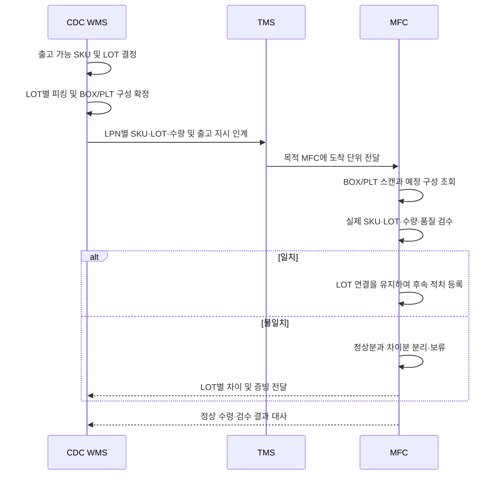

**범례:** CDC WMS=출고 LOT·LPN 구성 확정 / TMS=운송 인계·도착 이벤트 / MFC=실물 검수·자체 LOT별 입고/재고·적치 확정, WMS=CDC 원출발/Transit 대사 / LPN=BOX 또는 PLT 번호 / 점선 화살표=결과 전달 / 분기=정상·불일치 처리. **재고의 실제 증가·감소 확정 시점은 별도 재고 정책에서 정의한다.**

##### 16.10.2 검수 항목 **[권장안]**

| 확인 항목 | 정상 기준 | 불일치 처리 |
|---|---|---|
| 목적 센터 | 지시된 MFC와 일치 | 오배송 조사·보류 |
| LPN | 도착 BOX/PLT와 예정 목록 일치 | 누락/미등록/중복 스캔 분리 |
| SKU | 예정 E/B SKU와 실제 완제품 일치 | 잘못된 SKU로 자동 전환 금지 |
| 제조사 LOT | 실제 라벨과 출고 LOT 기록 일치 | 차이 수량 격리, 근거 확인 |
| 수량 | SKU·LOT별 실제 수령량 확인 | 부족/초과를 별도 사건으로 기록 |
| 소비기한 정보 | 기록 값과 실물 정보 일치 또는 승인된 판정 | 확인 불가 물량 정상 가용화 보류 |
| 품질·온도 | 기준 충족 여부 확인 | 이상 수량 격리·판정 의뢰 |

- 상위 PLT(LPN) 스캔으로 예정 하위 BOX 목록을 열람할 수는 있지만, **전체 LOT·수량 실물 검수가 자동 완료된다고 가정하지 않는다.**
- CDC 출고 LOT과 MFC 도착 LOT이 다르면 단순 바코드 스캔으로 LOT 원본 기록을 자동 덮어쓰지 않는다.
- 한 BOX 중 일부만 LOT 정보가 불명확하면 **확인 가능한 정상분과 미확인분을 구분**하고 조사한다.
- 수령 결과의 중복 이벤트는 고유 사건 ID와 기존 처리 여부로 차단한다. PLT 검수·BOX 검수·SKU 검수를 서로 독립한 세 번의 입고로 처리하지 않는다.

#### 정책 16.11 MFC LOT 추적의 연계 경계

MFC의 검수·적치·고객 피킹·포장·인계 작업은 MFC, 자기센터 LOT/LOC별 수량·예약·출고는 MFC가 담당한다. CDC WMS는 출발 LOT/LPN 구성과 MFC 확정수령 결과를 연결해 추적한다. 고객 주문→실제 출고LOT·수량 관계는 MFC/OMS 계약으로 확인하며 CDC 문서에 고객 피킹 절차·화면·취소/환불을 중복 정의하지 않는다.

#### 정책 16.12 소비기한 및 FEFO 정책과의 관계

본 장은 **LOT을 어떤 기준으로 FEFO 대상에 연결하는가**만 정의한다. 소비기한 일수, 판매 차단 시점, 배송 가능한 잔여기간, FEFO 동률 처리, 예외 승인 권한 등은 **소비기한·FEFO 상세 정책**에서 정한다.

##### 16.12.1 FEFO 입력에 제공할 정보

- 대상 SKU 및 보관 온도, 관리 대상 날짜 유형(소비기한/기타 품질 관련 일자)
- LOT 식별 및 제조사 LOT 원문
- LOT별 소비기한 정보와 검증 여부
- LOT별 센터·LOC·물량·가용/예약/보류 등 상태
- 이미 할당된 수량과 품질·회수 차단 여부

##### 16.12.2 LOT과 FEFO 처리 순서 **[권장안]**

1. SKU와 센터·온도구역의 취급 적합성 확인
2. LOT 식별·날짜 자료의 완전성 및 품질·회수 차단 여부 확인
3. 실제 피킹/출고 가능 재고 수량 확인
4. FEFO 정책에 따라 적합한 LOT 후보 중 순서를 결정
5. 지시된 LOT·실물 LOT 대사 후 실제 출고 LOT 확정

**금지:** LOT ID의 일련번호가 작다고 제조일자나 소비기한이 빠르다고 판단하지 않는다. `LOT-00000001`과 `LOT-00000002`의 크기는 발급 순서일 뿐 FEFO 기준이 아니다.

#### 정책 16.13 품질 이상·회수(Recall)와 LOT 추적

##### 16.13.1 이상 이벤트 분류 **[권장안]**

| 이벤트 | 판단 범위 | 처리 원칙 |
|---|---|---|
| 특정 BOX 파손 | 해당 BOX의 실제 SKU·LOT·수량 | 피해 수량 보류, 나머지와 구분 |
| 온도 이탈 | 영향 받은 시간·위치·LPN 및 실제 재고 | 영향 LOT·수량 식별 후 품질 판단 |
| 소비기한 정보 오류 | 해당 SKU·LOT 또는 기록 구간 | 확인 전 출고 가능 처리 보류 |
| 제조사 LOT 리콜 | 제조사 지정 배치 및 연관 상품 | 모든 관련 센터·이동·출고 경로 확인 |
| LOT 오등록 | 잘못 연결된 재고·BOX·주문 이력 | 영향 범위 추적, 승인된 이력 정정 |

##### 16.13.2 회수·추적의 기본 절차

1. 관제시스템 또는 권한 있는 담당자가 회수 사유·근거와 제조사 LOT·해당 SKU 범위를 접수한다.
2. 내부 LOT ID 및 제조사 원본 LOT을 사용해 적용 대상 배치를 식별한다. 제조사 LOT 번호만 같다는 이유로 다른 제조사 상품을 일괄 포함하지 않는다.
3. CDC/MFC의 **현재 보관 재고**를 SKU·LOT·LOC·LPN·수량별로 조회한다.
4. **이동 중 재고**(출고 인계·운송 중·MFC 검수 대기)를 조회한다.
5. **이미 출고된 재고**와 해당 주문 항목·실제 출고 LOT 이력을 조회한다.
6. 관련 물량의 추가 피킹·출고를 막는 품질·재고 차단 요청을 실행하고, 처리 성공·실패 센터를 대사한다.
7. 실제 격리·회수·폐기·고객 연락·환불 등 후속 조치는 각 권한·상태 정책에 따라 분리하여 진행한다.
8. 영향 범위, 조치 현황, 미확인 물량, 담당자·승인자·시각을 감사 이력으로 남긴다.

##### 16.13.3 양방향 추적 질문

| 추적 방향 | 확인해야 하는 질문 |
|---|---|
| 역방향 추적 | 이 주문에 출고된 실물 SKU·LOT은 무엇이고, 어느 MFC·CDC 출고에서 왔는가? |
| 정방향 추적 | 이 제조 LOT의 물량이 어떤 CDC·MFC·LPN·LOC·주문으로 이동했는가? |
| 이동 중 추적 | 아직 MFC에 도착하지 않은 BOX/PLT 내 해당 LOT은 무엇인가? |
| 수량 대사 | 대상 LOT의 기등록 물량, 현재량, 이동 중, 출고·폐기·조정 이력이 논리적으로 일치하는가? |

**주의:** LOT 회수 대상 등록과 재고 폐기 완료, 고객 환불 완료는 **서로 다른 상태**다. 회수 요청만으로 모든 주문을 환불 완료로 변경하거나 판매·재고 수량을 임의 삭제하지 않는다.

#### 정책 16.14 LOT 정정·분할·병합과 추적성

##### 16.14.1 잘못 등록된 LOT 정정 **[권장안]**

- 제조사 LOT 원문, SKU 연결 또는 소비기한 정보가 잘못된 경우 **정정 요청 → 영향 범위 조사 → 권한 승인 → 새 참조/값 반영 → 이력 보존** 순서로 처리한다.
- 이미 CDC→MFC로 이동했거나 주문으로 출고된 물량은 정정 시 과거 사건까지 추적할 수 있게 전후 연결을 보존한다.
- 식별 변경과 동시에 가용재고 수량을 조정하지 않는다. 실제 수량 차이가 있다면 별도 재고조정 사건으로 처리한다.

##### 16.14.2 LOT별 수량 분할

- 같은 LOT 100개를 두 BOX에 60개/40개로 나누더라도 **제조 LOT 자체가 둘로 생성되는 것은 아니다.**
- LOT의 재고 **보유 위치·포장·상태별 수량**을 분할한다. 품질 문제가 일부에만 발생했으면 해당 일부를 보류하고 나머지 물량에 대한 판정은 별도로 유지한다.

##### 16.14.3 서로 다른 LOT의 병합 제한

- 같은 SKU·같은 소비기한이더라도 제조 LOT이 다른 두 물량을 **하나의 LOT ID로 병합하지 않는다.**
- BOX/PLT 안에 함께 담아 이동할 수는 있으나 각 LOT의 구성 수량은 독립적으로 남긴다.
- 중복 등록한 동일 배치를 식별하는 **기록 통합 정정**은 품질·본사 권한 승인 후 수행하며 실제 제조 배치 통합과 혼동하지 않는다.

#### 정책 16.15 오류·예외 대응 기준

| 예외 | 탐지 시점 | 기본 조치 **[권장안]** | 하지 말아야 할 처리 |
|---|---|---|---|
| 식품 재고 LOT 미기록 | 초기 재고·피킹·검수 | 미확인 분리·자료 조사 | 무조건 출고 허용 |
| 제조사 LOT 라벨 훼손 | 실물 스캔 | LOT 확인·증빙 확보 | 다른 LOT 번호 추정 |
| 지정 LOT과 실제 LOT 불일치 | CDC·MFC 피킹 | 해당 작업 중단·재지시/승인 | 마지막 스캔 결과로 덮어쓰기 |
| CDC 출고 LOT과 MFC 수령 LOT 차이 | MFC 검수 | LOT별 실제 수량 대사·차이 보류 | BOX/PLT 전체 일괄 정상 처리 |
| 소비기한 불명확 | 초기 재고·검수·피킹 | 품질 판정까지 출고 제한 | LOT 코드로 날짜 계산 |
| 다른 LOT이 혼합된 BOX | 포장·검수 | LOT별 구성 확인·혼합 허용 여부 판정 | 합계 수량만 저장 |
| 한 LOT 일부 수량 파손 | 검수·실사 | 손상품 분리·재고 상태 차등 관리 | LOT 전체 수량 자동 폐기 |
| 회수 대상 LOT 출고 요청 | 보충·주문 피킹 | 출고 차단 및 관련 지시 보류 | 승인 없는 강제 출고 |
| 동일 검수 이벤트 재전송 | 수령·검수 | 기존 처리 결과 조회, 멱등 응답 | 중복 재고 증가 |
| LOT ID 중복·재사용 | 등록·정정 | 충돌 탐지·발급 정지·이력 조사 | 과거 LOT을 신규 물량에 재사용 |
| LOT 정정 중 진행 작업 | 이동·피킹·수령 | 영향 범위 재검증·필요한 작업 보류 | 이전 값으로 조용히 확정 |

#### 정책 16.16 시스템별 책임 및 운영 권한

##### 16.16.1 시스템의 역할

| 시스템 | LOT 관련 책임 | 담당하지 않는 영역 |
|---|---|---|
| 관제시스템 | 전역 LOT 식별 정책, 승인 권한, 품질·회수 범위, 감사·추적 조회 | 현장 스캔 없이 실물 수령 자동 확정 |
| CDC WMS | CDC 기등록 재고 LOT 연결·검증, 위치·LPN 관리, 보충 피킹·출고 LOT 실적 | 공급업체 CDC 입고 프로세스(1차 범위 제외) |
| MFC | 자기센터 도착 LOT 검수·적치·피킹·패킹·자체 재고/예약·LOT 상태와 수량 확정 | CDC 원장 직접 수정·근거 없는 제조 LOT 변경·본사 품질 정책 무단 변경 |
| SCM/Replenishment | 보충 수요·이동 지시 정보 연계, 품절·보충 영향 조회 | LOT 실물 스캔·품질 판정의 직접 수행 |
| TMS | BOX/PLT(LPN) 인계·운송·도착 사건 전달 | 재고 LOT 확정·FEFO 선정 |
| OMS | 주문 항목과 실제 출고 SKU·LOT 연계 정보 참조, 사후 회수 영향 확인 | 현장 피킹 LOT의 임의 변경 |
| Commerce | 필요 시 고객 안내·클레임 연계 | 제조 LOT 발급 또는 LOT 수량조정 |

##### 16.16.2 업무 권한 **[권장안]**

| 주체 | 허용 업무 | 제한 업무 |
|---|---|---|
| 관제시스템 상품/품질 담당 | LOT 근거 확인, 전역 품질 기준 검토, 회수 접수 | 물리적 검수 사실 임의 확정 금지 |
| 승인 권한자 | LOT 식별 정정·적격 LOT의 FEFO 순서 예외·품질 차단 해제 승인(권한별 분리) | 자기 승인 가능 여부는 추가 결정 |
| CDC 담당자 | CDC LOT 조회·스캔·작업 결과 등록·오류 접수 | 제조사 LOT 원문 무단 덮어쓰기 |
| MFC 담당자 | 검수·적치·피킹·차이 등록 | CDC 출고 LOT 원본 변경 금지 |
| 시스템 | 번호 고유성·중복 처리·추적 이력·품질 차단 여부 검증 | 근거 없이 소비기한·LOT 임의 추정 금지 |

#### 정책 16.17 구현·감사·검수 기준

##### 16.17.1 이력 및 중복 처리

- LOT 관련 변경·이동·피킹·검수·회수 이벤트마다 **고유 사건 식별자**를 남긴다.
- 출발/도착 센터·LOC·BOX/PLT(LPN), SKU·LOT, 수량·상태, 작업자·시각, 관련 지시와 전후 내역을 연계해 조회할 수 있어야 한다.
- 동일 이벤트가 재전송되면 이전 처리 결과를 확인하여 **한 번만 최종 반영**한다.
- 동일한 재고 수량을 PLT·BOX·SKU 구성에서 **중복 합산하거나 중복 차감·입고 처리하지 않는다.**
- 정정된 LOT의 과거 이동·주문 기록은 삭제하지 않고 원본과 후속 정정 관계를 유지한다.
- 확인 불가 또는 회수 대상 LOT이 진행 중 피킹 지시와 충돌하면 해당 작업의 확정 가능 여부를 재검증한다.

##### 16.17.2 검수 체크리스트

- [ ] 식품 SKU는 정상 운영 물량에 실제 확인된 LOT 연결이 있다.
- [ ] 비식품 SKU의 LOT 적용/미적용 설정을 식별할 수 있다.
- [ ] 내부 LOT ID와 제조사 LOT 원문이 구분돼 저장·표시된다.
- [ ] 같은 제조사 LOT 문자열이라도 제조사·SKU 등이 다르면 무조건 합치지 않는다.
- [ ] LOT 코드에 포함되지 않은 소비기한·제조일자를 별도 자료로 관리한다.
- [ ] 동일 SKU의 서로 다른 LOT은 같은 LOC/BOX/PLT에서도 구분 조회할 수 있다.
- [ ] CDC 피킹 지시 LOT과 실물 LOT이 다른 경우 자동 출고 확정되지 않는다.
- [ ] BOX/PLT(LPN) 구성 변경 시 SKU·LOT·수량·품질 정보와 추적 이력이 보존된다.
- [ ] 물류 BOX 개봉이 `B` SKU의 `E` SKU 변환으로 처리되지 않는다.
- [ ] CDC→MFC 인계·검수 차이를 SKU·LOT별로 조회할 수 있다.
- [ ] MFC의 주문 출고 기록에서 실제 SKU·LOT을 역추적할 수 있다.
- [ ] 회수 대상 LOT의 현재/이동 중/출고 이력을 추적할 수 있다.
- [ ] LOT 식별 정정이 상품 SKU 신규 발급이나 재고 수량 증가를 유발하지 않는다.
- [ ] PLT·BOX·SKU 중복 스캔으로 동일 재고가 이중 반영되지 않는다.
- [ ] 기존 7구간 LOC 표준만 사용한다.

#### 정책 16.18 팀에서 추가로 결정해야 할 항목

> 아래 항목은 **이 문서의 권장안이지 기존 팀 확정 사항이 아니다.** 구현 기준으로 사용하기 전에 결정하고, 관련 정책에도 같은 결과를 반영해야 한다.

| ID | 결정 항목 | 현재 권장 방향 | 교차 점검 대상 |
|---|---|---|---|
| D-01 | 내부 LOT 형식·namespace·센터 간 매핑 | `LOT-8자리`는 예시. 원발급 주체/ID와 제조 배치 계보를 전달하고 MFC 로컬 키 매핑 허용 | WMS·MFC·품질 |
| D-02 | 제조사 LOT 동일성 판정 키 | 제조사·SKU·원본 LOT·증빙 조합 확인 | SKU·관제 |
| D-03 | 제조사 LOT 누락 식품의 처리 | 판매·출고 보류 후 확인·품질 승인 | 품질·재고 |
| D-04 | 비식품 LOT 적용 대상 관리 | SKU별 추적 적용 설정 | SKU·관제 |
| D-05 | E/B의 제조 배치 참조 공유 가능 범위 | 자동 공유 금지, 공급사 근거 시 연계 | SKU·SCM |
| D-06 | 초기 CDC 재고의 LOT 데이터 검증·확정 주체 | 현장 확인 + 권한 승인 | CDC·관제 |
| D-07 | 동일 BOX의 혼합 SKU/LOT 허용 범위 | 추적 가능한 조건에서만 허용 | BOX·PLT(LPN) |
| D-08 | LOT 정정·중복 기록 병합 권한 | 본사 승인, 영향 이력 보존 | 관제·WMS |
| D-09 | 부분 LOT 품질 보류·해제 절차 | LOT별/수량별 범위 분리 | 품질·재고 |
| D-10 | 소비기한 불명확·FEFO 동률의 처리 | FEFO/품질 문서 우선 | FEFO·품질 |
| D-11 | 출고 LOT 실물 확인 수준 | 바코드 스캔/작업자 확인·예외 기록 | CDC·MFC |
| D-12 | LOT 회수 시 작업 차단 전파 범위 | CDC·MFC·운송 중·미출고 주문 함께 조회 | 관제·WMS·OMS |
| D-13 | LOT 회수 시 고객/주문 연계 데이터 범위 | 실제 출고 LOT을 주문 항목에 연결 | OMS·Commerce |
| D-14 | LOT 자료·라벨·정정 이력 보존 기간 | 법적 요건과 프로젝트 정책 확인 후 확정 | 관제·보안 |
| D-15 | LOT 스캔 불가 시 임시 기록·오프라인 처리 | 근거 기반 미확인·재처리, 중복 확정 방지 | CDC·MFC |
| D-16 | 검수 LOT 차이에 따른 재고 확정 시점 | 재고 수량·상태 정책에 위임 | 재고·LPN |

#### 정책 16.19 연계 문서와 충돌 방지 원칙

| 관련 문서 | 이 문서가 제공하는 것 | 해당 문서에 남겨 둘 결정 |
|---|---|---|
| SKU 코드 및 묶음판매 확정정책 | SKU↔LOT 연결, E/B 완제품 배치 추적 | E/B 발급·묶음환산·구매 제한 |
| BOX 및 PLT 물류 취급 단위 운영 정책(LPN 반영) | LPN 구성 안의 SKU·LOT·수량, LOT 추적 | BOX/PLT 발급·라벨·분리·해체·이동 |
| 로케이션 코드 및 적재 위치 운영 정책 | LOT 물량이 현재/과거 놓인 위치 연결 | 7구간 LOC 생성·사용 중지·적재 허용 조건 |
| 재고 수량 및 상태 정책 | LOT별 추적 대상 수량·품질 상태 연계 | 예약·차감·복구·실사 정정·센터 간 전이 |
| 소비기한 및 FEFO 판정 상세 정책 | LOT별 소비기한·상태·출고 후보 제공 | 출고 가능 잔여기간, FEFO 우선순위·차단·예외 |
| CDC→MFC 보충 운영 정책 | 출고·운송·검수의 실제 LOT 추적 | 보충량·우선순위·운송 지시·수령 책임 |
| OMS·Commerce 정책 | 실제 출고 주문 항목과 LOT 연결 및 회수 영향 식별 | 주문·배송·취소·환불·고객 안내 상태 |

**최종 원칙:** LOT은 **상품 종류(SKU)**도, **박스·팔레트(LPN)**도, **보관 위치(LOC)**도 아니다. LOT은 상품의 **제조·생산 배치**를 식별하는 별도 추적 기준이다. 바로픽의 식품 LOT 추적 필수 원칙을 지키되, 재고 수량 처리·FEFO 판정·고객 처리의 세부 업무 책임을 다른 정책과 혼동하지 않는다.

<a id="identifier-wave"></a>

### 부록 5. CDC Wave·Pick Task 실행 계약 — 책임 정리본

> 기존 부록의 MFC 고객 피킹·패킹·고객취소·고객배송 시퀀스와 사례는 삭제했다. 수정 전 원문은 책임정리 백업에 보존한다. MFC 현장 업무는 MFC 문서, 고객 주문은 OMS, 고객 배차/수행은 Delivery가 정의한다. 아래는 CDC 승인 이관의 작업 실행만 다룬다.

#### 정책 17.1 목적·대상·소유권

CDC Wave는 승인 이관의 Pick Task를 실행 가능한 작업 묶음으로 구성한다. Pick Task는 실제 CDC 작업자의 LOC·SKU·LOT·수량·목적LPN 스캔/실적 단위다. Wave는 TRF·차량운행·원출발·MFC수령과 다른 객체다. 완료가 재고출고/실출발/TIN을 의미하지 않는다.

| 주체 | 책임 |
|---|---|
| 공급 승인 주체 | 승인TRF·우선순위·수량·목적MFC·기한 입력. SCM 상세는 SCM-business-logic.md 참조 |
| CDC WMS | CDC 적격재고·예약/작업할당·Wave/Task·현장스캔·실적·원장 |
| CDC 작업자 | 본인 작업 수락·실제 피킹·부족/오류·실물 위치 증빙 |
| TMS | 간선차량·정차·온도구획·운행조건·실출발 사실 |
| MFC | 목적센터 수령 사실·자기센터 TIN. CDC Wave 사용 강제 없음 |

#### 정책 17.2 생성·릴리스·배정

1. 유효 승인TRF·버전·미취소·원행을 확인한다. 승인만 있고 CDC 확보가 안 됐으면 피킹 가능으로 표시하지 않는다.
2. CDC-F-016의 유효 확보와 현재 LOT/LOC·품질·기한·원LPN 구성·실행제한을 확인한다.
3. 목적MFC·온도·작업구역·출발마감·WMS 작업자 여력으로 후보를 편성한다. 필수 안전·FEFO·기존 확보가 동선 효율보다 우선한다.
4. 여러TRF를 묶어도 원행·예약·목적LPN·확정량을 섞지 않는다. 한TRF를 여러Task로 작업하는 것은 여러 실제 출발을 허용한다는 뜻이 아니다.
5. Wave/Task 생성은 같은 원요청/작업키에 한 번이다. 수동/자동배정 모두 최신 버전·작업자 권한·동시점유를 검증한다.
6. 배포한 지시의 변경·교대는 구배정을 무효화하고 실제 확정량·잔량·위치·담당을 인계한다. 만료·응답불명을 새 피킹으로 대체하지 않는다.

#### 정책 17.3 작업지시·스캔

지시서에는 Task·Wave·원TRF/행/버전, 목적MFC·마감, LOC·E/B SKU·LOT·기준단위 수량, 원BOX/PLT와 목적BOX, 취급/품질 제한, 현재 확정/잔량을 분리해 표시한다. LOT·Wave 형식은 미확정 코드 예시를 전역표준으로 승격하지 않는다.

실제 작업은 `현재본인배정 확인→Task 수락→LOC→SKU/실물포장→지정LOT→실수량→목적LPN→라인확정` 순으로 검증한다. 수기/예외는 권한·원사유·실물증빙·승인 필요조건을 검사한다. 다른SKU·E/B대체·LOT무단교체·타MFC BOX혼입·기확정 초과는 차단한다.

CDC 실피킹은 실제 작업자+PDA를 기준으로 한다. 후속 분류·검품·상차/미출발하차는 현재 프로젝트의 가상 설비 결과를 WMS가 검증하는 범위이며 실장비 제어 구현으로 표현하지 않는다.

#### 정책 17.4 수량·부분완료·취소

| 수량 | 의미 |
|---|---|
| 승인량 | 공급승인 입력. 실제 확보/피킹량과 다름 |
| 유효확보 | CDC 재고에 실제 연결한 권리 |
| 작업할당 | 현재 Task에 실행지시한 양. 승인/예약을 새로 더하지 않음 |
| 실피킹 | 실제 확인한 수량. 실물 위치/LPN 추적 |
| 확정부족 | 현장확인·후속처리 대상, 자동손실 아님 |
| 미처리잔량 | 아직 처리하지 않은 지시, 재지시 시 기확정 제외 |
| 취소/정리량 | 승인된 미실행 작업종료·실물복귀와 연결 |

Task/행별 원지시량은 해당 업무에서 정의한 확정완료·확정부족·미처리·취소/정리 범주로 중복 없이 대사한다. 보고수량을 기존 완료량에 다시 더하거나 실피킹을 승인/원예약과 합산하지 않는다. 피킹·검품·상차는 CDC 총현물을 줄이지 않으며 실제 출발 때만 CDC-F-022로 원출고를 확정한다.

부족이면 실제 위치·LPN·SKU/LOT·재계수·차단사유를 기록한다. 대체LOT/위치는 적격성과 원확보를 다시 검사한 새 지시로 연결하고 기확정량을 재피킹하지 않는다. 실사/조정은 별도 승인된 원장 사건이다.

외부승인 변경·취소는 원버전·미출발 여부를 확인한다. 미착수는 안전한 해제, 진행중은 중지확인·실집품 대사·실물복귀, 상차후미출발은 CDC-F-021·026 조건을 따른다. 이미 출발한 사실을 취소해 CDC 재고를 복원하지 않는다. 고객취소/환불 절차는 여기서 정의하지 않는다.

#### 정책 17.5 상태와 완료

Wave/Task의 구체 상태코드는 제안이며 본문 CDC-F-017~019의 현재 계약을 적용한다. 미배포·배포·진행·부분/보류·작업완료·취소/종결을 구분하고, 완료Task를 진행중으로 조용히 되돌리지 않는다. 부족이나 취소가 있는 작업을 전량실피킹 완료로 표시하지 않는다.

Task 종료는 원라인·완료/잔량·실물위치/구성·필요후속을 확인한다. Wave 종료는 모든 소속작업과 미결 의무의 처리상태를 대사한다. 이후 분류·검품·상차·실제출발·MFC TIN은 각각 별도 결과다. MFC 수령에 Wave 코드를 필수 식별자로 강제하지 않는다.

#### 정책 17.6 원사건·중복·복구

스캔/실적은 출처·eventId·원Task/행·expectedVersion·실행ID·실물LPN·실수량·발생/수신시각·담당을 연결한다. 같은키 같은본문은 원결과, 다른본문은 충돌이다. 새키로 같은실행을 보내도 업무상 유일성으로 중복을 차단한다. 확정/원장 결과불명은 조회하고 이미 성공한 실피킹을 반복하지 않는다.

품질차단·소비기한·구역폐쇄·원예약변경 뒤 구지시는 실행하지 않는다. 실제집품은 이미 일어난 사실로 보존하고 필요한 격리/복귀·재할당을 새 지시와 원사건으로 연결한다. 통지 실패는 통지만 복구한다.

#### 정책 17.7 CDC 검수 시나리오

| 조건 | 기대결과 |
|---|---|
| 같은Task 동시수락 | 유효담당1개 |
| 두TRF 같은Wave | 요청/목적LPN·예약·수량 별도 |
| 10개지시·7개실피킹 | 7확정/3잔량 또는 부족·초과/자동손실0 |
| 같은실피킹 중복·새eventId | 동일실행 한 번·CDC총현물 변화0 |
| 피킹후 취소 | 실제집품 보존·실물복귀 확인 전 가용복구0 |
| 상차완료·출발없음 | TOUT/Transit 증가0 |
| Wave완료 | MFC수령/고객배송 자동완료0 |
| 구지시 뒤 최신품질차단 | 신규실행중지·기집품 현위치/보관 추적 |

실제 시험은 미실행이다. 작업 원사건·예약·LPN 구성·후속 분류/검품·실출발을 대조한다.

## 제4부 — CDC WMS 중심 도메인 연계 계약 및 검증 기준

### 26. 공통 계약 기록 방식

모든 계약은 `계약ID·버전·요청/발행 주체·수신 주체·업무 선행 조건·수량/식별자·권한·검증·상태 전이·중복 재전송·응답 유실 복구·대사·테스트`를 갖는다. **이 장에 제시한 API/이벤트 명칭은 설계 제안**이며 URL, 메시지 브로커, 데이터베이스, 주기/타임아웃, 트랜잭션 전파를 확정하는 내용이 아니다.

#### 26.1 공통 메시지 Envelope [제안]

```json
{
  "schemaVersion": "1.0-proposed",
  "eventId": "unique-event-id",
  "eventType": "MFC_RECEIPT_POSTED",
  "sourceSystem": "MFC",
  "targetSystem": "CDC_WMS",
  "correlationId": "correlation-for-one-transfer",
  "idempotencyKey": "stable-per-business-operation",
  "trfId": "transfer-identifier",
  "transferVersion": 3,
  "departureId": "cdc-departure-identifier",
  "receiptId": "mfc-receipt-identifier",
  "postingId": "mfc-tin-commit-identifier",
  "postingVersion": 1,
  "postedAt": "2026-10-20T13:00:01+09:00",
  "sourceCenterId": "CDC01",
  "destinationCenterId": "MFC01",
  "occurredAt": "2026-10-20T13:00:00+09:00",
  "payload": {
    "lines": [
      {
        "transferLineId": "line-1",
        "receiptLineId": "receipt-line-1",
        "departureLineId": "departure-line-1",
        "skuCode": "E-00000001",
        "lotReference": "origin-lot-or-trace-reference",
        "lpnCode": "BOX-example",
        "uom": "EA",
        "receivedQty": 10,
        "acceptedQty": 8,
        "quarantinedQty": 2
      }
    ]
  }
}
```

**예시 값은 구현용 계약 초안이지 확정 바코드·LOT 번호·시스템 계정이 아니다.** `occurredAt`과 `receivedAt`/`postedAt` 등 시각은 별도로 보존하며, 생성된 `eventId`와 원업무 멱등키는 서로 다른 목적이다. 수령 이벤트는 해당 **MFC에서 TIN 원장 반영이 확정된 뒤** 발행되어야 한다. 사실 수령만 확인한 메시지는 별도 이름과 상태를 사용한다.

### 27. CDC WMS에서 반드시 유지할 계약 목록

| 계약 ID(제안) | 연결 | 요청/이벤트 | CDC WMS 판단/결과 | 외부 시스템의 책임 |
|---|---|---|---|---|
| CWC-01 | SCM→CDC WMS | `TransferApproved` | 승인·버전·품목/수량 검증 후 확보 | SCM만 TRF 승인·변경 |
| CWC-02 | CDC WMS→SCM | `AllocationResult` | 확보·부분 부족·거절 수량 통지 | SCM 공급 약속/재계획 결정 |
| CWC-03 | SCM→CDC WMS | `TransferChanged/Cancelled` | 미출발 작업·원예약·실물 정리 | SCM 변경 승인·미출발 잔량 종료 |
| CWC-04 | CDC WMS↔TMS | `TripAssigned/Updated` | 매니페스트·차량·온도·도크 일치 | TMS 차량 배정·운송 계획 |
| CWC-05 | TMS→CDC WMS | `TruckActuallyDeparted` | 증빙·실상차 확인 후 **CDC TOUT 한 번** | TMS 출발 사실 증빙 |
| CWC-06 | CDC WMS→MFC | `TransferShipmentManifest` | TRF·화물·SKU/LOT/BOX/PLT·출발 참조 제공 | MFC 수령 예상 정보 등록 |
| CWC-07 | MFC→CDC WMS | `MfcReceiptPosted` | 기전기 TIN 결과 조회·확인 후 **CDC 미정산 Transit 해소** | MFC 수령·정상/격리 자체 전기 |
| CWC-08 | CDC WMS↔MFC | `ReceiptStatusQuery/Reply` | 응답 유실·중복·버전 변경 대사 | MFC 원수령 동일 결과 반환 |
| CWC-09 | CDC WMS↔MFC | `ReceiptDiscrepancyReported` | 미수령/이종 LOT/LPN/초과 수량 조사 | MFC 원수령·실물 격리·증거 보존 |
| CWC-10 | CDC WMS↔MFC | `TraceabilityQuery/Reply` | 출발 LOT/LPN/수량 계보 제공 | MFC 원수령/로컬 LOT·위치 연결 |
| CWC-11 | CDC WMS→SCM | `Departure/ReceiptReconciliation` | 출발·반영 확인·미정산·손실·잔량 | SCM 기존 공급 중복 계획 방지 |
| CWC-12 | CDC WMS↔통합관제 | `TransferIncidentRaised/Resolved` | 실패·지연·불일치 원사건 제공 | 관제는 조치 조율·감사, 직접 수정 금지 |
| CWC-13 | 공통 상품 정본→CDC WMS/MFC | `ProductVersionPublished` | CDC SKU 버전 검사·출고 영향 확인 | 공통 SKU 정본 발급 서비스 지정 필요 |
| CWC-14 | CDC WMS↔MFC | `StockConditionOrRecallNotified` | CDC LOT 영향 출고 중지·회수 이력 제공 | MFC 자체 LOT 격리·고객 출고 차단 |
| CWC-15 | CDC WMS↔MFC | `TransferAckStatus` | 원출발 수령 응답 추적·재시도 | MFC 자체 입고 결과 복구 조회·중복 방지 |
| CWC-16 | MFC↔OMS | `Reserve/Release/Issue` | CDC WMS 직접 수행 안 함, 계약 경계만 명시 | MFC 자체 예약/출고, OMS 사업 결정 |
| CWC-17 | MFC↔Delivery | `PhysicalHandoverEvidence` | CDC WMS 직접 수행 안 함 | MFC 현장 사실·라이더 수거 증빙 검증 |
| CWC-18 | CDC WMS↔가상 설비 | `JobRequested/WorkResult` | 현장 모의 결과를 검증한 뒤 CDC 위치/작업 원장 반영 | 어댑터 자체 재고 원장 변경 금지 |
| CWC-19 | CDC WMS↔권한·감사 | `ApprovalAndActorContext` | 센터·역할·자기승인/변경이력 검증 | 권한 발급 정책·감사 상호 참조 |

**범위:** CWC-16~17은 **CDC가 구현할 API가 아니라, MFC 내부 업무를 CDC 계약에서 제외하기 위한 책임 경계 표기**이다. CWC-07~09는 서로 다른 CDC/MFC를 연결하기 위한 핵심 신규 계약이다.

#### 27.1 CWC-01·02 — SCM 승인 이관과 CDC 확보

**입력:** `trfId`, `transferVersion`, `sourceCenterId`, `destinationCenterId`, SKU/LOT 허용·수량·기한·우선순위.  **판단:** SCM 승인 유효성, CDC 보관 적격, 경쟁 예약, 품질·LOT·안전량·센터 취급, 중복 원승인 버전.  **성공:** CDC WMS에서 해당 출발 수량을 원 TRF에 예약하고 `allocationId`, `allocatedQty`, `shortQty`, 대기 사유 회신. **실물:** 변화 0.  **실패:** 무효 승인, 다른 버전, 원확보 경합, 수량 부족.  **복구:** 원 TRF/버전·원확보 결과 조회 후 누락 결과만 통지.  **금지:** SCM이 CDC 수량을 직접 예약/삭감하거나 승인 없이 CDC 출고를 실행하지 않음.

#### 27.2 CWC-04·05 — 출발 전 상차와 실제 출발의 분리

**입력:** `trfId`, `departureId`, `loadId`, `tripId`, `lpnCode`, SKU/LOT/수량, `evidenceId`, `occurredAt`.  **판단:** 원 승인/확보·실피킹/검품·상차 실적, 차량·목적지/온도·도크/출발증빙, 이미 TOUT한 출발 사건. **성공:** CDC WMS 단일 거래로 실제 발차분 `CDC -q / CDC_origin_Transit +q`와 불변 수불 기록. **실패:** 상차만 완료, 차량 도착만 확인, 증빙 불명·취소/출발 경합. **복구:** TMS 사실 조회 후 동일 departure ID로 재처리; 다른 이벤트 ID로 추가 출발 금지. **업무 한계:** 같은 TRF의 실물은 하나의 실제 출발 운송편으로 검증한다. 미출발 차량 변경 이력·부분 상차와 기출발 일부 기록 복구의 구체 필드는 합의 대상이며 다차량/다회 출발 허용을 재선택하는 것이 아니다.

#### 27.3 CWC-06 — CDC WMS에서 MFC로 출발 매니페스트 전달

**선행:** CDC 출고 시점에 유효한 TRF, 확정 LPN/LOT/수량/품질/온도와 출발 증빙. **필수 식별:** `shipmentManifestId`, `trfId`, `transferVersion`, `departureId`, `sourceCenterId`, `destinationCenterId`, `lpnCode`, `skuCode`, `lotReference`, `quantity`, `uom`. 기한 관리 대상은 검증된 `expiryDate` 또는 `expiryAt/timezone`을 함께 제공하며 미적용 비식품에 가짜 날짜를 강제하지 않는다. **실행:** 발신자는 출발한 실제 화물 명세를 MFC에 재전송 가능한 형태로 제공한다. 전송 성공/실패는 CDC의 물리 출발을 생성·취소하지 않는다. **수신:** MFC는 예상 입고·원출발 확인 데이터로 사용하며 **매니페스트만으로 현물 수량을 늘리지 않는다.** **오류:** 구버전 매니페스트·LPN 구성 불일치·센터 불일치는 격리·재조회한다.

#### 27.4 CWC-07 — MFC TIN 확정 결과와 CDC WMS Transit 대사

| 구간 | 수행 시스템 | 정상 처리 | 실패 때 금지할 처리 |
|---|---|---|---|
| A. 실물 검수 | MFC | 원출발/화물/LOT·실수령 r, 정상 n, 격리 h 생성 (`n+h=r`) | 수령 스캔=재고 반영 완료라고 간주 |
| B. 수령 전기 | **MFC** | 자체 TIN 트랜잭션에서 MFC 정상+n·격리+h 1회 | CDC DB를 직접 변경하거나 중복 TIN 생성 |
| C. 수령 확정 통보 | MFC→CDC WMS | 기전기 `receiptId`·수량·버전·`postingId`·품질 결과 제공 | 전기 실패·결과 불명을 `Posted`로 통지 |
| D. 결과 대사 | **CDC WMS** | 원출발·이미 확인한 수령 누계와 대조해 미정산 Transit−r 1회 | TIN 미확인에 이동 중 임의 차감·CDC 현물 복원 |
| E. 마감·통지 | CDC WMS→SCM/관제 | 미수령·부족·손실·증빙 불명 분리 | 미결 품질 사건을 자동 정상 처리 |

**성공 조건:** MFC의 `receiptId/postingId`가 성공하고 CDC WMS의 `reconciledReceiptId`에 같은 물량이 한 번 연결됨. **수신 중복:** 동일 원수령 동일 본문은 기존 결과 반환, 다른 본문은 충돌 거절. **응답 유실:** CDC는 같은 `receiptId`로 MFC에 상태 조회; MFC는 추가 재고를 쓰지 않고 기존 `postingId` 반환. **선행 출발 이벤트 순서 역전:** MFC는 수령 실물 격리를 허용할 수 있어도 원출발의 진위·귀속과 MFC 자체 TIN·품질·준비를 확인하기 전 정상 판매 가능을 자동 허용하지 않는다. CDC의 대사 ACK 지연만으로 MFC TIN 성공을 실패로 바꾸지 않는다. **부분 수령:** 원출발 12·첫 수령 10 이후 2가 실물 확인되면 다른 receipt ID와 함께 추가 TIN; 원수령 10을 12로 덮어쓰지 않음.

#### 27.5 CWC-08·09 — 수령 불일치·정정 권한

실물 수령을 취소한 것처럼 기록하거나 CDC 출발 원본을 바꿔 숫자를 맞추지 않는다. 초과·다른 SKU·다른 제조사 LOT·위치/품질 불명 물량은 MFC에서 **적격 판매 재고로 전기하지 말고** 격리·조사 처리한다(정확한 보관·초과 귀속은 확인 필요하며 반송 운송은 현행 범위 밖). MFC에서 이미 처리한 TIN의 수정은 기존 성공 행을 삭제하지 않고 원사건 참조·변경 승인·정정 이벤트로 추적한다. WMS는 CDC 원출발·Transit의 정정 필요를, MFC는 자기 수령·재고의 정정 필요를 각각 판정·승인·반영한다. WMS는 양쪽 확정 결과를 원사건으로 연결해 대사하며 MFC 정정을 대신 결정하지 않는다.

#### 27.6 CWC-10·14 — SKU·LOT·LOC·LPN·Wave의 전달 기준

- SKU 코드는 승인된 E-/B- 전역 식별을 그대로 전달한다. 출발/수령센터별 독립 SKU 재번호는 금지한다.
- LOT의 `manufacturerLot`, `internalLotId`, `expiryDate`, 품질·홀드 상태는 **출발 사실 기준의 출처**와 버전을 구분한다. MFC 로컬 LOT 키를 CDC PK와 같은 것으로 가정하지 않고 승인된 매핑으로 연결한다.
- 화물 LPN은 BOX/PLT 구성이 출발·수령 사이에 변한 근거와 버전이 있을 때만 변경한다. 랙의 CDC LOC는 화물 출발지 참조이고 MFC의 신규 실수령 LOC가 아니다.
- `waveId`는 CDC 작업 묶음의 참조이며 SCM TRF, TMS Trip, 수령번호와 같은 ID가 아니다. MFC 수신에 필수인 화물 식별은 `departureId/manifestId/transferLineId/lpnCode/skuCode/lotReference/qty` 중심이며 Wave는 추적에 필요한 경우만 전달한다.

### 28. 도메인 간 상태·버전·재처리 공통 약속

| 상태 축 | CDC WMS | MFC | 계약에서 지켜야 할 관계 |
|---|---|---|---|
| 출고 | ALLOCATED → PICKED → LOADED → **DEPARTED/TOUT_POSTED** | EXPECTED | CDC 사전 작업에서는 현물 미차감 |
| 운송 | TRANSIT_OPEN → (RECEIPT_POSTED_AWAITING_ACK) → TRANSIT_RECONCILED | EXPECTED → RECEIVING → **TIN_POSTED** | 분산 처리 중 상태를 한 값으로 합치지 않음 |
| 품질 | CDC 출발 품질·LOT/온도·회수 제한 | 실수령 정상/격리, MFC 판매 준비 | 도착 또는 수량 대사만으로 판매 가능 확정 금지 |
| 예외 | OUTBOUND_DISCREPANCY/RECONCILIATION_PENDING | RECEIPT_CONFLICT/RECONCILIATION_PENDING | 한쪽 오류를 성공으로 덮지 않음 |
| 행정 | SCM 승인·출발 잔량/사고 종결 추적 | 로컬 수령/품질 사건 종결 | 수량 대사 완료 ≠ 품질/사고 종결 |

상기 영문 상태는 **문서상 제안 식별자**다. 실제 enum·동기 API/메시지·SLA·타임아웃/재시도·데이터 보관기간은 팀 계약 전 확정하지 않는다. 장애 시 출발/수령 원본을 유지하고, 멱등성·Outbox/Inbox·재처리 큐·대사 작업을 선택적으로 설계해야 한다. **CDC WMS가 MFC의 원장 트랜잭션에 참여해 원자 커밋한다고 가정하지 않는다.**

### 29. CDC WMS 중심 수용 검증 — 제안, 미실행

| 테스트 | 입력·선행 상황 | 기대 결과 |
|---|---|---|
| CDC-V7-01 | 승인 전 피킹 지시 | 업무 차단·현물 무변경 |
| CDC-V7-02 | SCM 승인 12, CDC 적격 10 | 확보10·부족2, 현물 총량 변화0 |
| CDC-V7-03 | 두 이관이 마지막 5를 동시 예약 | 과예약 금지·예약 버전 경합 처리 |
| CDC-V7-04 | Wave 종료·상차 완료, 출발 증거 없음 | CDC 현물 차감0·Transit0 |
| CDC-V7-05 | TMS 실제 출발 12, 이벤트 3번 반복 | CDC-12/Transit+12 단 1회 |
| CDC-V7-06 | 출발 응답 분실 후 재시도 | 원 departure ID 조회 후 결과 재전달, 이중 출발 없음 |
| CDC-V7-07 | 출발 매니페스트 재전달 | MFC 입고 예고 중복 생성 없음 |
| CDC-V7-08 | 실수령 10(정상8/격리2), MFC TIN 성공 | MFC +10, CDC WMS 응답 수신 전 Transit 임시12 가능 |
| CDC-V7-09 | MFC TIN 성공, CDC 통지 유실 | MFC 재입고 없이 CDC 조회/대사 후 Transit 2 |
| CDC-V7-10 | 10개 수령 통지 2회 | CDC 이동 중 해소 1회, MFC 입고도 1회 |
| CDC-V7-11 | MFC 실물 10 스캔, MFC TIN 실패 | CDC 미정산 유지·MFC 가용 사전 가산 금지 |
| CDC-V7-12 | 출발12, 수령10, 이후 추가2 수령 | 별도 receipt ID 2, 최종 Transit0 |
| CDC-V7-13 | 출발 SKU A, MFC 수령 SKU B | 격리·원사건 조사, 출발 SKU/LOT 임의 변경 금지 |
| CDC-V7-14 | 상위 PLT와 하위 BOX가 같은 40개 | 40 1회 계상, PLT+BOX 이중 가산 금지 |
| CDC-V7-15 | MFC LOC 코드가 CDC LOC와 우연히 같음 | 센터 맥락 구분, 목적지 위치로 자동 복사 금지 |
| CDC-V7-16 | LOC 차단 중 새 적치 요청 | 후보 제외, 이미 있는 실물은 보존 |
| CDC-V7-17 | 부분 피킹 후 작업자 변경 | 기피킹 원실적 보존·미완료량만 재지시 |
| CDC-V7-18 | 오래된 LOT/FEFO 버전으로 피킹 시도 | 현 유효 기한·품질 재검증 |
| CDC-V7-19 | 작업 지시 중복으로 LPN 재발급 시도 | 원 구성·발급 ID 조회, 중복 실물/라벨 차단 |
| CDC-V7-20 | 서로 다른 센터가 공통 E SKU를 조회 | 동일 SKU, 서로 다른 센터 수량 정본 |
| CDC-V7-21 | MFC 재고 조회 불능으로 SCM 재계획 | 스냅샷 기준시각·불명 표시, MFC 재고0 확정 금지 |
| CDC-V7-22 | 실제 출발 후 SCM 취소 통보 | 출발 사실 유지, 승인된 별도 사건 검토; CDC 자동 재고 복원 금지 |
| CDC-V7-23 | 미수령2 조사 후 승인 손실 | CDC 이동 중 미정산2 중 승인 손실분만 감소·MFC 미기전기 유지 |
| CDC-V7-24 | CDC 출발 후 MFC 도착·정상 검수 실패 | MFC 격리 및 출발 계보 유지, 판매 가용0 |
| CDC-V7-25 | MFC 장애 후 재개 | 원수령 상태 조회·중복 이벤트 순서 역전 안전 복구 |
| CDC-V7-26 | 통합 합산 조회 중 MFC TIN 후 CDC 미수령 대사 전 | 같은 receipt ID 이중 집계 금지·미정산 상태 표출 |
| CDC-V7-27 | CDC WMS와 MFC의 연계 스키마 버전 다름 | 지원 버전 협상·인수 거절, 원사건 유실 없음 |
| CDC-V7-28 | MFC 고객 주문→CDC 출고 지시 | 승인된 SCM TRF가 없으면 CDC 출고 불가 |
| CDC-V7-29 | CDC 출고 품질 사고가 MFC 수령 뒤 확인 | 원출발 LOT 참조로 MFC에 제한 전달·로컬 원장에 별도 적용 |
| CDC-V7-30 | 출발수량/수령수량/손실 합계 오차 | 출발 행별 자동 종결 금지, 관제 사고·담당 확인 |

### 30. 미결정 및 팀 공동 합의 대장

| ID·우선순위 | 결정이 필요한 질문 | 책임·영향 도메인 | 합의 전 안전 기준 |
|---|---|---|---|
| SEP-01 P0 | 기존 MFC의 센터별 권한·원장 격리·장애복구 방식은? | MFC/인프라 | 별도 MFC용 WMS를 추가하지 않으며 MFC가 자기센터 재고를 소유 |
| SEP-02 P0 | CDC Transit은 WMS 정본으로 유지하면서 수령 결과 검증·대사 성공 증거를 어떤 필드/버전으로 연결하는가? | CDC WMS/MFC/SCM | CDC-origin 미정산 장부는 WMS가 소유한다. 합의 대상은 MFC 기전기 결과의 증거·검증·대사 응답 계약 |
| SEP-03 P0 | MFC TIN 원장 성공 시점과 CDC에게 전달할 권위 `receiptId/postingId/version`은? | MFC | 불명 시 현물 안전 보관·대사 대기, 성공 추정 금지 |
| SEP-04 P0 | CDC→MFC 출발 매니페스트를 누가 언제 전달하며 도착보다 늦을 때 처리하는가? | CDC WMS/MFC/TMS | 원출발 확인 전 MFC 정상 가용화 금지 |
| SEP-05 P0 | 공통 SKU E-/B-의 실제 정본 서비스·발급·승인·배포 방식은? | WMS·상품·Commerce·OMS | 동일 글로벌 SKU 유지, MFC 개별 재발급 금지 |
| SEP-06 P0 | WMS·MFC 연계의 동일 출발건 부분 수령, 초과/오배송·LOT 정정 승인 책임은? | CDC WMS/MFC/SCM/관제 | 중복 입고·과잉 출발·임의 귀속 금지 |
| SEP-07 P0 | 1요청·1이관·1출발을 유지하면서 차량 변경 이력·부분 상차·단일 실제 운송편을 어떻게 검증하는가? | SCM/TMS/CDC WMS | 기존 1회 출발 제약 임의 확대 금지 |
| SEP-08 P0 | 총합 재고 조회 시 TIN 기전기·CDC 통지 미수신의 이중 계상은 누가 제거하는가? | 관제/SCM/WMS·MFC | 이관 수령 ID로 집계 조정, 상태 불명 표시 |
| SEP-09 P1 | CDC/MFC LOT 로컬 ID와 제조사 LOT 공통 참조 규격? | CDC WMS/MFC/품질 | 제조 LOT 원문·SKU·기한/품질 함께 대사 |
| SEP-10 P1 | BOX-/PLT- LPN 번호의 센터 간 유일성·분할·라벨 재출력 방식? | CDC WMS/MFC/TMS | 원출발 LPN 계보 유지, 빈 자산번호와 분리 |
| SEP-11 P1 | CDC·MFC 7구간 LOC의 비랙 코드, 마스터 등록·이력 공유 범위? | WMS·MFC/현장 | 센터별 마스터 독립·실물 위치 추정 금지 |
| SEP-12 P1 | CDC Wave/Task·MFC Wave의 코드/상태 분리, 외부 전송 필요 필드? | WMS·MFC | Wave를 출발/수령 정본키로 사용하지 않음 |
| SEP-13 P1 | CDC 적치·분류·상차 가상 설비 어댑터 채택 여부 및 실제 피킹 배정 방식? | CDC WMS/운영 | 승인 전 설계안·테스트용으로 유지 |
| SEP-14 P1 | 메시지 브로커 또는 동기 API, Outbox/Inbox, 재시도/보관기간, 허용 지연? | WMS·MFC/TMS/인프라 | 멱등 ID·기전기 조회·결과 기반 복구를 요구 |
| SEP-15 P1 | CDC/MFC 온도·품질 보류와 재판매/폐기 권한·증거가 누구에게 귀속되는가? | 품질/CDC WMS/MFC | 근거 불명 현물 적격가용 금지 |
| SEP-16 P1 | 공통 권한·센터별 접근 분리, 자기승인, 실사 정정의 승인 단위? | 관리자/WMS·MFC | 각각 자기센터 권한 검증, 교차 원장 쓰기 금지 |
| SEP-17 P1 | 실제 CDC 시설 수치·SKU 수·용량 등 원문의 확정 근거를 1차 MVP에 그대로 적용할지? | CDC 운영/팀 | 원문 수치와 현물/실제 시설 성능 검증을 구분 |
| SEP-18 P1 | CDC의 35개 기능 ID를 `CDC-F`로 신규 관리할지 과거 `DC-F` 별칭을 유지할지? | CDC WMS/문서 담당 | 이 문서는 CDC-F로 표기, 레거시 DC-F 동일 기능으로 매핑 |
| SEP-19 P0 | 동일 미수령 잔량의 MFC 수령과 WMS 운송손실 확정을 어떻게 조정하는가? | WMS·MFC·TMS·재고 승인자 | MFC TIN/처리 중/불명/미통지 확인과 대상 범위 조정 계약 전 손실 자동확정·Transit 종결 보류. 실제 수령 사실·안전 보관은 유지 |

### 31. 이전 기준과의 충돌·범위 제외 대장

| 기존 V6.6/CDC 원문 표현 | 이번 기준 | 처리 성격 |
|---|---|---|
| 하나의 WMS W-04가 CDC·MFC·Transit 원장을 최종 직접 기록 | CDC WMS는 CDC·자기 원출발, MFC는 해당 MFC 수량/예약 기록 | **기존 MFC에 현장·자체 재고 책임 통합** |
| MFC만 실수령하고 WMS 한 곳에서 TIN·Transit 동시에 처리 | MFC **자체 TIN**→CDC WMS **Transit 대사** | 분산 사건 상태·조회 계약 필수 |
| OMS 주문의 MFC 예약도 CDC W-07 수행 | MFC가 자체 예약 원장 변경 | CDC 직접 구현 대상에서 제외 |
| MFC 고객 주문 Wave·작업·인계의 상세 구현이 CDC WMS에 포함 | MFC 영역으로 분리 | 업무 소유권 경계 명시 |
| LOC·LPN·SKU·LOT·Wave를 동일 DB 키로 가정할 수 있음 | 각 정본 및 namespace 확인, 전역 SKU·출발 계보만 공유 | 데이터 계약 보강 |
| `CDC -q / Transit +q`와 `Transit -r / MFC +r`가 모두 동일 DB 트랜잭션 | CDC TOUT, MFC TIN, CDC Transit 해소가 개별 트랜잭션 | 분산 실패·중복·대사 설계 필요 |
| 원문 CDC-F 35개 기능 ID | CDC 재고·작업 기능과 연계 ID를 유지하되 CDC-F-014·015의 SCM 내부계산/공급사업승인 상세는 삭제·계약화 | 2026-10-20 사용자 책임정리 지시. 수정 전 원문은 백업 보존 |
| 실제 자동화 설비 제어 포함처럼 읽힐 수 있음 | CDC 원문의 가상 설비 결과 검증(실장비 제어 제외) 유지 | MVP 제외범위 보존 |

### 32. 후속 소유권·계약 검증 방법

1. CDC WMS 담당과 MFC 담당이 **CWC-06~10, SEP-01~08**에 우선 합의한다. 이 단계에서는 두 시스템이 각자 관리하는 원장 수량과 수령 성공 증거를 확정한다.
2. SCM·TMS 담당과 승인 TRF·실제 출발·부분 수령·Trip 관계를 교차 검토한다.
3. MFC·OMS·Delivery 담당이 MFC 자체 예약/피킹/실인계 출고 계약을 검토한다. **CDC 문서가 그 업무의 계약 상대에게 책임을 강제하지 않는다.**
4. 공통 SKU/LOT/LPN/LOC의 식별자 발급 범위, 버전·재발급·불변 이력 규칙을 승인한다.
5. 위 30개 시험은 시나리오와 기대 결과 제안이며 구현 완료/테스트 통과가 아니다. 합의 후 계약 버전·코드·테스트 결과와 함께 재검증한다.

## 제5부 — 책임 정리·정합성 검수

### 35. 삭제/수정한 내용과 이유

| 대상 | 재작성 처리 |
|---|---|
| 상품카테고리/노출·가격/쿠폰·고객구매10개 제한·판매옵션 | WMS 내부업무에서 삭제. SKU실물/단위/스캔 계약만 유지 |
| 시설면적·랙/통로/하중·소방/도크/일차량 상세숫자 | WMS가 설계/인증한 확정값처럼 사용하지 않음. 실제승인마스터를 입력받는 실행검증으로 교체 |
| SCM H/C/I/F/SS·추천/배분/사업승인·추가공급 산식 | WMS 기능에서 제거. SCM 원승인/실적 계약만 유지 |
| 고정회차·배차/ETA·운송사고의 운행의사결정 | TMS 정본. WMS는 자기화물/원출발/미정산 영향만 처리 |
| MFC 작업자/고객피킹·포장UI·현장업무절차 | 기존 MFC가 현장 실행과 자체 재고 확정을 함께 담당 |
| 예정재고 고객예약·FUTURE/Rf 전환 허용 | 현재현물만예약하는 최신 OMS/SCM/Commerce와 충돌하므로 현행명세에서 제거 |
| MFC의 A=E−R만 고정·안전보호 미적용 | 승인안전보호/실행버전 적용과 중복차감방지를 함께 명시 |
| MFC TIN과 CDC Transit을 한원자거래/같은쓰기주체로 처리 | WMS·MFC 각각의 거래·기전기결과확인·미ACK 복구로 통일 |
| 10/50행·10/100만원·3영업일 등의 자동승인/상신 고정 | 현재센터별 승인된 정책입력으로 분리. 미설정자동승인/대체승인선 생성 금지 |

CDC-F-001~035의 상세한 작업·부분결과·실패/불명·수량/상태·완료조건과 LOC/LPN/LOT 추적 상세는 남겼다. 같은 규칙을 다른부록에서 반대로 정의하지 않으며 고객/공급/운송의 내부정책은 참조만 한다. 프로젝트 고유 기한프로필은 품질승인/버전이 연결돼야 하며 실제법규·상품표시보다 우월한 일반규칙으로 소개하지 않는다.

### 36. 추가 수용 시나리오 — 제안·미실행

아래 모든 수량사례의 S_protect=0은 시험값이며 운영미설정의 기본값이 아니다.

| ID | 입력·동작 | 기대 결과 |
|---|---|---|
| W8-01 | 같은위치 허용100/점유70/타예약20, 신규20 | 용량부족·현물증감0 |
| W8-02 | 같은위치 허용100/점유70/타예약20, 두작업 각10 동시확정 | 한도내하나만성공·중복점유0 |
| W8-03 | E/B에 같은8자리번호 별도발급 또는 E6/B1 치환 | 승인식별계약충돌·잔고병합0 |
| W8-07 | 동일출발12·TIN10=정상8/격리2 | MFC+10·CDC대사후Transit2·정상준비별도 |
| W8-08 | TIN성공/CDC통지유실 | 원수령결과반환·MFC추가입고0 |
| W8-09 | 남은미수령2 새실수령 | 새원실행/TIN2·기존10재반영0 |
| W8-10 | 실제14도착/원출발12 | 초과2실물/책임보존·자동귀속/출발증액0 |
| W8-21 | CDC 위치 장부5/실물4·원MOV1 미반영 | 원MOV 복구·양측 위치 대사·추가ADJ−1없음 |
| W8-22 | 조정−5승인/−3반영/다음응답불명 | 원조회후확인된잔량−2만·새−5금지 |
| W8-23 | 실제이동후WMS응답유실 | 원실행조회·실물재이동0 |
| W8-24 | 사업승인·TMS운송완료만수신 | MFC TIN/정상가용합성0 |
| W8-25 | H/R/Transit조회시각불일치 | 원수령중복제거 또는총계확정대기 |
| W8-26 | 수량조정승인선·평가근거미설정 | 집행보류·임의0원/대체승인선없음 |
| W8-27 | MFC TIN10 성공/CDC Transit12·ACK 지연 | MFC 현물+10은 유지, CDC 대사 후Transit2. ACK 지연만으로 MFC TIN 실패로 표시하지 않음 |
| W8-28 | CDC 정상10 중2 품질 격리 | 정상8/격리2·CDC 총량10, 상태별 대사에는 전환 유출/유입 반영 |
| W8-29 | 출발12·MFC 정상8/격리2·대사후미정산2 | 12=10+0+2. 출고 예정량이나 차이 신고량을 추가 합산하지 않음 |
| W8-30 | MFC TIN 결과불명과 동일잔량 손실 승인 경합 | 손실 자동확정/종결 보류·양측 원결과/조정근거 확인. 로컬 잔량만으로 성공 보장 금지 |
| W8-31 | CDC/MFC의 동일 제조배치 로컬LOT키가 다름 | 원발급 namespace·원LOT·제조사/SKU 근거로 매핑, MFC PK 강제 일치0 |
| W8-32 | 적치 FAILED/취소 표시·원시도 수행불명 | 출발 점유·목적지 용량 유지·원시도 조회, 표시만으로 예약해제0 |
| W8-33 | 정상적격E3·연결예약R4 | 정합성 보류·원예약/품질 조사. max결과0을 정상가용으로 표시하지 않음 |
| W8-34 | 회수/LOT미확인/기한미달 후보 | 출고 후보에서 제외·일반 승인 우회0 |
| W8-35 | 같은receipt의 A행 대사 성공/B행 저장불명 | A행 기반영 유지·B행 원결과만 조회/복구·전체 수령 성공 합성0 |
| W8-36 | 출발12·확인수령10·Transit2, MFC 승인정정 후 수령8 | δr−2·Transit4, 같은 정정 재전달 추가변화0·실제 반송 생성0 |
| W8-37 | 원수령10=정상8/격리2, 후속 품질해제 정상10 | 수령누계10·Transit 불변·후속 품질변화를 새TIN으로 계상0 |

기존 제4부의 CDC 수용시나리오와 함께 적용한다. 실제코드/DB·설비·단말·현장·분산계약 시험은 아직 수행하지 않았다. 문서검수는 함수입출력·불변식·사례산술·책임/참조의 대조이며 구현완료를 뜻하지 않는다.

### 37. 현재 정본과 참조 관계

이 파일은 CDC의 재고·창고실행·출고와 원출발 Transit 대사의 정본이다. MFC 재고관리(원문 미보관)는 MFC 자체 재고·예약·입고·품질·인계의 정본이며 MFC 작업관리(원문 미보관)와 하나의 MFC 영역을 이룬다. [OMS](OMS-business-logic.md)는 주문 판단, [SCM](SCM-business-logic.md)은 공급 판단, [TMS](TMS-business-logic.md)는 간선 운송, [Delivery](Delivery-business-logic.md)는 고객 배송을 소유한다. 공통 책임(원문 미보관)을 함께 적용한다.

기존 인포그래픽·원본복사본은 제작 당시 스냅샷이며 v8.1 문서 수정으로 자동 갱신되지 않았다. 이번 재검토의 수정 전 원문·수정 후 사본·발견 사항·검수 결과는 WMS 재검토 기록(원문 미보관)에 둔다. 수정전 상세와 변경/검수 기록은 WMS_재작성_20261020 폴더에 보존한다.
